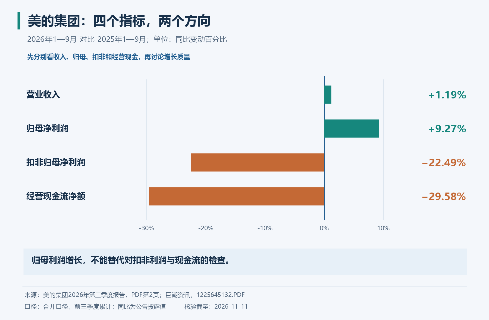
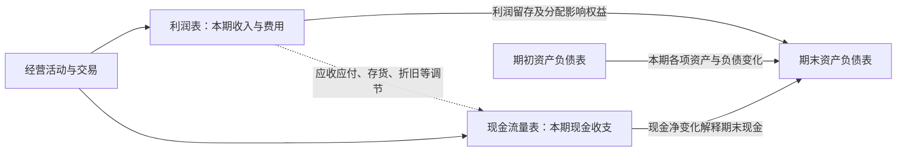
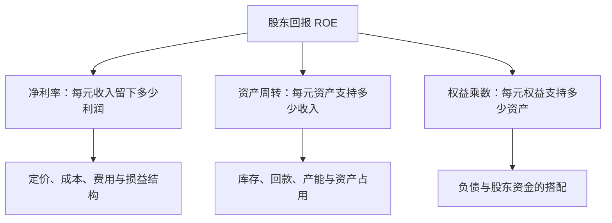

# 《一本书读懂财报》读书笔记

> 作者：肖星  
> 出版社：浙江大学出版社；作者主页列有 2014 年初版、2019 年第二版。本笔记以公开可核对的 2022 年第三版目录作为主题索引，不对应某次印刷的页码。  
> 分析依据：公开书目与目录、作者及高校资料、会计准则和财务教育的一手资料，另用美的集团 2026 年三季报及伯克希尔 1985 年股东信核验书外案例；未取得用户所持版本的完整原书。  
> 覆盖范围：按全书主要主题整理 35 个知识点，在关键小节结合真实公告与历史事件，另配计算演示、图解和练习；属于公开资料支持的系统导读，不是逐页精读记录。原书具体企业案例与版本差异未逐一复核；标为“书外”的真实案例已另据一手资料核验。  
> 更新日期：2026-11-11

书名、作者和版本分别核对了[清华大学作者主页](https://www.sem.tsinghua.edu.cn/info/1205/32025.htm)、[对外经济贸易大学图书馆书目](https://opac.uibe.edu.cn/opac/book/3d543fc78e2c850406c5a1cca06efe33)与[得到电子书目录](https://www.dedao.cn/ebook/detail?id=A1De6QkaNRMlK5yxrdmnEBXY97ZL23nRlM3o6zvGDekj1QgA84VbpqJOPLgxEJlY)。以下“原书对应主题”只说明主题在目录中出现；具体解释、图示与数值例子为本笔记的教学重组，不是作者原话。第 33—35 点明确属于延伸阅读。

## 先看这里：这本书最值得学什么

**一句话概括：把财报里的数字翻译成企业正在做的生意，再判断它赚得怎么样、钱够不够、风险在哪里。**

你不必先成为会计，但要掌握三种观察角度：

| 你关心的问题 | 先看哪张表 | 还要追问什么 |
| --- | --- | --- |
| 公司现在拥有什么、欠谁的钱？ | 资产负债表 | 这些资产能否收回、产生收益？债务何时到期？ |
| 这一段时间做生意赚了多少？ | 利润表 | 利润来自主营业务，还是偶然交易？为此用了多少资本？ |
| 钱实际怎么进来、怎么出去？ | 现金流量表 | 靠客户付款、变卖资产，还是借钱维持？ |

最重要的七个结论：

1. **资产、收入、利润、现金是四种不同的东西。** 大公司可能不赚钱，赚钱的公司也可能没钱付款。
2. **三张表描述同一家公司。** 一笔交易经常同时改变两张甚至三张表，不能孤立阅读。
3. **绝对金额回答“有多少”，比率回答“效率怎样”。** 赚 100 万是否优秀，要看投入了 500 万还是 5000 万。
4. **比率必须放回行业和战略里解释。** 高毛利和高周转可以代表不同的竞争路线，没有统一的漂亮数字。
5. **经营利润要与资本成本比较。** 股东提供的钱也有机会成本；账面盈利不一定创造经济价值。
6. **现金流要看来源和用途。** 投资现金净流出可能是扩产，现金净增加也可能只是借了更多钱。
7. **读懂财报是理解企业的起点。** 它不能自动解决未来预测、管理层诚信和股票买入价格的问题。

读完这份笔记，你应当能做三件事：解释一笔业务怎样进入三张表；用几个关键指标定位经营问题；把“这家公司看起来不错”改写成有证据、有条件的判断。

## 全书思路与本笔记覆盖地图

下面按公开目录的主题归并，不复制全部小标题，也不把本笔记编号冒充原书章号。

| 原书对应主题 | 要回答的问题 | 本笔记对应内容 |
| --- | --- | --- |
| 会计与企业活动 | 企业活动怎样被记录？ | 1—3 |
| 资产负债表 | 资源从哪来、放在哪里？ | 4—12 |
| 利润表 | 收入怎样变成利润？ | 13—15 |
| 报表的形成逻辑 | 成本、销售、研发怎样影响报表？ | 16—19、贯通算例 |
| 现金流量表 | 现金为什么不同于利润？ | 20—23 |
| 综合使用三张表 | 怎样比较盈利、营运和偿债能力？ | 24—29 |
| 财务数据背后的经营因素 | 行业、战略、执行如何留下痕迹？ | 31—32 |
| 判断好公司与资本回报 | 账面赚钱是否等于创造价值？ | 30、杜邦图解 |
| 对照企业案例、控制风险 | 怎样把指标串起来判断问题？ | 22、32、分析练习 |
| 决策应用 | 如何把分析变成可以验证的判断？ | 实践流程；33—35 为延伸 |

本书的学习顺序很有价值：**先认表里的项目，再看交易如何生成报表，然后算指标，最后用经营逻辑解释指标。** 如果直接跳到“哪几个比率能选牛股”，很容易记住公式却读错企业。

## 核心知识点：先把三张表读通

### 1. 企业活动可以从经营、投资、融资三个方向理解

经营是销售产品或服务、采购、生产、发工资等持续活动；投资是在设备、业务或其他资产上配置资金；融资是从股东、债权人处取得或归还资金。这是读企业的起点，不等于每笔业务的现金流分类都可凭字面判断。

**边界：** 银行发放贷款本身属于业务活动，不能把制造企业的分类直搬给金融企业。

### 2. 资产负债表看时点，利润表和现金流量表看期间

“12 月 31 日有多少应收款”是存量；“全年赚了多少利润”是流量。存量像水箱内的水，流量像某段时间的流入流出。拿 12 月末资产去解释全年收入时，要注意中间是否发生了大额增资或扩张。

### 3. 资产＝负债＋所有者权益，是理解交易的底座

资产是企业控制的资源；负债是要承担的现时义务；权益是扣除负债后的股东剩余权益。等式两边必须相等，它不是说“资产全部是现金”，也不是说“权益是银行里另存的一笔钱”。

**补充例子：** 股东投入 60 万，银行借款 40 万，公司现金为 100 万。花 70 万买设备后，资产变成现金 30 万加设备 70 万，负债 40 万、权益 60 万保持不变。企业只是换了资产形态，并没有因购买设备立即亏损 70 万。

这一等式还能帮助识别交易：借款增加资产和负债；股东出资增加资产和权益；确认亏损会减少权益。[财政部《企业会计准则——基本准则》](https://www.mof.gov.cn/zcsjtsgb/gztsgb/201407/t20140723_3578373.htm)提供了六大会计要素的定义。

### 4. 流动资产不等于随时可花的钱

现金、应收款、存货、预付款都可能属于流动资产，但变成可用现金的速度和可靠性不同。分类通常考虑正常营业周期及一年等条件，不能只背“一年以内”。

### 5. 应收款、预付款、合同负债，反映交易中的先后手

应收款通常意味着已经形成收款权利，但钱尚未到账；预付款意味着先给供应商钱，等待商品或服务；合同负债通常意味着先收到客户对价，还欠客户履约。

收到客户的钱，并不一定已经完成履约；允许客户延期付款，则意味着一部分经营资金由企业垫付。第 13 点将用美的实际合同资产说明履约、收款权和现金之间的区别。

**分析重点：** 先付款还是后付款，能体现议价能力，也可能只是行业惯例；应收款增长快要看账龄、客户集中度和减值，不能一见增长便断言造假。

### 6. 存货是尚未转成销售成本的投入

原材料、在产品、产成品都可能是存货。为使产品达到可销售状态而发生的合理采购和加工成本，先积累在资产中；销售实现时，已售部分才结转为成本。

**补充例子：** 买入 100 件商品，每件成本 20 元，卖出 60 件。忽略其他变化，营业成本为 1200 元，剩余存货为 800 元；采购付款 2000 元不是当期全部成本。

存货还要关注滞销、过时和跌价。账面成本 800 元的商品，如果预计卖出扣除相关支出只能收回 500 元，就不能继续用原价粉饰资产。相关确认与计量原则见[财政部存货准则](https://www.mof.gov.cn/zhengwuxinxi/zhengcefabu/2006zcfb/200805/t20080519_23107.htm)。

### 7. 折旧是成本分配，不是当期另付一笔现金

长期使用的设备，通常先确认为资产，再按其消耗方式分期计入产品成本或当期费用。直线法的简化公式为：

```text
年折旧额＝（原价－预计净残值）÷预计使用年限
```

**补充例子：** 设备 60 万，预计使用 5 年、残值为零，完整年度折旧为 12 万。买设备时现金流出 60 万；以后计提折旧时，不会再付 12 万。实际折旧还涉及启用月份、用途和减值等。

**容易误解：** 折旧不一定直接全进当期利润表，生产设备折旧可以先进入存货成本；已折旧完的机器也可能仍然有用。制度依据见[财政部固定资产准则](https://www.mof.gov.cn/zhengwuxinxi/zhengcefabu/2006zcfb/200805/t20080519_23104.htm)。

### 8. 无形资产、研发投入和“有价值的东西”不是同一集合

专利等符合确认条件的资源可以列为无形资产；员工能力、团队默契和自行积累的品牌价值，未必能按管理者心中的价格入账。所以，账面没有列出的优势不等于不存在。

研究和开发也不是“花钱就能资本化”：研究阶段通常费用化，开发阶段满足规定条件时才可能确认为资产。**资本化**就是先进入资产，后续再摊销或减值；不是凭空创造现金。

比较研发时，应同时看费用化金额、资本化金额、确认条件和项目进展，不能只看利润表的研发费用。这里用的是通行会计解释，可对照 [IAS 38 对内部研发阶段的说明](https://www.ifrs.org/content/dam/ifrs/publications/pdf-standards/english/2021/issued/part-a/ias-38-intangible-assets.pdf?bypass=on)，实际处理以企业适用准则为准。

### 9. 账面价值、市场价格、企业价值不是一回事

历史成本有可核对的交易基础，但不会把所有资源持续改写成今天的售价。不同资产可能使用不同计量方法，因此资产合计并不是“一口气卖掉公司能收多少钱”。

阅读时应把“多少金额”与“什么计量口径”一起看；也不能反过来把所有低账面价值资产都当作隐藏宝藏，低价值可能源于低效和老化。

### 10. 资产质量，比资产总额更值得追问

资产最终要通过收款、使用或出售兑现价值。应收款收不回来、设备闲置、库存卖不动，都会让账面资产失去原本的支撑。减值反映这种变化，但金额通常涉及估计。

**书外真实例子：** 美的 2026 年前三季度资产减值损失约 18.82 亿元，上年同期约 5.61 亿元；公司解释主要是商誉减值损失增加。这个项目提醒读者，过去并购形成的账面价值也需要后续盈利支持。但“资产减值损失总额”不能全部直接写成商誉减值金额，应继续查明细。[三季报第 4、8 页](https://static.cninfo.com.cn/finalpage/2026-10-30/1225645132.PDF)

**核查办法：** 看账龄、减值政策、资产用途、担保限制、未来现金流假设。减值有时只是较晚承认旧问题，不代表问题在计提当年才发生。应收款预期信用损失等要求可参考[财政部年报工作通知](https://m.mof.gov.cn/czxw/202501/t20250106_3951168.htm)。

### 11. 负债既要看金额，也要看种类和到期时间

银行贷款通常需要付息还本；应付供应商款项来自经营结算；预收性质的合同负债可能主要通过提供商品或服务履行。它们都可能形成压力，但压力的方式不同。

**边界：** “无息”不一定免费，供应商可能把成本放进售价或收紧供货条件；“长期借款”也可能因违约条款触发提前偿还。

### 12. 留存收益不是闲置现金，分红也不是经营费用

所有者权益既包括股东投入，也可能包括留存收益和其他权益变动。留存收益记录累计利润留在企业中的部分，但这笔利润可能已经转成设备、存货或应收款。

真实权益变化还可能包含增资、回购、其他综合收益等，不能永远用“期末权益－期初权益＝净利润”计算利润。

### 13. 收入确认关注业务是否履约，现金收付关注钱是否到账

收入回答企业完成了多少符合确认条件的业务，现金收付回答钱何时到账。权责发生制把业务成果归到所属期间，借款和增资不能当销售收入；已经履约的业务，也可能仍未收到钱。收入确认要结合合同、履约义务和控制权转移判断，不能只凭开票或签约。[IFRS 15 官方概述](https://www.ifrs.org/issued-standards/list-of-standards/ifrs-15-revenue-from-contracts-with-customers/)

**书外真实案例：美的集团 2026 年前三季度的合同资产。** 期末合同资产为 **59.58 亿元**，上年末为 **42.69 亿元**。公司在变动说明中解释，增加主要来自已经达到收入确认条件、但尚未取得收款权的项目。这里的数字来自资产负债表，解释来自公司，不能混称为分析者已经逐份查过合同。[三季报第 3—4、6 页](https://static.cninfo.com.cn/finalpage/2026-10-30/1225645132.PDF)

这项真实业务把三个阶段分开了：企业可以已经完成一部分符合要求的履约，因而确认收入；但收取对价还取决于后续条件，因此留下合同资产；等满足相应条件形成无条件收款权，再进一步看应收及收现。合同资产不是“现金在路上”的同义词，应继续检查履约、验收和信用风险。报告没有给出每一项目的完整条款，不能自行补造某项工程的结算时间表。

再把收入与现金流放在旁边看。同期美的营业收入为 **3673.65 亿元**，销售商品、提供劳务收到的现金为 **3364.05 亿元**。两者金额不同，正好提醒我们收入与收款不在同一时间、也未必完全同口径。[三季报第 8、10 页](https://static.cninfo.com.cn/finalpage/2026-10-30/1225645132.PDF)

不能用两者简单相减，就宣布“本期有这么多收入没收到”。本期收款可能对应以前的应收，收入与收款还涉及税额、预收和其他范围差异；合同资产也不等于全部未收现金的收入。正确方法是把收入政策、应收、合同资产、合同负债与实际收款一起读，再解释各项变化。

**仅作记账演示的简化算例：** 预收 4 万、以后完成总价 12 万的服务、成本 7 万并已付，最后再收 8 万。忽略税和其他事项，预收时不因到账直接确认全部收入；完成服务时利润为 5 万；最后收款只是结算旧权利，不再赚一次 8 万。这个三步模型帮助理解方向，不是美的具体合同的分录。

**练习：** 美的合同资产增加，能否直接认定收入虚假？**参考答案：** 不能。先查是否真实履约及合同条件；资产增加提出了后续结算与可收回性问题，但并未独自证明虚假或优质。

### 14. 利润表要一层层拆，找出利润来自哪里

为了入门，可以按这条分析路径阅读：收入减去已售产品或服务成本，得到毛利；再看销售、管理、研发、融资相关费用，以及其他损益和所得税，最终得到净利润。这是教学分解，不是某个报告期法定报表的完整列式。

要同时观察利润总额与归属口径：合并净利润包含少数股东享有的部分，不能全部当作上市公司普通股东的收益。

### 15. 毛利率与净利率分别回答不同问题

```text
毛利率＝（营业收入－营业成本）÷营业收入
净利率＝净利润÷营业收入
```

毛利率帮助理解产品售价与直接相关成本之间的空间；净利率考虑更多费用和损益。**补充例子：** 收入 100 万、成本 60 万，毛利率是 40%；最终净利润 8 万，净利率是 8%。高毛利可能同时伴随高研发、高营销和高售后投入。

比较前要统一合并口径、业务构成及收入确认方式。平台按净额列收入、零售商按总额列收入，毛利率可能天然差异很大，不能凭数字高低判胜负。

### 16. 支出、成本、费用有时间和用途上的区别

支出强调资源付出去；成本强调为产品、服务或资产付出的投入；费用强调某期间为取得收益而消耗的部分。三者会重合，但不是同义词。

**补充例子：** 预付明年房租属于本期现金支出，却未必是本期费用；买进未销售商品形成存货；本月已经收到水电服务但下月付款，可能已经形成本月费用和应付款。

理解这组区别，才能看懂为什么“省了一笔支出”不一定马上增加利润，“当期费用减少”也可能只是确认时间变化。

### 17. 固定成本，让销量变化对利润的影响被放大

在一定业务范围内，租金、部分人工和设备折旧不会跟销量一比一变化；材料等变动成本则更随产量变化。固定投入较大时，销量增加可摊薄单位固定成本，销量下降则反向放大压力。

**补充例子：** 单价 100 元、单位变动成本 60 元、期间固定成本 4 万元，忽略税费，盈亏平衡销量是：

```text
盈亏平衡销量＝固定成本÷（单价－单位变动成本）
            ＝40000÷40＝1000 件
```

卖 1100 件赚 4000 元，卖 900 件亏 4000 元。这个模型假设售价、成本结构及产能范围稳定；现实中折扣、加班、设备扩容都会改变结果。

### 18. 是否接单，要看增量收益和增量成本

一张订单的售价低于“含分摊固定成本的单位总成本”，不必然说明短期接单更差。如果产能闲置、固定成本已经发生，新订单能覆盖新增成本，可能有正的增量贡献。

**补充例子：** 单位变动成本 60 元、分摊固定成本 30 元，临时订单出价 80 元。在无需新增固定投入且没有其他机会的条件下，每件增加 20 元贡献；若因此挤占正常 100 元订单，判断就变了。

要考虑机会成本、回款风险、品牌与客户反应。不能把“短期有贡献”误读成长期可持续，也不能据此把所有固定成本永远忽略。

### 19. 会计估计与损益分类会影响利润，盈利质量要追到业务

盈利质量关心三个问题：利润有没有真实业务支撑，何时转成现金，以及未来是否可以重复。会计计量、特殊交易和经济变化都会影响报告利润，不能仅凭一条“增长”或“下降”作判断。估计变更应查理由和金额，分类差异则要查对应交易，不要把二者混为一谈。

**书外真实案例：美的集团 2026 年前三季度，归母增长而扣非下降。** 直接看同一份报告：

| 项目 | 金额，亿元 | 同比 |
| --- | ---: | ---: |
| 归母净利润 | 413.93371 | ＋9.27% |
| 减：非经常性损益净额 | 126.05401 | — |
| 扣非归母净利润 | 287.87970 | −22.49% |

三项可以勾稽：413.93371−126.05401＝287.87970。这里扣掉的是考虑所得税及少数股东影响后的净额，不能拿某项税前收益直接替换。归母增长与扣非下降同时成立，是两种定义产生的结果。[三季报第 2—3 页](https://static.cninfo.com.cn/finalpage/2026-10-30/1225645132.PDF)



**第一步，读公司给出的具体解释。** 公司称，人民币汇率变化产生的外币货币性项目损失列入经常性损益，而用于管理相关外汇风险的衍生金融工具收益列入非经常性损益。两笔经济上可能相关的损益，在扣非指标中被不同处理。因此，扣非下降不宜不经核查就翻译成“产品竞争力下降了同样幅度”。

**第二步，限制解释的范围。** 这不等于全部 126.05 亿元都是外汇对冲收益。报告第 4 页同时说明，公允价值变动收益的变化主要与权益工具投资有关。应分别核对收益类别、期限和实现情况，才能判断相互抵销多少；这份季报不足以完整重建所有风险敞口。公司解释也不能自动排除经营本身变化。[三季报第 2—4 页](https://static.cninfo.com.cn/finalpage/2026-10-30/1225645132.PDF)

**第三步，继续检查现金和资产。** 归母利润上升，不代表同额现金进入账户；扣非减少，也不代表所有非经常项目都没有经济价值。还要看客户收款、资本投入、减值和分部表现。研究结论应写成“利润口径分化，汇率相关分类是公司指出的主要因素，还需核查交易及经营”，而不是挑一个喜欢的数字结束研究。

会计估计是另一条需要检查的线：设备年限、坏账预期和减值假设影响费用归属，但它们不会让客户因此多付款。不要把所有变化都叫操纵，也不要只因符合准则就认定经营改善；分析调整应同时处理特殊收益和特殊损失，不能只剔除不喜欢的项目。

**练习：** 是否可以把 126.05 亿元全部从企业长期价值中扣除？**参考答案：** 不能直接这样做。先判定经济性质与未来可持续性，且避免与相关损失重复处理。扣非是披露口径，估值还要独立研究现金流和风险。本例是未经审计的阶段信息，不直接给出买卖结论。

### 20. 现金流的三类，要根据来源与用途解释

经营现金流反映主要经营活动的现金收支；投资现金流通常反映长期资产与投资的取得和处置；筹资现金流反映股东及债务资金的取得和偿还。概念可参照 [IAS 7 官方说明](https://www.ifrs.org/issued-standards/list-of-standards/ias-7-statement-of-cash-flows/)。

**书外真实例子：美的 2026 年前三季度的现金增减。** 按原报告人民币千元换算成亿元，经营净流入为 401.87380，投资净流入为 104.35372，筹资净流出为 204.95169，汇率影响为负 5.01696，因此现金及现金等价物净增加：

```text
401.87380＋104.35372－204.95169－5.01696＝296.25887 亿元
```

这是真实现金表的勾稽，不是利润计算。投资活动净流入不代表停止资本投入，筹资净流出也不能全部解释为偿还贷款；必须继续看各类内部的收支明细。另列的汇率影响还能说明：现金增减不一定只等于三类活动的简单相加。[三季报第 10—11 页](https://static.cninfo.com.cn/finalpage/2026-10-30/1225645132.PDF)

**口径提醒：** 利息、股利等在不同准则、行业和适用年度的分类可能不同，应看实际报表政策，不要只按日常语言归类。

### 21. 从净利润到经营现金流，先辨认差异，再追查形成过程

利润确认与现金收付存在时间差。间接法从净利润出发，调整非现金费用、经营资产负债变化及不属于经营现金的损益。理解每笔钱为什么加减，比套“现金含金量”阈值更有用。

**书外真实案例：美的 2026 年前三季度利润与经营现金。** 合并净利润为 **414.98562 亿元**，经营现金流净额为 **401.87380 亿元**，两者比值约 **96.84%**。这里刻意使用合并净利润，和集团现金流对齐；归母净利润只属于母公司股东，不能不加说明地换作同一口径。[三季报第 8、10 页](https://static.cninfo.com.cn/finalpage/2026-10-30/1225645132.PDF)

这个比值接近 1，不足以证明“利润几乎全部收现”。净利润中有非现金计量和投资相关损益，现金中又有跨期回款和付款。报告提供的直接法现金流量表可以先验证另一件事：经营现金为什么同比减少。

| 合并现金项目，亿元 | 2025 年前三季 | 2026 年前三季 | 变化 |
| --- | ---: | ---: | ---: |
| 经营流入 | 3484.26715 | 3574.00735 | ＋89.74020 |
| 经营流出，按付款正数 | 2913.60630 | 3172.13355 | ＋258.52725 |
| 经营净现金 | 570.66085 | 401.87380 | −168.78705 |

据原表直接计算，流入没有减少，付款增量却更大。其中采购及接受劳务付款增加 **214.53 亿元**，销售及劳务收现增加 **64.87 亿元**。这排除了“本期销售收现额同比下降”这一说法，但尚未证明付款增加是备货、结算旧欠款还是付款方式变化。[三季报第 10 页](https://static.cninfo.com.cn/finalpage/2026-10-30/1225645132.PDF)

由真实报表回到调节原理：已经计入收入却尚未收回的新增应收，通常占用现金；已买进但尚未售出的新增存货，也占用资金；新增应付款意味着一部分采购尚未付款，会缓冲占用。折旧加回只是取消当期非现金费用对利润起点的影响，设备更新仍需另外付钱。

**计算演示，非美的分录：** 若利润 30 万、折旧 10 万，应收增加 15 万、存货增加 20 万、应付增加 8 万，且不存在税费、处置损益等其他调整，则经营现金为 30＋10−15−20＋8＝13 万。真实季报没有给出完整调节桥时，不能把这五项公式硬套上去，再将未解释差额当作异常。

**练习：** 经营现金/合并利润为 96.84%，能否认定明年也能按这个比例回款？**参考答案：** 不能。应检查多期结构、应收账龄、存货、付款安排与特殊项目；比值是进一步调查的起点。

### 22. 现金流正负组合是线索，不是好坏标签

| 经营净现金流 | 投资净现金流 | 筹资净现金流 | 可以提出的假设 | 下一步核实 |
| --- | --- | --- | --- | --- |
| 正 | 负 | 负 | 经营回款支持投资、还债或分红 | 投资回报是否合理，是否过度分红 |
| 正 | 负 | 正 | 企业正在扩张，需要外部资金 | 新投资是否有效、债务期限是否匹配 |
| 负 | 负 | 正 | 外部资金支持经营和投资 | 是有期限的爬坡，还是模式持续失血 |
| 负 | 正 | 负 | 卖资产取得现金用于还债等 | 是否在收缩，剩余业务能否造血 |
| 正 | 正 | 正 | 三类活动均带来净流入 | 为何卖投资又融资，是否有特殊交易 |

上表是**补充分析示意**。相同符号可以对应不同事实：投资净流入可能来自处置工厂，也可能来自收回投资；净额还会遮住内部的大额流入流出。所有现金流都为正，并不自动优于经营回款支持扩张的公司。

### 23. 三张表通过利润、权益和现金连接



**怎么看图：** 利润解释权益变化的一部分；现金流解释现金及现金等价物变化；资产负债表保存经营活动留下的应收、存货、设备、债务等结果。

**简化边界：** 实际权益还有出资、分红、其他综合收益等变化；货币资金与现金及现金等价物口径也可能不同，因此应核对报表附注，不能只对两个表格里的名字。

把三表连起来最容易卡住的地方，是误以为每笔业务都要同时在三张表中出现。事实是：有的交易同时影响三表，有的只在资产负债表内部换形态。**以下是原创补充推演**，帮助你在后文完整算例之前建立方向感，均忽略税费和减值。

假设出售成本 6 万的现有商品，售价 10 万，客户暂未付款。利润表记录收入 10、成本 6，利润增加 4；资产负债表的应收增加 10、存货减少 6，净资产增加 4，权益也因利润增加 4；当时没有收付款，现金流量表不会凭空多出 10 万。三表之间没有矛盾，客户欠款保留了“利润尚未变成现金”的痕迹。

客户下一期付清 10 万时，现金增加 10、应收减少 10，资产总额和权益均不因这次收款而增加；现金流量表出现经营流入 10，利润表不会再赚一次。若你算出的第二期利润又多了 10，就说明把收回旧账误当新销售。

再看借款买设备：借到 20 万使现金和负债同时增加，买设备花 20 万又使现金减少、设备增加。经营利润当时可以完全不变，但现金流表会分别保留筹资流入和投资流出；不能因为净现金变化为零，就说这两笔活动无关紧要。它们给未来留下了折旧、利息、还本和产能。

实际核对时，先查现金从期初怎样变到期末，再查权益变动能否由利润、分配和其他变动解释，最后看应收、存货、设备和债务的变化是否与业务一致。**练习：** 公司偿还借款本金 5 万，为什么不能直接扣 5 万利润？**参考答案：** 现金和负债同减 5 万，属于偿还融资义务；借款时没有确认收入，还本时通常也不是费用。利息另按其性质处理。

## 核心知识点：从数字走到经营判断

### 24. 同型分析与趋势分析，让规模差异不再遮住问题

同型分析也叫共同比分析：把利润表项目除以收入，把资产项目除以总资产，看结构占比；趋势分析则观察同一项目跨期变化。

趋势还要剔除合并范围变化、季节性、一次性项目和口径变更；两个年份不一致的口径，算得再精确也不可比。

### 25. 周转率，衡量同一份资源能支持多少业务

```text
总资产周转率＝营业收入÷平均总资产
存货周转率＝营业成本÷平均存货
应收账款周转率＝赊销收入÷平均应收账款
```

平均值可以先用期初与期末的简单平均，但季节性强或变化大时应改用更密集数据。无法取得赊销收入时，分析者常以营业收入近似，并标明误差。

存货占用增加，可能来自积压，也可能是为长交期原料作必要储备，应结合业务判断。计算存货周转须以成本作分子，与存货的成本口径匹配，不能随手换成销售额；下一点直接查看美的实际存货与应收、应付的变化。

### 26. 现金转换周期与营运资金：资金究竟压在哪个环节

企业通常要先备货，再交付，再等客户付款；供应商若允许延期结算，会承担一部分垫资。现金转换周期就是对这一时间结构的概括。

```text
存货天数≈平均存货÷营业成本×期间天数
应收天数≈平均应收账款÷同口径赊销收入×期间天数
应付天数≈平均应付账款÷同口径赊购额×期间天数
现金转换周期≈存货天数＋应收天数－应付天数
```

赊购额缺失时用营业成本近似可能误差很大，季度口径也不能直接套全年 365 天。天数反映时间，资金占用还要考虑应收按售价、库存和采购按成本形成的差别。

**书外真实案例：美的 2026 年 9 月末，不能只盯一项应收。** 原报告的合并余额如下，均换算为亿元；对照期为上年末，不是上年同期：

| 项目 | 2025 年末 | 2026 年 9 月末 | 变化 |
| --- | ---: | ---: | ---: |
| 应收账款 | 404.50097 | 520.31439 | ＋115.81342 |
| 存货 | 646.28834 | 566.26338 | −80.02496 |
| 应付账款 | 1036.80491 | 929.71502 | −107.08989 |
| 应付票据 | 271.21881 | 482.44581 | ＋211.22700 |

数据来自[三季报第 6—7 页](https://static.cninfo.com.cn/finalpage/2026-10-30/1225645132.PDF)。只看到应收增加，容易说“钱都压在客户那里”；只看到库存减少，又可能说“周转全面改善”。表中实际有多个方向：应收增加可能占资，库存减少可能释放资金，应付账款减少与应付票据增加也需要放在一起理解。票据是支付与信用安排的一部分，不能当应付款已经彻底消失。

**为什么仍不能把四行变动相加，就宣布解释了经营现金流？** 因为还有预付款、合同资产、合同负债、其他经营项目，以及汇率、合并范围、减值和非现金结算等影响。本期资产变化还不等于现金变化。与第 21 点的采购付款增加一起看，可以形成调查问题，却不能凭主表直接写成“公司为增长主动备货”——期末存货余额实际上下降，更需要检查期间变化和结构。


**图解：** 同一经营链同时受库存、客户和供应商影响。要判断哪一环节改善，最好读多个季度平均余额、账龄和结算条件，而不只比较两个期末。

**仅作口径演示：** 假设日销售 1 万、日成本及采购 0.6 万，应收 60 天、库存 40 天、应付 30 天，简化占用为 60＋24−18＝66 万，不能把 70 天现金周期直接乘日销售得出 70 万。业务按同样条件扩大一半，稳定占用约变为 99 万，多出的 33 万必须有资金来源；这些是假设数字，不是从美的余额推得的结果。

**练习：** 美的存货期末余额下降，能直接认定存货周转天数缩短吗？**参考答案：** 不能；仍需期间平均存货、成本流量与季节性。余额下降也可能与采购、产品结构或减值有关。

### 27. 短期偿债能力，不能只靠一个流动比率

```text
流动比率＝流动资产÷流动负债
速动比率＝速动资产÷流动负债
```

速动资产通常排除存货及变现能力较弱的项目，但不同资料口径可能不同。比率衡量缓冲，不等同于现金到账承诺，也不存在对所有行业都合适的固定及格线。

如果流动资产主要是难以出售的库存，账面比率充足也未必能及时还债。应把预计收款日期与付款、还债日期放在同一时间表里，检查缺口和可用融资；只比较资产负债总数，会遗漏时间错配。

### 28. 长期偿债能力，要同时观察杠杆与利息负担

```text
资产负债率＝负债总额÷资产总额
利息保障倍数＝息税前利润 EBIT÷利息费用
```

EBIT 是扣利息和所得税之前的利润，比较时应统一是否剔除非经常性项目。负债总额含经营性负债，不能全部当作有息贷款；利息保障倍数也不反映本金何时偿还。

**补充例子：** EBIT 为 50 万、利息为 10 万，保障倍数为 5。若下年 EBIT 降为 10 万，利息没有同比下降，缓冲就消失了。负债率高低要结合行业、资产稳定性、币种和期限判断，金融企业尤其不适合套普通制造业阈值。

### 29. ROE 与杜邦分析，把股东回报拆成三种来源

净资产收益率 ROE 衡量一段时间内每单位股东权益对应的净利润。一个口径一致的简化分解是：

```text
ROE＝净利润÷平均股东权益
   ＝净利率×总资产周转率×权益乘数
权益乘数＝平均总资产÷平均股东权益
```

合并分析中，应匹配总净利润与总权益，或将归母净利润与归母权益配套；不能分子用归母、其他环节却混用全部股东口径。



**怎么看图：** 同样的 ROE，可能来自产品赚钱、资源转得快，也可能主要靠杠杆。

理解杜邦分解，可以先看分子分母如何抵消：净利润/收入，乘收入/平均资产，再乘平均资产/平均权益，剩下的正是净利润/平均权益。它是一条会计关系，作用在于把“回报高”改成三个可调查的问题：卖一元能留多少钱，资产一年能支持多少销售，以及用了多少负债和股东资金。

**书外真实案例：美的 2026 年前三季度的 ROE，先把口径读对。** 报告列示加权平均净资产收益率 **18.06%**，同比增加 **1.27 个百分点**，而归母净利润同比增加 9.27%。同表期末归母权益为 2235.19 亿元，较上年末仅增 0.13%。利润增长率、ROE 和权益增幅是不同量，不能互相替代。[三季报第 2 页](https://static.cninfo.com.cn/finalpage/2026-10-30/1225645132.PDF)

如果只用“413.93 亿元归母净利润÷期末权益”，并不能复算公告的加权平均 ROE。分母涉及期间资金变化与适用计算口径；报告第 7 页还显示库存股较上年末增加。回购、分配和权益变动都值得查，但不能仅凭这个余额就精确归因 ROE 提升。更不能把九个月 ROE 直接叫作已经实现的全年收益率。

杜邦分解在这里提供的是调查顺序：先看销售每一元留下多少合并利润，再看同口径平均资产支持多少收入，最后看资产与股东权益怎样搭配。归母指标不能随手与集团总权益混接。若加权平均 ROE 与简单两期平均法不同，应记录口径差异，不要为了凑数调整分子。

**再用一个短算式隔离杠杆效应，以下不是美的数据：** 两项资产都投入 100 万、EBIT 为 12 万。全部用股东资金，忽略税时期初权益回报为 12%；若借款 50 万、年利率 6%，利润为 9 万，除以 50 万期初权益得到 18%。若 EBIT 降至 2 万，前者仍为正 2%，后者则为负 2%。借款没有提高产品本身的赚钱能力，却放大了股东结果；本金到期风险还没有包含在这个算式里。

现实中权益很小或为负时，ROE 的常规比较意义会减弱。使用真实报表，应将加权平均、简单平均和期初权益演示明确分开。

实际应用可先解释最近几年 ROE 变化的主要来源，再问来源是否可持续：利润率改善有无一次收益，周转提高是否靠压库存过度，权益乘数上升是否伴随短债增加。**练习：** ROE 从 15% 升到 20%，同时净利率、周转率均不变，最先查什么？**参考答案：** 先查权益乘数与权益分母为何变化，包括借款、回购、分红和减值；不能直接据此认定产品竞争力提高。

### 30. ROIC、资本成本和经济利润：赚钱还要超过资金的机会成本

投资资本回报率 ROIC 关注经营使用的资本产生了多少税后经营收益；加权平均资本成本 WACC 反映债权和股权资金对应的要求回报。下面是便于理解的常见分析口径，不是所有行业唯一算法：

```text
NOPAT＝调整后的经营 EBIT×（1－适用税率）
ROIC＝NOPAT÷平均投入资本
WACC＝股权权重×股权成本＋债务权重×债务成本×（1－适用税率）
经济利润≈NOPAT－投入资本×WACC
```

NOPAT 是税后经营利润，尽量排除融资结构与非经营项目影响；投入资本可从有息债务加权益、扣除非经营现金等角度调整，也可从净经营资产计算。必须口径一致。WACC 的估计通常采用市场价值权重，税盾能否利用也有条件。

先弄清“资本成本”为什么不只等于借款利息。债权人要利息，股东也放弃了其他投资机会，并承担较后的索偿顺序；股东没有寄来利息账单，不代表他的资金没有要求回报。WACC 是对相应风险的资金要求回报的估计，不是保证能够实现的收益率。

**书外真实案例：伯克希尔 1985 年退出纺织业。** 巴菲特在当年股东信中回顾，一些更新设备的方案按单厂测算可以降低成本，但竞争者也会更新，行业价格随后下降，企业在投入更多资本后仍难获得足够回报。1985 年 7 月，伯克希尔决定关闭纺织业务。这里引用的是另一位经营者的历史记录，用来解释本书资本回报主题，并非肖星书中的原案例。[1985 年股东信：纺织业务关闭](https://www.berkshirehathaway.com/letters/1985.html)

把决策拆成三步就容易理解：第一，设备改善确实可能节约每件产品的生产成本；第二，如果整个行业都做相同投资，客户会通过降价拿走部分乃至大部分节约；第三，利润留下得不多，投入资本却变大，新增回报可能达不到资金要求。错误不一定发生在成本计算，而可能发生在“成本节约会全部留给股东”的竞争假设。

因此，ROIC 不是只在扩建后算一个漂亮比率，更应在扩建前追问新增资本的收益由谁取得。历史平均回报高，也不能证明下一个项目有效；原业务优势可能暂时掩盖新项目的低回报。反之，这段历史并不证明所有纺织或重资产投资都失败，要重新分析当时的竞争与价格条件。

**公式演示，非伯克希尔实际项目：** 投入资本 1000 万、NOPAT 80 万，ROIC 为 8%；若匹配的资本成本为 10%，经济利润约为 80−1000×10%＝负 20 万。这是机会成本缺口，不是现金账户又被扣 20 万。新增项目投入 200 万、每年新增 NOPAT 12 万，增量回报只有 6%；即使总利润增长，仍应质疑这笔新增投入。在严格假定 12 万等于从下一年末开始无限持续的净现金、无增长时，净现值为 12/10%−200＝负 80 万；真实项目不能跳过建设期、追加投入和寿命。

增长怎样由再投资与新增回报共同形成，可参照 [Damodaran 的增长推导](https://pages.stern.nyu.edu/~adamodar/New_Home_Page/valquestions/growth.htm)。资本成本的概念与误用参照其[资本成本论文](https://pages.stern.nyu.edu/~adamodar/pdfiles/papers/costofcapital.pdf)。这些用于校准本笔记的补充教学，不是原书给出的具体项目。

实务中新增产能常需几年才成熟，不能简单用本年利润增加除以本年资产增加便认定项目失败。应追踪一批投资的投产时间、利用率、利润和现金，并用一致口径与资本成本区间比较。**练习：** 为什么设备降本方案看似合理，整体投资仍可能不好？**参考答案：** 还需考虑竞争者行动与售价变化；节省成本若被降价抵销，新增资本就未必获得足够回报。

### 31. 行业、战略、执行，共同塑造财务数字

行业影响需求波动、议价能力、资产投入与资金周转；战略决定企业选择怎样的客户和竞争方式；执行影响这一选择能否落地。

分析顺序可以是：先找行业正常区间，再看公司选择，最后查实际结果。财报能提供证据，但无法单独证明因果；毛利下滑可能来自降价、原料涨价，也可能来自低毛利产品占比上升。

### 32. 增长、利润与风险，要放在同一条资金链里看

销售增长会带来更多利润机会，也可能需要增加库存、应收款和设备。新增业务如果回款慢、毛利低、资本投入大，增长反而可能压低资本回报并扩大融资缺口。

判断时把三件事放一起：新增利润是否可持续，新增资本是否有效，现金能否覆盖扩张与到期义务。成熟企业评价长期经营能力时，利润提供重要信息；快速扩张、财务困境或融资脆弱阶段，现金约束可能更迫切。不存在一张表在所有场景永远最重要。

## 延伸知识：读真实财报时还需要补上的三块

### 33. 附注、审计意见和管理层讨论，是理解数字的上下文

本点属于补充阅读方法。主表告诉你金额，附注解释会计政策、组成、估计与限制；审计意见表达审计师对报表整体的意见，不是对投资回报或未来偿债的保证。

管理层叙述与数字不一致时，应继续核查；不能仅凭一个异常比率宣判造假。主表、附注和经营解释需配合使用，可参照 [SEC 的报表与附注说明](https://www.sec.gov/investor/pubs/begfinstmtguide.htm)。

### 34. 自由现金流有用，但“经营现金流减资本开支”只是一个口径

本点为估值衔接的补充。常见简化自由现金流等于经营现金流减资本开支，用来看经营所得在长期资产投入后还剩多少；公司整体自由现金流 FCFF 和股东自由现金流 FCFE 则需要不同调整。

资本开支可能用于维持现有业务，也可能用于扩张，二者对未来现金流的含义不同。但“维护性”与“扩张性”往往无法从一行数字直接分开，不能为了让估值更高，就将必要设备更新一律归为可取消的扩张。

不要把这种简化数当作可直接分红金额；也不要忽略股权激励稀释、租赁、并购及债务偿还等因素。估值时，现金流归谁、折现率归谁，必须匹配。

### 35. 好公司与好买价，需要分开判断

这是对本书分析框架的投资应用延伸。财报帮助评估经营质量和历史表现，买入价值还依赖未来现金流、风险和支付价格。高利润企业如果价格已经包含过度乐观预期，仍可能带来差的投资结果。

用财报研究股票时，把“企业经营判断”与“估值假设”分栏记录，也记录什么变化会让自己改判。本笔记提供阅读方法，不提供某只股票的买卖结论。

## 难点贯通：亲手走一遍三张表

下面是**原创补充算例**，不是原书案例。金额统一为万元；公司期初尚未经营，各项余额为零。为突出三表关系，忽略增值税、所得税、坏账、汇率及其他复杂项目；假设利息现金流归筹资活动，折旧全部计入当期费用。

### 第一步：发生了哪些交易

| 次序 | 业务 | 对资产负债表的主要影响 | 对当期利润的影响 |
| --- | --- | --- | --- |
| 1 | 股东投入现金 100 | 现金＋100，投入资本＋100 | 无 |
| 2 | 银行借入现金 50 | 现金＋50，借款＋50 | 无 |
| 3 | 现金买设备 60 | 现金－60，设备＋60 | 购买本身不直接影响利润 |
| 4 | 买商品 40，支付 30，余款未付 | 现金－30，存货＋40，应付账款＋10 | 尚未销售，不直接影响利润 |
| 5 | 销售收入 80，收到 50，余款未收 | 现金＋50，应收账款＋30 | 收入＋80 |
| 6 | 上述已售商品成本为 25 | 存货－25 | 成本＋25，利润－25 |
| 7 | 支付当期工资、租金等 15 | 现金－15 | 费用＋15，利润－15 |
| 8 | 确认当期设备折旧 6 | 设备账面净额－6 | 费用＋6，利润－6 |
| 9 | 支付并确认借款利息 3 | 现金－3 | 利息费用＋3，利润－3 |
| 10 | 向股东现金分红 10 | 现金－10，权益－10 | 无，属于利润分配 |

### 第二步：利润表怎么算

| 项目 | 金额 |
| --- | ---: |
| 营业收入 | 80 |
| 减：营业成本 | 25 |
| 毛利 | 55 |
| 减：工资、租金等当期费用 | 15 |
| 减：当期折旧 | 6 |
| 简化 EBIT | 34 |
| 减：利息费用 | 3 |
| 税前利润 | 31 |
| 所得税费用：为教学简化设为零 | 0 |
| **净利润** | **31** |

它赚了 31 万，不等于它本期从客户那里净收到 31 万，也不等于可以随意拿走 31 万。

### 第三步：现金流量表怎么算

| 类型 | 计算 | 净现金流 |
| --- | --- | ---: |
| 经营活动 | 客户回款 50－采购付款 30－工资租金 15 | 5 |
| 投资活动 | 购买设备－60 | -60 |
| 筹资活动 | 股东投入 100＋借款 50－付息 3－分红 10 | 137 |
| **本期现金净增加** | **5－60＋137** | **82** |

设备折旧不再扣一次现金。取得贷款与投入资本没有出现在收入里，却出现在筹资现金流里。

### 第四步：期末资产负债表怎样平衡

| 资产 | 金额 | 负债与权益 | 金额 |
| --- | ---: | --- | ---: |
| 现金 | 82 | 银行借款 | 50 |
| 应收账款 | 30 | 应付账款 | 10 |
| 存货：40－25 | 15 | 股东投入资本 | 100 |
| 设备净额：60－6 | 54 | 留存收益：31－10 | 21 |
| **资产合计** | **181** | **负债与权益合计** | **181** |

现在能同时对上三条线：

```text
资产＝82＋30＋15＋54＝181
负债＋权益＝50＋10＋100＋21＝181
期末现金＝期初现金 0＋本期现金净增加 82＝82
```

### 第五步：为什么净利润 31，经营现金流只有 5

```text
净利润                                  31
加：计入利润但未发生当期现金支出的折旧      6
加：本例归为筹资现金流的利息费用            3
减：应收账款增加                         30
减：存货增加                             15
加：应付账款增加                         10
经营现金流                                5
```

这是本算例全部事实下的闭合调节，不是任意公司的通用完整公式。应收款让一部分收入还没变现金；存货使一部分现金还没变费用；应付款则让公司暂时不用支付部分采购款。**这就是利润与现金不同、但又能够相互解释的原因。**

## 把这些知识用起来：一次真实财报阅读练习

选一家业务容易理解的非金融企业，取得同口径连续三年的年报。先写问题，再找数字。

1. **用三句话描述生意。** 卖什么、卖给谁、客户为什么愿意付钱；暂时不看股票涨跌。
2. **看投入。** 主要资产是什么？近三年增加的是设备、存货、应收款还是现金？新增投入为哪个业务服务？
3. **看利润来源。** 收入、毛利、主要费用和净利润如何变化？用业务事实解释变化，避免只写“同比增加”。
4. **核对回款。** 经营现金流与净利润为什么不同？应收和存货的变化能否解释？特殊事项是否影响可比性？
5. **看效率与负担。** 选合适的周转率、ROE、ROIC与债务指标；口径和计算过程都留在笔记中。
6. **找可比对象。** 比同行、比历史，并解释战略差异；不用跨行业的“标准答案”硬打分。
7. **写出有限结论。** 哪些证据支持经营改善？最可能推翻判断的两件事是什么？哪些信息还不知道？

可以用这张小表组织结论：

| 判断 | 支持证据 | 另一种解释 | 下一步验证 |
| --- | --- | --- | --- |
| 补充示例：回款可能变慢 | 应收增长快于收入，账龄拉长 | 年末大客户交付集中 | 看期后收款、信用条款与客户情况 |
| 补充示例：扩张暂时占用现金 | 设备投入增加，投资净流出 | 投资低效或重复建设 | 看产能利用率、订单与后续资本回报 |

如果你是管理者，练习的输出可以是“优先催收哪类款项、减少哪类低效库存、如何评价新增投资”；如果你是普通读者，能把数字说成一段可验证的经营故事，就已经获得了本书最重要的能力。

## 易错点速查

| 常见误读 | 更准确的理解 |
| --- | --- |
| 买设备花了钱，所以当年全是亏损 | 先看资产确认，再看折旧、减值和用途 |
| 收到钱就是收入 | 借款、出资、预收款等需要分别判断 |
| 净利润就是老板能取走的钱 | 还要看现金、经营需求、债务和分配条件 |
| 现金流不能粉饰 | 分类、交易时点、保理、关联交易等仍需核查 |
| 投资现金流为负一定危险 | 先看买了什么、为什么买、回报和资金来源 |
| 高 ROE 一定是好公司 | 拆开利润率、周转与杠杆，检查分母和特殊收益 |
| 高毛利一定优于低毛利 | 看周转、费用、资本投入与竞争路线 |
| 账面净资产就是公司出售价值 | 账面计量与市场价值、未来价值并不相同 |
| 财报看懂了，就知道股价会涨 | 未来与买入价格仍需独立分析 |

## 自测：能解释这些问题，就抓住了主干

1. **赊销 10 万，尚未收款，通常先影响哪些项目？** 满足收入确认条件时，收入与应收款增加；销售成本等还需另行结转；当时不因这笔赊销产生客户回款。
2. **偿还贷款本金会降低当期利润吗？** 通常不会；它减少现金和借款。利息费用的确认是另一件事。
3. **折旧为什么可以在间接法里加回？** 因为它降低了起点利润，却不代表当期再付一次现金；仍需考虑长期设备投入。
4. **一家公司的现金增加，为什么可能更危险？** 增加可能来自短期举债，而经营仍在流血，未来偿债压力反而更大。
5. **ROE 提升，应先拆哪三项？** 净利率、总资产周转率、权益乘数，并统一利润和权益归属口径。
6. **公司 ROIC 为 7%、资本成本估计 10%，能说明什么？** 在这些口径与估计成立时，经营回报未达到资金要求回报；不能只因净利润为正就认定创造价值。
7. **应收款突然增加，为什么不能直接认定造假？** 增长、季节性、客户信用政策及收款时间都可能解释；异常是调查起点，不是结论。
8. **为什么说增长可能消耗价值？** 新增长可能占用很多资金，却只产生低于资本成本的新增回报，同时加重现金压力。

## 来源与阅读边界

本笔记不逐字摘录原书，未复制第三方书评。公开目录用于核对主题覆盖；会计与公司财务部分用通行知识和一手资料校准，真实数据表注明公司、期间与原公告；标为计算演示的数字才是假设。图示为本笔记的教学整理。国际准则资料用于解释概念，不表示可以忽略中国准则、行业差异及具体报告期要求。

| 资料 | 用途与边界 |
| --- | --- |
| [清华大学肖星主页](https://www.sem.tsinghua.edu.cn/info/1205/32025.htm) | 作者与早期版本核验，不据此推断全文内容 |
| [对外经贸大学图书馆书目](https://opac.uibe.edu.cn/opac/book/3d543fc78e2c850406c5a1cca06efe33) | 2022 年版书目信息、出版方与主旨 |
| [得到第三版目录](https://www.dedao.cn/ebook/detail?id=A1De6QkaNRMlK5yxrdmnEBXY97ZL23nRlM3o6zvGDekj1QgA84VbpqJOPLgxEJlY) | 主题索引；未把读者评论当作作者原文 |
| [财政部基本准则](https://www.mof.gov.cn/zcsjtsgb/gztsgb/201407/t20140723_3578373.htm) | 要素、权责发生制及计量概念 |
| [财政部存货准则](https://www.mof.gov.cn/zhengwuxinxi/zhengcefabu/2006zcfb/200805/t20080519_23107.htm) | 存货成本、结转与跌价概念 |
| [财政部固定资产准则](https://www.mof.gov.cn/zhengwuxinxi/zhengcefabu/2006zcfb/200805/t20080519_23104.htm) | 固定资产与折旧概念 |
| [财政部年报工作通知](https://m.mof.gov.cn/czxw/202501/t20250106_3951168.htm) | 资产减值与应收款风险提示的一手核验 |
| [SEC 财务报表入门](https://www.sec.gov/investor/pubs/begfinstmtguide.htm) | 报表分工、附注与经营解释 |
| [IFRS 基金会 IAS 7](https://www.ifrs.org/issued-standards/list-of-standards/ias-7-statement-of-cash-flows/) | 现金流类别与基本概念 |
| [IFRS 基金会 IFRS 15](https://www.ifrs.org/issued-standards/list-of-standards/ifrs-15-revenue-from-contracts-with-customers/) | 履约与收入确认逻辑；不替代特定合同判断 |
| [IFRS 基金会 IAS 38](https://www.ifrs.org/content/dam/ifrs/publications/pdf-standards/english/2021/issued/part-a/ias-38-intangible-assets.pdf?bypass=on) | 内部研发确认的概念解释 |
| [Damodaran：资本成本](https://pages.stern.nyu.edu/~adamodar/pdfiles/papers/costofcapital.pdf)与[资本回报教学](https://pages.stern.nyu.edu/~adamodar/New_Home_Page/cfemailspr11.html) | ROIC、资本成本及计算口径的补充校验 |
| [Damodaran：增长的基本驱动因素](https://pages.stern.nyu.edu/~adamodar/New_Home_Page/valquestions/growth.htm) | 资本再投资、平均与增量回报的补充校验 |
| [美的集团 2026 年三季报](https://static.cninfo.com.cn/finalpage/2026-10-30/1225645132.PDF) | 书外真实案例：合同资产、减值、利润分类、现金流、经营资金与 ROE；报告未经审计 |
| [伯克希尔 1985 年股东信](https://www.berkshirehathaway.com/letters/1985.html) | 书外真实案例：纺织投资与竞争对资本回报的影响 |

**尚未覆盖：** 原书各版具体企业案例的完整数据和推导、每个问答小节的全部细节、适用于特定公司的复杂收入合同及会计处理。后续拿到原书，可以按原章逐项补充，并把本笔记中的“主题覆盖”升级为可核对的阅读记录。

---

[返回书籍索引](../README.md) · [财商学习与实践路线](../财商进阶合订本.md)
