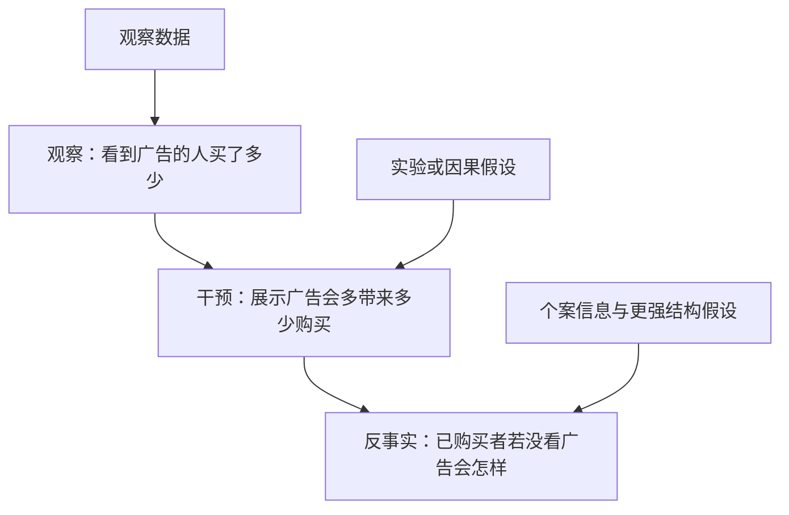
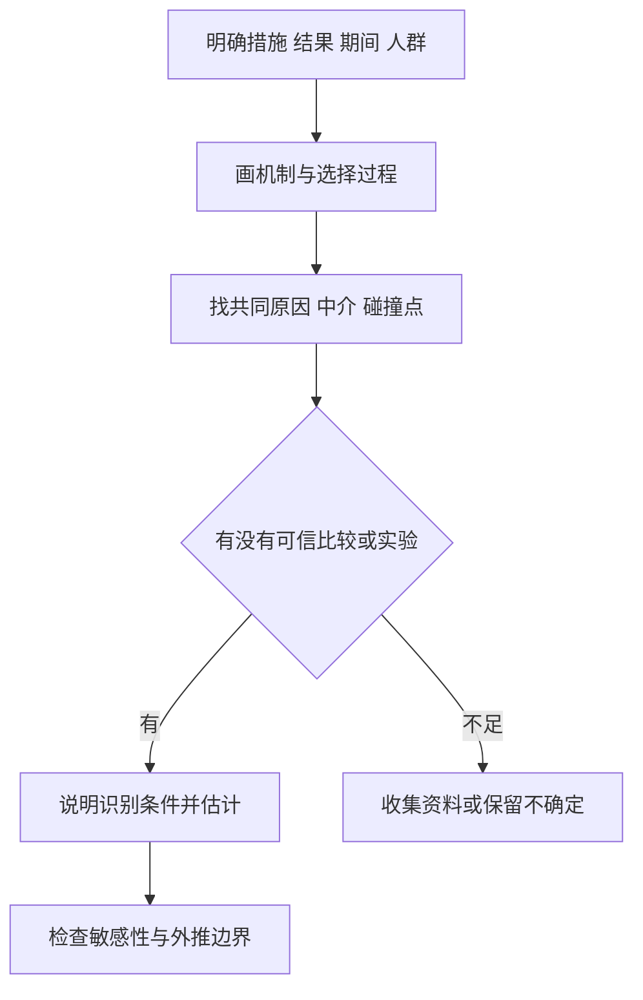

# 《为什么》：从“同时发生”走向“改变它会怎样”

> 作者：Judea Pearl、Dana Mackenzie，朱迪亚·珀尔、达纳·麦肯齐。英文 *The Book of Why: The New Science of Cause and Effect*，Basic Books，2018 年。用户中文译本未确认，不套用译本页码。  
> 依据：作者 UCLA 网站的目录、公开样章、勘误入口及原始研究；关键定义另以作者因果推断教材核对。未取得完整中文原书，本篇为公开资料系统导读，按原书十章主题重组为 32 点。只读到的样章不当成已经精读全书。  
> 原位案例用于解释研究方法；数学示意另行标注。医学研究仅讨论历史研究设计与结论范围，不作为个人治疗方案。更新：2026-11-12。

## 这本书要你多问哪一步

知道“买了某产品的人更富有”，不等于知道“买这个产品能使人更富有”。前者描述观察，后者要求理解如果主动改变行为，结果会怎样。

本书的核心不是重复“相关不等于因果”，而是展示：**在什么假设和研究设计下，可以把数据转化成因果判断；又在哪些情况下，现有数据根本回答不了问题。** 因果图把隐藏假设画出来，干预与反事实则帮助我们明确到底想估计什么。

对财商很有用的场景包括：广告是否产生新增销量，研发是否提高盈利，某管理措施是否改善现金流，某政策是否推动市场变化，以及自己的好回报到底来自什么。

## 十章主题地图

| 原书主题 | 本篇抓手 |
| --- | --- |
| 因果阶梯、学科历史 | 观察、干预、反事实不是同一道题 |
| 从证据到原因、贝叶斯 | 用证据更新信念，但仍需因果假设 |
| 混杂与去混杂 | 找到共同原因，明确可比较对象 |
| 吸烟争论与悖论 | 不能只凭统计外观决定因果 |
| 超越调整、干预 | 后门、前门与识别条件 |
| 反事实与中介 | 讨论未发生的结果及作用机制 |
| 大数据与人工智能 | 数据量不能自动补齐因果结构 |

可核对[作者书籍页面](https://bayes.cs.ucla.edu/WHY/)与[官方目录](https://www.cs.ucla.edu/~kaoru/book5p/toc.pdf)。本书对学科史有鲜明作者视角；因果推断也包含潜在结果、实验设计和计量经济学等相关传统，不宜读成只有一种方法产生过贡献。

## 核心知识点

### 1. 观察问题：在已经发生的条件下，结果怎样分布

观察问题问“看到 X 时，Y 通常怎样”。它可以支持预测，即使暂时不知道背后的因果机制。

例如，某些客户频繁搜索一个品牌，也经常购买该品牌。这个关系可能帮助预测谁会购买，却不能单独说明搜索广告创造了多少新增购买。预测任务与干预任务不同，不能把前者的准确率自动转成后者的收益。

### 2. 干预问题：主动改变 X，结果会怎样

干预把 X 的生成方式改变了。原本因需求强才看见广告的人，与被实验安排展示广告的人，选择机制可能不同。

因此问题必须明确：改变什么、对谁改变、改变到什么程度、看多久、比较什么。只说“广告有没有用”太宽泛，因为品牌词、非品牌词、新客户、熟客和不同时间尺度可能有不同效果。

### 3. 反事实问题：已经知道现实，再问另一种行动会怎样

反事实通常针对已发生事件，例如“这位客户已经购买，如果没有广告，他还会买吗”。同一个人在同一时刻无法同时处于两种真实状态，所以需要模型与额外假设。

反事实不是任意幻想。可解释的反事实必须说明哪些事实固定，改变哪项机制，以及结果怎样由结构推出。把所有不利条件都同时改掉，再说自己本来会成功，没有明确的因果意义。



箭头表示问题层次的区别，不表示只要增加数据就能自动向上升级。不同层次需要不同信息。[作者公开第一章](https://bayes.cs.ucla.edu/WHY/why-ch1.pdf)

### 4. 因果效应需要明确比较对象

某个结果发生以后，不存在一个天然可观察的“如果没做”的答案。要构造可比较组，或者在明确假设下推断这个替代结果。

企业增长后的自我归因常漏掉比较：行业是否一起增长，竞争者是否也改善，原有客户是否本来就会购买？比较组若具有系统差异，即使结果差距很大，也未必是行动造成的。

### 5. eBay 广告实验：可追踪转化不等于新增转化

**真实研究。** Blake、Nosko 与 Tadelis 在 eBay 的大规模付费搜索实验中，比较广告投放变化与购买行为。其结果显示，常规非实验估计高估了广告回报；品牌关键词广告在所研究条件下没有可测的短期收益，非品牌词对新用户与不常使用者更有效。这里引用作者 2014 年工作稿，对应后来的正式研究。[作者公开论文](https://faculty.haas.berkeley.edu/stadelis/tadelis.pdf)

关键机制是购买意图同时影响搜索、点击和购买。若把点击后成交全部算成广告贡献，就把本来会发生的购买也记给了广告。关闭付费渠道后，部分流量会转向免费渠道，原先的归因方式就暴露了问题。

这个发现不是“所有广告无效”。品牌成熟度、用户类型、平台、期限与广告形式都影响结果。可迁移的是评估方法：问新增收益，而不只问能被渠道记录的收益；比较新增利润和成本，而不只看成交金额。

### 6. 因果图是可检查的假设，不是发现真相的装饰

图中节点代表变量，箭头表达假定的直接因果关系。画图能让未说出的假设显露出来，但箭头本身需要背景知识、实验或其他证据支持。

尤其重要的是没有画出的箭头：它可能意味着你假设某种直接影响不存在。遗漏一个重要共同原因，可能使后续精确计算失去因果含义。先讨论图是否合理，再讨论怎样估计参数。

### 7. 混杂：共同原因会制造额外关联

如果 Z 同时影响 X 与 Y，观察到的 X—Y 关系可能包含 Z 的作用。广告例子中的购买意图，就是需要考虑的共同原因之一。


虚线不是已经确认的效应大小，而是研究问题。即使 X 与 Y 高度相关，也不能直接把全部关联归于这条箭头。

### 8. 条件概率与干预概率不同

`P(Y|X=x)` 表示观察到 X 等于 x 的人群中，Y 的分布；`P(Y|do(X=x))` 表示把 X 设置为 x 后，Y 的分布。do 记号强调改变生成机制。

前者的人群可能因动机、能力、资源或健康状况而自我选择。后者试图回答行动本身的效果。在随机化且执行符合要求等条件下，两者可以建立联系；在普通观察数据中，不能默认相等。

### 9. 随机化主要改变分配机制，不是让两组每项数据完全相等

随机分配让处理安排在设计上不依赖潜在结果和既有混杂因素，从而支持可比较性。但有限样本仍会出现偶然差异，失访、不遵从、测量误差和组间影响也可能带来问题。

因此随机试验仍需报告样本、分配、执行和分析方法。看到“随机”两个字并不意味着所有问题已解决；需要明确估计的是分配政策效果，还是实际接受处理的效果。

### 10. 观察研究与随机试验不同，可能既有混杂也有对象差异

**真实研究：WHI 的联合激素随机试验。** 2002 年发表的研究纳入 16,608 名 50—79 岁、基线保留子宫的绝经后女性，比较特定雌激素与孕激素联合方案和安慰剂，报告了一组有利与不利健康结局，并提前停止该试验部分。[原始 JAMA 论文](https://jamanetwork.com/journals/jama/fullarticle/195120)

在方法层面，这说明不能把“选择使用治疗的人结果较好”直接当作治疗效果。选择者可能在健康行为、医疗条件与起始时间上不同；同时，不同研究的人群、制剂、启动年龄和目标也可能不同。

不能把所有观察与试验差异都简单归结为一个“健康使用者偏差”，更不能从这篇历史论文推出所有人、所有激素方案都相同。正确做法是对齐研究问题与对象，再讨论识别假设。本文只用它训练研究阅读。

### 11. 后门路径：找出那些不是从处理出发的关联通路

在图中，X 与 Y 之间可能存在以箭头进入 X 开头的路径，例如 `X←Z→Y`。这些路径会让观察关联混入处理之外的信息。

后门准则帮助选择合适的调整变量：在标准条件下，用不含 X 后代的变量集合，阻断所有相关后门路径。它不是要求控制所有变量，而是根据图选择足以消除混杂、又不引入新问题的变量。[作者因果推断教材，后门与前门章节](https://web.cs.ucla.edu/~kaoru/primer-complete-2019.pdf)

### 12. 调整的直觉：先在可比层内比较，再按目标总体汇总

在 Z 满足合适调整条件且数据有足够覆盖时，可以使用：

```text
P(Y | do(X=x)) = Σz P(Y | X=x, Z=z) × P(Z=z)
```

Σ 表示对 Z 的不同取值求和。关键是采用目标总体中的 `P(Z=z)` 进行汇总，而不是让接受与未接受处理的人保留各自不同的构成。

这个公式需要因果条件，不是纯代数把关系统计变成因果。若遗漏重要共同原因、变量测量很差，或某层根本没有某种处理，结果仍可能不可靠。写出公式前，先解释为什么选这些分层变量。

### 13. 辛普森悖论告诉你：数据本身不决定该不该分组

**真实研究：1973 年伯克利研究生招生。** 1975 年论文发现总体男女录取率存在明显差异，进一步分析指出申请系别构成与系别录取难度对汇总比较很重要。[原始研究](https://faculty.ucmerced.edu/jvevea/classes/Spark/readings/Bickel-Berkeley.pdf)

但“控制系别”回答什么问题，需要先说清。若问同一系内部的录取差异，它很相关；若问更广泛的教育机会与申请路径，系别选择本身可能就是需要解释的过程。一个统计调整不能自动裁定所有社会问题。

投资研究同样如此。集团平均毛利率与各业务毛利率的变化可能方向不同，因为权重改变。若研究总利润，就要保留业务结构；若研究同一产品的竞争力，就要分解结构。选择总体或分组应由问题与机制决定，不能事后挑有利的一种。

### 14. 中介变量：位于影响传递的路径上

如果 X 改变 M，M 再改变 Y，那么 M 是该路径上的中介。研发可能影响产品能力，产品能力再影响收入，就是一种待核验的机制假设。

若目标是估计 X 的总效应，直接控制 M 可能把想研究的路径阻断。若目标是研究直接效应，则问题又不同。必须先定义效应，不能把“控制得越多越严谨”当成规则。

### 15. 碰撞点：控制共同结果反而可能制造关联

在 `X→S←Y` 中，S 是两个变量的共同结果。即使 X 与 Y 原本独立，只观察满足某种 S 的对象，也可能让二者出现关联。

**逻辑示意，不是真实数据：**若进入某个名单主要依赖能力或关系，且其中一项很强就较容易进入，那么只看入选者，可能看到两者的替代关系。这不证明在总体中能力和关系天然负相关。

财商应用是检查样本如何被选中：只分析获得融资、成功上市或仍然存续的企业，可能已按多个结果因素筛选。选择机制有时与普通混杂不同，不能简单靠多加几个回归变量消除。

### 16. 三种结构决定控制变量的不同后果

| 结构 | 图形 | 基本提醒 |
| --- | --- | --- |
| 共同原因 | `X←Z→Y` | 合适调整可阻断混杂路径 |
| 中介链条 | `X→M→Y` | 控制 M 可能阻断总效应的一部分 |
| 共同结果 | `X→S←Y` | 控制 S 或其后代可能打开原本关闭的路径 |

这是入门图形规则，复杂图要检查所有相关路径。一个变量在不同研究问题中可能扮演不同角色；不能永久给它贴“必须控制”的标签。

### 17. d 分离：用路径规则推导条件独立

d 分离提供判断图中哪些路径被阻断的方法。直觉上，链条和共同原因可以因条件化而被阻断；碰撞点路径通常关闭，却可能因对碰撞点或其后代条件化而打开。

这些规则让因果假设产生可检验的统计约束。但观察到某个独立关系，通常不能唯一确定全部箭头方向；多个图可能与同一数据相容。图形方法提供纪律，不是让数据自动选出唯一故事。

### 18. 吸烟争论：不能随机化所有问题，也不能因此放弃因果判断

**真实研究。** Doll 与 Hill 1950 年发表吸烟与肺癌的病例对照研究，比较肺癌患者和对照者的吸烟经历。单项研究是观察性证据，需要面对选择、回忆与混杂等问题。[BMJ 原始论文](https://www.bmj.com/content/2/4682/739)

本书用吸烟争论说明：提出一个潜在共同原因，并不等于这个共同原因已得到证实；但看到强相关，也不意味着可以省略竞争解释。可靠判断需要多种证据相互约束，而不是要求唯一一种不可能或不合伦理的试验。

对投资者，可迁移的是研究态度：无法随机分配企业管理层，不等于永远不能研究管理效果；但也不能因此把任何成功史都算成因果证明。要尽量寻找可比较变化、机制证据和替代解释检验。

### 19. 前门思路：某些隐藏混杂下，机制信息仍可帮助识别

前门准则不是“找到一个中介就成功”。经典形式需要中介截住 X 到 Y 的全部有向路径，X 到中介之间没有未阻断的后门路径，而中介到 Y 的后门路径能由 X 阻断，还要具备相应数据支持。

这些要求很强，现实中常难充分满足。它的价值是说明：不能用后门调整，并不代表所有因果问题都完全不可识别；但换一种数学方法，仍不能免除假设责任。不要把书中的解释性图形当作某个真实行业已满足条件的证明。

### 20. 识别与估计不同：先问能不能，再问是多少

识别是问在给定假设和无限充分数据的理想条件下，目标因果量能否由观察分布确定。估计则是在有限、带误差的数据中计算它。

如果问题根本没有识别，更多样本可能只是让错误答案的标准误更小。反过来，即使理论上可识别，现实数据质量差或样本不足，也可能无法给出有用估计。两关都需要通过。

### 21. do 演算是转换规则，不是凭空创造信息

do 演算通过图形条件，判断何时可以在表达式中增加、删除或交换观察与干预，从而把干预问题转成可估计的量。

入门读者不必先背全部规则，应该先理解它解决的任务：把因果假设转换成计算许可。没有明确结构、无法获得必要数据，演算不会自动产出正确答案。本文不提供完整形式证明，避免把教材级技术缩成看似万能的口诀。

### 22. 贝叶斯更新与因果识别不能混为一谈

贝叶斯方法帮助在给定模型下根据证据更新信念；因果结构则说明变量之间怎样生成和改变。两者可以合作，但后验概率并不自动拥有因果含义。

如果模型遗漏关键选择机制，更多数据可能让人对错误结构更有信心。分析时同时记录模型假设、先验信息、观察证据和对其他模型的敏感性，不要只展示一个精确概率。

### 23. 结构方程把机制写出来，回归线未必就是机制

结构方程描述变量如何由其原因和未观察因素产生。它带有“改变一个机制后，其他机制怎样保持”的含义。

普通回归可以很好拟合数据，但系数是否能解释成干预效果，需要额外条件。把营收对广告费用做回归，系数显著并不能消除需求同时影响两者的可能性。模型的预测用途与政策用途应分别检验。

### 24. 反事实的三步：解释现实、改变行动、推算结果

第一步结合已知结果更新对背景因素的认识；第二步把某项行动或机制替换为反事实条件；第三步用保留的结构推算另一结果。这个顺序避免把现实与另一个完全不同的世界随意比较。

但不同结构可能对同一观察事实给出不同反事实。尤其在个体层面，通常比平均处理效应需要更强假设。因此“如果当初没卖就赚了”只是价格路径的一种事后计算，若要评价当时决策质量，还应保留当时资金、信息和约束。

### 25. 直接效应与间接效应：你想保留哪条路径

总效应包含 X 通过各种路径对 Y 的影响；直接与间接效应尝试区分是否经过特定中介。不同定义对应不同干预问题，不能把回归中加入中介后的系数变化都直接叫作机制证实。

例如培训提高收入，可能通过技能、求职行为和雇主信号共同作用。要分别识别这些路径，需要额外数据与混杂假设。解释“怎样起作用”通常比确认“是否起作用”更难，不是多画一个框就解决。

### 26. 选择偏差与缺失数据也需要因果思考

谁进入样本、谁退出、什么情况下没有记录，都可能与处理和结果有关。只对完整记录作分析，可能改变所研究的人群。

在股票研究中，退市、清盘、停止披露与数据库覆盖不是技术小事。先说明你想研究哪个总体，再追踪样本从哪里被删掉。简单填补缺失值并不能自动解决选择机制。

### 27. 可迁移性：一个地方有效，不代表任何地方一样

试验可以很好地识别特定对象和环境中的效应，外推仍要问机制是否相同。价格、制度、用户基础和竞争反应，都可能改变结果。

eBay 的成熟品牌关键词广告结果，不能直接替新品牌定预算。对财商学习，最有价值的不是复制一个平均数，而是识别哪些条件影响效果，哪些条件在目标场景发生了变化。

### 28. 敏感性分析：假设略变，结论是否仍站得住

对于无法完全排除的隐藏混杂，可以研究它需要多强才能改变结论；对于不确定参数，可以检查不同合理范围下的结果。

敏感性分析不能证明假设为真，但能区分较稳固的结论与只依赖一个脆弱设置的结论。不要只选一个最有利的模型汇报，也不要把所有想象情景都当成同等可能。

### 29. 大数据和机器学习可以改善预测，不能无条件消除混杂

更丰富的数据和更灵活模型，可以提高估计效率、寻找异质性并处理复杂关系。但若训练数据始终只反映旧选择机制，准确预测并不等于知道新政策效果。

因果发现方法也依赖假设，如不存在某些隐藏原因、机制具有特定形式等。作者对人工智能前景的讨论是理论与研究主张，不宜当成任何现有系统已经具备可靠因果理解的认证。

### 30. 把公司“增长归因”改成可检验的问题

先明确结果是营收、利润还是股东现金；明确措施是提价、广告、扩产还是收购；画出共同原因、中介与选择过程；最后决定可用什么设计。



没有设计时，可以说某项解释与现有数据一致，但不要把一致当作唯一因果证明。这个限制能防止财报分析变成管理层故事的重复。

### 31. 因果正确也不直接等于投资值得做

确认某项技术确实提高效率，还要看谁取得收益、为此支付多少、竞争如何反应，以及市场价格已经反映什么。因果效果与投资赔率是不同层面。

同样，预测某政策会促进销售，不意味着相关股票必然上涨。你的回报还依赖预期差、价格、成本与风险。因果推断改善经营分析，但不能替代估值和个人资金管理。

### 32. 一张因果主张检查卡

```text
我想估计的行动与结果：
对象、期间及比较基准：
观察、干预还是反事实问题：
可能的共同原因：
作用中介与样本选择：
为何选择这些控制变量：
识别依赖的关键假设：
数据能否覆盖所需比较：
假设变化时结论是否稳健：
可迁移到哪些情境，不能迁移到哪里：
```

先用它审查一条真实的经营归因，再决定是否需要更复杂的统计工具。说清一个尚未识别的问题，通常比给出没有依据的精确比例更有价值。

## 练习与参考答案

**题一：**客户点击广告后购买，是否证明广告有效？不能。购买意图可能同时导致点击和购买，应估计相对不展示广告的新增结果。eBay 研究说明记录到的转化与新增转化可能差很多。

**题二：**研究培训对收入的总效应，能否无条件控制培训后的技能？不能。技能可能是中介，控制它会改变研究问题；还需检查中介相关混杂。

**题三：**样本一千万，回归结果很稳定，是否必然有因果含义？不是。样本规模帮助降低部分随机误差，不能单独保证结构假设、选择机制和识别条件成立。

## 边界与来源

本篇覆盖主要概念，不提供 do 演算、结构模型与中介分析的完整技术训练。相关原始研究和数学定义的核对入口已在原位链接；作者公开样章与教材没有复制到仓库。重要争论应继续阅读方法论文和不同研究传统，不能用一本科普书替代研究设计。

可与[《统计陷阱》](<../统计陷阱 - 达莱尔·哈夫/读书笔记.md>)检查数字，与[《模型思维》](<../模型思维 - 斯科特·佩奇/读书笔记.md>)比较多个机制，再用[《系统之美》](<../系统之美 - 德内拉·梅多斯/读书笔记.md>)理解反馈与时间延迟。
