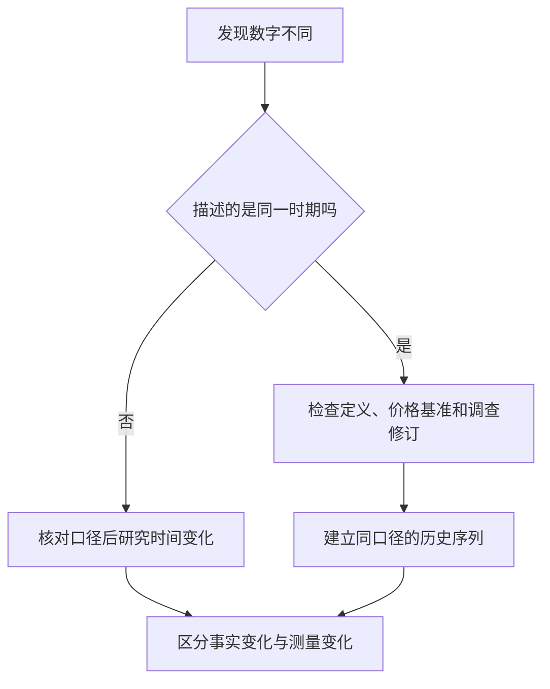

# 《事实》读书笔记

> 作者：汉斯·罗斯林、欧拉·罗斯林、安娜·罗斯林·罗朗德。原作 Factfulness，2018 年。  
> 分析依据：作者机构公开书页、数据注释与工具，以及国家统计局、世界银行、联合国机构的原始材料。未取得用户所持中文版本全文，属于公开资料支持的系统导读，不声称逐页精读。  
> 范围：十种认知倾向的主要框架，整理为 26 个知识点；财商联系和书后发生的案例是本笔记补充。历史数据、发布年份、估计与预测分别标注。  
> 更新日期：2026-11-12

## 先看这里：这本书能怎样提高财商

它教你把“世界好像怎样”改成“在什么指标、什么时期、什么人群中，证据显示怎样”。投资中很多错误，发生在估值之前：先被一个宏大叙事打动，然后才寻找支持它的公司。

本书不主张盲目乐观。它要求同时看见进步、尚存的问题和未来的不确定性。经济发展、人口变化和消费升级都值得研究，但不能仅凭一个方向正确的宏观故事，就判断某只股票价格合理。

建议重点读第 3、5、9、17、19、21 点：它们分别处理平均数、长期趋势、分母、紧迫感、口径修订和预测。这些是读财经新闻最容易直接用到的能力。

## 全书内容地图

十种倾向可以连成一条阅读新闻的检查路径。下面是主题归纳，不是逐字翻译目录。

| 容易发生的偏差 | 应补上的检查 | 本文主要位置 |
| --- | --- | --- |
| 把世界分成两极 | 中间的人在哪里，分布怎样 | 2—4 |
| 只注意坏消息 | 分清现在的水平与变化方向 | 5—7 |
| 把走势无限延长 | 识别增长限制、年龄结构与曲线 | 8—9 |
| 害怕就觉得危险 | 区分恐惧程度、概率与后果 | 10 |
| 被大数震住 | 找分母、比较对象和主要部分 | 11—12 |
| 用群体标签代替观察 | 比较组内差异和生活条件 | 13 |
| 认为文化与命运不变 | 检查缓慢变化和实际时间序列 | 14 |
| 只用一种解释 | 让不同专业和反证进入判断 | 15 |
| 找一个人承担全部原因 | 查结构、激励和信息条件 | 16 |
| 被“马上行动”推动 | 判断真实期限，保留核验时间 | 17 |

作者的[书页](https://www.gapminder.org/factfulness-book/)和[数据注释](https://www.gapminder.org/factfulness-book/notes/)可以用来追溯主题和原始材料。本笔记将后续数据用于练习，不把 2018 年的描述当作今天的事实。

## 核心知识点

### 1. 事实意识是一套习惯，不是“我很理性”的自我评价

事实意识要求你能指出观点的来源、时间、对象和可推翻条件。只说“有数据证明”还不够：数据可能测的是另一件事，或者已经过时。

先写下自己相信什么，再查材料，比看完答案后觉得“我早就知道”更有学习价值。遇到分歧，先问双方是不是在讨论同一个指标；很多争论是口径不同，并不是有人不会计算。

### 2. 二分法方便表达，却可能把大多数人藏起来

“富国与穷国”“有钱人与没钱人”是很粗的分类。处在同一类中的家庭，住房、饮水、交通和教育条件可能相差很远。理解市场需求，需要研究收入和约束的连续分布。

作者以四个收入层级帮助读者把注意力移向中间地带。它是教学框架，不是证明所有人在相同收入下都过着同样生活。资产、公共服务、家庭规模、地区价格和负债也会影响消费能力。

### 3. 平均数可以正确，给你的“典型人”印象却仍然错误

**真实数据：2024 年中国居民收入。** 国家统计局公布，全国居民人均可支配收入平均数为 **41,314 元**，中位数为 **34,707 元**。这里是全年居民收入，包含不同收入来源，并非全体劳动者的工资。[国家统计局原始发布及指标解释](https://www.stats.gov.cn/sj/zxfb/202501/t20250117_1958325.html)

平均数把收入汇总后分配到相应统计单位；中位数反映排序中间的位置。高收入一端能拉高平均数，却不会以同样方式拉高中间位置。两项同时成立，不是统计互相矛盾。

先做一项可复核计算：`34,707 ÷ 41,314 ≈ 84.0%`。它说明两个统计量之间的比例，**不说明只有 84% 的人取得了收入，更不说明其他人没有收入**。把统计量之比读成人群占比，是很常见的跳步。

再问投资上真正关心什么。如果要研究大众消费，平均购买力未必能代表目标顾客；如果研究总体消费总量，平均值和人口规模又可能有用。选指标应由问题决定，不能为了得出悲观或乐观结论而挑一个数字。

最后仍有不知道的部分：这两项汇总数没有给出所有人的分布，也不能告诉你某个城市、年龄或职业的购买力。研究具体公司，还要查客户定位、价格带、复购和渠道。宏观统计是背景，不是订单。

**自测：** 用 41,314 除以 12，能否称为“普通上班族月薪”？不能。时间单位可以换算，但居民收入的对象和构成不会因此变成就业者工资。

### 4. 比较群体时，组内差异可能比组间标签更有用

说两个国家平均收入不同，只提供了一个整体对比；不能推出其中每个家庭都按同一顺序排列。类似地，“科技企业”内部也存在完全不同的盈利模式、债务和竞争条件。

在研究中，把一个宽泛类别拆成真正影响决策的维度：收入水平、支出刚性、地区成本、年龄和现金来源。分类越接近机制，越能帮助判断；分类越接近标签，越容易替代思考。

### 5. 坏的现状与改善的趋势，可以同时为真

**真实资料：联合国儿童死亡估计。** 2026 年发布的 UN IGME 资料估计，2024 年全球约有 **490 万名**儿童未能活到五岁；同一资料指出，自 1990 年以来，五岁以下死亡率下降约 **60%**，但下降速度正在放缓。[UNICEF 数据报告](https://data.unicef.org/resources/levels-and-trends-in-child-mortality-2025/)

这三件事并不冲突：当前损失仍然严重，长期风险已经下降，进步的速度又可能不足。只保留第一句，会看不见有效改变；只保留第二句，会看不见当下需求；只保留第三句，也可能误以为长期成果不存在。

这里还必须分清**死亡人数**与**死亡率**。人口数量和结构改变时，两者不必同比例变化。不能用“490 万”与“下降 60%”直接计算出某年的死亡人数；它们的量纲和起点并不相同。

财商上可以沿用同一种分析顺序：一家公司仍亏损，可能同时在减亏；收入创新高，增速可能正在下降；经营现金为正，也可能弱于过去。把“水平、方向、速度”分开，才能准确写出事实。

但改善不等于值得买。价格可能已包含更快改善的预期，债务可能让企业等不到改善完成。这个案例训练的是描述能力，不提供某类资产必然上涨的结论。

### 6. 允许同时持有两条事实，能减少立场先行

看到进步不等于认可所有现状，承认问题也不等于否认长期变化。判断不能被压缩成“支持还是反对”“看多还是看空”两个按钮。

写研究结论时，可以保留三栏：已改善什么、仍然糟糕什么、还不能判断什么。这样更容易识别真正需要新增证据的部分，也更容易在事实改变时调整观点。

### 7. 新闻频率并不是现实发生率

新闻会选择异常、剧烈、有冲突和容易讲述的事件。长期、分散、缓慢的改善，未必有清楚的报道时点。因此，看到某类事件越来越多，可能是事件变多，也可能是报道、记录和传播变多。

要判断发生率，需要一个相对稳定的记录系统和分母。对于市场风险，不应靠自己刷到多少条暴跌新闻估计概率；对于产品问题，也应比较销量、使用时长、投诉定义及披露变化。

### 8. 直线外推默认了“产生变化的条件一直不变”

一条向上的线可能代表早期扩散，也可能已经接近饱和。收入、用户、产能和人口都有不同的约束。观察到过去的方向后，还应寻找使它放缓或加速的机制。

不要先选曲线，再找理由。先问客户从哪里来、可服务市场有多大、替代品怎样变化。指数、S 形、平台期只是可能形态，真正需要证据的是增长过程。

### 9. 人口数量与发生概率，要放在不同位置计算

风险人数通常受到“人群规模”和“单位风险”共同影响。一项率下降，不保证总人数下降；总人数上升，也不自动代表每个人的风险上升。

回到第 5 点的联合国材料，报告区分年龄段、地区和出生队列，正是因为各组风险不同。更高风险地区人口占比变化，也会影响总体结果。直接将全球平均数套给任一地区，可能错过最需要解释的结构。

这一点对企业同样重要：销售额变化可以来自客户变多、每位客户买得更多、单价提高或产品结构改变。这里只是帮助拆问题的关系式：`销售额 ≈ 客户数量 × 人均购买次数 × 每次购买金额`。三个量必须定义一致，退货和口径变化也要纳入。

看见收入增长后，应追问是哪项起作用；看见客单价上升，也要防止把低价客户流失误认成所有客户愿意多付钱。先拆解，再解释，最后才谈持续性。

### 10. 害怕程度与危险程度，不是同一种测量

恐惧受画面、距离、陌生程度与可控感影响；决策风险还需要概率、后果和可承受性。生动的个案可能提醒你调查，却不能独自给出发生率。

不需要为了显得理性而忽略严重后果。对于不可承受的损失，即使概率不易准确估计，也应先限制暴露。但“先防大错”与“相信每条惊吓信息”是两回事：前者检查实际传导路径，后者容易被叙事支配。

### 11. 大数字需要分母，也需要比较尺度

公司利润几十亿元，未必说明股东回报很高；投入资本、债务、股数和购买价格都可能很大。人口众多地区的事件总数，也应与人口及暴露量一起看。

分母不是为了弱化问题，而是为了明确你在回答什么。比较公共支出可以看总额，也可以看人均、占收入比例和实际服务效果；这些指标互补，不能相互冒充。

### 12. 找主要部分，但别把“二八”当成自然定律

将问题排序，常常比对每个细节平均分配注意力更有效。先查最大的业务、最大的现金支出、最集中的客户和最迫近的债务。

然而，不是所有分布都恰好符合 80/20。一个当前金额很小的担保或衍生风险，也可能产生重大尾部后果。主次排序应同时看规模、变化和失控后的影响。

### 13. 用生活条件替代国家刻板印象

**真实资料项目：Dollar Street。** Gapminder 按收入位置组织不同国家家庭的住房、日用品和生活照片，让读者比较相似条件，而不仅按国家标签浏览。[项目入口](https://www.gapminder.org/dollar-street)

它提供一种观察方式：先比较收入接近家庭的日常需求，再观察同一国家不同家庭的差异。对消费投资，这提醒我们研究实际客户，而不是把国籍、地区或社会标签直接当作需求。

但照片不是随机抽样的总体统计。展示的家庭不能代表所有家庭，也不能从某张厨房照片推算一个国家的市场规模。它能帮助提出更好的问题，市场估计仍要有代表性数据。

### 14. 缓慢改变容易被误认为从来不变

文化、教育、家庭结构和消费习惯并非永远固定。年度变化很小，累积几十年却可能很大；只用年轻时的印象理解今天，会把已经发生的变化漏掉。

作者的数据注释专门说明历史材料的年份与外推方式，这提醒读者把旧知识重新放回时间轴。研究企业时，也应检查竞争优势到底稳定在什么机制上，而不是仅因它过去存在就认为永远存在。

### 15. 单一视角会把不同问题变成同一个答案

只懂估值的人可能低估组织问题，只懂产品的人可能低估资本成本，只关注增长的人可能漏掉现金缺口。工具越熟练，越容易将所有问题都改写成自己擅长解决的形式。

采用多视角不等于让所有意见平均投票。需要先识别哪一类证据能决定结论，再请相应专业的人检验。不同意见的价值在于暴露缺失变量，不在于凑成一张更长的观点列表。

### 16. 找到责任人以后，还要找到可以改变的条件

责任追究回答谁应承担后果；机制分析回答怎样降低再次发生的可能。两者可以并行。仅说员工贪婪或管理者无能，可能没有触及奖励规则、信息延迟和监督缺口。

例如 CFPB 对富国银行 2016 年未授权开户问题的处理，直接讨论了销售目标与激励安排。这个真实案例说明，分析经营质量不能只看漂亮的客户数量，也要问这些数量怎样产生。[CFPB 原始公告](https://www.consumerfinance.gov/archive/newsroom/consumer-financial-protection-bureau-fines-wells-fargo-100-million-widespread-illegal-practice-secretly-opening-unauthorized-accounts/)

这里不推测所有员工的心理，也不声称改一个指标就能消除所有问题。可迁移的做法是：读增长指标时，同时检查业务真实性、客户授权、激励和纠错机制。

### 17. 紧迫感可能是真实约束，也可能是销售工具

**真实监管材料：虚假倒计时。** FTC 的 2022 年报告列举了没有真实期限却制造时间压力的倒计时，以及隐藏收费、增加退订困难等设计。[FTC 报告介绍](https://www.ftc.gov/news-events/news/press-releases/2022/09/ftc-report-shows-rise-sophisticated-dark-patterns-designed-trick-trap-consumers)

倒计时改变的是决策环境：读者把“会不会错过”放到“是否值得购买”前面，核对费用、条款和替代方案的时间随之缩短。这个过程并不要求商品本身一定虚假；即使是真商品，也可能因决策仓促而不适合你。

因此，先核实期限来自哪里：真实库存、监管截止日、合同安排，还是一个会自动重置的网页数字。若错过的代价只是少一次优惠，就不应自动赋予它高于本金安全和条款清晰度的权重。

真正的紧急情况也存在。本书方法不是永远拖延，而是把行动拆开：先做能够降低不可逆损失的步骤，再补齐信息；不要把时间紧等同于必须接受对方给出的唯一方案。

### 18. 购买力平价用于比较生活水平，不等于兑换汇率

相同美元金额在不同地区能买到的东西不同。购买力平价试图调整价格水平差异，便于跨地区比较；市场汇率则涉及货币交换。两种口径回答不同的问题。

本书四层收入框架中的金额属于当时的购买力比较体系，不能直接当作今天的人民币现金收入界线。个人能否支付房租，要看当地实际现金流与价格；跨国长期生活水平比较，才需要另行选择可比口径。

### 19. 同一年统计数字被修订，不意味着现实在修订当天突然改变

**真实案例：世界银行 2025 年调整全球贫困线。** 国际极端贫困线由按 2017 年购买力平价计的每日 2.15 美元，更新为按 2021 年购买力平价计的每日 3.00 美元。同时，新调查和各国贫困线资料进入估计。[世界银行 2025-06-05 说明](https://www.worldbank.org/en/news/factsheet/2025/06/05/june-2025-update-to-global-poverty-lines)

同一说明中，**2022 年**的极端贫困人口估计从以前发布的约 7.13 亿人修订为约 8.38 亿人。关键在于两次数字描述的是同一个历史年份。不能把差额约 1.25 亿人写成“2025 年新陷入贫困的人”。

这类变化有几层来源：计价基准变化、贫困界线变化、基础调查更新。分析时应先确定是哪一种变化，而不是先争论新数字应该支持哪种立场。比较长期趋势时，也应使用同一版本的历史序列。

财报重述、指数成分变化和行业统计范围调整也有类似问题。正确操作是保留旧口径、取得可比新序列，解释差异；把两个不同口径的端点接成一条增长线，会制造并不存在的时间变化。

图中最重要的分岔是“是不是同一个时期”。先回答这一点，才能知道自己在解释世界变化，还是解释认识世界的方法变化。

### 20. 数据也有生产过程，应读方法说明

抽样如何做、哪些人未被覆盖、缺失值怎样处理、估计模型如何设置，都会影响数字。官方数据值得认真使用，但“官方”不是免读附注的理由。

对公司的经营数据也一样：活跃用户是登录一次还是付费使用，新增客户是否扣除流失，订单额是否包含取消。把定义写清楚，往往比增加一个小数位更有价值。

### 21. 预测是条件性结果，不是提前发生的事实

第 5 点的 UNICEF 材料同时给出过去的估计与未来情景：按当时下降速度，2025—2030 年可能累计发生约 2730 万例五岁以下儿童死亡。这个未来量依赖假定，不是已经统计到的结果。[报告对预测条件的说明](https://data.unicef.org/resources/levels-and-trends-in-child-mortality-2025/)

研究中应分开三种文字：已记录或估计的历史、机构对历史的解释、在某些条件下的预测。历史估计也可能修订，但它与预测的证据状态仍不同。

企业的产能规划、盈利指引、市场规模预测也应同样处理。规划中的产能不是已经售出的产品，市场规模不是企业收入，收入也不是股东可以拿走的现金。把未来链条逐步拆开，能看见每个环节还需要什么条件。

### 22. 图表可以帮助理解，也可以让分母悄悄消失

看气泡图要先读横轴、纵轴、气泡面积、颜色和年份。面积代表人口时，不能把半径当成人口；不同年份的对数坐标也不能按普通长度直接理解绝对增量。

先把图翻译成一句准确的话，再提出解释。图上相关的两个量，不等于其中一个单独造成另一个；第三因素、样本构成和时间趋势都可能参与。

### 23. 社会长期进步，不自动等于今天的股票便宜

消费增长可以带来商机，也可以吸引竞争、压低利润。上市公司股东最终得到多少，还取决于进入价格、稀释、再投资回报和资本分配。

读完本书后最容易出现的新错误，是把“过去比想象中改善得多”改成“未来必然改善，所以任何资产都值得买”。事实意识同样要求核查这个乐观推论，而不是只用它纠正悲观者。

### 24. 宏观、行业、公司、证券，是四个不同层次

宏观需求增加，不保证某一行业利润增加；行业利润增加，不保证每家公司份额稳定；公司利润增加，不保证当前股价对应的回报足够。

图中的每条箭头都需要额外证据。投资研究的工作，就是核查这些连接；一份宏观报告不能替代整条链。

### 25. 先测自己，再纠正别人

在查一项事实之前，先写自己的估计范围和理由。查到结果后记录误差来自旧知识、分类、遗漏分母，还是把感受当频率。不要只挑自己答对的题做复盘。

目标不是追求永不犯错，而是让同类错误越来越容易被发现。与朋友讨论时，可以先分别估计再互相比较，避免第一个大声说出的数字成为全组的起点。

### 26. 用一张事实卡，把阅读变成可积累的判断

每个重要结论保存六项：准确问题、对象和期间、数据定义、原始来源、尚缺证据、会改变结论的条件。最后再写它是否足以支持行动。

对于同一主题，持续更新一张卡比不断收藏新文章更有价值。更新时保留旧判断及其日期，你才能看见自己是在因证据改变观点，还是随着市场涨跌更换叙事。

## 可以怎样练习

拿第 19 点做一次完整复盘：写出两个版本估计的共同年份、不同购买力基准和调查变化，再解释为何不能计算为 2025 年新增贫困。参考答案的重点不是算差额，而是明确差额的性质。

再拿一份公司公告，只回答三个问题：本期水平是多少、同比方向如何、变化由哪些可核查部分组成。暂时不写“好公司”“坏公司”。若三件事还不能分开，就先回到原表。

最后读一条行业新闻，把宏观事实到个股收益之间所缺的连接逐条列出。能清楚写“尚缺客户证据”或“尚缺估值比较”，已经是比仅表达看好更有用的产出。

## 能学到什么，以及本书的边界

你能学到的是准确描述、发现分母、更新旧知识和抵抗情绪化叙事。它不会替你完成会计、行业研究或估值，也不保证所有重要趋势都向好。改善与倒退都应由同一套证据标准判断。

本笔记没有复述全书人物经历，重点归纳十种倾向并加入独立材料。书中旧年份的测试答案应回到当时资料核对，不当成 2026 年的常识测验。作者概括的“本能”是面向大众的解释框架，不应被当成十个已经分别证明、能精确诊断个人的大脑模块。

## 来源与范围

- 书籍身份与主题：[Macmillan 书页](https://us.macmillan.com/books/9781250107817/factfulness/)、[Gapminder 书页](https://www.gapminder.org/factfulness-book/)。
- 原书数据和方法入口：[作者公开注释](https://www.gapminder.org/factfulness-book/notes/)，原书材料与本文新增资料分开。
- 本文真实案例分别在第 3、5、13、16、17、19、21 点附一手链接。数值计算为据已列数据重算；机制联系与财商练习为本笔记分析。
- 未核对用户版本的全部文字、译名及故事，不能将本笔记当作原书的逐章摘录。
