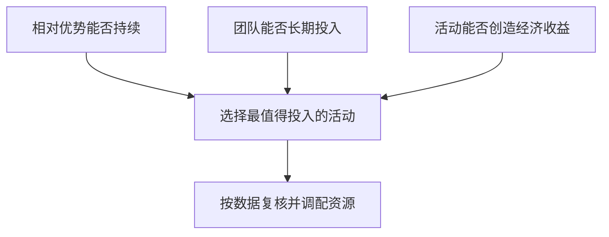

# 《从优秀到卓越》读书笔记

吉姆·柯林斯（Jim Collins）著，英文原作 *Good to Great: Why Some Companies Make the Leap... and Others Don't*，2001年。本篇依据出版社书目、作者公开的研究摘要与方法说明，以及相关公司、监管文件整理。覆盖主要管理框架与研究设计，中文原书全文和页码未核定。公司分析方法和练习为本篇补充。核验日期为2026-11-12。 [英文书目](https://www.penguin.co.uk/books/367795/good-to-great-by-collins-jim/9780712676090) [作者研究摘要](https://www.jimcollins.com/article_topics/articles/good-to-great.html)

柯林斯从一组股东回报发生持久变化的企业出发，回头研究人员、决策与行动如何配合。读这本书可以学会把管理口号转换成经营问题，同时评估从成功案例概括管理规律的证据强度。将它用于财商时，需要把经营质量、购入价格与股东回报逐步连接。

## 一、先读懂研究，才能使用结论

### 1. 作者用长期市场相对表现界定转型

团队从1,435家成熟公司中筛出11家，寻找一段表现平常、随后相对市场大幅改善的记录。转型后的标准包括15年累计股票回报达到整体市场的至少三倍，并检查行业整体变化。这个定义给研究提供统一入口，也把“卓越”的含义限定在特定指标、市场与期间。 [作者的筛选说明](https://www.jimcollins.com/article_topics/articles/good-to-great.html)

### 2. 对照公司用来区分常见做法与有解释力的差别

如果只看胜者，很多普通做法都会像成功秘诀。作者用相似的公司作比较，问面对相近机会时，两者有哪些行为差异。阅读时应继续追问可比性，核对规模、起始估值、负债、竞争环境与政策变化。有对照能够缩小解释范围，因果判断仍取决于这些差异是否得到处理。

### 3. 按结果选择样本，适合发现假说

研究者先知道谁在历史上成功，再回头找共同点。这种设计能发现值得检验的做法，但较难分辨原因、结果和共同背景。例如充裕现金可能让公司更容易长期投入，长期投入也可能提升现金流。判断方向需要时间顺序、独立对照和进一步验证。

### 4. 业绩窗口外的结果可以检验结论边界

Circuit City和房利美都入选作者的历史样本。Circuit City在2008年11月10日申请破产重整，2009年1月宣布关闭门店并清算。FHFA于2008年9月将房利美与房地美纳入托管。两组事实可以同时成立：公司曾达到研究的历史标准，后续也发生了重大的经营或融资危机。要解释后续结果，需要检查竞争、资金、治理与制度的变化。 [Circuit City相关SEC披露](https://www.sec.gov/Archives/edgar/data/945114/000110465909032399/a09-11315_110q.htm) [FHFA托管记录](https://www.fhfa.gov/conservatorship)

### 5. 市场回报与经营结果要分别核对

股票回报包含盈利成长、估值变化和股东分配等因素。某家公司经营很稳，如果起点价格过高，也可能长期跑输。复核一个“卓越”案例时，把投入资本回报、现金流与每股结果列出，再分解期间内的估值变化。研究标准和解释机制各有用途。

## 二、有纪律的人与决策环境

### 6. 第五级领导力把个人谦逊与专业意志放在一起

作者关注领导者怎样看待个人功劳、组织长期利益和困难决策。谦逊体现为愿意听取纠正并分享成就，意志体现为在证据清楚时落实困难选择。投资者可以观察如何披露失败、薪酬与风险是否匹配、是否培养接班人。公开形象只能作为线索。

### 7. 接班质量有助于观察能力是否沉淀在组织里

若关键决策依赖创始人个人关系、独家知识或临时协调，企业离开此人后容易失去能力。检查第二层管理、决策记录和授权机制，能看到流程是否支持继任者。强势领导者带来的短期成绩，要与组织延续性分别评价。

### 8. 先看关键岗位需要什么人

作者强调先决定哪些人参与，再确定方向。在不确定环境中，能学习和协作的人会扩大可选方案。实施时仍需说明岗位、责任和能力标准。一个团队能否执行变化，可以通过关键任务的交付、人员流失和决策延迟来观察。

### 9. 人员纪律要放在公平约束中执行

合适的人可以获得足够责任和授权。岗位要求与能力持续错配时，需要及时澄清、支持或调整。员工权益、培训投入和组织设计同样影响结果。把所有问题归结为个别人“不合适”，会掩盖激励不一致、资源不足或流程错误。

### 10. 让坏消息到达决策者

可以用问题主持会议，允许反对意见，复盘事故时先还原经过和机制，为关键警报设处理责任。目标是让错误在成本尚可控制时暴露。查公司时，看管理层有没有持续披露同一指标，以及不利变化是否获得回应。

### 11. 斯托克代尔悖论要求同时面对困难和维持长期信心

柯林斯引用其与斯托克代尔的交流，将面对当下事实与对最终结果保持信念并列。这是作者对访谈的阐释。经营分析里，可以保留长期目标，同时具体写出现金余量、客户流失和融资限制。把希望写成必定兑现的日期，会掩盖问题的实际进度。 [作者的概念说明](https://jimcollins.com/concepts/Stockdale-Concept.html)

## 三、刺猬理念把资源集中到可以验证的交集

### 12. 三个问题分别检查能力、动机和经济性

组织最有可能在哪件事上做出相对优势？成员愿意长期投入什么？哪个经济单位最能解释利润或现金流？把三个答案相交，才能看清哪些业务应得到人和钱。能力需要对照竞争者，热情需要看到持续投入，经济性需要单位数据。

图示为刺猬理念的三个检验。任何一项证据不足，都需要继续验证交集。

### 13. 经济分母决定团队会关注什么

柯林斯公开总结用富国银行的历史转型说明，团队更关注每位员工的利润，并调整网点与技术安排。作者的解释有助于理解指标如何集中决策注意力。用该指标做现代研究时，还要检查风险调整收益、合规、服务质量和员工负担。削减人员可能提高短期人均数字，长期经济效果需要另外观察。 [作者案例](https://www.jimcollins.com/article_topics/articles/good-to-great.html)

### 14. 现有收入大，不代表下一笔资源应该投在那里

在作者描述的金佰利案例中，管理层出售部分传统纸厂，将资源转向消费纸品。这个选择同时涉及资源退出、品牌与分销能力、竞争强度和长期资本需求。它说明战略判断须写明资金从哪里撤出、投向何处，以及新方向为何可能具有相对优势。案例属于作者对当时转型的解释。 [作者案例](https://www.jimcollins.com/article_topics/articles/good-to-great.html)

### 15. 简单战略往往来自多轮试验

清楚的经营方向需要比较多个机会、实际推进并获得反馈。团队可以先给判断设置可复查的指标，再随证据收缩范围。口号越简短，越需要在其背后留下假设、约束和被放弃的选项。

## 四、从有纪律的行动到飞轮

### 16. 纪律文化依赖责任和边界

把适当的授权、明确的成果和反馈结合起来，能减少事事审批。控制质量、合规和资金风险的制度仍需保留。分析一家公司时，应区分一线决定可以加快的事项与必须保持独立审核的事项。

### 17. 停止事项也要进入预算讨论

保持焦点意味着释放资本、人员与管理时间。每次批准新的投入，问应减少什么、收回多少资源、何时验证效果。退出也有转换成本，存量客户、合同和团队安排需要纳入核算。

### 18. 技术更容易放大已有能力

作者将技术视为推动经营体系的工具。采用一项技术之前，应说明它如何降低成本、缩短交付、改善质量或增加客户价值，再验证收益是否覆盖维护和迁移成本。新技术也可能改变行业边界，因此需要同时检查旧能力是否仍能创造收益。

### 19. 飞轮是前一轮成果能支持下一轮

作者以Kroger管理者的叙述说明，逐步完成计划形成看得见的成果，团队信心支持下一步行动。分析时要写清楚成果怎样提供再投资资源、降低获客成本，或改善交付。若每一轮都需要额外融资，增长与自我强化需要分别解释。 [作者公开案例](https://www.jimcollins.com/article_topics/articles/good-to-great.html)

图为经营反馈示意。逐条检查每个箭头的成本、时滞和证据，才能识别循环是否成立。

### 20. 恶性循环常由仓促换方向形成

初步表现欠佳，团队立即换项目和负责人，旧方案尚未留下足够证据，新项目又从零开始。应先核对投入是否到位、预定验证期是否结束、核心假设是否遭到反驳。证据能区分坚持和转向的时点。

### 21. 并购要服从经营机制与回报要求

用规模与营收增长评价并购容易忽略买入价格、整合成本、债务和人才流失。研究每项交易时，写清独立经营价值、预期协同、兑现时间及失败情景。持续扩张本身只描述行动规模。

### 22. 卓越到持久需要考虑价值、治理和适应

本书最后将转型与作者的《基业长青》研究联系起来。组织需要保护关键原则，也要允许战略适应客户、技术和监管条件。检查哪些东西依赖环境，哪些能够延续，并用治理和资本配置的长期记录验证。

## 五、怎样把研究框架用于财商

### 23. 把企业宣称的飞轮画成可查的因果链

从一个公开经营假说出发，给每一环写一项数量或文件证据。若公司说新增门店加强采购议价，就检查采购条款、毛利、同店收入和营运资金。再设对照，判断改善是不是原料下降或全行业复苏。

### 24. 同时收集同行、失败组和时间外案例

列出样本选择日期、原始公司集合和淘汰原因。把类似做法却未成功的企业也放在表里，核对它们何时采用、执行深度如何。这样可以将一个管理故事变成能够被后续证据修改的假说。

### 25. 用财报连接经营机制与股东结果

经营能力需要经过销量、价格、成本和再投资转化为自由现金流，再由资本结构和资本配置影响股东。复查时同时看盈利与现金、分母质量、负债到期、稀释和购入价格。可以与《竞争优势》《投资估价》配合使用。

### 26. 为优势变化写出复核日期

记录最重要的先行指标，写清何种变化会使判断下调。回顾经营结果时检查先行指标是否有效，若模型换了，保留前一版的判断。这样做可以区分环境变化与原来理解有误。

## 六、练习与参考答案

**练习一。**为什么历史样本后来的失败值得读，是否会自动推翻它当时达到筛选标准的事实？

参考答案。先保留历史窗口的回报事实，再检查此后经营、制度及融资的变化。后续失败限制了把成功特征当成永久保证的做法，也提供了评价机制的新样本。

**练习二。**人均利润上升，怎样判断组织更有效率？

参考答案。把利润变化拆成收入、价格、成本、一次性项目与员工人数，再核对投诉、交付、外包和风险成本。分母下降可能制造短期改善，需观察可持续的产出和现金。

**练习三。**如何验收一个企业的飞轮？

参考答案。逐环记录投入、可测成果、成果能否支持下轮以及最容易断裂的一环，用下一期事实与替代解释比较。书中管理概念适合生成待检验的问题。历史筛选回报属于作者样本研究，外推需要新证据。
