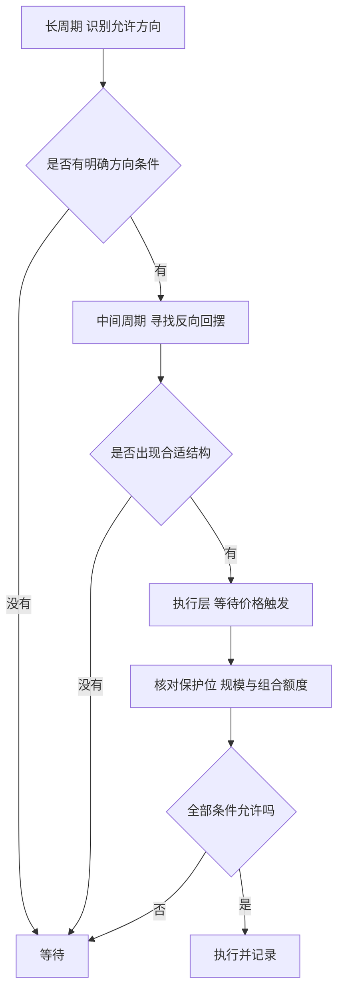
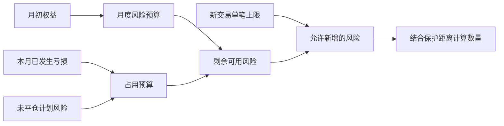

# 《以交易为生》读书笔记

> 作者：亚历山大·埃尔德（Alexander Elder）  
> 原版：Trading for a Living: Psychology, Trading Tactics, Money Management，Wiley，1993 年  
> 新版：The New Trading for a Living，Wiley，2014 年，结构和内容经过修订扩展。  
> 版本处理：用户没有指定中文译本。本笔记先整理原版共同主干，再明确标注新版及作者后续发展的内容；不把所有新方法倒推为 1993 年原版内容。  
> 分析依据：两版出版社目录、作者官网与公开交易日志、配套手册、访谈、指标平台官方说明，以及监管机构资料。未取得用户原书，属于公开资料与核心概念整理；真实事件、作者自行公布的交易记录与必要数学演示分别标明。  
> 覆盖范围：心理、方法、资金管理、主要技术工具、三重滤网、风险限制和日志，共 35 个核心知识点；不是对每个历史图形的逐图复述。  
> 更新日期：2026-11-11

## 先看这里：这本书讲什么

**一句话概括：把交易当成需要自我管理、明确方法和资金纪律的专业活动，而不是依靠刺激、直觉或某个神奇指标。**

作者用三个 M 组织自己的框架：Mind（心态）、Method（方法）、Money（资金管理）。如果方法没有优势，冷静也不能凭空赚钱；如果风险失控，再好方法也可能来不及发挥；如果执行不断变形，研究得到的规律也很难实现。[1993 年原版出版社信息](https://www.wiley.com/en-us/trading-for-a-living-psychology-trading-tactics-money-management-p-9780471592242)

最值得记住的六点：

1. **先管理自己，再管理头寸。** 急于证明、翻本或追求刺激，会改变原计划。
2. **技术指标描述的是不同方面。** 趋势、动量、成交量和市场宽度不是一回事。
3. **先辨别市场环境，再使用工具。** 在趋势里用震荡思维，容易不断逆势；在横盘里追每次突破，容易反复亏损。
4. **先定失效与退出条件，再决定数量。** 不能先买到自己兴奋，再寻找一个愿意接受的止损。
5. **单笔风险和连续亏损要分别限制。** 控制一笔大损失，不自动控制很多笔小损失。
6. **记录让经验能累积。** 没有事先计划和事后复盘，很难分辨方法、执行和运气。

“以交易为生”是书名，不代表读完即可取得稳定收入。本书帮助建立训练和决策框架；能否盈利仍取决于方法优势、成本、执行、资金与市场环境。

## 先分清版本与内容地图

| 内容 | 本笔记的版本归属 |
| --- | --- |
| 个人与群体心理、图表、趋势和震荡指标 | 1993 原版主干，2014 版保留并调整 |
| 成交量、持仓量、时间、市场宽度与情绪 | 原版已涉及，新版结构与部分工具有变化 |
| Elder-ray、Force Index、三重滤网 | 原版的重要工具与系统思想 |
| 冲动系统 Impulse System | 作者后续发展，2014 新版单列；官方手册注明最初见于 Come Into My Trading Room |
| 2% 与 6% 风险规则 | 本笔记按 2014 新版明确列出的章节解释，不把两者整套表述自动归为 1993 原版 |
| 交易工具分类、计划评分、系统化记录 | 按新版的明确结构补充说明 |

书的阅读顺序可以概括为：**为什么会失控 → 市场群体怎样行动 → 图表提供什么信息 → 怎样组合工具 → 先限制风险 → 记录并改进执行。**

原版与新版目录均可核对：[原版](https://www.wiley.com/en-us/trading-for-a-living-psychology-trading-tactics-money-management-p-9780471592242)、[2014 新版](https://www.wiley.com/en-ca/the-new-trading-for-a-living-psychology-discipline-trading-tools-and-systems-risk-control-trade-management-p-9781118443927)。

## 核心知识点：心理和市场

### 01. 三个 M 是相互制约的系统

心态负责按事实行动，方法负责给出可检验条件，资金管理负责让错误不会过早耗尽资源。不能把其中任何一项当成万能补丁。

连续亏损后，先分辨是方法在当前环境中不适用、执行偏离，还是头寸过大。仅用“我心态不好”解释所有亏损，可能漏掉方法本身没有优势。

### 02. 区分谋生目标与对轻松获利的幻想

交易收入不稳定，学习也需要时间、成本和反馈。把每月生活费用强行转成每天的盈利指标，容易迫使自己在没有机会时操作。

必须每天赚到一笔生活费，是个人资金需求，不是市场提供的交易信号。生活资金与学习资金的边界，应在交易之前确定。作者的访谈也强调，训练过程远比轻松赚钱的宣传漫长。[作者访谈](https://traderlife.co.uk/interviews/pod-chats/trader-interview-dr-alexander-elder/)

### 03. 识别自我破坏式行为

典型表现包括取消保护、越亏越加、为了报复市场扩大规模、赚钱后突然失去限制。它们往往不是缺少某个指标，而是没有按原先标准行动。

**补充练习：** 记录“我正在想什么”和“计划要求做什么”，尤其在连续盈利或亏损之后。行为可以被具体检查，比笼统指责自己贪婪或胆小更有帮助。

### 04. 承认失控并建立外部规则

原书借用互助组织的思路，强调承认问题、减少自欺、日复一日遵守承诺。这里是作者的交易管理类比，不是把所有亏损者诊断为成瘾或心理疾病。

暂停条件应写成可检查的行为：是否反复违背事前计划、是否绕过风险上限、是否无法解释自己的下单理由。发现这种模式后暂停并复盘，比相信下一次会突然自律更具体。具体触发阈值属于个人管理制度，不应冒充原书统一参数。

### 05. 价格是参与者行动的结果

成交价体现买卖双方在特定时刻达成的交易，不是企业价值的精确测量。群体的恐惧、兴奋和时间压力可以反映在价格与成交量中。

**补充解释：** 一根很长的上涨柱，说明该时间段价格显著上升；它不直接证明参与者知道未来，也不告诉你谁一定“更聪明”。从可观察行为到原因解释之间，仍存在推断。

### 06. 管理比预测更容易形成可执行动作

与其执着于明天一定怎样，不如写清：如果上涨、横盘、下跌，分别如何处理。作者强调把控制力放在自己的行动上。[作者访谈](https://www.mql5.com/en/articles/339)

无法控制价格是否突破，却能控制是否参与、投入多少、失效后何时退出。一个预测可能正确却无法执行；一个条件计划则可以应对多种未来。

## 核心知识点：图表和工具

### 07. 支撑与阻力是观察区域，不是保证反转的墙

过去成交集中的价位，可能影响参与者的记忆和行为，因此成为观察区域。但价格可以穿越，且突破后也可能再次回到区间。

过去多次止跌的区域，只能说明当时存在承接，不代表未来买方永远充足。使用这类位置时，需要规定什么算突破、何时确认失效，不能把线画得越精确就越相信。

### 08. 趋势与交易区间需要不同思路

趋势环境中，价格更容易延续方向；区间环境中，靠近边界后的回摆可能更明显。识别环境本身有滞后和误差。

强趋势中的“超买”可能持续，横盘中的小突破也可能反复失败。工具并非互相矛盾，而是回答不同环境的问题。

### 09. 形态、缺口和长影线要放回背景

原版讨论趋势线、缺口与形态；新版还专门讨论 Kangaroo Tails（袋鼠尾形态）。这些都在观察尝试突破、被拒绝或供需变化的迹象，不能脱离趋势、成交和后续行为独立断言。

长下影说明该周期内价格曾下探后回升，但可能是需求增强，也可能是短暂反弹。先描述发生了什么，再提出待验证解释，能减少看图说故事。

### 10. 指标分类比堆叠指标更有用

指标是对数据提出不同问题的计算方式。均线帮助观察平滑方向，动量工具描述变化速度或相对强弱，成交量工具加入交易活跃程度，市场宽度则考察参与上涨或下跌的范围。先有问题，再选工具，才知道数值变化应该改变哪部分判断。

**用实际指标定义检查“多重确认”：** StockCharts 文档给出的常见 MACD，是两条收盘价 EMA 的差；柱状图又是 MACD 与其信号线之差。其冲动系统同时观察 EMA 方向与 MACD 柱状图方向。这里确实有不同计算，但包含重叠的价格输入。[MACD 柱状图定义](https://chartschool.stockcharts.com/table-of-contents/technical-indicators-and-overlays/technical-indicators/macd-histogram)、[冲动系统实现](https://chartschool.stockcharts.com/table-of-contents/chart-analysis/chart-types/elder-impulse-system)

由此作出的教学判断是：看到均线、MACD 和柱状图同时改善，不能直接当作三次独立实验，更不能把三个随意假设的成功概率相乘来制造确定性。它们可以具有互补用途，但是否增添预测信息仍需研究。图表软件确实提供这些工具，不等于软件证明了组合能赚钱。

不同周期的指标也未必在“互相矛盾”。较长周期工具可以回答背景方向，较短周期工具可以描述正在发生的回调；两者本来就在问不同问题。问题在于有没有事先分工，而不是能否把全部颜色调成同一边。

可以把工具写入工作单：哪个限制方向，哪个帮助选择结构，哪个触发执行，哪个只是辅助背景。若几个指标都在回答最近是否上涨，就先查是否冗余；若准备新增一项，必须解释它要解决什么已识别的问题，而非只因刚经历亏损。

**自测与参考答案：** 指标越多，独立证据一定越多吗？不一定，要检查原始输入和定义。这节没有重建某个历史时点的技术信号，也没有声称任何指标当时一定正确；它直接使用真实工具定义，训练对证据来源的识别。

### 11. 移动平均线用平滑换取滞后

均线把一段价格压成趋势信息。较短周期更敏感，也更容易受噪声影响；较长周期较平滑，但变化时反应较慢。

想让均线既永不滞后、又完全不受假突破影响，是互相冲突的要求。选择参数必须结合用途和成本，不能只寻找过去最漂亮的一条线。

### 12. MACD 线、信号线与柱状图不相同

常见定义：MACD 线是快 EMA 减慢 EMA，信号线是 MACD 的平滑值，柱状图是两者之差。典型 12、26、9 参数是常见设置，不是所有市场的最优答案。

柱状图上升意味着它相对上一期变高，不一定已转为正数，也不等于价格已确立上涨趋势。**符号辨析：** −3 变为 −1 是负值区间里的改善，不是已经强于零轴。[官方指标计算说明](https://chartschool.stockcharts.com/table-of-contents/technical-indicators-and-overlays/technical-indicators/macd-histogram)

### 13. ADX 看趋势强度，不直接告诉多空方向

方向运动系统的 +DI、−DI 与 ADX 作用不同。ADX 上升可能对应更强上涨，也可能对应更强下跌。把“ADX 高”解释为“该买入”，会混淆强度和方向。

急剧下跌也可能让趋势强度指标升高。需要把方向与强度放在一起看。出版社对新版有关公式还有勘误，若自行编程应核对公式而不只抄某个截图。[ADX 官方说明](https://chartschool.stockcharts.com/table-of-contents/technical-indicators-and-overlays/technical-indicators/average-directional-index-adx)

### 14. 超买与超卖不是立即反转命令

RSI、随机指标、Williams %R 等观察价格相对近期行为的位置或动量。它们进入极端区域，可能提示回摆，也可能反映趋势很强。

RSI 超过常见阈值后继续上涨，并不是数学失效；错误可能是把一个状态标签当作确定卖点。指标阈值需要结合环境、时间周期与完整规则。[RSI 的定义与限制](https://chartschool.stockcharts.com/table-of-contents/technical-indicators-and-overlays/technical-indicators/relative-strength-index-rsi)

### 15. 背离是警报，不是时间表

价格创出新高，而某个动量指标没有同步创高，通常称为顶背离；低点情况相反。这可能说明运动力度发生变化，却不保证马上反转。

**补充解释：** 一辆车减速仍然可以继续前进。类似地，趋势可能在背离出现后继续一段时间。背离定义、比较窗口和确认条件不清楚时，事后解释空间很大。

### 16. 成交量提供参与程度，但不能单独说明动机

成交量告诉你交易活跃程度，不会直接说明每笔交易的最终目的。OBV 等工具把价格方向和成交量合并观察，但它们仍是概括。

放量下跌可能涉及止损、调仓、套期保值或长期看空，不能从一项数据直接认定某种动机。需要结合价格位置和后续变化。[OBV 官方说明](https://chartschool.stockcharts.com/table-of-contents/technical-indicators-and-overlays/technical-indicators/on-balance-volume-obv)

### 17. 持仓量与成交量不同

期货成交量是期间交易了多少，持仓量是仍未了结的合约数量。新开仓与平仓对持仓量的影响不同。原版也介绍 HPI 等把价格、成交与持仓结合的工具。

同一批头寸来回交易能产生大量成交，未必大幅增加未平仓合约。不能把成交活跃简单等同于新增资金方向。具体合约、换月与统计口径也要核对。

### 18. 时间周期是分析的一部分

周线向上与日线回调可以同时成立，因为它们观察的是不同窗口。先确定预计持有时间，再安排较长周期背景、主要分析周期和执行条件；不能在不利时临时换一张图替原判断辩护。

作者常用约五倍的相邻时间尺度组织分析，这是一种方法选择，不是市场定律。三重滤网的第三层也可以是价格触发和订单安排，不一定要求打开第三张更短周期图。下一个重点节将直接使用作者公开的 AMT 记录说明周期怎样分工。

数据何时可得同样重要。尚未收盘的周线仍会变化，不能把周五才确定的值用于模拟周二已知的决定。使用实时更新中的周线与只使用已完成周线，都必须事先定义，不能为了让历史成绩更好而混用。

### 19. 市场宽度检查“有多少人在参与”

新高—新低数量、上涨与下跌家数等工具，观察指数上涨背后是否有较广参与。新版还讨论站上一定周期均线的股票占比。

指数创新高可能只由少数权重股推动，普通股票表现却较弱。宽度背离提示结构需要检查，但不能单独证明大盘即将下跌。样本范围、退市和成分变化会影响比较。

### 20. 情绪与持仓报告提供背景，不是秘密答案

调查共识和不同参与者的持仓可以辅助判断拥挤程度。报告分类、发布时间和经济动机都必须理解，不能把某一类机构一概当作总能判断正确的人。

商业参与者的空头可能是给现货业务套保，而不是纯粹预测价格下跌。COT 是特定口径的持仓分解，并且存在数据日与发布日期的间隔。[CFTC 官方报告说明](https://publicreporting.cftc.gov/stories/s/r4w3-av2u)

### 21. Elder-ray：把高低价与均线作比较

常见 Bull Power 用最高价减 EMA，Bear Power 用最低价减 EMA，观察价格向均衡上方和下方伸展的程度。它们是作者设计的工具，不是直接测量真实买卖资金。

**数学演示（假设数据）：** 均线 100，最高 104、最低 98，对应 +4 与 −2。数值描述相对位置，不自动得出未来方向。需要结合均线方向和工具规则。[作者配套手册](https://6e6fa188-f273-4932-86c0-66af721f16a8.usrfiles.com/ugd/6e6fa1_60651ebd50ca4ea0bd0421f83dce9e74.pdf)

### 22. Force Index：把变动幅度与成交量联系起来

单期力量指数的核心计算为 `(本期收盘−上期收盘)×本期成交量`，再根据用途进行平滑。它结合方向、幅度与参与量，但不是企业基本面价值指标。

**数学演示（假设数据）：** 上涨 2 元、成交 1000 股，单期值为 2000；上涨 1 元、成交 5000 股，值为 5000。不同股票的绝对数值不能在不归一化时直接比较。[Force Index 官方计算说明](https://chartschool.stockcharts.com/table-of-contents/technical-indicators-and-overlays/technical-indicators/force-index)

## 核心知识点：把工具组成方法

### 23. 三重滤网的三层承担不同任务

三重滤网让不同层次分别承担方向、结构与执行职责。通过较长周期的方向条件，不等于马上买；出现较短周期回调，也不等于价格已经恢复。第三层还要确定实际触发和可执行风险。这是原版的重要框架，具体工具与参数存在实现变体。

**作者公开的真实交易叙述可以帮助理解分工。** 在 2015 年官方出版物 Step by Step Trading 的 AMT 交易日记中，埃尔德展示周线与日线：用周线作战略判断，用日线决定进入和退出，记录计划入场 92.52 美元、目标 97 美元、保护 91.12 美元。[作者官方日记，图 34—36](https://s3-us-west-2.amazonaws.com/elderdownload/wp/wp-content/uploads/20180314155306/Step_by_Step_Trading_Elder.pdf)

这份案例是作者对自己交易的公开记录，未在这里取得券商流水独立审计；它体现多周期分工，**不是原始三重滤网的唯一参数，也不是每条机械规则都被严格遵守的验证。** 尤其作者自己说明，他进入时周线冲动系统尚未转成中性，认为日线条件与保护安排足以支持行动。这是书外后续案例中的裁量与例外，不能偷偷删掉这句，把它包装成所有滤网标准通过的完美样本。

从记录中可以依次问：周线提供了哪项背景，日线显示了什么可行动结构，真正的入场条件是什么，保护位又如何限制失败。每一层都必须回答自己的问题。若只有“周线看好”而没有后三项，交易计划还没有完成。

计划数字的算术也能直接复核：目标距离为 `97−92.52=4.48`，保护距离为 `92.52−91.12=1.40`，事前比例为 3.2。这个比例来自作者公开的计划，不是本笔记编出的价格；但它只是计划结构，并不保证实际成交、退出或最终平均收益都保持 3.2。

实际使用还需要独立完成数量、费用、组合额度和订单检查。作者日记的价值在于让这些决策能够被追问，而不是让读者照抄当时价位。**自测：** 能否据一笔作者披露的盈利操作证明三重滤网有效？不能，它缺少全部样本和对照，也包含明确的裁量行为。

### 24. 通道方法依赖边界与趋势环境

价格通道围绕均衡区域设置上下边界，可以辅助观察偏离程度和规划目标。不同通道算法并不相同，也不是保证价格必须返回中线的约束。

横盘时靠近上沿可能是减仓观察区，强趋势中却可能连续贴着上沿运行。先说明策略是跟随趋势还是交易回摆，再决定如何使用边界。

### 25. 奖励风险比要和成功概率一起看

目标距离与保护距离的比值，是事前结构，不是已经实现的平均盈亏。一个看似 5:1 的目标如果几乎无法达到，也未必有优势。

**数学演示（假设分布）：** 每次赚 3、亏 1，若成功率只有 20%，忽略成本，期望 `0.2×3−0.8×1=−0.2`。不能为了得到好看的比值，把目标画得很远或保护位挤得不合理。

### 26. 先决定退出依据，再由它反推仓位

保护价应与市场结构、策略失效或波动相联系。随后用可承受金额除以单位损失，决定数量。先定数量再把保护价改到“刚好不疼”，容易让风险服从情绪。

合理保护距离增大时，可以减少数量；不必为了维持原仓位，把保护设置在正常噪声里。[CME：按保护距离与资金风险确定规模](https://www.cmegroup.com/education/courses/trade-and-risk-management/proper-position-size)

## 核心知识点：资金管理与执行

### 27. 2% 规则限制的是计划损失，不是买入金额

按新版明确的风险章节，2% 限制的是单笔到保护位的计划损失，占账户权益的比例；不是买入金额比例，也不是每次必须用满。它是作者的管理框架，不能保证实际最多只损失这些。

真实交易制度说明为什么必须保留“计划”二字：美国 SEC 的投资者教育指出，止损单触发后通常转为市价单，执行价格可能明显偏离触发价；止损限价单限制价格，却可能无法成交。[SEC 投资者教育：订单类型](https://www.investor.gov/introduction-investing/investing-basics/how-stock-markets-work/types-orders) 因此，设置一个保护价不等于购买了定额赔付保险。

**以下保留为必要算术，全部价格为假设：** 当前权益 100000 元，2% 为 2000 元。若入场 50、合理保护 48，每股计划风险 2 元，忽略费用可计算 1000 股，名义金额 50000 元。它绝不是只允许买价值 2000 元的资产。

若合理保护实际应在 47，距离变为 3 元，就应先重新计算数量，而不是为了保留 1000 股把保护硬挪近。逐股交易的简化上限为 `向下取整(2000÷3)=666 股`；若另为每股预留 0.2 元成本与执行偏差，则为 `向下取整(2000÷3.2)=625 股`。真实交易单位还要向下调整。预留值也不是保证覆盖所有跳空。

这个计算次序不能颠倒：先定义什么情况说明方法失效，再计算从可执行入场到该位置的损失，最后由资金上限反推数量。保护依据决定距离，资金管理决定数量；它们不能相互冒充。

另外，单笔满足 2% 不代表账户允许新增。还要检查第 28 点的月度额度、相关持仓和现金条件。实际订单机制与作者的风险框架一起理解，才能避免把一个整齐百分比误读成真实世界的损失上限。

### 28. 6% 规则同时计算本月亏损与未平仓风险

这里按 2014 新版第 51 节 The Six Percent Rule 说明：以月初权益为基数，把本月已发生的亏损与现有持仓相对入场价、到当前保护位的计划风险加总，检查是否还有新增风险空间。它不是单纯规定“最多持有三只股票”。

**数学演示（假设账户）：** 月初资金 100000，本月已亏 2500，现有持仓计划风险 2500，距离 6000 的额度只余 1000。即使新交易满足单笔 2% 上限，也不能再加入 2000 风险。

要区分两种情形。第一，亏损与未平仓风险合计占满额度，但实际亏损尚未达上限：新版后续例子允许在已有头寸有利运行、合理提高保护位或兑现头寸后，重新计算可用风险；不能为挤出额度随便把止损收得过紧。第二，实际月亏损已达 6%：停止当月新增交易并复盘，不能靠重新计算来恢复开仓。作者 2015 年的官方入门书也明确强调后者。[作者后续说明：Step by Step Trading，How to control risk](https://s3-us-west-2.amazonaws.com/elderdownload/wp/wp-content/uploads/20180314155306/Step_by_Step_Trading_Elder.pdf)

计划限额仍无法保证阻止跳空超额损失；保护位到成本，只是按规则计算的入场本金风险降为零，浮盈回吐和成交不确定性仍存在。

**风险占用与释放的数学演示：** 另设月初权益 100000 元的账户，本月已实现亏损 2000 元；现有 A、B 两笔按入场成本到当前保护位计算，各占用 1500 元。合计已占用 5000 元，距 6000 元剩 1000 元。此时一项新机会希望承担 1500 元，虽然小于单笔 2% 上限，也不能直接加入，因为总额会到 6500 元。

若 A 有利运行，并且按照合理的退出逻辑把保护提高到入场成本，按这项规则的计算口径，A 的开放风险由 1500 降到零。账户现有占用变为 `2000+0+1500=3500 元`，余量为 2500 元，才可以重新评估那笔 1500 元的新机会。释放的是规则计算中的本金风险，不是把真实市场变成零风险；A 的浮盈仍可回吐，也仍会遇到跳空。

另一条路径中，若 A 不是提高保护，而是在原保护位亏损 1500 元退出，不能说“持仓少了一笔，所以释放 1500”。原来 A 的未平仓风险消失了，却变成本月已发生亏损；合计仍是 `3500+1500=5000 元`。这正是把已发生亏损纳入计算的意义：止损退出不会自动为不断试错刷新一整份预算。

如果本月实际亏损累计已经到 6000 元，就进入暂停当月新增交易的情形。不能把盈利头寸的浮盈随意抵消亏损记录，也不能通过转账、重新命名账户或临时改变统计月份来恢复额度。具体账户制度还需预先明确跨月头寸、成本与权益计算，不能在触及限制后才选对自己有利的口径。

**练习与参考答案：** 上述 A 在保护位止损后，若有人只查看“当前 B 还有 1500 风险”，便认为还可增加 4500，错在哪里？漏掉了本月已发生的 3500 元亏损，实际只剩 1000 元。这是资金账与风险账必须一起维护的原因，也解释了为何“账户里还有现金”不是是否能新开仓的充分条件。

### 29. 组合相关性可能让多笔同时出问题

多个名字不同的头寸可能依赖同一风险因素。每笔都有保护价，也不保证组合在压力时独立退出；相关性、流动性和融资条件可能同时改变。

**1998 年 LTCM 提供了现实教训。** 官方历史材料记载，其投资横跨政府债券、抵押证券、股票及多种衍生工具，但危机中的避险与流动性变化使许多原本期待收敛的价差一起向不利方向扩大。[美联储历史资料](https://www.federalreservehistory.org/essays/ltcm-near-failure)、[1999 年官方工作组报告入口](https://home.treasury.gov/news/press-releases/report3097)

这说明分散品种不等于分散生存条件。不同交易若都依赖持续融资、较好流动性或同一风险偏好，遇到这些条件变化时就可能共同受损。平时观察到的相关性，也不保证在压力情境下保持不变。

放回埃尔德的框架，2% 与6%是计划损失管理，还需要了解损失是否会同时发生、是否可能越过保护价，以及现金能否支持现实执行。不能仅把各笔纸面止损相加，就认为所有风险已被封顶。

这个事件不是对埃尔德策略的历史回测，也不说明 LTCM 当时采用其规则；它提供的是组合机制的真实例子。学习目标是识别共同失败原因，不是拿一次机构失败替代自己对全部持仓的分析。

### 30. 回撤后的恢复需要先保护能力

亏损后急着加大规模，可能把一次正常不顺变成无法恢复的损失。恢复过程应先检查规则、减少不必要的风险和复查执行，而不是立即设定回本期限。

**补充算例：** 100 降到 80，恢复到 100 需要 25% 收益；降到 50 则需要 100%。规模管理的目的之一，就是防止账户落入越来越难恢复的状态。

### 31. 手续费、滑点和订单选择属于方法本身

订单方式决定怎样把判断变成成交，不能放在方法之外。SEC 的投资者教育区分了常见订单：市价单不保证执行价格；限价单要求价格达到限制，却不保证成交；止损单达到触发条件后通常变成市价单；止损限价单则在触发后保留价格限制。[真实订单机制说明](https://www.investor.gov/introduction-investing/investing-basics/how-stock-markets-work/types-orders)

这对应一个实际取舍：更重视尽快退出，还是更重视不接受差于某个水平的价格。市场快速变化时，两者未必同时满足。止损限价单避免了某些不利价格成交，但也可能留下继续持有的风险，不能把它一概叫作更安全的止损。

费用还会进入完整期望。买卖价差、手续费与实际滑点可能使毛优势变成净劣势。缩短时间周期后，单次目标可能变小而交易次数增加，这时同样成本占目标的比例更高。不能只把信号变多看作机会增加。

**仅作成本算术：** 若每次预期毛收益 20 元，往返费用和滑点平均 25 元，净期望是 −5 元；这是数学展示，不对应某个真实产品费率。真实费率、盘口、订单规模和撮合方式需要另外取得。

本节依据实际订单机制解释成交不确定性；具体触发方式和适用制度仍须按市场与交易服务核对。

### 32. 模拟与回测检验逻辑，也有局限

回测和模拟应检验规则、数据与成本，也必须承认它们没有覆盖真实运行的所有风险。程序按什么逻辑设计，与生产环境最终发出了什么订单，是两层问题。

**真实案例：2012 年 Knight Capital 的系统事故。** SEC 调查材料记载，错误部署与遗留功能导致大量非预期订单；开市前出现了与问题相关的自动邮件，但未形成有效处置。[SEC 2013 年调查公告](https://www.sec.gov/newsroom/press-releases/2013-222) 这里不把事故解释成交易者心理，也不假定该机构使用了本书方法；它说明执行控制失败可以独立于市场方向判断造成损失。

对个人学习框架的可迁移含义，是把“策略信号、发送订单、实际成交、累计风险”分别记录并核对。模拟中得到一条盈利曲线，不会自动验证代码部署、异常状态、账户接口和停机处理。没有实际成交数据，也不能声称按理论触发价完成过全部交易。

统计检验仍是另一道关卡。只挑选最佳参数、使用未来才可知的数据，或在同一根日线同时碰到目标和保护时一律选择有利顺序，都能让模拟虚高。运行控制正确不能修好这些研究错误，研究逻辑正确也不能替代运行控制。

**自测与参考答案：** 自动化是否等于消除了纪律问题？没有，它把一部分责任转向规则定义、实现验证和过程监督。这个案例不能证明某一项检查必然避免所有损失，但能解释为什么只测收益公式远远不够。

### 33. 交易日志是学习系统，不只是盈亏流水

日志要让后来的人能够复原当时知道什么、计划什么、实际做了什么，而不仅是最后赚亏多少。作者公开的 AMT 记录正好说明这一点：同一交易同时保存数字表和周、日线图，并记录分次退出。[作者 Step by Step Trading 的 Good records make good traders 与 Your visual diary](https://s3-us-west-2.amazonaws.com/elderdownload/wp/wp-content/uploads/20180314155306/Step_by_Step_Trading_Elder.pdf)

这份材料有一个值得直接复算的差别：计划入场是 92.52 美元，数字记录中的买入价为 92.85 美元。若仅为比较而保持原目标 97、保护 91.12，实际入场后的距离就由计划的 4.48／1.40，变成 4.15／1.73，比例约为 2.40。**后一个比例是本笔记根据公开数字做的比较计算，不是作者宣称最终实现的收益风险比，也不据此猜测为何成交更高。**

这就是日志为何不能只留事前截图。计划、执行与事后结果并不相同：即使方向判断一样，价格差异也会改变数量、潜在回吐和目标结构。要诊断问题，必须知道差异发生在哪一环，而不能把全部结果统称为“技术好”或“心态差”。

记录还应保留例外。作者在该日记中承认一项进入条件的裁量，不能在复盘时将它抹掉，只保留成功结果。若自己的执行也出现偏离，要记录当时理由，后来才能区分规则需要改进，还是临场决定改变了方法。情绪则记具体想法和动作，不必用“贪婪”给自己贴总标签。

这是一份作者选择公开的案例，既非完整交易数据库，也非独立审计业绩。它能示范怎样留下可追问的记录，却不能证明同类形态总能获利。**练习与参考答案：** 为什么应同时保存计划价和成交价？因为只保留其中一个，就无法分辨分析与执行的差异，也无法正确复核当时风险。

## 新版与后续发展补充

### 34. 冲动系统看趋势和动量是否同向

冲动系统以均线方向与 MACD 柱状图方向组合标色：两者都上升为绿，都下降为红，不一致为中性。常见参数使用 13 期 EMA 与常见 MACD 设置。

其重要用途是过滤逆着冲动的行为，而不是见绿就无条件买、见红就无条件做空。作者官方手册明确说这一方法最初见于 Come Into My Trading Room，2014 新版将其纳入；不能写成 1993 原版独有的完整系统。[作者手册](https://6e6fa188-f273-4932-86c0-66af721f16a8.usrfiles.com/ugd/6e6fa1_60651ebd50ca4ea0bd0421f83dce9e74.pdf)、[平台实现定义](https://chartschool.stockcharts.com/table-of-contents/chart-analysis/chart-types/elder-impulse-system)

### 35. 交易工具、目标与记录需要一起选择

新版明确扩展股票、ETF、期权、期货、外汇等工具讨论。相似价格观点，用不同工具表达，风险结构会不同：持有期限、保证金、到期、时间价值和成交方式都会改变结果。

看对方向不意味着任何期权头寸都会获利，因为时间流逝和波动率变化也会影响价格。不要因为某工具名义投入小就认定风险小。新版的目标设置、计划评分与日常作业，都是为了让研究、执行和反馈形成同一过程。

## 难点图解一：三重滤网到底过滤什么

第一层决定大方向，第二层选择较合适的结构，第三层控制执行时点。长周期允许做多，并不等于马上买；日线超卖也不能跳过第一层。图为教学整理，不是已经验证的自动交易程序。

## 难点图解二：单笔额度与月度额度的关系

允许新增的风险同时受单笔和总体约束。账户还有现金，不代表还有风险额度；某笔交易的纸面保护位已经到成本，也不意味着真实跳空风险等于零。

## 完整数值练习：不要把仓位和风险混淆

以下为数学演示，全部数值为假设；设可按单股交易、成本暂忽略，不对应任何具体市场规定。

月初权益 100000 元，本月已亏 2500 元，现有头寸计划风险为 2500 元。为明确计算口径，假设当前其他头寸浮盈浮亏合计为零，且没有资金进出，因此当前权益为 97500 元。新机会的入场价 40、保护价 38、目标 46。

1. 单笔按当前权益的 2% 框架最多计划风险 `97500×2%=1950 元`；月度 6% 额度仍按月初权益计算。
2. 月度剩余预算：`6000−2500−2500=1000 元`。
3. 每股计划风险：`40−38=2 元`。
4. 数量受更紧约束：`min(1950,1000)÷2=500 股`。
5. 名义买入金额：`500×40=20000 元`。
6. 事前目标收益与风险之比：`(46−40)/(40−38)=3`，并非未来实际收益保证。

若预留费用和滑点，数量还要减少。若真实产品按整手交易，须向下调整到允许的交易单位。若突然只能在 36 成交退出，实际亏损为 2000 元，超过原计划的 1000 元，这正说明保护价不是保险。

## 实际应用：把交易计划写成别人也能检查的记录

| 时点 | 应记录什么 | 用途 |
| --- | --- | --- |
| 研究前 | 资金用途、分析周期、允许的风险 | 先确定边界 |
| 决策前 | 市场环境、信号、反证、入场与保护 | 防止事后编理由 |
| 下单前 | 单位损失、数量、剩余额度、成本 | 检查规模 |
| 执行后 | 实际成交、滑点、是否按计划 | 区分想法与现实 |
| 结束后 | 盈亏、过程质量、异常、可改进项 | 形成反馈 |
| 定期复盘 | 重复错误、不同环境表现、成本和回撤 | 决定下一步训练 |

一个适合入门的练习，是连续记录 20 个历史或模拟案例，保持同一套定义，中途不为解释结果而改规则。20 个案例不足以证明有统计优势，但可以暴露计划中最明显的歧义和执行问题。

## 常见误读与自测

- **三重滤网是三种指标多数投票吗？** 不是，它们承担方向、回摆与触发的不同职责。
- **RSI 超卖一定要买吗？** 不是，强下跌可以持续超卖。
- **MACD 柱状图由 −3 变 −1，是否已经转正？** 没有，只是向上变化。
- **2% 规则是否只允许买入总值为资金 2%的资产？** 不是，它限制到保护位的计划损失。
- **本月已经亏了 5%，还能因为单笔小于2%而随意再开吗？** 不能，还要看整体剩余风险空间。
- **冲动系统是不是 1993 原版就有的完整程序？** 不应这样归属；它是后续发展并进入新版的工具，也不能代替完整计划。
- **心理好是否足以盈利？** 不足以，还需要成本之后有优势的方法与合适规模。

书中的技术工具是作者的方法论与经验，不等于已对所有市场证明有效。固定百分比不是适合每个人的风险答案；本笔记没有做当代品种的回测，也没有把短期技术信号与企业长期价值分析混为一谈。

## 来源与待补充内容

1. [Wiley 1993 原版](https://www.wiley.com/en-us/trading-for-a-living-psychology-trading-tactics-money-management-p-9780471592242)与[2014 新版及勘误](https://www.wiley.com/en-ca/the-new-trading-for-a-living-psychology-discipline-trading-tools-and-systems-risk-control-trade-management-p-9781118443927)：作者、版本和结构。
2. [作者官网配套工具](https://www.elder.com/product-page/elder-disk-for-metastock-v2-0)及其[官方手册](https://6e6fa188-f273-4932-86c0-66af721f16a8.usrfiles.com/ugd/6e6fa1_60651ebd50ca4ea0bd0421f83dce9e74.pdf)：三重滤网、Elder-ray 和冲动系统归属。
3. [作者访谈：MQL5](https://www.mql5.com/en/articles/339)、[作者访谈：TraderLife](https://traderlife.co.uk/interviews/pod-chats/trader-interview-dr-alexander-elder/)：训练、心理和实践背景。
4. [作者 Entries and Exits 的出版物预览](https://www.everand.com/book/343296333/Entries-and-Exits-Visits-to-Sixteen-Trading-Rooms)与 [Step by Step Trading 官方 PDF](https://s3-us-west-2.amazonaws.com/elderdownload/wp/wp-content/uploads/20180314155306/Step_by_Step_Trading_Elder.pdf)：辅助核对作者对 2% 和 6% 的解释，并使用 Step by Step Trading 图 34—36 的 AMT 交易计划与日志。该案例属于作者后续公开的自行记录；2014 新版第 51 节的风险释放细节已另外核对，不把后续著作自动归入 1993 原版。
5. StockCharts 的[MACD 柱状图](https://chartschool.stockcharts.com/table-of-contents/technical-indicators-and-overlays/technical-indicators/macd-histogram)、[ADX](https://chartschool.stockcharts.com/table-of-contents/technical-indicators-and-overlays/technical-indicators/average-directional-index-adx)、[RSI](https://chartschool.stockcharts.com/table-of-contents/technical-indicators-and-overlays/technical-indicators/relative-strength-index-rsi)、[Force Index](https://chartschool.stockcharts.com/table-of-contents/technical-indicators-and-overlays/technical-indicators/force-index)与[冲动系统](https://chartschool.stockcharts.com/table-of-contents/chart-analysis/chart-types/elder-impulse-system)：核对指标定义，不用于宣称投资表现。
6. [CME 头寸规模](https://www.cmegroup.com/education/courses/trade-and-risk-management/proper-position-size)、[CFTC 持仓报告](https://publicreporting.cftc.gov/stories/s/r4w3-av2u)和[模拟交易说明](https://www.cftc.gov/LearnAndProtect/AdvisoriesAndArticles/fraudadv_tradingsystem.html)：补充现代术语和执行边界。

7. [SEC：订单类型](https://www.investor.gov/introduction-investing/investing-basics/how-stock-markets-work/types-orders)、[Knight 事件执法公告](https://www.sec.gov/newsroom/press-releases/2013-222)与[美联储：LTCM 濒临倒闭](https://www.federalreservehistory.org/essays/ltcm-near-failure)：订单、执行控制及组合风险的书外真实案例。

尚未逐项核对指定中文译本的译名、图例、完整 HPI 计算和所有新版交易评分细则。历史事件、真实机制和作者公开的 AMT 日志在原知识点附来源；其中作者自行记录不等于独立审计业绩。流程图与练习由本笔记编排，只有明确标为数学演示的数值是假设，公式结论限于已说明的口径。

---

[返回书籍索引](../README.md) · [财商学习与实践路线](../财商进阶合订本.md)
