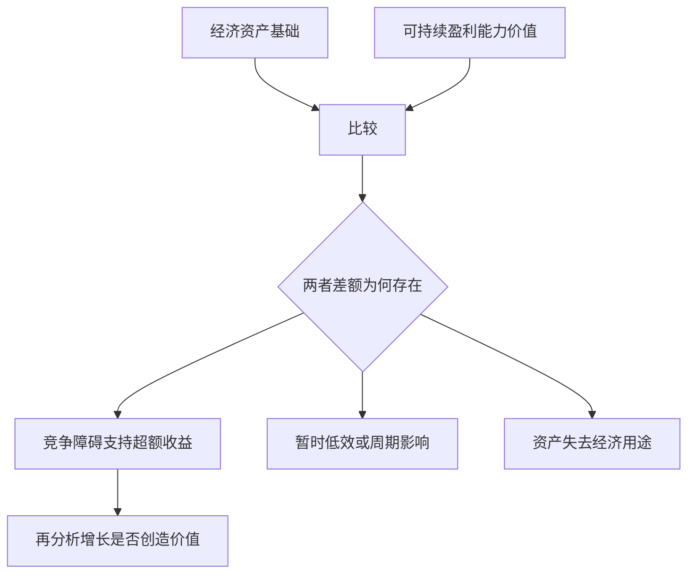
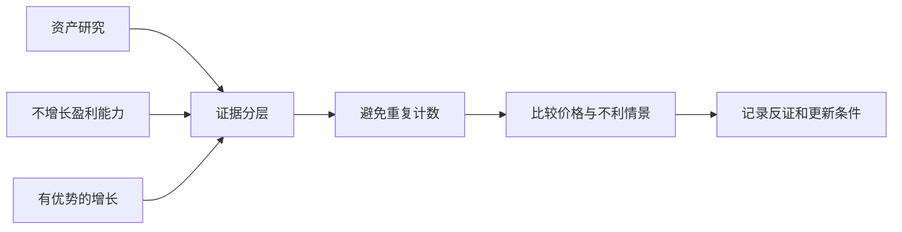

# 《价值投资》：把资产、盈利能力与增长分层判断

> 本篇对应 Value Investing: From Graham to Buffett and Beyond，第二版，Wiley，2020 年。作者为 Bruce C. Greenwald、Judd Kahn、Erin Bellissimo、Mark A. Cooper、Tano Santos。目录用“布鲁斯·格林沃尔德等”，不是泛指所有名为《价值投资》的书。第一版作者名单与第二版不完全相同。  
> 资料范围：出版社目录、作者所属机构公开讲解与一手经营资料支持的系统导读，未取得用户版本全文。覆盖机会搜索、资产价值、盈利能力价值、特许经营优势、增长、研究组织和风险，共 30 点；不虚构原书页码与每位受访投资人的完整方法。更新：2026-11-12。

## 这本书的独特视角

面对一个公司，先问现有资产的经济基础，再问不依赖额外增长的盈利能力，最后才为未来增长付钱。这样的顺序让不确定性逐层暴露，避免把最难验证的远期增长偷偷藏进一个总估值。

作者对传统 DCF 的批评，是它容易把可靠和不可靠的信息混合；这不等于证明现金流折现没有逻辑基础。盈利能力价值本身也包含折现和持续性假设。最值得学习的是证据层次和竞争分析，而不是把两派方法当作互相排斥的信仰。[出版社第二版书页](https://www.wiley.com/en-us/value-investing-from-graham-to-buffett-and-beyond-2nd-edition-p-9781118233818)、[哥伦比亚商学院对作者方法的说明](https://business.columbia.edu/insights/chazen-global-insights/greenwald-explains-value-investing-principles)

## 内容地图

| 层次 | 主要问题 | 位置 |
| --- | --- | --- |
| 找机会 | 为什么别人可能忽视或卖出 | 1—5 |
| 资产基础 | 重建或清算需要什么成本 | 6—11 |
| 盈利能力 | 不依赖额外增长值多少 | 12—17 |
| 竞争与增长 | 超额回报能否延续与扩展 | 18—24 |
| 组合和流程 | 怎样处理错误与证据更新 | 25—30 |

## 核心知识点

### 1. 价值投资不是某一种低倍数风格

低市盈率、低市净率只是筛选线索，可能对应低估，也可能对应衰退和风险。价值判断是比较价格与能获得的经济利益，而不是把价格低的证券都归为安全。

一家增长企业也可以有价值，一家便宜的旧资产公司也可能没有足够回报。关键是你为哪些收益支付多少钱，这些收益需要多少投入，证据是否支持持续性。

### 2. 先研究为什么出现便宜，而不是只研究便宜多少

信息复杂、规模太小、被迫卖出、暂时不受欢迎或机构约束，可能造成忽视；但坏资产、治理问题和价值持续流失也会造成低价。

应写出卖方可能面对的约束，以及自己是否真的与其不同。仅仅说市场短视，不能证明自己更正确。一个低价如果长期存在，也需要解释缺少什么实现价值的机制。

### 3. 专业化研究可以降低信息劣势

在少数行业积累客户、竞争和会计知识，有助于更快判断哪些差异重要。但专注不能变成只听行业内部乐观叙事。

研究者应同时了解替代技术与行业外竞争，并保留放弃的条件。能力圈是一组能解释和核验的问题，不是“我看了很多年”这样的时间标签。

### 4. 筛选器只是分配注意力的工具

资产折价、异常收益、分拆或低关注度可以帮助缩小范围，但筛选不能处理全部合同、会计与竞争因素。筛选结果不应直接生成买入清单。

记录被排除原因同样重要。未来回看时，区分当时信息不足的合理放弃与自己误用标准的错误，不要只因后来上涨就断定当时必须买。

### 5. 研究顺序要按证据可靠程度展开

已经存在的资产与近期正常经营能力，通常比十年以后市场份额更容易核实。但资产也可能无经济用途，当前盈利也可能不可持续，所以这只是研究顺序，不是保证。

越往远期增长，越需要说明竞争优势、市场容量、再投资和管理。给不同层次标出证据质量，比把所有预测塞进一张精确表格更容易发现薄弱环节。

### 6. 资产价值应区分清算与重置

如果行业缺乏继续经营的经济性，清算可能更相关；如果行业有长期需求，分析一个竞争者复制现有经营能力的成本，可以帮助判断进入条件。

清算价值关注出售后能剩下什么，重置价值关注重新建立相同能力需要什么。它们回答不同问题，不能为了得到更高价值而任意选取各项的最大数。

### 7. 现金不是全部可自由分配

经营需要的现金、受限资金、客户备付、海外或受监管资金，都可能有约束。必须先确定哪些现金已经支持现有盈利，哪些是真正多余资产。

估值把经营现金流与现金余额相加时，要避免重复计入。如果拿走现金会削弱业务或违反要求，那部分不能直接按无负担多余现金处理。

### 8. 应收、库存和设备都需要经济性调整

应收款要考虑回收与账龄，库存要考虑过时、折价和处置渠道，设备要考虑用途、寿命和技术替代。账面记录是一项证据，不是价值结论。

**真实补充：伯克希尔 1985 年股东信讨论纺织设备拍卖时，解释了重置成本和账面金额无法保证出售所得。**[巴菲特原信](https://www.berkshirehathaway.com/letters/1985.html)

这个案例帮助理解边界：若行业中很多人同时退出，专业设备可能缺少经济买方；“再造一套很贵”不代表有人需要再造。重置价值必须以行业具有可持续需求为前提，不能为失去用途的资产保底。

### 9. 无形经营能力可能不在账面上

客户关系、品牌、研发、员工培训和分销网络，可能通过历年费用形成，而非以完整资产出现。忽略这些能力，会把轻资产企业的经济投入低估。

但重建成本不是随意把历史营销费累加。需要判断哪些投入仍有效、寿命多长、竞争者是否必须付出相同代价。花过的钱可能已经浪费，不能因为是无形支出就全部变成价值。

### 10. 研发调整要同时改变盈利与资本

**ASML 2024 年报告披露研发费用约 43 亿欧元。**[公司年度报告](https://www.asml.com/investors/annual-report/2024)如果为了分析重建能力，把部分研发看成多年投入，就应同时考虑未摊销研究资产与历史项目的经济寿命。

这不是把当前研发全部加回利润。失败项目可能不再有价值，正在开发的项目也可能需要继续投入。分析调整与公司正式会计记录要分开，且应展示敏感性。

使用这一视角，能解释为什么两家账面资本相近的公司可能拥有很不同的知识基础；它仍不能让研究者精确知道竞争者需要多少年追赶。难以估计的地方应保留范围。

### 11. 负债和隐藏义务必须与资产一起算

养老金、租赁、担保、诉讼、环保和重组成本，都可能影响股东可获得的净价值。部分义务需要从附注而非主表查找。

不能把有形和无形资产估得很积极，却对负担只采用最狭窄的借款余额。资产价值研究的目标是净请求权，不是列出看起来最丰富的资源清单。

### 12. 盈利能力价值 EPV 先问不增长能赚多少

Earnings Power Value 把经过调整、可以持续的盈利按适当资本成本资本化。重要的是不先为额外增长付钱，以便看出现有经营本身是否已提供足够价值。

简化表达为 `EPV = 可持续税后经营收益 ÷ 资本成本`，但收益要扣除维持业务所需的真实投入，并处理经营与非经营资产、融资和股东权利。它不是随便挑一年 EBIT 除以一个低利率。

**数学演示：从利润到无增长可分配经营收益。** 假设经正常化的税后经营利润为 90，其中已扣除折旧 20；为维持相同经济能力，每年实际需要设备投入 30，营运资本不再增长，其他调整暂忽略。那么可以支持分配的经营收益近似为 `90＋20−30＝80`。若合适资本成本为 10%，经营 EPV 为 800。

再假设公司有额外现金 50、债务 200，且没有其他权益调整，则普通股对应价值为 650。这里 800 是经营资产价值，不是股东已经可以领取的现金；50 也必须确实属于多余现金，否则会重复计入。

最需要质疑的不是除法，而是前面的 80：30 是否够维持竞争位置？原来的 90 是否包括暂时高价或低税率？客户是否会转向新产品？若经济能力本身正在衰退，不增长的永续假设就可能不适用。这个层次化演示是分析者补充，用来理解模型条件，不是原书某页的公司估值。

### 13. 正常化利润需要理解业务，而非只取平均

周期、资产出售、异常税率、重组和产能利用都会影响当前利润。可以利用多年资料，但如果竞争和业务结构已经改变，历史平均并不一定代表未来正常水平。

**Target 2022 年第二季度受削减库存措施影响，营业利润同比下降 87%，公司同时披露客流和销售仍增长。**[公司公告](https://corporate.target.com/press/release/2022/08/target-corporation-reports-second-quarter-earnings)

这是一项真实的异常利润分析入口：既不能把受压单季永久化，也不能把所有损失一概加回。要问库存问题会不会重复、需求结构是否改变、恢复需要什么成本。正常化必须有机制和证据，不能只是把不喜欢的数字删除。

### 14. 维持性投入与成长性投入的区分很重要也很困难

维持现有销售、服务和竞争位置所需的投入，必须从可分配收益中扣除；扩张投入则要与新增回报一起评价。财务报表通常不会直接给出完美划分。

可以结合折旧、资产年龄、行业更新、单位产能投资和管理层说明估计。把全部资本开支视作可取消成长支出，常会夸大 EPV；把所有支出都当维持，又可能低估扩张型企业。

### 15. 不增长不是不需要管理和再投入

维持收入水平仍可能需要替换设备、研发更新、客户获取和人员投入。通胀也可能提高维持同一实物规模的现金需求。

因此，EPV 的“不增长”是一种分析条件，不是让企业停止投资的实际策略。模型应估计保住当前经济能力需要什么，而不是把所有支出冻结在过去。

### 16. EPV 与资产价值的差额提示竞争问题

如果盈利能力价值显著高于复制经营能力的成本，潜在竞争者通常有动力进入；如果差额能够持续，就需要解释什么障碍保护它。

若 EPV 低于资产价值，可能是暂时低迷、管理低效，也可能是资产已失去经济用途。不能机械认定管理层一换就能恢复。差额提出调查问题，不自动给出投资结论。



三种解释需证据区分。图不是一套按差额大小直接交易的公式。

### 17. 不能把资产价值和 EPV 简单相加

同一工厂既是资产，又产生经营盈利。若先把全部资产价值计入，再加完整盈利现值，会重复计算同一经济利益。

资产与 EPV 通常是比较和分解的工具，额外现金或独立非经营资产才可能在一致定义下另加。每项加法都要问它是否已经包含在前面的现金或收益里。

继续使用独立的**数学演示**：复制现有经营能力要 600，当前可持续经营 EPV 为 800。二者相差的 200，提示有某种超额收益，也可能是资产或盈利估计有误。若确有进入障碍，研究重点是为什么竞争者花 600 无法取得同样盈利，而不是把公司直接估成 1400。

如果反过来，重置成本 800、EPV 600，也不能自动按 800 购买。一个理性新进入者可能根本不愿重建这门生意；已有股东也不一定能以 800 卖出资产。两种估值差异帮助识别竞争结构，却不是让研究者在高低数中任选较高者。

### 18. 特许经营价值依赖可保护的竞争优势

这里的“特许经营”是经济意义的 franchise，不仅指餐饮加盟。它指企业能阻止竞争将回报压回普通水平的条件。

客户黏性、成本结构、规模和其他进入障碍，必须解释怎样保护盈利。市场份额大只是结果，不是保护机制本身。持续超额收益需要与竞争者的行为一起观察。

### 19. 客户关系与局部规模可以相互加强

在特定区域、产品或客户群中，客户密度可以改善服务和成本；更好服务又可能增强留存。关键规模可能是局部的，而非全球营业额最大。

研究应确定竞争边界：客户真正比较哪些供应商，配送和服务半径多大，产品是否需要兼容。边界划错，会把在一个区域存在的优势错误扩展到全部业务。

### 20. 喜诗案例帮助区分资本需求与利润增长

**巴菲特 2007 年股东信回顾，购买喜诗时价格为 2500 万美元，业务所需资本约 800 万美元；随后多年增长并未要求与利润同比例的大量新增资本。**[2007 年原信](https://berkshirehathaway.com/letters/2007ltr.pdf)

这份经营者回顾说明，增长价值不能只由增长率决定。若提价和客户关系使现金提高，而维持与扩张资本需求较少，股东能取得较多自由现金。它不是独立随机实验，也不能证明所有品牌消费企业都拥有相同能力。

研究时应分开原有资本回报与新增资本回报，还要检查市场容量和品牌维护。喜诗的历史表现不意味着可以把其经验直接套给任何新品牌，或为所有品牌支付无限价格。

### 21. 增长只有超过资本成本才增加经济价值

**数学演示：**新增投入 100，资本成本 10%，若持续税后收益为 15，形成超额回报；若只有 7，规模变大却未达到资金机会成本。

在无竞争优势的市场，增长可能需要不断投入却只能获得普通回报。你不能因为收入未来更高，就自动给出很大的成长溢价。增长的价格必须与新增投资效率一起判断。

进一步区分三种情形：新增回报高于资金成本，增长可能增加价值；回报接近资金成本，增长扩大规模但未必增加净现值；回报低于资金成本，增长可能损害价值。三种企业都可能报告收入和利润上升，所以报表中“增长”两个字不能完成判断。

还需要检查增长是否挤占有价值的旧业务。进入新地区可能提高总销售，却降低旧客户服务质量或增加品牌维护；收购增长可能更快，却把原有现金换成价格过高的资产。分层研究的好处，是迫使每一种增长分别证明资本投入与回报，而不让优质老业务替所有新项目担保。

### 22. 增长空间与优势边界需要同时满足

已有地区的优势不一定能复制到新市场。进入新客户群、渠道或产品后，原有品牌、规模和经验可能失效，需要新的投入。

研究应将有优势的增长和无优势的扩张分开。全国市场很大，只说明需求空间，不说明公司可以低成本取得它。跨界并购更不能因为合并收入增加就称为创造价值。

### 23. 管理层的资本配置决定增长能否兑现

优秀业务产生现金后，管理层可以再投资、收购、回购、派息或偿债。不同选择改变未来回报与风险。

应检查收购价格、整合成本和实际结果，而不仅看管理层声称的协同。若业务缺乏高回报增长机会，返还资金可能更合理；但也要考虑税务、融资与维持竞争地位的需要。

### 24. 不要为远期成长支付两次

一种常见错误是，先用高增长时期利润作为“正常盈利”计算 EPV，再额外加很高的成长价值。这可能在基础层已经计入成长，随后又重复加一次。

每个价值层应明确时间与条件。分层估值的优点是暴露假设，只有真正分清各层，才不会把同一好消息在资产、盈利和成长三处分别计价。

### 25. 安全余地应与信息质量匹配

估值区间宽、治理复杂或资产难以兑现时，需要更充分证据和更大余地；资料清楚也仍有经营与市场风险。没有适用于所有公司的固定折价比例。

便宜本身不能弥补无法理解的损失结构。若价值依赖多个同时成功的假设，较大表面折价也可能缺少实质保护。

### 26. 催化剂帮助实现价值，但不能创造原本不存在的价值

出售资产、改善管理、分拆和回购可能缩小折价，但也可能失败或耗时很长。必须判断事件如何改变现金或股东权利。

普通股在重组中可能被清除，旧 GM 就提供了这种权利边界的真实案例。[GM 官方说明](https://investors.gm.com/shareholders/stock-information)不能把企业获得融资与旧股东实现价值混为一谈，催化剂需要具体分配分析。

### 27. 组合管理要考虑共同错误来源

多个看起来便宜的公司，可能共同依赖低利率、某种商品价格或同一行业恢复。如果根本假设错了，持仓数量不能提供想象中的保护。

按风险来源而非只按名字检查组合，记录最坏共同情景及资金需求。集中与分散都要有理由，不能因为某位成功投资者集中，就忽略自己的证据和承受能力。

### 28. 研究过程需要独立检验和反证

可安排一次“反方复核”：暂时假定自己估值过高，要求找出最可能的原因。若资产层高估，检查经济用途和隐藏负担；若 EPV 高估，检查维持投入与正常利润；若增长层高估，检查优势能否延伸。这样反方意见直接对应模型，而不是只讨论市场情绪。

复核后仍应保留原始报表、调整表和估计日期。未来表现不好时，才能区分事实后来变化，还是当时已有资料被忽略。分层模型的价值不只是得到估值，也在于让错误可以定位和修正。

先形成自己的分析，再认真比较外部观点，可以减少跟随名人或群体的惯性。反证必须针对真正支撑价值的条件，例如客户关系、资产用途或维持性投入。

只写“股市可能下跌”不是有效反证，因为它未检验公司估值。最好说明一项新事实出现后，哪一层价值会改变，改变方向是什么。

### 29. 与 DCF 的分歧应作为方法比较

作者强调分层分析对证据可靠性的帮助，而达摩达兰强调统一现金流模型的一致性。两者都需要估计持续收益和资金机会成本，不应被简化成“资产派完全不预测、DCF 完全不保守”。

可以用 EPV 检查当前业务基础，再用 DCF 展示增长和资本投入的完整路径。如果差异很大，追查维持性投入、竞争消退和终值假设，而不是选出更符合期待的那个答案。



图中的三层互相检查，并非三个估值全部相加。

### 30. 一页分层研究卡

```text
公司和资料日期：
行业是否值得继续经营：
清算或重置资产价值的依据：
账外经营能力与隐藏义务：
可持续盈利、维持性投入及资本成本：
资产价值与 EPV 差异如何解释：
竞争优势的机制与边界：
新增资本回报与增长空间：
估值中有没有重复计数：
当前价格要求哪些层次同时成立：
最强反证、实现路径和复查条件：
```

没有足够资料完成某一层，就标未知。不得因为框架要求成长分析，就凭空给一个成长价值。

## 练习与参考答案

**资产价值 100、EPV 130，是否价值至少 230？** 不是。两者通常对应同一经营资产的不同分析角度，不能直接相加。差额提示竞争优势或估计差异，需要解释。

**EPV 低于重置成本，是否一定值得买？** 不一定。可能暂时低效，也可能行业已不值得进入，重置成本不能保护失去经济用途的资产。

**增长很快为什么仍可能损害价值？** 因为增长需要资本；新增回报低于资金成本时，规模与会计利润增加不代表经济价值增加。

## 边界与继续阅读

本篇没有复述第二版每位投资者访谈，也没有将其个别策略概括为所有价值投资者的共同规则。重置、维持性投入和竞争优势都需要判断，不是比 DCF 天然“没有假设”的方法。

可与[《巴菲特的护城河》](<../巴菲特的护城河 - 帕特·多尔西/读书笔记.md>)深入检查竞争机制，与[《投资估价》](<../投资估价 - 阿斯沃斯·达摩达兰/读书笔记.md>)核对模型的一致性。
