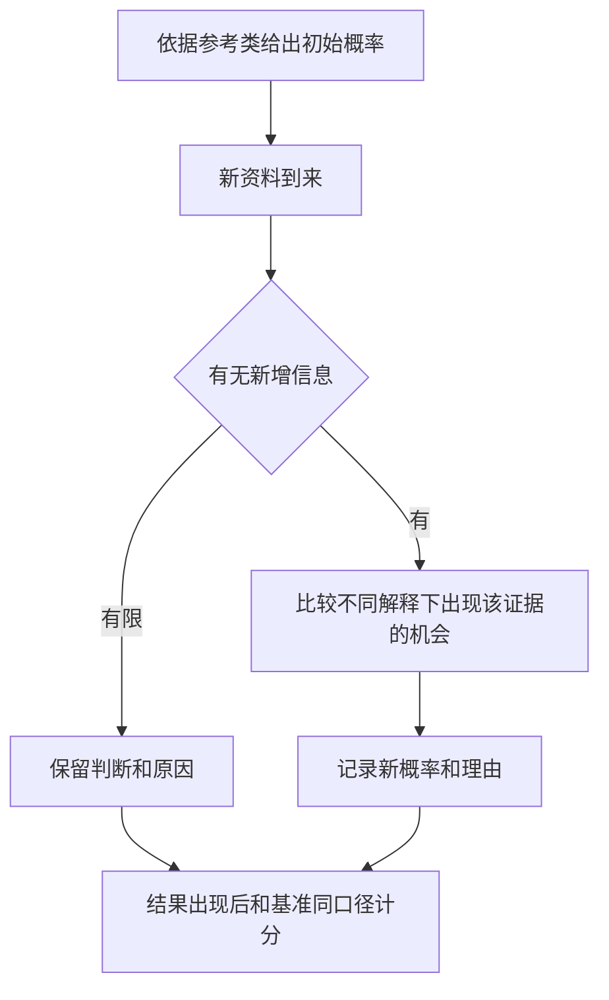

# 《信号与噪声》读书笔记

纳特·西尔弗（Nate Silver）著，英文原作 *The Signal and the Noise* 初版于2012年。本文依据英文出版方书目、中文公开目录及下列原始资料整理。中文参考书目为中信出版社2026年6月《信号与噪声：预测的科学与艺术》，ISBN 9787521784220。覆盖13章的主要问题和跨领域方法，资料范围为公开导读，中文原书全文和页码未核定。书外研究与计算演示在相关段落注明。核验日期为2026-11-12。 [英文出版方](https://www.penguinrandomhouse.com/books/305826/the-signal-and-the-noise-by-nate-silver/) [中文书目与目录](https://yuntaigo.com/book.action?recordid=b2hvbG5ta2M5Nzg3NTIxNzg0MjIw)

西尔弗把天气、棒球、选举、地震、金融和气候并列，追问哪些信息能提高预测质量，哪些规律仅在历史样本中出现，以及怎样表达剩余的不确定性。读完可建立一份带基准、时间戳和修订理由的预测日志，并用它评价经营判断、回测和风险情景。

| 章次 | 场景 | 对应的预测难题 |
|---|---|---|
| 1–3 | 金融危机、政治评论、棒球 | 样本外失败、专家激励、定量与定性信息 |
| 4–7 | 天气、地震、经济、流行病 | 初始状态误差、过拟合、数据修订、行为反馈 |
| 8–10 | 贝叶斯、国际象棋、扑克 | 更新信念、搜索成本、运气与技巧 |
| 11–13 | 市场、气候、低频安全风险 | 群体信息、时间尺度、稀有事件 |

## 一、信号取决于预测目标

### 1. 先定义目标、期限和结果的判定条件

信号是与目标有关的信息，噪声会干扰判断。季度销售数据可能有助于预测当期回款，预测十年后的份额还需要行业结构和竞争证据。先确定对象、期限与口径，再选择指标。否则，同一指标可以随结果被解释为任何一种趋势。

### 2. 解释过去、预测未来、选择行动，各需一套检验

解释回答为什么，预测回答接下来可能怎样，行动还要考虑成本和可选方案。季节性变量可能提高预测，却未必是因果杠杆。盈利增长预测即使准确，也要比较市场价格已计入多少预期。将三个判断分别记录，事后才能定位错误。

### 3. 用朴素基准评价模型增加了多少信息

基准可以是上年同期、长期发生率或价格持平。模型和基准使用相同起点、时限、结果口径及评分方式。若复杂模型只略好于基准，应把数据、维护和解释成本算进去。若差距很大，也应先检查基准是不是被设得过弱。

### 4. 狐狸型思考愿意综合线索并更新

西尔弗借刺猬和狐狸区分依赖单一统摄观念与综合多种线索的方式。后者更愿意承认条件变化。清楚的单一机制仍可能很有价值，多线索也必须核对相互依赖。五篇文章转述同一公告，增加的独立证据很少。

### 5. 预测者的激励会影响公开表达

鲜明且极端的判断容易传播，预测者却未必需要对全部历史预测负责。评价财经评论时，先收集同一期间的完整记录、发表时间和失败案例。看到一次命中，只能确认一次结果，估计预测能力需要稳定的比较口径和足够记录。

### 6. 棒球模型和球探各有能观察到的信息

书中以棒球说明，历史相似球员、年龄曲线和现场观察各有价值。定量模型抵消印象偏差，现场知识可能揭示伤病、角色改变和数据未覆盖的能力。将现场判断加入模型时，记录调整的理由和幅度，之后比较加与不加时的样本外成绩。

## 二、模型怎样把噪声当成规律

### 7. 过拟合会把样本中的偶然性写进规则

搜索的指标、阈值和组合越多，偶然找到漂亮曲线的机会越多。训练误差下降可能来自规律，也可能来自对少数异常值的记忆。只有冻结规则后处理未知样本，才能观察泛化能力。反复查看同一测试集并据此改参数，会让它逐渐变成训练数据。

### 8. 时间序列评价要尊重信息公开时间

年报反映上一年的经营，正式披露前通常无法取得最终数字。用报告截止日代替披露日会提前使用信息。回测可按当时可得的资料版本训练，逐步向前滚动。最终评价区间预先保留，并同时记录停牌、退市和成本。

图示为时间序列验证。每一轮都在相应日期截断信息，规则发生变化时另记版本。

### 9. 数据漂移会让原有代理指标失效

**书外真实研究。**Lazer等2014年分析Google Flu Trends，指出它曾对美国流感样病例就诊比例作出超过CDC估计两倍的预测。搜索行为、搜索产品和用户接触的信息都可能变化，历史映射关系也会跟着变。研究同时比较了结合传统监测数据的改进方向。此处的目标量是流感样病例就诊比例。 [原始研究](https://dash.harvard.edu/entities/publication/73120378-c3eb-6bd4-e053-0100007fdf3b)

用于公司研究时，搜索热度可以作为兴趣的一条线索，再和订单、退款及回款核对。平台推荐规则改变以后，应检查热度是否仍能预测实际销量。

### 10. 金融危机暴露了样本覆盖和共同风险

第1章把房价、评级与杠杆放在同一条预测失败链条里。若训练样本主要覆盖房价表现良好的时期，模型对广泛下跌、融资抽离与违约同时出现的情况可能缺少经验。组合中有许多借款人，可以分散个体风险，共同冲击仍会使损失集中。

阅读时逐项列证据。模型依赖怎样的房价及违约相关性？谁依赖评级、以何种方式融资？哪些损失会通过抵押品和交易对手扩散？《大空头》和《当音乐停止之后》可用于补充不同层次的证据。

### 11. 宏观数据修订会改变我们事后看到的历史

初值、修订值、名义量、实际量与季节调整结果各有口径。预测输入应使用当时可得的版本，事先说明用哪种结果计分。最终修订值可以成为评价对象，若把它提前放进模型，就会夸大历史上实际可用的预测能力。

### 12. 相关性与干预效果承担不同的证据责任

两个变量一起变化，可以提供待检验的预测线索。若要改变其中一个来获得另一个结果，还需检查共同原因、反向因果和样本选择。一个模型从观察预测改成指导行动时，应重新审查变量是否真的具有可干预的作用。

## 三、不同领域的可预测边界

### 13. 天气预测能进步，误差仍随时限积累

观测、数值模型、计算能力和预报员判断共同提高天气预报。时限拉长时，初始状态的细小误差可能在非线性演变中放大。集合预报用不同起点或设置生成多条可能路径。若集合成员共享系统偏差，多条路径仍可能整体偏离。 [NOAA预报说明](https://www.noaa.gov/explainers/improving-weather-forecasts)

### 14. 从真实飓风路径数据看绝对误差与相对改善

美国国家飓风中心2026年3月30日发布2025飓风季检验报告。表1列出大西洋盆地热带气旋官方路径预报相对事后最佳路径的平均距离误差。2025年12小时误差为20.1海里，120小时为162.0海里。下图比较两段期间、同一提前时长上的平均误差。 [NHC报告第20页表1](https://www.nhc.noaa.gov/verification/pdfs/Verification_2025.pdf#page=20)

| 提前时间 | 2025官方误差（海里） | 2020–2024官方平均（海里） | 2025可检验案例数 |
|---:|---:|---:|---:|
| 12小时 | 20.1 | 23.0 | 215 |
| 24小时 | 32.6 | 34.3 | 191 |
| 48小时 | 53.4 | 58.7 | 148 |
| 72小时 | 85.2 | 89.8 | 111 |
| 96小时 | 110.5 | 128.7 | 83 |
| 120小时 | 162.0 | 185.4 | 64 |

用相同48小时时限比较，2025年的CLIPER5基准误差是190.6海里。官方误差53.4海里，按表中数值计算，相对改善约为1－53.4÷190.6＝72%。几十海里的绝对误差和相对基准的明显改善可以同时存在。样本数量随时限变化，风暴组合在不同年份也有差异，年度数据用于描述性比较。路径误差、风暴强度和登陆概率需要各自的评价口径。

### 15. 降水概率先读对事件定义

美国国家气象局的降水概率针对指定地点、时段和可测降水标准。70%表示该地点在规定时段达到标准的机会。评价长期质量时，汇集同类70%预测，再与实际发生频率比较。区域覆盖率、降水持续时间和强度有各自的指标。 [NWS降水概率说明](https://www.weather.gov/lmk/pops)

### 16. 地震长期危险度和精确预报服务不同决策

USGS区分区域内一定年限发生显著地震的概率，与同时指定时间、地点、震级的预测。前者可用于理解长期建设风险。后者需要更高精度。书中案例提醒读者，事后从少数事件中挑选相似先兆，容易高估其预测能力。检验要同时记录所有触发和误报。 [USGS地震预测问答](https://www.usgs.gov/faqs/can-you-predict-earthquakes)

### 17. 稀有事件常缺少可比样本

当风险事件罕见时，较高的识别率仍可能伴随大量误报。要核对历史样本的遗漏、机制变化和参考类别。损失大且概率难估时，同时评价承受能力、缓冲和降低暴露的成本。

### 18. 气候趋势与短期天气属于不同时间尺度

书中的气候章节讨论长期信号与自然波动叠加。局地某天的天气和全球多年平均量是不同的预测目标。企业分析也要明确假说的时间尺度。预期多年渠道变化，需要连续经营证据。承诺季度结果，则应按季度口径验收。

### 19. 预测公布后，人们可能改变行为

经济和公共卫生场景中，参与者、政策制定者会根据预期采取行动。干预后的结果可能偏离原有情景。事前保留条件持续与行动改变两条路径，事后核对实际条件，可以帮助定位偏差来自模型还是环境。

## 四、怎样更新概率并长期计分

### 20. 贝叶斯更新把先验和证据区分力连起来

先验是看到新资料前的判断。似然比比较同一证据在假说成立和不成立时的出现机会。后验赔率等于先验赔率乘似然比，概率p对应赔率p÷(1－p)。不同解释都能产生的消息，似然比接近1，更新幅度就小。

### 21. 计算演示应保留中间步骤

假设某经营假说先验为20%，证据在假说成立时出现概率为60%，在假说不成立时为20%。先验赔率为1比4，似然比为3，更新后赔率3比4，换回概率约42.9%。这些数字用于数学演示。实务中还应比较多种合理先验，观察判断是否对起点敏感。

### 22. 同源证据重复计入会夸大置信度

同一调查生成的指标、基于同一报表的多份点评，都可能共享信息和误差。连续乘多个单独似然比，需要核对各条证据在相应假说下的条件独立性。先追踪信息源与新增内容，再决定更新多少。

图示为概率日志的更新流程。保留原先概率和证据日期，以便复核更新发生在何时。

### 23. 校准和区分能力要一起看

校准问70%预测是否大约70%发生，区分能力问模型是否能给容易发生的事件较高概率。对所有事件都报一个历史发生率，可能在稳定样本上校准良好，却很难区分个案。比较时还需记录各概率组的样本数量。

### 24. Brier分数给概率预测提供有梯度的反馈

实践补充中可用(p－y)²评价二元事件，p为预测概率，y在事件发生时等于1，否则等于0，分数越低越好。计算演示中事件实际未发生，报80%得0.64，报55%得0.3025。一次分数评价这次预测，长期能力需汇总全部结果并与基准比较。

### 25. 合并模型的效果依赖误差是否互补

不同数据、方法和假设可能使错误部分抵消。若几个模型使用同一资料和相同假设，平均也可能留下共同偏差。合并前标出各自资料源、失效条件和样本外表现，避免把多个高度相关预测当成独立支持。

## 五、技巧、运气与竞争

### 26. 国际象棋展示搜索广度、深度和评价规则

IBM记录，深蓝在1997年的六局比赛中以3.5比2.5战胜卡斯帕罗夫。团队除了使用并行计算，也改进了局面评价和残局资料。有限时间内可以增加候选走法，也可以把少数分支算得更深。研究公司时也可区分扩大资料覆盖与改进解释机制，按主要误差来源分配精力。 [IBM项目史](https://www.ibm.com/history/deep-blue)

### 27. 扑克章节用反复决策分离技能和运气

有合理胜算的一手牌也可能输掉。复盘要重建行动时所能知道的牌面、对手范围和损益条件，不能仅以结局评分。股票研究可以采用类似的记录纪律，但市场制度、流动性和竞争结构变化更大，应重新评价每次决策的可比性。

### 28. 群体报价能汇集信息，也受交易制度影响

市场报价背后有参与资格、资金约束、流动性与交易成本。要把报价读成某事件的概率，先核对合约结算条件和可成交性。股票价格还包含风险溢价、现金流和折现预期，解释时需要与相应模型一起讨论。

### 29. 市场有效性要连同风险模型与成本检验

弱式、半强式和强式有效性涉及不同信息范围。观察到超额收益时，应同时检查风险、可交易性、样本选择和成本。识别价格偏离以后，还要评估它可能持续多久，以及持有过程是否超过资金约束。

### 30. 低频风险要同时用预测与压力测试管理

有限的历史记录很难支撑精确概率。可以先测试不同情景对现金、供应、债务和运营连续性的影响，审查哪些措施能以可接受的成本减少多类损失。概率区间、损失范围和应对选择应保留在同一份记录中。

## 六、阅读后的练习

从一份公开财报选择经营指标，记录预测日期、口径、截止日、基准、概率或区间及数据来源。新消息出现后保留旧记录，再加新概率和变动理由。使用同一办法评价个人模型与基准，复盘时分别检查数据质量、模型、行动和外部变化。

**练习一。**先用2025年的结果选出最佳指标，再公布该年回测成绩，怎样重新验证？

参考答案。将2025年视为开发资料。冻结规则和成本，选独立时段或进行前瞻记录，再与同条件基准比较。

**练习二。**为什么不能只用12小时与120小时误差的比值评价五天预报？

参考答案。应比较相同提前时间的基准和使用目的。表中120小时官方误差162.0海里，CLIPER5为438.5海里。提前安排资源有独立价值，还要结合预测更新频率和行动成本。

**练习三。**三家媒体都说某企业需求旺盛，应怎样更新判断？

参考答案。先追溯报道是否来自同一采访，再找可以区分持续需求与短期冲量的交付、退货、存货和回款证据。用《超级预测》练计分，用《理性》比较行动后果，用《猜想与反驳》记录何时应当修正解释。
