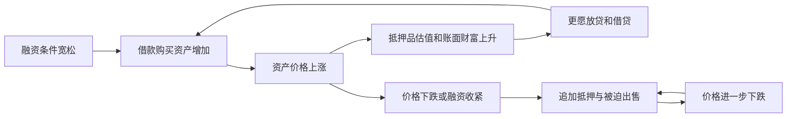
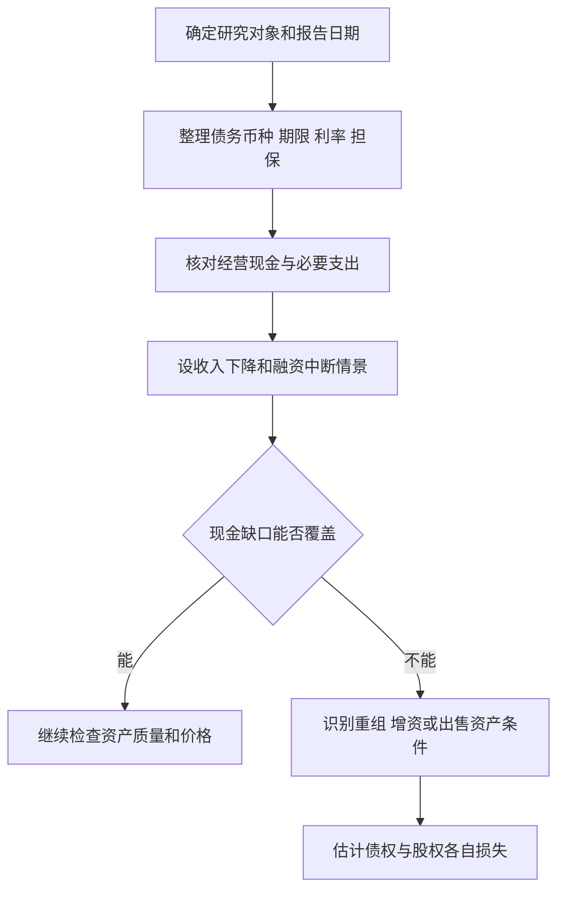

# 《债务危机》读书笔记

> 作者：瑞·达利欧（Ray Dalio）。中文对应《债务危机：我的应对原则》，中信出版社，2019 年 3 月，ISBN 9787521700077；英文材料为 2018 年 *Principles for Navigating Big Debt Crises*，中文书目亦标原作名 *A Template for Understanding Big Debt Crises*。不是作者后来的世界秩序或国家破产主题新书。
>
> 资料范围：基于桥水官方公开英文材料、出版社提供的中文电子书信息及央行、国际组织历史资料整理。未逐页核读全书；重点覆盖债务周期模型和应对工具，不逐一复述附录全部历史案例。文中案例补充、数学演示和财商应用均与作者观点区分。整理日期：2026-11-12。

这本书试图回答：为什么前几年看似人人受益的借贷扩张，会突然变成整个社会都缺钱？达利欧把债务看成跨期承诺：今天购买力增加，意味着未来收入要拿出一部分偿还。当许多人同时提高借债、资产上涨又支持更多借债时，繁荣与脆弱性可以一起累积。

最有价值的收获不是背出下一次危机年份，而是学会同时查看**债务存量、利息与到期压力、收入现金流、抵押品、币种和政策空间**。同样的负债率，在不同结构下会有非常不同的结果。

## 原书结构与阅读重点

公开版本包含债务大周期的解释模型，德国魏玛时期、美国大萧条、2008 年金融危机三个深入案例，以及更广泛的历史案例对照。作者把通缩型与通胀型危机分开讨论，强调政策工具组合。这里把机制、账表和可复查的历史证据重新组织成 30 个知识点。版本与结构见[中信出版社提供的书目页面](https://read.douban.com/ebook/109344022/)及[桥水官方公开材料](https://www.bridgewater.com/big-debt-crises/principles-for-navigating-big-debt-crises-by-ray-dalio.pdf)。

## 核心知识点

### 1. 借债先增加购买力，后来占用购买力

对借款人来说，贷款到账时可以提前购买房屋、设备或消费；之后必须用工资、经营收入、资产出售或新贷款偿还。借贷可以把有价值的项目提前，也可以把本来负担不起的支出提前。

因此，不能只问“债务有没有增长”，还要问增长换来了什么。能提高未来生产能力的投资，与主要依赖资产涨价继续融资的购买，偿债逻辑不同。即使项目具有社会价值，如果回报到账晚于债务到期，也可能发生支付危机。

### 2. 一个人的债务，是另一个人的资产

企业向银行借款，企业记负债，银行记贷款资产；银行对储户的存款又是银行负债。借款人违约时，不是账上一个数字凭空消失，而是某个债权人需要确认损失。

这解释了为什么“让坏债全部自行清零”并非没有其他后果：损失可能传到储户、养老金、其他企业及公共财政。反过来，保住所有债权面值也可能鼓励过度借贷。危机处理中，损失如何分配往往比损失是否存在更有争议。

### 3. 支出与收入连接起来，节省可能互相抵消

一个家庭减少开支，自己的现金流可能改善；很多家庭同时减少开支，商家的收入会下降，随后压缩工资、采购和投资。原本用于偿债的总收入可能随之缩水。

这是宏观与家庭预算不同的地方。它不意味着家庭不应储蓄，而是提醒政策分析不能把所有部门都当成收入不变的独立家庭。研究一家上市公司，也要考虑它的客户是否正集体缩表，而非仅查看公司自身借款。

### 4. 债务率有两个变量，压债务不保证比率下降

债务率通常写作 `债务 / 收入`，国家分析常用 GDP 作收入尺度。分子减少时，如果分母下降更快，比率仍可能上升。

**数学演示：**债务 150、年收入 100，比率 150%；债务减少到 145，收入却跌至 90，比率变成约 161.1%。偿债努力是真实的，但经济收缩抵消了效果。这个算例只是比例关系，不代表任何国家数据。

检查债务报告时，要把“余额增加”“债务率上升”“利息负担加重”拆开。三者常同时出现，也可能方向不同；只报其中一个会遗漏重要信息。

### 5. 利息、到期本金和可用现金共同决定支付压力

资产负债表告诉你欠多少，现金流表与到期表才告诉你何时需要钱。低息长期债务可能比高息短期债务更容易承受；尚未到期的贷款也可能有提前触发条款。

财商补充：检查企业至少分开经营活动现金流、必要资本开支、现金利息、未来一年到期本金及可自由动用的现金。受限资金、保证金和不能随时分配的子公司现金，不宜全部当作母公司的还债现金。

没有统一的“安全覆盖倍数”适合所有行业。现金流季节性强、客户集中或融资容易中断的企业，需要更审慎地看时间匹配。

### 6. 短期周期不等于严格定时的波浪

作者用短期债务周期解释利率、信用和需求的来回变化：融资较容易时支出扩大，产能约束和通胀压力上升后政策收紧，随后增速下降。这个过程有因果逻辑，但不是每隔固定年数必定发生。

央行可能提前调整，财政、外部冲击和金融结构也会改变路径。把历史平均长度直接换成买卖日期，会把解释模型误当成计时器。

### 7. 长期债务周期描述累积约束，不是宿命

如果每次下行都依靠更低利率、更高杠杆来缓冲，债务相对于收入可能长期增加，常规降息的空间也可能减小。作者用较长时间尺度讨论这种累积。

但“债务高”不等于“明天崩溃”。债务币种、平均期限、储蓄结构、生产率增长与政策可信度，会影响调整速度。不同国家不能只凭一条债务率曲线排列危机倒计时。

### 8. 泡沫阶段，抵押品上涨会制造看似安全的借贷

房产涨价后，原借款人的抵押覆盖看起来改善；银行愿意多借，买家购买力增强，资产进一步涨价。人们容易把这个反馈当成资产内在价值不断增长。

图是机制示意，不是价格预测。关键分界在于：还款依赖的是可持续收入，还是只有继续涨价、继续借新债才能兑现。

### 9. 资产很好，也可能被迫卖在很差的价格

**真实案例：英国 2022 年 LDI 压力。**养老金相关的负债驱动投资策略使用国债、回购和衍生品管理长期利率风险。国债收益率快速上升、价格下跌后，部分机构需要追加抵押，卖出国债筹钱又扩大了市场压力。英格兰银行研究用交易数据描述了这一链条。[英格兰银行研究](https://www.bankofengland.co.uk/working-paper/2023/an-anatomy-of-the-2022-gilt-market-crisis)

这说明“长期资产与长期负债匹配”仍可能带来短期现金需求，尤其使用杠杆和衍生品时。风险不只是资产最终是否违约，还包括在市场最差时是否必须交保证金。该事件发生于原书之后，是本文补充，不能据此断言所有养老金都资不抵债。

应用时把压力测试分成两张表：最终资产价值是否足够，未来几天的现金是否足够。只做第一张，可能漏掉触发危机的入口。

### 10. 顶部可以最繁荣，也可以最脆弱

危机前的利润、就业和抵押品价格可能很好，因为信用扩张本身正在推高这些指标。若把高峰利润当成永续水平，既高估收益，又低估负债压力。

检查重点是新增借款用途、利息资本化、再融资依赖、放贷标准变化和资产收益率是否低于融资成本。单独一个指标不是泡沫证明；多个相互强化的条件同时出现，才构成值得进一步核查的风险图景。

### 11. 流动性问题和偿付能力问题要分开

流动性问题是长期可能有价值，但今天拿不出现金；偿付能力问题是资产的可回收价值不足以覆盖负债。前者可能通过过桥资金或期限调整缓解，后者通常需要减记、增资或损失分担。

两者也会互相转化。缺现金引发低价抛售，会把原本可持续的资产负债表打坏；持续亏损也会使市场停止续贷。救助者难以实时区分，所以应说明估值假设，不能把“有人愿意再借钱”当成没有损失的证明。

### 12. 通缩会提高固定名义债务的实际负担

如果收入与物价下跌，而债务本金不变，借款人需要拿出更多实际产出偿还。为还债而出售资产，可能继续压低价格。这是债务与通缩相互加强的重要机制。

**真实历史：美国 1930—1933 年银行恐慌。**银行失败、提现压力与货币收缩相互作用，信用渠道受损。美联储历史资料也讨论金本位约束、政策失误和经济下滑，不把危机简化为单一原因。[银行恐慌史](https://www.federalreservehistory.org/essays/banking-panics-1931-33)

从这一机制可以学到：低价本身未必意味着需求立刻恢复。若买方担心失业、缺信用或等待更低价格，便宜资产仍可能缺少买家。历史并不证明每一次降价都会走向大萧条。

### 13. 通胀型危机往往伴随货币信任或外币约束

当本币贬值、进口价格上升、资本外流与财政压力相互作用时，经济可能同时出现萎缩和高通胀。此时简单降息或印本币未必缓解外币偿债，反而可能加大汇率压力。

原书用魏玛德国等案例讨论极端情形，但不能据此说一切资产购买都会导致恶性通胀。战争、财政税基、外币赔款、制度可信度和货币需求都很重要。本文未逐项复核德国历史数据，因此不照搬未经核验的价格倍数。

### 14. 债务是什么货币，比国籍标签更直接

一个国家可以发行本币，并不意味着可以无成本获得外币。企业收入是本币、债务是美元时，本币贬值会放大本币计价的负债；若出口收入同样是美元，则可能有自然对冲，但仍要检查期限和金额。

**真实案例：阿根廷 2001—2002 年危机。**2001 年末主权违约、2002 年初货币局安排退出，发生在长期衰退与债务、汇率压力交织的背景下。IMF 独立评估讨论了制度约束、政策判断和危机处置。[IMF 2004 年独立评估](https://www.imf.org/-/media/websites/imf/imported-full-text-pdf/external/np/ieo/2004/arg/eng/pdf/_report.pdf)

用它解释币种错配，不能把全部损失都归为汇率，也不能把阿根廷的制度条件直接套给其他国家。分析时应写出“收入币种—负债币种—可动用外汇—到期节奏”四格表。

### 15. 政府能创造本币，不等于能创造真实资源

货币发行可以改变谁先获得购买力，帮助支付以本币计价的名义债务，却不能瞬间生产能源、医疗服务和粮食。资源闲置程度不同，同样的需求刺激可能主要增加产出，也可能主要提高价格。

因此，“货币发行一定无效”与“只要发行就没有约束”都忽略了条件。需要看供给瓶颈、社会是否愿意持有本币、财政信用以及资金到达谁手里。

### 16. 去杠杆工具一：减少支出，直接但会压收入

削减开支能够减小单个借款人的资金缺口；问题在于，政府、企业与居民同时削减，可能使总收入下降，扩大违约。

读作者讨论时，不能误以为他主张任何紧缩都错误。浪费性支出与维持生产能力的支出，短期减少与永久取消，经济衰退时期与供给过热时期，影响不同。政策设计需要考虑时点和组成，而不仅是总金额。

### 17. 去杠杆工具二：重组债务，必须有人确认损失

重组可以减本金、降利率、延长期限或交换债券。即使名义本金不变，只要回款更晚、利息更低，债权人的现值也可能下降。

**真实案例：希腊 2012 年私人部门债务重组。**欧洲稳定机制资料说明了私人债权人参与的交换与减记安排。这里的学习重点是债务条件改变与损失分担，而非把“获得新融资”等同于原债务全部恢复价值。[ESM 对 2012 年重组的说明](https://www.esm.europa.eu/content/what-was-private-sector-debt-restructuring-march-2012)

对债券和银行股投资者，企业“没有停止营业”并不代表原股东或债权人没有损失。应分别问业务是否持续、负债条款是否变化、股权是否稀释，不能用经营存续替代证券回报判断。

### 18. 去杠杆工具三：转移支付，改变负担落点

税收、补贴、资本注入与公共保障可以把资源从一部分部门转给另一部分。它们未必减少全社会即时负债总额，但可能缓解最容易被迫削减支出的群体压力。

代价是政治阻力、激励变化和财政可持续性。把“救助金融体系”与“奖励原股东”混为一谈，也会使讨论失焦；制度可以在维持关键支付服务的同时，让股东、管理层或某些债权人承担损失。

### 19. 去杠杆工具四：货币支持，工具对象各不相同

降息、向金融机构提供贷款、购买证券以及财政直接支出，不是同一动作。购买债券首先改变资产持有人及金融条件；财政补贴更直接改变领取者收入；银行贷款是否增加还取决于资本、风险和借款需求。

**真实案例：美联储 2008 年宣布、2009—2010 年实施的机构 MBS 购买。**美联储资料记载，在 2009 年 1 月至 2010 年 3 月购买阶段共购入 1.25 万亿美元机构 MBS；该数值是这一阶段实际累计购买规模，不是 2008 年首次公告规模。[美联储项目说明](https://www.federalreserve.gov/newsevents/reform_mbs.htm)

这说明“宣布购买”“累计买入”“期末余额”必须区分。其政策目的包括改善住房信贷条件，但不能仅凭购买后经济好转，就把所有复苏归因于这一项政策。

### 20. “和谐去杠杆”是条件组合，不是保证书

作者所谓较理想的去杠杆，是把紧缩性工具与支持收入的工具结合，使债务相对于收入下降，同时避免过度通缩或失控通胀。它是目标及机制框架，不是只要找到固定配比就一定成功。

实际难处包括损失认定滞后、政策传导不均、国际资本反应和政治妥协。通胀暂时下降不代表债务已修复，债务率暂时下降也可能只是物价上涨抬高名义分母；要观察生产能力、真实收入和融资结构。

### 21. 名义增长与利率的关系需要配合新增赤字

简化的政府债务动态可以写成：

`下一期债务率 = 上期债务率 × (1 + 有效利率) / (1 + 名义GDP增速) + 当期基本赤字 / 当期GDP`

基本赤字指不含利息支出的财政收支缺口；基本盈余则该项为负。公式忽略汇率重估、资产处置和统计调整，只用于说明方向。

**数学演示：**上期债务率 100%，有效利率 4%，名义增速 5%，基本预算平衡，则下一期约 99.05%；若再有相当于当期 GDP 的 3% 基本赤字，则约 102.05%。所以“增速大于利率”不保证债务率下降，仍要看新增收支与其他调整。

### 22. 利率降低也可能推不动借贷

借款人如果缺少盈利项目、担心未来收入或只想偿还旧债，较低利率不一定让其扩大投资。银行若担心损失或资本不足，也可能不愿放贷。作者用“推绳子”等比喻说明传导受阻。

应用时别只看政策利率，还要看信用利差、实际贷款条件、信贷需求和收入预期。政策从公告到企业订单、现金回款的路径有多层，股价可以先反应，也可能反应过度。

### 23. 救市场流动性不等于承诺所有资产涨价

英格兰银行在 2022 年国债市场失灵时实施临时、定向购买，目标是恢复市场功能并给相关机构调整时间。官方事后说明强调支持措施的暂时性和后续退出。[英格兰银行案例分析](https://www.bankofengland.co.uk/quarterly-bulletin/2023/2023/financial-stability-buy-sell-tools-a-gilt-market-case-study)

由此可见，紧缩货币以控制通胀与针对局部市场提供流动性，并非逻辑上绝对互斥。判断政策时要看对象、期限、定价和目的，不能把任何央行买债都直接翻译成全面转向宽松。

### 24. 民间债务下降，公共债务可能上升

危机中政府可能增加转移支付、注资银行，同时税收减少。私人部门缩表与公共部门扩表可能同时出现，帮助缓冲经济，也改变了风险承担者。

因此，看到公共债务上升，不能跳过时间顺序，直接推论危机一定由政府借款引发。相反，也不能说只要债务转到政府就消失了；未来利息、税收、通胀和支出空间仍可能承担代价。

### 25. 资产回报取决于预期差，不只取决于周期阶段

即使正确判断经济会衰退，若证券价格已经反映更糟情形，实际收益仍可能与直觉相反。债券还受到期限、信用、币种和通胀影响；股票受到估值、利润和股东结构影响。

本文财商应用：宏观分析先用于识别脆弱环节、设置研究情景，而不是直接生成某只股票的买入指令。买证券仍要判断价格是否合理，以及研究结论出错时损失会如何发生。

### 26. 危机中的相关性可能来自共同融资渠道

平时看似无关的资产，若被同一批高杠杆投资者持有，融资紧张时可能一起被卖出。历史相关系数不能完整描述压力情景。

观察组合时，可按经济驱动因素和资金来源重分组：是否都依赖低利率，是否都需要持续再融资，是否有共同抵押品。持有很多名称不等于分散了同一种风险；这也不意味着应照搬作者的机构投资组合。

### 27. 历史模板要保留不匹配之处

比较两个危机，应并列制度、汇率安排、债务币种、银行资本、人口与政策空间。只找相似的价格曲线，容易把关键差异删掉。

一个实用写法是：本次与历史案例相似的机制有三项，不同的约束有三项，哪些数据出现会使类比失效。这样的比较才能更新判断；一句“历史总会重演”不能被检验，也无法指导具体研究。

### 28. 公司债务研究要穿过表面利润

利润可以包含未收现收入、资产处置收益和会计估计；偿债需要可动用现金。债务还可能隐藏在担保、回购义务、融资安排及关联方往来中，必须结合附注。

这是本文补充的阅读流程，不是对任何公司的投资结论。一个季度现金流好不能替代完整周期分析，合理的长期价值也不能替代近期支付能力。

### 29. 个人层面的启发是让承诺与现金流相称

家庭不能像本币央行那样创造支付手段。个人可以学习期限匹配、保留应对意外的流动性、避免用短期借款支持波动很大的长期资产，并理解浮息和币种风险。

这里不依据阅读任务推断你的收入、负债或仓位，也不给统一的应急金月数。真正的计划需要列出固定开支、可调整开支、收入稳定性和债务条款，再评估可承受的变化。

### 30. 最值得带走的是“谁付款、何时付款、用什么付款”

宏观词汇最终都可以落回支付关系。需求下降是谁少花钱，债务重组是谁少收钱，货币支持是谁先拿到可支付资产，通胀又是谁的购买力下降。

当你能画出这些关系，经济新闻就不再只是“放水”“紧缩”“见底”几个标签。作者提供的是一套分析视角，真正可靠的结论仍需资产负债表、现金流、制度事实和可修正的假设共同支持。

## 练习与参考答案

**练习一：债务余额下降，债务率却上升，是否必然统计错误？**

参考答案：不是。先核对期间和口径，再检查收入或 GDP 是否下降得更快；也要检查外币重估和债务范围变化。债务存量与支付压力不能互相替代。

**练习二：一家企业资产长期价值较高，但三天后有保证金追缴，是否能仅凭低估值判断安全？**

参考答案：不能。需要现金、抵押品合格性、追加保证金规则和可落实融资；长期有价值仍可能发生被迫出售。英国 LDI 事件提示的是这个时间维度，不是所有长期国债都不安全。

**练习三：央行购买证券之后，物价未立即上涨，能否证明购买毫无影响？**

参考答案：不能。需要考虑没有政策时的反事实、信贷与资产价格渠道、供给条件和其他同期措施。也不能反过来把后续全部增长归因于购买。先明确要检验的具体结果和时间窗口。

## 能学到什么、还缺什么

可以学到债务与收入的反馈，分清流动性和偿付能力，理解币种与期限，拆解四类处置工具，并把宏观新闻转为可核查的问题。适合与《这次不一样》的历史比较、《逃不开的经济周期》的多种周期机制以及财报类笔记交叉阅读。

本笔记没有复现全书历史数据库，也未逐页核读三个长案例；不提供未来危机时间或交易信号。重要事实的链接已放在相关知识点，作者的模板、历史事实与本文财商补充应分开使用。
