# 全部书籍笔记合订版

> 本文件汇集 71 份独立笔记与 1 篇实战案例附录，方便连续阅读。各篇的分析依据、版本和来源保留在原位置。
> 独立笔记与案例原文件是主要维护版本；修改后可运行 `_工具/更新合订版.py` 同步本文件。

想先建立学习和实践流程，请读[《财商进阶合订本》](财商进阶合订本.md)；想单独打开一本，请访问[书籍索引](README.md)。

## 目录

1. [一本书读懂财报 - 肖星](#book-01)
2. [聪明的投资者 - 本杰明·格雷厄姆](#book-02)
3. [巴菲特股东信 - 沃伦·巴菲特](#book-03)
4. [投资最重要的事 - 霍华德·马克斯](#book-04)
5. [思考，快与慢 - 丹尼尔·卡尼曼](#book-05)
6. [学会提问 - 尼尔·布朗、斯图尔特·基利](#book-06)
7. [超级预测 - 菲利普·泰特洛克、丹·加德纳](#book-07)
8. [股票大作手回忆录 - 埃德温·勒菲弗](#book-08)
9. [海龟交易法则 - 柯蒂斯·费思](#book-09)
10. [以交易为生 - 亚历山大·埃尔德](#book-10)
11. [被讨厌的勇气 - 岸见一郎、古贺史健](#book-11)
12. [金钱心理学 - 摩根·豪泽尔](#book-12)
13. [小狗钱钱 - 博多·舍费尔](#book-13)
14. [漫步华尔街 - 伯顿·马尔基尔](#book-14)
15. [共同基金常识 - 约翰·博格](#book-15)
16. [股市长线法宝 - 杰里米·西格尔](#book-16)
17. [彼得·林奇的成功投资 - 彼得·林奇、约翰·罗瑟查尔德](#book-17)
18. [怎样选择成长股 - 菲利普·费雪](#book-18)
19. [穷查理宝典 - 查理·芒格](#book-19)
20. [投资中最简单的事 - 邱国鹭](#book-20)
21. [周期 - 霍华德·马克斯](#book-21)
22. [随机漫步的傻瓜 - 纳西姆·尼古拉斯·塔勒布](#book-22)
23. [黑天鹅 - 纳西姆·尼古拉斯·塔勒布](#book-23)
24. [反脆弱 - 纳西姆·尼古拉斯·塔勒布](#book-24)
25. [对赌 - 安妮·杜克](#book-25)
26. [噪声 - 丹尼尔·卡尼曼、奥利维耶·西博尼、卡斯·桑斯坦](#book-26)
27. [事实 - 汉斯·罗斯林等](#book-27)
28. [统计陷阱 - 达莱尔·哈夫](#book-28)
29. [清醒思考的艺术 - 罗尔夫·多贝里](#book-29)
30. [影响力 - 罗伯特·西奥迪尼](#book-30)
31. [系统之美 - 德内拉·梅多斯](#book-31)
32. [战胜华尔街 - 彼得·林奇、约翰·罗瑟查尔德](#book-32)
33. [股市真规则 - 帕特·多尔西](#book-33)
34. [巴菲特的护城河 - 帕特·多尔西](#book-34)
35. [投资估价 - 阿斯沃斯·达摩达兰](#book-35)
36. [证券分析 - 本杰明·格雷厄姆、戴维·多德](#book-36)
37. [价值投资 - 布鲁斯·格林沃尔德等](#book-37)
38. [安全边际 - 塞思·卡拉曼](#book-38)
39. [资本回报 - 爱德华·钱塞勒](#book-39)
40. [投资者的未来 - 杰里米·西格尔](#book-40)
41. [金融炼金术 - 乔治·索罗斯](#book-41)
42. [富爸爸穷爸爸 - 罗伯特·清崎](#book-42)
43. [邻家的百万富翁 - 托马斯·斯坦利、威廉·丹科](#book-43)
44. [巴比伦最富有的人 - 乔治·克拉森](#book-44)
45. [金钱与生活 - 维姬·鲁宾、乔·多明格斯](#book-45)
46. [拿铁因素 - 大卫·巴赫、约翰·戴维·曼](#book-46)
47. [投资四大支柱 - 威廉·伯恩斯坦](#book-47)
48. [聪明的资产配置 - 威廉·伯恩斯坦](#book-48)
49. [机构投资的创新之路 - 大卫·斯文森](#book-49)
50. [非理性繁荣 - 罗伯特·希勒](#book-50)
51. [金融的逻辑 - 陈志武](#book-51)
52. [经济学原理 - N.格里高利·曼昆](#book-52)
53. [牛奶可乐经济学 - 罗伯特·弗兰克](#book-53)
54. [魔鬼经济学 - 史蒂文·列维特、史蒂芬·都伯纳](#book-54)
55. [卧底经济学 - 蒂姆·哈福德](#book-55)
56. [置身事内 - 兰小欢](#book-56)
57. [贫穷的本质 - 阿比吉特·班纳吉、埃斯特·迪弗洛](#book-57)
58. [这次不一样 - 卡门·莱因哈特、肯尼思·罗格夫](#book-58)
59. [债务危机 - 瑞·达利欧](#book-59)
60. [逃不开的经济周期 - 拉斯·特维德](#book-60)
61. [小岛经济学 - 彼得·希夫、安德鲁·希夫](#book-61)
62. [简单的逻辑学 - D.Q.麦克伦尼](#book-62)
63. [思辨与立场 - 理查德·保罗、琳达·埃尔德](#book-63)
64. [超越智商 - 基思·斯坦诺维奇](#book-64)
65. [为什么 - 朱迪亚·珀尔、达纳·麦肯齐](#book-65)
66. [模型思维 - 斯科特·佩奇](#book-66)
67. [助推 - 理查德·塞勒、卡斯·桑斯坦](#book-67)
68. [错误的行为 - 理查德·塞勒](#book-68)
69. [怪诞行为学 - 丹·艾瑞里](#book-69)
70. [决断力 - 奇普·希思、丹·希思](#book-70)
71. [清单革命 - 阿图·葛文德](#book-71)

**实战案例附录**

1. [2026三季报图解](#case-01)

---

<a id="book-01"></a>

[单独打开本篇](<一本书读懂财报 - 肖星/读书笔记.md>)

## 《一本书读懂财报》读书笔记

> 作者：肖星  
> 出版社：浙江大学出版社；作者主页列有 2014 年初版、2019 年第二版。本笔记以公开可核对的 2022 年第三版目录作为主题索引，不对应某次印刷的页码。  
> 分析依据：公开书目与目录、作者及高校资料、会计准则和财务教育的一手资料，另用美的集团 2026 年三季报及伯克希尔 1985 年股东信核验书外案例；未取得用户所持版本的完整原书。  
> 覆盖范围：按全书主要主题整理 35 个知识点，在关键小节结合真实公告与历史事件，另配计算演示、图解和练习；属于公开资料支持的系统导读，不是逐页精读记录。原书具体企业案例与版本差异未逐一复核；标为“书外”的真实案例已另据一手资料核验。  
> 更新日期：2026-11-11

书名、作者和版本分别核对了[清华大学作者主页](https://www.sem.tsinghua.edu.cn/info/1205/32025.htm)、[对外经济贸易大学图书馆书目](https://opac.uibe.edu.cn/opac/book/3d543fc78e2c850406c5a1cca06efe33)与[得到电子书目录](https://www.dedao.cn/ebook/detail?id=A1De6QkaNRMlK5yxrdmnEBXY97ZL23nRlM3o6zvGDekj1QgA84VbpqJOPLgxEJlY)。以下“原书对应主题”只说明主题在目录中出现；具体解释、图示与数值例子为本笔记的教学重组，不是作者原话。第 33—35 点明确属于延伸阅读。

### 先看这里：这本书最值得学什么

**一句话概括：把财报里的数字翻译成企业正在做的生意，再判断它赚得怎么样、钱够不够、风险在哪里。**

你不必先成为会计，但要掌握三种观察角度：

| 你关心的问题 | 先看哪张表 | 还要追问什么 |
| --- | --- | --- |
| 公司现在拥有什么、欠谁的钱？ | 资产负债表 | 这些资产能否收回、产生收益？债务何时到期？ |
| 这一段时间做生意赚了多少？ | 利润表 | 利润来自主营业务，还是偶然交易？为此用了多少资本？ |
| 钱实际怎么进来、怎么出去？ | 现金流量表 | 靠客户付款、变卖资产，还是借钱维持？ |

最重要的七个结论：

1. **资产、收入、利润、现金是四种不同的东西。** 大公司可能不赚钱，赚钱的公司也可能没钱付款。
2. **三张表描述同一家公司。** 一笔交易经常同时改变两张甚至三张表，不能孤立阅读。
3. **绝对金额回答“有多少”，比率回答“效率怎样”。** 赚 100 万是否优秀，要看投入了 500 万还是 5000 万。
4. **比率必须放回行业和战略里解释。** 高毛利和高周转可以代表不同的竞争路线，没有统一的漂亮数字。
5. **经营利润要与资本成本比较。** 股东提供的钱也有机会成本；账面盈利不一定创造经济价值。
6. **现金流要看来源和用途。** 投资现金净流出可能是扩产，现金净增加也可能只是借了更多钱。
7. **读懂财报是理解企业的起点。** 它不能自动解决未来预测、管理层诚信和股票买入价格的问题。

读完这份笔记，你应当能做三件事：解释一笔业务怎样进入三张表；用几个关键指标定位经营问题；把“这家公司看起来不错”改写成有证据、有条件的判断。

### 全书思路与本笔记覆盖地图

下面按公开目录的主题归并，不复制全部小标题，也不把本笔记编号冒充原书章号。

| 原书对应主题 | 要回答的问题 | 本笔记对应内容 |
| --- | --- | --- |
| 会计与企业活动 | 企业活动怎样被记录？ | 1—3 |
| 资产负债表 | 资源从哪来、放在哪里？ | 4—12 |
| 利润表 | 收入怎样变成利润？ | 13—15 |
| 报表的形成逻辑 | 成本、销售、研发怎样影响报表？ | 16—19、贯通算例 |
| 现金流量表 | 现金为什么不同于利润？ | 20—23 |
| 综合使用三张表 | 怎样比较盈利、营运和偿债能力？ | 24—29 |
| 财务数据背后的经营因素 | 行业、战略、执行如何留下痕迹？ | 31—32 |
| 判断好公司与资本回报 | 账面赚钱是否等于创造价值？ | 30、杜邦图解 |
| 对照企业案例、控制风险 | 怎样把指标串起来判断问题？ | 22、32、分析练习 |
| 决策应用 | 如何把分析变成可以验证的判断？ | 实践流程；33—35 为延伸 |

本书的学习顺序很有价值：**先认表里的项目，再看交易如何生成报表，然后算指标，最后用经营逻辑解释指标。** 如果直接跳到“哪几个比率能选牛股”，很容易记住公式却读错企业。

### 核心知识点：先把三张表读通

#### 1. 企业活动可以从经营、投资、融资三个方向理解

经营是销售产品或服务、采购、生产、发工资等持续活动；投资是在设备、业务或其他资产上配置资金；融资是从股东、债权人处取得或归还资金。这是读企业的起点，不等于每笔业务的现金流分类都可凭字面判断。

**边界：** 银行发放贷款本身属于业务活动，不能把制造企业的分类直搬给金融企业。

#### 2. 资产负债表看时点，利润表和现金流量表看期间

“12 月 31 日有多少应收款”是存量；“全年赚了多少利润”是流量。存量像水箱内的水，流量像某段时间的流入流出。拿 12 月末资产去解释全年收入时，要注意中间是否发生了大额增资或扩张。

#### 3. 资产＝负债＋所有者权益，是理解交易的底座

资产是企业控制的资源；负债是要承担的现时义务；权益是扣除负债后的股东剩余权益。等式两边必须相等，它不是说“资产全部是现金”，也不是说“权益是银行里另存的一笔钱”。

**补充例子：** 股东投入 60 万，银行借款 40 万，公司现金为 100 万。花 70 万买设备后，资产变成现金 30 万加设备 70 万，负债 40 万、权益 60 万保持不变。企业只是换了资产形态，并没有因购买设备立即亏损 70 万。

这一等式还能帮助识别交易：借款增加资产和负债；股东出资增加资产和权益；确认亏损会减少权益。[财政部《企业会计准则——基本准则》](https://www.mof.gov.cn/zcsjtsgb/gztsgb/201407/t20140723_3578373.htm)提供了六大会计要素的定义。

#### 4. 流动资产不等于随时可花的钱

现金、应收款、存货、预付款都可能属于流动资产，但变成可用现金的速度和可靠性不同。分类通常考虑正常营业周期及一年等条件，不能只背“一年以内”。

#### 5. 应收款、预付款、合同负债，反映交易中的先后手

应收款通常意味着已经形成收款权利，但钱尚未到账；预付款意味着先给供应商钱，等待商品或服务；合同负债通常意味着先收到客户对价，还欠客户履约。

收到客户的钱，并不一定已经完成履约；允许客户延期付款，则意味着一部分经营资金由企业垫付。第 13 点将用美的实际合同资产说明履约、收款权和现金之间的区别。

**分析重点：** 先付款还是后付款，能体现议价能力，也可能只是行业惯例；应收款增长快要看账龄、客户集中度和减值，不能一见增长便断言造假。

#### 6. 存货是尚未转成销售成本的投入

原材料、在产品、产成品都可能是存货。为使产品达到可销售状态而发生的合理采购和加工成本，先积累在资产中；销售实现时，已售部分才结转为成本。

**补充例子：** 买入 100 件商品，每件成本 20 元，卖出 60 件。忽略其他变化，营业成本为 1200 元，剩余存货为 800 元；采购付款 2000 元不是当期全部成本。

存货还要关注滞销、过时和跌价。账面成本 800 元的商品，如果预计卖出扣除相关支出只能收回 500 元，就不能继续用原价粉饰资产。相关确认与计量原则见[财政部存货准则](https://www.mof.gov.cn/zhengwuxinxi/zhengcefabu/2006zcfb/200805/t20080519_23107.htm)。

#### 7. 折旧是成本分配，不是当期另付一笔现金

长期使用的设备，通常先确认为资产，再按其消耗方式分期计入产品成本或当期费用。直线法的简化公式为：

```text
年折旧额＝（原价－预计净残值）÷预计使用年限
```

**补充例子：** 设备 60 万，预计使用 5 年、残值为零，完整年度折旧为 12 万。买设备时现金流出 60 万；以后计提折旧时，不会再付 12 万。实际折旧还涉及启用月份、用途和减值等。

**容易误解：** 折旧不一定直接全进当期利润表，生产设备折旧可以先进入存货成本；已折旧完的机器也可能仍然有用。制度依据见[财政部固定资产准则](https://www.mof.gov.cn/zhengwuxinxi/zhengcefabu/2006zcfb/200805/t20080519_23104.htm)。

#### 8. 无形资产、研发投入和“有价值的东西”不是同一集合

专利等符合确认条件的资源可以列为无形资产；员工能力、团队默契和自行积累的品牌价值，未必能按管理者心中的价格入账。所以，账面没有列出的优势不等于不存在。

研究和开发也不是“花钱就能资本化”：研究阶段通常费用化，开发阶段满足规定条件时才可能确认为资产。**资本化**就是先进入资产，后续再摊销或减值；不是凭空创造现金。

比较研发时，应同时看费用化金额、资本化金额、确认条件和项目进展，不能只看利润表的研发费用。这里用的是通行会计解释，可对照 [IAS 38 对内部研发阶段的说明](https://www.ifrs.org/content/dam/ifrs/publications/pdf-standards/english/2021/issued/part-a/ias-38-intangible-assets.pdf?bypass=on)，实际处理以企业适用准则为准。

#### 9. 账面价值、市场价格、企业价值不是一回事

历史成本有可核对的交易基础，但不会把所有资源持续改写成今天的售价。不同资产可能使用不同计量方法，因此资产合计并不是“一口气卖掉公司能收多少钱”。

阅读时应把“多少金额”与“什么计量口径”一起看；也不能反过来把所有低账面价值资产都当作隐藏宝藏，低价值可能源于低效和老化。

#### 10. 资产质量，比资产总额更值得追问

资产最终要通过收款、使用或出售兑现价值。应收款收不回来、设备闲置、库存卖不动，都会让账面资产失去原本的支撑。减值反映这种变化，但金额通常涉及估计。

**书外真实例子：** 美的 2026 年前三季度资产减值损失约 18.82 亿元，上年同期约 5.61 亿元；公司解释主要是商誉减值损失增加。这个项目提醒读者，过去并购形成的账面价值也需要后续盈利支持。但“资产减值损失总额”不能全部直接写成商誉减值金额，应继续查明细。[三季报第 4、8 页](https://static.cninfo.com.cn/finalpage/2026-10-30/1225645132.PDF)

**核查办法：** 看账龄、减值政策、资产用途、担保限制、未来现金流假设。减值有时只是较晚承认旧问题，不代表问题在计提当年才发生。应收款预期信用损失等要求可参考[财政部年报工作通知](https://m.mof.gov.cn/czxw/202501/t20250106_3951168.htm)。

#### 11. 负债既要看金额，也要看种类和到期时间

银行贷款通常需要付息还本；应付供应商款项来自经营结算；预收性质的合同负债可能主要通过提供商品或服务履行。它们都可能形成压力，但压力的方式不同。

**边界：** “无息”不一定免费，供应商可能把成本放进售价或收紧供货条件；“长期借款”也可能因违约条款触发提前偿还。

#### 12. 留存收益不是闲置现金，分红也不是经营费用

所有者权益既包括股东投入，也可能包括留存收益和其他权益变动。留存收益记录累计利润留在企业中的部分，但这笔利润可能已经转成设备、存货或应收款。

真实权益变化还可能包含增资、回购、其他综合收益等，不能永远用“期末权益－期初权益＝净利润”计算利润。

#### 13. 收入确认关注业务是否履约，现金收付关注钱是否到账

收入回答企业完成了多少符合确认条件的业务，现金收付回答钱何时到账。权责发生制把业务成果归到所属期间，借款和增资不能当销售收入；已经履约的业务，也可能仍未收到钱。收入确认要结合合同、履约义务和控制权转移判断，不能只凭开票或签约。[IFRS 15 官方概述](https://www.ifrs.org/issued-standards/list-of-standards/ifrs-15-revenue-from-contracts-with-customers/)

**书外真实案例：美的集团 2026 年前三季度的合同资产。** 期末合同资产为 **59.58 亿元**，上年末为 **42.69 亿元**。公司在变动说明中解释，增加主要来自已经达到收入确认条件、但尚未取得收款权的项目。这里的数字来自资产负债表，解释来自公司，不能混称为分析者已经逐份查过合同。[三季报第 3—4、6 页](https://static.cninfo.com.cn/finalpage/2026-10-30/1225645132.PDF)

这项真实业务把三个阶段分开了：企业可以已经完成一部分符合要求的履约，因而确认收入；但收取对价还取决于后续条件，因此留下合同资产；等满足相应条件形成无条件收款权，再进一步看应收及收现。合同资产不是“现金在路上”的同义词，应继续检查履约、验收和信用风险。报告没有给出每一项目的完整条款，不能自行补造某项工程的结算时间表。

再把收入与现金流放在旁边看。同期美的营业收入为 **3673.65 亿元**，销售商品、提供劳务收到的现金为 **3364.05 亿元**。两者金额不同，正好提醒我们收入与收款不在同一时间、也未必完全同口径。[三季报第 8、10 页](https://static.cninfo.com.cn/finalpage/2026-10-30/1225645132.PDF)

不能用两者简单相减，就宣布“本期有这么多收入没收到”。本期收款可能对应以前的应收，收入与收款还涉及税额、预收和其他范围差异；合同资产也不等于全部未收现金的收入。正确方法是把收入政策、应收、合同资产、合同负债与实际收款一起读，再解释各项变化。

**仅作记账演示的简化算例：** 预收 4 万、以后完成总价 12 万的服务、成本 7 万并已付，最后再收 8 万。忽略税和其他事项，预收时不因到账直接确认全部收入；完成服务时利润为 5 万；最后收款只是结算旧权利，不再赚一次 8 万。这个三步模型帮助理解方向，不是美的具体合同的分录。

**练习：** 美的合同资产增加，能否直接认定收入虚假？**参考答案：** 不能。先查是否真实履约及合同条件；资产增加提出了后续结算与可收回性问题，但并未独自证明虚假或优质。

#### 14. 利润表要一层层拆，找出利润来自哪里

为了入门，可以按这条分析路径阅读：收入减去已售产品或服务成本，得到毛利；再看销售、管理、研发、融资相关费用，以及其他损益和所得税，最终得到净利润。这是教学分解，不是某个报告期法定报表的完整列式。

要同时观察利润总额与归属口径：合并净利润包含少数股东享有的部分，不能全部当作上市公司普通股东的收益。

#### 15. 毛利率与净利率分别回答不同问题

```text
毛利率＝（营业收入－营业成本）÷营业收入
净利率＝净利润÷营业收入
```

毛利率帮助理解产品售价与直接相关成本之间的空间；净利率考虑更多费用和损益。**补充例子：** 收入 100 万、成本 60 万，毛利率是 40%；最终净利润 8 万，净利率是 8%。高毛利可能同时伴随高研发、高营销和高售后投入。

比较前要统一合并口径、业务构成及收入确认方式。平台按净额列收入、零售商按总额列收入，毛利率可能天然差异很大，不能凭数字高低判胜负。

#### 16. 支出、成本、费用有时间和用途上的区别

支出强调资源付出去；成本强调为产品、服务或资产付出的投入；费用强调某期间为取得收益而消耗的部分。三者会重合，但不是同义词。

**补充例子：** 预付明年房租属于本期现金支出，却未必是本期费用；买进未销售商品形成存货；本月已经收到水电服务但下月付款，可能已经形成本月费用和应付款。

理解这组区别，才能看懂为什么“省了一笔支出”不一定马上增加利润，“当期费用减少”也可能只是确认时间变化。

#### 17. 固定成本，让销量变化对利润的影响被放大

在一定业务范围内，租金、部分人工和设备折旧不会跟销量一比一变化；材料等变动成本则更随产量变化。固定投入较大时，销量增加可摊薄单位固定成本，销量下降则反向放大压力。

**补充例子：** 单价 100 元、单位变动成本 60 元、期间固定成本 4 万元，忽略税费，盈亏平衡销量是：

```text
盈亏平衡销量＝固定成本÷（单价－单位变动成本）
            ＝40000÷40＝1000 件
```

卖 1100 件赚 4000 元，卖 900 件亏 4000 元。这个模型假设售价、成本结构及产能范围稳定；现实中折扣、加班、设备扩容都会改变结果。

#### 18. 是否接单，要看增量收益和增量成本

一张订单的售价低于“含分摊固定成本的单位总成本”，不必然说明短期接单更差。如果产能闲置、固定成本已经发生，新订单能覆盖新增成本，可能有正的增量贡献。

**补充例子：** 单位变动成本 60 元、分摊固定成本 30 元，临时订单出价 80 元。在无需新增固定投入且没有其他机会的条件下，每件增加 20 元贡献；若因此挤占正常 100 元订单，判断就变了。

要考虑机会成本、回款风险、品牌与客户反应。不能把“短期有贡献”误读成长期可持续，也不能据此把所有固定成本永远忽略。

#### 19. 会计估计与损益分类会影响利润，盈利质量要追到业务

盈利质量关心三个问题：利润有没有真实业务支撑，何时转成现金，以及未来是否可以重复。会计计量、特殊交易和经济变化都会影响报告利润，不能仅凭一条“增长”或“下降”作判断。估计变更应查理由和金额，分类差异则要查对应交易，不要把二者混为一谈。

**书外真实案例：美的集团 2026 年前三季度，归母增长而扣非下降。** 直接看同一份报告：

| 项目 | 金额，亿元 | 同比 |
| --- | ---: | ---: |
| 归母净利润 | 413.93371 | ＋9.27% |
| 减：非经常性损益净额 | 126.05401 | — |
| 扣非归母净利润 | 287.87970 | −22.49% |

三项可以勾稽：413.93371−126.05401＝287.87970。这里扣掉的是考虑所得税及少数股东影响后的净额，不能拿某项税前收益直接替换。归母增长与扣非下降同时成立，是两种定义产生的结果。[三季报第 2—3 页](https://static.cninfo.com.cn/finalpage/2026-10-30/1225645132.PDF)


**第一步，读公司给出的具体解释。** 公司称，人民币汇率变化产生的外币货币性项目损失列入经常性损益，而用于管理相关外汇风险的衍生金融工具收益列入非经常性损益。两笔经济上可能相关的损益，在扣非指标中被不同处理。因此，扣非下降不宜不经核查就翻译成“产品竞争力下降了同样幅度”。

**第二步，限制解释的范围。** 这不等于全部 126.05 亿元都是外汇对冲收益。报告第 4 页同时说明，公允价值变动收益的变化主要与权益工具投资有关。应分别核对收益类别、期限和实现情况，才能判断相互抵销多少；这份季报不足以完整重建所有风险敞口。公司解释也不能自动排除经营本身变化。[三季报第 2—4 页](https://static.cninfo.com.cn/finalpage/2026-10-30/1225645132.PDF)

**第三步，继续检查现金和资产。** 归母利润上升，不代表同额现金进入账户；扣非减少，也不代表所有非经常项目都没有经济价值。还要看客户收款、资本投入、减值和分部表现。研究结论应写成“利润口径分化，汇率相关分类是公司指出的主要因素，还需核查交易及经营”，而不是挑一个喜欢的数字结束研究。

会计估计是另一条需要检查的线：设备年限、坏账预期和减值假设影响费用归属，但它们不会让客户因此多付款。不要把所有变化都叫操纵，也不要只因符合准则就认定经营改善；分析调整应同时处理特殊收益和特殊损失，不能只剔除不喜欢的项目。

**练习：** 是否可以把 126.05 亿元全部从企业长期价值中扣除？**参考答案：** 不能直接这样做。先判定经济性质与未来可持续性，且避免与相关损失重复处理。扣非是披露口径，估值还要独立研究现金流和风险。本例是未经审计的阶段信息，不直接给出买卖结论。

#### 20. 现金流的三类，要根据来源与用途解释

经营现金流反映主要经营活动的现金收支；投资现金流通常反映长期资产与投资的取得和处置；筹资现金流反映股东及债务资金的取得和偿还。概念可参照 [IAS 7 官方说明](https://www.ifrs.org/issued-standards/list-of-standards/ias-7-statement-of-cash-flows/)。

**书外真实例子：美的 2026 年前三季度的现金增减。** 按原报告人民币千元换算成亿元，经营净流入为 401.87380，投资净流入为 104.35372，筹资净流出为 204.95169，汇率影响为负 5.01696，因此现金及现金等价物净增加：

```text
401.87380＋104.35372－204.95169－5.01696＝296.25887 亿元
```

这是真实现金表的勾稽，不是利润计算。投资活动净流入不代表停止资本投入，筹资净流出也不能全部解释为偿还贷款；必须继续看各类内部的收支明细。另列的汇率影响还能说明：现金增减不一定只等于三类活动的简单相加。[三季报第 10—11 页](https://static.cninfo.com.cn/finalpage/2026-10-30/1225645132.PDF)

**口径提醒：** 利息、股利等在不同准则、行业和适用年度的分类可能不同，应看实际报表政策，不要只按日常语言归类。

#### 21. 从净利润到经营现金流，先辨认差异，再追查形成过程

利润确认与现金收付存在时间差。间接法从净利润出发，调整非现金费用、经营资产负债变化及不属于经营现金的损益。理解每笔钱为什么加减，比套“现金含金量”阈值更有用。

**书外真实案例：美的 2026 年前三季度利润与经营现金。** 合并净利润为 **414.98562 亿元**，经营现金流净额为 **401.87380 亿元**，两者比值约 **96.84%**。这里刻意使用合并净利润，和集团现金流对齐；归母净利润只属于母公司股东，不能不加说明地换作同一口径。[三季报第 8、10 页](https://static.cninfo.com.cn/finalpage/2026-10-30/1225645132.PDF)

这个比值接近 1，不足以证明“利润几乎全部收现”。净利润中有非现金计量和投资相关损益，现金中又有跨期回款和付款。报告提供的直接法现金流量表可以先验证另一件事：经营现金为什么同比减少。

| 合并现金项目，亿元 | 2025 年前三季 | 2026 年前三季 | 变化 |
| --- | ---: | ---: | ---: |
| 经营流入 | 3484.26715 | 3574.00735 | ＋89.74020 |
| 经营流出，按付款正数 | 2913.60630 | 3172.13355 | ＋258.52725 |
| 经营净现金 | 570.66085 | 401.87380 | −168.78705 |

据原表直接计算，流入没有减少，付款增量却更大。其中采购及接受劳务付款增加 **214.53 亿元**，销售及劳务收现增加 **64.87 亿元**。这排除了“本期销售收现额同比下降”这一说法，但尚未证明付款增加是备货、结算旧欠款还是付款方式变化。[三季报第 10 页](https://static.cninfo.com.cn/finalpage/2026-10-30/1225645132.PDF)

由真实报表回到调节原理：已经计入收入却尚未收回的新增应收，通常占用现金；已买进但尚未售出的新增存货，也占用资金；新增应付款意味着一部分采购尚未付款，会缓冲占用。折旧加回只是取消当期非现金费用对利润起点的影响，设备更新仍需另外付钱。

**计算演示，非美的分录：** 若利润 30 万、折旧 10 万，应收增加 15 万、存货增加 20 万、应付增加 8 万，且不存在税费、处置损益等其他调整，则经营现金为 30＋10−15−20＋8＝13 万。真实季报没有给出完整调节桥时，不能把这五项公式硬套上去，再将未解释差额当作异常。

**练习：** 经营现金/合并利润为 96.84%，能否认定明年也能按这个比例回款？**参考答案：** 不能。应检查多期结构、应收账龄、存货、付款安排与特殊项目；比值是进一步调查的起点。

#### 22. 现金流正负组合是线索，不是好坏标签

| 经营净现金流 | 投资净现金流 | 筹资净现金流 | 可以提出的假设 | 下一步核实 |
| --- | --- | --- | --- | --- |
| 正 | 负 | 负 | 经营回款支持投资、还债或分红 | 投资回报是否合理，是否过度分红 |
| 正 | 负 | 正 | 企业正在扩张，需要外部资金 | 新投资是否有效、债务期限是否匹配 |
| 负 | 负 | 正 | 外部资金支持经营和投资 | 是有期限的爬坡，还是模式持续失血 |
| 负 | 正 | 负 | 卖资产取得现金用于还债等 | 是否在收缩，剩余业务能否造血 |
| 正 | 正 | 正 | 三类活动均带来净流入 | 为何卖投资又融资，是否有特殊交易 |

上表是**补充分析示意**。相同符号可以对应不同事实：投资净流入可能来自处置工厂，也可能来自收回投资；净额还会遮住内部的大额流入流出。所有现金流都为正，并不自动优于经营回款支持扩张的公司。

#### 23. 三张表通过利润、权益和现金连接

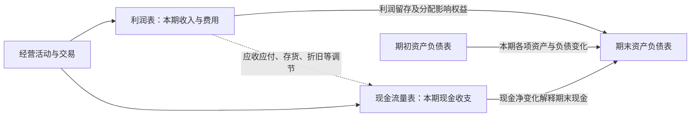

**怎么看图：** 利润解释权益变化的一部分；现金流解释现金及现金等价物变化；资产负债表保存经营活动留下的应收、存货、设备、债务等结果。

**简化边界：** 实际权益还有出资、分红、其他综合收益等变化；货币资金与现金及现金等价物口径也可能不同，因此应核对报表附注，不能只对两个表格里的名字。

把三表连起来最容易卡住的地方，是误以为每笔业务都要同时在三张表中出现。事实是：有的交易同时影响三表，有的只在资产负债表内部换形态。**以下是原创补充推演**，帮助你在后文完整算例之前建立方向感，均忽略税费和减值。

假设出售成本 6 万的现有商品，售价 10 万，客户暂未付款。利润表记录收入 10、成本 6，利润增加 4；资产负债表的应收增加 10、存货减少 6，净资产增加 4，权益也因利润增加 4；当时没有收付款，现金流量表不会凭空多出 10 万。三表之间没有矛盾，客户欠款保留了“利润尚未变成现金”的痕迹。

客户下一期付清 10 万时，现金增加 10、应收减少 10，资产总额和权益均不因这次收款而增加；现金流量表出现经营流入 10，利润表不会再赚一次。若你算出的第二期利润又多了 10，就说明把收回旧账误当新销售。

再看借款买设备：借到 20 万使现金和负债同时增加，买设备花 20 万又使现金减少、设备增加。经营利润当时可以完全不变，但现金流表会分别保留筹资流入和投资流出；不能因为净现金变化为零，就说这两笔活动无关紧要。它们给未来留下了折旧、利息、还本和产能。

实际核对时，先查现金从期初怎样变到期末，再查权益变动能否由利润、分配和其他变动解释，最后看应收、存货、设备和债务的变化是否与业务一致。**练习：** 公司偿还借款本金 5 万，为什么不能直接扣 5 万利润？**参考答案：** 现金和负债同减 5 万，属于偿还融资义务；借款时没有确认收入，还本时通常也不是费用。利息另按其性质处理。

### 核心知识点：从数字走到经营判断

#### 24. 同型分析与趋势分析，让规模差异不再遮住问题

同型分析也叫共同比分析：把利润表项目除以收入，把资产项目除以总资产，看结构占比；趋势分析则观察同一项目跨期变化。

趋势还要剔除合并范围变化、季节性、一次性项目和口径变更；两个年份不一致的口径，算得再精确也不可比。

#### 25. 周转率，衡量同一份资源能支持多少业务

```text
总资产周转率＝营业收入÷平均总资产
存货周转率＝营业成本÷平均存货
应收账款周转率＝赊销收入÷平均应收账款
```

平均值可以先用期初与期末的简单平均，但季节性强或变化大时应改用更密集数据。无法取得赊销收入时，分析者常以营业收入近似，并标明误差。

存货占用增加，可能来自积压，也可能是为长交期原料作必要储备，应结合业务判断。计算存货周转须以成本作分子，与存货的成本口径匹配，不能随手换成销售额；下一点直接查看美的实际存货与应收、应付的变化。

#### 26. 现金转换周期与营运资金：资金究竟压在哪个环节

企业通常要先备货，再交付，再等客户付款；供应商若允许延期结算，会承担一部分垫资。现金转换周期就是对这一时间结构的概括。

```text
存货天数≈平均存货÷营业成本×期间天数
应收天数≈平均应收账款÷同口径赊销收入×期间天数
应付天数≈平均应付账款÷同口径赊购额×期间天数
现金转换周期≈存货天数＋应收天数－应付天数
```

赊购额缺失时用营业成本近似可能误差很大，季度口径也不能直接套全年 365 天。天数反映时间，资金占用还要考虑应收按售价、库存和采购按成本形成的差别。

**书外真实案例：美的 2026 年 9 月末，不能只盯一项应收。** 原报告的合并余额如下，均换算为亿元；对照期为上年末，不是上年同期：

| 项目 | 2025 年末 | 2026 年 9 月末 | 变化 |
| --- | ---: | ---: | ---: |
| 应收账款 | 404.50097 | 520.31439 | ＋115.81342 |
| 存货 | 646.28834 | 566.26338 | −80.02496 |
| 应付账款 | 1036.80491 | 929.71502 | −107.08989 |
| 应付票据 | 271.21881 | 482.44581 | ＋211.22700 |

数据来自[三季报第 6—7 页](https://static.cninfo.com.cn/finalpage/2026-10-30/1225645132.PDF)。只看到应收增加，容易说“钱都压在客户那里”；只看到库存减少，又可能说“周转全面改善”。表中实际有多个方向：应收增加可能占资，库存减少可能释放资金，应付账款减少与应付票据增加也需要放在一起理解。票据是支付与信用安排的一部分，不能当应付款已经彻底消失。

**为什么仍不能把四行变动相加，就宣布解释了经营现金流？** 因为还有预付款、合同资产、合同负债、其他经营项目，以及汇率、合并范围、减值和非现金结算等影响。本期资产变化还不等于现金变化。与第 21 点的采购付款增加一起看，可以形成调查问题，却不能凭主表直接写成“公司为增长主动备货”——期末存货余额实际上下降，更需要检查期间变化和结构。


**图解：** 同一经营链同时受库存、客户和供应商影响。要判断哪一环节改善，最好读多个季度平均余额、账龄和结算条件，而不只比较两个期末。

**仅作口径演示：** 假设日销售 1 万、日成本及采购 0.6 万，应收 60 天、库存 40 天、应付 30 天，简化占用为 60＋24−18＝66 万，不能把 70 天现金周期直接乘日销售得出 70 万。业务按同样条件扩大一半，稳定占用约变为 99 万，多出的 33 万必须有资金来源；这些是假设数字，不是从美的余额推得的结果。

**练习：** 美的存货期末余额下降，能直接认定存货周转天数缩短吗？**参考答案：** 不能；仍需期间平均存货、成本流量与季节性。余额下降也可能与采购、产品结构或减值有关。

#### 27. 短期偿债能力，不能只靠一个流动比率

```text
流动比率＝流动资产÷流动负债
速动比率＝速动资产÷流动负债
```

速动资产通常排除存货及变现能力较弱的项目，但不同资料口径可能不同。比率衡量缓冲，不等同于现金到账承诺，也不存在对所有行业都合适的固定及格线。

如果流动资产主要是难以出售的库存，账面比率充足也未必能及时还债。应把预计收款日期与付款、还债日期放在同一时间表里，检查缺口和可用融资；只比较资产负债总数，会遗漏时间错配。

#### 28. 长期偿债能力，要同时观察杠杆与利息负担

```text
资产负债率＝负债总额÷资产总额
利息保障倍数＝息税前利润 EBIT÷利息费用
```

EBIT 是扣利息和所得税之前的利润，比较时应统一是否剔除非经常性项目。负债总额含经营性负债，不能全部当作有息贷款；利息保障倍数也不反映本金何时偿还。

**补充例子：** EBIT 为 50 万、利息为 10 万，保障倍数为 5。若下年 EBIT 降为 10 万，利息没有同比下降，缓冲就消失了。负债率高低要结合行业、资产稳定性、币种和期限判断，金融企业尤其不适合套普通制造业阈值。

#### 29. ROE 与杜邦分析，把股东回报拆成三种来源

净资产收益率 ROE 衡量一段时间内每单位股东权益对应的净利润。一个口径一致的简化分解是：

```text
ROE＝净利润÷平均股东权益
   ＝净利率×总资产周转率×权益乘数
权益乘数＝平均总资产÷平均股东权益
```

合并分析中，应匹配总净利润与总权益，或将归母净利润与归母权益配套；不能分子用归母、其他环节却混用全部股东口径。

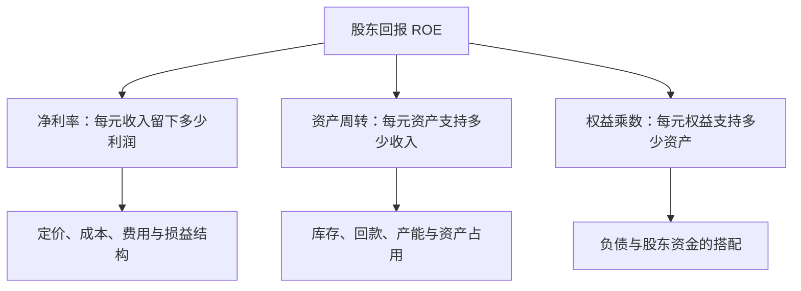

**怎么看图：** 同样的 ROE，可能来自产品赚钱、资源转得快，也可能主要靠杠杆。

理解杜邦分解，可以先看分子分母如何抵消：净利润/收入，乘收入/平均资产，再乘平均资产/平均权益，剩下的正是净利润/平均权益。它是一条会计关系，作用在于把“回报高”改成三个可调查的问题：卖一元能留多少钱，资产一年能支持多少销售，以及用了多少负债和股东资金。

**书外真实案例：美的 2026 年前三季度的 ROE，先把口径读对。** 报告列示加权平均净资产收益率 **18.06%**，同比增加 **1.27 个百分点**，而归母净利润同比增加 9.27%。同表期末归母权益为 2235.19 亿元，较上年末仅增 0.13%。利润增长率、ROE 和权益增幅是不同量，不能互相替代。[三季报第 2 页](https://static.cninfo.com.cn/finalpage/2026-10-30/1225645132.PDF)

如果只用“413.93 亿元归母净利润÷期末权益”，并不能复算公告的加权平均 ROE。分母涉及期间资金变化与适用计算口径；报告第 7 页还显示库存股较上年末增加。回购、分配和权益变动都值得查，但不能仅凭这个余额就精确归因 ROE 提升。更不能把九个月 ROE 直接叫作已经实现的全年收益率。

杜邦分解在这里提供的是调查顺序：先看销售每一元留下多少合并利润，再看同口径平均资产支持多少收入，最后看资产与股东权益怎样搭配。归母指标不能随手与集团总权益混接。若加权平均 ROE 与简单两期平均法不同，应记录口径差异，不要为了凑数调整分子。

**再用一个短算式隔离杠杆效应，以下不是美的数据：** 两项资产都投入 100 万、EBIT 为 12 万。全部用股东资金，忽略税时期初权益回报为 12%；若借款 50 万、年利率 6%，利润为 9 万，除以 50 万期初权益得到 18%。若 EBIT 降至 2 万，前者仍为正 2%，后者则为负 2%。借款没有提高产品本身的赚钱能力，却放大了股东结果；本金到期风险还没有包含在这个算式里。

现实中权益很小或为负时，ROE 的常规比较意义会减弱。使用真实报表，应将加权平均、简单平均和期初权益演示明确分开。

实际应用可先解释最近几年 ROE 变化的主要来源，再问来源是否可持续：利润率改善有无一次收益，周转提高是否靠压库存过度，权益乘数上升是否伴随短债增加。**练习：** ROE 从 15% 升到 20%，同时净利率、周转率均不变，最先查什么？**参考答案：** 先查权益乘数与权益分母为何变化，包括借款、回购、分红和减值；不能直接据此认定产品竞争力提高。

#### 30. ROIC、资本成本和经济利润：赚钱还要超过资金的机会成本

投资资本回报率 ROIC 关注经营使用的资本产生了多少税后经营收益；加权平均资本成本 WACC 反映债权和股权资金对应的要求回报。下面是便于理解的常见分析口径，不是所有行业唯一算法：

```text
NOPAT＝调整后的经营 EBIT×（1－适用税率）
ROIC＝NOPAT÷平均投入资本
WACC＝股权权重×股权成本＋债务权重×债务成本×（1－适用税率）
经济利润≈NOPAT－投入资本×WACC
```

NOPAT 是税后经营利润，尽量排除融资结构与非经营项目影响；投入资本可从有息债务加权益、扣除非经营现金等角度调整，也可从净经营资产计算。必须口径一致。WACC 的估计通常采用市场价值权重，税盾能否利用也有条件。

先弄清“资本成本”为什么不只等于借款利息。债权人要利息，股东也放弃了其他投资机会，并承担较后的索偿顺序；股东没有寄来利息账单，不代表他的资金没有要求回报。WACC 是对相应风险的资金要求回报的估计，不是保证能够实现的收益率。

**书外真实案例：伯克希尔 1985 年退出纺织业。** 巴菲特在当年股东信中回顾，一些更新设备的方案按单厂测算可以降低成本，但竞争者也会更新，行业价格随后下降，企业在投入更多资本后仍难获得足够回报。1985 年 7 月，伯克希尔决定关闭纺织业务。这里引用的是另一位经营者的历史记录，用来解释本书资本回报主题，并非肖星书中的原案例。[1985 年股东信：纺织业务关闭](https://www.berkshirehathaway.com/letters/1985.html)

把决策拆成三步就容易理解：第一，设备改善确实可能节约每件产品的生产成本；第二，如果整个行业都做相同投资，客户会通过降价拿走部分乃至大部分节约；第三，利润留下得不多，投入资本却变大，新增回报可能达不到资金要求。错误不一定发生在成本计算，而可能发生在“成本节约会全部留给股东”的竞争假设。

因此，ROIC 不是只在扩建后算一个漂亮比率，更应在扩建前追问新增资本的收益由谁取得。历史平均回报高，也不能证明下一个项目有效；原业务优势可能暂时掩盖新项目的低回报。反之，这段历史并不证明所有纺织或重资产投资都失败，要重新分析当时的竞争与价格条件。

**公式演示，非伯克希尔实际项目：** 投入资本 1000 万、NOPAT 80 万，ROIC 为 8%；若匹配的资本成本为 10%，经济利润约为 80−1000×10%＝负 20 万。这是机会成本缺口，不是现金账户又被扣 20 万。新增项目投入 200 万、每年新增 NOPAT 12 万，增量回报只有 6%；即使总利润增长，仍应质疑这笔新增投入。在严格假定 12 万等于从下一年末开始无限持续的净现金、无增长时，净现值为 12/10%−200＝负 80 万；真实项目不能跳过建设期、追加投入和寿命。

增长怎样由再投资与新增回报共同形成，可参照 [Damodaran 的增长推导](https://pages.stern.nyu.edu/~adamodar/New_Home_Page/valquestions/growth.htm)。资本成本的概念与误用参照其[资本成本论文](https://pages.stern.nyu.edu/~adamodar/pdfiles/papers/costofcapital.pdf)。这些用于校准本笔记的补充教学，不是原书给出的具体项目。

实务中新增产能常需几年才成熟，不能简单用本年利润增加除以本年资产增加便认定项目失败。应追踪一批投资的投产时间、利用率、利润和现金，并用一致口径与资本成本区间比较。**练习：** 为什么设备降本方案看似合理，整体投资仍可能不好？**参考答案：** 还需考虑竞争者行动与售价变化；节省成本若被降价抵销，新增资本就未必获得足够回报。

#### 31. 行业、战略、执行，共同塑造财务数字

行业影响需求波动、议价能力、资产投入与资金周转；战略决定企业选择怎样的客户和竞争方式；执行影响这一选择能否落地。

分析顺序可以是：先找行业正常区间，再看公司选择，最后查实际结果。财报能提供证据，但无法单独证明因果；毛利下滑可能来自降价、原料涨价，也可能来自低毛利产品占比上升。

#### 32. 增长、利润与风险，要放在同一条资金链里看

销售增长会带来更多利润机会，也可能需要增加库存、应收款和设备。新增业务如果回款慢、毛利低、资本投入大，增长反而可能压低资本回报并扩大融资缺口。

判断时把三件事放一起：新增利润是否可持续，新增资本是否有效，现金能否覆盖扩张与到期义务。成熟企业评价长期经营能力时，利润提供重要信息；快速扩张、财务困境或融资脆弱阶段，现金约束可能更迫切。不存在一张表在所有场景永远最重要。

### 延伸知识：读真实财报时还需要补上的三块

#### 33. 附注、审计意见和管理层讨论，是理解数字的上下文

本点属于补充阅读方法。主表告诉你金额，附注解释会计政策、组成、估计与限制；审计意见表达审计师对报表整体的意见，不是对投资回报或未来偿债的保证。

管理层叙述与数字不一致时，应继续核查；不能仅凭一个异常比率宣判造假。主表、附注和经营解释需配合使用，可参照 [SEC 的报表与附注说明](https://www.sec.gov/investor/pubs/begfinstmtguide.htm)。

#### 34. 自由现金流有用，但“经营现金流减资本开支”只是一个口径

本点为估值衔接的补充。常见简化自由现金流等于经营现金流减资本开支，用来看经营所得在长期资产投入后还剩多少；公司整体自由现金流 FCFF 和股东自由现金流 FCFE 则需要不同调整。

资本开支可能用于维持现有业务，也可能用于扩张，二者对未来现金流的含义不同。但“维护性”与“扩张性”往往无法从一行数字直接分开，不能为了让估值更高，就将必要设备更新一律归为可取消的扩张。

不要把这种简化数当作可直接分红金额；也不要忽略股权激励稀释、租赁、并购及债务偿还等因素。估值时，现金流归谁、折现率归谁，必须匹配。

#### 35. 好公司与好买价，需要分开判断

这是对本书分析框架的投资应用延伸。财报帮助评估经营质量和历史表现，买入价值还依赖未来现金流、风险和支付价格。高利润企业如果价格已经包含过度乐观预期，仍可能带来差的投资结果。

用财报研究股票时，把“企业经营判断”与“估值假设”分栏记录，也记录什么变化会让自己改判。本笔记提供阅读方法，不提供某只股票的买卖结论。

### 难点贯通：亲手走一遍三张表

下面是**原创补充算例**，不是原书案例。金额统一为万元；公司期初尚未经营，各项余额为零。为突出三表关系，忽略增值税、所得税、坏账、汇率及其他复杂项目；假设利息现金流归筹资活动，折旧全部计入当期费用。

#### 第一步：发生了哪些交易

| 次序 | 业务 | 对资产负债表的主要影响 | 对当期利润的影响 |
| --- | --- | --- | --- |
| 1 | 股东投入现金 100 | 现金＋100，投入资本＋100 | 无 |
| 2 | 银行借入现金 50 | 现金＋50，借款＋50 | 无 |
| 3 | 现金买设备 60 | 现金－60，设备＋60 | 购买本身不直接影响利润 |
| 4 | 买商品 40，支付 30，余款未付 | 现金－30，存货＋40，应付账款＋10 | 尚未销售，不直接影响利润 |
| 5 | 销售收入 80，收到 50，余款未收 | 现金＋50，应收账款＋30 | 收入＋80 |
| 6 | 上述已售商品成本为 25 | 存货－25 | 成本＋25，利润－25 |
| 7 | 支付当期工资、租金等 15 | 现金－15 | 费用＋15，利润－15 |
| 8 | 确认当期设备折旧 6 | 设备账面净额－6 | 费用＋6，利润－6 |
| 9 | 支付并确认借款利息 3 | 现金－3 | 利息费用＋3，利润－3 |
| 10 | 向股东现金分红 10 | 现金－10，权益－10 | 无，属于利润分配 |

#### 第二步：利润表怎么算

| 项目 | 金额 |
| --- | ---: |
| 营业收入 | 80 |
| 减：营业成本 | 25 |
| 毛利 | 55 |
| 减：工资、租金等当期费用 | 15 |
| 减：当期折旧 | 6 |
| 简化 EBIT | 34 |
| 减：利息费用 | 3 |
| 税前利润 | 31 |
| 所得税费用：为教学简化设为零 | 0 |
| **净利润** | **31** |

它赚了 31 万，不等于它本期从客户那里净收到 31 万，也不等于可以随意拿走 31 万。

#### 第三步：现金流量表怎么算

| 类型 | 计算 | 净现金流 |
| --- | --- | ---: |
| 经营活动 | 客户回款 50－采购付款 30－工资租金 15 | 5 |
| 投资活动 | 购买设备－60 | -60 |
| 筹资活动 | 股东投入 100＋借款 50－付息 3－分红 10 | 137 |
| **本期现金净增加** | **5－60＋137** | **82** |

设备折旧不再扣一次现金。取得贷款与投入资本没有出现在收入里，却出现在筹资现金流里。

#### 第四步：期末资产负债表怎样平衡

| 资产 | 金额 | 负债与权益 | 金额 |
| --- | ---: | --- | ---: |
| 现金 | 82 | 银行借款 | 50 |
| 应收账款 | 30 | 应付账款 | 10 |
| 存货：40－25 | 15 | 股东投入资本 | 100 |
| 设备净额：60－6 | 54 | 留存收益：31－10 | 21 |
| **资产合计** | **181** | **负债与权益合计** | **181** |

现在能同时对上三条线：

```text
资产＝82＋30＋15＋54＝181
负债＋权益＝50＋10＋100＋21＝181
期末现金＝期初现金 0＋本期现金净增加 82＝82
```

#### 第五步：为什么净利润 31，经营现金流只有 5

```text
净利润                                  31
加：计入利润但未发生当期现金支出的折旧      6
加：本例归为筹资现金流的利息费用            3
减：应收账款增加                         30
减：存货增加                             15
加：应付账款增加                         10
经营现金流                                5
```

这是本算例全部事实下的闭合调节，不是任意公司的通用完整公式。应收款让一部分收入还没变现金；存货使一部分现金还没变费用；应付款则让公司暂时不用支付部分采购款。**这就是利润与现金不同、但又能够相互解释的原因。**

### 把这些知识用起来：一次真实财报阅读练习

选一家业务容易理解的非金融企业，取得同口径连续三年的年报。先写问题，再找数字。

1. **用三句话描述生意。** 卖什么、卖给谁、客户为什么愿意付钱；暂时不看股票涨跌。
2. **看投入。** 主要资产是什么？近三年增加的是设备、存货、应收款还是现金？新增投入为哪个业务服务？
3. **看利润来源。** 收入、毛利、主要费用和净利润如何变化？用业务事实解释变化，避免只写“同比增加”。
4. **核对回款。** 经营现金流与净利润为什么不同？应收和存货的变化能否解释？特殊事项是否影响可比性？
5. **看效率与负担。** 选合适的周转率、ROE、ROIC与债务指标；口径和计算过程都留在笔记中。
6. **找可比对象。** 比同行、比历史，并解释战略差异；不用跨行业的“标准答案”硬打分。
7. **写出有限结论。** 哪些证据支持经营改善？最可能推翻判断的两件事是什么？哪些信息还不知道？

可以用这张小表组织结论：

| 判断 | 支持证据 | 另一种解释 | 下一步验证 |
| --- | --- | --- | --- |
| 补充示例：回款可能变慢 | 应收增长快于收入，账龄拉长 | 年末大客户交付集中 | 看期后收款、信用条款与客户情况 |
| 补充示例：扩张暂时占用现金 | 设备投入增加，投资净流出 | 投资低效或重复建设 | 看产能利用率、订单与后续资本回报 |

如果你是管理者，练习的输出可以是“优先催收哪类款项、减少哪类低效库存、如何评价新增投资”；如果你是普通读者，能把数字说成一段可验证的经营故事，就已经获得了本书最重要的能力。

### 易错点速查

| 常见误读 | 更准确的理解 |
| --- | --- |
| 买设备花了钱，所以当年全是亏损 | 先看资产确认，再看折旧、减值和用途 |
| 收到钱就是收入 | 借款、出资、预收款等需要分别判断 |
| 净利润就是老板能取走的钱 | 还要看现金、经营需求、债务和分配条件 |
| 现金流不能粉饰 | 分类、交易时点、保理、关联交易等仍需核查 |
| 投资现金流为负一定危险 | 先看买了什么、为什么买、回报和资金来源 |
| 高 ROE 一定是好公司 | 拆开利润率、周转与杠杆，检查分母和特殊收益 |
| 高毛利一定优于低毛利 | 看周转、费用、资本投入与竞争路线 |
| 账面净资产就是公司出售价值 | 账面计量与市场价值、未来价值并不相同 |
| 财报看懂了，就知道股价会涨 | 未来与买入价格仍需独立分析 |

### 自测：能解释这些问题，就抓住了主干

1. **赊销 10 万，尚未收款，通常先影响哪些项目？** 满足收入确认条件时，收入与应收款增加；销售成本等还需另行结转；当时不因这笔赊销产生客户回款。
2. **偿还贷款本金会降低当期利润吗？** 通常不会；它减少现金和借款。利息费用的确认是另一件事。
3. **折旧为什么可以在间接法里加回？** 因为它降低了起点利润，却不代表当期再付一次现金；仍需考虑长期设备投入。
4. **一家公司的现金增加，为什么可能更危险？** 增加可能来自短期举债，而经营仍在流血，未来偿债压力反而更大。
5. **ROE 提升，应先拆哪三项？** 净利率、总资产周转率、权益乘数，并统一利润和权益归属口径。
6. **公司 ROIC 为 7%、资本成本估计 10%，能说明什么？** 在这些口径与估计成立时，经营回报未达到资金要求回报；不能只因净利润为正就认定创造价值。
7. **应收款突然增加，为什么不能直接认定造假？** 增长、季节性、客户信用政策及收款时间都可能解释；异常是调查起点，不是结论。
8. **为什么说增长可能消耗价值？** 新增长可能占用很多资金，却只产生低于资本成本的新增回报，同时加重现金压力。

### 来源与阅读边界

本笔记不逐字摘录原书，未复制第三方书评。公开目录用于核对主题覆盖；会计与公司财务部分用通行知识和一手资料校准，真实数据表注明公司、期间与原公告；标为计算演示的数字才是假设。图示为本笔记的教学整理。国际准则资料用于解释概念，不表示可以忽略中国准则、行业差异及具体报告期要求。

| 资料 | 用途与边界 |
| --- | --- |
| [清华大学肖星主页](https://www.sem.tsinghua.edu.cn/info/1205/32025.htm) | 作者与早期版本核验，不据此推断全文内容 |
| [对外经贸大学图书馆书目](https://opac.uibe.edu.cn/opac/book/3d543fc78e2c850406c5a1cca06efe33) | 2022 年版书目信息、出版方与主旨 |
| [得到第三版目录](https://www.dedao.cn/ebook/detail?id=A1De6QkaNRMlK5yxrdmnEBXY97ZL23nRlM3o6zvGDekj1QgA84VbpqJOPLgxEJlY) | 主题索引；未把读者评论当作作者原文 |
| [财政部基本准则](https://www.mof.gov.cn/zcsjtsgb/gztsgb/201407/t20140723_3578373.htm) | 要素、权责发生制及计量概念 |
| [财政部存货准则](https://www.mof.gov.cn/zhengwuxinxi/zhengcefabu/2006zcfb/200805/t20080519_23107.htm) | 存货成本、结转与跌价概念 |
| [财政部固定资产准则](https://www.mof.gov.cn/zhengwuxinxi/zhengcefabu/2006zcfb/200805/t20080519_23104.htm) | 固定资产与折旧概念 |
| [财政部年报工作通知](https://m.mof.gov.cn/czxw/202501/t20250106_3951168.htm) | 资产减值与应收款风险提示的一手核验 |
| [SEC 财务报表入门](https://www.sec.gov/investor/pubs/begfinstmtguide.htm) | 报表分工、附注与经营解释 |
| [IFRS 基金会 IAS 7](https://www.ifrs.org/issued-standards/list-of-standards/ias-7-statement-of-cash-flows/) | 现金流类别与基本概念 |
| [IFRS 基金会 IFRS 15](https://www.ifrs.org/issued-standards/list-of-standards/ifrs-15-revenue-from-contracts-with-customers/) | 履约与收入确认逻辑；不替代特定合同判断 |
| [IFRS 基金会 IAS 38](https://www.ifrs.org/content/dam/ifrs/publications/pdf-standards/english/2021/issued/part-a/ias-38-intangible-assets.pdf?bypass=on) | 内部研发确认的概念解释 |
| [Damodaran：资本成本](https://pages.stern.nyu.edu/~adamodar/pdfiles/papers/costofcapital.pdf)与[资本回报教学](https://pages.stern.nyu.edu/~adamodar/New_Home_Page/cfemailspr11.html) | ROIC、资本成本及计算口径的补充校验 |
| [Damodaran：增长的基本驱动因素](https://pages.stern.nyu.edu/~adamodar/New_Home_Page/valquestions/growth.htm) | 资本再投资、平均与增量回报的补充校验 |
| [美的集团 2026 年三季报](https://static.cninfo.com.cn/finalpage/2026-10-30/1225645132.PDF) | 书外真实案例：合同资产、减值、利润分类、现金流、经营资金与 ROE；报告未经审计 |
| [伯克希尔 1985 年股东信](https://www.berkshirehathaway.com/letters/1985.html) | 书外真实案例：纺织投资与竞争对资本回报的影响 |

**尚未覆盖：** 原书各版具体企业案例的完整数据和推导、每个问答小节的全部细节、适用于特定公司的复杂收入合同及会计处理。后续拿到原书，可以按原章逐项补充，并把本笔记中的“主题覆盖”升级为可核对的阅读记录。

---

[返回书籍索引](<README.md>) · [财商学习与实践路线](<财商进阶合订本.md>)


---

<a id="book-02"></a>

[单独打开本篇](<聪明的投资者 - 本杰明·格雷厄姆/读书笔记.md>)

## 《聪明的投资者》读书笔记

> 作者：本杰明·格雷厄姆（Benjamin Graham）；英文名：The Intelligent Investor。  
> 版本说明：初版发表于 1949 年；常见评注版保留格雷厄姆后期修订文本，另加入 Jason Zweig 的评注。Zweig 又有更新版本，不能把新增评论、现代产品和案例都算作格雷厄姆原著内容。用户所持中文译本未确认。  
> 分析依据：公开目录、Zweig 本人介绍与访谈、监管机构投资者教育资料，以及对经典概念的原创教学解释；书外案例另核对伯克希尔原信、美国财政部证词、Vanguard 官方基金资料表与美的集团公告。未取得用户版本全文。  
> 覆盖范围：原书二十章的主要主题，归并为 32 个知识点；不逐个复述历史公司案例，不承诺覆盖所有脚注与版本差异。  
> 更新日期：2026-11-11

版本与评注的区别参见 [Zweig 官方书页](https://jasonzweig.com/books/the-intelligent-investor/)；章目参照 [O'Reilly 的授权电子书目录](https://www.oreilly.com/library/view/the-intelligent-investor/9780061745171/)。以下章节号按常见修订版正文二十章；中文小标题为概括，不冒充某个译本原文。标明“书外真实案例”的事件据一手资料核验，不冒充原著案例；计算演示与应用流程为本笔记编写。

### 先看这里：它究竟教你什么

**一句话概括：把股票当作企业权益，以合理价格和风险安排购买，建立能让自己长期坚持的判断与纪律。**

“聪明”主要指独立判断、耐心、自我约束和愿意承认不知道，不是预测每一次涨跌的天才。你可以研究得很深，也可以承认自己不愿长期研究，采用更简明的防御路线；危险在于既没有研究，又期待持续获得专业选股的结果。

七个最值得记住的结论：

1. **投资与投机要分清。** 没有分析支撑、只期待下个人出更高价的交易，不能因持有时间变长就自动升级为投资。
2. **市场报价不是你的老师。** 它提供交易条件，你有权暂时不交易。
3. **买得便宜，要相对于价值。** 股价跌过、单价低、历史涨得少，都不等于便宜。
4. **给错误留余地。** 安全边际承认预测会错，并且要防止误判导致无法承受的损失。
5. **优先选择你能执行的方案。** 高难度策略与高自信不是同一回事。
6. **费用、过度交易和情绪是可控制的损耗。** 未来市场回报无法保证，这些损耗却会真实发生。
7. **数字标准有时代背景，原则更长久。** 原书的利率、公司规模和筛选阈值，不能直接变成今天任何市场的买入指令。

它对提高财商最直接的帮助，是把“我觉得会涨”改成四个问题：**我买的是什么？依据是什么？价格给了多少容错？我承担得起什么结果？**

### 全书主线与知识覆盖

| 正文位置 | 主要问题 | 本笔记覆盖 |
| --- | --- | --- |
| 第 1—3 章 | 投资边界、通胀、市场历史 | 1—5 |
| 第 4—5 章 | 防御型投资者的组合与股票选择 | 6—10 |
| 第 6—7 章 | 进取型投资者应避开什么、研究什么 | 21—24 |
| 第 8 章 | 怎样面对市场波动 | 11—13 |
| 第 9—10 章 | 基金与投资顾问 | 25—27 |
| 第 11—12 章 | 基本分析与每股收益 | 15—18 |
| 第 13—15 章 | 企业比较、不同类型选股 | 9、17、21—22、29 |
| 第 16 章 | 可转换证券与认股权证 | 28 |
| 第 17—19 章 | 历史案例、股东与管理层、分红 | 19—20、29 |
| 第 20 章 | 安全边际 | 14、30 |

正文负责建立判断框架；Zweig 的评注帮助解释现代市场中的应用和行为问题。下面将两者能确认的共同原则与补充教学分开，不把互联网时代的基金产品当成 1949 年已存在的原著建议。

### 核心知识点

#### 1. 投资，是分析、保护本金与合理回报共同组成的过程

原书第 1 章的投资概念包含充分分析、对本金安全的重视及适当回报。它不是任何资产绝不下跌的担保，也不是“好公司永远都能买”。

**财商收获：** 每笔资金先标清目的。没有证据支撑的部分就承认是押注，不用“长期投资”掩盖缺少判断依据。

#### 2. 投机可以存在，最危险的是自己没有意识到在投机

原书并非宣称所有投机都不合法或不道德，而是要求你知道自己在做什么。区分的关键不是持有几天，也不是证券有没有名气，而是回报理由：你能否依据资产、盈利、价格和风险作出有保护的判断，还是主要押注接下来会有更高报价。相同证券可以被不同的人以不同方式使用，持有多年也不能自动补出缺失的分析。

判断一笔交易，先写下收益依据、价格保护和失效条件。若主要依据只是别人愿意更高价接手，就应承认其中投机成分；一次赚钱不能倒推方法可靠，一次亏损也不能单独证明分析毫无价值。

最常见的失控从“改名”开始：原先打算短线交易，下跌后临时改口“价值投资要有耐心”，但没有新增任何企业证据。问题不是没有立即卖出，而是原来的退出依据被情绪悄悄删除。后来再跌，他可能继续用更多钱摊低成本，使一笔有界的尝试变成整个家庭的风险。

因此，边界应落实在资金用途和书面规则上。先把必要生活支出、确定要用的钱和长期投资计划分清，再讨论是否保留试验性资金。不同账户能帮助记录，却不能隔离经济后果：如果不断从核心资金补钱，名义上的“小账户”仍会吞掉大账户。杠杆尤其会使账户跌幅之外再出现利息和强平约束。

**原创风险算例：** 假设总投资资金 100 万，其中 5 万是你明确接受可能全部损失的试验，其余 95 万先假设不变。试验亏掉 80%，总额变成 96 万，总体损失 4%；若亏损后再从其余资金转入 15 万继续押注，原来的风险安排就已经失效。这里的 5% 只是展示边界的假设，不是建议所有人配置这一比例，也不是允许不研究的理由。

检查一笔交易，可以暂时遮住买入成本，写下“从今天开始，还愿意以这个规模承担它吗？依据是什么？何种事实会改变决定？”买入价会影响税费和实际损益，却不会因为你想回本，就成为企业价值的支撑。

**自查题：** 一笔交易最初有研究依据，后来债务违约风险大增，但你只因不愿亏损而继续持有，原来的“投资”标签能否保证安全？**参考答案：** 不能。判断需要随证据更新；承认风险变化、减小规模或退出，都可能比维护标签更重要。Zweig 对行为约束的说明可参见[其 CFA 讲稿](https://jasonzweig.com/wp-content/uploads/2016/10/CFA-Graham.pdf)，本节资金边界的计算为补充教学。

#### 3. 防御型与进取型，区分的是投入方式和能力要求

防御型希望降低严重错误与管理负担，进取型愿意持续承担额外研究、判断和执行工作。主要区别在投入方式和能力要求，不能按“敢重仓所以进取”划分。防御路线也要检查期限、分散和费用；进取路线则必须能说明额外工作怎样改善判断。

**书外真实案例：2008—2017 年，巴菲特与 Protégé 的十年比较。** 巴菲特选用跟踪标普 500 的低成本指数基金，对方选择五只基金中的基金，间接持有两百多只对冲基金。2017 年信披露，指数基金十年累计增长 **125.8%**；四只完成十年观察的组合分别为 **21.7%、42.3%、87.7%、27.0%**，另一只于 2017 年清算，不能假装其观察期完全相同。[2017 年股东信，PDF 第 10—11 页](https://www.berkshirehathaway.com/letters/2017ltr.pdf)

这个真实比较让“更多专家、更复杂流程”与“最终投资结果”分开了。对方并非没有研究，而是额外研究、调整与多层费用没有在这次比较中转化为更好的净结果。学习本书时，应把进取理解为愿意付出并验证额外努力，而不是默认复杂方案天然优于简单方案。

但它也不是所有主动管理必败的实验。五只组合并非随机抽样，风险暴露与指数不同，十年环境也不是所有未来环境。正确收获是提出检验标准：多承担了什么风险、付出了什么费用、选择了什么可比较基准，最后是否获得了补偿；不能仅看名气或工作量。

如果你选择进取路线，应能持续产出经营分析、估值区间、反证条件和事后复核。若大部分时间只是读重复的评论，额外投入可能没有形成优势。若选择防御路线，则要接受它同样会经历市场波动，而不是在最困难时临时改成预测涨跌。

**计算演示：** 20 万资金若真能在相同风险、扣除成本后多取得 2 个百分点回报，一年增加 4000 元；如果投入 200 小时，相当于每小时 20 元的假设增量。这里并未证明那 2 个百分点存在，只提示时间和机会成本也应计入决策。

**练习：** 能否因十年比较中的指数胜出，就认定任何指数产品都适合自己？**参考答案：** 不能。还要检查所跟踪市场、集中度、费用、汇率、资金期限和风险承受力。此例是书外实践，不应误称为格雷厄姆原著中的指数基金案例。

#### 4. 通胀会侵蚀购买力，名义本金不变也可能变穷

名义回报是账户金额的变化，实际回报还要扣除物价影响。简化计算为：

```text
实际收益率＝（1＋名义收益率）÷（1＋通胀率）－1
```

**补充例子：** 一年名义赚 4%，物价涨 6%，实际购买力变化约为 1.04÷1.06－1＝负 1.89%。账户余额增加并不等于消费能力增加。

第 2 章因此提醒读者不能只看固定金额收益。但股票也不是任意期限必然跑赢通胀：企业可能无法涨价，利润率可能受挤压，买入估值也影响结果。抗通胀要看具体经济机制，不靠资产标签许愿。

#### 5. 学历史，是认识循环与估值，不是找到精确时钟

第 3 章用长时期市场背景讨论估值和预期。历史有助于看见繁荣时普遍乐观、低迷时普遍悲观，也提醒你当前价格已包含多少期待。

不要把书中某年市盈率和利率看成永远有效的红绿灯。值得继承的是比较价格与经营基础，警惕“这次任何价格都合理”。

#### 6. 资产配置先解决承受能力，再讨论选哪只股票

第 4 章讨论股票与高等级债券的组合。原书的股票区间与均衡配置建议属于历史框架，不能不问期限、币种和未来支出就机械套用。心理上愿意忍受下跌，与经济上能等恢复，是不同条件。

**书外真实案例：Vanguard LifeStrategy 60/40 Fund 的 2022 年。** 该基金的官方资料说明其策略约为 60% 股票、40% 债券；截至 2026 年 9 月的资料表列示，2022 年基金回报为 **−16.00%**，2023 年为 **＋15.49%**。数据包含分红和资本收益分配再投资、扣除基金费用，是该基金的历史回报，不代表所有 60/40 组合。[Vanguard 官方资料表第 1 页](https://workplace.vanguard.com/assets/corp/fund_communications/pdf_publish/us-products/fact-sheet/F0914.pdf)

这个结果首先纠正“分散之后不会亏”的想法。股票和债券各有风险，债券也会因利率、信用和期限变化跌价；把它们组合起来，并不承诺每次相互抵销。其次，投资者的钱是否可以等待，比自己是否喜欢这个比例更先需要回答：若必须在亏损年份支付确定支出，实际选择与能够长期持有的人不同。

用上述已发生的两年回报作标准化计算，不另编行情：期初设为 100，2022 年末为 84，2023 年末为 84×1.1549＝**97.0116**。第二年涨幅看起来接近第一年跌幅，仍未回到原点。这里暂不考虑个人税费、申赎和币种兑换；不能把这个单位值当作实际基金净值。

这也不能反过来证明 60/40 永久失效，更不能根据这两年就替所有人确定配置。应先将短期必要支出、应急资金和长期目标区分，再检查候选组合在不利情景下的金额损失、流动性和币种是否合适。工作收入与投资若同时暴露于同一行业，家庭整体风险还可能高于投资账户显示的程度。

选定安排后，复核应由资金用途、收入稳定性和负债等变化驱动，不能仅因某类资产最近上涨，就宣称自己的承受能力也提高了。现代期限与风险原则可参照 [Investor.gov 配置说明](https://www.investor.gov/introduction-investing/getting-started/asset-allocation)。

**练习：** 看到上述基金 2023 年上涨，能否认定 2022 年底必须用的钱也适合事先投入这种组合？**参考答案：** 不能。后来反弹不会改变当时的付款期限，也不保证未来反弹何时出现。这一案例用于理解风险与期限，不推荐该产品。

#### 7. 再平衡，是恢复原定风险，不是知道明天谁会涨

某类资产上涨后会在组合里占更大比重。再平衡把组合带回预先设定的范围，也可以利用新增资金完成，减少不必要的卖出。

**补充例子：** 原有股票 60 万、债券 40 万，股票涨到 90 万、债券仍为 40 万。股票占比约 69.23%；若目标仍为 60%，总资产 130 万对应股票 78 万，可将 12 万股票换成债券。这个计算没有预测股票接下来一定跌。

要事先规定按时间还是按偏离幅度检查，并考虑交易成本和税收；目标本身不合适时，应重新制定计划，而不是盲目恢复旧比例。[Investor.gov 再平衡说明](https://www.investor.gov/additional-resources/spotlight/formerdirectorlorischock-directors-take/it-time-rebalance-your-investment-portfolio)

#### 8. 债券的“固定收益”，不等于价格固定或没有风险

债券要分别看信用风险、利率风险、通胀风险、流动性和赎回条款。固定票息债券通常在市场利率上升时跌价；期限越长等因素可能使敏感度更高。

**补充例子：** 旧债每年付 3 元，市场新债同等风险可付 5 元，旧债往往需要降低价格才有吸引力。持有到期的思路仍依赖发行人能履约，并且你确实不需要提前出售。

高收益债的高利率通常包含更高违约风险，不能把收益率提升理解成免费午餐。[SEC 利率风险说明](https://www.investor.gov/introduction-investing/general-resources/news-alerts/alerts-bulletins/investor-bulletins-86)、[SEC 高收益债说明](https://www.investor.gov/sites/default/files/ib_high-yield.pdf)

#### 9. 防御型股票筛选，是把风险挡在买入之前

第 5、14 章重视企业规模、财务稳健、盈利稳定、分红记录、适度增长及不过高的购买价格。这些要求共同构成防御，不是拿某一个指标就结束研究。

原书具体规模门槛、市盈率、市净率及历史年限有其时代背景。今天分析轻资产企业和新会计口径时，要理解筛选目的，不能把数字组合当成自动盈利机器。

#### 10. 分散化，是承认自己可能看错

分散要覆盖不同企业风险，必要时也考虑行业、市场、币种和资产类型。买很多名称，不代表风险来源分散；十只依赖同一个商品价格的股票仍可能同时受损。

分散不能消灭市场整体下跌，也不能使明显过高的价格变合理。它的作用是减少单一错误对整体的破坏。[澳大利亚 Moneysmart 分散化说明](https://moneysmart.gov.au/how-to-invest/investment-diversification)

#### 11. 市场先生：把报价当作选项，不把情绪当作命令

原书第 8 章把市场想成不断提供买卖价格的交易伙伴。你可以接受合适报价，也可以不成交。寓言要解决的是：价格变化会诱导你用涨跌评价企业与自己的判断，然而报价与生意价值不是同一个量。

**书外真实案例：1973 年的《华盛顿邮报》公司。** 巴菲特在 1993 年信中回顾，买入时该公司股价已经大幅下跌；他将这次投资直接联系到格雷厄姆的“市场先生”。信中还说明，1973 年投入约 1000 万美元，到 1993 年持仓价值超过 4 亿美元、当年取得股息约 700 万美元。[1993 年股东信，市场风险讨论及 Katharine Graham 段](https://www.berkshirehathaway.com/letters/1993.html)

这些后来的成果能说明该项投资最终成功，却不能反过来证明“当时只要敢买下跌股就行”。真正应学习的是当时决策要依据什么：业务能否持续赚钱、管理层是否善待股东、买入价格是否留下余地。多年后收益漂亮，是结果验证；它不是事前可以跳过研究的理由。

报价提供的是一个选项。如果生意证据没有同幅恶化，较低报价可能改善未来回报条件；若客户、竞争或偿债能力已经永久受损，价格下跌也可能是在传递重要信息。“市场先生情绪化”不能成为拒绝坏消息的借口。该报业公司的历史经验，也不能保证今天所有媒体仍具有当时的经营条件。

实际操作时，将一次大跌拆成三栏：报价发生什么变化，经营事实发生什么变化，原估值中哪条假设需要调整。只有第一栏变了，不必立刻交易；第二栏有长期影响，就要重估。无法核实的地方写“未知”，而不是把坚持持有自动叫作独立思考。

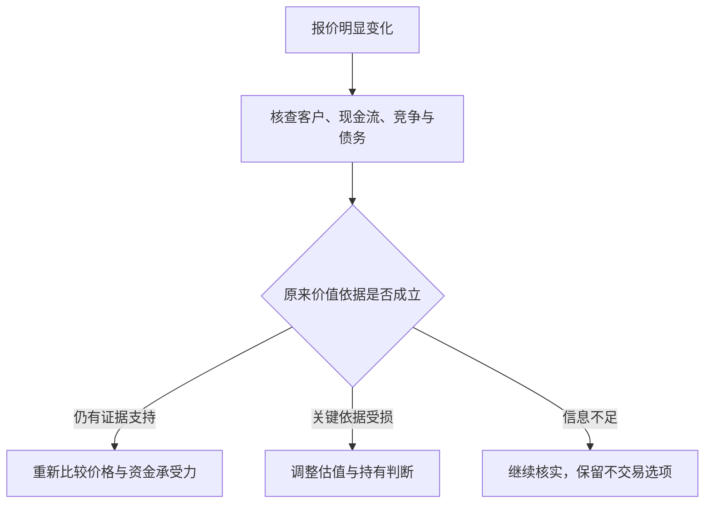

**图解：** 下跌只是入口，不能直接跳到“便宜了”或“坏了”。**练习：** 华盛顿邮报的成功是否证明跌得越多越安全？**参考答案：** 不证明。安全取决于下跌后支付的价格与可靠价值依据，以及资金能否承受等待；历史成功不是普遍规律。

#### 12. 价格是交易条件，价值是有依据但不确定的估计

价格容易看见，价值需要判断盈利能力、资产、竞争、债务和未来现金流。价值不是自己最喜欢的目标价，也不是买入成本。

一个实用习惯是先研究合理价值区间，再对照报价；如果先迷恋涨幅或目标价，随后搜集理由，分析容易变成自我辩护。

#### 13. 波动不是全部风险，永久损失和被迫出售更关键

格雷厄姆关注本金受损，而不只是报价起伏。资产价值、融资安排、期限和生活需要共同决定损失能否承受；没有卖出，不等于经济价值没有受损。

**书外真实案例：LTCM 在 1998 年濒临崩溃。** 美国财政部 1999 年国会证词披露，1997 年末长期资本管理基金资产接近 **1300 亿美元**，资本约 **47 亿美元**，总资产与资本之比约 **28 倍**。这是表内粗略杠杆，不能当作包括全部衍生风险的完整尺度。[美国财政部 1999 年证词](https://home.treasury.gov/news/press-releases/rr2991)

这个资金结构把一个重要问题摆到估值之前：即使认为价差最终会回归，资本能否承受它先向不利方向扩大？损失侵蚀权益后，相同资产规模对应的杠杆会更高，追加抵押品和融资收缩又可能迫使卖出。预测最终方向，与有能力等到兑现，是不同能力。

LTCM 是复杂机构事件，不能按一个杠杆比率概括所有原因，也不能据此断言所有套利都会失败。对个人可迁移的检查是：债何时到期、何时必须用钱、市场恶化时是否还要补现金。风险管理要让研究判断有机会接受长期事实检验，而不是让一次资金断裂提前终止。

**练习：** “我愿意长期持有”能否解决短期借款到期？**参考答案：** 不能。心理上的耐心不会改变合同现金需求。

#### 14. 安全边际，是为估值错误与坏情况预留缓冲

第 20 章把安全边际作为核心概念。余地可以来自价格低于保守价值、偿债覆盖充分、资产负债表稳健等；其前提是估值与风险判断本身有证据。如果每个预测都必须实现才能赚到合理回报，就没有为误差留出多少空间。

**书外真实反例：2016 年收购 PCC，2020 年承认付价过高。** 伯克希尔 2020 年信说明，当年约 **110 亿美元的减记几乎全部对应巴菲特在 2016 年收购 Precision Castparts 时的错误**：他对正常盈利潜力过于乐观。信中仍认可企业与管理者，却承认对未来平均利润和购买价格判断错误。[2020 年股东信，PDF 第 2—3 页](https://www.berkshirehathaway.com/letters/2020ltr.pdf)

这说明“买的是好公司”并不能替代安全边际。先把企业称为行业优秀者，再把优秀推导成很高的正常利润，最后为这个利润付高价，可能在不知不觉中把多个乐观假设叠加。外部冲击发生时，被暴露的既有当期经营压力，也有原先付价的脆弱性。

同样不能把减记直接等同于当年现金流出 110 亿美元：收购付款发生在更早时期，减记反映账面价值调整。这个数字也不是一份完整的最终投资回报计算。它真正提醒投资者，估值中的“正常盈利”需要承压验证，保守措辞不等于保守假设。

**如何将教训变成做法？** 先写出销量、利润率、维护支出和资本结构的证据，再对最敏感的变量做不利情景。不要先选一个想买的价格，再调增长率让模型显示便宜。即使承压价值高于价格，仍要查债务到期和被迫出售风险，因为账面价值等待实现需要资金条件配合。

**仅作分母演示：** 假定保守价值为 80 元、价格 56 元，折价为 (80−56)/80＝30%；由价格上涨到该价值的空间是 (80−56)/56≈42.86%，二者不是同一百分比。若后续证据使保守价值降到 50 元，原来的“三成安全边际”就已不成立。这是假设演算，不是 PCC 的估值复原。

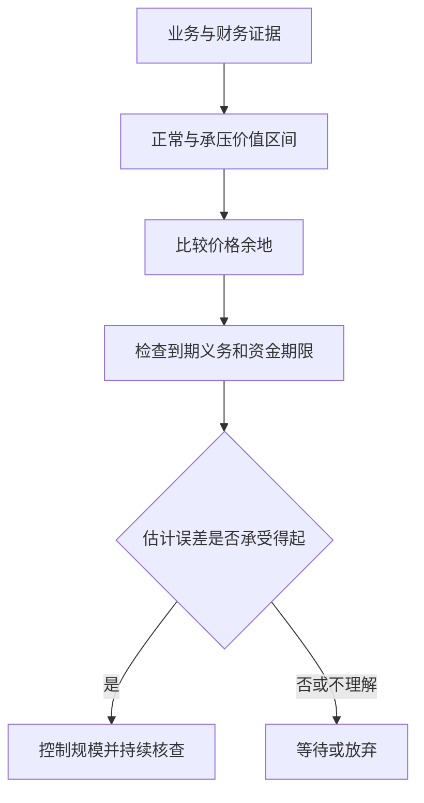

**练习：** 已买入的企业后来公布减值，能否说“非现金，所以安全边际没变”？**参考答案：** 不能。要研究减值是否意味着原来的盈利或资产价值假设失效；非现金计量仍可能承认过去真实的资本损失。

#### 15. 估值应当有区间，不要被小数点迷惑

第 11 章讨论证券分析对普通投资者的意义。你不必得到唯一精确价格，但应理解结论依赖哪些前提。增长率、利润率、资本投入和折现要求稍变，估值可能相差很大。

**补充例子：** 一个简化永续模型中，稳定现金流 10 元，要求回报 10%，零增长估值为 100 元；若要求回报提高到 12%，估值降至约 83.33 元。该模型极度简化，只用于显示敏感性，不能直接给真实公司估价。

看懂模型的条件比背公式更重要。越远期、越不稳定的收益，越不适合假装预测精准。

#### 16. 企业成长和股东高回报之间，还隔着价格与资本投入

好行业、好产品不必然带来好投资。预期增长可能已被计入高价格，增长本身也可能需要大量新资本、借债或增发。

因此要问：增长最终归现有股东多少？要投入多少？价格已经预付了多少？低增长并不自动好，高增长也不自动坏，关键在于事实和价钱是否匹配。

#### 17. 市盈率、市净率是检查工具，不是价值本身

```text
市盈率 PE＝每股价格÷每股收益
市净率 PB＝每股价格÷每股净资产
```

低 PE 可能因利润正处周期高点，也可能因为市场预见利润下降；低 PB 可能因资产价值被低估，也可能因为资产无法产生足够收益。净资产为负、盈利为负时，常规比率的含义会明显改变。

**补充例子：** 某企业今年 EPS 为 10 元、股价 50 元，看似只有 5 倍 PE；若正常年份 EPS 只有 2 元，实际常态盈利对应 25 倍。第 14 章的筛选纪律应该这样理解，而不是机械寻找最小比率。

#### 18. 每股收益要读质量、周期和稀释，不只读表面增长

第 12 章提醒读者研究每股数字的形成过程。市盈率的价格容易看到，盈利分母却需要检查：是否经常、处于什么周期、使用多少资本、被多少股数分享。单年高利润可能恰在景气高点，历史平均也可能掩盖结构性衰退。

**书外真实案例：美的 2026 年三季报怎样被误读为“全年正常利润”。** 原表披露前三季度归母净利润 **413.93371 亿元**、增长 **9.27%**；第三季度单季归母利润为 **149.47334 亿元**、增长 **25.93%**。同一份报告的累计扣非归母利润却下降 **22.49%**。这是不同期间和定义的真实数字，不能选增长最快的一项替代全部盈利能力。[三季报第 2 页](https://static.cninfo.com.cn/finalpage/2026-10-30/1225645132.PDF)

第一步是对齐期间。把前三季度利润机械乘 4/3，得到约 **551.91 亿元**，只是隐含“第四季恰等于前三季的季度均值”；它没有处理季节性，更不是已实现全年业绩。若用这个数字计算市盈率，必须标为自己的情景假设，不能装成报告披露。

第二步是拆损益。公司解释扣非差异涉及外币项目与相关衍生工具的分类；报告还列有其他投资和公允价值变动项目。不能把归母增长直接称为主营盈利增长，也不能无条件把扣非当作唯一的正常利润。应逐项判断哪些与持续经营相关、哪些可能反复发生、哪些只是某一期间的计量结果。[三季报第 2—4、8 页](https://static.cninfo.com.cn/finalpage/2026-10-30/1225645132.PDF)

第三步才是每股分析。前三季度基本每股收益 **5.54 元**、同比增加 **11.24%**，增长率并不等于归母利润的 9.27%。每股指标还涉及普通股股东收益及加权平均股数等口径，应查回购、增发和潜在稀释，而不是假设股数始终不变。这里没有取得足够信息来将差额全部归因于某一次回购。

周期企业还要进一步按正常销量、售价、单位成本和固定费用重建盈利。**简化计算演示：** 卖 100 万件、单价 100 元、单位变动成本 60 元、固定费用 2000 万，忽略税息时利润为 2000 万；售价降至 90 元、其他不变，利润便降至 1000 万。收入只跌 10%，利润却跌 50%，因此不能把景气高点的低 PE 自动当便宜。这不是美的成本结构测算。

**练习：** 为什么即使真实公告没有错误，投资者仍会算出误导性的市盈率？**参考答案：** 可能混用单季与累计、机械年化、错误正常化盈利，或忽略股数变化。先把分母研究清楚，才谈价格是否留有余地。

#### 19. 分红是资本配置的一种方式，不是凭空增加财富

第 19 章讨论股东、管理层和分红政策。留存利润应当有合理用途，管理层需要证明留在公司里能带来足够收益；但高分红本身也不是优秀的全部证据。

比较分红、留存、回购时，应看再投资机会、财务状况、价格和税收。股票拆分只是把同一权益拆成更多份额，不会自动创造经营价值。

#### 20. 股东应评价管理层，不把所有解释照单全收

管理层替股东运用资本，应根据长期每股经营结果、资本回报、报酬安排和对外沟通来评价。规模扩张和高管名气不等于股东利益增长。

这是第 19 章主题的实践延伸。普通股东的信息和影响力有限，不能以“我会监督”替代事前选择；重要的是识别激励是否匹配、解释能否核验，以及自己是否愿意继续承担这种治理结构。

#### 21. 进取型投资，需要可识别的优势和完整研究

第 6—7、15 章涉及更主动的投资方法。它要求识别为什么某些证券被忽略、为什么报价可能偏离价值，以及自己有哪些证据；并不保证多花时间就一定赚得更多。

真正的进取路线常常意味着更谨慎的研究和更耐心的等待。若研究能力无法覆盖复杂情形，保持简单也符合本书精神。

#### 22. 便宜资产与价值陷阱，只差几个关键前提

低于账面净资产买入，只有在资产具有可回收价值、义务可控，而且价值能归属股东时，才可能提供保护。账面便宜若伴随持续亏损、资产难卖和资金消耗，折价可能只是问题的一部分。

**书外真实案例：伯克希尔纺织设备的清算。** 1985 年退出纺织业后，伯克希尔在 1986 年初拍卖相关设备。原信所列出售金额还包含拍卖前数月的部分处置；这批设备原价约 **1300 万美元**、账面净值 **86.6 万美元**，出售总收入仅 **163,122 美元**，计入必要处置费用后净收益低于零。[1985 年股东信，设备拍卖段](https://www.berkshirehathaway.com/letters/1985.html)

这不是说会计一定错了，而是说明“仍可使用”“账上还有价值”和“有人愿意以该价格买走”不同。若整个行业都缺少有利可图的用途，专用设备的转售价值会很低，拆除和搬运还可能增加成本。因此，研究低 PB 或净资产折价，必须逐类问谁会买、以什么用途买、费用和债务如何扣除。

同一历史也不能推出所有工业资产都无价值。资产所在位置、通用程度、需求和处置方式不同，回收结果会不同。**练习：** 能用设备新购置价作为清算价值下限吗？**参考答案：** 不能；重置成本回答重新买入要花多少，清算价值取决于当前买方及处置代价。

#### 23. 特殊机会，必须把失败情景也放进计算

并购、清算、重组等事件可能形成不同于普通经营估值的机会，但它们依赖事件完成、时间、融资、监管等条件。历史书中的机会描述不能替代今天的具体交易分析。

**补充例子：** 以 90 元买入，成功后得 100 元，失败后可能只值 60 元。如果成功概率为 80%，粗略期望终值是 92 元；看似正的 2 元差额还未扣时间和成本，概率估计又可能错。

事件套利并不是“有公告就稳赚”。对多数普通读者，理解为什么有价差即可，不必把它变成自己必须掌握的操作技能。

#### 24. 新发行与热门证券，报价可能对卖方更有利

第 6 章强调避免在发行热潮中放松标准。企业和承销方了解自身情况，也可能选择市场情绪良好的时期融资；买方不能因为“新”“抢手”“明星机构参与”而免除分析。

这不是说所有新股都差，而是提醒你考虑交易双方的动机、历史数据是否完整、锁定期及潜在供给，以及价格给了多少保护。

#### 25. 投资顾问应帮助你作出合适决定，不只是给出热点名单

第 10 章讨论投资者与顾问的关系。需要了解顾问的资质、报酬来源、利益冲突、研究依据与服务边界；复杂术语和坚定语气不能替代这些信息。

自己不必重复所有专业工作，但应能复述投资在赚什么钱、会在什么情况下亏损。无法解释的推荐，不应因“专家说了”就被视为充分分析。

#### 26. 基金解决部分管理负担，却不能消除底层风险

第 9 章讨论基金；现代低成本广泛分散基金的具体应用也常见于 Zweig 的评注和投资者教育资料。持有基金意味着间接持有其资产，必须理解投资范围、集中度、费用和约束。

指数基金也会下跌，主动基金也可能有合理用途。比较时先统一风险与基准，再看成本和长期可验证结果。[Investor.gov 基金说明](https://www.investor.gov/introduction-investing/investing-basics/investment-products/mutual-funds-and-exchange-traded-funds-etfs/mutual-funds)

#### 27. 成本会复利，行为损耗可能更大

管理费、交易价差、佣金、税收和频繁换手都会侵蚀结果。Zweig 的现代解释特别适合用来理解这一点；本文算例只是数学演示，不是收益预测。

**书外真实观察：** 第 3 点的十年基金比较中，巴菲特特别指出多层固定收费的持续负担；但不能把整个表现差距都归因为费用，因为策略和风险也不同。[2017 年股东信，PDF 第 10—11 页](https://www.berkshirehathaway.com/letters/2017ltr.pdf)

**只演示费用复利：** 本金 10 万，假设每年毛回报固定 7%、将年费简化为直接减去 0.2% 或 1.5%，30 年后约为 72.0 万或 49.8 万。这个计算隔离费率影响，不是上述真实基金的收益复原。

费用率也未必包含所有交易成本；“零佣金”不能等同于零成本。账户因为恐慌追涨杀跌造成的损耗，还可能超过显性费用。[SEC 费用影响说明](https://www.sec.gov/oiea/investor-alerts-bulletins/investoralertsib_fees_expensespdf)

#### 28. 可转换证券、优先股和认股权证，要拆开权利与代价

第 16 章着重可转换证券与认股权证；优先股在其他章节亦有讨论。可转债将债权与转股选择结合，但票息、转股条件、赎回条款和发行人信用共同决定价值；优先股也不等同于存款。

“上涨有股性、下跌有债性”不能当成保本承诺。必须查具体条款和清偿顺序。[新西兰 FMA 的债券类型与风险说明](https://www.fma.govt.nz/consumer/investing/types-of-investments/bonds)

#### 29. 企业对比与历史案例，训练的是识别模式

第 13、17、18 章安排公司比较与案例。读它们的价值是练习区分经营事实、财务结构、市场预期与价格，而不是记住几十年前哪家公司后来涨跌。

阅读案例可以固定问四件事：当时能知道什么？人们忽略了什么？价格包含什么？结论是否被后见之明美化？本笔记没有原样重演书中全部历史公司数据。

#### 30. 安全边际与分散化要一起用，不能只做其中一半

你可能判断某只股票便宜，但估值仍会错；你也可以充分分散，却把整个组合买得很贵。前者需要限制单个判断的破坏力，后者需要在组合层面注意价格与预期。

格雷厄姆的思路不是找一个完美数字，而是让研究、价格、分散、财务安排和行为纪律共同工作。暂时没有适合机会时，不交易也是一种决定。

#### 31. 定期投入可以降低择时负担，但不保证收益

本点为防御路线的补充应用。把稳定结余按计划投入，有助于减少反复猜测入场点的负担；价格低时同样金额能买更多份额，价格高时买得较少。

**补充例子：** 两次各投 1000 元，价格分别 10 元和 5 元，买到 100 份和 200 份，平均成本约 6.67 元。但若资产价值不断下降，买得更多也可能扩大损失。

应区分“工资逐步到手后投资”与“已持有大笔现金却刻意分期投入”，两者机会成本不同。纪律必须建立在适合的资产、期限和现金安排上。

#### 32. 用书面规则约束自己，比发誓保持理性更可靠

本点是全书原则的实践重组。投资前记录目标、资金期限、选择依据、主要风险、持有规模及何时重新评估。这样才能区分后来到底是企业变化，还是自己情绪变化。

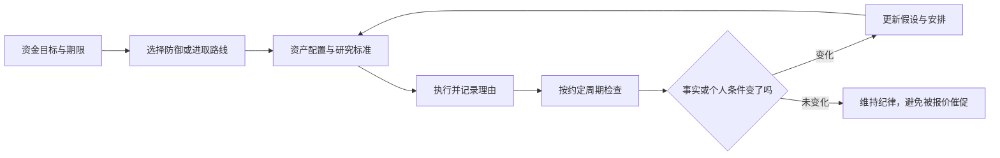

图示强调“有变化就更新，无变化也不必强行交易”。纪律不是顽固，承认错误是纪律的一部分。

### 三个难点，用小算例再看一遍

#### 难点一：便宜和安全边际到底差在哪里

**原创例子：** 公司未来正常情况下可能值 100 元，乐观情况下值 150 元，悲观情况下值 55 元。

| 报价 | 相对乐观价值看 | 相对保守情景看 | 应有的认识 |
| --- | --- | --- | --- |
| 120 元 | 似乎还能涨 25% | 容错很少 | 不能只选择最乐观故事 |
| 80 元 | 看上去折价更多 | 仍高于悲观价值 | 需要认真判断坏情景及承受能力 |
| 50 元 | 折价很大 | 低于当前悲观估计 | 继续检查估计、债务和治理是否漏项 |

价格低于保守估值只是证据之一。如果公司的债务条款使普通股在坏情景下归零，不能只用一个简单估值区间遮住这个风险。

#### 难点二：亏损为什么这么需要避免

```text
恢复原本金所需收益率＝亏损比例÷（1－亏损比例）
```

| 先亏损 | 回到原点需要上涨 |
| ---: | ---: |
| 10% | 约 11.11% |
| 25% | 约 33.33% |
| 50% | 100% |
| 75% | 300% |

这是纯算术，不说明所有下跌都该立刻卖出；它解释为什么本金保护、避免过度杠杆和控制单个错误很重要。长期复利需要你还有资本，并且有时间留在场内。

#### 难点三：好公司为什么也会让人亏钱

**原创例子：** 公司每股收益现在为 2 元，买入价格 100 元，即 50 倍 PE。五年后 EPS 增至 3 元，但市场只给 25 倍 PE，股价为 75 元；忽略分红税费，价格回报为负 25%。企业确实增长了，投资者仍然亏损。

这里没有预测“高 PE 一定跌”。它说明投资结果包含两部分：企业创造了什么，以及买入时已经为未来支付了多少。分析不能只有第一部分。

### 你能实际学到什么

| 能力 | 原来容易怎样想 | 学完后怎样问 |
| --- | --- | --- |
| 辨别投资理由 | 大家都看好，所以可以买 | 支持价值的证据是什么？ |
| 管理价格情绪 | 涨说明对，跌说明错 | 企业事实改变了吗，价格提供什么条件？ |
| 区分适合与刺激 | 越复杂越专业 | 我有能力长期执行吗？ |
| 识别风险 | 不波动就安全 | 是否存在永久损失、通胀或资金错配？ |
| 评价专业服务 | 历史冠军最可靠 | 承担了什么风险、收费多少、利益如何一致？ |
| 制订计划 | 等市场稳定再说 | 我可以先写下哪些无需预测的规则？ |

建议先做一页“个人投资原则草稿”，内容包括：资金用途和期限、需要保留的流动资金、研究投入程度、允许的资产范围、分散原则、费用检查、再平衡方式、复盘周期。这里不替你填写固定比例；那些需要结合真实情况决定。

然后挑一项已经了解的资产，只写一页研究：业务或资产是什么；收益从哪里来；最可能亏损的三种原因；价格是否合理；什么证据会改变判断。如果无法写清，先继续学习，比急于找到交易动作更有价值。

### 原书、评注与今天的应用，哪些不能混为一谈

- **格雷厄姆的长期原则：** 企业所有权视角、投资与投机区分、价格纪律、风险保护、适当分散及情绪管理。
- **格雷厄姆的历史工具：** 当时的股票债券比例、利率对比、具体筛选阈值、净流动资产机会和历史证券案例，需要放在当时市场结构中理解。
- **Zweig 的评注：** 用较新的市场经验、基金和行为解释帮助应用原则；不是格雷厄姆亲自评论互联网泡沫或后来的金融产品。
- **本笔记的补充：** 家庭资金用途、数学例子、图解、书面规则、对现代产品的风险说明，不冒充书中逐字结论。

本书不是短线择时教材，也没有承诺便宜资产一定迅速被市场发现。有些企业价值确实会持续下滑；耐心必须配合事实更新。重视安全不等于拒绝一切风险，而是知道风险为什么值得承担、怎样避免承担不起的结果。

### 自测与参考答案

1. **持有五年就一定算投资吗？** 不一定。应看买入依据、分析和风险安排，时间本身不提供充分分析。
2. **市场先生报价下降，应该立即买入吗？** 不一定。先检查价值是否也下降，以及价格是否真正有吸引力。
3. **安全边际能保证不亏吗？** 不能。它是对判断错误和坏情景的缓冲，前提与估值也可能错。
4. **为什么高收益债不能替代低风险储蓄？** 高收益通常补偿更高信用风险，还可能有价格和流动性风险。
5. **进取型投资者是否应该提高杠杆？** 不能这样推导。进取强调研究和判断投入，并非冒险程度。
6. **再平衡为何不需要预测？** 因为它是恢复适合目标的风险分布，依据是规则与偏离，不是猜测下一次行情。
7. **一家公司 EPS 增长，股东为什么仍可能亏钱？** 买入价格过高、估值倍数下降或其他条件变化，都能抵消经营增长。
8. **本书最适合普通人带走的东西是什么？** 一套能执行的原则：看懂、看价、留余地、适当分散、控制成本、保持独立并允许修正。

### 来源与仍需补充的内容

| 已核对资料 | 在本笔记中的用途 |
| --- | --- |
| [Zweig 官方书页](https://jasonzweig.com/books/the-intelligent-investor/) | 版本与新增评注性质 |
| [O'Reilly 授权目录](https://www.oreilly.com/library/view/the-intelligent-investor/9780061745171/) | 正文二十章主题对应 |
| [Zweig 的 CFA 讲稿](https://jasonzweig.com/wp-content/uploads/2016/10/CFA-Graham.pdf) | 行为、投资与投机、安全边际的概念核对 |
| [Zweig 本人关于新版的访谈](https://www.morningstar.com/podcasts/the-long-view/jason-zweig-revisiting-intelligent-investor) | 作者原著与后续现代解释的区别 |
| [Investor.gov 资产配置](https://www.investor.gov/introduction-investing/getting-started/asset-allocation) | 期限、风险承受与配置的补充 |
| [Investor.gov 再平衡](https://www.investor.gov/additional-resources/spotlight/formerdirectorlorischock-directors-take/it-time-rebalance-your-investment-portfolio) | 再平衡原理与费用考虑 |
| [Moneysmart 分散化](https://moneysmart.gov.au/how-to-invest/investment-diversification) | 分散的作用与边界 |
| [SEC 债券利率风险](https://www.investor.gov/introduction-investing/general-resources/news-alerts/alerts-bulletins/investor-bulletins-86) | 固定票息债券与利率关系 |
| [SEC 高收益债](https://www.investor.gov/sites/default/files/ib_high-yield.pdf) | 信用风险补充 |
| [Investor.gov 共同基金](https://www.investor.gov/introduction-investing/investing-basics/investment-products/mutual-funds-and-exchange-traded-funds-etfs/mutual-funds) | 基金风险、历史业绩与费用 |
| [SEC 费用影响](https://www.sec.gov/oiea/investor-alerts-bulletins/investoralertsib_fees_expensespdf) | 长期费用机制 |
| [FMA 债券类型](https://www.fma.govt.nz/consumer/investing/types-of-investments/bonds) | 混合证券与条款风险 |
| [伯克希尔 1985 年信](https://www.berkshirehathaway.com/letters/1985.html)、[1993 年信](https://www.berkshirehathaway.com/letters/1993.html) | 书外的资产清算与华盛顿邮报案例 |
| [伯克希尔 2017 年信](https://www.berkshirehathaway.com/letters/2017ltr.pdf)、[2020 年信](https://www.berkshirehathaway.com/letters/2020ltr.pdf) | 书外的十年基金比较、正常盈利与付价错误 |
| [美国财政部 1999 年证词](https://home.treasury.gov/news/press-releases/rr2991) | LTCM 杠杆事件的一手记录 |
| [Vanguard 官方基金资料表](https://workplace.vanguard.com/assets/corp/fund_communications/pdf_publish/us-products/fact-sheet/F0914.pdf) | 2026 年 9 月资料表所载 2022、2023 年历史回报 |
| [美的集团 2026 年三季报](https://static.cninfo.com.cn/finalpage/2026-10-30/1225645132.PDF) | 实际期间、利润口径与每股指标练习 |

尚未逐页核对中文译本、各版 Zweig 评注差异、历史公司案例和附录。这里不把书中旧数值变成当代荐股标准，也不把原创算例当作未来收益预测。若补充原书，下一步可以逐章核对具体阈值、案例背景及作者当时的限制条件。

---

[返回书籍索引](<README.md>) · [财商学习与实践路线](<财商进阶合订本.md>)


---

<a id="book-03"></a>

[单独打开本篇](<巴菲特股东信 - 沃伦·巴菲特/读书笔记.md>)

## 巴菲特股东信：按主题整理的读书笔记

> 作者：沃伦·巴菲特（Warren E. Buffett）。这里的“股东信”指伯克希尔官网原始书信，不对应某一种中文选编本。  
> 资料范围：选读并核对 1977、1983、1985、1986、1987、1989、1991、1992、1996、1999、2007、2008、2010、2011、2012、2013、2014、2016、2018、2020、2022、2023、2024 报告年度的代表主题，补充 2025 年感恩节信息的作者与传承说明；书外案例另使用贵州茅台 2026 年三季报与美国财政部 1999 年证词。不是全部年份逐封精读。  
> 组织方式：35 个知识点，关键小节直接解释原信真实企业与书外公告，保留必要公式演示，另附三个计算练习，全文四幅示意图；原信原则与补充教学分开，给出具体年份链接。  
> 更新日期：2026-11-11

**先把年份分清：** 年度信通常按报告年度命名，发表于下一年。巴菲特的 **2024 年度信署名日期为 2025-02-22**；2025-11-10 的信是感恩节信息，其中说明他不再撰写年度报告中的信。官网已将 Greg Abel 的年度信单列，不能把其 2025 报告年度信当作巴菲特写作。[巴菲特年度信目录](https://www.berkshirehathaway.com/letters/letters.html)、[2024 年度信](https://www.berkshirehathaway.com/letters/2024ltr.pdf)、[2025 感恩节信息](https://www.berkshirehathaway.com/news/nov1025.pdf)、[Abel 年度信目录](https://www.berkshirehathaway.com/letters/gealetters.html)

本笔记只提炼所列代表年份的主题，不把某年持仓、利率、会计规则或现金数字描述成当前状态，也不根据巴菲特历史交易给出现在的买卖建议。

### 先看这里：这些信的共同问题是什么

**一句话概括：把自己当作企业的长期共有人，研究一门生意能产生多少真实收益、谁在配置这些收益，以及你付出了什么价格和风险。**

股东信比“投资名言合集”更有用，因为它们把原则放进了真实取舍：为什么买或不买、为什么留存现金、为什么回购、怎样解释会计数字、犯了什么错，以及规模变大后原来的方法为什么需要调整。

最值得带走的八个结论：

1. **看每股价值，不只看企业规模。** 收入和利润总额增长，未必让原股东变得更富。
2. **优质企业要能长期创造超出资本成本的收益。** 品牌、成本优势等要落实成经济结果。
3. **增长需要算代价。** 只有新增投入能获得足够回报，增长才有价值。
4. **真正属于股东的收益，要扣除维持竞争力所需投入。** 折旧加回不等于设备可以永远不更新。
5. **资本配置是管理层的核心工作。** 再投资、收购、还债、分红和回购之间，要比较机会成本。
6. **现金与稳健负债结构提供生存能力。** 机会只有在你无需被迫退出时才有意义。
7. **长期持有有条件。** 生意、价格、管理和风险值得信任，才有耐心的依据。
8. **普通人最该学习的是判断方法。** 伯克希尔有保险资金、经营现金流与制度优势，个人无法直接复制其资金结构。

### 一张图看伯克希尔思路

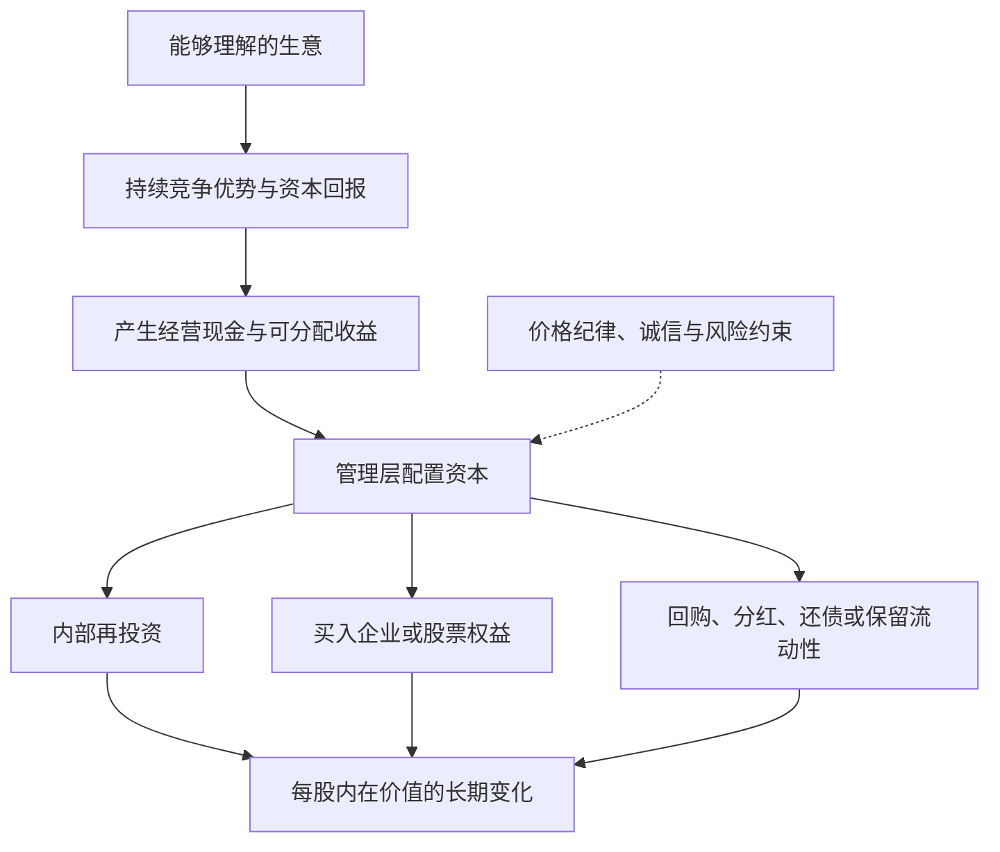

这是一张**补充示意图**。重点是现金的再次配置决定后续复利；每一步都要看价格与风险。它不是说企业只要有现金，就必然能找到高回报项目。

### 主题一：作为企业共有人思考

#### 1. 买股票，是买企业的一部分

1977 年信把股票选择与收购企业放在同一种研究逻辑下：理解业务、长期前景、管理者与购买价格。[1977 年信](https://www.berkshirehathaway.com/letters/1977.html)

**补充解释：** 如果没有交易软件报价，你仍愿意依据利润、资产、客户和竞争拥有这门生意吗？这能帮助区分“研究企业”与“等待别人接盘”。

#### 2. 计分单位应该是每股，而不只是总量

1983 年信明确以每股内在价值的长期进展衡量成绩，而非公司规模。[1983 年信](https://www.berkshirehathaway.com/letters/1983.html)

分析并购、增发和股权激励时，因此要同时看新增价值与新增股数。仅仅“公司更大了”不足以证明交易有利。

#### 3. 内在价值，是未来可取得现金的现值估计

1989 年信以未来现金流入流出的折现说明内在价值，并强调它不同于账面价值。[1989 年信](https://www.berkshirehathaway.com/letters/1989.html)

**补充解释：** 同样 100 元，今天收到与十年后收到并不等价；未来还存在不确定性。估值需要说明现金归谁、何时取得、还需投入多少，以及采用什么要求回报。

不是把增长率填进模型就能得到“真价格”。分析者对未来有不同合理判断，内在价值应视为区间；债务、现金、少数股东等口径必须配套。

#### 4. 市场价值、账面价值与经济价值会偏离

1987 年信指出，账面数与实际商业价值可能差异很大；业务表现与投资者付出的购买成本也需要分开评价。[1987 年信](https://www.berkshirehathaway.com/letters/1987.html)

这也不意味着可以无视会计数字。先理解数字如何形成，再判断它有没有遗漏经济价值，比直接喊“账面没意义”更有用。

#### 5. 能力圈最重要的是边界

能力圈不是给行业贴上“懂或不懂”的永久标签，而是知道哪些关键变量可以形成可靠判断，哪些仍只是猜测。1996 年信强调，判断范围有多大不如边界是否清楚重要。[1996 年信](https://www.berkshirehathaway.com/letters/1996.html)

**原信中的真实处境：1999 年，面对快速变化行业的吸引力。** 巴菲特在这一年信件的投资讨论中明确说，预测快速变化行业的长期经济状况超出他们的判断边界；即使别人的判断看起来被上涨股价验证，他们也不据此模仿。[1999 年信，末段投资讨论](https://www.berkshirehathaway.com/letters/1999htm.html)

这个选择很容易被误读成“认定新行业没有前途”。其实他说的是自己不能可靠预测谁能长期赚钱，而不是社会不会因技术进步受益。行业会发展、产品受欢迎、某家公司能保留利润、当前股价合理，是四个不同判断。能回答第一个，不等于后三个也有答案。

同封信对 GEICO 的经营则给出具体的客户、营销和资金信息，显示他的研究能够进入保险业务的实际机制。这个对照比“懂传统、不懂科技”的行业标签更重要：理解意味着能将客户行为、竞争成本与资本结果串起来，且知道哪些估计可以被后续结果检验。

因此，使用一个产品只是研究入口。你还要说明客户为何续费，竞争者为何不能轻易复制利润，以及维持优势要投入多少。关键数据没有披露时，应缩小结论，比如只确认销售增长，不扩大成长期经济性已经证明。

**边界：** 1999 年的自我限制不是所有投资者永远不得研究新技术的规则，也不证明伯克希尔后续所有技术投资都与能力圈冲突。能力可以扩展，但应由可验证的研究进展证明，不能由买入后的自信宣布。

**练习：** 别人买入一家公司后上涨，是否证明你也已具备研究它的能力？**参考答案：** 不证明。价格结果没有替你解释收入质量、竞争和估值；应先找出自己仍不能回答的关键问题。

#### 6. 所有权视角还包括信息责任

2024 年信将报告理解为向股东解释“拥有什么”和“怎样思考”，不仅罗列法定数字，也应承认问题。[2024 年信](https://www.berkshirehathaway.com/letters/2024ltr.pdf)

**补充应用：** 读管理层信件时，检查是否说清盈利来源、困难、资本用途及错误，还是只重复口号。诚恳语言是一个信号，仍需要用数据、行动与多年记录核查。

对自己的投资也可以这样做：每年向“未来的自己”写一页报告，说明发生了什么、为什么继续持有、先前哪里判断错了。

### 主题二：识别真正好的生意

#### 7. 护城河，要能保护资本回报

护城河要回答：利润这么好，为什么竞争者没有把它分走？它是阻止优势被侵蚀的机制，不是名气的同义词。2007 年信把这种问题落实在伯克希尔真实持有的生意上。[2007 年信](https://www.berkshirehathaway.com/letters/2007ltr.pdf)

**原信案例：喜诗糖果，1972—2007 年。** Blue Chip Stamps 在 1972 年收购喜诗，之后 Blue Chip 并入伯克希尔。2007 年信给出了下面的经营对照，金额为美元：

| 指标 | 1972 年收购时 | 2007 年 |
| --- | ---: | ---: |
| 年销量 | 1600 万磅 | 3100 万磅 |
| 销售额 | 3000 万 | 3.83 亿 |
| 税前利润 | 不到 500 万 | 8200 万 |
| 经营所需资本 | 800 万 | 4000 万 |

来源为[2007 年信，PDF 第 6 页喜诗段](https://www.berkshirehathaway.com/letters/2007ltr.pdf)。原信以持久竞争优势解释其结果，同时指出现金销售减少应收需求、较短的生产配送周期降低库存占用。

理解这个案例，要逐步看。首先，销量增长并非与利润同速爆发；这迫使我们研究价格、产品和成本，而不能只用“行业高速成长”解释成功。其次，更多利润没有要求经营资本按同样幅度增加，经营资金便更容易离开糖果业务，投向其他机会。最后，品牌优势只有落实成持续选择、盈利和资本效率，才成为股东的经济利益。


**图解：** 好生意不仅要赚到利润，还要避免为了维持这些利润不断吞回所有现金。

**不要从表里多推一步。** 销售额除以磅数的变化不是同质产品价格指数，可能包含产品结构和其他变化；税前利润除以某个期末资本，也不能直接冒充同口径税后 ROIC。这个案例更不证明今天任何带“品牌”标签的股票都值得高价购买。

核查另一家企业是否有类似优势，应寻找可持续的客户选择与单位经济性，并观察新竞争、渠道变化和替代品。**练习：** 利润率高但需要投入极大的资本，能否据此认定具有喜诗式经济特征？**参考答案：** 不能，还要看资本回报与可释放现金，不能只比较利润率。

#### 8. 少量追加资本就能增长的生意，复利条件更好

1987 年信讨论一些企业以较少新增资本扩大收益，同时释放资金用于其他机会。[1987 年信](https://www.berkshirehathaway.com/letters/1987.html)

这里并不是说重资产行业全部差。基础设施可能在可靠需求和合适监管回报下创造价值；关键是资本需求、风险和回报匹配，而非只按“轻”或“重”打分。

#### 9. 通胀考验的不只是涨价能力，还有补充资本需求

1983 年信的经济商誉讨论，把通胀下的盈利增长与维持业务所需资本放在一起看。[1983 年信](https://www.berkshirehathaway.com/letters/1983.html)

不要把“拥有很多实物资产”直接等同于抗通胀。资产替换成本上升也可能成为负担；还要考虑客户能否接受涨价。

#### 10. 成长与价值不是两套互斥的投资

1992 年信指出，增长本来就是价值计算中的一项因素，其作用取决于增长所需投入及其回报。[1992 年信](https://www.berkshirehathaway.com/letters/1992.html)

“价值股”不是低 PE 的同义词，“成长股”也不是任何价格都合理。应比较未来净收益、风险和当前支付金额。

#### 11. 优质企业也可能因买得过贵而成为差投资

2020 年信承认收购 Precision Castparts 时对正常盈利潜力过于乐观，因而付价过高；这与认可管理者和业务质量并不矛盾。[2020 年信](https://www.berkshirehathaway.com/letters/2020ltr.pdf)

**顺着这个真实事件理解：** 即使企业在自身设备和经营资本上回报很好，收购者支付的价格还可能远高于这些资本。收购价格越高，未来必须兑现的收益要求也越高。原信将错误归到对正常盈利的估计和付价，而没有将其简单归咎于经营者；这正是把公司质量与投资价格分开的含义。

#### 12. 时间帮助好生意，也会暴露坏生意

2023 年信回顾芒格对伯克希尔路线的影响：从廉价但平庸的企业，转向以合理价格拥有更优秀的企业。[2023 年信](https://www.berkshirehathaway.com/letters/2023ltr.pdf)

这是一种研究方向，不是“好公司永不卖”的口号。若竞争优势消失、治理恶化、价格脱离合理范围或自身资金条件改变，仍需重新评估。

### 主题三：资本怎样分配，决定复利能否继续

#### 13. 资本配置者，要把公司现金与最佳替代机会比较

经营者决定如何把业务做好，资本配置者还要决定利润留在原业务、买别的业务、还债或交还股东。1986 年信把配置资本列为总部的关键工作；现金已经在公司里，不代表继续投入没有机会成本。[1986 年信](https://www.berkshirehathaway.com/letters/1986.html)

**原信案例：从纺织业务抽出资金，到最终退出。** 1985 年信回顾，1967 年伯克希尔以纺织业务释放的资金进入保险、收购 National Indemnity；资金既来自收益，也来自减少库存、应收和固定资产占用。纺织业务仍持续多年，到 1985 年 7 月才决定关闭。[1985 年信：纺织业务回顾](https://www.berkshirehathaway.com/letters/1985.html)

这一历史把两个决策区分开：现有工厂是否继续运营，与新增一元资金是否继续投入同一行业，并不必然有相同答案。企业可以在承担现有业务责任的同时，把新增可用资金配置到更好的机会。若管理层只允许讨论“在原行业怎样扩张”，便人为缩小了股东资金的选项。

退出同样不是一开始便轻易作出的正确选择。巴菲特在原信中承认，原先预期纺织业务能保持适度现金回报，但后来持续耗用资金，自己退出太迟。教学上的重点是给继续投入设置证据条件：原来预期何时该实现，什么变化说明长期经济性已不成立，是否把既有投入变成继续投入的借口。

原业务利润高也不能证明下一笔投资好。资本配置应比较新增项目的回报和风险，而不只是历史平均成绩；对收购还要比较支付价格，对回购要比较每股价值，对还债要考虑融资成本和到期约束。投资于别处也不是天然正确，保险业务的成功并不能使每一次跨行业收购合理。

**仅作公式演示：** 假设盈利 100 万，其中留存 50 万；留存资金下一年带来 20% 的新增收益，则多赚 10 万。若新增回报仅为 4%，只多赚 2 万。两种方案都叫增长，但是否值得取决于匹配的要求回报；这些不是伯克希尔项目数据。

每股视角还要求查股数。若增长靠大量发行新股取得，原股东每一份权益对应的价值可能没有增长。**练习：** 连续多年不分红能否证明复利更快？**参考答案：** 不能，必须证明留存资金最终创造了足够的每股价值；规模扩大本身不是答案。

#### 14. 留存利润必须有理由，分红也没有放之四海的答案

2012 年信详细讨论再投资、收购、回购和分红的选择。留存是否有利，依赖公司能否有效使用资金及股东的实际处境。[2012 年信](https://www.berkshirehathaway.com/letters/2012ltr.pdf)

不要从伯克希尔的历史不分红政策推出“所有好企业都不分红”，也不要把高股息率当成可持续回报承诺。

#### 15. 回购是否创造价值，核心在价格和资金条件

2022 年信解释，减少股数会提高继续持有者的比例，但高价回购会损害他们；“回购”这个动作本身不保证创造价值。[2022 年信](https://www.berkshirehathaway.com/letters/2022ltr.pdf)

回购同时改变两个量：公司少了一笔现金，继续持有的股东所对应的股数也减少了。只看第二项，很容易得出“回购越多越好”；只看现金减少，又会忽略以折价买回权益可能给剩余股东带来的利益。正确比较是每股内在价值的变化，而不是回购公告金额或每股收益是否机械上升。

**原信案例：伯克希尔 2020 年的回购。** 当年公司花费 **247 亿美元**，回购相当于 **80,998 股 A 类股**的股份；巴菲特称，这使继续持有者在各项业务中的相对权益提高约 **5.2%**。他同时给出两项理由：认为每股内在价值会改善，并且回购后仍有充足资金应对机会和问题。[2020 年信，PDF 第 5 页](https://www.berkshirehathaway.com/letters/2020ltr.pdf)

5.2% 说明剩余股东对应的份额变化，不是当年利润增长率，也不是说回购花的钱消失后公司价值完全不变。回购仍须用公司现金支付；是否划算取决于买入价格与估计价值，以及资金是否真有余裕。原信表达的是管理层的判断，不能据此取得一个外部独立验证的精确内在价值。

下面用短算式将这笔实际决策的两个方向拆开，**仅演示数学，不复原伯克希尔估值**：假设回购前全部股权内在价值 V 为 1000 万元，包含 100 万可自由支配且按面值计入价值的现金；总股数 N 为 100 万股，每股内在价值 V/N＝10 元。公司用这 100 万现金 C 回购并注销股份，回购价为 P。忽略税费、交易费用、融资和经营变化，回购后：

```text
剩余股权价值＝V－C
剩余股数＝N－C/P
回购后每股内在价值＝(V－C)/(N－C/P)
```

式中金额和股数单位必须匹配，且剩余股数应大于零。用这个关系可以逐项计算：

| 回购价 | 买回并注销股数 | 剩余价值 | 剩余股数 | 每股内在价值 |
| --- | ---: | ---: | ---: | ---: |
| 5 元 | 20 万股 | 900 万 | 80 万股 | 11.25 元 |
| 10 元 | 10 万股 | 900 万 | 90 万股 | 10.00 元 |
| 20 元 | 5 万股 | 900 万 | 95 万股 | 约 9.47 元 |

在这些假设下，低于回购前每股内在价值回购，剩余每股价值提高；按相等价格回购，中性；高于价值回购，剩余股东受损。这里没有凭空创造新的工厂收益，而是公司以不同价格向退出的股东购买权益，改变了价值在退出者和留下者之间的分配。

为什么 EPS 上升仍可能误导？再假设回购所用的闲置现金没有收益，原业务一年利润 100 万且不变。即使按 20 元高价回购，利润除以 95 万股，EPS 仍由 1 元升到约 1.053 元；但每股内在价值已经由 10 元降到约 9.47 元。股数减少可以改善每股盈利表象，不能证明付价合理。

现实还要先检查资金条件。若这 100 万其实是季节性备货、偿债或承保赔付需要的资金，支出会损害经营与韧性，“其他条件不变”的算例就不成立。若借债回购，利息、违约风险和资金机会成本也要计入；若回购股份随后用于股权激励，实际净股数未必按公告金额所暗示的幅度减少。

实务阅读应把回购授权、实际执行金额、实际平均价格、注销或其他用途、期末及加权平均股数分开看。估计价值本来就有误差，因此不能将公司管理层说“低估”直接当作事实。

**练习：** 本例用 100 万按 8 元回购并注销，其他假设相同，每股价值是多少？**参考答案：** 注销 12.5 万股，剩余 87.5 万股，每股 900/87.5≈10.286 元。它说明低于假定价值回购的方向，不证明真实市场中 8 元一定便宜。

#### 16. 用股票收购，付出的是一部分未来权益

2014 年信回顾 Dexter 鞋业收购错误，强调用伯克希尔股票支付的经济代价不能只看当年账面金额。[2014 年信](https://www.berkshirehathaway.com/letters/2014ltr.pdf)

因此并购要比较取得资产的价值与交付对价的内在价值。EPS 暂时增加、交易被称作“协同”，都不能替代这一比较；也应检查负债和潜在整合成本。

#### 17. 少数股权与整家公司，都可以是资本配置选项

1999 年信把投资资产与经营企业分别展示；2012 年信也说明，整体收购并不天然优于持有部分优秀企业。[1999 年信](https://www.berkshirehathaway.com/letters/1999htm.html)、[2012 年信](https://www.berkshirehathaway.com/letters/2012ltr.pdf)

**补充解释：** 有控制权可以决定管理与现金用途，但价格可能更高、退出更困难；小股东更易调整仓位，却无法主导资本分配。两种结构有不同权利和约束。

对普通人，买上市股票通常是少数股东位置，因此不能假设自己买入后就能让公司改正治理问题。

### 主题四：读懂经济收益，而不只盯报表结尾

#### 18. 所有者收益，要考虑维持业务真正需要的支出

1986 年信提出 owner earnings：从报告收益调整有关非现金项目，再考虑维持长期竞争位置和业务规模所需的资本支出及必要营运资金。它不是财报中一项标准化现成指标。[1986 年信](https://www.berkshirehathaway.com/letters/1986.html)

**原信真实案例：FlightSafety 的模拟器投入。** 2007 年信披露，1996 年收购 FlightSafety 时，税前经营利润为 **1.11 亿美元**，固定资产净额 **5.70 亿美元**；到 2007 年，税前经营利润为 **2.70 亿美元**，固定资产净额 **10.79 亿美元**。收购以来累计折旧 **9.23 亿美元**，资本支出却累计 **16.35 亿美元**，主要投入用于匹配新机型的飞行模拟器。[2007 年信，PDF 第 7 页](https://www.berkshirehathaway.com/letters/2007ltr.pdf)

这些数字说明为什么“利润加折旧”不是可永远提走的钱。折旧降低了会计利润，计提时没有再付现金；但真实经营仍须购买和更新设备。若把折旧全部加回，却忘记维持竞争位置的投入，就会高估长期可分配能力。

同时必须保留边界：上述 **16.35 亿美元不是已经确认的维持性资本支出**，其中包含增长与设备更新；累计资本支出比折旧多 **7.12 亿美元**，也不是可直接从某一年利润扣除的数字。案例教的是识别必要投入，不是教我们只靠两行报表就准确分开维护与增长。

```text
教学用近似关系：
所有者收益＝报告收益＋适当非现金调整
           －维持性资本支出－必要营运资金增加
```

现金流归属要一致，不能从集团税前经营利润出发，再随意解释为普通股东税后所得。实务上应调查设备寿命、更新计划、产能变化与长期投入，形成区间；非现金股权激励也可能稀释股东，不能因没有即时付款便让经济代价消失。

**书外真实对照：贵州茅台 2026 年前三季度。** 集团经营现金流净额 **840.59 亿元**、同比增长 **120.07%**。公司说明主要涉及财务子公司不可随时支取的同业存款到期收回，以及吸收集团成员单位存款的变化。[三季报第 2—3、10—11 页](https://static.cninfo.com.cn/finalpage/2026-10-31/1225649896.PDF)

这提醒我们在扣维护支出之前，还须认清现金来自哪项业务。财务子公司的资产收回与存款负债变化，不等于酒业当期创造的可持续收益；合并经营现金也不等于普通股东可以全部取走的钱。只扣两条存款项目，仍没有完整剥离金融业务及内部抵销，不能把剩余数直接叫酒业所有者收益。

**仅作算式演示：** 无债务企业利润 100 万、合适折旧调整 30 万、必要维护投入 45 万、营运资金增加 10 万，近似所有者收益为 75 万；这不是以上任一公司的估值。**练习：** 能否将茅台的 840.59 亿元直接作为永续现金流？**参考答案：** 不能，业务范围、可持续性、资本需求和股东归属均尚未统一。

#### 19. 会计净利润与经营表现，需要拆开看

2018 年信解释，权益投资未实现价格变动进入当期损益后，伯克希尔合并净利润会出现很大波动，未必等于旗下经营企业同幅变化。[2018 年信](https://www.berkshirehathaway.com/letters/2018ltr.pdf)

这不意味着投资损失永远可以忽略。短期波动与长期价值损失要分别判断，也不能把管理层喜欢的“调整后利润”自动当成唯一真相。

#### 20. 透视收益，帮助看见未分配但属于你的经营成果

1991 年信讨论 look-through earnings，把重要被投资企业留存的经营收益纳入经济观察，并考虑相关税负，而不仅看收到的股息。[1991 年信](https://www.berkshirehathaway.com/letters/1991.html)

也不能把透视收益直接当可用现金。你未必能强制分配，资金可能被低效投资消耗；税收、控制权及现金流限制仍重要。

#### 21. 经济商誉与会计商誉，不是同一件事

1983 年信区分真实商业优势产生的经济价值与会计记录；后续年度信反复提醒，不同会计呈现不能取代经济分析。[1983 年信](https://www.berkshirehathaway.com/letters/1983.html)

既不能见商誉就认定优质，也不能见商誉就认定造假。应回到购买价格、取得资产的赚钱能力、减值假设与后续结果。旧信中的商誉摊销会计规则有历史背景，不应照搬到今天。

### 主题五：保险、资金来源与风险承受

#### 22. 浮存金是暂时持有但最终负有义务的钱

1996 年信解释，保险通常先收保费、后支付赔款，从而形成可暂时运用的浮存金；它并不属于股东自由支取的权益。[1996 年信](https://www.berkshirehathaway.com/letters/1996.html)

浮存金的账面口径涉及准备金和其他项目，不能简单等于当年保费，也不能把它类比成个人信用卡额度后照搬投资。

#### 23. 浮存金有没有优势，取决于成本和稳定性

保险先收保费、后付赔款形成时间差。暂时掌握的资金有价值，但最终负有赔付义务；承保定价不足，取得资金便要付出经济成本。低成本浮存金不是整个行业自动具有的属性。

**原信中的正反对照：1999 年与 2011 年的伯克希尔。** 1999 年信报告承保亏损约 **14 亿美元**，浮存金成本为 **5.8%**。2011 年信则披露全年承保利润 **2.48 亿美元**、年末浮存金 **705.71 亿美元**；截至当时连续九年承保盈利，合计约 **170 亿美元**。[1999 年信：保险经济性](https://www.berkshirehathaway.com/letters/1999htm.html)、[2011 年信，PDF 第 7、9 页](https://www.berkshirehathaway.com/letters/2011ltr.pdf)

对照说明，不能因为保险公司收到了保费、持有大量投资资产，就把资金说成免费。1999 年的承保亏损是取得和管理保险义务的代价；2011 年的承保盈利则意味着承保本身赚钱，投资收益还在其外。相同的“浮存金”名称，经济价值取决于产生它的业务质量。

数字的口径也值得学习：1999 年披露的成本率不能用当年亏损随手除以某个期末浮存金去强行复算，成本应与相应期间的平均资金匹配；2011 年年末浮存金不是全年平均数，更不能把九年累计承保利润除以它当作当年收益率。

为什么不能靠降低保费无限扩大浮存金？保费先到账，赔付可能多年后才充分显现；若最初少估损失，早期利润和资金规模都会看起来不错，随后补提准备才暴露成本。1999 年信也强调准备金估计的不确定性。核验应看多年的赔付发展、准备金和承保结果，而非只看当年现金流入。

资金稳定性与赔付时间必须同时检查。个别保单最终会赔付，总体资金能否稳定依赖持续的合理承保；若新业务减少而旧赔款到期，原先持有的资产必须能够及时变现。不能因为集团长期投资业绩不错，就忽略短期赔付和市场冲击可能同时发生。

**仅作成本演示：** 平均浮存金 1000 万、承保亏损 50 万，简化成本为 5%；投资若只赚 40 万，两项合计仍亏 10 万。这不是某一年的伯克希尔报表。**练习：** 2011 年的良好记录能否保证此后每年承保盈利？**参考答案：** 不能；原信也没有作这种保证，灾害、竞争和估计偏差仍会改变结果。

#### 24. 保险的纪律，是价格不够时愿意不做生意

2011 年信列出的承保原则包括理解风险、审慎估计损失、给出合理保费，并在无法获得合适价格时放弃。[2011 年信](https://www.berkshirehathaway.com/letters/2011ltr.pdf)

**补充应用：** 这能推广到其他决策：不是所有收入都值得追，必须计算承担了什么义务。明知道某个客户价格不足以覆盖长期服务成本，却因“竞争对手也接”而接受，可能损害企业。

用于个人投资时，也可以问：我是否因为账户里有钱或别人都在买，就认为必须立刻成交？没有合适条件时，放弃并不是没有能力。

#### 25. 流动性是生存条件，也是危机时的选择权

2010 年信强调现金与稳健资金来源，使伯克希尔能够抵御大额保险损失，并在别人被迫收缩时行动。[2010 年信](https://www.berkshirehathaway.com/letters/2010ltr.pdf)

不能照抄某年的现金金额或比例。保险集团有巨额潜在赔付，个人有生活开支、债务和职业收入，流动性应与自己的义务匹配。

#### 26. 杠杆改变了你是否能等到判断兑现

2008 年信置于金融危机背景，揭示信用、融资和交易对手问题怎样互相放大；报价与会计盈利并不能代替真实偿付能力。[2008 年信](https://www.berkshirehathaway.com/letters/2008ltr.pdf)

**书外真实案例：** 1998 年 LTCM 濒临崩溃之前，1997 年末资产近 1300 亿美元、资本约 47 亿美元，表内粗略杠杆约 28 倍。美国财政部在 1999 年证词中以此说明规模和融资放大的风险。[财政部证词](https://home.treasury.gov/news/press-releases/rr2991)

此例不是伯克希尔的投资经历。它说明资产判断之外，还必须承受不利价格与融资要求；若资金先耗尽，最终估值判断就没有机会兑现。单一杠杆比率仍不足以完整描述衍生品和流动性风险。

关心的不是单一“借款比例”，还有利率、期限、担保条款、追加抵押要求和收入稳定性。长期投资不能自动抵消短期融资风险。

#### 27. 衍生品要拆解合约，不靠名称判断安全

2008 年信谈到衍生品的交易对手、合约与估值问题，伯克希尔自身也持有相关合约；其观点不能简化成“所有衍生品都不能用”。[2008 年信](https://www.berkshirehathaway.com/letters/2008ltr.pdf)

**补充解释：** 需要看最大赔付、到期方式、保证金、提前终止、交易对手信用与现金需求。两份表面相似的合约，若一份要求每天追加保证金，另一份没有同样条款，风险路径可能差很多。

普通读者最该学会问“最坏时谁要付多少钱、什么时候必须付”，而不是看到专业机构使用就假设适合自己。

### 主题六：管理、行为与长期学习

#### 28. 选人和授权相互依赖，分权不是放弃监督

1986、1987 年信解释伯克希尔对优秀经营者的信任与较少干预的方式，同时把总部注意力放在重要人选和资本上。[1986 年信](https://www.berkshirehathaway.com/letters/1986.html)、[1987 年信](https://www.berkshirehathaway.com/letters/1987.html)

**补充应用：** 授权有效的前提是人可靠、目标与激励明确、信息能够回到总部、关键风险有人负责。不能用“巴菲特不管细节”作为忽视内控的理由。

评价管理层时，结合长期每股成果、资本配置与股东待遇；仅有聪明和勤奋仍不够，利益是否一致、沟通是否诚实同样重要。

#### 29. 组织也会从众，聪明人可能共同做出糟糕决定

1989 年信讨论组织惯性：有钱就找项目、替领导偏好寻找论据、照抄同行等现象，会侵蚀独立判断。[1989 年信](https://www.berkshirehathaway.com/letters/1989.html)

个人也会这样：先喜欢某只股票，再只搜索支持它的材料。写出反论点、替代方案和“不买”的条件，是可操作的纠偏办法。

#### 30. 承认错误要具体，修正要及时

2020 年信说明一项收购中对正常盈利估计过高；2024 年信进一步强调，识人或资本配置失误发生后，拖延纠正会加重问题。[2020 年信](https://www.berkshirehathaway.com/letters/2020ltr.pdf)、[2024 年信](https://www.berkshirehathaway.com/letters/2024ltr.pdf)

**补充应用：** 复盘不要只写“市场不好”。分开记录事实错误、估值过高、现金安排不当、执行偏离，以及当时无法预知的冲击。

也要避免结果偏见：赚到钱的过程可能不可靠，亏钱的过程可能仍合乎事前概率。认错是更新证据和行动，不是以自责代替改进。

#### 31. 长期成果可能由少数成功决定，但事前不能随意押注

2022 年信回顾可口可乐、美国运通等长期持有案例，说明少数重要成功和时间可以在整体结果中发挥很大作用。[2022 年信](https://www.berkshirehathaway.com/letters/2022ltr.pdf)

**补充解释：** 这不意味着随便买一堆高风险资产、等一只暴涨。必须有合理研究、价格、风险上限和避免整体毁灭的安排，才能让真正成功的业务有时间增长。

也不要仅用原始成本上的股息率决定是否继续持有；新增投资和持有选择都应看今天的价值、价格与替代机会。

#### 32. 规模会限制机会，过去的高回报不能机械外推

1991 年信直说，资本基数扩大后，能够显著影响整体结果的机会更少。[1991 年信](https://www.berkshirehathaway.com/letters/1991.html)

个人资金小确有灵活性，但这不自动变成研究优势。学习巴菲特时要区分普遍原则与机构规模、声誉、资金结构带来的特殊条件。

#### 33. 对多数非专业投资者，成本和简单性值得重视

2013 年信给出非专业投资者通过低成本指数方式持有一组企业的思路；2016 年信讨论多层费用如何侵蚀专业管理的结果。[2013 年信](https://www.berkshirehathaway.com/letters/2013ltr.pdf)、[2016 年信](https://www.berkshirehathaway.com/letters/2016ltr.pdf)

**补充解释：** 巴菲特积极选企业，与他认为很多人不必选股，并不矛盾：所需能力和条件不同。不要以他的长期持仓集中，推导自己也应该集中。

2013 年信提到为家人信托安排的特定比例，有明确对象和背景，不是所有人的通用配置。指数同样有市场、集中、币种和产品风险；学习原则比照抄数字更重要。

#### 34. 继任与文化，是企业价值的一部分

2023、2024 年信和 2025 感恩节信息提供了继任与延续经营理念的背景。读信时应区分作者个人能力与能够延续的制度。[2023 年信](https://www.berkshirehathaway.com/letters/2023ltr.pdf)、[2025 感恩节信息](https://www.berkshirehathaway.com/news/nov1025.pdf)

继任不是只选一个名字，还包括激励、信息、治理与文化。知名创始人仍在，也不能跳过这些问题。

#### 35. 财富最终服务于生活，幸运也参与了结果

2025 感恩节信息把人生、幸运、慈善安排与传承放进同一叙述，提醒读者财富不只是一个账户数字。[2025 感恩节信息](https://www.berkshirehathaway.com/news/nov1025.pdf)

**补充应用：** 提高财商不应只变成“尽可能提高年化收益”。更完整的目标是保留生活选择、减少不必要的脆弱性、为重要责任准备资金，并知道自己愿意怎样使用财富。

把成果全部归功于天赋，容易过度自信；把不利全部归咎运气，又会失去学习机会。可以同时承认环境作用，并改进自己能控制的储蓄、学习、判断和风险安排。

### 公式复习：与真实企业案例分开的计算练习

#### 练习一：为什么利润相同，企业价值可能不同

以下金额统一为万元，全部是假设；为了突出概念，忽略税收变化、债务和复杂会计调整。

| 项目 | A 企业 | B 企业 |
| --- | ---: | ---: |
| 报告净利润 | 100 | 100 |
| 加回合适的非现金折旧调整 | 20 | 20 |
| 维持业务所需设备投入 | 15 | 70 |
| 必要营运资金增加 | 5 | 20 |
| **简化所有者收益** | **100** | **30** |

A 为 100＋20－15－5＝100；B 为 100＋20－70－20＝30。同样的会计利润，不代表同样的长期可提取收益。这里只比较经营现金基础，**尚未比较购买价格**：A 若贵得过头，也不一定比 B 更值得买。


维持性投入没有一个可以从所有公司报表中直接抄下来的准确数值，因此需要附注、业务理解与区间分析。图只是帮助理解资金去向，不是标准化自动估值程序。

#### 练习二：浮存金为什么既有价值又有风险

假设某保险业务一年平均可运用浮存金 1000 万，在这一年的简化计量下：

| 场景 | 承保结果 | 投资收益 | 两者简化合计 |
| --- | ---: | ---: | ---: |
| 定价合理、投资正常 | 盈利 20 | 40 | 盈利 60 |
| 低价抢业务、投资正常 | 亏损 80 | 40 | 亏损 40 |
| 定价合理、投资亏损 | 盈利 20 | -100 | 亏损 80 |

这是机制示意，不是保险公司完整利润模型，尚未计入全部资本、税费与准备金变化。浮存金规模越大，并不必然越好；**资金成本、损失分布、运用方式和偿付能力必须一起看。**

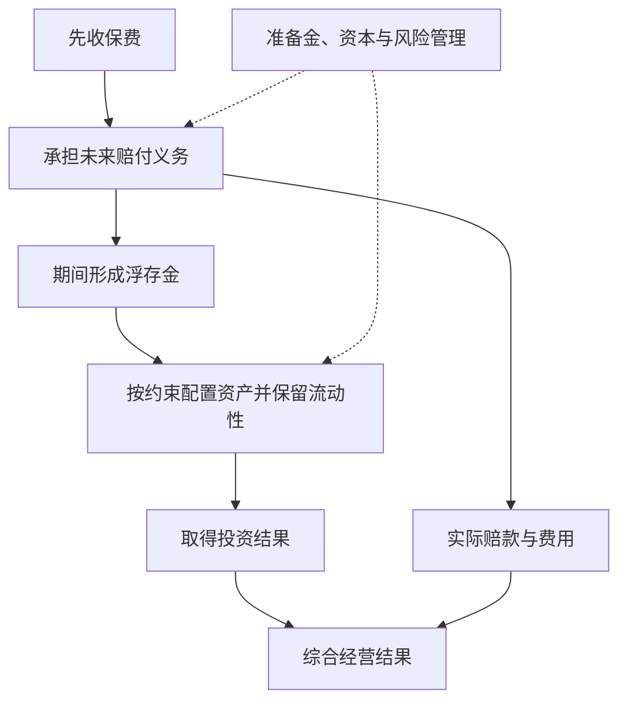

这也解释为什么个人不能用普通短期借款模拟保险资金：还款期限、资金稳定性、成本、规模和风险管理机制都不同。

#### 练习三：有增长，不一定创造价值

假设企业有 100 万可分配资金，可以选择：

- 项目甲：每年新增税后经营收益 5 万，持续经营仍需承担业务风险。
- 项目乙：每年新增税后经营收益 15 万，但预测更不确定。
- 其他选择：还债、保留现金、回购或分红。

不能仅以甲乙都能增加利润就认为两者都值得做。还要比较资本成本、现金时间、追加投入、失误情景和机会成本。若相应要求回报为 10%，甲的 5% 回报可能不足；乙的 15% 看上去较好，但必须核查其估计是否可靠。

**财商训练：** 每当看到“扩大规模”“利润增长”，补问一句“多用了多少钱、承担了什么新风险”。这比单记某年的伯克希尔回报率更容易迁移到自己的决策中。

### 读这些信时，最容易学错的地方

| 容易形成的口号 | 应补上的条件 |
| --- | --- |
| 买好公司就不用看价格 | 经营质量与购买价格共同决定回报 |
| 长期持有就是永远不卖 | 原先的经营与风险判断需要持续成立 |
| 不需要预测 | 不必精确预测短期市场，但估值仍包含对企业未来的判断 |
| 浮存金是免费资金 | 是否低成本取决于承保结果、稳定性和偿付约束 |
| 回购总是利好 | 价格、财务承受能力及替代用途都重要 |
| 现金多说明看空股市 | 可能服务于赔付、经营、收购与流动性；不能只猜宏观观点 |
| 经营利润比净利润好，所以调整后数都可靠 | 调整要逐项解释，不能一味排除真实成本 |
| 集中持有才能成功 | 个体能力、资金结构、信息和承受能力不同 |
| 伯克希尔买了，我也该买 | 成本、条件、期限、权利和信息时点可能完全不同 |
| 巴菲特成功，所有解释都已被证明 | 成功记录仍包含环境、机会与幸存者因素，需要独立检验 |

股东信同时是管理者向股东解释公司的文件，不是随机实验，也不是完整学术理论。评价某段话时要保留公司立场、当时背景和后来变化；关注其论证，避免把作者名望替代证据。

### 按财商目标使用：一张企业研究卡

每研究一家企业，尝试用下面十个问题写一页答案，不必先建立复杂模型：

1. **业务：** 谁为哪些产品或服务付钱？竞争者为什么不能轻易替代？
2. **能力边界：** 哪些关键因素我确实理解，哪些只是听说？
3. **收益：** 利润中有多少能转成可持续现金，维持业务还要花多少？
4. **资本回报：** 现有资本赚得怎样，新增资本是否有合适回报？
5. **管理：** 管理层过去如何使用资金，对待股东是否一致？
6. **融资：** 债务、保险义务或其他承诺，可能在何时要求现金？
7. **每股结果：** 增发、回购和分红，怎样改变每份权益？
8. **价值与价格：** 保守、正常、较好情景分别依赖哪些前提？
9. **推翻条件：** 哪两三种事实会让原判断不再成立？
10. **自身安排：** 即使研究正确，仓位与资金期限是否允许等到结果？

完成后找一位观点不同的人，或自己站在反方，挑战最关键的假设。对普通读者而言，能写清“不知道哪里”，往往比迅速生成一个精确目标价更有价值。

### 代表年份阅读地图与来源

表内年份均为报告年度；官网信件一般于下一年发表。每行只说明本文取用的主题，不表示那封信仅讨论这些内容。书外对照另使用[贵州茅台 2026 年三季报](https://static.cninfo.com.cn/finalpage/2026-10-31/1225649896.PDF)与[美国财政部 LTCM 证词](https://home.treasury.gov/news/press-releases/rr2991)，没有把这些事件冒充巴菲特原信案例。

| 原始资料 | 本文取用主题 |
| --- | --- |
| [1977](https://www.berkshirehathaway.com/letters/1977.html) | 以企业所有权方式选股 |
| [1983](https://www.berkshirehathaway.com/letters/1983.html) | 股东原则、每股价值、经济商誉 |
| [1985](https://www.berkshirehathaway.com/letters/1985.html) | 纺织业务退出、资金重新配置与决策复盘 |
| [1986](https://www.berkshirehathaway.com/letters/1986.html) | 资本配置、授权、所有者收益 |
| [1987](https://www.berkshirehathaway.com/letters/1987.html) | 账面与经济价值、资本效率 |
| [1989](https://www.berkshirehathaway.com/letters/1989.html) | 内在价值与组织惯性 |
| [1991](https://www.berkshirehathaway.com/letters/1991.html) | 透视收益与规模约束 |
| [1992](https://www.berkshirehathaway.com/letters/1992.html) | 成长、价值与新增资本回报 |
| [1996](https://www.berkshirehathaway.com/letters/1996.html) | 能力圈、浮存金 |
| [1999](https://www.berkshirehathaway.com/letters/1999htm.html) | 经营与投资口径、能力边界、浮存金成本 |
| [2007](https://www.berkshirehathaway.com/letters/2007ltr.pdf) | 喜诗的资本效率、FlightSafety 的设备投入与商业质量 |
| [2008](https://www.berkshirehathaway.com/letters/2008ltr.pdf) | 危机、融资及衍生品风险 |
| [2010](https://www.berkshirehathaway.com/letters/2010ltr.pdf) | 流动性与抗冲击能力 |
| [2011](https://www.berkshirehathaway.com/letters/2011ltr.pdf) | 浮存金成本和承保纪律 |
| [2012](https://www.berkshirehathaway.com/letters/2012ltr.pdf) | 分红、留存与资本用途 |
| [2013](https://www.berkshirehathaway.com/letters/2013ltr.pdf) | 非专业投资者与指数化思路 |
| [2014](https://www.berkshirehathaway.com/letters/2014ltr.pdf) | 以股票支付并购的机会成本 |
| [2016](https://www.berkshirehathaway.com/letters/2016ltr.pdf) | 专业管理费用与投资者净结果 |
| [2018](https://www.berkshirehathaway.com/letters/2018ltr.pdf) | 会计净利润与经营表现 |
| [2020](https://www.berkshirehathaway.com/letters/2020ltr.pdf) | PCC 收购估值失误、正常盈利判断及实际回购 |
| [2022](https://www.berkshirehathaway.com/letters/2022ltr.pdf) | 回购价格、长期成功及局限 |
| [2023](https://www.berkshirehathaway.com/letters/2023ltr.pdf) | 芒格对投资路线的影响与传承 |
| [2024](https://www.berkshirehathaway.com/letters/2024ltr.pdf) | 沟通责任、承认并纠正错误 |
| [2025-11-10 感恩节信息](https://www.berkshirehathaway.com/news/nov1025.pdf) | 年度信作者交接、人生与财富用途 |

### 自测：能回答这些，就抓住了核心

1. **企业利润增长，为什么股东未必更富？** 还要看资本投入、股数变化、资金使用与购买价格。
2. **所有者收益为什么不能简单等于净利润加折旧？** 需要扣除维持竞争力的资本投入及必要营运资金，且非现金调整应逐项判断。
3. **浮存金为什么不是股东权益？** 它对应未来赔付等义务，只是暂时由公司持有和按要求运用。
4. **为什么低价回购可能提高每股价值？** 如果价格低于合理内在价值且资金安排适当，减少股数所增加的份额可超过支付现金损失的价值。
5. **怎么判断护城河不是口号？** 寻找持续的定价、成本、复购、份额与资本回报证据，并分析竞争者怎样可能突破。
6. **为什么规模越大越难重复过去的高收益？** 足够影响整体的大机会更少，交易与资本配置约束更多。
7. **普通人应该照抄哪一部分？** 学研究、价格、费用、风险与诚信原则；不照抄历史持仓、机构杠杆和特定信托比例。
8. **2025 年发表的年度信与 2025 年度信相同吗？** 不同。巴菲特 2025-02-22 发表的是 2024 报告年度信；Abel 的 2025 报告年度信另列，2025 感恩节信息也不是年度报告信。

尚未覆盖每年全部业务、行业细节、税制与会计变更、早期合伙人信及全部投资记录；这些需要按专题继续读原文。本文已覆盖代表性投资与经营原则，但不应被理解为“巴菲特全部观点”或今天伯克希尔的完整经营分析。

---

[返回书籍索引](<README.md>) · [财商学习与实践路线](<财商进阶合订本.md>)


---

<a id="book-04"></a>

[单独打开本篇](<投资最重要的事 - 霍华德·马克斯/读书笔记.md>)

## 《投资最重要的事》读书笔记

> 作者：霍华德·马克斯（Howard Marks）  
> 英文原作：The Most Important Thing: Uncommon Sense for the Thoughtful Investor，2011 年  
> 版本说明：原书与后来的 Illuminated 评注版有区别。后者加入其他投资者的评论；本笔记围绕马克斯原书的 20 章思想整理，不把评注者观点自动归到马克斯名下。中文译者和具体版次未指定。  
> 分析依据：出版社目录、作者公开投资备忘录、公司正式财报与美联储历史资料，未取得用户原书。较晚备忘录和真实财报仅作为书外教学，不作为“原版已写过这些后来事实”的证据；作者回顾、公司披露与本笔记推断分别标明。  
> 覆盖范围：主要章节与 30 个核心知识点，侧重价值、价格、风险、周期、心理及决策方法。  
> 更新日期：2026-11-11

### 先看这里：这本书讲什么

**一句话概括：投资的关键，是在不确定的未来面前，以合适的价格承担自己理解、能承受、并得到足够补偿的风险。**

书名里的“最重要”不是只有一个秘诀。马克斯不断从不同角度解释：只懂价值却不懂价格，只会判断却不懂风险，或者懂道理但受情绪驱动，都可能让投资失败。全书讨论的是判断框架，不是一个固定买卖公式。[出版社原书框架及评注版说明](https://cup.columbia.edu/book/the-most-important-thing-illuminated/9780231162845/)

最值得记住的七个结论：

1. **好公司不一定是好投资。** 好坏还要结合买入价格和未来真正实现的结果。
2. **想与平均结果不同，就需要有依据地与平均观点不同。** 单纯反对多数人没有优势。
3. **风险不只是价格上下波动。** 还包括永久损失、流动性、杠杆和无法按计划持有。
4. **高风险意味着更宽的结果范围，不意味着确定的高收益。**
5. **周期和情绪会改变机会的价格。** 不必能预测拐点日期，仍可以评估当下是否过分乐观或悲观。
6. **好过程不保证每次有好结果。** 运气使单次输赢不能直接证明能力。
7. **防守的目的，是在不利情境中保留继续参与的能力。** 它不等于永远不承担风险。

### 全书主要内容与知识地图

下面把原书 20 章归为七组，标题是本笔记的中文概括。[原版章节目录见出版社页面](https://cup.columbia.edu/book/the-most-important-thing-illuminated/9780231162845/)

| 原书章节 | 核心主题 | 需要学会回答的问题 |
| --- | --- | --- |
| 1—2 | 第二层思维、市场效率及局限 | 我凭什么比市场的综合判断更有优势 |
| 3—4 | 价值、价格与价值关系 | 买到的东西值多少，现在付了多少 |
| 5—7 | 理解、识别、控制风险 | 哪些情境会让我遭受难以恢复的损失 |
| 8—10 | 周期、心理钟摆、负面影响 | 当下价格包含怎样的情绪和融资条件 |
| 11—13 | 逆向、寻找便宜、耐心等待 | 为什么别人不愿买，而我有理由参与 |
| 14—16 | 知道未知、理解位置、运气 | 我不知道什么，能否承受预测出错 |
| 17—20 | 防御、避免陷阱、增加价值、综合运用 | 怎样把这些认识组成一致的决策方式 |

### 核心知识点：先明确自己的优势

#### 01. 第二层思维：不仅判断事情，还判断价格中的预期

第二层思维不是把结论说得更复杂，而是把两件事分开：企业发生了什么，以及投资者已经为怎样的前景付出了多少价格。判断经营改善，并不能跳过第二件事直接得出投资有利。[作者对第二层思维的说明](https://www.oaktreecapital.com/insights/memo/i-beg-to-differ)

**直接看真实财报：** 美的集团 2026 年前三季度收入同比增长 1.19%，归母净利润增长 9.27%，扣非归母净利润却下降 22.49%。公司在三季报中把扣非变化主要联系到汇率与相关风险管理工具收益的分类差异。这组事实本身就不支持只用一个增长率概括经营。[美的官方三季报，第 2—4 页](https://static.cninfo.com.cn/finalpage/2026-10-30/1225645132.PDF)

第一层分析应该先核对口径：归母利润、扣非利润和现金流分别是什么，哪些项目造成分化，相关收益与损失是否经济匹配。不能看到归母增长就宣布全面改善，也不能看到扣非下降就把同样幅度直接叫作主营业务衰退。连第一层事实都未拆清时，复杂的估值故事只是放大不确定性。

第二层才进一步问：公告前的市场原本预计什么，价格已反映多少，以及自己的估计到底比共识乐观还是悲观。**本笔记没有公告前同口径预期、当前估值或市场隐含假设的完整证据，所以不能把这些数字称作超预期或低于预期。** 数据难看并不自动表示价格低估，数据好看也不自动表示仍有收益空间。

这里的真实案例还有一个教训：仅仅找到公司对分类差异的解释，仍不等于证明盈利可以持续。需要继续检查匹配关系、实现与未实现损益、业务本身变化和资本需求。市场预期也不能从单一股价唯一反推，因为同一价格可以包含不同的增长、风险与持有期限假设。

读者可以在这一节直接完成三栏记录：已披露事实、公司解释、尚缺的预期与价格证据。**参考判断：** 目前能够确认利润口径分化并提出下一步问题，不能形成买卖结论。完整勾稽和原表在[真实财报图解](<实战案例/2026三季报图解.md>)，但本节的核心是识别每一层到底需要什么证据。

#### 02. 与众不同是必要条件之一，不是充分条件

主动投资想得到不同于市场的结果，持仓或判断通常也要不同。但不同可能来自更深入的研究，也可能只是无知和固执。

提出不同于市场的判断，需要说明市场漏看了什么事实、自己的估计为何更可靠。仅说“别人恐惧我贪婪”，无法区分便宜机会与真正的坏资产。

#### 03. 市场有效意味着竞争很强，不是价格永不出错

大量聪明参与者会迅速消化公开信息，所以显而易见的机会不容易长期存在。与此同时，情绪、约束、信息差异和强迫交易也可能使价格偏离合理范围。

**补充解释：** 不能从“市场有时犯错”直接跳到“我可以稳定赚钱”。还需要证明你能识别错误、在成本后有优势，并在价格修复前坚持得住。这是对原书市场效率主题的展开。

#### 04. 先问自己知道什么，再问市场明天怎样

公司现金流、债务结构和合同条款通常比宏观拐点更具体；但即使研究了很多，也必须识别能力边界。承认不知道，可以避免在没有优势的领域承担过大风险。

能读懂历史财报，不代表能精确判断未来利率和汇率。把知识分为已核实事实、合理估计、无法判断三层，有助于控制自信。[作者区分不同投资态度：Us and Them](https://www.oaktreecapital.com/docs/default-source/memos/2004-05-07-us-and-them.pdf)

### 核心知识点：价值与价格

#### 05. 价值来自资产能够提供的经济利益

价值最终关联资产能向出资者提供的经济利益。利润、经营现金流、可分配现金与价值不是同一个量；从一张财报走向估值，需要继续处理维持经营的投入、资本需求、负债和利益归属。[作者后续讨论：The Calculus of Value](https://www.oaktreecapital.com/insights/memo/the-calculus-of-value)

**真实例子：贵州茅台 2026 年前三季度合并经营现金流净额为 840.59 亿元，同比增长 120.07%，而销售商品、提供劳务收到的现金增幅约为 3.41%。** 报告解释，合并经营现金流大幅变化主要涉及财务子公司的同业存款到期收回，以及吸收集团成员存款的净变化。[贵州茅台官方三季报，第 1—3、10—11 页](https://static.cninfo.com.cn/finalpage/2026-10-31/1225649896.PDF)

因此，840.59 亿元不是“当期卖酒产生、股东随时可取走的钱”。合并范围中包含金融业务，就需要理解存款、资金运用和相应负债；即使只考察实体经营，也仍须考虑维持业务的投入、必要营运资金及其他现金义务。把一个经营净额直接乘以估值倍数，会跳过这些环节。

同样，不能减掉两项存款相关的同比变化，就称剩余为纯酒业现金流。同比变化不是本期金额，两项也不代表全部金融业务，内部交易与抵销仍未处理。这些限制不是为了否认报表，而是确保拿去估值的量真正回答“可持续、归属于谁的经济利益”。

**必要的折现算术：** 假如一年后能确定收到 110 元，按 10% 折现，现值为 100 元。这只是数学演示，现实企业的未来现金与折现条件都不确定。必须先研究现金从哪来、需要留下多少、哪些变化使它减少，再考虑如何折现；公式不能替代前面的经营判断。

本例能帮助理解为何好看的现金增速不等于价值同比增长同样幅度，却没有得出茅台的合理价格。练习的合格答案应说明还需要哪些经营、投入与负债资料，而不是在缺少这些材料时填出一个精确估值。[本例数据勾稽](<实战案例/2026三季报图解.md>)

#### 06. 价值是估计区间，不是精确真值

未来经营和折现条件都不确定，所以一个看似精确的估值常隐藏很多假设。用区间和情境思考，比假装知道精确到小数点的价值更诚实。

合理价值区间不是已经确定的客观常数，区间中点也不自动成为精确答案。应解释哪些变化会使价值落到区间下方，以及不同估计对买入价格的影响。估值表格越复杂，不等于输入越可靠。

#### 07. 好资产与好价格必须分开评价

企业、行业的前景，与买入价格是否划算必须分开。一个产业改变世界，不保证所有公司都成功；即使选中了成功者，也可能支付了过高价格。

**马克斯本人在 2000 年初发表的 bubble.com 是可直接核对的事前材料。** 当时他没有否认科技、电子商务和通信会改变生活，而是把问题转向：谁能成为赢家，以及现在为其权益付出多少才合理。[2000 年备忘录原文](https://www.oaktreecapital.com/docs/default-source/memos/2000-01-02-bubble.pdf) 这比事后笼统说互联网是泡沫更有教学价值，因为它展示了如何在承认技术前景的同时质疑价格。

这里至少有三项不确定性：产业发展规模、企业能够获取并保留多少收益、当前价格对未来提前支付了多少。前一项正确，后两项仍可能错误。只要把“世界会需要它”直接等同于“任何价格都能买”，价值判断就被产业叙事替代了。

反过来，后来出现大幅调整，也不能证明科技进步是假的；更不能据此将每一个新行业都归为同类泡沫。需要重新检查收入转化为现金的能力、竞争和资本投入，以及价格中包含的期待。该备忘录是作者当时观点的证据，不是证明他每次择时都准确的完整业绩记录。

**自测与参考答案：**“互联网后来确实改变世界，所以当时所有高估值都合理”缺少什么？缺少公司层面的价值捕获、持续性和价格比较。技术正确、企业成功与投资回报，是相连但不等价的三个判断。

#### 08. 买入价格在很大程度上决定未来空间

一个价格已经要求经营、融资和市场情绪都非常顺利的投资，对坏消息的容错通常较小。如果买入时已经充分反映悲观预期，结果只需没有那么差，也可能有较好回报。

这不是“越跌越买”的规则。要同时确认价值是否也在下降。如果合理价值的降幅大于报价降幅，资产即使跌价也可能变得更贵；要比较的是价格相对价值的关系。[作者第二层思维备忘录](https://www.oaktreecapital.com/docs/default-source/memos/2015-09-09-its-not-easy.pdf)

#### 09. 安全边际是在估错时留出空间

安全边际不是一个保证赚钱的固定折扣，而是通过更保守的估计、更有利的买价、更强的资产负债表或合同保护，为不利结果保留余地。

相对保守估值打折买入，能容纳一部分判断误差；但债务和经营变化若使实际价值大幅下降，原先的“折扣”仍会失效。安全边际要建立在可信的价值分析上，而不是只看与历史高价的差距。

#### 10. 价值陷阱：看似便宜，实则价值持续流失

低市盈率可能来自周期顶部利润，低市净率可能伴随资产减值或无法变现。价格便宜的原因必须讲得通。

**数学演示（假设利润与价格）：** 当年每股利润 10、股价 50，对应 5 倍市盈率；若正常年份每股利润只有 2，则对应 25 倍。分母处于周期高点，会把估值看得过于便宜；同时还需分清暂时低迷与结构性衰退。

### 核心知识点：风险究竟是什么

#### 11. 波动是一个风险信息，不是风险的全部

马克斯更关心永久资本损失及不利情境，而不是仅用历史价格标准差概括风险。没有频繁报价的资产也可能很危险；价格经常变化的资产也未必必然遭受永久损失。

边界是：波动仍会通过杠杆、生活用款、赎回或心理压力让人被迫卖出。因此不能把“波动不等于风险”读成“波动无所谓”。[作者相关讨论：A Look Under the Hood](https://www.oaktreecapital.com/insights/memo/a-look-under-the-hood)

#### 12. 承担更多风险，不保证得到更多回报

通常需要更高的预期回报吸引人承担不确定性，但预期不是承诺，合同票息也不等于最后实际回报。风险补偿还可能在竞争中被压低，出现承担更多风险却得到更少保护的情况。

**真实的事前观察来自马克斯 2007 年的 The Race to the Bottom。** 在后来公开对话中，他回顾当时看到贷款机构通过放松条件争取业务，指出资本提供者竞争可能同时压低收益要求、弱化保障。这份备忘录写在全球金融危机全面爆发之前，属于可核对的当时判断，而非事后补写。[2007 年备忘录入口](https://www.oaktreecapital.com/insights/memo/the-race-to-the-bottom)、[作者对当时观察的公开回顾](https://www.oaktreecapital.com/insights/memo/conversation-at-panmure-house)

把这种竞争看作一场拍卖就容易理解：希望获得贷款业务的人，可能接受更低利率、更少约束或更弱的借款人。赢得交易不代表赢得好投资；如果得到的保护比减少的报酬还差，未来不利情境反而更难承受。供需旺盛带来的热闹，会掩盖交易条款本身的恶化。

**纯算术示例，非真实债券：** 100 元买入，一年后有 90% 概率收回 110 元、10% 概率归零，预计收回只有 99 元。纸面正常履约收益为 10%，预期名义收益却为 −1%。真实违约概率、回收率和发生时间不能这样随手假定，这个式子只是展示“承诺”与“综合结果”不同。

风险补偿也不是挑出高期望就结束。即使更低买价改善平均结果，仍要检查极端损失、资金用途、多个资产共同出问题的可能，以及概率估计是否可信。不能因为最后顺利履约，就回头宣称当时不存在风险。

这个案例支持的是研究条款与价格的必要性，并不能把所有宽松融资都判为将要违约，更不能从一篇正确预警推出危机发生的精确日期。

#### 13. 风险常在大家觉得安全时积累

普遍乐观会压低风险补偿、推高估值、鼓励借债和降低审查标准。因此过去一段时间平稳，并不能证明未来也安全。

长期未出问题可能诱使融资者接受更高杠杆和更少保护，表面的稳定便可能伴随内部脆弱性增加。需要观察行为是否更激进，而不仅仅看最近有没有亏损。[作者对风险的后续回顾](https://www.oaktreecapital.com/insights/memo/risk-revisited-again)

#### 14. 风险控制不等于拒绝所有风险

完全回避不确定性，也可能付出购买力损失、目标无法实现或机会成本。真正的管理，是判断哪些风险值得承担、承担多少，以及出错后会怎样。

同一项投资，对长期闲置资金与近期必须支付的费用，风险意义不同。选择应当结合资金用途，而不是只看产品标签。[作者后续论述：The Indispensability of Risk](https://www.oaktreecapital.com/insights/memo/the-indispensability-of-risk/)

#### 15. 杠杆缩小能够活下来的结果范围

杠杆会把小幅资产变化转成更大的权益变化，也可能使你在分析最终兑现前被迫行动。它改变的不只是收益率，而是能够继续持有的结果范围。

**真实事件是 1998 年 LTCM 濒临失败。** 美联储历史资料记录，该基金在 1997 年末向投资者返还资本，却没有相应缩减投资规模；1998 年危机中，原本期待收敛的价差反而扩大。其后由私人金融机构注资安排避免仓促清算，纽约联储参与协调但未投入自身资金。[美联储历史资料](https://www.federalreservehistory.org/essays/ltcm-near-failure)

表面上，许多头寸押的是相似资产价差，不是简单押市场涨跌。然而，融资、流动性和共同平仓压力可以使这些交易一起恶化。等待未来收敛需要资本与对手继续支持，数学上的长期关系不能替你支付眼前的资金要求。

**只作杠杆算术：** 资产 100、负债 80，权益为 20；资产降到 85、暂时假设负债不变，权益只剩 5，下降 75%。这不是 LTCM 的真实账表，而是解释为什么资产跌幅与资本损失不是同一个比例。

实际判断要检查融资期限、保证金、可变现性以及损失时是否被迫出售，不能只看常态下的波动。LTCM 事件不证明所有杠杆或价差策略都失败，但足以反驳“市场中性就不需要担心生存条件”这种过强结论。

#### 16. 流动性与资金期限也是风险

某资产长期可能有价值，但若短期无法变现，而你短期必须用钱，就有错配。价格低不代表一定适合持有者。

退出期限远于资金使用期限时，不能只比较预计收益。还要考虑锁定、交易深度、估值透明度和被迫出售的折价。耐心需要资金条件支撑，不能只靠意志。

### 核心知识点：周期与心理钟摆

#### 17. 周期意味着变化，不能把现状永久外推

繁荣会吸引投资和融资，新增供给与过度扩张又可能压低回报；衰退会促使收缩，逐渐创造改善条件。不同周期可能相互作用，但长度和幅度没有固定刻度。

高利润可能吸引扩产；新增供给逐步释放后，先前的高利润可能消失。不能机械地把一年的好业绩乘很多年。周期分析需要具体行业依据，不是看到上涨多年就断言明年必跌。

#### 18. 信贷周期会放大经济与价格变化

融资宽松时，借款容易、条款放松，更多交易得以完成；当信心逆转，融资收缩又迫使出售和缩减投资。资产价格与资金可得性会互相强化。

收购价格上涨使账面抵押价值看起来更高，进而支持更多借款；一旦价格下降，这个循环可能反转。研究投资时要问“如果不能再轻易融资，会怎样”。[作者历史备忘录：The Race to the Bottom](https://www.oaktreecapital.com/insights/memo/the-race-to-the-bottom)

#### 19. 心理钟摆：现实小变动，评价可能大摆动

同样的数据，在乐观环境中容易被解读为暂时困难，在悲观环境中容易被解读为永久崩溃。情绪会改变投资者愿意支付的价格。

企业利润变化与市场愿付的估值倍数变化可能同时发生，因此价格变化不只来自利润本身。钟摆只是解释框架，没有告诉你哪一天到顶或触底。[作者对心理的后续说明：Sea Change](https://www.oaktreecapital.com/insights/memo/sea-change)

#### 20. 识别我们在哪里，比精确预测下一步更务实

可以评估价格、融资条件、风险偏好和市场叙事是否偏向极端，而不声称知道下周走势。这些判断可以影响整体风险姿态，但不应被包装成精确择时能力。

估值偏高、融资条件激进、参与者普遍不讨论损失，提示认真检查防御；它仍可能持续很久。准备和预测的区别在于，准备允许多种未来，预测往往押一个结果。

#### 21. 恐惧、贪婪、从众与嫉妒会干扰决策

“别人已经赚了很多”不是资产价值的证据，却很容易降低自己的标准。职业压力、排名和面子，也会使人参与自己并不理解的事情。

**补充练习：** 决策前分别写“我希望得到什么”和“支持投资的事实是什么”。如果第二栏只有别人赚钱、名人参与或过去上涨，应回到分析，而不是用情绪补足证据。

### 核心知识点：逆向、耐心与防御

#### 22. 逆向投资依赖价格错误，而非人少

逆向投资需要指出价格为什么错，不是只证明参与者少。群体可能因恐慌低估资产，也可能因真实损伤而合理撤退；必须从资产、结构和价格中区分。

**真实实践：2008 年危机中的橡树。** 马克斯在 Taking the Temperature 中回顾，橡树在危机前准备了储备资本；雷曼破产后，Bruce Karsh 团队从 9 月中旬到年底大规模投入困境债务。他解释当时关注的，是较高顺位债权及低买价提供的保护，而非确定市场已经见底。[作者关于当时决策的回顾](https://www.oaktreecapital.com/insights/memo/taking-the-temperature)

这段材料是参与者事后的公开叙述，不能当成独立审计的全部业绩。其教学价值在于让“别人恐惧我买入”变成具体条件：先有能够投入的资金，再研究偿付结构与价值，即使经营出现不利变化，买价和权利顺序是否仍留下空间。缺少这些条件，单靠逆向勇气并不能复制其决策。

这里也能看见周期与准备的关系。好时期融资容易、保护被削弱，值得积累警惕；恐慌时被迫出售增多，才可能出现价格与价值分离。但同样的低价既可能是折扣，也可能是资产永久受损的反映，所以要继续核查而不是自动买入。

资金期限同样关键。若自己需要短期偿债、必须等待新融资，可能在机会出现时没有行动能力。所谓耐心不只是愿意等，也是持有资金与资产的安排允许等。原文没有让读者相信任何下跌都会恢复。

**自测与参考答案：** 橡树当时买入，能否证明它准确预知最低点？不能。该叙述强调在可接受条件下采取行动，本来就不要求先确定底部。学习对象是证据、价格、权利结构和准备，而不是事后最低价的神话。

#### 23. 便宜货通常令人不舒服，但不舒服不是证据

如果所有人都能轻松确认安全、有吸引力，价格通常已反映许多优点。机会常伴随争议、复杂性或短期问题。

**补充解释：** 这不是鼓励专挑难懂的资产。复杂性可能意味着你根本无法判断价值。只有当不舒服的原因可分析、价格提供补偿且资金能承担时，才值得继续研究。

#### 24. 耐心等待不等于永远看空

机会不好时可以维持标准，而不是为了有动作而行动。但等待也有代价：现金回报、购买力、目标期限和错失机会都需要评估。

预先写明什么价格、质量和风险条件值得参与，定期复查；如果只说“等更便宜”，却永远不愿更新，就可能把耐心变成拖延。书中的耐心是有准备的等待。

#### 25. 防御投资重视少犯致命错误

防御是保留在不利环境里继续决策的能力，可以体现为较低买价、较少杠杆、较可靠的资产负债表和匹配现金用途；它不是永远只持现金，也不是所有年份都必须领先。

**真实的动态调整材料是马克斯 2020 年的 Calibrating。** 他回顾当年 3 月不同时间发表的判断：市场下跌、价格降低时讨论分步买入；反弹改变价格之后，又重新检查积极程度。文中坚持不把“可以开始买一些”说成“已经知道唯一底部”。[2020 年备忘录原文](https://www.oaktreecapital.com/docs/default-source/memos/calibrating.pdf)

这使防御从一个永久标签变成相对价格和条件的选择。相同资产，在不同价格下值得承担的程度可能不同；同一经济前景也可能因买价下降而出现更多补偿。逐步调整则承认未来仍有多种路径，避免把全部决定压在某一天的预测上。

还要区分债权与股票。债权上行常受合同限制，避免严重违约很重要；股票可能由少数持续增长的赢家贡献较大收益。为了不出现任何短期波动而退出所有赢家，也不是完整防御。因此要结合资产的损益结构，而不是统一套一个“有利润就卖”的动作。[作者对两类资产的后续讨论](https://www.oaktreecapital.com/insights/memo/fewer-losers-or-more-winners/)

**算术演示，非历史组合：** 100 先涨 50% 再跌 50%，剩 75；先涨 20% 再跌 20%，剩 96。它解释下行破坏为何值得防范，但不证明保守组合永远更好。如果严重下跌未发生，承担较多风险者可能长期领先。

评估防御应看保护是否真实、代价是否事先接受、机会成本是否合理，以及多个环境中的表现。上述备忘录记录的是作者判断随当时条件更新，不是提供一套已验证的机械择时公式。

#### 26. 分散要看共同失败原因

一篮子资产可能共同依赖低利率、同一行业或同一融资来源。分散名称不等于分散真正风险。

评估家庭风险时，还要检查收入、房产和证券是否高度依赖同一个行业；共同依赖会使它们在行业低迷时同时承压。将投资放回整体财务状况，比单看每项资产的独立回报更有用。这是把原书风险思想用于个人决策的补充。

### 核心知识点：不确定性、运气与评价

#### 27. 用一组情境替代单一路线

未来不是唯一可预测的结果。应描述正常、较差、严重不利等情境，以及每种情况下现金流、偿债和退出会怎样。

预计销量增长的同时，也计算持平和下滑时是否仍能覆盖固定费用。情境概率可能很不精确，不能因表格写了百分比就误以为不确定性已被消除。

#### 28. 单次结果不能证明决策质量

评价决策需要回到当时信息与风险，不能只靠结果。一个真实而有意思的观察对象，就是马克斯本人后来最受认可的预警。

在 2000 年初的 bubble.com 中，他先承认此前的谨慎在当时行情中显得错误，再继续陈述对投机行为的担忧。到 2025 年回顾时，他又明确说那次预警后来得到迅速印证。[2000 年原文](https://www.oaktreecapital.com/docs/default-source/memos/2000-01-02-bubble.pdf)、[2025 年本人回顾](https://www.oaktreecapital.com/insights/memo/on-bubble-watch)

把两份材料放在一起，比只读“成功预言泡沫”的标题更有帮助。决策当时并没有结果保证；先前看起来落后，也不自动说明风险判断毫无根据。后来迅速应验，使一次判断格外容易被记住，但它仍不足以单独证明完整预测能力，更不能倒推他知道具体转折日期。

因此应区分判断内容：发现价格和叙事中存在脆弱性，与准确知道脆弱性何时暴露，不是同一能力。前者可以支持调整承担，后者需要另外的证据。若把每次正确方向都说成精准择时，就会夸大经验能够提供的东西。

在后来的 You Bet! 中，马克斯明确把过程与实现结果分开，强调未知信息和随机性会影响结果。[作者关于决策质量的说明](https://www.oaktreecapital.com/docs/default-source/memos/you-bet.pdf) 这不等于亏损时一律归咎运气：仍须检查是否遗漏可得信息、规模是否合理、是否为坏结果准备过。

实用复盘分两步：先尽量遮住结果，评估当时资料、价格、反证与承担；再加入结果，检查它提供了什么新信息。即使长期成绩也需看环境、杠杆、成本和未发生但曾承担的失败路径。真实成功案例是研究起点，不是可以停止质疑的终点。

#### 29. 看风险调整后的贡献，而不是只看涨了多少

牛市中承担更大市场风险的人可能赚得更多，却未必创造了更多能力价值。比较表现需要考虑市场环境、杠杆、基准、成本与风险承担。

相对于市场的额外收益，可能来自分析能力，也可能来自更多杠杆、更集中暴露或暂未显现的尾部风险。仅凭收益数字无法排序，还需要检查完整过程和下行情景。

#### 30. 把原则组合起来，避免单项走极端

只讲安全可能永不行动，只讲逆向可能不停接下跌资产，只讲耐心可能变成不肯认错。真正的框架需要同时回答价值、价格、风险、资金期限和反证条件。

**补充解释：** 一项机会可以有估值折扣，却因无法承受锁定期而不适合你；也可以是好企业，却因价格已很充分而缺少吸引力。投资决策是多条件权衡，不是寻找一句永远正确的口号。

### 难点算例：好公司为什么也可能是坏投资

以下为原创教学例子，所有金额按每股计算，忽略股息、成本和税费，不对应实际证券。

假设现在每股利润为 5，三年后利润增长到 6，经营确实改善 20%。但价格还取决于市场愿意支付多少倍利润。

| 情景 | 买入价格 | 三年后估值假设 | 三年后价格 | 简单持有收益 |
| --- | --- | --- | --- | --- |
| A：初始支付很高预期 | 150（30 倍） | 20 倍 | 120 | −20% |
| B：初始支付较低预期 | 75（15 倍） | 20 倍 | 120 | +60% |

两种情景面对同一家企业、同样的经营增长，却有不同结果。这里并未证明 15 倍便宜或 30 倍昂贵；估值是否合理还取决于质量、增长、风险和其他机会。算例只说明：**公司表现与买方回报之间，隔着买入价格。**

### 难点图解一：价值、预期和价格如何相互作用

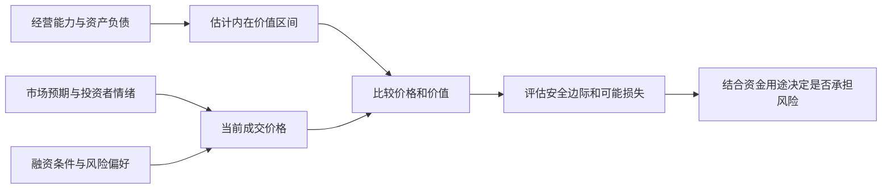

图中价值和价格分别形成，最后再比较。它们会相互影响，但不应被混成同一个数字。“市场今天报价多少”与“你估计它能提供多少经济利益”是两个问题。

### 难点图解二：风险为什么会在繁荣中增长

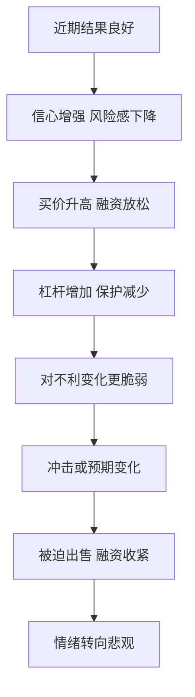

这只是机制示意，没有固定时间表。它不表示每次上涨都会立即崩溃，也不表示所有悲观市场都有便宜机会；它提醒读者观察价格背后的风险积累。

### 如何把这本书用于自己的决策

可以将一次投资研究写成一页，逐项填入真实资料：

| 问题 | 应写出的内容 |
| --- | --- |
| 我买的究竟是什么 | 资产、权利、现金来源，而不只是代码或概念 |
| 我估计值多少 | 区间、关键假设、最敏感的变量 |
| 现在支付多少 | 当前价格包含怎样的增长与风险预期 |
| 我与市场哪里不同 | 具体事实或解释差异，不是“我更有信心” |
| 可能错在哪里 | 竞争、债务、估值、执行、资金期限等 |
| 最差会怎样 | 永久损失、被迫退出和生活资金影响 |
| 为什么值得承担 | 价格提供的补偿与其他选择相比如何 |
| 什么会改变判断 | 可验证的反证与复查时间 |

**补充练习：** 找一个历史上由热门转冷门的行业，分别重建当时的乐观与悲观解释。不要用已经知道的结局给当时的人贴标签，而是检查哪些信号当时已经可见，哪些只是事后才知道。

### 常见误读

- “风险不是波动”，不等于可以无视净值波动、保证金或短期用款。
- “逆向”，不等于自动买入跌得最多的东西。
- “好价格”，不等于绝对价格低或离历史高点很远。
- “知道周期位置”，不等于能预测转折日期。
- “防守”，不等于永远追求零亏损，也不等于永不投资。
- “运气重要”，不等于研究无用；它要求以更长样本和更完整过程评价能力。
- “有安全边际”，不等于估值一定正确或永远不需要重新评估。

### 回顾自测

1. **为什么利好兑现后也可能下跌？** 因为之前价格可能预期了更好的结果。
2. **风险越高，为什么不保证赚得越多？** 因为更高不确定性同时扩大了不利结果范围。
3. **安全边际能防止什么，不能防止什么？** 可以留出部分误差空间，不能修复完全错误的价值判断或所有极端情境。
4. **如何区分逆向与固执？** 前者有证据和价格依据，也愿意面对反证；后者只维护原立场。
5. **好公司与好投资之间还差什么？** 买价、未来实际结果、风险与持有者条件。
6. **单次成功为什么不够？** 因为运气和隐藏风险可能暂时没有暴露。

### 来源与资料边界

- [Columbia University Press：The Most Important Thing Illuminated](https://cup.columbia.edu/book/the-most-important-thing-illuminated/9780231162845/)：用于原书 20 章结构及评注版区别。
- [作者备忘录：I Beg to Differ](https://www.oaktreecapital.com/insights/memo/i-beg-to-differ)与[It's Not Easy](https://www.oaktreecapital.com/docs/default-source/memos/2015-09-09-its-not-easy.pdf)：第二层思维、逆向及价格的重要性。
- [Us and Them](https://www.oaktreecapital.com/docs/default-source/memos/2004-05-07-us-and-them.pdf)：知识边界与不同风险态度。
- [The Calculus of Value](https://www.oaktreecapital.com/insights/memo/the-calculus-of-value)：作者后续对价值与价格的澄清；文中当时的市场判断没有转成今天的建议。
- [Risk Revisited Again](https://www.oaktreecapital.com/insights/memo/risk-revisited-again)、[The Indispensability of Risk](https://www.oaktreecapital.com/insights/memo/the-indispensability-of-risk/)与[A Look Under the Hood](https://www.oaktreecapital.com/insights/memo/a-look-under-the-hood)：风险概念与个人约束。
- [The Impact of Debt](https://www.oaktreecapital.com/insights/memo/the-impact-of-debt)：杠杆与生存空间。
- [The Race to the Bottom](https://www.oaktreecapital.com/insights/memo/the-race-to-the-bottom)与[Sea Change](https://www.oaktreecapital.com/insights/memo/sea-change)：融资行为及心理变化。
- [You Bet!](https://www.oaktreecapital.com/docs/default-source/memos/you-bet.pdf)：决策过程与结果的区别。
- [Fewer Losers, or More Winners?](https://www.oaktreecapital.com/insights/memo/fewer-losers-or-more-winners/)：防守、股债差异和风险回报关系的后续说明。

- [2000 年 Bubble.com 备忘录](https://www.oaktreecapital.com/docs/default-source/memos/2000-01-02-bubble.pdf)、[Taking the Temperature](https://www.oaktreecapital.com/insights/memo/taking-the-temperature)与[2020 年 Calibrating](https://www.oaktreecapital.com/docs/default-source/memos/calibrating.pdf)：互联网估值、2008 年机会准备及 2020 年风险调整的作者原始论述或事后回顾，不能当作独立审计的业绩证明。
- [美的 2026 三季报](https://static.cninfo.com.cn/finalpage/2026-10-30/1225645132.PDF)、[茅台 2026 三季报](https://static.cninfo.com.cn/finalpage/2026-10-31/1225649896.PDF)与[核验表及图解](<实战案例/2026三季报图解.md>)：第 01、05 点书外财报教学材料；报告期间、单位与归属口径在原位说明。
- [美联储：LTCM 濒临倒闭](https://www.federalreservehistory.org/essays/ltcm-near-failure)：第 15 点杠杆与融资约束案例。

本笔记没有检验个人投资组合，也没有推导一套普适估值参数。待提供具体中文版本后，可以继续核对原书案例、译名与评注者的不同意见。图表由本笔记编排；真实财报与历史事件在原位附来源，只有明确标为数学演示或假设算例的数值为教学设定。

---

[返回书籍索引](<README.md>) · [财商学习与实践路线](<财商进阶合订本.md>)


---

<a id="book-05"></a>

[单独打开本篇](<思考，快与慢 - 丹尼尔·卡尼曼/读书笔记.md>)

## 《思考，快与慢》读书笔记

> 作者：丹尼尔·卡尼曼（Daniel Kahneman）  
> 原书：Thinking, Fast and Slow，2011 年。简体参考版：胡晓姣、李爱民、何梦莹译，中信出版社，2012 年，ISBN 9787508633558；见[对外经济贸易大学图书馆书目](https://opac.lib.uibe.edu.cn/opac/book/b0acae873a7a226eb38de2c9ce39a774)。用户持有版本尚未确认，不混用不同译本页码。  
> 分析依据：出版社公开介绍与试读、作者研究和公开资料，结合原创概念解释；未取得用户原书，不声称逐页精读。  
> 覆盖范围：五部分框架、34 个主要知识点、概率与风险难点、财商应用和复盘练习。  
> 更新日期：2026-11-11

### 先看这里：它能怎样提高财商

**一句话概括：人经常在不知道自己用了什么捷径的情况下作出判断；改善决策，需要识别容易出错的情境，再用概率、外部数据和事先设计的流程约束直觉。**

本书最有价值的地方，不是让你记住一串偏差名称，而是帮助你发现这些常见错误：觉得熟悉就相信，听到故事就判断，赚了钱就认定自己厉害，亏了钱就只想回本，看见风险就忘了概率，看见机会就忘了代价。

先记住六个结论：

1. **直觉很有用，但自信不能证明直觉正确。** 要看环境是否有稳定规律，以及自己是否得到过有效反馈。
2. **先问同类情况通常怎样，再看这个案例有多特别。** 基础概率能为故事提供约束。
3. **一次结果不能完整代表决策质量。** 好方法可能暂时亏钱，错误判断也可能碰巧赚钱。
4. **损失和收益的感受受参照点影响。** 买入价格、历史高点和心理目标，常常会悄悄左右选择。
5. **把风险放进整体中审视。** 单独看每次涨跌，与看总体目标、相关性和承受能力，可能得到不同判断。
6. **用可重复的检查流程，代替“我以后一定更理性”。** 记录预测、比较备选方案、查证反面证据、事前复盘，通常更容易落实。

知识点中的真实研究、真实财报与教学推论分别注明。研究使用的虚构题目不等于虚构研究；必要的数学演示另作标注。财商应用不冒充原书投资策略。

### 全书五部分怎样连接

卡尼曼在[出版社公开试读](https://us.macmillan.com/books/9780374275631/thinkingfastandslow/)中说明了五部分的组织方式。下面按主题重组，便于把知识点连起来。

| 部分 | 核心问题 | 本笔记覆盖 |
| --- | --- | --- |
| 两种思考方式 | 判断如何快速产生，何时需要审查？ | 1—7：双系统、注意力、流畅性、联想、故事、替代、光环 |
| 启发式与偏差 | 为什么直觉常常不擅长统计？ | 8—15：样本、锚定、可得性、情感、基础概率、合取、回归 |
| 过度自信 | 为什么我们高估理解、预测和控制能力？ | 16—21：后见之明、有效性错觉、模型、专家直觉、外部视角、乐观 |
| 选择 | 人怎样感受收益、损失和风险？ | 22—31：参照点、价值函数、概率加权、心理账户、框架等 |
| 两个自我 | 当下感受与事后记忆为何不一致？ | 32—34：体验、记忆、峰终、聚焦与幸福 |

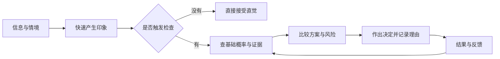

这张图是本笔记的应用整理。快速印象不可避免，关键是让重要决定经过必要检查，并能在之后得到真实反馈。

### 第一部分：两种思考方式

#### 1. 系统 1 与系统 2 是理解思考的模型

系统 1 指快速、自动、往往不费力的处理，系统 2 指需要注意力的计算、推理和自我检查。它们是理解加工方式的模型，不是大脑里两个独立器官。快不等于错，慢也不保证对；关键是答案有没有接受与任务相称的检查。

**真实研究：球拍与球的认知反思题。** Frederick 在 2005 年发表的研究使用了一个问题：两样东西合计 1.10 美元，球拍比球贵 1 美元，球多少钱？这是实际研究采用的题目，不是声称现实中发生过这笔购买。[原研究及发表信息](https://www.aeaweb.org/articles?id=10.1257/089533005775196732)

直觉容易给出 0.10 美元，因为 1.10 很自然地被拆成 1 和 0.10。但把这个答案放回条件就会发现：球若为 0.10，球拍应为 1.10，合计变成 1.20，违反题设。设球价为 x，正确关系是 `x+(x+1)=1.10`，因此 x=0.05，球拍为 1.05。难点不在代数，而在于是否在“已经有一个顺口答案”之后继续验证。

这说明快速处理可以迅速产生候选答案，审查过程则要检查全部约束。只把同一个答案在心里重复三遍，不能算充分审查；把它代回原条件，才做了有机会发现错误的动作。研究中的表现也不能直接当作一个人的整体智商、道德或投资能力标签。

用于财商时，可以把这种检查迁移到财报：利润增长、收入增长和现金增加是否被当成同一个问题？买入理由是否同时满足价格、风险和期限约束？这些是本笔记的应用推论，不是该实验已经证明能提高股票回报。慢思考的价值取决于检验质量，而非思考时长。

#### 2. 注意力有限，复杂判断会相互挤占资源

注意力有限，投入某项任务时，其他显眼的信息也可能被漏掉。重要判断因此需要安排检查步骤，不能依赖“有问题我自然会看到”。

**真实实验：数传球时漏看大猩猩。** Simons 与 Chabris 在 1999 年的研究中，让参与者观看传球录像并完成注意任务；不少人没有报告画面里经过的意外对象。实验使用了不同条件，不能把某一条件的漏看比例当作所有场景的固定比例。[两位作者的原论文](https://www.chabris.com/Simons1999.pdf)

这里不是参与者的眼睛收不到信息，而是正在执行的任务影响了什么进入注意。财报阅读的对应做法是把“查利润”和“查现金、债务、附注”分为明确步骤；后者不是看完前者后必然自动发生的过程。这个迁移是学习方法上的启发，并非实验直接测得的投资效果。

#### 3. 认知轻松：容易处理的信息更容易显得可信

熟悉、重复、表达清楚的信息常让人产生顺畅感。这种感觉有时被误当作真实或优质的证据。相反，陌生或难读的信息会让人觉得不可靠，即使内容本身未必有问题。

#### 4. 联想与启动：当前情境会影响接下来容易想到什么

一个词、情境或记忆能激活相关内容，使某些解释更容易进入头脑。这有助于理解信息并非在真空中被处理。但具体的社会启动实验效果，需要分别看证据。

卡尼曼在[2012 年公开信](https://www.nature.com/news/polopoly_fs/7.6716.1349271308!/suppinfoFile/Kahneman%20Letter.pdf)中已讨论社会启动研究的重复验证问题。不能把本书每个生动实验都当作普遍规律，也不能据此否定全部判断与决策研究。

#### 5. 所见即全部：大脑倾向于用已有信息拼成完整故事

信息不足时，我们未必感到“还不知道”，反而容易把当前掌握的少量事实组合成连贯解释。故事越顺，就越容易忽视缺失的内容。

**书外真实财报练习（截至 2026-11-11）：** 根据美的 2026 年三季报，可以各拟一个标题：“前三季度归母净利润增长 9.27%”和“前三季度扣非归母净利润下降 22.49%”。先遮住另一条，记录自己由第一条产生的印象，再把它们同时列出来，并加入同一报告中收入增长 1.19%、经营现金流下降 29.58% 两项。四个指标合看，已经足以说明一条标题不能代表全部信息。[原报告第 2 页](https://static.cninfo.com.cn/finalpage/2026-10-30/1225645132.PDF) 两个标题来自同一份报告，却选择了不同信息；这里是自我观察练习，不是已经实施的心理实验，更没有证明所有读者必然受到同样影响。

继续把记录分成“表中事实”“我的解释”“尚缺资料”。例如“经营全面向好”与“主营业务全面恶化”，都比单项数字能支持的结论更宽。补全表格后，应查看非经常性损益明细和公司解释，而不是只挑能维护第一印象的一行。**参考答案方向：** 合理的修正未必是从乐观变悲观，而可能是承认各指标分化，暂缓总体判断；无论最先看到哪个标题，都使用同一份核对清单，才不会让最先看见的信息充当全部证据。

#### 6. 问题替代：用容易的问题回答困难的问题

真正的问题可能是“这家公司未来产生的现金能否支持当前价格”，大脑却回答了“我喜不喜欢它的产品”。容易回答的问题产生了明确感觉，于是被误当成原问题的答案。

#### 7. 光环效应：一个突出特点染色了其他判断

一个人的能力、外貌或名望令人印象深刻，可能连带影响我们对其诚信、专业范围和观点正确性的评价。负面印象也能产生类似扩散。

### 第二部分：直觉为什么容易误读统计

#### 8. 小数定律错觉：以为小样本也应稳定代表总体

小样本通常比大样本波动更大，极端表现更常出现。如果只看几个案例，就容易把随机起伏解释成可靠规律。

#### 9. 锚定：最先接触的数字会牵引后续估计

最先接触的数字可能牵引后续估计，即使它与目标并无可靠关系。锚定不是“用了参考价就一定错”，而是参考数字未经验证，却影响了判断尺度。

**真实实验：随机转盘与联合国成员估计。** Tversky 与 Kahneman 的 1974 年论文报告：不同组先接触到 10 或 65，再估计非洲国家在联合国成员中的占比，两组估计中位数分别为 25% 和 45%。这是历史实验的结果，不是今天的联合国成员比例。[原始论文公开副本](https://www.csc2.ncsu.edu/faculty/mpsingh/local/Social/f24/wrap/readings/Tversky%2BKahneman-heuristics-biases-1974.pdf)

转盘没有提供成员国信息，但估计仍向它靠拢。把机制迁移到股票时，应当追问自己围绕的是盈利与现金的独立估计，还是历史高价、买入价或别人的目标价。历史价格可能包含信息，却需要论证，不能仅因曾经出现过就成为合理价值。

可操作的检查是先记录独立估值区间与依据，再查看外部报价；若两者差异很大，明确是哪项新证据改变了估值。单纯把别人给出的数字上下调一点，仍可能没有摆脱原锚。

#### 10. 可得性：容易想起不等于更常发生

鲜明、近期、反复出现的案例更容易被想起，于是可能被误认为发生频率高。判断的对象从真实比例变成了记忆的便利程度。

#### 11. 情感启发：喜欢与害怕会影响风险判断

对某事有好感时，人可能同时提高对收益的估计、降低对风险的估计；反感时则反过来。这样形成的风险收益判断，看似来自分析，实际上可能来自同一个总体感觉。

#### 12. 代表性与基础概率：像某一类，不等于很可能属于那一类

一个对象符合某种典型印象时，人容易忽略该类别原本多常见。正确判断通常既需要个案特征，也需要基础概率。

**真实研究与证据边界：** 卡尼曼在诺贝尔演讲中回顾了工程师／律师基础比例实验：给定类别构成后，人物描述仍可能使判断忽略基数；他同时指出，某些显式基数忽略结果对研究设计敏感，并非牢不可破。[作者回顾，印刷页 476](https://www.mit.edu/~shaslang/mprg/kahnemannNobelLecture.pdf)

这说明应先问总体由哪些类别组成，再问个案特征的区分能力；同时也应接受研究边界，不能宣称人类无论何时都会忽略基数。下面只用清楚标注的假设数字演示贝叶斯计算，不将其当成实验数据。

理解它的关键是分清两种问题：**若对象真的有问题，信号多大概率会出现？** 与 **若信号已经出现，对象多大概率真的有问题？** 前者从真实类别出发，后者从观察到的信号出发，分母完全不同。把两者混起来，就会把筛查能力误认为筛查后的确定程度。

可以把基础概率看成检查之前的人群构成，而把信号看成一种筛选。假如绝大多数对象本来都正常，即使正常者只有一小部分被误标，也可能涌入很多案例。筛选有价值，却不代表被选中的对象大多数必然属于目标类别。既要看它抓住了多少目标，也要看它带进来多少非目标。

下面的示意中，真正有问题的 100 份材料提供了 80 个标记，而正常的 9,900 份材料提供了 990 个误标。我们收到一个标记时，它来自哪条路径尚未知，因此正确的比较是 80 与全部 1,070 个标记，而不是 80 与最初的 100 个问题对象。

**财商应用中的对应关系：** 一个“公司可能有风险”的指标，不能只展示它曾经命中过哪些坏公司，还应检查它在正常公司里有多常见。同样，“成功企业常有某特征”，不意味着“有某特征的企业常成功”。这不是说指标无效，而是要求同时检查命中、误报和样本本来的构成。

**练习与参考答案：** 假设方法的识别率与误报率保持不变，但基础比例由 1% 上升为 10%，在 10,000 份材料中会怎样？真实问题 1,000 份，标记 800 份；正常 9,000 份，误标 900 份；标记中实际有问题的比例为 `800÷1700≈47.06%`。同一种信号，在不同总体中含义会变化。现实中还必须验证方法表现是否能迁移，不能随意假定不变。

#### 13. 合取谬误：细节更多的故事，概率不会因此更大

“A 与 B 同时发生”属于“A 发生”的一部分，因此概率不能更高。故事更符合人物形象，不等于包含更多条件的事件更容易发生。

**真实研究：琳达问题。** Tversky 与 Kahneman 的研究给参与者阅读一位关注社会议题的虚构女性简介，再比较“银行出纳员”和“银行出纳员且积极参加女权运动”等描述。研究中出现了把合取项排在单一项之前的回答。琳达是实验人物，真实的是研究及其观察结果。[卡尼曼本人对原研究的回顾，印刷页 468—469](https://www.mit.edu/~shaslang/mprg/kahnemannNobelLecture.pdf)

不必猜琳达真正是什么人，集合关系已经给出限制：每位兼具两种特征的人都在第一类里，第一类还可能有不满足第二条件的人。因此“更像”与“更可能”必须分开。

分析企业时，同理要把“增长”与“增长且提高利润率且成功出海”区分。后者也许是更吸引人的完整故事，但每增加一个必须同时满足的条件，不能凭叙事吸引力提高联合概率。题目措辞和理解方式会影响实验回答，不能因此给某个真实投资者贴认知缺陷标签。

#### 14. 回归均值：极端表现后往往不再同样极端

观测到极端结果后，下一次不再同样极端，可能来自不完全相关的测量和暂时因素，并不必然由奖励、惩罚或某种干预造成。回归均值也不等于所有个体最终都相同。

**真实历史研究：高尔顿对身高的分析。** 高尔顿 1886 年关于遗传身高的论文研究了父母与成年子女身高的关系：按父母身高分组后，极高或极矮父母的子女平均表现没有同样极端。这里讨论的是条件平均，不是每个高个子父母的孩子都更矮。[论文原文的大学存档](https://www.york.ac.uk/depts/maths/histstat/galton_reg.htm)

这个结果的关键是两代身高相关但并非完全一致。按照一个变量挑出最极端组后，另一个不完全相关变量的组平均，可能更接近其总体平均。它不需要一股神秘力量把每个人往中间拉，也不能被解释成人类一代代趋向同一个身高。

把逻辑迁移到投资排名时，某基金一年的极高收益可能同时包含能力、市场暴露和偶然顺风。按当年收益挑冠军，往往同时挑中了有利偶然因素；下一年这些因素不再同样有利，即使能力未变，名次也可能回落。这里是统计原理的应用分析，不是高尔顿研究过基金。

尤其要防止把它变成“股价跌多了必涨”。股票历史高点不是已验证的稳定价值中心；盈利、利率、竞争和股本会改变，原来所谓正常水平也会变化。只有先证明某变量存在相对稳定的关系，才谈得上研究回归；即便样本里存在，也还需考虑交易成本和样本外表现。

检查一段解释时，应问：极端样本是怎样选出来的？比较变量相关程度如何？正常水平是否改变？有没有把自然回落误当成管理措施的效果？这比单说“回归均值”更能帮助判断。

#### 15. 直觉预测需要考虑信息可靠程度

弱信号不应支持非常极端的预测。若个案信息与最终结果的关联不强，合理预测通常应更靠近参考群体的平均情况。

#### 难点图解一：基础概率如何改变信号的意义

**补充教学算例，数字全部假设：** 10,000 份材料中实际有问题的占 1%。某筛查方法能标记其中 80%，同时会误标 10% 的正常材料。

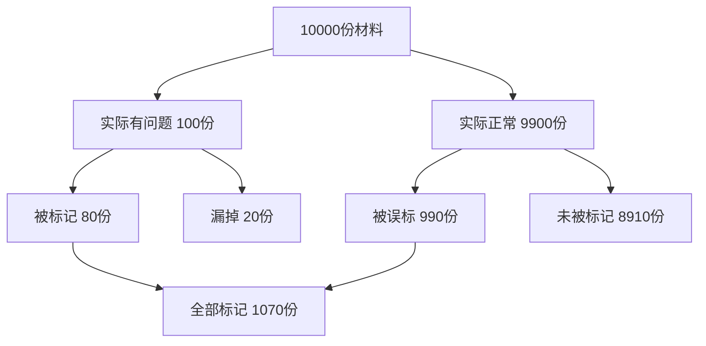

被标记后确实有问题的比例为：

`80 ÷ (80 + 990) ≈ 7.48%`

80% 是“有问题时被发现”的概率，不是“被发现时确实有问题”的概率。因为正常材料数量很大，少量比例的误标也会产生很多案例。实际使用还需要确认筛查表现、基础比例和人群是否可比。

### 第三部分：为什么我们容易过度自信

#### 16. 理解错觉与后见之明：结果出来后，过去显得过分清楚

知道结果后，人容易重构当时的判断，觉得事情本来就明显。成功者的路径被写成必然，曾经存在的其他可能被抹掉。

#### 17. 有效性错觉：有把握的感觉可以超过证据质量

判断的自信程度，常受故事一致性影响，不只受预测能力影响。资料即使有限，只要互相看起来吻合，人也可能很笃定。

#### 18. 简单规则有时优于无约束的临场判断

人评估同类对象时容易受到顺序、心情和不相关信息影响。预先确定指标和处理方式，可以提高一致性。模型不需要很复杂才有帮助。

#### 19. 专家直觉的可靠性需要条件

卡尼曼与加里·克莱因指出，直觉技能的形成需要环境具有可学习的规律，以及足够的学习机会与反馈。主观确信本身不能验证能力；参见二人的[原始论文](https://bear.warrington.ufl.edu/brenner/mar7588/Papers/kahneman-klein-2009.pdf)。

判断一项经验是否真的训练了直觉，可以拆成三个问题。首先，环境里是否存在相对稳定、足以支持预测的线索？其次，当事人是否经历过足够多且相关的案例？最后，反馈是否及时、清楚，能让他知道自己为什么对或错？只是工作年限很长，并不保证这三项成立。

专业能力的适用范围应按任务划分。会计规则核对与远期股价预测的线索稳定程度、反馈速度不同；前一任务上的熟练不能直接证明后一任务的预测能力。

反馈质量差时，人尤其容易从结果中学错。承担巨大隐含风险，短期也许连续获利；如果每次获利都被解释成判断高明，训练出的可能是过度自信。反之，一个过程合理的决定遇到罕见坏结果，也不能仅因损失就把全部方法推翻。记录事前依据、概率和环境，能帮助区分可重复信号与偶然回报。

这与第 1 点的关系是：可靠直觉往往来自长期学习，而不是天生免于偏差；慢分析也应尊重已经验证的领域经验，而非每次从零计算。遇到陌生领域、结构改变或反馈模糊时，应提高独立核查的比例。

**练习与参考答案：** “我经历过三个牛市，所以能准确预测下一次拐点”，缺了什么？至少缺少完整预测记录、失败样本、事前明确的拐点定义和能区分市场顺风的评价。经历丰富是相关信息，是否形成可靠技能仍要另行验证。

#### 20. 外部视角：先找参考类别，再讲自己的特殊故事

内部视角关注眼前计划的细节；外部视角看类似项目通常花多久、成功率多高、常出现什么问题。计划谬误往往来自只看理想流程，忽略同类项目的实际分布。

#### 21. 乐观偏差与事前验尸：提前讨论失败的可能路径

乐观能支持行动，但过度乐观会低估成本、竞争和偶然性。事前验尸的做法，是假设计划已经失败，请参与者独立写出可能原因，从而让不受欢迎的信息更容易被说出来。

### 第四部分：收益、损失与风险选择

#### 22. 期望值、效用与参照点：相同金额不一定带来相同体验

期望值是不同结果按概率加权后的平均数；效用考虑结果对人的实际意义。前景理论进一步强调，人常按相对参照点的变化来感受结果，而不只看最终财富。

#### 23. 敏感性递减：越远离参照点，同样增量的感觉可能越小

从没有到获得一小笔钱，心理变化可能大于在已经获得很多之后再增加相同金额。损失一侧也存在类似的非线性。人对变化的感觉通常不是一条直线。

#### 24. 损失厌恶与禀赋效应：失去已经拥有的东西格外难受

损失厌恶比较的是参照点两侧的感受：失去一项东西与得到同等东西，心理分量未必相同。禀赋效应则指拥有某物后，愿意放弃它所要求的价格，可能高于尚未拥有时愿意付出的价格。

**真实实验：被分配到杯子的人与没有杯子的人。** Kahneman、Knetsch 与 Thaler 在 1990 年的实验中把杯子分配给部分参与者，再观察交易与估价；持有者愿意出售的价格与未持有者愿意购买的价格出现差距。杯子确实被分配和交易，不是拿一个虚构收藏者的故事证明结论。[三位研究者的原论文](https://econreadinggroup.github.io/assets/Kahneman%20et%20al.%20%281990%2C%20JPE%29.pdf)

这个设计有意思的地方是，分配改变了谁拥有物品，而不是先由最喜欢杯子的人自愿买入。于是“卖方本来就特别喜欢”不能轻易包办差异。但单个实验也不能穷尽所有解释：交易程序、理解程度和经验等都会影响表现；不能据此认为所有市场都存在固定倍数的估值差。

要把损失厌恶与风险厌恶分开。前者关心相对参照点的失去有多难接受，后者关心是否愿意承担不确定性。为避免承认损失而扩大下注，恰好可能表现为承担更多风险。股票持仓行为的现实研究见第 28 点。

对应财务决策，应分别列出未来现金、风险、成本，以及“这已经属于我”的感受。情感价值可以真实存在，却不能直接证明市场价值更高。“如果现在持有现金，还会以当前价格购买吗”可以帮助重新比较，但税费、流动性和组合约束仍要纳入，不能把这一问当成自动卖出规则。

#### 25. 概率加权与四重模式：概率变化的心理分量不均匀

人可能把极小概率赋予过大权重，对接近确定的变化又格外敏感。收益与损失情境结合概率，会产生不同的风险偏好。这是常见倾向，不是人人必然遵守的规律。

| 情境 | 常见倾向 | 帮助理解的补充例子 |
| --- | --- | --- |
| 高概率收益 | 更偏向确定结果 | 接受略小但确定的收益 |
| 高概率损失 | 愿意冒险避免损失 | 为避免确认损失而选择更大的风险 |
| 低概率收益 | 偏好小概率大收益 | 为极低中奖机会支付费用 |
| 低概率损失 | 偏好消除风险 | 为小概率重大损失购买保障 |

不要把购买保险简单判作错误：损失规模、承受能力、保障条件和费用都重要。这个框架解释心理倾向，不替代具体经济分析。

可以用四个**完全假设的选择题**逐格理解它。第一，确定得到 90 与 90% 概率得到 100、10% 得到 0：两者金额期望值均为 90，但接近确定的收益可能格外有吸引力。第二，确定损失 90 与 90% 概率损失 100、10% 不损失：期望损失相同，后者却保留了“完全逃过损失”的希望，可能令人愿意冒险。风险偏好随着收益或损失的框架改变，而不只是因为期望金额不同。

第三，确定得到 10 与 1% 概率得到 1,000：小概率大奖容易占据想象，选择者可能赋予这 1% 超出其线性比例的心理权重。第四，确定损失 10 与 1% 概率损失 1,000：同样的小概率，因为对应灾难般的损失，又可能让人愿意付出确定成本来避免。现实选择还会受金额大小、个人资源与描述方式影响，不能据此预测每一个人的答案。

注意，**概率加权不等于把概率估计错了**。一个人可能知道 1% 就是每百次约一次，却在决定愿意付出多少钱时，把这个机会或风险看得特别重。判断事实概率与评价结果吸引力，是两项不同的心理任务。前景理论把相对参照点的结果感受、敏感性变化和概率权重结合起来；不能只用一句“人都讨厌亏损”解释四种情况。

**练习与参考答案：** 为什么有人既买彩票，又购买保险？两种行为可能都涉及对低概率结果的较大心理权重，只是一个追求巨大收益，一个避免巨大损失。但这不是对具体选择是否合理的最终评价。保险还可帮助承担不起的风险转移，彩票也可能被当作娱乐支出；仍需看价格、条款、能力与目标。

#### 26. 罕见事件：想象鲜明时可能高估，经验不足时又可能低估

稀少事件的判断容易受呈现方式影响。文字描述中的灾难可能被过度关注；只看自己短期经验，又可能因为从未遇到而忽略它。

#### 27. 窄框架与宽框架：不要把每次波动都当成完整人生

逐笔孤立地看收益和损失，可能让人对短期波动过度反应。把决策放在总体目标和长期规则中，有助于减少临时情绪的支配。

#### 28. 心理账户、沉没成本与处置效应

心理账户给钱或资产贴上来源、用途与盈亏标签；沉没成本是已无法收回的投入；处置效应是更容易兑现盈利、继续持有亏损的行为倾向。三者有关联，不能只凭一次持有或卖出就判断动机。

**真实证券账户研究。** Odean 在 1998 年发表的研究分析一家折扣券商 10,000 个账户在 1987—1993 年的交易，观察到投资者较倾向兑现盈利而非亏损；研究还检查了再平衡、股价相关成本等替代解释。[原论文及方法](https://onlinelibrary.wiley.com/doi/10.1111/0022-1082.00072)

研究不是只数“卖出的赢家比输家多”，还必须考虑当时账户里分别有多少可卖的赢家与输家，否则行情较好时本来就可能有更多盈利股票。这个分母问题对个人复盘同样重要：需要比较有机会兑现的盈亏，而非只挑两笔令人印象深刻的交易。

数据支持的是样本中的行为模式，不能读取每个账户主人的内心。作者也区分了损失相关偏好与错误的均值回归信念等解释。因此，不能把所有持有亏损股票的行为都说成不理性。

个人可以检查：继续持有的理由是否仍指向未来价值与风险，还是只剩“卖了就证明我错了”？再把税费、组合和资金需求列入比较。这样使用研究，是为了提出更好的问题，而不是从一项群体现象直接生成买卖信号。

#### 29. 后悔、默认与不作为：行动方式也会影响感受

相似后果下，人对主动改变造成的损失，可能比对维持默认造成的损失更后悔。因此“什么都不做”容易显得安全，即使它也有代价。

#### 30. 偏好逆转：单独评价与并排比较可能改变排序

某些属性容易单独判断，另一些属性只有比较后才看得清。不同评价方式可能让同一个人给出不一致的选择。

#### 31. 框架效应：同一个事实的说法会改变选择

相同结果换成“保住多少”或“损失多少”的说法，可能改变选择。需要先把两种描述转换到相同终局，再判断其差别究竟来自后果还是措辞。

**真实实验，假设题设：1981 年的疾病决策问题。** Tversky 与 Kahneman 给不同组描述一场预计危及 600 人的假设疾病。在“救活”框架下，72% 选择确定救活 200 人；在结果对应的“死亡”框架下，只有 22% 选择确定死亡 400 人。另一选项在两个版本中是同一风险分布。疾病情境是实验题设，不是真实疫情记录。[原论文，第 453 页](https://psych.hanover.edu/classes/cognition/papers/tversky81.pdf)

| 统一成最终结果 | 救活框架 | 死亡框架 |
| --- | --- | --- |
| 确定方案 | 200 人存活 | 400 人死亡 |
| 风险方案 | 1/3 全存活、2/3 无人存活 | 1/3 无人死亡、2/3 全死亡 |

在题设总人数固定的条件下，每一行两种说法对应相同结果，但不同组的选择比例变化明显。这个实验不表示每个人换个说法都会反转，也不是说承担风险必然错误；它说明措辞可以影响偏好。

读投资宣传时，可把“保本机会”“损失概率”“成功率”统一写成结果、概率、期限与费用，再问损失幅度是否被省略。只有统一了这些条件，才知道是在比较真实不同的方案，还是同一方案的不同包装。

#### 难点图解二：收益、感受与决策分三层

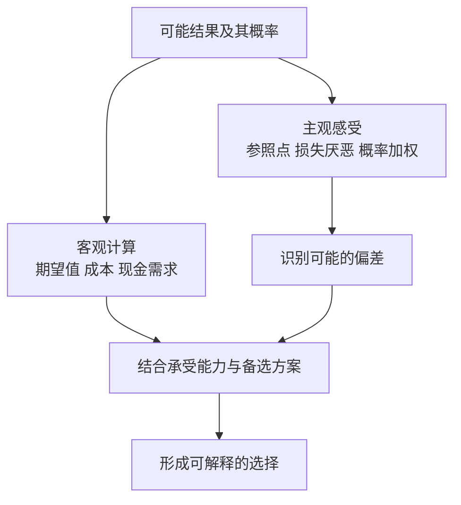

**补充算例：** 一次假设机会有 50% 概率赚 200 元、50% 概率亏 100 元，金额期望值为 `0.5×200−0.5×100=50 元`。期望值为正不等于对每个人都值得承担：若损失会影响必要支出，或概率估计不可靠，判断就不同。前景理论解释感受如何影响选择，并不要求人接受一切正期望机会。

### 第五部分：两个自我与幸福

#### 32. 体验自我与记忆自我

体验自我对应当下正在感受的生活；记忆自我负责对经历作整体评价，并影响下一次选择。一次经历的事后评价，未必准确汇总了其中每个时刻。

#### 33. 峰终定律与时长忽视

对一些经历的事后评价，受最强烈时刻和结尾影响较大，对持续时间考虑较少。它是特定条件下观察到的倾向，不是所有记忆遵守的公式。

**真实随机研究：肠镜检查后的回忆。** Redelmeier、Katz 与 Kahneman 在 2003 年发表的研究纳入 682 名患者；随机分组后，一组在结尾增加一段相对不痛的过程。这组对整个经历的事后不愉快评分较低，尽管检查时间更长。[研究原文](https://www.amherst.edu/system/files/media/0678/colonoscopy%202.pdf)

这里要分清三种量：经历了多久、过程每一时刻怎样、事后如何概括。增加的结尾没有删掉此前经历，却改变了回忆中的整体评价。这正说明“记得没那么难受”与“经历的总负担更少”不是同一命题；研究也不能单独隔离所有记忆机制。

用到投资复盘时，可把期末收益与完整净值、最大回撤、持有时间和资金压力并排记录。这样不会只因最后一个月反弹就把前面全过程改写成轻松获利。这是对记忆偏差的应用思路，原研究没有测量证券投资效果；研究程序也不是日常诊疗建议。

#### 34. 聚焦错觉：正在关注的因素，看起来比平时更能决定幸福

当人集中思考收入、城市、职位或某件物品时，容易高估该因素对日常生活的全面影响，忽略习惯、关系、时间使用及其他条件。

书中关于收入与幸福的具体研究有特定年份、人群和测量方式。本笔记不把某个历史收入阈值当作跨国家、跨时期的普遍标准。

### 财商应用：给重要决定做一次认知检查

以下流程是综合应用，不是作者给出的投资配方。

| 检查步骤 | 要回答的问题 | 主要防什么 |
| --- | --- | --- |
| 写清目标 | 这笔钱何时要用？我希望解决什么问题？ | 问题替代、聚焦 |
| 建立参考类别 | 类似情况通常怎样？失败案例占多少？ | 基础概率忽视、小样本 |
| 分开事实与叙事 | 哪些是已发生的事实，哪些是预测或愿望？ | 所见即全部、光环 |
| 统一比较口径 | 期限、费用、税费、流动性是否可比？ | 框架效应、偏好逆转 |
| 写出失败路径 | 什么情况会使判断错误？能否承受？ | 过度乐观、罕见风险忽视 |
| 查看整体影响 | 与已有风险是否重叠？是否影响必要现金？ | 窄框架 |
| 留下事前记录 | 预计什么、依据什么、何时复查？ | 后见之明、结果偏差 |

### 两个可以立即做的练习

**练习一：给一条“很有说服力”的观点拆层。** 写下它的结论、三个事实、两个假设、一个反面解释，以及仍缺少的信息。如果发现只有故事没有可核对数据，先降低确信程度。

**练习二：建立一页决策记录。** 记录日期、目标、选项、概率范围、可能损失、选择理由和复查时间。复盘时分别评价过程与结果，不能只用是否赚钱决定当时是否理性。

可以把记录写成：`我认为 X 可能发生，依据是 A/B；若出现 C，我会降低判断；目前最不确定的是 D。` 这会迫使模糊信心变成可检验的主张。

### 怎样批判性地读这本书

双系统是有用的解释框架，不是对所有认知过程的完整解剖。慢思考可能只是为原有偏见寻找更多理由；知道偏差名称，也不代表自己能自动避免。

书中实验的证据强弱并不一致。社会启动等具体例子受到重复验证方面的质疑，不能照单全收；同时，不能由部分例子有问题就宣布统计推理、前景理论和所有行为研究都无效。应按具体主张检查原研究、后续验证与适用条件。

许多偏差是群体层面的倾向，不能仅凭一次行为给个人贴标签。对他人的判断，最好先问数据与情境；对自己的改善，最好设计流程和环境，而不是只要求更用力思考。

### 回顾：八个自测问题

1. **系统 2 为什么不保证正确？** 注意力有限，而且慢处理也可能沿用错误假设或为偏见辩护。
2. **为什么成功三次不证明有能力？** 样本过小，还需区分运气、风险、筛选与稳定表现。
3. **基础概率与个案证据怎样配合？** 先用同类频率建立起点，再按证据的区分能力调整。
4. **回归均值是否意味着跌得多就会涨？** 不是；正常水平可能变化，价格也不是固定能力加随机噪声那么简单。
5. **损失厌恶与风险厌恶相同吗？** 不同；在某些损失情境中，人反而愿意承担更大风险。
6. **正期望值为什么仍不足以决定行动？** 还需考虑概率可靠性、承受能力、流动性及替代方案。
7. **如何降低后见之明？** 留下事前概率、证据和备选路径，按当时信息复盘。
8. **两个自我为什么与消费有关？** 事后回忆的美好，不一定等于日常体验的舒适。

### 来源与待补充内容

| 已查阅来源 | 用途 |
| --- | --- |
| [Macmillan：官方书页与公开试读](https://us.macmillan.com/books/9780374275631/thinkingfastandslow/) | 作者、书籍五部分结构及研究主题 |
| [对外经济贸易大学图书馆：简体版书目](https://opac.lib.uibe.edu.cn/opac/book/b0acae873a7a226eb38de2c9ce39a774) | 2012 年参考版译者、出版社及 ISBN |
| [卡尼曼：诺贝尔奖演讲文本，MIT 镜像](https://www.mit.edu/~shaslang/mprg/kahnemannNobelLecture.pdf) | 启发式、选择与框架研究的一手资料入口 |
| [卡尼曼与克莱因：Conditions for Intuitive Expertise](https://bear.warrington.ufl.edu/brenner/mar7588/Papers/kahneman-klein-2009.pdf) | 专家直觉的适用条件 |
| [卡尼曼 2012 年关于社会启动的公开信](https://www.nature.com/news/polopoly_fs/7.6716.1349271308!/suppinfoFile/Kahneman%20Letter.pdf) | 可重复性问题的作者本人说明 |
| [普林斯顿大学：作者演讲索引](https://kahneman.scholar.princeton.edu/lectures) | 原作者关于直觉、体验与记忆的进一步学习入口 |

正文用自己的话解释概念；真实实验、历史研究及财报在知识点原位注明来源，研究的假设题设与真实过程分别说明。图解、计算推导和应用练习为教学整理，不冒充原书引文。尚未核对用户版本的全部章节与案例，也未对全书所有实验进行系统证据综述。取得原书后，可继续补充逐章定位与译文差异。

---

[返回书籍索引](<README.md>) · [财商学习与实践路线](<财商进阶合订本.md>)


---

<a id="book-06"></a>

[单独打开本篇](<学会提问 - 尼尔·布朗、斯图尔特·基利/读书笔记.md>)

## 《学会提问》读书笔记

> 作者：尼尔·布朗（M. Neil Browne）、斯图尔特·基利（Stuart M. Keeley）  
> 原书：Asking the Right Questions: A Guide to Critical Thinking。本笔记按**原书第 12 版**的主要框架整理。简体参考版为许蔚翰、吴礼敬译，机械工业出版社，2021 年，ISBN 9787111680925；见[新华书店书目信息](https://item.xhsd.com/items/110000103245062)。  
> 版本说明：本书有多个原书版本及不同中文装帧、对照版，章节组合与练习可能不同。用户持有版本未确认，本稿不声称对应全部版本，不使用混合页码。  
> 分析依据：出版社公开目录、书目信息与核心概念整理；没有用户提供的原书，未逐页核对全部例证。  
> 覆盖范围：主要提问框架、32 个知识点、论证图解、财报与投资宣传应用、练习及检查表。  
> 更新日期：2026-11-11

### 先看这里：这本书教什么

**一句话概括：面对一个有说服力的观点，先弄清它在主张什么，再逐层检查理由、假设和证据，最后形成与证据强度相称的判断。**

它教的不是怎样让别人回答更多话，而是怎样判断一段话是否值得相信。表达者可能是真诚的，论证仍可能薄弱；结论可能恰好正确，给出的理由仍可能不够。

用于提高财商时，它最重要的作用，是帮助你拆开这些不同层次：

- 产品宣传说了什么，与合同承诺了什么。
- 公司业绩确实改善了什么，与市场故事推断了什么。
- 一个人曾经赚钱，与其方法是否能持续有效。
- 某项投资可能有收益，与它是否适合你的目标和约束。

最值得先掌握的六件事：**找到结论、问出理由、澄清词义、挖出假设、检查证据、考虑别的结论。** 不必每次把全部问题机械问完，先抓住最影响结论的环节。

### 全书结构与阅读路线

[Pearson 第 12 版官方目录](https://www.pearson.com/en-us/pearsonplus/p/9780137501731.html)可核对全书的提问顺序。下面用简短主题概括，不逐字复刻目录。

| 章节主题 | 主要任务 | 本笔记对应 |
| --- | --- | --- |
| 第 1 章：提问的态度和方法 | 从被动接受转向主动判断 | 1—4 |
| 第 2—3 章：论题、结论、理由 | 先把论证找出来 | 5—8 |
| 第 4 章：语言中的歧义 | 确认双方讨论同一件事 | 9—10 |
| 第 5 章：价值与描述性假设 | 找出没说出口的桥梁 | 11—13 |
| 第 6 章：推理谬误 | 检查支持关系有没有断裂 | 14—15 |
| 第 7—8 章：证据质量 | 评估经验、权威、观察与研究 | 16—21 |
| 第 9 章：替代原因 | 避免仓促认定因果 | 22—23 |
| 第 10 章：统计信息 | 检查数字怎样产生和呈现 | 24—27 |
| 第 11 章：遗漏信息 | 找到可能改变判断的缺口 | 28 |
| 第 12 章：合理结论 | 超越非黑即白 | 29—30 |
| 第 13 章：思考障碍 | 对自己的偏见也保持警惕 | 31—32 |

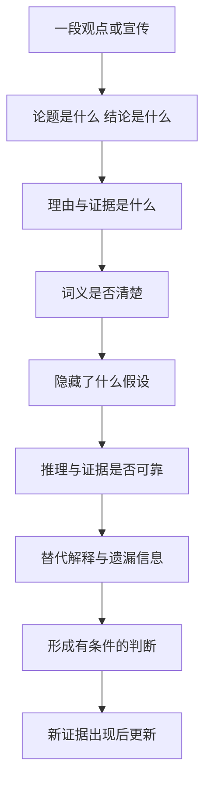

文字理解：先确认自己没有误读别人，再评价其论证；最后得到的可以是支持、反对、部分支持，也可以是信息不足。批判性思考不是每次都要推翻原观点。

### 一、先建立合适的提问态度

#### 1. 批判性思维：按理由和证据决定相信到什么程度

这里的批判不是刻薄、挑刺或永远反对，而是主动检查一个结论的支持是否充分。它允许承认别人说得好，也允许修正自己的原判断。

#### 2. 海绵式与淘金式思维：吸收信息和筛选信息需要配合

海绵式强调学习、理解和记忆；淘金式强调选择、质疑和判断。没有知识储备，质疑容易变成空泛怀疑；只吸收不检查，又容易把观点都当成事实。

#### 3. 弱势与强势批判：是否也愿意检查自己偏爱的观点

弱势批判把提问当成维护既有立场的工具，只挑对方的问题；强势批判对双方使用相近标准，也愿意改变自己。

#### 4. 好的提问需要好奇、谦逊和尊重

谦逊指承认知识与判断的局限，好奇指愿意理解不同解释，尊重指不把观点分歧直接变成人格攻击。这些态度能让更多信息进入讨论。

### 二、先找出论证，再评判它

#### 5. 论题：这段话究竟想回答什么问题

论题可能是描述性的，讨论事实如何；也可能是规定性的，讨论应该如何做。两种问题所需的支持不同：知道会发生什么，不自动决定该怎样选择。

#### 6. 结论：作者希望你接受的主张是什么

结论不一定在最后一句，也不一定有“所以”作为提示。寻找结论时，问“作者最终想让我相信什么或做什么”。如果无法准确复述，就还不适合反驳。

#### 7. 理由与证据：为什么这些信息支持这个结论

理由是支持结论的陈述，证据为这些陈述提供依据。两者可以交叉：一份可靠统计既可能是证据，也可能被直接作为论证的理由。

#### 8. 论证结构：前提成立，还需要推理连得上

一个论证需要分别检查：事实是否可靠，事实与结论是否相关，以及支持力度够不够。前提是真的，不表示随它而来的所有结论也是真的。

**真实财报：美的 2026 年前三季度利润分化。** 报告披露归母净利润为 413.93 亿元，同比增长 9.27%；扣非归母为 287.88 亿元，同比下降 22.49%。公司同时解释了汇率及相关风险管理工具分类的影响。[原报告第 2—4 页](https://static.cninfo.com.cn/finalpage/2026-10-30/1225645132.PDF)

第一步，只写原表支持的命题：两种利润口径变化方向不同。不要立刻把归母增长改称主营全面改善，也不要把扣非下降改称主营全面恶化。

第二步，找从数字走向经营结论的桥梁。如果要判断可持续盈利增强，需要了解利润组成、经营业务和损益的持续性；公司给出的分类解释是应核验的线索，不能替代对全部经营因素的分析。尤其不能把两种利润的全部差额都归为某一项汇兑收益。

第三步，单独检查从经营判断走向投资行动的桥梁。即使确认竞争力改善，仍需购买价格、市场隐含预期、风险与资金期限的信息。报告没有因为利润增长就自动证明当前股票便宜。

因此，当前材料能支持的是“应拆开研究利润构成及其变化”，而不是直接买入或卖出。这里练习的重点是把事实、解释和行动三层分开；[完整原表与计算](<实战案例/2026三季报图解.md>)可用于核对，但本节的推理已经成立，不依赖读完另一篇才理解。

#### 难点图解一：理由和结论之间，往往藏着假设


这个补充示意只展示部分桥梁，不能当成完整估值方法。它说明：即使起点事实正确，仍需核查转化过程和当前价格，才能靠近投资结论。

### 三、检查语言和未说出口的前提

#### 9. 歧义：同一个词是否承载了不同意思

一个词有多种解释，而这些解释会改变结论时，就必须澄清。歧义不限于形容词，也包括数字的单位、期间和定义。

**真实事件：1999 年火星气候轨道器失联。** NASA 的任务资料说明，英制与公制单位未正确转换造成导航计算错误，使探测器过分接近火星。这不是一次“算得不够精确”，而是传递的数值与接受方预期的意义没有对齐。[NASA 任务记录](https://science.nasa.gov/mission/mars-climate-orbiter/)

这里可学到的逻辑检查是：双方即使使用相同名称，也未必指向同一测量量。财报中的“增长”“净利润”“现金”“亿元”，同样必须连着期间、主体、单位和定义阅读。数字在一个环节没有单位，后面再精确的小数也修复不了最初的口径错误。

NASA 的事故调查还涉及组织和检验流程；不能把复杂事故简化成某个人粗心。这个案例用于说明定义对齐为什么是推理前提，不是据此认定所有含糊表达都会造成同样严重后果。

#### 10. 情绪用词与说服性定义：有些语言先替你作了评价

“聪明资金”“落后观念”“优质赛道”等词，会把赞许或贬低放进描述里，使读者在核查事实前已经站队。有时定义本身就把想证明的结论装了进去。

#### 11. 价值假设：不同结论可能来自不同的优先级

价值假设涉及什么更重要，例如收益与安全、效率与公平、眼前消费与未来储备。分歧有时不是事实不清，而是双方排序不同。

#### 12. 描述性假设：关于世界如何运作的隐含信念

描述性假设声称某些事实或因果关系成立，例如过去规律会继续、样本代表总体、某措施能够改变结果。它们即使没有明说，也可能支撑整段论证。

#### 13. 怎样挖出假设：寻找理由到结论之间缺失的桥梁

把理由和结论写下来，再问：还必须相信什么，才能从这里走到那里？最值得查的假设，是一旦不成立就会改变结论的那一条。

**接着分析第 8 点的真实美的财报。** 从归母利润增长走向持续经营能力增强，需要增长与持续经营有关；从持续经营增强走向投资有吸引力，又需要价格尚未充分反映这些信息。这是两条不同的推理链，不能只用同一个 9.27% 填补。[实际数据与说明](https://static.cninfo.com.cn/finalpage/2026-10-30/1225645132.PDF)

可以做反事实检查，但要明确这只是检验假设：若增量主要来自不稳定损益，经营结论还成立吗？若价格早已反映很高的未来增长，行动结论还成立吗？这些问题不是在宣称实际公司必然处于上述状态，而是定位需要哪些证据。

随后把问题转为可查资料：第一条查利润调整表、分部与多期表现，第二条查价格及估值中的预期。能想象出一个反例，只说明原推理并非必然；要判断现实中哪种解释更合理，仍需要证据。

区分关键假设与一般背景也很重要。某项不确定性只有在它足以改变价值、风险或选择时，才值得成为本轮重点。把所有未知都列出来却不分轻重，会让分析失去方向。

### 四、识别推理谬误，但不要沉迷贴标签

#### 14. 常见谬误：理由看起来热闹，却没有完成支持任务

识别谬误最有用的方式，是说清哪一步没有成立，而不只是报出名称。以下是补充示例：

| 常见问题 | 补充例子 | 怎样继续问 |
| --- | --- | --- |
| 人身攻击 | “他没赚过大钱，所以分析必错” | 分析的数据和推理具体错在哪里？ |
| 稻草人 | 把“控制风险”改说成“永远不投资” | 对方实际主张是什么？ |
| 虚假两难 | “现在买，否则永远没机会” | 还有等待、少量研究或其他选择吗？ |
| 诉诸人气 | “大家都买，所以可靠” | 人气能证明哪个关键属性？ |
| 不当诉诸权威 | “名人推荐，所以适合你” | 专业领域、证据与个人条件是否匹配？ |
| 循环论证 | “这是好产品，因为它很优秀” | 是否给出了独立理由？ |
| 滑坡 | “错过这次，以后一定越来越穷” | 中间每一步的因果证据是什么？ |
| 转移话题 | 被问费用，却不断谈使命 | 原问题是否得到回答？ |

有些风险链条或专家判断确实有根据，不能只因形式相似就自动判为谬误。

#### 15. 理由有问题，不等于结论必然相反

一个人用错误理由支持结论，只能说明这条论证不充分，不能直接证明结论为假。这是批判性思维中非常重要的克制。

### 五、检查证据有多好

#### 16. 证据的分量取决于它要支持多大的结论

证明“这件事可能发生”，一个可靠案例也许有用；证明“多数人都会这样”，就需要代表性的资料；证明“某措施导致了变化”，还需要更强的因果识别。

#### 17. 个人经验、见证与案例：具体，但可能不具代表性

个人经验容易理解，也能提供重要线索；局限在于样本小、记忆有偏、条件可能不同，且不容易看见没有成功的案例。

#### 18. 权威证据：看专业适配、透明度和独立性

专家与机构提供的信息有价值，但必须核对专业范围、原始证据和可追溯性。信誉可以帮助决定先调查什么，不能替代对关键主张的核验。

**真实监管案例：Theranos 对产品使用情况的陈述。** SEC 在 2018 年公布的民事指控中称，公司曾声称技术被美国国防部用于特定场景，而监管调查认为该部署说法不实。公司与 Holmes 当时同意解决相关指控但不承认或否认指控；这里引用的是该时点的指控和和解公告，不把它写成后来的刑事裁决。[SEC 原公告](https://www.sec.gov/newsroom/press-releases/2018-41)

“被重要机构采用”如果属实，可能是值得研究的外部证据；但把这句话写进介绍的人，并不等于那家机构本身。要拆成：谁在作声明，谁能独立确认，实际使用范围是什么，是否足以支持技术能力或商业前景。

因此，应寻找可核对的验证、合同或独立测试，而不是把多个转述同一句宣传的渠道，当成多份独立背书。本例支持的是核查权威声明来源的必要性，不是说知名人物或专业机构都不值得信任。

#### 19. 个人观察与调查：看到什么，也受观察方式影响

调查必须连着收集方式阅读：谁有机会进入样本，谁主动参加，谁没有回答，以及调查究竟测了什么。更多回答能减少某些随机波动，却不能自动修复选人方式的偏差。

**真实对照：2014 年 TIME 读者投票与苏格兰公投。** TIME 自己公布的网上读者投票共 16,418 票，57.5% 支持独立；同年的正式公投结果是支持 44.7%、反对 55.3%。[TIME 对自身投票的报道](https://time.com/3394671/scottish-independence-poll-time-com-yes/)、[英国政府公布的公投结果](https://www.gov.uk/government/news/scottish-independence-referendum-whats-next)

这不意味着网上投票的加法错了，也不能把 TIME 的读者投票直接叫作失败的代表性民调。两者的人群和参与机制不同：愿意在网站点击的读者，不能未经证明就代表有资格投票并实际参与的选民。

所以看到“上万人支持”时，先问这一万人是谁，再问人数够不够。对应股票研究，论坛投票、产品爱好者群调查、只展示愿意回复的客户，都必须检查同一问题。结论应先限定为被观察到的样本；要推广到总体，需要额外的抽样与代表性依据。

#### 20. 研究证据：看设计是否与主张匹配

研究结论的强度，取决于设计能排除哪些其他解释。仅观察到两组不同，不一定能把差别归因于你关心的因素。

**真实研究：预测训练与“高手选拔”不是同一种证据。** Mellers 等人的 2014 年论文报告，在地缘政治预测比赛中把参与者随机分配到不同训练及协作条件；但把第一年成绩最好的约 2% 集中到第二年的精英团队，是按既有成绩选拔。[原论文的方法与结果](https://faculty.wharton.upenn.edu/wp-content/uploads/2015/07/2014---psychological-strategies-for-winning-a-tournament.pdf)

随机分配有助于让初始差异在平均意义上得到平衡，因此训练组与对照组的比较更接近“训练有没有作用”。精英组则已经经过成绩筛选，不能把它与其他组的全部差距都解释成分组后某一次培训的效果。你必须先知道每组是怎样形成的，再看柱状图。

这一区别直接适用于理解课程或投资服务宣传：主动报名的人、主动留下评价的人、被筛选出的成功者，可能本来就与其余人不同。要检查起点、退出、共同环境和测量口径；单看期末结果，可能把选择过程当成教学效果。这里是从研究设计提炼的检查方法，不是在指称某家具体课程无效。

随机设计也不是结束检查的口令。任务参与、样本退出、结果计量和可推广范围仍须分析。研究中的参与者、任务和期限，与普通人的股票账户不同，不能直接推出照做便能获得同样收益。

**自测：**能否把精英团队第二年领先，解释为任何人只要被放进同样团队就能达到该水平？不能，原来的选拔与后来的团队环境同时存在，不能把选择差异抹掉。

#### 21. 类比：相似之处必须与结论相关

类比能帮助理解，也可以提示可能性；但两件事表面相像，不意味着决定结果的机制相同。需要检查相似点与差异点哪一个更重要。

### 六、寻找替代原因

#### 22. 一个结果可能有多个解释

看到变化后，人容易接受第一个顺手的原因。寻找替代原因，是主动检查还有什么可能产生相同结果。它要求比较解释的证据，而不是无穷无尽地提出想象。

#### 23. 相关、先后和因果是不同关系

两个量一起变化，可能是 A 影响 B、B 影响 A、第三个因素同时影响两者，或偶然关联。A 先发生、B 后发生，也不足以单独证明 A 导致 B。

#### 难点图解二：为什么同一组相关数据支持不同解释

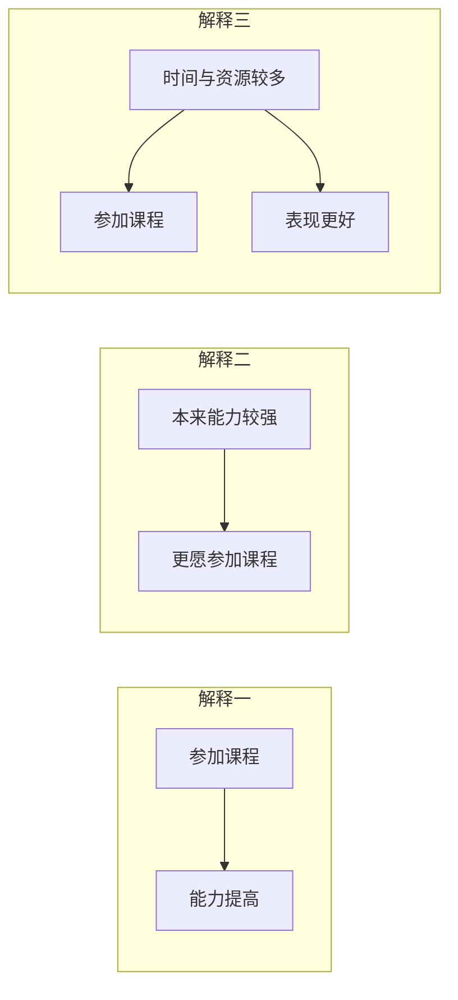

这是假设性示意，不是在评价某门真实课程。观察到“参加者表现更好”后，需要进一步区分课程作用、自我选择与共同因素；不能只挑自己喜欢的一条路径。

### 七、把数字看清楚

#### 24. 百分比要有分母、基期和口径

百分比必须与分母、基期、期间和指标定义一起阅读。“增长一倍”与“增加一个百分点”不同；某个净额的增长，也不等于其中一项收入的增长。

**真实财报：茅台 2026 年前三季度经营现金流。** 合并经营现金流净额由上年同期约 381.97 亿元增加到 840.59 亿元，同比增幅为 120.07%；销售商品、提供劳务收到的现金同期只增加约 3.41%。[原报告第 2、10—11 页](https://static.cninfo.com.cn/finalpage/2026-10-31/1225649896.PDF)

先把分母写清：`(840.59−381.97)÷381.97` 约为 120.07%，显示值经舍入。这是经营净现金的增幅，不是销售收款的增幅。经营净额把多项流入和流出加减后得到，某项支出减少，也会使净额增长。

再核对范围：合并报表包含财务子公司的项目。两项存款相关行的同比变化，合计解释了约 93.99% 的经营现金流增量；它们的变化不能被重命名为卖酒回款。[公司说明及原表](https://static.cninfo.com.cn/finalpage/2026-10-31/1225649896.PDF)

所以“经营现金流大幅增长”有公告支持；“卖酒回款翻倍”没有。即使把两项同比贡献减掉，也只得到其余项目的同比净变化，不是本期酒业现金流。这个案例说明：百分比的算术可以完全正确，语言中的分母或指标替换仍可能把结论带错。详细正负号可在[原表计算](<实战案例/2026三季报图解.md>)复核。

读任何收益率、满意度或增长率，都可以依次写出本期、基期、两期差和总体。缺一项，就先缩小结论，不替来源补上未经证明的含义。

#### 25. 平均数会隐藏分布

算术平均数、中位数和众数回答不同问题。总体平均不错，不代表多数人都不错；极端值可能显著拉动平均数。还应查看离散程度、分组和样本数量。

#### 26. 收益率需要看复利、波动和完整期间

收益率需要同时说明观察期间、现金流、复利算法、费用和是否实际实现。“年化”是一种把不同期间转成可比尺度的计算，不表示已经经历完整一年。

**真实监管案例：把最初三周外推成年化 2,700%。** SEC 在 2023 年对 Titan 的行政处理公告中指出，其加密策略宣传使用高达 2,700% 的假设年化表现，却未充分说明依赖最初三周表现持续一年的假设。Titan 在不承认或否认监管认定的条件下同意相关处理。[SEC 原公告](https://www.sec.gov/newsroom/press-releases/2023-153)

这里应依次拆开三个问题：三周实际测到了什么，怎样把三周换成一年，以及后面几十周为何能保持同样条件。即使换算公式没有算错，外推前提也可能很强；一个短窗口的极端表现，更不能自动成为客户完整持有一年的真实收益。

只为了说明计算，若短期增长为 r、期间为 d 天，按全年持续复利的假设可写成 `(1+r)^(365/d)−1`。这里没有代入虚构公司业绩，也不反推 Titan 每一天的实际收益；公式强调的是，指数放大会把“以后也一样”的假设放大。

比较表现还要区分算术平均与资金复合增长。纯数学演示：先涨 50% 再跌 50%，财富乘数为 `1.5×0.5=0.75`，不会回到原点。这个小算式仅用于理解算法，真实的主体案例仍是上面的监管披露。

**读宣传时的检查顺序：**先找完整期间和真实账户或假设模型的标识，再看追加资金、费用、回撤与基准，最后才比较年化数字。没有这些条件，漂亮百分比无法独立证明投资能力。

#### 27. 测量指标未必就是你真正关心的东西

一个指标可以被准确测量，却没有充分代表真正关心的目标。问题不只在算术，还在指标与目标之间的联系是否成立。

**真实事件：大众汽车排放测试。** 美国 EPA 的执法资料说明，涉事车辆使用能识别测试条件的软件，在测试与正常使用情境中的排放控制表现不同；相关民事和解涉及约 59 万辆汽车。[EPA 对案件与和解的记录](https://www.epa.gov/enforcement/volkswagen-clean-air-act-civil-settlement)

因此，“在某个测试里通过”不能脱离测试方式，直接等同“日常使用也达到相同表现”。本案涉及被识别的规避机制；不是一般统计误差，更不是证明所有测试或认证无效。

股票研究也应检查类似的代理关系：注册人数是否代表付费需求，订单是否可取消，收入是否转换成利润和现金。每次都要问目标是什么、指标怎样生成、哪些行为能改变指标而不改善目标。只有把这条链讲清，数字才有解释力。

### 八、遗漏信息与合理结论

#### 28. 重要遗漏：哪些缺失信息可能改变结论

任何表达都会省略信息，关键是被省略的部分是否重要。常见缺口包括反例、成本、失败比例、适用人群、时间范围、风险、替代方案和不同利益方的影响。

#### 29. 多个合理结论：支持、反对之外还有条件与程度

证据支持的结论有不同强度。可以确认一项事实，同时对原因、持续性和行动保留判断；这并不矛盾。

**回到美的实际利润分化。** 同一份三季报支持“归母增长”和“扣非下降”两个事实。非经常性损益净额为 126.05 亿元，且报告解释了部分分类影响；这些材料要求进一步研究利润构成，而不是简单选一个数字代表整家公司。[原报告第 2—4 页](https://static.cninfo.com.cn/finalpage/2026-10-30/1225645132.PDF)

| 层次 | 现在可以怎样说 | 尚不能越过的缺口 |
| --- | --- | --- |
| 事实 | 两种利润口径变化不同 | 不能把扣非直接叫主营利润 |
| 解释 | 分类与非经常项目值得拆解 | 不能把全部差额归给同一原因 |
| 持续性 | 需要更多分部和多期资料 | 不能凭单期累计数据确认长期趋势 |
| 行动 | 尚需估值与风险分析 | 不能直接得出当前买卖结论 |

形成多个结论，不是允许所有说法同样正确。每往下一层，都增加了需要证明的内容。末尾加一句“仅供参考”，也不能补上缺失的证据。

实际选择可与研究结论分开：信息不足时继续核查或暂缓承诺；是否值得追加研究，取决于信息价值、成本与后果。不必为了显得果断，把一个证据有限的判断写成绝对句。

#### 30. 信息不足时，确信程度与行动强度也可以降低

没有完整证据时，不必假装已经知道答案。可以继续核查、寻找低成本试验、缩小承诺，或暂缓决定。不同决定需要的证据强度，应考虑后果与可逆性。

### 九、把提问也用在自己身上

#### 31. 思考障碍：愿望、身份和熟悉感会改变证据标准

确认偏差会让人偏好支持自己的信息；信念固着让被削弱的观点仍难放下；可得性和光环效应让鲜明案例与好印象获得过大权重。知道这些名称只是开始。

#### 32. 好问题应帮助交流，并留下可复查的判断

有效提问通常先准确复述对方，再指出最重要的不确定处。问完以后，应把已确认事实、待核查假设和当前结论分开记录，便于新信息出现时更新。

### 综合复盘：回到已经讲过的真实材料

遮住前面各节的分析，只保留原始来源，再尝试完成下表：

| 真实材料 | 要独立检查什么 | 参考答案方向 |
| --- | --- | --- |
| 第 26 点 Titan 年化宣传 | 三周窗口如何变成一年，哪些条件是假设 | 区分观察期与外推期，不能把假设年化当作客户完整一年真实收益 |
| 第 19 点网上读者投票 | 一万多份回答能否代表正式选民 | 先查入样与参与机制；样本大不自动解决代表性问题 |
| 第 8、13、29 点美的财报 | 利润事实经过哪些桥梁才到投资行动 | 分开事实、可持续性、价格及个人约束，逐层补证据 |
| 第 24 点茅台现金流 | 净额增速是否能代表单项销售回款 | 保持分母、合并范围与指标定义一致 |

这项复盘不再另编一家公司。重点是你能否从真实材料自己找出推理缺口，而不是记住本笔记的结论。原始来源就在对应知识点附近，核对时同时保留日期和数据口径。

### 一页可复用的提问清单

面对重要观点，优先回答下面十二问：

1. 我们究竟在讨论哪个问题，是事实判断还是行动建议？
2. 对方希望我接受的结论是什么？
3. 支持结论的理由有哪些，是否与结论相关？
4. 哪些关键术语需要具体定义？
5. 结论体现了怎样的价值优先级？
6. 哪些没说出口的事实假设连接了理由与结论？
7. 推理是否出现跳跃，或者只用情绪、身份和人气代替证据？
8. 证据来自哪里，收集方式能否支持这么大的结论？
9. 是否存在反向因果、共同因素或其他合理解释？
10. 数字的分母、期间、分布、费用和口径是什么？
11. 哪些遗漏的信息最可能改变我的判断？
12. 目前可以得出多强的结论，什么新证据会让我改变看法？

不需要在闲聊中逐条盘问。涉及投入大量金钱、时间、长期承诺的决定，更值得完整使用这套检查。

### 练习：每天拆一条观点

选一条财经评论或商品宣传，限时十分钟，写五行：

```text
结论：对方主张什么？
理由：主要支持是什么？
假设：哪个未说出口的条件最关键？
缺口：哪一条信息最可能改变判断？
当前判断：支持到什么程度，下一步查什么？
```

一周后比较自己的记录：是否更容易分清事实、推断与建议？是否经常只挑不喜欢的观点检查？是否能够在证据不足时保留判断，而不急于站队？

### 阅读边界

批判性思维不能代替专业知识。会提问能发现一份财报分析的缺口，但要回答这些问题，仍需会计、行业与估值知识。也不能把“可能存在另一个解释”当作足以否定全部现有证据的理由。

证据并非必须完美才有用。合理目标是提高判断质量，让确信与行动匹配证据，而不是把标准提高到永远无法作决定。知识较多的一方值得被认真听取，同时仍需要清楚说明依据。

这本书的框架适用于检验论证，不宜用来否定他人的感受。一个人在表达难过时，可能需要先被听见；事实判断、价值选择和情感支持，是不同的交流任务。

### 回顾：八个自测问题

1. **批判与反对有什么区别？** 批判检查依据，可以接受或修正观点；反对只是可能的结果之一。
2. **事实为真，结论就一定成立吗？** 不一定，事实与结论之间还需要合理联系。
3. **价值假设与描述性假设有何不同？** 前者关心什么更重要，后者关心世界事实上怎样运作。
4. **发现谬误是否证明结论为假？** 不证明，只说明该论证存在缺陷。
5. **为何案例不能自动代表总体？** 个案的选择方式与条件可能特殊，失败和未被观察者可能被忽略。
6. **相关关系至少要检查哪些方向？** 正向、反向、共同因素与偶然关联。
7. **平均收益为正是否说明多数人赚钱？** 不说明，需要分布、中位数、亏损比例和计算方式。
8. **好的结论为什么常带条件？** 因为证据、人群与环境有范围，条件让判断更准确也更容易更新。

### 来源与待补充内容

| 已查阅来源 | 核验用途 |
| --- | --- |
| [Pearson：原书第 12 版官方书页](https://www.pearson.com/en-us/subject-catalog/p/pgmtitle/P200000002371/9780137501731) | 作者、版本与总体教学目标 |
| [Pearson+：第 12 版目录](https://www.pearson.com/en-us/pearsonplus/p/9780137501731.html) | 主要章节与提问框架 |
| [新华书店：中文第 12 版](https://item.xhsd.com/items/110000103245062) | 中文参考版译者、出版社、年份与 ISBN |
| [Investor.gov：Performance Claims](https://www.investor.gov/introduction-investing/general-resources/news-alerts/alerts-bulletins/investor-bulletins-47) | 财商应用中对业绩宣传的核查原则 |

白话解释、分析步骤和练习为本笔记整理；真实事件、公司数字和研究结果在对应知识点附原始来源，纯计算演示另行标注。书外材料不冒充原书案例或引文。尚未取得用户所用版本，因此未覆盖其全部练习及版本独有增补；后续可按原书逐章补足定位。

---

[返回书籍索引](<README.md>) · [财商学习与实践路线](<财商进阶合订本.md>)


---

<a id="book-07"></a>

[单独打开本篇](<超级预测 - 菲利普·泰特洛克、丹·加德纳/读书笔记.md>)

## 《超级预测》读书笔记

> 作者：Philip E. Tetlock、Dan Gardner（菲利普·泰特洛克、丹·加德纳；中文译名因版本而异）  
> 原作：*Superforecasting: The Art and Science of Prediction*，2015。简体版也以《超预测》为名；繁体版《超級預測》由日月文化出版。  
> 分析依据：出版社资料、公开目录、作者团队的方法说明、Good Judgment Open 评分说明和相关原始研究；未取得用户所持版本全文。  
> 覆盖范围：全书十二章的主要主题、34 个核心及延伸知识点；不复述全部人物案例，不声称逐页精读。章名用主题意译，不对应特定中译本页码。  
> 阅读目的：学会对不确定的事情作出有依据、可检验、可修改的判断，并用于投资决策。真实事件和研究结果在对应知识点附来源，数学演算与练习另外标注为教学补充。  
> 更新日期：2026-11-11

**详细阅读建议：**先通过概览了解全书，再重点读第 09、12、16—18、20、26、33 点。它们展开了“怎样找基础概率、怎样更新、怎样评分、怎样转成决策”的完整过程；其余知识点用于补充背景。需要案例的知识点直接结合真实事件、研究或业务实践讲解；纯公式演算另标假设，不把它们当作真实记录。

### 先看这里：这本书真正教你什么

预测能力不是“总能猜中结果”，而是长期把不同结果的可能性估得更合理。一个人说某事有 80% 概率发生，后来没发生，不能仅凭这一次就判定他不懂；但如果他反复说 80%，实际只发生约一半，他的自信就出了问题。

本书把判断从口才比赛变成可以记录、评分、改进的工作。核心顺序是：**问清问题 → 找基础概率 → 拆解原因 → 给出概率 → 接收新证据 → 更新 → 评分复盘。**

你最值得带走的五个变化：

- 从“我看好这家公司”，转成“我对哪一个经营结果、在什么期限内，有多大把握”。
- 从“我的故事很有说服力”，转成“同类事情通常怎样，这次有哪些可靠的不同”。
- 从“改观点等于认输”，转成“证据变了，合理的判断也应该变”。
- 从“这一次赚了，所以分析正确”，转成“判断质量要与运气、买入价格和承担的风险分开”。
- 从“寻找永远正确的专家”，转成“建立一套可重复检查的思考过程”。

书籍信息见 [Penguin Random House 官方书页](https://www.penguinrandomhouse.com/books/227815/superforecasting-by-philip-e-tetlock-and-dan-gardner/)；中文书名与版本可核对 [长荣大学 HyRead 书目](https://cjcu.ebook.hyread.com.tw/bookDetail.jsp?id=122604)。

### 全书主线与覆盖地图

| 章节主题 | 主要解决的问题 | 本笔记对应内容 |
| --- | --- | --- |
| 1 乐观的怀疑者 | 预测有边界，为什么仍值得改进 | 知识点 1—4 |
| 2 知识的错觉 | 为什么确信和解释能力会误导判断 | 5—7 |
| 3 给预测评分 | 怎样让预测接受检验 | 15—19 |
| 4 超级预测者 | 好成绩有多少来自能力和运气 | 20—21 |
| 5 思维能力 | 拆解、基础概率和不同视角 | 8—11 |
| 6 数字与概率 | 如何表达不确定性 | 12—18 |
| 7 信息与更新 | 多看新闻为什么不一定更准确 | 13、22—23 |
| 8 持续改进 | 如何通过反馈训练判断 | 24—25、34 |
| 9 团队 | 如何让讨论增加信息而非制造从众 | 26—28 |
| 10 领导者的难题 | 如何同时承认不确定性与作出行动 | 29 |
| 11 能力边界 | 遇到罕见事件和不可预测变化怎么办 | 30—31 |
| 12 下一步 | 如何把预测变成组织与个人习惯 | 32—34、练习 |

这张表是阅读导航，不表示一个概念只在某一章出现。公开目录可在上面的馆藏书目中核对。

### 一、先改变你对“预测”的理解

#### 01．概率判断与结果断言是两回事

“会发生”把判断压成一个二元答案；“发生概率约 65%”保留了不确定程度。实际结果最终是发生或不发生，但在结果揭晓前，你拥有的只是有限信息。

#### 02．好问题必须可结算

好预测题至少有对象、事件标准、截止时间和判定来源。“以后会更好”可以不断改解释，难以检验；清晰事件则允许第三方在结果出现后独立结算。

**真实历史事件：2014 年苏格兰独立公投。** 9 月 18 日举行的正式公投，最终支持独立者占 44.7%，反对者占 55.3%。[官方结果说明](https://www.gov.uk/government/news/scottish-independence-referendum-whats-next)

用这个真实事件说明题目定义，可以问“在这次正式公投的有效票中，支持独立的比例是否超过一半”。它比“苏格兰将来会不会独立”清楚：前者有指定投票、阈值与结果来源；后者可能混入下一次投票、谈判和无限期未来。这里是在复盘题目应怎样写，不是在宣称自己事前预测成功，也不冒充比赛的原始题目。

对相等、取消、推迟或无法取得结果的处理，应在预测开始时约定，不能揭晓后为保住成绩改规则。一次投票的结果也不能回答所有更长时期的政治问题。

**把同样方法用于当前的真实公司。** 以 2026-11-11 为提问时点，美的 2026 年三季报已经披露，不能再当作未揭晓成绩；可研究的问题是全年扣非归母净利润是否严格高于上一年可比值。练习可约定以截至 2027-05-31 公开的年度报告及正式更正为准，相等判“否”，缺乏同口径数据则记“无法结算”。截止日是练习约定，不是披露日预测。[已知的三季报输入](https://static.cninfo.com.cn/finalpage/2026-10-30/1225645132.PDF)

定义清楚之后才去调查历史基数、季节性和第四季度信息，并在结果公布前登记概率。为了表格完整随手填一个百分比，不会让题目更科学。

#### 03．挑选努力能改善答案的问题

有的事情靠简单规则就能判断；有的事情在所需期限内几乎没有可靠信息。最值得投入的，是可以通过资料、比较与分析显著改善判断的问题。

对财商的意义是分配研究时间。用一小时核对公司现金流，可能比用一小时猜明天开盘的涨跌更有学习价值。并不是所有问题都必须给一个漂亮数字；资料不足也是有用结论。

#### 04．预测距离越远，误差来源通常越多

复杂系统会出现反馈、政策变化、行为适应和偶发冲击。能对某个短期、定义明确的事件取得较好成绩，不代表能准确预测二十年后的市场格局。

因此应同时说明预测期限和适用范围。对遥远未来可以使用情景与宽区间；对即将公布的经营数据，可以分析更具体的变量。不要把短期预测比赛的结果无限推广。

#### 05．专业头衔、口才与预测成绩要分别评估

领域知识有价值，但一个人懂得解释历史，不等于他对未来的概率判断一直准确。公开表达的激励也可能偏向鲜明、肯定、容易传播的观点。

检查专家时，不只找他说对的几次，而要找完整记录、失败案例、预测期限和比较基准。也不能反过来得出“专家都没用”；该书批评的是不受检验的权威，不是知识本身。

#### 06．狐狸式思考与刺猬式思考

“刺猬”倾向用一个强大的解释框架理解各种现象；“狐狸”更愿意同时使用多个有限模型，承认例外，并在证据变化时调整。

#### 07．直觉是起点，反思负责检查

鲜活故事容易让人忽视基础概率；刚看到的新闻容易被高估；已经表态后容易只搜支持证据。这些心理倾向会影响概率估计。

实践时可以分两步写：第一反应是什么；随后有什么证据支持、什么证据反对。目的不是消灭直觉，而是避免把熟悉感和确信感当成证据。对认知偏差的系统学习，可结合《思考，快与慢》。

### 二、如何把一个模糊判断拆成可分析的问题

#### 08．费米式拆解：先求可解释的数量级

遇到不知道答案的问题，可以把它拆成较容易估计的部分。例如估算某地潜在订阅收入，可以依次考虑目标人数、触达比例、付费比例、客单价与续费情况。

拆解的价值在于暴露假设：到底是人数不确定，还是转化率不确定？乘出一串小数不等于精确，多个有偏的输入还可能放大误差。先给合理范围，再找最影响结论的变量。

#### 09．基础概率：先看类似事情通常怎样

基础概率提供一个独立于个案故事的起点：类似的事情通常怎样？关键不只是找到很多历史记录，还要解释为什么这组记录与当前问题可比。

**真实业务实践：飓风路径锥使用历史预报误差。** 美国国家飓风中心的传统路径锥按过去五年官方路径误差设置各预报时效的范围，各预报时效采用约 67% 的历史误差覆盖口径。2026 年 NOAA 又说明将试验覆盖 90%、区分速度与方向误差的椭圆方案。[NHC 历史误差说明](https://www.nhc.noaa.gov/verification/verify4.shtml)、[NOAA 2026 年产品说明](https://www.noaa.gov/news-release/national-hurricane-center-to-issue-new-forecast-cone-graphics-for-2026-hurricane-season)

这个例子不是直接计算某一二元事件的基础发生率，而是相邻的“外部视角”：不只盯着本次中心预测线，还利用同类预测以前错过多远，形成不确定范围。用哪几年、哪种预报时效和哪种系统误差作为参照，都会影响范围的含义；传统与试验产品也不能混读。

迁移到企业增长判断，先确定行业、规模、所处阶段、增长口径和观察期，再看目标增长在完整样本里多常见。只挑今天仍然存续的公司，或只挑已经成功推出产品的公司，会改变原问题；更多同类成功故事不能弥补失败样本缺席。

参照组越窄，业务可能越接近，但样本也可能越少。较宽与较窄参照可以同时保留，比较结论对选择有多敏感。结构变化时要说明历史类比在哪里失效，并扩大不确定范围，而不是仅用“这次不同”跳过所有比较。

**自测：**路径锥外是否必然没有影响？不是。各时效的历史误差覆盖比例不等于整条未来路径必然以同一概率全部落在范围内，中心位置的误差范围也不等于风雨影响范围；同理，公司的利润增长参照率，也不是股票上涨概率。参考类别和目标变量必须同时对齐。

#### 10．外部视角与内部视角要互相校正

外部视角看同类案例的分布；内部视角看当前个案的具体原因。只看外部会忽略真实变化，只看内部则容易被精心包装的故事带走。

参照组不是唯一正确答案。可以分别选较宽和较窄的同类组，观察结论变化。如果换一个合理参照组，估计就大幅改变，应承认模型不稳定，而不是掩盖分歧。

#### 11．至少提出一个竞争解释

看到营收增长，不要立即认定护城河加深。也可能是涨价、并购、一次性大单、渠道压货或行业整体景气。找能区分这些解释的证据，比继续搜“营收增长”的新闻更有价值。

竞争解释不是为了机械唱反调，而是防止只验证第一种想法。每个解释都应有它更容易出现的可观察现象。

#### 12．贝叶斯更新：新证据改变旧概率

贝叶斯更新的难点不在公式，而在区分两个问题：“如果项目会成功，我有多大机会看到这条消息？”与“既然看到了这条消息，项目成功概率是多少？”它们看起来相似，答案却通常不同。前一个问题描述消息产生的机制，后一个问题才是你想更新的判断。

**真实材料中的更新问题：美的 2026 年三季报。** 摘要中扣非归母净利润下降 22.49%，但同页说明提到汇兑损失与相关衍生工具收益的分类差异。[原报告第 2 页](https://static.cninfo.com.cn/finalpage/2026-10-30/1225645132.PDF)

看到后一条信息后，原先把扣非降幅直接等同主营恶化幅度的解释就需要重查：分类因素与经营因素可能同时存在。报告没有提供足以计算“主营恶化概率”的先验和似然比，所以这里不编一个精确后验。贝叶斯思路帮助提出问题：这条信息更支持哪些解释，它在相反解释下是否也可能出现，是否只是已知材料的重复。

**下面仅为公式演算，数字均为假设，不是公司或研究的实际记录。** 一条进度信号如何改变概率： 你判断一批复杂设备是否能按期交付，初始概率为 40%。随后看到消息：“关键部件已经通过验收。”为了把逻辑讲清楚，假设在确实按期交付的项目中，80% 会在这个时点出现此消息；在最终延期的项目中，也有 40% 会出现此消息，因为其他环节仍可能拖期。

先不要套公式，把情境放大成 1000 个虚构的类似项目：

| 实际结局 | 初始项目数 | 出现验收消息的比例 | 既属于该结局、又出现消息的数量 |
| --- | ---: | ---: | ---: |
| 按期交付 | 400 | 80% | 320 |
| 延期交付 | 600 | 40% | 240 |
| 合计 | 1000 | — | 560 |

你现在处在“已经看到消息”的 560 个项目中，其中 320 个按期交付。因此更新后的概率是 `320÷560≈57.1%`。好消息确实提高了概率，但没有把它提高到 80%。原因是延期项目本来更多，其中也会出现相同消息。

这个过程可以写成通行概率公式，作为理解本书的教学补充，并非要求每次预测都手算：

```text
后验赔率 = 先验赔率 × 似然比
赔率 = 概率 ÷ (1 − 概率)
似然比 = P(证据 | 事件发生) ÷ P(证据 | 事件不发生)
后验概率 = 后验赔率 ÷ (1 + 后验赔率)
```

本例先验赔率为 `0.4÷0.6=2/3`，似然比为 `0.8÷0.4=2`，所以后验赔率为 `4/3`，再换回概率就是 `4/7≈57.1%`。赔率在这里表示发生与不发生的相对可能性，不是投资产品的赔付倍数。

现在可以看清什么叫“有区分能力的证据”。如果一条口号在按期项目和延期项目中出现的比例都为 90%，似然比为 1，判断就不该因为它改变。消息听起来多积极并不关键，关键是它是否更支持一种结局。相反，如果另一项检测几乎只在成功项目中通过，它的更新力度就应更大。

还要防止重复计数。三家媒体转载同一份验收公告，只是同一证据有了三次曝光，不能把似然比 2 连乘三遍。即使两条消息文字不同，也可能都来自同一生产进展；第二条的作用要在“已经知道第一条”的条件下判断。只有适当的条件独立假设成立，才可以直接使用各自的似然比连续相乘。

在真实投资研究中，这些百分比通常不能精确取得。这时贝叶斯方法最有用的部分是提问习惯：原来的可能性是多少？这条证据在相反情境下也常见吗？我有没有重复计算同一个原因？可以用合理范围做敏感性分析，而不是编造精确数字来让模型显得专业。

**小练习：**其他条件不变，如果初始按期概率只有 10%，同一条消息会把概率提高到多少？先验赔率为 `1/9`，乘 2 得 `2/9`，转回概率为 `2/11≈18.2%`。同样的好消息，在不同起点上不会产生相同的最终把握。

#### 13．证据的区分能力比新闻热度更重要

如果一条消息无论哪种结果发生都很常见，它对判断帮助有限。管理层说“我们有信心”通常不如可核验的订单履约与回款信息有区分能力。

反过来，一条不起眼但直接推翻关键假设的信息，可能需要大幅更新。问“这条证据在另一种结果下也会出现吗”，可以帮助你抵抗标题带来的情绪变化。

#### 14．概率可以细分，但不要制造虚假的精确

只有“可能／不可能／五五开”三个档位，会损失有用的信息。60% 与 85% 应当意味着不同的把握和不同的防备。

但 62.371% 也不自动优于 60%。如果证据薄弱，给出中心估计并解释主要不确定因素，通常比多写几位小数诚实。精度要由信息支持。

#### 15．小概率会发生，50% 也不等于一无所知

一个可信的 10% 判断，本来就允许少数事件发生。不能在事后把“低概率”改写成“不可能”。与此同时，50% 可能表示充分分析后的势均力敌，也可能表示没有研究，两者理由不同。

因此记录数字之外，还要记录依据。靠所有问题都答 50% 可以避免极端错误，却不一定有预测技能。

### 三、如何判断自己是不是进步了

#### 16．校准：你的自信与实际频率是否匹配

校准关心概率语言是否可信：长期来看，被赋予相近概率的事件，实际发生频率是否相符。它不要求每一小组结果都恰好与概率一致。

**真实专业实践：ECMWF 检验季节预测的可靠性。** 欧洲中期天气预报中心的官方用户指南把可靠性图与 ROC 图用于季节预测评估，并持续监测预报系统表现。这里依据的是指南中 2023 年的存档版本，不把某一张历史评估图当成当前系统成绩。[官方检验指南](https://confluence.ecmwf.int/pages/viewpage.action?pageId=311146420)

可靠性检查的思路是：把历史预测按相近概率归组，计算这些预测对应的事件后来有多常发生。如果经常报很高概率的那组实际上发生得明显更少，就需要检查过度自信、模型偏差或样本是否可比。只展示某一次预报特别准，无法替代这项长期检查。

这里的分组是统计工具，并不要求报十次 70% 就必须有七次发生。有限样本会波动，相关事件也会减少独立信息：同一次天气系统影响多个地区，或同一种商品价格影响多家公司，不能简单看成很多互不相关的验证。

投资预测日志也应事先确定记录范围，不在结果出来后删掉尴尬题目；概率、日期、事件定义和最后结果都保留。若只挑重仓、成功或最容易解释的事件，得到的是筛选后的自信记录。

校准好还不等于信息丰富。始终报总体发生率的人可能不算失真，却无法指出哪次风险特别高。因此需要把校准、区分能力和综合评分放在一起看，不能用一个“命中率”包办。

#### 17．区分能力：你能不能辨别不同风险的事件

如果一类事件总体发生率为一半，永远报 50% 可能整体校准尚可，但没有区分具体事件。更好的预测应该有依据地区分哪些更容易发生、哪些更不容易。

不过“敢报 95%”本身不等于区分能力；还要看高概率组是否确实更常发生、概率与实际频率是否吻合。研究中用于描述这些能力的指标并不完全相同，不能只凭一张看起来很陡的图判断好坏。

#### 18．Brier 分数：给概率错误一个可计算的代价

如果只按“有没有猜中方向”评分，报 51% 与报 99% 会被当成一样。这会奖励含糊表达，也无法区分谨慎错误与非常自信的错误。Brier 分数把预测概率与最终结果之间的距离平方，使概率表达本身也承担责任。

**真实使用场景：** IARPA 的 ACE 项目要求把判断与后来发生的真实事件对照检验；预测比赛以概率评分组织反馈，避免仅保留猜中故事。[IARPA 项目说明](https://www.iarpa.gov/research-programs/ace) 第 26 点给出了实际研究表里的 Brier 分数，下面解释这类分数怎么算，演算数值不冒充比赛原始记录。

二元事件的一种常见写法为：

```text
单题分数 = (p − y)²
p：事前预测概率，0 到 1
y：结果发生记 1，没发生记 0
多题成绩：这些分数的平均值；越低越好
```

先看一题。报 80%，结果发生时分数为 `(0.8−1)²=0.04`；没发生时为 `(0.8−0)²=0.64`。分数越低越好，所以非常肯定地判断错误，会比稍微偏向一边的错误付出更大代价。这里的“代价”是评价指标，并不是实际账户盈亏。

**纯计算演示：为什么不能只追求方向命中率。** 假设甲把十件事全报 80%，实际八件发生。其平均分为：

```text
(8×0.04 + 2×0.64) ÷ 10 = 0.16
```

乙把同样十件事全报 100%。他也有八次方向正确，但平均分为 `(8×0+2×1)÷10=0.20`。两人命中率同为 80%，甲在这组结果上的概率评分更好。丙全报 50%，平均分为 0.25；他在这十题的已知结果上得分较差，但是否漏用了信息，还要回看事前证据，不能仅由事后八次发生倒推出当时就该报 80%。

这个评分还有一个值得理解的数学性质。假设真实发生概率为 q，你报告 p，预期分数可以化成：

```text
预期分数 = q×(1−p)² + (1−q)×p²
         = (p−q)² + q×(1−q)
```

第二项由事件本身的不确定性决定，第一项在 p=q 时最小。因此，在这个模型下，如实报告自己最合理的概率判断，优于为了显得勇敢而夸大把握，或为了避免背责而全部写成五五开。真实世界的 q 通常不知道，这个式子用于说明评分为什么鼓励诚实，不是告诉你能直接查出真实概率。

Good Judgment Open 对全部互斥结果的误差求和。二元事件中还会加上“不发生”的误差，因此分数是上式的两倍、范围为 0—2；上面的单事件口径范围为 0—1。**比较成绩前必须统一口径。**[GJ Open 官方评分说明](https://www.gjopen.com/faq)

还应把评分与决策后果分开。对一个日常小事件预测错，与漏掉严重风险，可能在 Brier 分数上相同，现实损失却不同。这个指标适合评价概率判断，不能独自决定资金应投多少、是否值得行动。比较不同预测者时，还需统一题目、期限和基准；否则专挑容易题的人可能显得更优秀。

**动手算：**你报 60%，结果没有发生，单事件分数为 0.36；若报 30%，则为 0.09。这个结果只能说明后一个判断在这一次得分较好，不能凭一题证明他的长期方法更强。

#### 19．有分数，还要有公平的基准

预测容易的题与困难的题，分数不能直接横比；等到结果几乎确定再预测，也不能与提前几个月的人公平比较。应在相同问题、相近时间、相同评分规则下，与基础概率、简单模型或群体结果比较。

GJ Open 会按预测有效期间的每日分数汇总。这提醒我们：不要只挑最终最接近结果的一次判断。更早发现变化也是一种价值，但具体计算必须按平台规则，而非自行挑选有利的日期。[GJ Open 官方评分说明](https://www.gjopen.com/faq)

#### 20．优秀成绩要排除运气与筛选效应

事后挑出表现最好的人，再解释他为什么成功，会混入运气和筛选效应。需要检查他在未用于选拔的新问题上是否仍有表现，以及环境是否同时改变。

**真实跟踪研究：超级预测者的第二年检验。** Mellers 等人的研究把第一年表现最好的约 2% 组成精英团队，再看第二年成绩；论文报告这组仍显著领先。[原研究的 Tracking 部分](https://faculty.wharton.upenn.edu/wp-content/uploads/2015/07/2014---psychological-strategies-for-winning-a-tournament.pdf)

重要之处在于观察进入了新的预测期，不只是反复展示被选中时那一份漂亮成绩。这比采访一位猜中的人、把他的生活习惯解释成成功原因，更接近对可重复能力的检验。

但还不能把全部优势解释成固定天赋。选拔后团队环境也改变，参与投入、协作和信息处理可能共同影响结果。合理结论是这组人在研究条件下展现了可持续的预测优势，而不是任何领域、任何期限都保证准确。

纯数学可以说明为什么选拔效应值得认真对待：1024 人各自独立猜十次公平硬币，十次全中的人数期望为 `1024×(1/2)^10=1`。这只是计算演示，不是实际比赛记录，也不表示每次必定恰好一人全中。现实市场有技能与风险暴露，不能把它直接等同硬币。

所以评价基金或预测者时，应先看选拔前如何界定样本，再看未参与选择的新时期，最后检查费用、共同风险和规则变化。单次冠军与稳定优势之间，需要跨越这三层证据。

#### 21．能力、知识、训练、投入共同起作用

本书强调的是可培养的思考习惯，而不是宣称智力和专业知识毫无用处。愿意做功课、能理解基本数量关系、能纠正错误，都有帮助。

研究中的成绩来自特定任务和制度，不能推导成“普通人随便看新闻就能击败所有专业人士”。IARPA 的项目本身就同时研究如何收集、加权、组合概率判断，并用真实结果检验。[IARPA：ACE 项目](https://www.iarpa.gov/research-programs/ace)

### 四、如何更新、合作与长期练习

#### 22．关注信息不等于不断消费新闻

有价值的是新信息对关键变量的影响，不是新闻数量。应该事先列出需要跟踪的事项，例如需求、客户付款、成本、债务到期与竞争格局。

如果一条新闻与这些变量无关，可以记录但不改概率。这样能防止判断随信息流剧烈摇摆。

#### 23．通常小步更新，但关键证据可以要求大幅改变

反应不足是维护旧观点；反应过度是把每条新消息当成世界重写。合理更新幅度取决于证据强弱。

“频繁小幅更新”不是禁止大幅调整。如果核心客户合同已明确终止，原来建立在合同续签上的收入判断可能需要重做。保持一致指方法一致，不是数字永远不动。

#### 24．让观点成为待检验的假设

当“我持有这只股票”变成“我是懂这家公司的聪明人”，反对证据就容易被当成人身攻击。减少这种身份绑定，可以让修改判断更轻松。

练习写一句话：“如果出现什么证据，我会显著降低原来的估计？”如果答案永远是“那只是暂时困难”，这个判断可能已无法证伪。

#### 25．持续测试状态：把复盘用于修改方法

改进需要有明确问题、及时反馈、持续练习和对错误来源的分析。单纯回忆“这次没想到”很难形成技能。

可以把错误分成：问题定义不清、基础概率选错、遗漏重要因素、证据重复计算、更新太慢、信心过度。下一轮只选择一两个改进点，以便观察是否有用。

#### 26．先独立思考，再交换理由

团队的价值来自信息被补充、理由被检查和错误被纠正。人数多不会自动增加独立证据，也不保证判断一定更好。

**真实比赛：比较有无训练与团队协作。** 2014 年预测研究的表 1 给出第一年下列平均 Brier 分数；数越低越好，这里采用论文的完整结果评分口径。[原论文表 1](https://faculty.wharton.upenn.edu/wp-content/uploads/2015/07/2014---psychological-strategies-for-winning-a-tournament.pdf)

| 第一年的条件 | 问题开放首周 | 中间两周 | 最后一周 |
| --- | ---: | ---: | ---: |
| 独立预测、无训练 | 0.44 | 0.40 | 0.31 |
| 独立预测、概率训练 | 0.40 | 0.36 | 0.29 |
| 团队预测、无训练 | 0.42 | 0.33 | 0.22 |
| 团队预测、概率训练 | 0.35 | 0.30 | 0.19 |

先比较相同时间窗口，不能拿临近揭晓时的团队成绩与很早的个人成绩竞争。表中的 0.35 也不是“35% 题目错误”，Brier 是概率误差分数；论文使用的是开放至少一个月的问题来做这部分时段比较。

再看组织方式：该研究中的团队能够交流信息和理由，并接受怎样帮助团队提高判断质量的指导。不能把结果简化为“开会人数越多，预测越准”，也不能从这张表直接推出股票收益。[研究方法](https://faculty.wharton.upenn.edu/wp-content/uploads/2015/07/2014---psychological-strategies-for-winning-a-tournament.pdf)

据此可以设计自己的讨论流程：先各自写下事件定义、概率、依据和反证，再同时公开；找出分歧究竟来自不同事实还是不同假设；核查最能改变分歧的资料，最后独立更新。这个流程是本笔记的应用设计，不是声称原实验逐项使用了完全相同的会议步骤。

保留分歧往往比强迫一致更有价值。若一方认为需求更强，另一方认为成本更高，应分别记录可核验条件，待新资料出现时更新。这样结果揭晓后才能知道哪项推理有效，而不是只留下一个妥协数字。

#### 27．汇总可以减少个人噪声，但权重需要依据

均值、中位数或加权结果可以作为讨论起点。表现记录、专业信息、预测是否及时，都可能影响权重。

但不能因为某人地位高就给最高权重，也不能把同一来源的十个转述当成十份独立意见。汇总方法应靠后续成绩检验，不能只因听起来复杂就采用。

#### 28．概率“极化”有条件，不能机械加码

概率极化是把汇总概率适当推离 50%，研究中用于处理平均值可能没有充分体现的信息整合。它需要信息结构和模型支持，不能当成提高自信的口令。

**真实研究：对信息重叠建模。** Satopää、Pemantle 与 Ungar 的论文把预测者掌握的部分重叠信息纳入模型，分析适当的极化幅度如何随重叠程度变化。[作者公开论文](https://arxiv.org/abs/1406.2148)

理解它可以从一条实际研究原则出发：多个概率背后若包含不同的有效信息，汇总可能得到任何单个人都没有的依据；若大家的信息大体相同，多人同意就没有同等分量。信息重复与信息补充，应该产生不同的更新力度。

因此，读多家机构报告时，先追到原始公告、数据或访谈来源。十份报告可能只是同一条材料的十种转述。模型论文给出的是特定假设下的理论说明，不能据此在股票群里看到多数看涨，就把 70% 机械调成 90%。参数与表现仍需独立验证。

#### 29．承认不确定性仍然可以果断行动

领导与投资都不可能等到 100% 确定。可以同时说“当前证据偏向这个方案”“还有这些风险”“满足某个条件就调整”。

果断应落实为清楚的行动责任和触发条件；谦逊应落实为对证据保持开放。朝令夕改与拒绝修正，都不是理想状态。

#### 30．大问题需要一组相互关联的小问题

“这家公司是不是优秀企业”太宽。可以分成需求是否稳定、客户是否续约、经营现金是否跟上利润、竞争是否压价、资本开支是否产生回报等。

这些小问题能够帮助形成整体判断，但不能把相关概率直接相乘。它们可能受同一个经济周期驱动。需要明确条件关系，才谈得上计算联合概率。

#### 31．罕见冲击与可预测性边界

有的重大变化很难提前以明确问题和稳定概率描述。对此，预测技能应与承受冲击的能力结合：保留余地、减少单一假设依赖、研究失败情景。

本书对预测能力较乐观，也讨论能力的限制。不能因为会用概率语言，就宣称已掌握“黑天鹅预测公式”。在财商学习中，稳健的资产负债安排可以补偿一部分预测不足。

#### 32．预测、因果解释与价值判断要分开

“某政策可能发生”是预测；“该政策将通过什么机制影响利润”是因果判断；“政策是否公平”是价值判断。它们可能互相关联，但一个问题答得好，不能代替另两个问题。

买股票时尤其容易把“我喜欢这家公司的产品”变成“它的股票应该上涨”。喜好不是关于价格与回报的证据。

#### 33．预测不直接等于行动：还要考虑后果

这是把本书用于财商时最重要的一步转换，也是补充教学：预测回答“什么可能发生”，行动还要回答“如果发生或不发生，我分别会得到和失去什么”。后果不同，同一个概率可以对应完全不同的选择。

**真实事件：2020 年 WTI 近月合约出现负价。** 2020 年 4 月 20 日，WTI 2020 年 5 月期货合约在到期前出现负价格。EIA 当时解释，需求冲击、可用存储约束与临近到期时的交易流动性共同作用；其他期限和基准的原油并非全部变成负价。[EIA 当时的分析](https://www.eia.gov/todayinenergy/detail.php?id=43495)

这个事件使“我看好未来油价”与“我可以一直持有这张近月合约”等判断的差别非常具体。前者预测未来价格，后者还要求处理到期、实物交割、仓储、换月、现金和交易对手。方向后来即使符合预期，也不能补回此前因合约约束被迫退出的损失。这里没有替任何交易者编造事前概率或实际盈亏。

从概率走向行动，必须把预测对象与所持工具对上，再列出不同结果下实际承受的后果。下面的纯数学演算进一步说明概率与收益结构为何不能混同，金额均为教学假设。

**计算演示：同样 70% 把握，两种结果结构。** 机会甲成功赚 20 单位，失败亏 60 单位；机会乙成功赚 10 单位，失败亏 10 单位。为了聚焦计算，假设均只有这两种结果、收益在同一时点实现，暂不计费用与其他约束。

```text
甲的期望净结果 = 0.7×20 − 0.3×60 = −4
乙的期望净结果 = 0.7×10 − 0.3×10 = 4
```

如果只问“判断正确的把握是否超过一半”，两者看起来一样；考虑后果之后，差别就出来了。由一般形式 `p×盈利−(1−p)×亏损>0`，可以得到：

```text
需要的成功概率 > 亏损金额 ÷（盈利金额 + 亏损金额）
```

甲需要超过 `60÷80=75%` 才有正的金额期望，乙只需超过 50%。这里的门槛依赖固定二结果、相同时点等简化假设；真实股票收益有更复杂的连续分布，不能只选两个对自己有利的价位就认为算完了风险。

更进一步，即使乙的期望值为正，也没有告诉你应该投入多少。如果失败损失会影响房租、偿债或其他必要支出，或者许多机会其实会在同一冲击下同时失败，平均值仍然不足以支持行动。需要分别考虑一次损失、连续损失、资金期限以及概率估计本身可能错误。

股票里还多了一层价格。公司收入增长有 80% 概率，不等于这只股票上涨有 80% 概率。市场也许早已按更高增长定价，经营增长兑现时，估值反而下降。必须先定义你预测的是经营事实还是资产回报，再建立二者之间的模型，不能把前者的概率直接贴到后者上。

因此，一份完整记录至少有三个部分：对事件的预测；不同情景下的经济后果；个人或组合的约束。预测部分用合理评分检验，行动部分用成本、风险和结果复盘。把它们分开后，你才能识别“预测很好但买贵了”“判断一般但赔率有利”，以及“过程有问题却碰巧赚钱”等不同情况。

**小练习：**某机会有 80% 概率赚 1、20% 概率亏 4，是否可以因胜率高就积极参与？金额期望恰好是 0，计入费用后会更差；即使不计费用，也没有获得承担风险的平均补偿。先把概率与后果配在一起，再谈行动。

#### 34．保留事前记录，防止事后记忆变形

结果揭晓后，人会觉得征兆早就明显，也容易忘记自己曾经有多肯定。记录日期、概率、证据、反证与更新条件，才能分辨真正的学习与事后编故事。

复盘时先遮住结果，重新检查当时信息是否支持判断，再看结果。你需要纠正的是可重复的思考错误，而不是强迫每个坏结果都有一个“早该知道”的解释。

### 难点图解一：一轮完整的预测

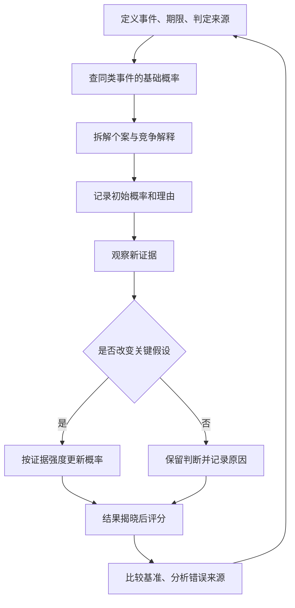

**怎么看：**这是一条带反馈的工作流程。“更新”不是随意改答案；每次修改都保留理由。最终评分是为了改进下一轮，不是为了寻找一次正确答案的荣耀。

### 难点图解二：概率不是投资建议

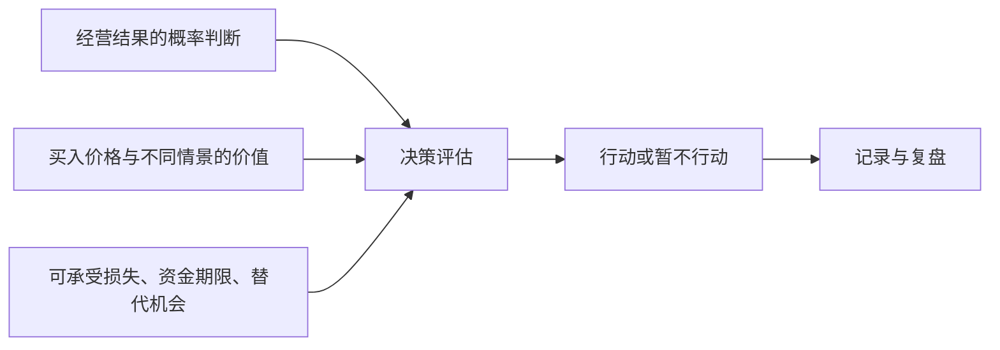

**怎么看：**预测只提供决策的一部分输入。一个经营结果即使很可能发生，也可能已被股价充分反映；好的预测不能自动生成好的投资回报。

### 难点图解三：用一组数据理解校准与评分

以下为原创构造的教学数据，不是真实研究结果：

| 四次预测 | 预测概率 p | 实际 y | 单事件 Brier 分数 |
| --- | ---: | ---: | ---: |
| A | 0.80 | 1 | 0.04 |
| B | 0.60 | 0 | 0.36 |
| C | 0.30 | 0 | 0.09 |
| D | 0.70 | 1 | 0.09 |
| 平均 | — | — | 0.145 |

同四题若每次都报 50%，平均分为 0.25；这个小样本中，上述预测更好。若按 GJ Open 的二元全结果求和口径，两者分别为 0.29 与 0.50。

**不能得出的结论：**四道题不足以证明稳定技能，也不足以测量“70% 档位”的长期校准。这里仅用于学会计算，不用于宣传某种准确率。

### 把方法用于财商：一个完整练习

选一家你能理解业务的公司，只使用公开资料，暂时不买卖。

1. **写清问题。**选择一个年度报告可以核验的经营指标，不用“有没有投资价值”这样无法直接结算的问题。
2. **找参照。**查看公司多年表现与合理同业，记录样本过少、业务变化或统计口径的限制。
3. **拆成因素。**例如收入可以分为销量与价格，利润还涉及成本、费用、税与非经常项目。
4. **给初始概率。**写出中心估计和最重要的三个依据，不使用没有来源的精确数字。
5. **写反证。**列出哪些信息会让你降低估计，哪些信息会提高估计。
6. **设置更新时间。**财报、经营公告或关键条件变化时更新；不是每次价格波动都改判断。
7. **结算后评分。**保留所有预测记录，避免只展示看对的案例。
8. **另做价格判断。**即使经营预测不错，也要另外研究价格、潜在回报与风险，不能跳过估值。

可复制的记录格式：

| 日期 | 可结算问题 | 概率 | 主要依据 | 最强反证 | 下次更新触发条件 | 结果与分数 |
| --- | --- | ---: | --- | --- | --- | --- |
| 自行填写 | 先约定截止日与数据口径 | 自行估计 | 列事实与来源 | 列可能推翻的假设 | 明确事件或日期 | 揭晓后补齐 |

### 作者方法的简明复习卡

选值得研究的问题；把问题拆小；结合基础概率和个案；随证据适度更新；考虑相反力量；使用有依据的概率精度；平衡自信与谨慎；复盘时防止后见之明；善用团队；持续练习这些平衡。这里是对附录方法的简写，执行时仍须按具体问题调整。[作者团队公开的十项方法](https://goodjudgment.com/philip-tetlocks-10-commandments-of-superforecasting/)

### 自测：真正理解了没有

1. **预测 80% 的事没发生，能否证明预测者很差？**不能单凭一次结论判断，要看长期记录、校准、评分与比较基准。
2. **为什么多读十篇新闻未必有帮助？**可能只是同一信息的重复，也可能没有改变任何关键假设。
3. **为什么要先找基础概率？**它提供独立于个案故事的参照，减少过度相信特殊性的倾向。
4. **10% 概率是否可以忽略？**不能，还要看发生后的代价与自己能否承受。
5. **如何识别真正的改进？**在新问题与公平比较条件下，方法和成绩持续改善，而不只是事后解释更顺。
6. **看对企业增长就能买股票吗？**不能，价格、利润质量、回报结构与个人约束仍需独立分析。

### 来源与边界

- [英文出版社书页](https://www.penguinrandomhouse.com/books/227815/superforecasting-by-philip-e-tetlock-and-dan-gardner/)：原作、作者与主题。
- [长荣大学 HyRead 馆藏书目](https://cjcu.ebook.hyread.com.tw/bookDetail.jsp?id=122604)：繁体版信息与目录。
- [IARPA ACE 项目](https://www.iarpa.gov/research-programs/ace)：研究目的与方法范围。
- [宾夕法尼亚大学作者主页](https://psychology.sas.upenn.edu/people/philip-tetlock)：作者及研究背景。
- [作者团队公开方法](https://goodjudgment.com/philip-tetlocks-10-commandments-of-superforecasting/)：附录方法的简明核对。
- [GJ Open FAQ](https://www.gjopen.com/faq)：评分口径、日度记录与比较。
- [预测者选拔说明](https://goodjudgment.com/how-to-become-a-superforecaster/)：训练、组队与选拔的区别。
- [概率图表说明](https://goodjudgment.com/faq_analytics_charts/)：问题定义与结果选项。
- [信息多样性与预测汇总原始研究](https://arxiv.org/abs/1406.2148)：概率极化及信息重叠的条件。

本笔记覆盖主要方法与实践逻辑，在相关知识点原位解释真实预测研究、专业实践和公司材料，不含全部历史案例。贝叶斯赔率算例、公司分析流程、决策期望算例和自测为补充教学；它们帮助理解原书思想，不冒充书中原例。预测研究中的优势不意味着对所有领域、所有期限都有效，也不能转化为股票获利保证。

---

[返回书籍索引](<README.md>) · [财商学习与实践路线](<财商进阶合订本.md>)


---

<a id="book-08"></a>

[单独打开本篇](<股票大作手回忆录 - 埃德温·勒菲弗/读书笔记.md>)

## 《股票大作手回忆录》读书笔记

> 作者：埃德温·勒菲弗（Edwin Lefèvre）  
> 英文原名：Reminiscences of a Stock Operator，初版 1923 年  
> 版本：未指定中文译本；章节定位采用英文原作的 I—XXIV 章，不套用某个中文版本的页码。  
> 分析依据：公开英文原文的主题检索与重点段落核对、出版社书目信息，以及美联储、监管机构和央行的历史资料。没有用户提供的中文原书。书内文学化叙述与独立可核验的书外事件分别标明；数字推导仅作为数学演示。  
> 覆盖范围：全书主要主题与 28 个核心知识点，重点覆盖交易心理、市场判断、持仓与风险、失败教训及后半部的信息与市场操纵主题；不是逐段翻译或每个故事的复述。  
> 更新日期：2026-11-11

### 先看这里：这本书讲什么

**一句话概括：一个擅长观察价格的人，如何在反复赚钱、亏损和重新开始中，理解交易真正考验的是判断、时机、持仓、风险和自我控制。**

先把人物关系讲清：本书由勒菲弗创作，以虚构人物拉里·利文斯顿（Larry Livingston，也写 Lawrence Livingston）的第一人称讲述，主要原型是杰西·利弗莫尔（Jesse Livermore）。它带有传记素材，但经过文学加工，不能把主人公的每段叙述都当作利弗莫尔本人逐字口述的历史档案。出版社也把它描述为经过小说化处理的故事。[出处：出版社书目](https://www.panmacmillan.com/authors/edwin-lefevre/reminiscences-of-a-stock-operator/9780857190567)

最值得带走的六个认识：

1. **方向正确不等于能赚钱。** 入场太早、仓位太大、资金撑不到趋势出现，都可能使正确判断变成实际亏损。
2. **大行情中的持仓，比猜中许多小波动更重要。** 但“拿得住”有前提：原先依据仍在，风险仍可承受。
3. **价格表现是需要尊重的事实。** 对行情的解释再漂亮，也不能替账户承担损失。
4. **希望和恐惧容易用反地方。** 人常对亏损抱希望，对盈利却急于兑现。
5. **仓位、流动性和执行会改变策略。** 小资金能做的事，大资金不一定做得到；纸面盈利也不等于随时能兑现的现金。
6. **市场经验应当变成规则和记录。** 只记得大赚的故事，记不住为何亏损，不能形成可重复的能力。

读完可以学会识别交易中的自我欺骗、区分“好判断”和“好交易”，并把模糊的经验整理成可以复核的决策过程。它没有提供一个经过现代统计检验、读完就能直接执行的完整机械交易系统。

### 主要内容与全书思路

本书的原始章节多用罗马数字命名。下面是便于理解的**主题归组**，不是伪造的中文章节标题；某些主题会跨章重复出现。[原文与完整目录](https://www.gutenberg.org/files/60979/60979-h/60979-h.htm)

| 原作范围 | 主要内容 | 这一部分解决什么问题 |
| --- | --- | --- |
| I—IV | 报价板、观察价格、对赌行经历，转向实际交易后的挫折 | 为什么同一套方法换个市场环境就可能失效 |
| V | 老交易者的启发，从小波动转向大势与持续持仓 | 为什么“判断对了却赚不到” |
| VI—IX | 时机、联太股票经历、市场总体环境及大规模操作 | 方向、入场与仓位如何相互影响 |
| X—XII | 商品交易、棉花操作、他人的观点对独立判断的干扰 | 为什么丰富的信息和权威意见也可能让人犯错 |
| XIII—XIV | 债务、心理压力、等待机会与恢复交易能力 | 为什么急着翻本会破坏原本的能力 |
| XV | 咖啡交易及意外外部干预 | 为什么供需判断正确仍可能输给制度与时机 |
| XVI—XVIII | 小道消息、内部人、人的行为与交易经验 | 如何分辨事实、利益动机和诱人的说法 |
| XIX—XXIV | 历史上的市场操纵、股票销售、公众情绪及信息传播 | 为什么不能把热闹的价格、报道和推荐直接当成价值 |

整体线索是：**观察价格 → 在真实市场受挫 → 学会判断大势和时机 → 管住仓位和心理 → 识别市场参与者的动机。**

### 核心知识点：市场和判断

#### 01. 先观察，再形成解释

主人公早期通过记录价格及随后走势来检验自己的观察。这种方法的价值，不是证明每种图形都有效，而是把“我觉得”变成“我事先记录过，后来是否发生”。[原文 I 章](https://www.gutenberg.org/files/60979/60979-h/60979-h.htm)

观察价格后，先写下预计发生什么、多久内发生、什么现象算判断错误。定期检查原始记录，比事后说“我早就看出来了”更有信息量。边界是：少量成功案例不能证明稳定规律，还要看全部样本和失败案例。

#### 02. 价格可能先变化，解释随后才出现

交易者面对的是已经发生的成交，而完整原因往往晚到。书中反复提醒，不应因为暂时找不到新闻解释，就否认异常价格行为。

这不意味着“价格永远正确”或“基本面没用”。价格也会含噪声、误判和人为影响。更准确的理解是：**价格是当前需要处理的事实，解释是仍需检验的假设。** 对已经触发的风险，不应只靠一个尚未证实的解释拖延处理。

#### 03. 先判断市场环境，再判断单个标的

在整体上涨、整体下跌和横盘环境中，相同的个股信号可能有不同含义。主人公逐渐从抓每一笔小波动，转向研究总体条件及市场主方向。[原文 V、VIII 章](https://www.gutenberg.org/files/60979/60979-h/60979-h.htm)

在多数股票上涨时，一家公司上涨未必说明你的选股能力很强。要区分来自市场的推动与来自个股的额外表现。边界是：总体方向的判断同样可能出错，不能用“大势一定向上”取消退出条件。

#### 04. 最小阻力方向：问市场更容易往哪里走

书中的“最小阻力方向”，可以理解为在当时供需和市场情绪下，价格较容易继续运动的方向。它不是神秘指标，也不是保证未来路线不变的定律。

利好出现后价格很难继续上行，反而卖压很重，可能说明先前的强势需要重新评估；利空出现后跌不动，也可能提供另一种信息。这里观察的是“消息与反应之间的关系”，不能只凭一次反应下结论。

#### 05. 价格高低不等于贵贱，也不自动决定方向

涨过很多不代表马上要跌，跌过很多也不代表马上要涨。书中关注的是后续运动是否支持自己的交易方向，而不是执着于过去见过的价格。[原文 VII 章](https://www.gutenberg.org/files/60979/60979-h/60979-h.htm)

上涨后的资产可能继续上涨，也可能已透支预期；下跌后的资产可能出现机会，也可能继续恶化。单看价位无法回答估值问题，需要另做价值分析，不能把趋势交易原则冒充估值结论。

#### 06. 不要把自己的持仓变成观点的理由

正确顺序是“根据证据形成观点，再决定持仓”；常见错误是“因为已经买了，所以持续寻找看多理由”。主人公强调，不能让已经拥有的头寸替自己思考。[原文 VIII 章](https://www.gutenberg.org/files/60979/60979-h/60979-h.htm)

持仓偏见常表现为对同一条经营数据改变评价：买入前重视危险，买入后却急于解释成暂时问题。可以自问：“如果现在空仓，我还会以同样理由买入吗？”这只是识别偏见的辅助问题，不能替代完整决策。

### 核心知识点：时机和持仓

#### 07. 方向与时机是两道不同的问题

“以后会跌”不等于“现在适合做空”。原作第 VIII 章有一个具体教训：叙述者在 1907 年大跌前已经看空总体环境，却多次因为过早建立空头而亏损。后来，他注意到大型铁路公司的融资安排，以及争取有限资金的迹象，才把原先的方向判断与当时的资金紧张联系起来。**这是原书的文学化交易叙述，不是本笔记独立核验的历史成交记录。**[原作 VIII 章](https://www.gutenberg.org/files/60979/60979-h/60979-h.htm)

重点不是铁路融资公告构成永远有效的卖出信号，而是“有一个看空理由”和“价格开始按这个理由运行”之间可能有很长距离。资金紧张的判断可以比下跌提前很久；持仓却每天承受价格变化、融资和心理压力。后来市场下跌，也不会退还先前为过早参与支付的损失。

**可独立核对的历史背景**是，1907 年 10 月 Knickerbocker Trust 停业，恐慌波及其他机构，股票抵押借款的资金条件急剧紧张。美联储历史资料记录，10 月 22 日相关拆借利率年化报价骤升，随后进一步攀升。[美联储：1907 年恐慌](https://www.federalreservehistory.org/essays/panic-of-1907) 这能支持“融资条件是实际约束”，却不能替小说中的个人判断时间和成交作证。价格方向之外，资金可得性与持有成本本身就会决定谁还能继续等待。

把它分为三层就容易理解。方向判断讨论未来较可能发生什么；时机判断讨论现在有哪些证据值得开始承担；仓位判断讨论在证据兑现之前，自己还能承受什么。任何一层不成立，都可能使最终方向正确的想法变成失败交易。叙述者后来更看重总体条件，不能据此抹去此前的失败路径。

**算术演示，非历史数据：** 100000 元权益承担 500000 元的线性空头敞口，标的价格先逆向上涨 10%，会亏掉 50000 元，尚未计算成本。即使后来跌回预想位置，已经被迫退出的人也无法获得后续结果。这个算式只展示规模如何放大路径风险，不是对书中头寸的复算。

现实应用是分别记录方向依据、参与条件与降低承担的条件。不能为了等待宏观判断正确，无限延长一笔已无法承受的交易。**自测：**“后来果然跌了”能证明最初仓位合理吗？不能，它只涉及终点方向，没有验证途中风险和执行能力。

还要警惕叙述者自己的确定语气。书中把事后回看的条件说得十分清楚，真实决策时的信息缺口却不能因此消失。本节提炼的是决策结构，不是替历史经验提供统计有效性证明。

#### 08. 等待信号也是决策

市场没有义务每天提供机会。书中的等待既包括入场前等待条件成熟，也包括已经建立合理头寸后等待行情展开。无事可做时频繁交易，可能只是用操作缓解焦虑。

没有符合条件的机会时，记录“无符合条件的交易”比降低条件硬做一笔更有纪律性。前提是原先条件经过思考；无限期等待一个模糊的“完美时刻”也可能只是回避决策。

#### 09. 看对以后，还要拿得住

第 V 章写到，老交易者 Partridge 收到建议：卖掉已上涨的 Climax Motors，等回调再买回。他拒绝的重点，是卖出后可能失去原有头寸。叙述者也回顾自己多次先获利离场，却等不到预想回调，眼看价格继续上行。**人物与对话属于小说化原作的叙述证据，不是经过审计的真实交易样本。**[原作 V 章](https://www.gutenberg.org/files/60979/60979-h/60979-h.htm)

这个场景解释了“看对却赚得少”的具体机制。原本只需完成方向判断和持有决策，现在主动增加两项任务：能否在回调前卖出，以及能否在回调后及时买回。第二项还有心理障碍：卖出后若继续上涨，人容易因为不愿买得比刚才贵而一直等待。所谓降低成本，可能换来长期空仓。

所以，持仓能力不是被动忍耐，而是避免让每次短期变化都重新启动整套决策。原先依据没有失效、风险仍可承受，就没有必要仅因“已赚了一点”而改变计划。书中强调的是让主要行情发挥作用，不是从每个局部波动都挤出额外收益。

但 Partridge 的回答不能推广成永不退出。同一章也讨论总体条件逆转后离场，以及不必追求最高、最低的最后一点价格。继续持有处理正常波动，退出处理依据失效或风险越界。真正有问题的是盈利时按短期情绪卖，亏损时临时搬出长期信念。

原文没有给出机械区分正常回调与趋势结束的唯一指标，所以读者仍需在自己的方法中明确定义。不能把后来上涨倒写成“当时显然应持有”，也不能把一次卖出后下跌当成反复操作更好的证明。

**自测与参考答案：** 如果故事中的卖出建议后来恰好成功，持仓思想是否被推翻？没有。单次结果不足以比较两种方法，还需连同成本、错过的行情、失败的重入和全部样本评估。这个故事首先教我们识别：为了多赚一点，究竟新增了哪些判断任务。

#### 10. 放弃吃到最低点和最高点的执念

极端价位通常只有事后才知道。想吃尽整段行情，可能导致入场过早、离场过晚，或在已经赚到可观利润后仍拒绝退出。

不必吃到完整波段，一段行情中合理取得的部分收益也可能符合原计划。卖出后又涨了，不自动说明原决定错误；要看卖出时掌握的信息与规则。以事后最优结果审判每一次行为，会使任何真实决策看起来都失败。

#### 11. 试探仓位：先让市场给反馈

书中描述先建立一部分头寸，观察后续表现，再决定是否扩大。这体现的是在信息不完整时逐步承担风险，而不是第一次就把全部判断押上。[原文 VII 章](https://www.gutenberg.org/files/60979/60979-h/60979-h.htm)

试探仓位的作用是让初始损失保持可控，并让后续增加取决于事先设定的确认条件。边界是：试探本身也有成本；反复试探很多相同风险的资产，合起来仍可能是大仓位。

#### 12. 顺势加仓与亏损摊平不是一回事

原作第 VII 章强调，初次头寸得到有利反馈后才考虑第二次投入，同时明确提醒，这不是对无止境金字塔加仓的推荐。第 XIV 章又叙述了具体过程：先对不再领涨的股票建立空头，等市场整体转弱、既有头寸普遍出现浮盈后，再扩大承担。**这是文学化原作记录的做法，不是当代收益验证。**[原作 VII、XIV 章](https://www.gutenberg.org/files/60979/60979-h/60979-h.htm)

两处结合，才能看清加仓理由：不是投入得还不够多，而是先前假设获得进一步反馈。相反，棉花失误中继续买入以抗拒下跌，依据的是维护自己的立场。两种操作都增加数量，证据方向却不同。

价格有利也不等于新增头寸免费。**以下只是风险算术，非书中成交：** 账户 100000 元，50 买 500 股，保护位 47，计划风险 1500 元。价格到 54 再买 500 股而保护仍在 47，总计划损失变成 `500×3+500×7=5000 元`。市场给了正反馈，操作却将风险从 1.5% 提高到 5%。

若市场结构确实允许将两批保护位提高到 51，从入场成本计算，最终净损失为 1000 元；从当前 54 算，1000 股回落到 51 会令权益减少 3000 元。前一个数字讨论累计操作的本金损失，后一个讨论此刻权益回吐。两者都没有包含跳空、费用和成交不确定性。

不能为了把算式变漂亮而随意提高保护位。如果位置处于正常噪声里，频繁退出可能破坏方法。合理顺序是先判断失效位置，再核对全部批次风险，最后决定是否增加以及增加多少，而非先加仓再寻找安慰自己的数字。

书中经验提供判断框架，却没有统一适合所有品种的加仓比例。长期定投、价值配置或再平衡有不同依据，不能只因第二次买价更低就归为错误摊平。关键是新增承担有无新证据支持，整体损失是否仍可承受。

### 核心知识点：风险和执行

#### 13. 先处理已知错误，不等市场替你解围

当事实证明原判断不成立，承认小错误可以阻止它变成大损失。书中讨论的核心是及时接受错误，不是要求所有资产都使用同一个固定百分比止损。

当可核查的买入依据已经被明确否定，继续持有若只剩“不想承认亏损”，那么“等回本”便已替代原交易理由。应检查的是失效条件，而不只是账户颜色。

#### 14. 头寸大小会决定你能否冷静思考

同样一段波动，在小仓位下只是可观察的信息，在过大仓位下却可能触发恐慌和被动平仓。杠杆把资金约束带进决策，使你无法无限等待。

为什么规模会改变判断？因为人在承受不起损失时，容易把每一条新消息都理解成威胁，反复盯盘，或者不愿面对账户。此时所谓“心理问题”未必能靠更强意志解决：如果一次正常波动就影响房租、还款或睡眠，结构本身已经要求人持续对抗无法承受的压力。降低规模，可能比反复责备自己更直接。

**可独立核对的案例是 1998 年 LTCM 危机。** 官方历史资料记载，该基金具有很大规模与杠杆，危机中多类价差向不利方向运动，私人金融机构随后安排注资以避免仓促清算。[美联储历史资料](https://www.federalreservehistory.org/essays/ltcm-near-failure) 这个案例说明，即使拥有专业人员和模型，也不能凭“最终会恢复”的判断无限持有；融资、资本和退出市场的容量可以先形成硬约束。

但不能从这份机构资料推断某个交易者当时恐惧或失去自控。资金约束是可以核对的事实，心理反应则需要另外证据。把两者分开，恰好能避免将所有失败都解释成个人不够坚强：有些结构即使由非常冷静的人执行，也无法承受。

现代风险管理常把数量写成“允许承担的金额÷每单位到退出位置的损失”，并再核对最小交易单位、资金、保证金、流动性与成本。例如允许计划损失 1000 元，每股风险 5 元，忽略费用可以得到 200 股。这个式子只负责把已确定的条件换成数量，不负责证明方向正确，也不负责寻找保护位。若保护距离只有随意拍出的 1 元，算出来的 1000 股就可能是一种精确的错误。[补充资料：CME 头寸规模教育](https://www.cmegroup.com/education/courses/trade-and-risk-management/proper-position-size)

还要检查合计风险。五笔各自可接受的头寸，如果都依赖同一市场方向，压力来时可能一起恶化。生活用途也是约束：一个准备长期承担波动的人，若下月必须把钱取走，实际承受范围与口头计划并不一致。所谓“资金管理”，不仅是一个百分比，而是让价格路径、退出安排、现金需求与自己的能力彼此兼容。

这里不提供适用于所有人的固定风险比例。可学到的能力是：当自己总无法执行时，除了研究心理，也回头检查规模；当某项交易无论怎样缩小都不适合账户时，接受不参与。放弃一项无法承受的机会，也是完整决策。

#### 15. 流动性决定纸面盈利能否兑现

价格屏幕显示的最后一笔成交，不代表全部持仓都能以该价兑现。原作讨论大头寸需要等待市场有足够承接时退出，说明数量本身会改变交易难度。[原作 VII、XIV 章](https://www.gutenberg.org/files/60979/60979-h/60979-h.htm)

**书外真实事件：2010 年 5 月 6 日闪崩。** CFTC 与 SEC 联合工作人员报告记载，当日市场已经剧烈波动、流动性趋薄；一个卖出程序计划卖出 75000 份 E-mini 合约。冲击中，一些流动性提供者暂停或退出，期货与股票市场之间的联系又传递了压力。[联合调查报告](https://www.sec.gov/news/studies/2010/marketevents-report.pdf)

这不是“成交很多，所以总能卖出去”。成交量记录已经交换了多少，流动性则关心此刻还剩多少愿意接近当前价承接的订单。同一批头寸快速往返可以制造较大成交量，但不保证市场能吸收新的单向卖盘。想退出的人同时增加、愿意接盘的人减少，执行价可能迅速偏离此前报价。

对应本书，纸面盈利只按某个可见价格估值，兑现还需要对手、数量和时间。如果策略只有“价格到这里就退出”，却未检查可成交数量和订单方式，它缺少一部分实际条件。规模越大，这个缺口越重要。

报告解释的是一次特定事件的市场机制，并不证明某个订单单独造成全部闪崩，也不证明书中方法能在当时获利。它使原书的提醒更具体：风险不仅是最终方向错误，也包括需要行动时，市场没有提供预期的成交条件。

#### 16. 不同交易场所不能照搬同一套方法

主人公早期在对赌行中利用报价规律获利，进入真实市场后遭遇报价滞后、成交和成本等差异。对赌行的客户通常押的是价格变化，并非每笔都对应真实证券买卖。[原文 I—IV 章](https://www.gutenberg.org/files/60979/60979-h/60979-h.htm)

可迁移的认识是：一套方法必须考虑撮合方式、手续费、延迟、保证金和流动性。模拟账户没有明显问题，不意味着真实订单也能以同样价格完成。更换品种或交易制度时，需要重新验证。

#### 17. 意外事件可能从价格以外改变结果

书中咖啡交易说明，供需分析之外还存在制度、外部干预和持有成本等风险。主角自认分析正确，也不能据此消除实际损失。[原文 XV 章](https://www.gutenberg.org/files/60979/60979-h/60979-h.htm)

应区分“没想到的事件”和“根本没有管理不确定性”。不可能预测所有冲击，但可以不让单一判断占满全部生存空间。书中的具体事件属于历史叙事，不宜直接类比为某个当代政策会怎样出台。

**真实制度变化：2015 年 1 月 15 日，瑞士国家银行宣布取消每欧元 1.20 瑞郎的最低汇率政策。** 这一决定和此前政策的存在均可从央行当日公告及后续官方说明核对。[瑞士央行当日公告](https://www.snb.ch/en/publications/communication/press-releases/2015/pre_20150115)、[央行对取消政策的说明](https://www.snb.ch/en/publications/communication/speeches/2015/ref_20150424_tjn)

它直接改变了把政策边界视为交易前提的分析。即使某段历史里汇率受到政策约束，也不能把该边界当成自然定律，更不能据此无限增加规模。过去观察到的价格范围，部分可能来自一项会调整的制度，而不是市场永远不会越过那里。

本节没有重建某个账户当时的报价、止损成交或损失，也不借政策调整声称能够事前预测。它说明需要写清自己的判断依赖哪些制度条件，以及条件改变后怎样重新评估。书中咖啡故事提供叙事启发，央行公告则提供可独立核验的现实事件；二者的证据层级不同。

#### 18. 生活安全与交易资金要有边界

主人公在恢复财务状况后，讨论了将部分资金放到不易被自己再次用于投机的安排中。这提醒读者，赚钱能力不等于保住钱的能力。[原文 XIV 章](https://www.gutenberg.org/files/60979/60979-h/60979-h.htm)

将日常开支、应急储备与高波动试验资金分开，避免一次冲动把本来可以退出的交易变成不得不坚持。这里提炼的是用途隔离思想，不是建议照抄书中历史性的具体金融安排。

### 核心知识点：心理与学习

#### 19. 希望和恐惧常被用反

人在亏损时容易希望价格回来，在盈利时却害怕利润消失，因此倾向于留住亏损、迅速卖掉盈利。问题不是必须消除情绪，而是不能让情绪替换原有条件。

对亏损单问“如果继续恶化，我何时退出”；对盈利单问“支持持有的条件是否仍在”。这比简单喊“克服恐惧”更可操作。盈利交易也可能应该退出，关键是证据和计划，而非一律反着情绪做。

#### 20. 想回本，会把市场变成私人债务人

第 XIII—XIV 章把债务压力与判断失常放在同一条叙事线上。叙述者说，债权人的催逼使他难以专心；处理债务负担、重新取得只能支持有限头寸的帮助后，他刻意约六周不去容易诱使自己下单的经纪行，等待认为合适的机会。**这些细节来自文学化原作，不能据此认定破产或借款是可复制的翻身方法。**[原作 XIII—XIV 章](https://www.gutenberg.org/files/60979/60979-h/60979-h.htm)

值得学的不是后来赚了多少钱，而是他识别到两种压力。客观资金约束意味着有限资本无法承受太多试错；行为约束意味着知道自己随时能交易，就可能为缓解急迫感而勉强寻找机会。他改变所处环境，减少把“我必须恢复”错误翻译成“现在有机会”的可能。

“回本”把标准从市场条件移到过去成本。原本该问是否符合参与条件，债务却把问题改成这次够不够补缺口。机会没有变化，人可能扩大数量、推迟退出、降低门槛。过去的损失因而通过行为进入下一次损失。

**仅作恢复幅度计算：** 100000 元降到 90000 元后，回到原值需要约 11.11%，不是 10%；再损失 5000 元，只剩 85000 元，需要约 17.65%。这些并非原书记录，用于说明急于翻本可能让目标越来越远。

恢复时应分别审查正常方法损失、执行偏离和适用环境，而非用“心态不好”包办一切。暂停也应有具体目的，例如整理记录、恢复规模约束和核实研究依据；它不等于休息后保证盈利。

**自测与参考答案：** 原作后来出现财务恢复，是否证明此前承担过大的做法合理？不能。一个幸存者能够讲述恢复，不代表所有处境相似的人都恢复了。这个故事说明压力怎样改变行为，却不能替代完整失败样本与策略检验。

#### 21. 独立判断不等于拒绝新信息

第 XII 章的 Percy Thomas 不只是随口给消息的人。叙述者把他描写成棉花知识丰富、分析有系统、表达极有感染力的专家；正因如此，自己逐渐用对方的解释替换了原有观察，继续买入棉花，后来承认遭受重大损失。**这是有出处的叙事案例，不是独立审计的交易档案。**[原作 XII 章](https://www.gutenberg.org/files/60979/60979-h/60979-h.htm)

问题不是专业知识没价值，而是三件事被混在一起：对方了解行业，对方的解释很有说服力，因此自己当前头寸就合理。前两项即使成立，也不能直接推出第三项。懂供需的人仍可能判断错时机，同一观点也可能不适合另一人的资金和仓位。

值得停下来看的变化，是叙述者从“市场怎样表现”转向“我要继续买，阻止它下跌”。交易不再只是表达分析，而是在维护原分析与自尊。继续投入不再需要新证据，反对证据则不断被解释掉。

可以把外部建议拆成两栏：新增了哪些可核对事实，提出了哪些仍需检验的推断。独立判断不是拒绝专家，也不是永不改口；它要求知道自己为何改变，并对新承担负责。把观点借来容易，把依据和退出责任一并想清楚，才是真正学习。

#### 22. 自信与固执的区别在于能否被事实纠正

自信让人能在正常波动中执行；固执让人在依据已经消失后继续维护面子。二者表面上都像“不动摇”，实际判断标准完全不同。

事先写下哪些证据会让自己改变看法；出现后真的改变，比临时高喊“坚持信念”可靠。自信应来自对过程和风险的理解，不能只来自一次大赚。

#### 23. 把亏损分为正常成本与执行错误

一次亏损可能来自不可避免的不确定性，也可能来自违反自己的方法。只以盈亏评价交易，会把侥幸赚钱的错误行为奖励出来。

**补充解释：** 建两列记录：“是否按照事先计划行动”和“最后赚亏多少”。四种组合都可能出现。这个二维复盘表是本笔记的教学工具，书中没有给出同款表格；它用于把书中的自我审查思想变成可检查动作。

#### 24. 经验必须落成可复核的记录

记住自己的错误，必须具体到“在哪种条件下，做了什么，后果是什么”。只说“下次要更冷静”，无法指导下一次操作。[原文 I、V 章](https://www.gutenberg.org/files/60979/60979-h/60979-h.htm)

记录应从“我总是卖飞”这样的情绪评价，转向可核查问题：实际退出依据是否与计划一致、偏离反复发生在哪里。这样才能形成改进方案。记录也要包括没有交易的决定，避免只保留能讲出故事的样本。

### 核心知识点：消息、利益与公众行为

#### 25. 小道消息常在提供方向感，而非可靠知识

原作第 VI 章提供了一个比“消息都骗人”更细致的案例。叙述者观察联太股票后做多，经纪人 Ed Harding 出于自认可靠的消息和善意劝他退出；他不仅卖掉多头，还反手做空。随后公司宣布提高股息，价格走强，他回补时又遇到明显的成交价偏离。**这是文学化叙述，动机与成交细节均按书中说法呈现，不冒充独立历史结论。**[原作 VI 章](https://www.gutenberg.org/files/60979/60979-h/60979-h.htm)

这个故事不能教“永远相信自己，别听别人”。叙述者也可能观察错；问题是没有获得足以自己核查的新证据，却因信任对方的聪明、关系与善意，改变了整个方向。而“原先多头可能不合适”，并不自动等于“立即做空一定合适”，他把一次提醒扩展成了另一项判断。

消息应分层处理：对方提供什么事实，事实来自哪里，它如何影响原假设，是否足以支持具体行动。诚实的人也可能传递错误消息；有利益的人也可能提供真实事实。动机影响怎样检查信息，却不能独自决定真假。

消息越确定，越容易让人忽略仓位与成交条件。书中回补价格偏离说明，即使意识到错误，也未必能按刚看到的报价撤销。判断失误与执行损失可以叠加，不能只把学费归结为听错消息。

把一条推荐写成三栏：已证实事实、未证实推断、使结论失效的证据。这样不会保证正确，却能发现在哪一步交出了判断权。**自测：**“他是好朋友，没有害我”为何不足以支持交易？因为动机可靠不等于信息完整，更不等于信息足以决定方向、数量与时机。

#### 26. 内部人了解企业，不等于了解整个市场

某个人即使了解公司经营，也可能不了解整体资金环境、其他参与者行为和短期价格。书中对内部意见的反思，不是鼓励寻找更隐秘的信息，而是提醒不同知识有不同适用范围。

“今年销售很好”无法单独回答“这一事实是否已经计入价格”“当前估值是否合理”。企业事实、估值和交易时机应当分别分析。

#### 27. 市场中的叙事可能带有销售目的

后半部大量讨论股票推销、市场活跃度制造和公众信心。对普通读者最有价值的，是理解信息如何与持仓利益结合，不能只看一条推荐有没有专业词汇。[原文 XIX—XXIV 章](https://www.gutenberg.org/files/60979/60979-h/60979-h.htm)

书中人物有时把操纵视作行业技巧，这是当时叙述的视角，不是本笔记对这些做法的认可。今天阅读这些章节，重点应放在识别利益冲突和虚假热度，而不是照着设计交易行为。

#### 28. 人性会重复，但历史价形不会精确复制

贪婪、恐惧、从众和不愿认错，有跨时代的相似性；市场制度、参与者和信息速度却持续变化。因此，可以借鉴行为机制，不能据一段百年前的行情推断今天同样走势必然再现。

一个成功者的故事也缺少完整对照组：做过类似事情但失败的人，未必留下同样著名的回忆录。读本书最稳妥的方式，是提取待检验的原则，而不是把传奇当成收益证据。

### 难点图解一：为什么看对方向仍会亏钱

以下是原创教学示意，不是历史收益图。

```mermaid
flowchart TD
    A[预计长期会涨] --> B{什么时候参与}
    B --> C[过早参与且仓位过大]
    B --> D[等待条件并控制仓位]
    C --> E[短期反向波动]
    E --> F[资金或心理无法承受]
    F --> G[被迫退出]
    G --> H[后来上涨也无法获益]
    D --> I{原有依据仍成立吗}
    I -->|是| J[按计划持有并管理风险]
    I -->|否| K[退出或重新评估]
```

这张图说明，预测只是第一步。真正结果还经过时机、仓位、执行和持有能力。即使选择右边路径，仍然可能亏损；图示只解释过程，不承诺结果。

**补充数值例子：** 用 10 万元资金承担价值 50 万元的价格敞口，忽略利息和成本，标的下跌 10% 会产生约 5 万元损失，即资金的 50%。标的后来恢复，并不能帮助已经被迫退出的人。这里仅演示线性杠杆损益，真实产品的保证金和强平条件可能不同。

### 难点图解二：持有、止损和加仓如何不互相矛盾

```mermaid
flowchart TD
    A[已有头寸] --> B{原交易依据是否失效}
    B -->|是| C[按预定条件退出]
    B -->|否| D{风险是否超出限额}
    D -->|是| E[降低风险或退出]
    D -->|否| F{是否满足事先的加仓条件}
    F -->|是| G[核对加仓后总风险]
    G --> H[允许范围内增加]
    F -->|否| I[继续观察或持有]
```

“拿得住”解决的是不要因为噪声随便离场；“止损”解决的是依据失效或风险失控；“加仓”解决的是怎样在反馈有利时扩大参与。它们针对不同条件，不是互相否定的口号。图示是对书中思想的教学整理，原书没有这份机械规则。

### 读完能怎么用

先把本书用于训练判断质量，而不是立刻扩大实际交易。可以选一段已经结束的历史行情，遮住后面的部分，做以下练习：

| 要记录的问题 | 有信息量的写法 | 没有信息量的写法 |
| --- | --- | --- |
| 为什么考虑参与 | 指出可观察条件及可能反证 | 感觉要涨 |
| 何时承认错误 | 依据失效条件、价格条件或时间条件 | 看情况 |
| 能承担多少损失 | 金额、仓位与风险敞口一起写 | 应该问题不大 |
| 为什么继续持有 | 原条件仍在，风险符合计划 | 不舍得卖 |
| 为什么退出 | 条件变化或达到预定退出规则 | 忽然害怕 |
| 怎样复盘 | 分开评估过程、结果和运气 | 赚钱就是对 |

观察一次价格后，先写下决定，再揭开后面的行情。这个顺序能减少事后合理化。练习的成果是一份可检查记录，不是对未来获利能力的证明。

### 哪些地方要保留判断

- **它是叙事作品。** 没有连续、完整、可审计的交易样本，不能据此估算策略的胜率、最大回撤或未来收益。
- **有些经验靠主观判断。** “大势”“行为正常”“时机成熟”都需要进一步定义，无法仅凭几句格言直接回测。
- **作者描写不等于科学验证。** 直觉成功故事不能证明直觉可靠；破产后的复起也不能证明高杠杆值得复制。
- **市场结构存在时代差异。** 历史中的对赌行、交易撮合、融资环境与今天不同，应用时需要重新核实具体制度。
- **叙事中对错误的解释可能不完整。** 不应把所有亏损归因于“不够自律”；方法本身也可能没有优势，或者适用环境已经变化。
- **与价值投资不冲突，也不等同。** 本书主要讨论投机交易者怎样面对价格和头寸，不足以代替公司估值、长期资产配置或财报分析。

### 回顾自测

1. **为什么最后看对也可能亏钱？** 因为中途波动、时间、杠杆、成本或退出时机会让资金先耗尽。
2. **持有和死扛怎么区分？** 看原依据、风险限额及退出条件是否仍然成立，而不只看持有时间。
3. **盈利后能不能无限加仓？** 不能，需计算加仓后的总风险、退出距离及流动性。
4. **听取专家意见怎样保持独立？** 提取可核查事实和论证，自己确定它是否改变原判断。
5. **一笔赚钱交易一定做对了吗？** 不一定，违规冒险也可能暂时得到好结果。
6. **本书最不该照抄的是什么？** 传奇人物的规模、杠杆和历史操纵行为，以及未经检验的确定性判断。

### 来源与范围说明

1. [Project Gutenberg 英文原文](https://www.gutenberg.org/files/60979/60979-h/60979-h.htm)：用于核对主要故事、概念和罗马数字章节。该站将原作标为美国公有领域；本笔记使用自己的中文概述，不转录现代中文译文。
2. [Project Gutenberg 书目信息](https://www.gutenberg.org/ebooks/60979)：作者、语言、作品信息及公开版本入口。
3. [Pan Macmillan 出版社书目](https://www.panmacmillan.com/authors/edwin-lefevre/reminiscences-of-a-stock-operator/9780857190567)：核对文学加工性质及主人公的现实原型关系。
4. [CME：Proper Position Size](https://www.cmegroup.com/education/courses/trade-and-risk-management/proper-position-size)：仅用于现代头寸规模的教学补充，不作为原书内容的来源。

5. 美联储历史资料：[1907 年恐慌](https://www.federalreservehistory.org/essays/panic-of-1907)与[LTCM 濒临倒闭](https://www.federalreservehistory.org/essays/ltcm-near-failure)：融资、仓位与市场环境的书外事实，不用于反向证明书中个人成交。
6. [SEC/CFTC：2010 年 5 月 6 日市场事件报告](https://www.sec.gov/news/studies/2010/marketevents-report.pdf)：市场深度与流动性变化。
7. [瑞士央行 2015 年 1 月 15 日公告](https://www.snb.ch/en/publications/communication/press-releases/2015/pre_20150115)：取消欧元兑瑞郎最低汇率安排的事实。

尚未覆盖的是某个指定中文译本的译者差异、译注及全部历史案例细节。图表为本笔记编排；书内故事属于文学化叙述，书外历史事件有独立来源，明确标出的数学演示是假设计算，三者不互相替代。

---

[返回书籍索引](<README.md>) · [财商学习与实践路线](<财商进阶合订本.md>)


---

<a id="book-09"></a>

[单独打开本篇](<海龟交易法则 - 柯蒂斯·费思/读书笔记.md>)

## 《海龟交易法则》读书笔记

> 作者：柯蒂斯·费思（Curtis Faith，亦译柯蒂斯·费斯）  
> 英文原名：Way of the Turtle，McGraw Hill，2007 年  
> 版本：未指定中文译本；本笔记对应费思的这本书，不是迈克尔·卡沃尔的海龟历史著作。  
> 分析依据：出版社信息与目录、作者参与公开的原始海龟规则、交易所合约资料、原始研究论文及监管机构历史报告。未取得用户原书，不声称逐页精读；历史规则、书外真实案例和假设数学演示分别标明。  
> 覆盖范围：全书主要主题、32 个知识点，包含交易心理、完整系统、原始参数、风险、绩效与回测。原始规则与本笔记的教学补充分别说明。  
> 更新日期：2026-11-11

### 先看这里：这本书讲什么

**一句话概括：把交易变成一套能承受不确定性、控制仓位、反复执行并接受检验的系统，而不是不停寻找“下一次必涨”的答案。**

作者是海龟培训计划的参与者，书中既回顾训练与交易经历，也讨论如何判断一套方法是否真的有优势。规则简单，不代表执行容易；同一套方法会让人经历长时间不顺、连续亏损，以及盈利大幅回吐。书的价值很大一部分就在解释这些困难。[出版社书目](https://www.mheducation.com/highered/mhp/product/way-turtle-secret-methods-turned-ordinary-people-into-legendary-traders.html)

最重要的六个认识：

1. **优势是长期分布上的优势，不是下一笔必胜。**
2. **买卖信号只是系统的一部分。** 交易什么、买多少、怎样退出、怎样应对成本同样重要。
3. **仓位由波动和资金承受力决定。** 名义金额相同，不代表风险相同。
4. **趋势交易常以许多小亏换少数较大盈利。** 如果总提前卖出盈利单，可能把系统原有优势破坏掉。
5. **回测漂亮不等于未来可靠。** 参数挑选、样本、成本、幸存者偏差和执行假设都会影响结果。
6. **纪律必须建立在方法有依据的前提上。** 坚持无优势的规则，只会稳定地执行错误。

### 全书主要内容地图

以下为按原版目录对应的中文主题概括，中文译本标题可能不同。[目录核对：图书馆书目](https://librarycatalog.cityofwoodland.gov/Record/.b18118562)

| 原版章节 | 主要问题 | 本笔记的重点 |
| --- | --- | --- |
| 1—2 风险与海龟心智 | 人为什么会做出不利于自己的交易 | 偏见、损失厌恶、结果与过程 |
| 3—4 训练经历与思考方式 | 同样接受训练，为什么执行不同 | 概率思维、耐心、规则一致性 |
| 5—6 优势与优势消失 | 优势从哪里来，为什么会被破坏 | 期望值、入场与退出、市场环境 |
| 7—8 绩效与资金管理 | 怎样衡量收益和承担风险 | 波动、回撤、仓位、组合限制 |
| 9—10 系统构件与实例 | 怎样把想法组成可测试的系统 | 市场、过滤器、信号、退出、规模 |
| 11 回测问题 | 为什么历史结果会骗人 | 过拟合、样本和交易成本 |
| 12—13 稳健性 | 如何减少对偶然参数与行情的依赖 | 指标稳定性、跨市场检验、系统分散 |
| 14 与结语 | 如何面对自己的弱点 | 可执行的方法、持续学习 |
| 原始规则附录 | 海龟当年具体怎样操作 | 突破、N、头寸单位、止损与限额 |

整体逻辑是：**先接受不确定性 → 找到可检验优势 → 用仓位保护资金 → 执行完整规则 → 持续检查优势和风险。**

### 核心知识点：概率与心理

#### 01. 交易系统必须完整

一个“突破就买”的想法不是完整系统。还要说明交易哪些市场、每次买多少、何时止损、何时退出盈利头寸，以及如何执行订单。否则结果不好时，很难知道问题出在信号、仓位还是执行。

同样的入场信号，配上不同仓位和退出规则，会形成不同的收益与损失分布。比较策略时，必须比较整套规则，而非只比较买点。[原始规则入口](https://www.tradingblox.com/originalturtles/originalturtlerules.htm)

#### 02. 趋势跟随是在响应价格

海龟通过突破识别可能形成的趋势，再跟随价格，而不是先给出目标价。突破会失败，所以系统必须接受反复小额试错。

突破失败和按规则退出，本来就是趋势跟随可能付出的代价；若长期趋势收益覆盖不了这些损失和成本，系统优势也可能不存在。趋势跟随不能免除验证。

#### 03. 胜率和期望值是两回事

胜率回答多少次赚钱，期望回答把盈利、亏损和成本合起来后，平均结果怎样。趋势方法尤其不能只看胜率：如果一部分收益来自少数持续很久的行情，频繁落袋为安可能同时切掉方法的收益来源。

**真实研究可以怎样看？** Hurst、Ooi、Pedersen 在 2017 年发表的趋势研究，把时间序列动量的历史模拟扩展到 1880 年，并比较不同市场和环境。他们研究的是明确构建的策略及历史数据，不是只展示某位海龟的大赚故事。[作者机构发布的论文](https://www.aqr.com/-/media/AQR/Documents/Insights/Journal-Article/AQR-JPM-Fall-2017.pdf)

这提供的学习方向，是用完整结果分布检验方法，而不是拿一次漂亮交易作答案。它不等于费思的 20/55 日规则已经得到同样验证；模拟的规则、样本、交易成本与风险目标不同，结果不能互相借用，更不能当作今天的收益承诺。

**以下仅是算术演示，不是上述论文或海龟业绩：** 若胜率 40%，平均盈利 3R、平均亏损 1R、每笔成本 0.1R，则期望为 `0.4×3−0.6×1−0.1=0.5R`。R 指事前定义的风险金额尺度。若实际执行把平均盈利截成 0.5R，暂时保持其他条件不变，期望就变成 −0.5R。这里假设胜率不变只是为了隔离退出方式的影响，现实修改后要重新检验整套分布。

正期望也不排除连亏。纯数学上，独立且亏损概率固定为 60% 时，事先指定的五笔都亏的概率是 `0.6^5≈7.78%`；这不是一百笔中出现任意五连亏的概率。真实交易还可能受同一行情影响而相关。

因此要同时检查平均值、尾部、收益集中度与承受能力。研究支持的只能是一定假设下的历史分布，不是下一笔必胜。**自测：** 能否因读到长期研究为正，就直接接受未经核对的个人策略？不能，必须确认自己执行的规则与证据指向的是同一个对象。

#### 04. 单次结果无法评价整体方法

好方法可能连续亏损，坏方法也可能连赚。需要观察足够多、相对独立且覆盖不同环境的样本。几十笔高度相似的交易，未必比几笔更能代表不同情境。

高度相关品种的同期盈利，可能主要来自同一个市场冲击。记录多笔交易不等于获得同样多的独立证据，不能把交易次数直接等同于证据强度。

#### 05. 损失厌恶会改变收益分布

人容易尽快卖出盈利头寸来获得确定感，却愿意拖延接受亏损。在需要少数大趋势贡献收益的系统中，这样会截断有利的一端、放大不利的一端。

解决思路是事先确定条件并复查执行，而不是在交易中临时追求舒服。提前离场一次可能恰好避开回落，但长期是否有利，要对全部退出记录一起分析。

#### 06. 纪律和方法适配同样重要

纪律不是无视现实地永远坚持。一套平均回撤很深、很久才出现大盈利的系统，可能超出某个人的资金期限和心理承受力。选择适合自己的规则，应发生在研究和计划阶段，而不是持仓中随意修改。

无法承受策略可能出现的回撤时，不宜仅因某策略年化收益高就选择它。真实可执行的较低风险方案，可能优于纸面上更漂亮却会中途放弃的方案。

### 核心知识点：海龟原始规则

下面是历史规则的概念摘要，不是当前所有市场的通用参数。历史参数依据作者署名的公开规则文件；本笔记以自己的话解释，并把书外真实材料与假设数学演示分别标注。[公开规则原站](https://www.tradingblox.com/originalturtles/originalturtlerules.htm)；[同文 PDF 镜像，供核对](https://www.tradingwithrayner.com/wp-content/uploads/2014/11/OriginalTurtleRules.pdf)

| 项目 | 历史规则核心参数 |
| --- | --- |
| 入场 | 系统一前 20 日突破；系统二前 55 日突破 |
| 趋势退出 | 系统一反向 10 日突破；系统二反向 20 日突破 |
| 波动单位 | N 为真实波幅的 20 期平滑值 |
| 单位规模 | 一个 Unit 的 1N 波动约对应资金的 1% |
| 初始保护距离 | 通常为 2N |
| 顺势加仓 | 通常每有利移动 0.5N 增加一个 Unit |
| 单市场限额 | 最多 4 Units |
| 组合限额 | 紧密相关同向 6；较松相关同向 10；全部同向 12 Units |

#### 07. 真实波幅 TR：把跳空算进去

普通高低差只看当天内部范围，可能漏掉隔夜跳空。真实波幅用三个距离中的最大值：

`TR = max(H−L, |H−C前|, |L−C前|)`

H 是当天最高价，L 是最低价，C前是前一交易日收盘价。**数学演示（假设价格）：** 昨收 100，今天最高 106、最低 104，日内高低差只有 2，但 TR 为 6。隔夜从 100 跳到 104 以上的风险不能忽略。

#### 08. N 是波动尺度，不是方向预测

原始算法先用 20 个 TR 的简单平均初始化，再递推：

`N今日 = (19×N昨日 + TR今日) / 20`

N 越大，说明近期价格通常波动更宽；它不告诉你下一步上涨还是下跌。这里平滑系数为 `1/20`，不能直接与所有软件默认的“20 日 EMA”混为一谈，后者常用不同系数。实际计算必须确认定义。

#### 09. 先把价格波动换成金额波动

不同合约每个报价点对应的钱不同。先算 `每手的1N金额 = N × 每点价值`，再决定手数，才能跨市场比较。

**数学演示（假设合约）：** A 合约波动 2 点、每点值 100 元，1N 是每手 200 元；B 合约波动 20 点、每点值 5 元，1N 是每手 100 元。A 的报价波动较小，金额风险却更大。不能只看屏幕价格变化多少。

#### 10. Unit 是波动标准化后的头寸单位

Unit 是按波动金额确定的头寸单位，不是固定一手。原始规则的规模思想是先把价格波动转成一手的金额波动，再决定多少手接近账户的风险尺度。[作者公开的原始规则](https://www.tradingblox.com/originalturtles/originalturtlerules.htm)

`每个 Unit 手数 = 向下取整[资金基数×1% ÷ (N×每点价值)]`

用**真实合约规格**看中间一步：CME 的 Micro E-mini S&P 500 期货，乘数是每指数点 5 美元，最小跳动为 0.25 点，对应每手 1.25 美元。这里的“点”和“最小跳动”不同：一个完整指数点包含四个最小跳动。[CME 官方合约规格](https://www.cmegroup.com/markets/equities/sp/micro-e-mini-sandp-500.contractSpecs.html)

如果把每跳 1.25 美元误当成每点价值，头寸计算会扩大四倍。这不是交易观点错误，而是单位错误。真实产品名称也必须查清：同属一个指数的不同规格合约，乘数可能不同；不能因为图表看起来一样，就沿用另一份合约的数量。

**仅为算术，N 并非实际测量值：** 假设某时点 N＝20 指数点、资金基数为 100000 美元，则一手的 1N 波动金额为 `20×5=100 美元`；1% 尺度为 1000 美元，一个 Unit 为 10 手。若保护距离是 2N，到保护位的计划损失约为 2000 美元，而不是 1000 美元。真实保证金、交易成本和组合限额还须另外检查。

波动变大时，在资金基数相同的条件下，计算出来的手数会变少；但 N 是过去波动的估计，不保证未来冲击也处于同一范围。若向下取整为零，表示最小合约已超过这项尺度，不能为了参与而自动四舍五入成一手。

这个现实规格例子把三个问题分开了：N 衡量多少价格变化，乘数规定变化值多少钱，Unit 决定持有多少数量。后面 N＝2、每点价值 100 元的加仓表采用另一组纯教学数字，不能误读成该 CME 合约的实测交易。

#### 11. 1% 波动单位，不等于单笔最多亏 1%

**这是最常见的理解错误。** 如果一单位的 1N 等于资金 1%，保护距离是 2N，那么该单位从入场到保护价的计划损失约为 2%，还未计成本和跳空。1% 描述的是规模标准，2N 描述的是距离。

实际止损成交可能比预设价差，因此“计划损失”不是保证的最大损失。多个单位和多个市场还要合并评估，不能把每一笔的数字孤立看待。

**另设一组数学演示，供本节与后面的加仓表使用：** 资金基数 100000 元，N＝2 点，每点每手 100 元。按第 10 点公式，一个 Unit＝1000÷200＝5 手。100 点买入，初始保护位按 2N 放在 96，距离为 4 点，所以计划损失为 `5×4×100=2000 元`。把它误记成 1000 元，等于只计算了 1N 波动，却忘了实际保护距离有两个 N。原始规则中的规模与保护距离，是两项要相乘的条件。

再加入顺势扩仓。为了只观察逻辑，固定 N，不考虑本次交易中的重新定规模、成本和跳空；每上涨 0.5N，也就是 1 点，增加 5 手。按规则同步调整前面单位的保护位后，四批入场是 100、101、102、103，常规等间隔情况下最终保护位为 99。第一批到保护位亏 500，第二批亏 1000，第三批亏 1500，第四批亏 2000，总计 5000 元。后面的加仓表逐行列出每一步，不能把四批一律当成“每批 1%”。

这里还有一个更难的区别：在价格到 103 时，前面三批已经有浮盈 1500、1000、500，共 3000 元；第四批刚建仓。此刻若 20 手都从 103 回到 99，净值将回吐 `20×4×100=8000 元`。其中 3000 是已经出现但未兑现的浮盈，另外 5000 是相对全部入场成本的净损失。所以“这笔操作从入场算最多计划亏 5000”和“当前净值可能回落 8000”，在这些假设下可以同时成立。

这也说明有浮盈并不等于新增头寸免费。风险管理需要知道自己在问什么：相对本金的损失、相对当前权益的回吐，还是保证金不足的可能性。若存在其他相关品种，压力可能同时发生；若开盘跳过保护位，实际回吐又可能超过上述计划。

**练习与参考答案：** 四批建完后，若只能统一在 98 成交退出，总损失是多少？四批分别亏 1000、1500、2000、2500，合计 7000 元；从 103 时的净值看回吐 10000 元。区别仍然是此前 3000 元浮盈。这个练习说明为什么保护价只能是行动触发条件，不能被当成保险赔付上限。

#### 12. 20 日与 55 日突破使用已完成交易日

向上超过此前若干日最高价对应做多信号，向下低于最低价对应做空信号。把当天尚未结束的数据提前放进计算，可能制造前视错误。

原始规则采用盘中穿越触发，而非默认等当天收盘；开盘已越过信号时还要考虑真实开盘与成交价格。若修改成收盘信号，就是另一个策略变体，需要单独测试。

#### 13. 系统一有“上次突破是否盈利”的过滤

系统一并非遇到每次 20 日突破都交易。作者公开的原始规则规定：若该市场上一次突破按规则本应盈利，新的短周期突破被跳过；计算时既包括实际参加的突破，也包括被跳过的突破，且不区分上次是多头还是空头。亏损突破的具体口径，是在出现盈利的 10 日退出前，价格先向不利方向移动 2N。[原始规则 PDF，Entries 部分](https://www.tradingwithrayner.com/wp-content/uploads/2014/11/OriginalTurtleRules.pdf)

这是一条**真实公布的历史规则**，不是本笔记为解释行情临时设计的过滤。它要求维护两类记录：实际成交账回答账户发生了什么；理论突破账回答按规则该把前次信号判为什么。没有真实下单，也不能因此删掉理论突破，否则过滤状态会停留在很久以前的一笔真实交易。

| 当时已经知道的状态 | 系统一下一步怎样处理 |
| --- | --- |
| 前次突破按规则为亏损 | 新的合格 20 日突破可以进入后续规模检查 |
| 前次突破按规则为盈利 | 跳过新的短周期信号，同时保留 55 日补救安排 |
| 当前信号被跳过 | 仍按规定跟踪理论结果，为后续判断保存记录 |
| 市场继续形成 55 日突破 | 按补救安排检查，避免始终被短周期过滤挡在行情外 |

表格把原规则拆成状态流程，不是一份覆盖所有日内细节的实现程序。尤其不能先读完整段历史，知道某次突破最终亏损，再把这个未来结果用于决定更早时点的信号；记录必须沿时间向前更新。重叠信号、一天内多次触发和跳空，仍需在具体实现中确定处理顺序。

系统二的 55 日突破不采用这项盈利过滤。两种系统有时可能在类似价格进入，却不应因此把逻辑混在一起。软件的现代默认参数也可能不同于历史参数。[Trading Blox 的规则实现说明](https://tradingblox.com/docs/users-guide/17-built-in-systems-and-blox/turtle-system-rules/)

**自测与参考答案：** 为什么仅查询“账户上一笔是否赚钱”不够？因为原规则的判断对象是突破历史，包含未真实成交的信号。理解这一点比记住“20 日买入”更重要：同样的入场数字，加上不同状态记录，实际已经是不同方法。

#### 14. 55 日系统与补救信号各有作用

长期系统接受符合条件的 55 日突破，不使用上述盈利过滤。短期系统保留 55 日补救，是为了在跳过短期信号后，仍有机会参与持续扩展的趋势。

20 日信号被盈利过滤跳过，不会取消随后 55 日突破的补救职责。这项衔接是原规则的一部分；具体两个系统怎样分配资金，需要事先确定。

#### 15. 加仓依据有利运动，而不是亏损补救

历史规则通常在有利移动 0.5N 后增加一单位，间距以此前实际成交价为基准，并受单位限额约束。实际成交滑点会改变下一次加仓位置。

**数学演示（假设成交）：** 计划在 100 附近入场却实际成交 100.4，N 为 2，那么下一次加仓基准通常应以 101.4 考虑，而非假装仍在 100 成交。成本和成交事实必须进入后续规则。

#### 16. 加仓后要同步管理保护位置

标准规则在增加单位后会调整先前单位的保护位置，以免新旧仓位风险无限叠加。正常按 0.5N 间隔加仓时，保护位置常集中到最新单位入场价后方 2N；出现跳空或异常间隔时，不应机械假设所有保护位完全相同。

最需要理解的是：加仓、止损和总风险必须作为一个整体计算。只记住“最多四单位”，却不调整保护和计算总暴露，不能称为理解了系统。

#### 17. 保护性止损与趋势退出是两种条件

前者限制不利变化，后者在价格反向突破通道时结束趋势持仓。系统一多头通常关注反向 10 日低点，系统二关注 20 日低点；空头对称处理。

应执行先触发的适用退出条件，不能为了等通道信号而忽略已经触发的保护位。趋势退出可能把浮盈还回很多，这是允许利润扩展所付出的代价，不等于可以忽视风险。

#### 18. 更紧的止损不是免费的改进

公开规则还说明过 Whipsaw 替代方法：更紧的 0.5N 保护距离，退出后满足条件可以重入。它与标准 2N 方法不同，不能混拼成“只取优点”的版本。

**补充解释：** 更紧的保护减少单次计划损失，却可能提高被正常噪声洗出的次数、手续费和心理负担。评估时要比较总体期望和执行成本，而不是只问一笔最坏亏多少。

### 核心知识点：组合与资金管理

#### 19. 分散的是风险来源，不只是品种名称

同时做多几种高度相关的商品，可能相当于押同一个经济因素。原始规则设置分层单位限额，就是为了避免表面分散、实质集中。

多个代码可能同时对同一种原材料价格敏感，不能仅凭代码不同就认定机会相互独立。历史相关性也会变化，压力时期的共同下跌可能比正常时期更强。

#### 20. 同向单位限额不等于固定最大亏损

单品种、相关组和全组合的限额同时生效；达到任一约束，就可能无法继续增加。12 个同向单位不意味着账户最大只会亏 12%，因为单位按 1N 标准化，保护距离、跳空和同时波动都可能放大损失。

**补充解释：** 风险限额是限制暴露的工具，不是对未来损失的保险。账户需要考虑各头寸的实际保护距离、现金和保证金压力，不能仅数单位。

#### 21. 回撤之后，仓位应该能随之收缩

资金下降却维持原有手数，会使每次交易占剩余资金的比例越来越高。海龟历史上采用名义资金基数管理，并有亏损后的主动降档；这与普通账户实时净值直接复利不是完全同一结构。

**数学演示（假设资金）：** 资金从 100 降到 80，若每次仍可能损失 10，风险从 10% 上升到 12.5%。一般教学重点是让风险预算随承受能力下降，而不是将历史名义账户细则照搬到所有个人账户。

#### 22. 保证金不是风险的价格标签

保证金是建立或维持期货头寸的资金要求，不是亏损上限。真实的损益由合约数量、价格变化、乘数和成交过程决定，必要时还会涉及交割与额外资金要求。[CME 的头寸与风险教育](https://www.cmegroup.com/education/courses/things-to-know-before-trading-cme-futures/position-and-risk-management)

**真实事件：2020 年 4 月 20 日，WTI 2020 年 5 月合约结算价为每桶 −37.63 美元。** 这发生在该合约临近到期时。EIA 的解释涉及需求骤降、可用储存能力和近月合约流动性；它同时指出，较远月合约及其他原油价格并未因此全部变成负数。[EIA 当时的市场说明](https://www.eia.gov/todayinenergy/detail.php?id=43495)、[CFTC 对该合约事件的报告](https://www.cftc.gov/media/5296/InterimStaffReportNYMEX_WTICrudeOil/download)

这个事件使两个常见误解失效。第一，商品“总有实物价值”不代表某个时间、地点和交割义务对应的合约不会出现负价。第二，只交了部分保证金，不代表损失只能止于那笔保证金。不能承接实物、储存或融资的参与者，其可等待时间与有实际经营能力的参与者不同。

对应海龟规则，N 与单位规模解决的是按既有波动尺度配置头寸；它们不能代替合约月份、换月、可交割性和异常价格机制的检查。历史波动较小，也不能保证临近到期的未来风险小。

这里没有重建任何海龟账户当日的信号、成交或损益，不能说趋势方法一定赚到了负油价行情，也不能说所有持有人都会遭受同样损失。能确认的是：真实交易条件可以超出朴素价格直觉，风险系统必须能够处理这种可能性。

#### 23. 要同时观察回撤幅度和持续时间

回撤是净值从此前峰值下降的比例。相同 20% 回撤，三周恢复与三年未恢复，对资金用途和执行压力不同。

**补充算例：** 下跌 d 后，回到原值需要上涨 `d/(1−d)`。跌 20% 需涨 25%；跌 50% 需涨 100%。这说明避免过深损失不仅是心理需要，也关乎复利基础；它不意味着能事先精确知道最大回撤。

#### 24. 少数大盈利对系统可能至关重要

趋势方法的利润可能不均匀分布。连续几次失败后选择性跳过下一个信号，有可能恰好错过主要盈利交易。

但也不能用“下次可能是大行情”支持无限亏损。需要在研究阶段估计合理回撤范围、建立运行监测，并在事先约定的评估时点审查，而不是每次亏损后随意切换，又在每次盈利后突然扩大。

### 核心知识点：评估优势与回测

#### 25. MFE、MAE 与 E-ratio：分开研究入场反馈

MFE 是观察期内相对入场最有利的移动，MAE 是最不利的移动；以入场时的波动尺度归一化后，可以跨品种比较。E-ratio 用平均归一化有利移动除以平均归一化不利移动，研究特定时间窗口内的入场倾向。

**补充解释：** 这不等于实际利润率。达到过最高点，不代表真实系统在最高点卖掉；观察窗口、做空方向和成本口径也会影响结论。它是拆解系统的工具，最终仍需看完整策略结果。对应原书第 5 章 Trading with an Edge 中的 The Edge Ratio 小节；中文译名随版本而异。

#### 26. 收益、波动、回撤不能压成一个数字就完事

常见评估方法包括复合年化收益 CAGR、风险调整收益和最大回撤。CAGR 的教学公式为 `(期末净值/期初净值)^(1/年数)−1`，假设不存在未调整的中途资金进出。

Sharpe 常以平均超额收益除以超额收益标准差；MAR 常以年化收益与最大回撤相比。比较时必须统一数据频率、费用及净值定义。波动指标也可能漏掉难以在短样本中观察的尾部风险。[补充资料：CFA 绩效指标](https://rpc.cfainstitute.org/topics/performance-attribution/risk-adjusted-performance)

#### 27. 稳健的衡量要减少端点和单次事件的支配

书中讨论 RAR、R-cubed 等稳健指标，是为了避免起止日期或某次最大回撤过分决定评价。RAR 从资金曲线回归趋势估计年化增长，不能把它简单当作 CAGR 的另一个名字。

CAGR 对样本起止点敏感，末段行情可能明显改变计算结果；这不等于系统整体突然变好。各种稳健指标仍依赖定义和样本，本笔记不以某个指标阈值宣称可靠。[Trading Blox 对 RAR 的定义](https://www.tradingblox.com/docs/users-guide/22-appendices/glossary-of-terms/)

#### 28. 过拟合：把历史噪声当规律

过拟合不是单纯“参数很多”，而是不断利用已见结果改变问题，最终把历史答案写进规则。Bailey 等人的《回测过拟合概率》研究把这种选择问题作为检验对象：从许多候选中挑出历史赢家，会使样本内的优胜表现不能直接代表样本外能力。[研究原文](https://www.davidhbailey.com/dhbpapers/backtest-prob.pdf)

一个真实的研究要求因此变得清楚：不能只保存最终获胜的回测，还要知道研究中比较过哪些变体、为何淘汰其他结果。规则最后只留下几个参数，并不意味着选择过程只有一次机会。**纯计数演示：** 10 种入场、5 种退出、4 种保护距离和5种过滤，已经是 1000 个组合；这个数字不是作者或海龟实际做过的测试记录。

还要区分开发数据与评估数据。假如看过所谓测试期的结果后，据此修改规则，这段数据就参与了开发。把文件继续叫作“测试集”，不会恢复独立性。这不是说一旦调整就不许继续研究，而是要诚实记录新版本已经使用哪些证据，再寻找新的验证方式。

实际市场还会改变测试程序的适用范围。2020 年负油价前，CME 已在 4 月发布支持负价格的准备与测试通知。[CME 2020 年 4 月 8 日公告](https://www.cmegroup.com/notices/clearing/2020/04/Chadv20-152.html) 这提醒研究者：若代码默认价格必须大于零，或数据处理把负价当错误删去，回测看似平稳也可能只是遗漏了真正困难的市场状态。这里是对真实制度变化的研究方法应用，不是该公告在证明某项策略优劣。

因此，检验至少要区分三件事：策略有无经济或行为依据，统计选择是否制造了假优势，数据和执行模型是否正确。多留一段样本不能自动修好合约处理错误；程序算得准确也不能修好筛选偏差。**自测：** 结果不好后只修改一次规则，原测试期还能算完全未参与选择吗？不能。

#### 29. 样本和市场选择会制造假优势

只测试今天还活着的资产，会漏掉退市或消失的失败者；只挑选趋势最明显的年份，也会高估趋势策略。使用当时无法得知的成分、修订后数据或最终收盘价，可能引入前视偏差。

用今天仍然存续的公司名单回测过去，会漏掉已经退市或消失的样本，相当于提前使用了存续信息。测试应尽量还原每个历史时点实际可选的范围。这里是对书中样本与可靠性主题的教学展开。

#### 30. 交易成本和执行假设可以吃掉纸面优势

成本不只是手续费，还包括买卖价差、滑点、冲击和期货换月等。预设触发价不等于真实成交价，限价单可能根本不成交。

对毛优势很小的系统，忽略滑点可能直接改变盈亏结论。改变合理的成本假设后就完全失效的系统，需要特别审视。[CFTC 对模拟交易局限的说明](https://www.cftc.gov/LearnAndProtect/AdvisoriesAndArticles/fraudadv_tradingsystem.html)

#### 31. 稳健系统追求一片可用区域

稳健性讨论的是：方法的解释是否只依赖几个恰巧有利的历史位置。费思强调不要迷信孤立的最优参数；真实研究中也需要主动扩大环境与样本，而不是只展示一条漂亮曲线。

**可核对的研究实例：** Hurst、Ooi、Pedersen 的 2017 年论文使用跨商品、股指、债券和货币的长期资料构建时间序列动量，比较多个历史阶段，并讨论费用、成本及市场相关性。[论文原文](https://www.aqr.com/-/media/AQR/Documents/Insights/Journal-Article/AQR-JPM-Fall-2017.pdf) 它所示范的是把同一个明确方法放进更多环境检查，而不是从过去挑一个最适合的方法再宣称普遍有效。

这仍然是历史模拟。早期资料质量、可交易性、成本估计和策略选择都需要审查；它也不是费思原始海龟参数的同义词。读者应先问具体测试了什么，再问结果怎样，不能把所有标着“趋势跟随”的成绩汇成同一份证明。

参数邻域是另一项检查。若一个周期非常好，相邻周期却完全失效，应研究它是否由少数入场日期决定。不能为了避免这个问题，就要求去掉最大盈利后仍获利：少数大趋势本来可能是方法结构的一部分。正确用途是识别收益集中度，而非偷偷改掉收益分布后审判另一套系统。

组合层面同样要看共同失败原因。多个系统名字不同，若依赖相同市场、方向或流动性环境，压力时仍可能一起亏损。平时相关性低也不等于危机时独立。稳健性因此既包括参数，也包括市场、时间、成本与风险来源。

读完这一节应能提出比“哪个参数最好”更有用的问题：哪些条件下机制仍成立，哪些变化会使自己降低信心，实际执行与研究假设是否一致。答案依然是有条件的证据，不能变成对未来收益的保证。

#### 32. 方法会衰退，需要监测而不是迷信

方法需要监测，原因不仅是价格规律可能改变，还包括实现系统可能偏离原定规则。只看最终盈亏，会把这两类问题混成一件事。

**真实事件：Knight Capital 的 2012 年交易事故。** SEC 的行政命令记载，系统部署与旧功能问题使订单路由程序在处理 212 笔客户订单时，约 45 分钟内产生数百万次成交，形成大量非预期头寸，最终损失超过 4.6 亿美元。[SEC 行政命令](https://www.sec.gov/files/litigation/admin/2013/34-70694.pdf) 这是自动执行和控制失效的案例，并非海龟策略的运行结果。

把它放回系统交易框架，研究逻辑正确只是第一步。还要核对实际发出的订单是否等于计划订单，累计头寸是否越界，数据、合约与程序版本是否正确，以及异常时怎样停止继续增加承担。机器严格执行的如果是错误状态，速度反而会放大损失。

因此，运行记录应同时保存策略信号、订单、成交、风险和版本。遇到异常，先辨别是正常不利行情、规则本身失效，还是实现根本没有按规则工作。不能用“长期坚持”掩盖执行错误，也不能因为一次正常止损就随意更换参数。

这里不能断言某一种风控设置必然阻止 Knight 的全部损失，也不把机构系统事故直接等同于个人交易。它能支持的结论是：真实系统必须有过程监测，回测曲线无法替代这部分工作。

### 难点算例：N、单位、止损和加仓一次算清

以下为数学演示，全部数值为假设，不对应任何实际产品或历史业绩。假设资金基数 100000 元、N＝2 点、每手每点价值 100 元，忽略手续费、滑点、保证金限制，N 在本次示例中固定。

- 一个 Unit 的规模：`100000×1%÷(2×100)=5 手`。
- 一个 Unit 波动 1N 的损益：`5×2×100=1000 元`，即 1%。
- 100 点入场、96 点保护：距离 2N，计划亏损 `5×4×100=2000 元`，即 2%。
- 每次有利移动 0.5N＝1 点增加一单位。

| 已持有单位 | 各单位入场价 | 示例共同保护价 | 全部触发时相对各入场价的总计划损失 |
| --- | --- | --- | --- |
| 1 | 100 | 96 | 2000 元 |
| 2 | 100、101 | 97 | 3500 元 |
| 3 | 100、101、102 | 98 | 4500 元 |
| 4 | 100、101、102、103 | 99 | 5000 元 |

最后一行计算：`[(100−99)+(101−99)+(102−99)+(103−99)]×5×100=5000`。

这说明：不能说“每单位 2%，四单位必定总风险 8%”，因为先前单位保护位同步改变；也不能说“四单位还是最多亏 2%”。还要区分**相对入场成本的亏损**与**从当前浮盈回撤到保护位的损失**。若在 103 观察，全部 20 手回到 99，净值会相对当时减少 8000 元，其中包含已经拥有的浮盈回吐。

```mermaid
flowchart LR
    A[真实波幅 TR] --> B[平滑得到 N]
    B --> C[N乘每点价值]
    C --> D[单手金额波动]
    E[资金基数与风险尺度] --> F[算每单位手数]
    D --> F
    F --> G[结合保护距离计算计划风险]
    G --> H[检查加仓与组合限额]
```

读图顺序是先统一波动单位，再统一金额，最后才决定数量。N 不等于手数，保证金也不等于损失预算。

### 难点图解：系统为什么需要整个闭环

```mermaid
flowchart TD
    A[确定市场与数据] --> B[计算波动与通道]
    B --> C{是否符合入场及过滤条件}
    C -->|否| D[等待并记录]
    C -->|是| E[计算规模并检查组合风险]
    E --> F{允许增加风险吗}
    F -->|否| D
    F -->|是| G[执行订单并记录实际成交]
    G --> H[管理保护位 加仓与趋势退出]
    H --> I[记录净结果与执行偏差]
    I --> J[按预定周期检验方法]
    J --> A
```

图中每个环节都可能出错。一个优秀的入场条件，无法自动修复过大仓位、成交不真实或退出设计不匹配的问题。

### 可以怎样用这本书训练决策

先做纸面练习或历史演练，把以下七项写清：交易范围、数据口径、入场、规模、保护、退出、执行成本。每一项都要能让另一个人看懂后作出相同判断。

再做三组比较：

1. **完整规则与临时干预。** 记录提前退出、跳过信号、取消保护分别改变了什么。
2. **单笔与组合。** 先计算单品种风险，再把相关品种放在一起，检查风险是否集中。
3. **纸面与执行。** 对比理论触发价和可成交价，检查细小优势是否被成本抹去。

输出可以是一张日志：日期、信号、N、资金基数、单位数、保护价、组合风险、实际成交、偏离原因。学习成果是能完整说明风险和规则，而不是背出“20 日买、10 日卖”。

### 回顾自测与边界

- **为什么低胜率也可能盈利？** 取决于平均盈亏和成本，不能只看猜对次数。
- **1% 与 2N 怎么对应？** 单位按 1N≈1% 配置，2N 距离约为该单位 2% 的计划损失。
- **为什么不能直接复制网上软件默认值？** 软件实现与历史参数可能不同，过滤、成交和数据口径也会改变策略。
- **更紧止损一定更好吗？** 不是，频繁退出、重入和成本可能抵消单次损失降低。
- **为什么系统要有趋势退出？** 否则只知道什么时候买，却没有办法确定盈利持仓何时结束。
- **回测最好的参数最可靠吗？** 不一定，可能是筛选噪声的结果。

历史海龟计划的业绩叙述不是当前收益承诺。本笔记没有完成对某个当代市场的回测，也没有证明原始参数今天仍有正期望。公开规则中部分账户制度和操作细节带有历史背景；真要实现系统，还须明确数据、换月、触发顺序、跳空和成本，不能凭这个摘要直接认定实现正确。

### 来源与待补充内容

1. [McGraw Hill 原版书目](https://www.mheducation.com/highered/mhp/product/way-turtle-secret-methods-turned-ordinary-people-into-legendary-traders.html)：作者、原版与出版信息。
2. [图书馆原版目录](https://librarycatalog.cityofwoodland.gov/Record/.b18118562)：章节结构。
3. [作者参与公开的原始规则入口](https://www.tradingblox.com/originalturtles/originalturtlerules.htm)和[同文 PDF 镜像](https://www.tradingwithrayner.com/wp-content/uploads/2014/11/OriginalTurtleRules.pdf)：历史参数与规则细节。
4. [Trading Blox 规则实现说明](https://tradingblox.com/docs/users-guide/17-built-in-systems-and-blox/turtle-system-rules/)及[术语表](https://www.tradingblox.com/docs/users-guide/22-appendices/glossary-of-terms/)：过滤逻辑与研究指标；软件默认值未当作原始海龟参数。
5. [CME 风险管理教育](https://www.cmegroup.com/education/courses/things-to-know-before-trading-cme-futures/position-and-risk-management)：现代保证金与风险的补充解释。
6. [CFA 风险调整绩效](https://rpc.cfainstitute.org/topics/performance-attribution/risk-adjusted-performance)：绩效评价补充。
7. [Bailey 等：回测过拟合概率](https://www.davidhbailey.com/dhbpapers/backtest-prob.pdf)：研究方法补充，不是书中逐字内容。
8. [CFTC 模拟交易局限](https://www.cftc.gov/LearnAndProtect/AdvisoriesAndArticles/fraudadv_tradingsystem.html)：实际执行与假设回测的差异。

9. [CME 微型标普 500 期货规格](https://www.cmegroup.com/markets/equities/sp/micro-e-mini-sandp-500.contractSpecs.html)、[2020 年 4 月负价格准备通知](https://www.cmegroup.com/notices/clearing/2020/04/Chadv20-152.html)、[EIA 对负油价的解释](https://www.eia.gov/todayinenergy/detail.php?id=43495)及[CFTC WTI 中期调查报告](https://www.cftc.gov/media/5296/InterimStaffReportNYMEX_WTICrudeOil/download)：真实合约、市场事件与系统假设边界。
10. [Hurst、Ooi、Pedersen：趋势跟随长期研究](https://www.aqr.com/-/media/AQR/Documents/Insights/Journal-Article/AQR-JPM-Fall-2017.pdf)：历史模拟研究，不能等同于原始海龟规则或实际账户收益。
11. [SEC：Knight 2012 事件行政命令](https://www.sec.gov/files/litigation/admin/2013/34-70694.pdf)：真实执行控制失效案例。

尚待指定中文版本后核对的部分包括译名、译注、书内全部测试表，以及 R-cubed 等扩展指标的具体实现。这里解释其用途，不编造未经核实的公式或历史结果。真实事件、合约规格与研究各在原位附来源；明确标为数学演示的价格、账户和盈亏分布仅服务于计算，不是当时交易记录。

---

[返回书籍索引](<README.md>) · [财商学习与实践路线](<财商进阶合订本.md>)


---

<a id="book-10"></a>

[单独打开本篇](<以交易为生 - 亚历山大·埃尔德/读书笔记.md>)

## 《以交易为生》读书笔记

> 作者：亚历山大·埃尔德（Alexander Elder）  
> 原版：Trading for a Living: Psychology, Trading Tactics, Money Management，Wiley，1993 年  
> 新版：The New Trading for a Living，Wiley，2014 年，结构和内容经过修订扩展。  
> 版本处理：用户没有指定中文译本。本笔记先整理原版共同主干，再明确标注新版及作者后续发展的内容；不把所有新方法倒推为 1993 年原版内容。  
> 分析依据：两版出版社目录、作者官网与公开交易日志、配套手册、访谈、指标平台官方说明，以及监管机构资料。未取得用户原书，属于公开资料与核心概念整理；真实事件、作者自行公布的交易记录与必要数学演示分别标明。  
> 覆盖范围：心理、方法、资金管理、主要技术工具、三重滤网、风险限制和日志，共 35 个核心知识点；不是对每个历史图形的逐图复述。  
> 更新日期：2026-11-11

### 先看这里：这本书讲什么

**一句话概括：把交易当成需要自我管理、明确方法和资金纪律的专业活动，而不是依靠刺激、直觉或某个神奇指标。**

作者用三个 M 组织自己的框架：Mind（心态）、Method（方法）、Money（资金管理）。如果方法没有优势，冷静也不能凭空赚钱；如果风险失控，再好方法也可能来不及发挥；如果执行不断变形，研究得到的规律也很难实现。[1993 年原版出版社信息](https://www.wiley.com/en-us/trading-for-a-living-psychology-trading-tactics-money-management-p-9780471592242)

最值得记住的六点：

1. **先管理自己，再管理头寸。** 急于证明、翻本或追求刺激，会改变原计划。
2. **技术指标描述的是不同方面。** 趋势、动量、成交量和市场宽度不是一回事。
3. **先辨别市场环境，再使用工具。** 在趋势里用震荡思维，容易不断逆势；在横盘里追每次突破，容易反复亏损。
4. **先定失效与退出条件，再决定数量。** 不能先买到自己兴奋，再寻找一个愿意接受的止损。
5. **单笔风险和连续亏损要分别限制。** 控制一笔大损失，不自动控制很多笔小损失。
6. **记录让经验能累积。** 没有事先计划和事后复盘，很难分辨方法、执行和运气。

“以交易为生”是书名，不代表读完即可取得稳定收入。本书帮助建立训练和决策框架；能否盈利仍取决于方法优势、成本、执行、资金与市场环境。

### 先分清版本与内容地图

| 内容 | 本笔记的版本归属 |
| --- | --- |
| 个人与群体心理、图表、趋势和震荡指标 | 1993 原版主干，2014 版保留并调整 |
| 成交量、持仓量、时间、市场宽度与情绪 | 原版已涉及，新版结构与部分工具有变化 |
| Elder-ray、Force Index、三重滤网 | 原版的重要工具与系统思想 |
| 冲动系统 Impulse System | 作者后续发展，2014 新版单列；官方手册注明最初见于 Come Into My Trading Room |
| 2% 与 6% 风险规则 | 本笔记按 2014 新版明确列出的章节解释，不把两者整套表述自动归为 1993 原版 |
| 交易工具分类、计划评分、系统化记录 | 按新版的明确结构补充说明 |

书的阅读顺序可以概括为：**为什么会失控 → 市场群体怎样行动 → 图表提供什么信息 → 怎样组合工具 → 先限制风险 → 记录并改进执行。**

原版与新版目录均可核对：[原版](https://www.wiley.com/en-us/trading-for-a-living-psychology-trading-tactics-money-management-p-9780471592242)、[2014 新版](https://www.wiley.com/en-ca/the-new-trading-for-a-living-psychology-discipline-trading-tools-and-systems-risk-control-trade-management-p-9781118443927)。

### 核心知识点：心理和市场

#### 01. 三个 M 是相互制约的系统

心态负责按事实行动，方法负责给出可检验条件，资金管理负责让错误不会过早耗尽资源。不能把其中任何一项当成万能补丁。

连续亏损后，先分辨是方法在当前环境中不适用、执行偏离，还是头寸过大。仅用“我心态不好”解释所有亏损，可能漏掉方法本身没有优势。

#### 02. 区分谋生目标与对轻松获利的幻想

交易收入不稳定，学习也需要时间、成本和反馈。把每月生活费用强行转成每天的盈利指标，容易迫使自己在没有机会时操作。

必须每天赚到一笔生活费，是个人资金需求，不是市场提供的交易信号。生活资金与学习资金的边界，应在交易之前确定。作者的访谈也强调，训练过程远比轻松赚钱的宣传漫长。[作者访谈](https://traderlife.co.uk/interviews/pod-chats/trader-interview-dr-alexander-elder/)

#### 03. 识别自我破坏式行为

典型表现包括取消保护、越亏越加、为了报复市场扩大规模、赚钱后突然失去限制。它们往往不是缺少某个指标，而是没有按原先标准行动。

**补充练习：** 记录“我正在想什么”和“计划要求做什么”，尤其在连续盈利或亏损之后。行为可以被具体检查，比笼统指责自己贪婪或胆小更有帮助。

#### 04. 承认失控并建立外部规则

原书借用互助组织的思路，强调承认问题、减少自欺、日复一日遵守承诺。这里是作者的交易管理类比，不是把所有亏损者诊断为成瘾或心理疾病。

暂停条件应写成可检查的行为：是否反复违背事前计划、是否绕过风险上限、是否无法解释自己的下单理由。发现这种模式后暂停并复盘，比相信下一次会突然自律更具体。具体触发阈值属于个人管理制度，不应冒充原书统一参数。

#### 05. 价格是参与者行动的结果

成交价体现买卖双方在特定时刻达成的交易，不是企业价值的精确测量。群体的恐惧、兴奋和时间压力可以反映在价格与成交量中。

**补充解释：** 一根很长的上涨柱，说明该时间段价格显著上升；它不直接证明参与者知道未来，也不告诉你谁一定“更聪明”。从可观察行为到原因解释之间，仍存在推断。

#### 06. 管理比预测更容易形成可执行动作

与其执着于明天一定怎样，不如写清：如果上涨、横盘、下跌，分别如何处理。作者强调把控制力放在自己的行动上。[作者访谈](https://www.mql5.com/en/articles/339)

无法控制价格是否突破，却能控制是否参与、投入多少、失效后何时退出。一个预测可能正确却无法执行；一个条件计划则可以应对多种未来。

### 核心知识点：图表和工具

#### 07. 支撑与阻力是观察区域，不是保证反转的墙

过去成交集中的价位，可能影响参与者的记忆和行为，因此成为观察区域。但价格可以穿越，且突破后也可能再次回到区间。

过去多次止跌的区域，只能说明当时存在承接，不代表未来买方永远充足。使用这类位置时，需要规定什么算突破、何时确认失效，不能把线画得越精确就越相信。

#### 08. 趋势与交易区间需要不同思路

趋势环境中，价格更容易延续方向；区间环境中，靠近边界后的回摆可能更明显。识别环境本身有滞后和误差。

强趋势中的“超买”可能持续，横盘中的小突破也可能反复失败。工具并非互相矛盾，而是回答不同环境的问题。

#### 09. 形态、缺口和长影线要放回背景

原版讨论趋势线、缺口与形态；新版还专门讨论 Kangaroo Tails（袋鼠尾形态）。这些都在观察尝试突破、被拒绝或供需变化的迹象，不能脱离趋势、成交和后续行为独立断言。

长下影说明该周期内价格曾下探后回升，但可能是需求增强，也可能是短暂反弹。先描述发生了什么，再提出待验证解释，能减少看图说故事。

#### 10. 指标分类比堆叠指标更有用

指标是对数据提出不同问题的计算方式。均线帮助观察平滑方向，动量工具描述变化速度或相对强弱，成交量工具加入交易活跃程度，市场宽度则考察参与上涨或下跌的范围。先有问题，再选工具，才知道数值变化应该改变哪部分判断。

**用实际指标定义检查“多重确认”：** StockCharts 文档给出的常见 MACD，是两条收盘价 EMA 的差；柱状图又是 MACD 与其信号线之差。其冲动系统同时观察 EMA 方向与 MACD 柱状图方向。这里确实有不同计算，但包含重叠的价格输入。[MACD 柱状图定义](https://chartschool.stockcharts.com/table-of-contents/technical-indicators-and-overlays/technical-indicators/macd-histogram)、[冲动系统实现](https://chartschool.stockcharts.com/table-of-contents/chart-analysis/chart-types/elder-impulse-system)

由此作出的教学判断是：看到均线、MACD 和柱状图同时改善，不能直接当作三次独立实验，更不能把三个随意假设的成功概率相乘来制造确定性。它们可以具有互补用途，但是否增添预测信息仍需研究。图表软件确实提供这些工具，不等于软件证明了组合能赚钱。

不同周期的指标也未必在“互相矛盾”。较长周期工具可以回答背景方向，较短周期工具可以描述正在发生的回调；两者本来就在问不同问题。问题在于有没有事先分工，而不是能否把全部颜色调成同一边。

可以把工具写入工作单：哪个限制方向，哪个帮助选择结构，哪个触发执行，哪个只是辅助背景。若几个指标都在回答最近是否上涨，就先查是否冗余；若准备新增一项，必须解释它要解决什么已识别的问题，而非只因刚经历亏损。

**自测与参考答案：** 指标越多，独立证据一定越多吗？不一定，要检查原始输入和定义。这节没有重建某个历史时点的技术信号，也没有声称任何指标当时一定正确；它直接使用真实工具定义，训练对证据来源的识别。

#### 11. 移动平均线用平滑换取滞后

均线把一段价格压成趋势信息。较短周期更敏感，也更容易受噪声影响；较长周期较平滑，但变化时反应较慢。

想让均线既永不滞后、又完全不受假突破影响，是互相冲突的要求。选择参数必须结合用途和成本，不能只寻找过去最漂亮的一条线。

#### 12. MACD 线、信号线与柱状图不相同

常见定义：MACD 线是快 EMA 减慢 EMA，信号线是 MACD 的平滑值，柱状图是两者之差。典型 12、26、9 参数是常见设置，不是所有市场的最优答案。

柱状图上升意味着它相对上一期变高，不一定已转为正数，也不等于价格已确立上涨趋势。**符号辨析：** −3 变为 −1 是负值区间里的改善，不是已经强于零轴。[官方指标计算说明](https://chartschool.stockcharts.com/table-of-contents/technical-indicators-and-overlays/technical-indicators/macd-histogram)

#### 13. ADX 看趋势强度，不直接告诉多空方向

方向运动系统的 +DI、−DI 与 ADX 作用不同。ADX 上升可能对应更强上涨，也可能对应更强下跌。把“ADX 高”解释为“该买入”，会混淆强度和方向。

急剧下跌也可能让趋势强度指标升高。需要把方向与强度放在一起看。出版社对新版有关公式还有勘误，若自行编程应核对公式而不只抄某个截图。[ADX 官方说明](https://chartschool.stockcharts.com/table-of-contents/technical-indicators-and-overlays/technical-indicators/average-directional-index-adx)

#### 14. 超买与超卖不是立即反转命令

RSI、随机指标、Williams %R 等观察价格相对近期行为的位置或动量。它们进入极端区域，可能提示回摆，也可能反映趋势很强。

RSI 超过常见阈值后继续上涨，并不是数学失效；错误可能是把一个状态标签当作确定卖点。指标阈值需要结合环境、时间周期与完整规则。[RSI 的定义与限制](https://chartschool.stockcharts.com/table-of-contents/technical-indicators-and-overlays/technical-indicators/relative-strength-index-rsi)

#### 15. 背离是警报，不是时间表

价格创出新高，而某个动量指标没有同步创高，通常称为顶背离；低点情况相反。这可能说明运动力度发生变化，却不保证马上反转。

**补充解释：** 一辆车减速仍然可以继续前进。类似地，趋势可能在背离出现后继续一段时间。背离定义、比较窗口和确认条件不清楚时，事后解释空间很大。

#### 16. 成交量提供参与程度，但不能单独说明动机

成交量告诉你交易活跃程度，不会直接说明每笔交易的最终目的。OBV 等工具把价格方向和成交量合并观察，但它们仍是概括。

放量下跌可能涉及止损、调仓、套期保值或长期看空，不能从一项数据直接认定某种动机。需要结合价格位置和后续变化。[OBV 官方说明](https://chartschool.stockcharts.com/table-of-contents/technical-indicators-and-overlays/technical-indicators/on-balance-volume-obv)

#### 17. 持仓量与成交量不同

期货成交量是期间交易了多少，持仓量是仍未了结的合约数量。新开仓与平仓对持仓量的影响不同。原版也介绍 HPI 等把价格、成交与持仓结合的工具。

同一批头寸来回交易能产生大量成交，未必大幅增加未平仓合约。不能把成交活跃简单等同于新增资金方向。具体合约、换月与统计口径也要核对。

#### 18. 时间周期是分析的一部分

周线向上与日线回调可以同时成立，因为它们观察的是不同窗口。先确定预计持有时间，再安排较长周期背景、主要分析周期和执行条件；不能在不利时临时换一张图替原判断辩护。

作者常用约五倍的相邻时间尺度组织分析，这是一种方法选择，不是市场定律。三重滤网的第三层也可以是价格触发和订单安排，不一定要求打开第三张更短周期图。下一个重点节将直接使用作者公开的 AMT 记录说明周期怎样分工。

数据何时可得同样重要。尚未收盘的周线仍会变化，不能把周五才确定的值用于模拟周二已知的决定。使用实时更新中的周线与只使用已完成周线，都必须事先定义，不能为了让历史成绩更好而混用。

#### 19. 市场宽度检查“有多少人在参与”

新高—新低数量、上涨与下跌家数等工具，观察指数上涨背后是否有较广参与。新版还讨论站上一定周期均线的股票占比。

指数创新高可能只由少数权重股推动，普通股票表现却较弱。宽度背离提示结构需要检查，但不能单独证明大盘即将下跌。样本范围、退市和成分变化会影响比较。

#### 20. 情绪与持仓报告提供背景，不是秘密答案

调查共识和不同参与者的持仓可以辅助判断拥挤程度。报告分类、发布时间和经济动机都必须理解，不能把某一类机构一概当作总能判断正确的人。

商业参与者的空头可能是给现货业务套保，而不是纯粹预测价格下跌。COT 是特定口径的持仓分解，并且存在数据日与发布日期的间隔。[CFTC 官方报告说明](https://publicreporting.cftc.gov/stories/s/r4w3-av2u)

#### 21. Elder-ray：把高低价与均线作比较

常见 Bull Power 用最高价减 EMA，Bear Power 用最低价减 EMA，观察价格向均衡上方和下方伸展的程度。它们是作者设计的工具，不是直接测量真实买卖资金。

**数学演示（假设数据）：** 均线 100，最高 104、最低 98，对应 +4 与 −2。数值描述相对位置，不自动得出未来方向。需要结合均线方向和工具规则。[作者配套手册](https://6e6fa188-f273-4932-86c0-66af721f16a8.usrfiles.com/ugd/6e6fa1_60651ebd50ca4ea0bd0421f83dce9e74.pdf)

#### 22. Force Index：把变动幅度与成交量联系起来

单期力量指数的核心计算为 `(本期收盘−上期收盘)×本期成交量`，再根据用途进行平滑。它结合方向、幅度与参与量，但不是企业基本面价值指标。

**数学演示（假设数据）：** 上涨 2 元、成交 1000 股，单期值为 2000；上涨 1 元、成交 5000 股，值为 5000。不同股票的绝对数值不能在不归一化时直接比较。[Force Index 官方计算说明](https://chartschool.stockcharts.com/table-of-contents/technical-indicators-and-overlays/technical-indicators/force-index)

### 核心知识点：把工具组成方法

#### 23. 三重滤网的三层承担不同任务

三重滤网让不同层次分别承担方向、结构与执行职责。通过较长周期的方向条件，不等于马上买；出现较短周期回调，也不等于价格已经恢复。第三层还要确定实际触发和可执行风险。这是原版的重要框架，具体工具与参数存在实现变体。

**作者公开的真实交易叙述可以帮助理解分工。** 在 2015 年官方出版物 Step by Step Trading 的 AMT 交易日记中，埃尔德展示周线与日线：用周线作战略判断，用日线决定进入和退出，记录计划入场 92.52 美元、目标 97 美元、保护 91.12 美元。[作者官方日记，图 34—36](https://s3-us-west-2.amazonaws.com/elderdownload/wp/wp-content/uploads/20180314155306/Step_by_Step_Trading_Elder.pdf)

这份案例是作者对自己交易的公开记录，未在这里取得券商流水独立审计；它体现多周期分工，**不是原始三重滤网的唯一参数，也不是每条机械规则都被严格遵守的验证。** 尤其作者自己说明，他进入时周线冲动系统尚未转成中性，认为日线条件与保护安排足以支持行动。这是书外后续案例中的裁量与例外，不能偷偷删掉这句，把它包装成所有滤网标准通过的完美样本。

从记录中可以依次问：周线提供了哪项背景，日线显示了什么可行动结构，真正的入场条件是什么，保护位又如何限制失败。每一层都必须回答自己的问题。若只有“周线看好”而没有后三项，交易计划还没有完成。

计划数字的算术也能直接复核：目标距离为 `97−92.52=4.48`，保护距离为 `92.52−91.12=1.40`，事前比例为 3.2。这个比例来自作者公开的计划，不是本笔记编出的价格；但它只是计划结构，并不保证实际成交、退出或最终平均收益都保持 3.2。

实际使用还需要独立完成数量、费用、组合额度和订单检查。作者日记的价值在于让这些决策能够被追问，而不是让读者照抄当时价位。**自测：** 能否据一笔作者披露的盈利操作证明三重滤网有效？不能，它缺少全部样本和对照，也包含明确的裁量行为。

#### 24. 通道方法依赖边界与趋势环境

价格通道围绕均衡区域设置上下边界，可以辅助观察偏离程度和规划目标。不同通道算法并不相同，也不是保证价格必须返回中线的约束。

横盘时靠近上沿可能是减仓观察区，强趋势中却可能连续贴着上沿运行。先说明策略是跟随趋势还是交易回摆，再决定如何使用边界。

#### 25. 奖励风险比要和成功概率一起看

目标距离与保护距离的比值，是事前结构，不是已经实现的平均盈亏。一个看似 5:1 的目标如果几乎无法达到，也未必有优势。

**数学演示（假设分布）：** 每次赚 3、亏 1，若成功率只有 20%，忽略成本，期望 `0.2×3−0.8×1=−0.2`。不能为了得到好看的比值，把目标画得很远或保护位挤得不合理。

#### 26. 先决定退出依据，再由它反推仓位

保护价应与市场结构、策略失效或波动相联系。随后用可承受金额除以单位损失，决定数量。先定数量再把保护价改到“刚好不疼”，容易让风险服从情绪。

合理保护距离增大时，可以减少数量；不必为了维持原仓位，把保护设置在正常噪声里。[CME：按保护距离与资金风险确定规模](https://www.cmegroup.com/education/courses/trade-and-risk-management/proper-position-size)

### 核心知识点：资金管理与执行

#### 27. 2% 规则限制的是计划损失，不是买入金额

按新版明确的风险章节，2% 限制的是单笔到保护位的计划损失，占账户权益的比例；不是买入金额比例，也不是每次必须用满。它是作者的管理框架，不能保证实际最多只损失这些。

真实交易制度说明为什么必须保留“计划”二字：美国 SEC 的投资者教育指出，止损单触发后通常转为市价单，执行价格可能明显偏离触发价；止损限价单限制价格，却可能无法成交。[SEC 投资者教育：订单类型](https://www.investor.gov/introduction-investing/investing-basics/how-stock-markets-work/types-orders) 因此，设置一个保护价不等于购买了定额赔付保险。

**以下保留为必要算术，全部价格为假设：** 当前权益 100000 元，2% 为 2000 元。若入场 50、合理保护 48，每股计划风险 2 元，忽略费用可计算 1000 股，名义金额 50000 元。它绝不是只允许买价值 2000 元的资产。

若合理保护实际应在 47，距离变为 3 元，就应先重新计算数量，而不是为了保留 1000 股把保护硬挪近。逐股交易的简化上限为 `向下取整(2000÷3)=666 股`；若另为每股预留 0.2 元成本与执行偏差，则为 `向下取整(2000÷3.2)=625 股`。真实交易单位还要向下调整。预留值也不是保证覆盖所有跳空。

这个计算次序不能颠倒：先定义什么情况说明方法失效，再计算从可执行入场到该位置的损失，最后由资金上限反推数量。保护依据决定距离，资金管理决定数量；它们不能相互冒充。

另外，单笔满足 2% 不代表账户允许新增。还要检查第 28 点的月度额度、相关持仓和现金条件。实际订单机制与作者的风险框架一起理解，才能避免把一个整齐百分比误读成真实世界的损失上限。

#### 28. 6% 规则同时计算本月亏损与未平仓风险

这里按 2014 新版第 51 节 The Six Percent Rule 说明：以月初权益为基数，把本月已发生的亏损与现有持仓相对入场价、到当前保护位的计划风险加总，检查是否还有新增风险空间。它不是单纯规定“最多持有三只股票”。

**数学演示（假设账户）：** 月初资金 100000，本月已亏 2500，现有持仓计划风险 2500，距离 6000 的额度只余 1000。即使新交易满足单笔 2% 上限，也不能再加入 2000 风险。

要区分两种情形。第一，亏损与未平仓风险合计占满额度，但实际亏损尚未达上限：新版后续例子允许在已有头寸有利运行、合理提高保护位或兑现头寸后，重新计算可用风险；不能为挤出额度随便把止损收得过紧。第二，实际月亏损已达 6%：停止当月新增交易并复盘，不能靠重新计算来恢复开仓。作者 2015 年的官方入门书也明确强调后者。[作者后续说明：Step by Step Trading，How to control risk](https://s3-us-west-2.amazonaws.com/elderdownload/wp/wp-content/uploads/20180314155306/Step_by_Step_Trading_Elder.pdf)

计划限额仍无法保证阻止跳空超额损失；保护位到成本，只是按规则计算的入场本金风险降为零，浮盈回吐和成交不确定性仍存在。

**风险占用与释放的数学演示：** 另设月初权益 100000 元的账户，本月已实现亏损 2000 元；现有 A、B 两笔按入场成本到当前保护位计算，各占用 1500 元。合计已占用 5000 元，距 6000 元剩 1000 元。此时一项新机会希望承担 1500 元，虽然小于单笔 2% 上限，也不能直接加入，因为总额会到 6500 元。

若 A 有利运行，并且按照合理的退出逻辑把保护提高到入场成本，按这项规则的计算口径，A 的开放风险由 1500 降到零。账户现有占用变为 `2000+0+1500=3500 元`，余量为 2500 元，才可以重新评估那笔 1500 元的新机会。释放的是规则计算中的本金风险，不是把真实市场变成零风险；A 的浮盈仍可回吐，也仍会遇到跳空。

另一条路径中，若 A 不是提高保护，而是在原保护位亏损 1500 元退出，不能说“持仓少了一笔，所以释放 1500”。原来 A 的未平仓风险消失了，却变成本月已发生亏损；合计仍是 `3500+1500=5000 元`。这正是把已发生亏损纳入计算的意义：止损退出不会自动为不断试错刷新一整份预算。

如果本月实际亏损累计已经到 6000 元，就进入暂停当月新增交易的情形。不能把盈利头寸的浮盈随意抵消亏损记录，也不能通过转账、重新命名账户或临时改变统计月份来恢复额度。具体账户制度还需预先明确跨月头寸、成本与权益计算，不能在触及限制后才选对自己有利的口径。

**练习与参考答案：** 上述 A 在保护位止损后，若有人只查看“当前 B 还有 1500 风险”，便认为还可增加 4500，错在哪里？漏掉了本月已发生的 3500 元亏损，实际只剩 1000 元。这是资金账与风险账必须一起维护的原因，也解释了为何“账户里还有现金”不是是否能新开仓的充分条件。

#### 29. 组合相关性可能让多笔同时出问题

多个名字不同的头寸可能依赖同一风险因素。每笔都有保护价，也不保证组合在压力时独立退出；相关性、流动性和融资条件可能同时改变。

**1998 年 LTCM 提供了现实教训。** 官方历史材料记载，其投资横跨政府债券、抵押证券、股票及多种衍生工具，但危机中的避险与流动性变化使许多原本期待收敛的价差一起向不利方向扩大。[美联储历史资料](https://www.federalreservehistory.org/essays/ltcm-near-failure)、[1999 年官方工作组报告入口](https://home.treasury.gov/news/press-releases/report3097)

这说明分散品种不等于分散生存条件。不同交易若都依赖持续融资、较好流动性或同一风险偏好，遇到这些条件变化时就可能共同受损。平时观察到的相关性，也不保证在压力情境下保持不变。

放回埃尔德的框架，2% 与6%是计划损失管理，还需要了解损失是否会同时发生、是否可能越过保护价，以及现金能否支持现实执行。不能仅把各笔纸面止损相加，就认为所有风险已被封顶。

这个事件不是对埃尔德策略的历史回测，也不说明 LTCM 当时采用其规则；它提供的是组合机制的真实例子。学习目标是识别共同失败原因，不是拿一次机构失败替代自己对全部持仓的分析。

#### 30. 回撤后的恢复需要先保护能力

亏损后急着加大规模，可能把一次正常不顺变成无法恢复的损失。恢复过程应先检查规则、减少不必要的风险和复查执行，而不是立即设定回本期限。

**补充算例：** 100 降到 80，恢复到 100 需要 25% 收益；降到 50 则需要 100%。规模管理的目的之一，就是防止账户落入越来越难恢复的状态。

#### 31. 手续费、滑点和订单选择属于方法本身

订单方式决定怎样把判断变成成交，不能放在方法之外。SEC 的投资者教育区分了常见订单：市价单不保证执行价格；限价单要求价格达到限制，却不保证成交；止损单达到触发条件后通常变成市价单；止损限价单则在触发后保留价格限制。[真实订单机制说明](https://www.investor.gov/introduction-investing/investing-basics/how-stock-markets-work/types-orders)

这对应一个实际取舍：更重视尽快退出，还是更重视不接受差于某个水平的价格。市场快速变化时，两者未必同时满足。止损限价单避免了某些不利价格成交，但也可能留下继续持有的风险，不能把它一概叫作更安全的止损。

费用还会进入完整期望。买卖价差、手续费与实际滑点可能使毛优势变成净劣势。缩短时间周期后，单次目标可能变小而交易次数增加，这时同样成本占目标的比例更高。不能只把信号变多看作机会增加。

**仅作成本算术：** 若每次预期毛收益 20 元，往返费用和滑点平均 25 元，净期望是 −5 元；这是数学展示，不对应某个真实产品费率。真实费率、盘口、订单规模和撮合方式需要另外取得。

本节依据实际订单机制解释成交不确定性；具体触发方式和适用制度仍须按市场与交易服务核对。

#### 32. 模拟与回测检验逻辑，也有局限

回测和模拟应检验规则、数据与成本，也必须承认它们没有覆盖真实运行的所有风险。程序按什么逻辑设计，与生产环境最终发出了什么订单，是两层问题。

**真实案例：2012 年 Knight Capital 的系统事故。** SEC 调查材料记载，错误部署与遗留功能导致大量非预期订单；开市前出现了与问题相关的自动邮件，但未形成有效处置。[SEC 2013 年调查公告](https://www.sec.gov/newsroom/press-releases/2013-222) 这里不把事故解释成交易者心理，也不假定该机构使用了本书方法；它说明执行控制失败可以独立于市场方向判断造成损失。

对个人学习框架的可迁移含义，是把“策略信号、发送订单、实际成交、累计风险”分别记录并核对。模拟中得到一条盈利曲线，不会自动验证代码部署、异常状态、账户接口和停机处理。没有实际成交数据，也不能声称按理论触发价完成过全部交易。

统计检验仍是另一道关卡。只挑选最佳参数、使用未来才可知的数据，或在同一根日线同时碰到目标和保护时一律选择有利顺序，都能让模拟虚高。运行控制正确不能修好这些研究错误，研究逻辑正确也不能替代运行控制。

**自测与参考答案：** 自动化是否等于消除了纪律问题？没有，它把一部分责任转向规则定义、实现验证和过程监督。这个案例不能证明某一项检查必然避免所有损失，但能解释为什么只测收益公式远远不够。

#### 33. 交易日志是学习系统，不只是盈亏流水

日志要让后来的人能够复原当时知道什么、计划什么、实际做了什么，而不仅是最后赚亏多少。作者公开的 AMT 记录正好说明这一点：同一交易同时保存数字表和周、日线图，并记录分次退出。[作者 Step by Step Trading 的 Good records make good traders 与 Your visual diary](https://s3-us-west-2.amazonaws.com/elderdownload/wp/wp-content/uploads/20180314155306/Step_by_Step_Trading_Elder.pdf)

这份材料有一个值得直接复算的差别：计划入场是 92.52 美元，数字记录中的买入价为 92.85 美元。若仅为比较而保持原目标 97、保护 91.12，实际入场后的距离就由计划的 4.48／1.40，变成 4.15／1.73，比例约为 2.40。**后一个比例是本笔记根据公开数字做的比较计算，不是作者宣称最终实现的收益风险比，也不据此猜测为何成交更高。**

这就是日志为何不能只留事前截图。计划、执行与事后结果并不相同：即使方向判断一样，价格差异也会改变数量、潜在回吐和目标结构。要诊断问题，必须知道差异发生在哪一环，而不能把全部结果统称为“技术好”或“心态差”。

记录还应保留例外。作者在该日记中承认一项进入条件的裁量，不能在复盘时将它抹掉，只保留成功结果。若自己的执行也出现偏离，要记录当时理由，后来才能区分规则需要改进，还是临场决定改变了方法。情绪则记具体想法和动作，不必用“贪婪”给自己贴总标签。

这是一份作者选择公开的案例，既非完整交易数据库，也非独立审计业绩。它能示范怎样留下可追问的记录，却不能证明同类形态总能获利。**练习与参考答案：** 为什么应同时保存计划价和成交价？因为只保留其中一个，就无法分辨分析与执行的差异，也无法正确复核当时风险。

### 新版与后续发展补充

#### 34. 冲动系统看趋势和动量是否同向

冲动系统以均线方向与 MACD 柱状图方向组合标色：两者都上升为绿，都下降为红，不一致为中性。常见参数使用 13 期 EMA 与常见 MACD 设置。

其重要用途是过滤逆着冲动的行为，而不是见绿就无条件买、见红就无条件做空。作者官方手册明确说这一方法最初见于 Come Into My Trading Room，2014 新版将其纳入；不能写成 1993 原版独有的完整系统。[作者手册](https://6e6fa188-f273-4932-86c0-66af721f16a8.usrfiles.com/ugd/6e6fa1_60651ebd50ca4ea0bd0421f83dce9e74.pdf)、[平台实现定义](https://chartschool.stockcharts.com/table-of-contents/chart-analysis/chart-types/elder-impulse-system)

#### 35. 交易工具、目标与记录需要一起选择

新版明确扩展股票、ETF、期权、期货、外汇等工具讨论。相似价格观点，用不同工具表达，风险结构会不同：持有期限、保证金、到期、时间价值和成交方式都会改变结果。

看对方向不意味着任何期权头寸都会获利，因为时间流逝和波动率变化也会影响价格。不要因为某工具名义投入小就认定风险小。新版的目标设置、计划评分与日常作业，都是为了让研究、执行和反馈形成同一过程。

### 难点图解一：三重滤网到底过滤什么

```mermaid
flowchart TD
    A[长周期 识别允许方向] --> B{是否有明确方向条件}
    B -->|没有| C[等待]
    B -->|有| D[中间周期 寻找反向回摆]
    D --> E{是否出现合适结构}
    E -->|没有| C
    E -->|有| F[执行层 等待价格触发]
    F --> G[核对保护位 规模与组合额度]
    G --> H{全部条件允许吗}
    H -->|是| I[执行并记录]
    H -->|否| C
```

第一层决定大方向，第二层选择较合适的结构，第三层控制执行时点。长周期允许做多，并不等于马上买；日线超卖也不能跳过第一层。图为教学整理，不是已经验证的自动交易程序。

### 难点图解二：单笔额度与月度额度的关系

```mermaid
flowchart LR
    A[月初权益] --> B[月度风险预算]
    C[本月已发生亏损] --> D[占用预算]
    E[未平仓计划风险] --> D
    B --> F[剩余可用风险]
    D --> F
    G[新交易单笔上限] --> H[允许新增的风险]
    F --> H
    H --> I[结合保护距离计算数量]
```

允许新增的风险同时受单笔和总体约束。账户还有现金，不代表还有风险额度；某笔交易的纸面保护位已经到成本，也不意味着真实跳空风险等于零。

### 完整数值练习：不要把仓位和风险混淆

以下为数学演示，全部数值为假设；设可按单股交易、成本暂忽略，不对应任何具体市场规定。

月初权益 100000 元，本月已亏 2500 元，现有头寸计划风险为 2500 元。为明确计算口径，假设当前其他头寸浮盈浮亏合计为零，且没有资金进出，因此当前权益为 97500 元。新机会的入场价 40、保护价 38、目标 46。

1. 单笔按当前权益的 2% 框架最多计划风险 `97500×2%=1950 元`；月度 6% 额度仍按月初权益计算。
2. 月度剩余预算：`6000−2500−2500=1000 元`。
3. 每股计划风险：`40−38=2 元`。
4. 数量受更紧约束：`min(1950,1000)÷2=500 股`。
5. 名义买入金额：`500×40=20000 元`。
6. 事前目标收益与风险之比：`(46−40)/(40−38)=3`，并非未来实际收益保证。

若预留费用和滑点，数量还要减少。若真实产品按整手交易，须向下调整到允许的交易单位。若突然只能在 36 成交退出，实际亏损为 2000 元，超过原计划的 1000 元，这正说明保护价不是保险。

### 实际应用：把交易计划写成别人也能检查的记录

| 时点 | 应记录什么 | 用途 |
| --- | --- | --- |
| 研究前 | 资金用途、分析周期、允许的风险 | 先确定边界 |
| 决策前 | 市场环境、信号、反证、入场与保护 | 防止事后编理由 |
| 下单前 | 单位损失、数量、剩余额度、成本 | 检查规模 |
| 执行后 | 实际成交、滑点、是否按计划 | 区分想法与现实 |
| 结束后 | 盈亏、过程质量、异常、可改进项 | 形成反馈 |
| 定期复盘 | 重复错误、不同环境表现、成本和回撤 | 决定下一步训练 |

一个适合入门的练习，是连续记录 20 个历史或模拟案例，保持同一套定义，中途不为解释结果而改规则。20 个案例不足以证明有统计优势，但可以暴露计划中最明显的歧义和执行问题。

### 常见误读与自测

- **三重滤网是三种指标多数投票吗？** 不是，它们承担方向、回摆与触发的不同职责。
- **RSI 超卖一定要买吗？** 不是，强下跌可以持续超卖。
- **MACD 柱状图由 −3 变 −1，是否已经转正？** 没有，只是向上变化。
- **2% 规则是否只允许买入总值为资金 2%的资产？** 不是，它限制到保护位的计划损失。
- **本月已经亏了 5%，还能因为单笔小于2%而随意再开吗？** 不能，还要看整体剩余风险空间。
- **冲动系统是不是 1993 原版就有的完整程序？** 不应这样归属；它是后续发展并进入新版的工具，也不能代替完整计划。
- **心理好是否足以盈利？** 不足以，还需要成本之后有优势的方法与合适规模。

书中的技术工具是作者的方法论与经验，不等于已对所有市场证明有效。固定百分比不是适合每个人的风险答案；本笔记没有做当代品种的回测，也没有把短期技术信号与企业长期价值分析混为一谈。

### 来源与待补充内容

1. [Wiley 1993 原版](https://www.wiley.com/en-us/trading-for-a-living-psychology-trading-tactics-money-management-p-9780471592242)与[2014 新版及勘误](https://www.wiley.com/en-ca/the-new-trading-for-a-living-psychology-discipline-trading-tools-and-systems-risk-control-trade-management-p-9781118443927)：作者、版本和结构。
2. [作者官网配套工具](https://www.elder.com/product-page/elder-disk-for-metastock-v2-0)及其[官方手册](https://6e6fa188-f273-4932-86c0-66af721f16a8.usrfiles.com/ugd/6e6fa1_60651ebd50ca4ea0bd0421f83dce9e74.pdf)：三重滤网、Elder-ray 和冲动系统归属。
3. [作者访谈：MQL5](https://www.mql5.com/en/articles/339)、[作者访谈：TraderLife](https://traderlife.co.uk/interviews/pod-chats/trader-interview-dr-alexander-elder/)：训练、心理和实践背景。
4. [作者 Entries and Exits 的出版物预览](https://www.everand.com/book/343296333/Entries-and-Exits-Visits-to-Sixteen-Trading-Rooms)与 [Step by Step Trading 官方 PDF](https://s3-us-west-2.amazonaws.com/elderdownload/wp/wp-content/uploads/20180314155306/Step_by_Step_Trading_Elder.pdf)：辅助核对作者对 2% 和 6% 的解释，并使用 Step by Step Trading 图 34—36 的 AMT 交易计划与日志。该案例属于作者后续公开的自行记录；2014 新版第 51 节的风险释放细节已另外核对，不把后续著作自动归入 1993 原版。
5. StockCharts 的[MACD 柱状图](https://chartschool.stockcharts.com/table-of-contents/technical-indicators-and-overlays/technical-indicators/macd-histogram)、[ADX](https://chartschool.stockcharts.com/table-of-contents/technical-indicators-and-overlays/technical-indicators/average-directional-index-adx)、[RSI](https://chartschool.stockcharts.com/table-of-contents/technical-indicators-and-overlays/technical-indicators/relative-strength-index-rsi)、[Force Index](https://chartschool.stockcharts.com/table-of-contents/technical-indicators-and-overlays/technical-indicators/force-index)与[冲动系统](https://chartschool.stockcharts.com/table-of-contents/chart-analysis/chart-types/elder-impulse-system)：核对指标定义，不用于宣称投资表现。
6. [CME 头寸规模](https://www.cmegroup.com/education/courses/trade-and-risk-management/proper-position-size)、[CFTC 持仓报告](https://publicreporting.cftc.gov/stories/s/r4w3-av2u)和[模拟交易说明](https://www.cftc.gov/LearnAndProtect/AdvisoriesAndArticles/fraudadv_tradingsystem.html)：补充现代术语和执行边界。

7. [SEC：订单类型](https://www.investor.gov/introduction-investing/investing-basics/how-stock-markets-work/types-orders)、[Knight 事件执法公告](https://www.sec.gov/newsroom/press-releases/2013-222)与[美联储：LTCM 濒临倒闭](https://www.federalreservehistory.org/essays/ltcm-near-failure)：订单、执行控制及组合风险的书外真实案例。

尚未逐项核对指定中文译本的译名、图例、完整 HPI 计算和所有新版交易评分细则。历史事件、真实机制和作者公开的 AMT 日志在原知识点附来源；其中作者自行记录不等于独立审计业绩。流程图与练习由本笔记编排，只有明确标为数学演示的数值是假设，公式结论限于已说明的口径。

---

[返回书籍索引](<README.md>) · [财商学习与实践路线](<财商进阶合订本.md>)


---

<a id="book-11"></a>

[单独打开本篇](<被讨厌的勇气 - 岸见一郎、古贺史健/读书笔记.md>)

## 《被讨厌的勇气》读书笔记

> 作者：岸见一郎、古贺史健  
> 简体版参考：渠海霞译，机械工业出版社，2015 年，ISBN 9787111495482。书目信息已与[广西大学图书馆馆藏](https://opac.gxu.edu.cn/bookInfo_01h0501087.html)核对。  
> 分析依据：公开目录、出版社介绍及阅读指南，结合核心概念的原创解释。当前没有用户提供的原书，属于**公开资料与知识框架整理**，不声称逐页精读或核对全部论证。  
> 覆盖范围：五夜对话主线、28 个主要知识点、难点图解、原位真实案例、应用练习与争议边界；不复述全部对话和案例。
> 案例性质：下文现实案例均为本笔记补充，依据当事人公开叙述、机构原始资料或研究介绍；与本书概念的联系属于分析者的解释，不冒充书中案例，也不把个案当作阿德勒理论已获证实。  
> 更新日期：2026-11-11

### 先看这里：这本书最值得学什么

**一句话概括：把生活的决定权从过去的标签和别人的评价中拿回来，在与人合作、承担责任的过程中，建立自己的价值感。**

它采用青年与哲人的对话，介绍作者理解的阿德勒思想，是一部哲学式的生活讨论。五夜结构可在[英文出版社的阅读指南](https://www.simonandschuster.com/books/The-Courage-to-Be-Disliked/Ichiro-Kishimi/9781501197277)中核对。它并非阿德勒亲笔著作，也不宜把书中每个强烈措辞都视作已经得到验证的心理学定律。

最值得带走的六件事：

1. **过去有影响，眼前仍可能有选择。** 理解来路之后，还要寻找下一步能改变什么。
2. **事实、评价和行动要分开。** “这次没通过”和“我这个人没有价值”不是同一回事。
3. **不必把所有人的认可当成行动许可证。** 认真做自己的事，同时接受评价无法完全控制。
4. **课题分离之后仍需合作。** 明确谁负责什么，是为了减少控制和纠缠。
5. **自我接纳、他者信赖、他者贡献相互支持。** 既能承认不足，也能与人建立关系。
6. **今天的生活本身有价值。** 可以有远期目标，但不要把现在全部变成等待成功的候场时间。

读完这份笔记，应该能更清楚地区分：我想做的事与我怕被评价的事、我的责任与别人的选择、真实能力差距与对整个人的否定。它最有用的场景包括讨好、比较、边界不清和迟迟不敢行动。

### 五夜对话怎样连成一条线

下表使用主题概括，方便理解，各版本的章节译名可能不同。主要结构与[日文原出版社目录](https://www.diamond.co.jp/book/9784478025819.html)、[掌阅简体版目录](https://se.zhangyue.com/book/detail?appId=e4de9a67&bookId=11873464&bookType=1)交叉核对。

| 主题位置 | 这一夜主要回答什么 | 本笔记对应知识点 | 与下一步的关系 |
| --- | --- | --- | --- |
| 第一夜：人能否改变 | 我是不是只能由过去决定？ | 1—5：解释、目的、生活方式、过去、情绪 | 先找回行动空间 |
| 第二夜：人际关系与自卑 | 为什么比较、冲突和逃避会束缚人？ | 6—13：人际视角、自卑、竞争、权力斗争、人生课题 | 看清自己如何进入关系 |
| 第三夜：课题分离与自由 | 我究竟应该对什么负责？ | 14—18：认可、边界、协作、自由、主动改变 | 减少把他人的评价当成命令 |
| 第四夜：共同体与平等 | 不讨好以后，怎样与人相处？ | 19—23：整体论、归属、横向关系、鼓励、存在价值 | 自由并不以孤立为终点 |
| 第五夜：接纳、贡献与当下 | 幸福感如何进入日常生活？ | 24—28：接纳、信赖、贡献、平凡、当下 | 把认识落在日常选择里 |

```mermaid
flowchart LR
    A[看见解释与选择] --> B[发现比较和逃避]
    B --> C[分清课题与责任]
    C --> D[建立平等与合作]
    D --> E[在当下接纳和贡献]
```

**怎么看这张图：** 前半本帮助人从“我必须如此”中松动出来，后半本回答松动之后怎样生活。只读到课题分离，就容易把全书理解成“谁也别管谁”；继续读到共同体和贡献，才看得见作者想建立的关系。

### 第一夜：从“我只能这样”到“我还能怎么做”

#### 1. 我们体验到的世界，包含自己赋予的解释

人面对的并不只是外部事件，还包括对事件的理解。同一件事可以被读成否定、提醒、机会或风险，随后引出不同的情绪和行动。这是全书讨论主观意义的入口。

**边界：** 解释能够调整，不代表现实伤害可以靠换个想法消失。低薪、歧视和违约等问题还需要实际资源、制度或行动来处理。

#### 2. 目的论：观察行为正在帮助自己达成什么

原因视角问“什么经历使我这样”，目的视角问“我现在这样做，正在回避或获得什么”。作者强调后者，因为如果只把行为归给不可改变的过去，行动就可能被搁置。但这是一种理解行为的哲学视角，不能直接推导成“每个症状都由本人为了某个目的而制造”。

这里的转换，是把解释问题继续推进为行动问题。理解行为的来路之后，再考察它的眼前收益和长期代价：当下是否减少了不舒服？是否保住了熟悉的状态？是否同时阻断了反馈？这些都应是需要核查的问题，不能预先当成答案。

**真实材料：Tim Urban 对自己拖延的叙述。** 他在 2013 年的文章中回忆，大学毕业论文直到截止前 72 小时才开始写；他还描述自己写文章时不断转去浏览无关内容。这是本人回忆和自我解释，不是研究者对其进行的临床评估。[来源：Urban 本人《Why Procrastinators Procrastinate》](https://waitbutwhy.com/2013/10/why-procrastinators-procrastinate.html)。

用目的视角分析，首先不问他“究竟是不是一个懒人”，而看这种做法暂时完成了什么：按他的叙述，无关浏览提供了眼前的轻松，写作被后移；这与他希望完成作品的长远目标并不一致。**一个行为可以在眼前有用、在长期有害。** 因此，指出它的功能并不是赞同它，也不是断言他自由选择了所有后果。

再往下一步，改变就不能只靠责骂人格。可以检查任务是否清楚、启动成本是否过高、反馈是否来得太迟，以及眼前的放松是否只能通过拖延得到。将任务缩小、把休息与工作明确安排，是可尝试的行动设计；这是本笔记的应用建议，不是 Urban 这一经历已经验证有效的治疗方案。

**最容易错的推理：** 既然拖延可能让人暂时轻松，那么所有迟迟不行动的人都在逃避。这个结论不成立。资源不足、任务不明确、照护负担和健康状况也可能影响行动；必须先了解事实。目的也未必是清醒策划的阴谋，不能把观察行为功能偷换成责备当事人故意痛苦。

**练习：** 这份材料能证明“拖延者都想失败”吗？**参考答案：不能。** 它至多提供一个人如何描述自己行为的材料；眼前追求轻松与长远希望完成工作可以同时存在。对自己实际的拖延记录，可以分别写下当时避开了什么、付出了什么代价，再试一个可承受的调整，而不是给自己下人格判决。

#### 3. 生活方式：反复使用的解释和应对习惯

这里的“生活方式”不只是作息或消费习惯，而是较稳定的看法：我是什么样的人、别人是什么样的人、我怎样才能得到安全和价值。比如“必须表现完美才配被接纳”，就会影响学习、工作和亲密关系。

维持旧方式常有熟悉、可预测的好处，改变则要承担不确定。书中所谓勇气，包含愿意承受这部分不舒服；它不意味着只要下决心，所有困难都会迅速消失。

#### 4. 过去不能重写，但它不必成为对未来的唯一判决

作者将关注点放在“怎样使用已经发生的经历”。承认曾经受伤，与寻找当下的支持和选择，可以同时进行。这里最重要的区分是：**对未来承担一些行动责任，不等于对过去遭受的伤害承担过错责任。**

必须保留医学边界。书中对创伤的激烈表述不能按字面理解成创伤不存在。美国国立精神卫生研究所说明，创伤后应激障碍可能伴随持续症状并影响日常生活，并非所有经历创伤的人都会发展成这种障碍；这些反应也不能简单视作主动选择痛苦。[来源：NIMH 的创伤后应激障碍说明](https://www.nimh.nih.gov/health/publications/post-traumatic-stress-disorder-ptsd)。这项知识用于纠正误读，不是替任何具体人物作诊断。

**真实材料：乔布斯怎样回述离开苹果。** 在 2005 年斯坦福毕业演讲中，他回忆离开苹果后曾感到迷茫，后来开展新的事业，并在苹果收购 NeXT 后回归。这是当事人多年后的回顾，包含他对经历的意义解释。[来源：斯坦福发布的演讲原稿](https://news.stanford.edu/stories/2005/06/youve-got-find-love-jobs-says)。

这个材料能帮助理解的是：已经发生的职业挫折，与此后仍可能出现的行动空间，并不矛盾。它不能证明所有失业都会带来更好的结果，也不能让人倒推“当时的伤害是必要的”。这是在已知后来结果的条件下形成的叙事，不能当作当时就能预见未来的证明；只看成功者，还会漏掉遭遇类似挫折却未获得同样机会的人。

应用时可以把问题拆成三层。**事件层**确认发生过什么、谁承担什么责任，不因当事人后来恢复就改写事实。**影响层**承认经历留下的情绪、身体反应、资源损失与关系变化，不把持续困难视为道德失败。**行动层**才讨论目前有哪些支持、选择和可承受的小步。第三层的存在，不会使前两层变成假的。

这种拆法也能防止两种相反的误读。一种是把过去视作决定一切的命运，因而不再寻找机会；另一种是要求当事人只要换个想法就立即恢复，因而忽略环境和实际损失。本书较有帮助的部分，是在不抹去事实的前提下寻找可以行动的位置，而不是保证任何人都能复制某位成功者的结局。

**练习：** 乔布斯后来回归苹果，能否证明“挫折本身对每个人都有益”？**参考答案：不能。** 后续结果不能单独识别挫折的因果作用，也不能反映所有经历相似事件的人。用于自己的真实经历时，应列出现有资源与下一步选择，而不是强迫自己把所有痛苦解释成礼物。

#### 5. 情绪有时会承担沟通或控制的功能

书中用愤怒讨论目的：有些争执中，人把提高音量当作让对方服从的方式。这个提醒的实用之处，在于把“我现在很生气”与“所以我可以伤害别人”分开。

**边界：** 愤怒并非总是有意识制造的，也可能是自动出现的反应。较合理的用法是学习识别情绪后的行为选择，而不是要求自己不得生气，或拿这个概念揣测别人的真实动机。

### 第二夜：看懂自卑、比较和关系中的拉扯

#### 6. 人际关系视角：很多痛苦带有“别人如何看我”的成分

作者用人际关系解释许多烦恼：羞耻、嫉妒、孤独、地位焦虑等，经常离不开与他人的联系。把这种成分找出来，有助于从抽象的“我很差”转向具体的问题。

“一切烦恼都来自人际关系”应当理解为书中的强烈理论视角，不宜当成排除疾病、环境、资源不足等原因的普遍结论。

#### 7. 自卑感：意识到自己与理想之间有差距

感到不足并不自动构成问题。若差距能被具体描述，它可能提供学习方向：我暂时不会做什么，还需要练习什么。关键是别把一项能力的不足扩展成整个人没有价值。

比较有时提供信息，但要留意比较对象和条件是否相似。别人的起点、资源和经验可能与你不同，把这些差异全部归结为个人价值，会误判问题。

#### 8. 自卑情结：把差距变成永远不行动的理由

书中区分自卑感与自卑情结：前者是感到不足，后者则把不足固定成“所以我做不到”的结论。当理由不再接受具体检验，它就可能保护我们免于承担尝试的风险。

**边界：** 经济、身体和制度上的限制可能真实存在。不能只凭别人尚未行动，就指责对方在找借口。先确认限制，再谈可选择的部分。

#### 9. 优越情结：夸大地位也可能是在保护脆弱的自我评价

书中认为，一些炫耀、借权威抬高自己或贬低他人的行为，可能是在补偿自卑。表面上非常自信，实际上仍把价值寄托于“我必须比别人高”。

这不是一套远程诊断他人的方法。展示成果、表达自信不等于优越情结；分析行为的功能，比给人贴标签更有帮助。

#### 10. 人生不是一场决定人格高低的排名赛

追求进步与追求压过别人不同。前者可以以自己的目标和状态为参照，后者让价值感永远依赖相对排名；即使短暂领先，也很容易害怕被超越。

现实中考试、招聘和商业都有竞争。这里可借鉴的是：承认竞争机制，同时不把竞争结果升级为“赢家值得尊重、输家没有价值”的人格等级。

#### 11. 权力斗争：争论可能从解决问题变成迫使对方认输

当对话的目标从“事情怎么处理”变成“你必须承认我更强”，双方更容易升级冲突。此时继续寻找更有杀伤力的话，通常不能解决原问题。

退出权力争夺也不意味着放弃权利。必要时结束争执、留存事实、寻求协调，都与平等沟通相容。被持续侵犯时，没有义务无限耐心地陪对方辩论。

#### 12. 人生三大课题：工作、交友、爱

作者把人与社会的联系归为三类：工作中的协作，朋友之间的信任，以及更亲密的爱与家庭关系。这些课题要求人在不同距离上与他人建立连接，不能靠彻底回避关系全部解决。

工作关系首先需要清楚的协作和履责，不要求彼此都亲密；友谊涉及自愿交往与相互信赖；亲密关系则需要更深入地协商生活安排。区分这几类关系，是为了理解不同责任，不是把人机械地装进三个格子。

爱的课题强调尊重独立的人格。亲近不赋予监控、占有或替对方决定一切的权力。关系不合适时，讨论改变或结束关系，也可以是认真面对课题。

#### 13. 人生谎言与使用视角：识别自己怎样回避重要课题

“人生谎言”描述一种可能：先想回避某件事，再找到一个让回避显得无可奈何的解释。相应地，使用视角把注意力从“我缺少什么条件”转向“已有条件怎样使用”。

但设备、资金或照护负担确实可能构成门槛。这个概念适合自我提问，不适合替别人宣布“你的困难都是假的”。更好的问题是：还有什么条件能补上，或者哪一步可以缩小？

### 第三夜：课题分离与被讨厌的勇气

#### 14. 认可可以令人开心，但不宜成为活着的唯一凭证

如果行动总以得到赞许为前提，目标会不断随着他人的期待改变。别人不表态时，你就难以判断自己做得是否合适。这使自主性逐渐让位于对评价的监测。不过，摆脱对认可的依赖，并不等于摆脱反馈。

两者的差别，体现在评价怎样进入决策。依赖认可时，路径容易变成“别人不赞同 → 我不够好 → 必须改到别人高兴”；较自主的路径是“别人不赞同 → 他具体指出了什么 → 理由是否成立 → 决定保留或修改哪一部分”。后者仍重视别人的信息，只是不把对方的态度直接当作裁决。

**真实材料：Pixar 的 Braintrust 评议。** Ed Catmull 在本人著作的公开节选中介绍，Pixar 定期组织创作人员评议制作中的电影，要求坦诚指出问题；他也承认，担心显得愚蠢、冒犯别人或遭到报复，会阻碍这种坦诚。[来源：Catmull 本人《Inside the Pixar Braintrust》](https://www.fastcompany.com/3027135/inside-the-pixar-braintrust?partner=rss)。

这个做法把“受到批评”放回改进作品的过程：讨论的价值，是增加对作品问题的认识，不是让参会者都感到自己已经完美。联系本书来看，既不必为了被接受而隐藏问题，也不能把自主理解为拒绝听到问题。这里借用的是一种反馈安排，不是宣称 Pixar 采用了阿德勒心理学。

如何在反馈中保留自主判断？先分清反馈的对象：是事实有误、推理有缺口、承诺未完成，还是表达偏好不同？前几项可以核查，偏好也可以讨论，但都不宜直接扩展为整个人是否值得尊重。然后为修改写出理由：要修正的是哪个问题，有什么依据，是否会引入新的代价。这样才把“听取意见”变成学习，而非讨好。

当然，反馈制度也受到权力关系影响。面对掌握评价权的人，沉默不必然说明个人没有勇气；组织同样需要减少羞辱和报复的风险。不能把一家公司的管理者自述当成受控实验，更不能据其成绩断言某种制度单独造成了成功。

**练习：** Braintrust 的存在是否说明“别人提出什么都照做”才算开放？**参考答案：不说明。** 从材料可确认的是坦诚交流的重要性，不能推出每条意见都正确。更好的做法是查清批评指向的事实与理由；对成立的问题负责，同时允许有依据的分歧存在。

#### 15. 课题分离：谁主要承担选择的后果，谁就应拥有相应决定权

课题可以理解为需要某个人面对的选择和责任。书中的分离方法，帮助我们辨认哪些事能由自己承担，哪些事只能邀请对方参与，不能替对方完成。“谁承担后果”是重要线索，但现实中一个决定的后果常由多人共同承受，不能只靠这一个问题就分清所有责任。

特别容易误用的一步，是把“我控制不了结果”误认为“我不需要为过程负责”。自主权、能力限制、承诺与共同安排是不同维度。自己的行动应认真负责；他人的评价无法保证；共同事项需要协商。课题分离处理的是这些边界，不能删掉所有令人不舒服的义务。

**真实材料：Simone Biles 在东京奥运会的退出与团队协作。** 美国体操协会 2021 年报记载，她退出团体比赛后续项目后，仍在场边为队友加油，其他队员接续完成比赛。报告将健康与安全列为这次退出的重要背景。[来源：USA Gymnastics 2021 年报，第 8 页](https://static.usagym.org/PDFs/About%20USA%20Gymnastics/2021annualreport.pdf)。

这个事件适合用来分辨“边界”与“脱离关系”。停止某一项参与，并不必然等于停止一切支持；与此同时，团队存在需要，也不能使一个人的健康和安全失去分量。这里讨论的是公开可见的行动，不推测她的隐秘动机，也不以本书概念解释她的医学状态。

以下是**本笔记的职责分析**，不是对当时内部决策过程的复原。第一层是本人可以报告的实际状态，以及需要专业人员参与判断的安全条件；外界的期望不能替代这些信息。第二层是团队需要处理的比赛安排，退出造成的调整确实存在，不能只用“别人的课题”加以忽略。第三层是公众评价，它可以存在，但不能代替前两层的事实与职责判断。

因此，两个极端都不充分。只说“团队需要你，所以必须继续”，会忽略能力和安全边界；只说“这是个人选择，所以不必沟通任何影响”，又会忽略共同事务。较完整的做法是说明实际限制、确认可承担的部分、配合必要的调整，同时承认自己无法保证所有人满意。边界与合作是在同一件事里完成的。

从这个案例也不能推出普通合作中的任何临时退出都合理。具体还要看约定、紧急情况、他人权益及可行的替代安排；更不能仅凭最终奖牌结果，倒推当时继续或退出哪条路径必定最好。

**练习：** 她退出后仍支持队友，能说明什么？**参考答案：** 至少说明退出某项行动与维持合作并非逻辑上的矛盾；不能据此证明每个退出决定都正确，也不能推出必须用额外付出来换取保护自身安全的资格。判断仍应回到当时的事实和责任。

#### 16. 分离课题之后，可以支持、协商和合作

不接管对方的人生，并不妨碍关心对方。区别在于：你是提供帮助，让对方保留行动能力；还是把自己的意志包装成帮助，要求对方照办。

对未成年人、病患或受托事务，职责不能随意撤销。较合理的做法是按能力与约定逐步增加自主性，同时履行必要照护。这是把书中思想用于现实情境时需要补上的区分。

#### 17. 被讨厌的勇气：容许合理选择带来不一致的评价

人无法同时满足所有人的期待。如果每次行动都要求无人不满，很多合理边界就无法表达。书名所说的勇气，可以理解为愿意承担一部分不被认可的可能，而不是刻意制造反感。

**真实材料：Malala 对继续发声的公开说明。** 她在 2014 年诺贝尔和平奖演讲中回顾，女孩受教育受到阻碍时，自己选择公开发声；同一演讲中，她感谢父母和教师给予的支持。[来源：Malala Fund 发布的本人演讲](https://malala.org/news-and-voices/malala-nobel-speech)。

这个材料把“行动的理由”与“能否得到所有人许可”分开：她在演讲中给出的理由，是儿童受教育与平等的诉求，而非让每一个反对者先满意。联系本书，可以学习的是先说清自己坚持的价值与责任，再判断如何行动；并不需要以被讨厌的程度衡量勇气。

这里尤其不能把遭受暴力压迫与普通的人际分歧混为一谈。反对有时只是不同偏好，有时却意味着真实危险；保护安全、寻找支持与改变制度，都比一句“不要在乎别人”更具体。也不能拿一个公开人物的选择要求所有处于风险中的人同样行动，或者认为求助、暂退就缺乏勇气。

**被讨厌本身不是正确性的证明。** 别人指出事实错误、失信或伤害时，应认真处理；别人不喜欢自己的合理选择，则不必自动放弃。Malala 的公开叙述帮助看清这种区别，却不是验证阿德勒理论普遍有效的实验，也不能据此推断她每个阶段的心理状态。

#### 18. 关系的改变可以由自己开始，但不能保证对方配合

“等对方先改变，我才改变”容易形成相互等待。自己可以先调整表达、兑现承诺、退出辱骂或提出清楚的协作条件。这种主动性不依赖对方先授予许可。

主动改变只保证自己的选择有所不同，不保证关系修复。对方拒绝协作时，还要依据事实决定是否继续、调整距离或寻找其他支持。自主性也包括承认自己无法单方面维持一段关系。

#### 难点图解一：分清责任，同时留下协作空间

```mermaid
flowchart TD
    A[遇到让我焦虑的事情] --> B[列出事实 约定 决定权与后果]
    B --> C{哪些部分由我承担}
    C --> D[我的行动与承诺]
    C --> E[对方的选择与评价]
    C --> F[共同事项或照护职责]
    D --> G[准备 行动 修正并负责]
    E --> H[表达诉求 提供信息 接受无法控制]
    F --> I[协商边界 明确分工 履行职责]
    G --> J[观察结果 再调整]
    H --> J
    I --> J
```

**文字版：** 先核对事实和约定，再分出自己的行动、对方的选择和需要协商的共同事项。自己的部分认真承担，对方的部分表达请求，共同部分明确分工。这张图是本笔记的应用整理，加入了现实中的共同责任，避免把所有关系硬切成互不相干的两半。

### 第四夜：自由之后，如何与人连接

#### 19. 个体心理学的“个体”，强调人是不可分割的整体

这里的个体不是鼓励孤立自利，而是提醒读者把思想、情绪、身体反应和行为放在一起理解。不能一方面坚持行为属于自己，另一方面又把所有行为后果都推给某个脱离自己的部分。

整体理解不等于否认自动反应或身体因素，也不要求人能够随意控制全部心理过程。实用重点是增加理解和责任感，而非增加自责。

#### 20. 共同体感觉：我属于这里，也能为这里做一点事

课题分离的终点不是不再需要任何人，而是形成有边界的连接。共同体感觉包含对他人的关心、归属感，以及把他人视为可以合作的伙伴。

共同体可以大于某一个班级、公司或朋友圈。某个小圈子的评价，不代表整个世界的判决。不过，寻找更大的归属不能成为要求个人无限服从集体的理由；人仍然保有边界和退出不适合环境的空间。

#### 21. 横向关系：承认差异，但不把人格排成高低

纵向关系把人分为有资格评判的一方和接受评判的一方；横向关系强调人格平等。经验、职责和权限可以不同，人格尊严不必因此分级。主管能够决定工作安排，不意味着其人格比员工更高；员工提出疑问，也不等于否定主管所有职责。

**真实研究材料：Google 对团队效能的内部研究。** Project Aristotle 的公开介绍将心理安全列为重要相关因素，同时列出可靠履责、结构与清晰度等因素；“心理安全”在这里指成员可以提出问题、承认不足，而不因这些人际风险受到羞辱。[来源：Google re:Work 原始研究介绍](https://rework.withgoogle.com/intl/en/guides/understand-team-effectiveness)。

它帮助说明，允许发问与要求履责可以同时存在。若把平等理解为不能指出错误，就难以改进；若把负责理解为可以羞辱人，也会损害真实信息的交流。横向关系关心的是以怎样的方式讨论差异，而不是宣布所有人有相同权限或相同专业判断力。

研究边界同样重要：这是组织内部的观察和分析，不能只凭相关性认定某一个因素造成全部绩效差异，也不是对本书“横向关系”概念的直接检验。Google 的结果不能无条件推广到所有团队。用于实践时，应同时检查成员能否说出问题，以及交付标准、分工和后果是否清楚。

#### 22. 鼓励：帮助对方看见能力与贡献，减少用评价控制人

书中对表扬和惩罚的批评，针对的是用“我认可你，你才有价值”的方式塑造依赖。鼓励更侧重事实、感谢与支持，让对方形成自己的判断。

这不意味着日常赞美一概有害，也不意味着教育中不能给反馈。更有用的判断是：这句话在帮助理解和成长，还是只在交换服从？

#### 23. 存在价值：人的价值不能只用即时产出来计量

如果“有用”被理解成持续赚钱、获奖或解决问题，就容易把老人、病人、儿童以及暂时需要帮助的人排除在外。书中讨论存在本身的意义，提醒人们不要只按行为结果衡量价值。

可以肯定人的价值，同时评价某个行为是否合适。接纳一个人，不等于支持其所有行为；要求改正行为，也不必否定整个人。

### 第五夜：把接纳、信赖和贡献放进今天

#### 24. 自我接纳：承认现状，然后决定可以怎样改善

自我接纳不是强行宣称自己很优秀。它允许一个人准确承认目前的能力与局限，同时不把这些事实推导成“我没有价值”。能力评价回答能否完成某项任务；人格尊重回答怎样对待一个人，两者不能互相替代。

接纳之所以能带来改进，是因为行动需要一个真实起点。只肯接受优秀的自己，就可能回避反馈；只肯接受失败者的标签，又会把改进空间提前封死。接纳要求更精确地描述问题：具体不会什么、哪个步骤出错、哪些条件尚未具备，而不是用一个总评价覆盖全部生活。

**真实材料：资深外科医生主动邀请观察。** 阿图·葛文德在 2011 年亲述，自己邀请退休外科医生 Robert Osteen 观察手术，对方指出了他未留意的操作与配合细节。这是本人记录的改进经历，不能据此断言教练适合所有人或必然改善医疗结果。[来源：Gawande 本人《Personal Best》](https://www.newyorker.com/magazine/2011/10/03/personal-best)。

这件事与本节的联系，在于“已经具备专业能力”和“仍有必要接受反馈”可以同时为真。接受观察不需要先把整个自己判定为不合格。我们也不必据此替当事人判断是否已达到某种心理状态；能够直接学习的是把问题暴露出来以供检查的行动方式。

这一概念怎样连接到信赖？如果把每次提问都看成暴露低人一等，关系就容易变成资格考试；如果把暂时的不足看作可以讨论的信息，就有机会向他人提出明确请求。信赖意味着给这种交流留出空间，但对方是否有能力帮助、反馈是否合理，仍需判断。自我接纳不是放弃选择帮助者。

再往前一步，接纳还能为贡献留下位置。一个人不需要在所有事情上都优秀，才有资格参与共同任务；同时，不会的部分也不能假装会，以免把风险转给他人。承认边界、选择能负责的工作、遇到困难及时说明，比用表面自信维持形象更可靠。

**练习：** “有不足”能否推出“应把所有决定交给比自己强的人”？**参考答案：不能。** 接纳使我们更愿意利用可靠帮助，但不会取消自己的判断与责任。对自己的真实任务，可以写下一个已确认的短板、一个能提供具体反馈的人，以及自己负责完成的修正动作。

最后，不要把贡献重新变成接纳条件。暂时无法工作、处于恢复期或需要照护的人，同样值得尊重。人的存在价值不应等到产出达标才被承认；这与第 23 点相连，也是避免把本书读成效率训练手册的关键。

#### 25. 他者信赖：愿意建立关系，不以控制对方来消灭全部不确定

书中区分基于条件、担保的信用与关系中的信赖。信赖强调愿意以伙伴的态度与人相处，而不是先把所有人视为敌手，要求他们不断证明绝不会伤害自己。

这属于人际姿态，不是取消风险管理。借款、合作和涉及安全的事情仍需核实、约定与保护。书中的信赖也不要求你留在欺骗或伤害持续发生的关系里。

#### 26. 他者贡献：把注意力放到自己能提供的价值

当价值感只来自“别人觉得我怎么样”，注意力容易陷入反复审视自己。关注贡献，则转向“这件事对谁有帮助，我能承担哪一部分”。劳动、照护、分享与合作都可能成为贡献；衡量的重点是实际需要，而不是自己是否成为最显眼的人。

**真实材料：CERN 开放 Web 软件。** CERN 的历史说明记载，1993 年 4 月 30 日，机构将三项 Web 软件组件置于公有领域，允许外部使用、复制、修改和传播；后来发布新版本时又调整了开放方式。[来源：CERN《Licensing the Web》](https://home.cern/science/computing/the-birth-of-the-web/licensing-web/)。

这个事件呈现了一种可见的贡献：让已有成果能够被他人接续使用，而非要求每位使用者先与提供者建立私人交换关系。它可以帮助理解贡献如何超出直接熟人圈。不过，这是机构的具体历史决策，不能用来推断每个参与者的心理动机，更不能推出个人应无条件放弃报酬或权益。

把第 24—26 点连起来，三者处理的是不同障碍。**自我接纳**回答“我有不足，是否仍能进入关系”；**他者信赖**回答“关系中有不确定，是否仍愿意给合作留下空间”；**他者贡献**回答“进入关系后，我怎样参与实际事务，而不只监测自己的评价”。它们相互支持，不是先完成一项才准许进入下一项的资格考试。

三者缺一时，容易出现不同偏差。缺少接纳，贡献可能变成不停证明自己配得上关系；缺少信赖，帮助可能伴随对他人每一步的控制；缺少对真实需要的关注，接纳和信赖又可能停留在自我感受，没有转化为负责任的参与。这里说的是检视自己行为的方向，不是根据他人某个举动就给其人格下结论。

判断贡献是否走偏，可以核对三个问题：对方或共同事务实际需要什么？我愿意并有能力承担到哪里？结果不被采用或没有得到称赞时，我是否仍允许对方保留选择？这些问题将帮助与控制分开，也让贡献有机会长期持续。

还需要区分贡献感与贡献效果。主观觉得自己有用，能够提供意义感；但涉及他人的工作时，仍要核查帮助是否实际发生，不能以出发点良好免除纠错。边界、报酬、休息和必要的资源保护，也可以是持续贡献的条件，并非贡献的反面。

**练习：** CERN 的开放决定能否证明“只有不收钱的工作才算贡献”？**参考答案：不能。** 一个案例展示了一种分享方式，无法排除其他方式。是否提供了有价值的帮助、是否尊重相关人的选择和权益，与是否获得合理报酬是不同的问题。

#### 27. 接受平凡：不靠特别成功或特别失败来获得位置

当人相信“普通就等于没有价值”，可能走向两端：只有夺冠才算活着，或者干脆以失败、反抗和破坏来证明自己特殊。两种方式都可能被“必须与众不同”牵引。

接受平凡不等于拒绝抱负。可以追求很高的目标，同时承认今天尚未出色的自己，也值得得到基本尊重。目标是方向，不必成为存在资格考试。

#### 28. 活在当下：过程本身构成人生，意义在参与中形成

如果把人生看成只为到达终点而走的路，现在便容易被视为必须忍耐的空白。书中强调认真经历当下：今天的工作、交流、练习和贡献，本身就是正在发生的人生。

作者把贡献看作方向感的重要来源。这可以帮助人寻找意义，却不代表存在唯一适合所有人的生活目标。享受、好奇、休息和关系，也不需要全部折算成生产效率。

#### 难点图解二：接纳、信赖、贡献怎样相互支持

```mermaid
flowchart LR
    A[自我接纳<br/>看清不足而不否定自己] --> B[他者信赖<br/>愿意把别人当伙伴]
    B --> C[他者贡献<br/>在能力与边界内参与]
    C --> D[感到自己属于关系与共同体]
    D --> A
```

**文字版：** 能承认自己的不完美，就不必把全部精力用来防止别人看见不足；愿意与人合作，就有机会参与有意义的事情；参与又能让人体验归属。这是一种帮助理解的关系图，不是必然有效的心理治疗流程，几个方面也可以同时发展。

### 四组最容易混淆的概念

| 容易混淆 | 真正需要分开的地方 | 可以问自己的问题 |
| --- | --- | --- |
| 接纳自己／放弃改善 | 接纳现状提供起点；放弃改善则不再寻找可行步骤 | 我承认事实之后，是否还有一个可做的小动作？ |
| 课题分离／推卸责任 | 分离是说清决定权和职责；推卸是甩掉已经承担的义务 | 我是否履行了承诺和共同事项中的分工？ |
| 被讨厌的勇气／随意伤害人 | 前者接受评价差异；后者忽视行为后果 | 对方是在表达偏好，还是指出我的实际伤害？ |
| 贡献／讨好 | 贡献关心实际帮助；讨好把回报和认可当作隐含条件 | 如果没有称赞，我还认为这件事值得做吗？ |

### 把原理用到自己的真实决定：一份完整复盘

前文已经把现实材料放进相关知识点。实际运用时，不必给自己编一个励志故事，也不要急着套用名人的结局。选择最近一个确实发生、仍有记录可核对的决定，按下面六步复盘。这是本笔记的应用方法，不是原书的正式量表。

1. **先还原事实。** 写下发生时间、当时已知的信息、相关约定和自己的实际行动。把别人实际说过的话与自己的推测分开；不知道的部分保留为空。
2. **区分影响与功能。** 记录自己真实感受到的压力，以及做法当时带来的眼前好处、随后产生的代价。只提出可检验的解释，不因某种解释听起来深刻就认定它是真的。
3. **分清三类责任。** 哪些行动由自己决定，哪些评价由别人作出，哪些后果涉及共同安排？共同事务还要写明需要谁参与，避免用课题分离绕过协商。
4. **筛选反馈。** 把具体事实错误、推理问题、承诺问题与偏好差异分开。前几项需要核查，后一项可以协商；任何一项都不自动成为整个人的价值判决。
5. **确定一个可负责的修正。** 写清做什么、何时做、需要什么支持。这里评价的是行动的可行性，不是要求一次改变所有习惯。
6. **检查合作与边界。** 修正是否回应真实需要，是否侵占他人的决定权，是否超过自己的能力和资源？根据后续信息再调整，而非只检查是否得到称赞。

复盘材料留在自己可接受的范围内即可。不愿公开敏感经历，并不代表不够勇敢；反思的价值在于更准确地判断和行动。

### 我能学到什么，以及怎样练习

#### 练习一：区分材料能支持什么

重读第 2、4、21 节，分别给材料标记“本人回忆”“本人事后解释”“组织观察研究”。每项写出一个不能推出的结论。

**参考答案：** Urban 的自述不能代表所有拖延者；乔布斯的成功结局不能证明挫折普遍有益；Google 的观察结果不能单独证明某种关系方式造成所有绩效差异。这样既能从真实材料学习，也不把案例当作口号的证明工具。

#### 练习二：给真实烦恼画责任边界

选择自己一件真实烦恼，写三栏：我能决定的、对方决定的、需要共同协商的。每栏只写一个下一步；同时查是否存在承诺、共同权益或必要照护职责。

**自查标准：** “我控制不了结果”后面，是否仍保留了自己能够认真履行的行动？“这是共同事项”后面，是否写明需要沟通的内容？若只有要求对方改变，没有自己的动作或协商安排，边界还没有真正落地。

#### 练习三：用真实反馈练习自我接纳

拿一份自己已完成的作品或工作记录，请合适的人指出一个具体可改善之处。只记录对方确实观察到的问题；如果反馈笼统，继续澄清它指向的事实。随后选一项自己愿意负责的修正。

**自查标准：** 是否既没有因为不舒服就拒绝反馈，也没有把任何批评都照单全收？能说清采纳或不采纳的理由，比证明自己毫无缺点更有用。涉及专业风险的任务，应由相应专业人员提供判断。

#### 练习四：验证一次贡献是否有用

找一件自己实际准备提供的帮助，先确认对方是否需要，再确认投入范围。完成后检查帮助是否发生、是否有需要修正的信息，以及自己是否暗中要求对方以服从或持续称赞回报。

**自查标准：** 合理的帮助允许接受者表达真实需要和不同意见；贡献者也保有时间、资源与退出边界。没有获得称赞不必然说明帮助无效，获得称赞也不能替代效果核查。

### 哪些地方要保留判断

#### 用于财商时：保持自主，也保持可纠正

以下是本笔记的教学延伸。面对亲友推荐、群体情绪或社交媒体上的财富比较，可以把本书用在三个地方：

- **不靠跟随购买认可。** 别人赚钱，不意味着你必须买同样的东西。先说明自己的目标、资金期限和能理解的风险。
- **不靠坚持错误证明独立。** 自主判断需要证据；发现原判断错误时修正，与为了面子扛下去完全不同。被多数人反对，本身也不是你正确的证据。
- **不把一次盈亏变成人格评价。** 获利不能自动证明高明，亏损也不能证明整个人没有价值。复盘的是资料、推理、风险与执行。

课题分离不能替代财务知识，也不意味着推荐者可以不对自己的陈述负责。你能做的是查证信息、理解约束并记录理由；他人如何评价你，不应成为资金决策的主要依据。

#### 对书中论述的必要保留

**第一，书中的强断言需要降到合适的使用范围。** 目的论、人际关系视角和课题分离可以启发思考，却不能单独解释所有精神痛苦、社会困境和复杂责任。特别是创伤相关内容，要区分作者的哲学表达与现有医学认识。

**第二，对话形式有启发性，但并不等于完成了证据检验。** 哲人的论证适合拿来反思；读者仍可追问有没有反例、哪些条件下不适用、有哪些现实成本。一个观点让人有力量，不自动证明它对所有人都成立。

**第三，个人选择与社会条件同时存在。** 资源不足、权力不对等和照护负担会限制选择。强调行动空间有价值，但不应把“还有哪些办法”偷换成“你的困境全怪你自己”。

**第四，边界不能代替沟通，贡献不能代替自我照顾。** 很多事情需要谈清职责、提供支持、调整环境。只在脑中宣布课题分离，现实问题并不会自行解决。

**第五，它更适合作为反思和练习的入口。** 如果读完只是获得一套批判别人的术语，例如给人贴上自卑情结、人生谎言、寻求认可的标签，通常偏离了这本书最有用的部分。

### 回顾：八个自测问题

1. **目的论与原因视角有什么不同？** 前者关注当前行为在达成或回避什么，后者关注它如何形成；实践中可以结合使用。
2. **自卑感与自卑情结如何区别？** 差距可以成为改进方向；若差距被固定成永远不能行动的理由，就需要重新审视。
3. **判断课题归属时看什么？** 决定权、后果、承诺和共同职责，而非单凭自己想不想承担。
4. **不追求所有人的认可，是否还能听取批评？** 能。反馈是否有事实依据，与说话者是否喜欢自己，是两个问题。
5. **为什么课题分离后还需要共同体感觉？** 分清边界帮助建立可持续的合作，自由并不以孤立为终点。
6. **横向关系是否取消岗位层级？** 不取消；它要求在职责不同的情况下仍尊重人格平等。
7. **贡献与讨好怎么区分？** 看实际帮助、边界与隐含交换，而非只看行为表面是否在帮助人。
8. **活在当下是否意味着不做计划？** 不意味着。可以有计划，同时承认今天的行动与体验本身有价值。

### 来源与核验说明

以下资料用于核对书目、五夜结构、公开可见主题、现实案例与重要边界。现实材料均在对应知识点原位说明并引用；白话拆解、概念联系、关系图和练习为本笔记的原创分析，不作为原书引文。本人叙述、机构记录和观察研究具有不同证据性质，不将其混写成理论验证。涉及原书主题以五夜定位，未编造页码。

| 来源 | 本次用于核验的内容 |
| --- | --- |
| [Diamond：日文原版官方页面](https://www.diamond.co.jp/book/9784478025819.html) | 作者、原版出版信息、公开目录中的主要概念 |
| [Simon & Schuster：英文版官方页面与阅读指南](https://www.simonandschuster.com/books/The-Courage-to-Be-Disliked/Ichiro-Kishimi/9781501197277) | 对话形式、五夜结构、读者讨论方向 |
| [Atlantic Books：英文版官方介绍](https://atlantic-books.co.uk/book/the-courage-to-be-disliked/) | 自主、边界及摆脱过度讨好的总体主题 |
| [广西大学图书馆：简体版馆藏记录](https://opac.gxu.edu.cn/bookInfo_01h0501087.html) | 简体版作者、译者、出版社、年份与 ISBN |
| [掌阅图书馆：简体版公开目录](https://se.zhangyue.com/book/detail?appId=e4de9a67&bookId=11873464&bookType=1) | 简体版公开可见的章节与小节主题 |
| [NIMH：创伤后应激障碍](https://www.nimh.nih.gov/health/publications/post-traumatic-stress-disorder-ptsd) | 对“创伤不存在”作必要的医学边界校正，不用于替代本书内容 |

| [Tim Urban：本人关于拖延的文章](https://waitbutwhy.com/2013/10/why-procrastinators-procrastinate.html) | 第 2 节：公开自述的行为及眼前收益，避免替他人诊断动机 |
| [斯坦福：乔布斯 2005 年毕业演讲](https://news.stanford.edu/stories/2005/06/youve-got-find-love-jobs-says) | 第 4 节：当事人回顾挫折与后续行动；不将成功者叙事当作普遍因果证据 |
| [Ed Catmull：Pixar Braintrust 著作节选](https://www.fastcompany.com/3027135/inside-the-pixar-braintrust?partner=rss) | 第 14 节：创作反馈与坦诚讨论，区分认可和改进信息 |
| [USA Gymnastics：2021 年报，第 8 页](https://static.usagym.org/PDFs/About%20USA%20Gymnastics/2021annualreport.pdf) | 第 15 节：Biles 退出比赛后续项目及继续支持队友的机构记录 |
| [Malala Fund：2014 年诺贝尔和平奖演讲](https://malala.org/news-and-voices/malala-nobel-speech) | 第 17 节：本人说明发声理由，同时讨论支持与实际风险 |
| [Google re:Work：团队效能研究介绍](https://rework.withgoogle.com/intl/en/guides/understand-team-effectiveness) | 第 21 节：心理安全与履责并存；保留观察研究的因果和推广边界 |
| [Atul Gawande：本人文章《Personal Best》](https://www.newyorker.com/magazine/2011/10/03/personal-best) | 第 24 节：专业人士主动接受观察，不据个案宣称干预必然有效 |
| [CERN：Web 软件开放历史](https://home.cern/science/computing/the-birth-of-the-web/licensing-web/) | 第 26 节：开放已有成果供他人使用，贡献不等于无条件放弃权益 |

**仍未完成的部分：** 未获得用户持有版本，未核对全部对话、例证和译文差异。此稿力求覆盖主要知识框架，不能据此声称覆盖了原书每一个细节；有原书后可进一步按章节补充证据、语境和准确定位。

---

[返回书籍索引](<README.md>) · [财商学习与实践路线](<财商进阶合订本.md>)


---

<a id="book-12"></a>

[单独打开本篇](<金钱心理学 - 摩根·豪泽尔/读书笔记.md>)

## 《金钱心理学》读书笔记

> 作者：摩根·豪泽尔（Morgan Housel）；英文书名：The Psychology of Money: Timeless Lessons on Wealth, Greed, and Happiness。  
> 版本：英文原版由 Harriman House 于 2020 年出版；用户所持中文译本、译者及印次未确认。  
> 资料范围：基于出版社目录、作者公开文章及原始研究整理的系统导读，未取得用户版本全文，不是逐页精读。覆盖正文二十章的主要主题，重组为 26 个知识点；历史消费观后记仅作主题说明。研究案例与应用推导标为书外补充，不冒充书中原例。  
> 更新日期：2026-11-12。

书名、作者及章目据[出版社书页](https://harriman.house/books/the-psychology-of-money/)核对，出版日期见[出版社目录](https://harriman.house/wp-content/uploads/2025/03/HH-Rights-Catalogue-LBF-Jan-June-25_sm.pdf)。作者 2018 年的同名文章是思想来源之一，内容与后来的书并不完全相同。

### 先理解这本书在解决什么

**它讨论的不是怎样找到下一只暴涨股票，而是为什么知道不少金融知识的人，仍可能把自己的钱管理得很糟。** 财务决定同时受经历、欲望、恐惧、社会比较和资金期限影响。公式告诉你某种方案在给定假设下有什么结果，行为决定你是否真的能执行这些假设。

本书的价值在于把“挣钱能力”与“留下财富的能力”分开，把收益率与自主权一起看。你可以不成为预测专家，却逐渐学会保留余地、停止无休止的比较、减少中断长期计划的错误。

但它不是完整的会计、资产定价或理财产品手册。个人责任也不是贫富结果的唯一解释：收入条件、制度、健康、家庭义务与运气都存在。把书读成“穷是因为心态不好”，恰好丢掉了它对经历和偶然性的强调。

### 主要框架与覆盖

| 原书主题群 | 要解决的问题 | 本笔记 |
| --- | --- | --- |
| 第 1—3 章：经历、运气、足够 | 为什么同一笔钱，不同人看法不同 | 1—5 |
| 第 4—6 章：复利、生存、尾部结果 | 怎样让长期积累不被打断 | 6—9 |
| 第 7—10 章：自由、外在消费、储蓄 | 财富到底用来换取什么 | 10—14 |
| 第 11—16 章：可执行、意外、余地、改变、代价、不同游戏 | 怎样让方案适合真实生活 | 15—21 |
| 第 17—20 章：悲观、故事、综合、个人选择 | 怎样处理信息与形成自己的规则 | 22—25 |
| 消费观后记与补充应用 | 历史背景怎样进入个人习惯 | 26及练习 |

```mermaid
flowchart LR
    A[收入与初始资源] --> B[储蓄形成可投资资金]
    B --> C[承担与目标相符的风险]
    C --> D[时间与复利]
    D --> E[财富和选择权]
    F[欲望升级与社会比较] -.-> B
    G[杠杆与被迫卖出] -.-> D
    H[余地与可执行规则] --> D
```

图意：行为不是投资之外的装饰。它决定资金能留下多少、能经历多久，以及是否在不利时刻退出。

### 知识点与原位置讲解

#### 1. 人们用自己的经历理解钱，经验却不等于完整世界

经历会给同一个词不同的含义。亲历失业的人看“安全”，与在资产上涨中成长的人看“机会”，起点可能完全不同。理解这种差异，能减少争吵，也能防止把自己的有限样本当普遍定律。

**书外真实研究：Malmendier 与 Nagel 的“萧条一代”。** 研究利用美国 1964—2004 年消费者财务调查数据，发现经历过较低股票回报的人，往往较少参与股票市场，也较少把流动资产配置到股票。研究控制了年龄等因素，近期经历影响更强，早期经历的关联也能持续很久。[NBER 原始研究及正式发表信息](https://www.nber.org/papers/w14813)

这提供了一个具体解释：人不是只读取同一份历史收益表，再进行完全相同的优化。真实承受过损失的人，可能赋予类似风险更高权重。反过来，长期顺利也可能使人低估坏结果。

不过，这是基于调查的统计证据，不等于能给任何个人贴上心理诊断，更不能从出生年份精确推导资产比例。对自己更有用的做法是写下：我关于钱最牢固的三条信念来自什么经历？哪一条是可核验事实，哪一条只是避免再次受伤的保护反应？

#### 2. 解释一种行为，不等于赞同它

本书开篇的宽容并不是说每一种财务决策都合理。你可以理解某人为什么借钱追涨，同时指出其资金安排可能无法承受下跌。把原因解释与结果评价分开，讨论才不会停在“他太傻”或“每个人都有道理”。

实际沟通时先问资金用途、经历和担忧，再讨论证据。家庭预算尤其如此：一个人追求增长，另一个人追求稳定，两人可能都在维护家庭，只是优先解决的问题不同。

#### 3. 运气与风险，是控制范围之外的两面

某个结果可能同时包含能力、努力、时代条件与偶然事件。看到赢家后再寻找一个整齐的成功公式，容易把幸存者的共同特征当成成功原因。

判断一项经验是否值得学，可以做三个检查：类似选择失败的人有多少；当事人在决策时知道什么；如果重要外部条件反过来，方法还是否站得住。不要因无法量化运气，就把它设为零；也不要用“都是运气”取消分析责任。

本书重视这一点，是因为它同时影响自信和同情：成功后知道自己并未控制一切，失败后才不会只用道德评价别人。

#### 4. 从单个传奇学习方法，不能照抄人生

**作者的真实叙述：** 豪泽尔在 2018 年文章中对照了长期生活节俭、身后留下大笔慈善资产的 Grace Groner，与拥有金融职业经历却因借贷和流动性问题陷入个人破产的 Richard Fuscone。这是作者公开讲述的真实人物，本文未独立重建二人的完整资产和法律记录。[作者原文](https://collabfund.com/blog/the-psychology-of-money/)

这个对照说明学历、收入和理财结果之间没有自动等号，但不能推出“知识没用”，也不能把某人长期集中持股的幸运结果推广成人人适用的策略。应提炼的是储蓄、期限和融资约束，而不是把传奇人物的一切选择都当标准答案。

#### 5. “足够”是一条停止加码的规则

如果目标会随别人财富不断上移，再多收益也可能不能带来满足。更危险的是，为赢得本来并不必要的增量，拿已经足够重要的生活基础冒险。

“足够”不是强迫低收入家庭放弃改善生活，也不是一个统一金额。它应由住房、照护、健康、工作选择和风险承受来定义。可以把目标分成必须保障、希望改善和纯粹比较三类，再问：为了第三类，是否正在牺牲第一类？

写下不愿失去的东西，比只写想赚多少钱更能约束极端决定。声誉、健康、家庭信任和避免负债失控，有时比继续提高账户数字更稀缺。

#### 6. 复利最难的部分，是给它足够长且不中断的时间

复利意味着收益进入下一期的本金，后面的增长建立在前面增长之上。它不要求每年惊艳，却要求本金、时间和持续参与同时存在。

数学演示：假定 1 万元每年净增长 7%，20 年后约 3.87 万元，40 年后约 14.97 万元。后 20 年增加的金额远大于前 20 年。公式为 `终值＝本金×(1＋年净回报率)^年数`；这里固定 7% 只为展示数学，不是任何资产的收益承诺。

作者对 Groner 的叙述强调长期积累，但真实人生还包含证券选择、消费约束和运气。不要把“某个长期赢家存在”误读为“任何资产坚持持有都会成功”。价值永久毁损、费用过高或欺诈，不会因时间自动被修复。

复利思维真正改变的，是评价计划的方式：不只问最理想情景下能赚多少，还问这套安排能坚持多少年。过度借贷或把短期支出全部放进波动资产，即使平均回报看起来更高，也可能使计划在最需要持续时中断。

#### 7. 获得财富与保住财富，需要不同的习惯

获得财富可能需要探索、承担风险和集中精力；保住财富还需要承认未知、保留流动性和防止一次损失摧毁基础。两者不是互相否定，而是要在同一计划中并存。

可以把长期增长资金与近期必需资金分开，并让借款期限与资产兑现时间相符。保留余地可能降低某一年看起来最漂亮的收益，却提高跨过多个不利年份的机会。这里追求的是持续参与，不是账户永远没有波动。

#### 8. 少数极端赢家，可能决定整体结果

**书外真实研究：** Bessembinder 的全球股票研究覆盖 1991—2020 年超过 6.4 万只普通股；表现最好的约 2.4% 公司贡献了样本全部净财富创造，比较基准是美国一个月国库券。多数单只股票的全样本持有回报低于该基准。[研究者所在学院的原始研究入口](https://wpcarey.asu.edu/department-finance/faculty-research/do-stocks-outperform-treasury-bills)

这并不意味着只有 2.4% 股票上涨，其余全部亏损。“全部净财富创造”是把赢家、输家和基准机会成本合计后的结果，既不是上涨股票比例，也不是交易胜率。

为什么会这样？单只不使用杠杆的股票最多损失投入本金，但成功企业的上涨幅度没有同样的百分比上限。少量巨大赢家能弥补大量平庸结果，于是“典型一只股票”的体验与“整个市场组合”的表现不同。

由此可以得到两条不同层次的启发：评价一组投资时，不必要求每项都成功；事前不知道赢家是谁时，广泛分散能降低遗漏关键赢家的风险。它不能支持“多买很多垃圾总有一只翻百倍”，也不能证明任何市场指数都适合任何期限。

**练习：** 既然赢家很少，为什么不只买未来赢家？参考答案：结论是事后识别，真正困难是事前可靠选择；把结果名单当预测能力，正是需要避免的错误。

#### 9. 生存优先，不代表拒绝所有风险

风险有两类后果：一种让你不舒服但仍能继续，另一种让你永久失去继续的条件。把所有波动消灭并不现实，但可以努力减少破产、强平、刚性支出断供等后果。

因此不能仅用“亏损概率”比较方案。还要看亏损幅度、是否借钱、损失发生时有没有收入、坏情况能否叠加。能够承受的风险才有机会转成长期回报。

#### 10. 财富最实用的价值之一，是控制自己的时间

自由不一定表现为不工作，也可以是有余地拒绝不合适的工作、陪伴家人或学习新技能。这个目标与炫耀性消费不同，因为它通常来自尚未花掉的资源。

可以把财务目标改写成具体选择：“需要多长的缓冲，才允许我换工作？”比“我要比同事更有钱”更容易转成预算与储蓄安排。衡量财富时，除了总额，还要看它减少了多少被迫接受的条件。

#### 11. 看到昂贵消费，只能证明发生了消费

豪车、住房和旅行是可见的；债务、支出压力、资产及稳定收入通常不可见。外在生活方式无法直接证明净财富，更无法证明对方的幸福程度。

如果为了获得赞赏而消费，应先问自己真正需要的是使用体验，还是想借物品得到别人的评价。这个区分不是禁止享受，而是防止把短暂的比较误当长期目标。

#### 12. 收入、资产与净财富是三个不同的量

收入是期间流入，资产是拥有的资源，净财富要扣负债。高收入若伴随高固定支出，仍可能缺少选择余地；低负债和稳定储蓄则能积累缓冲。

这是补充财务解释。记录时应把月度现金收支与时点资产负债表分开，避免把贷款到账当收入，把房产总价当可自由使用的财富。尚未变现的资产还要考虑出售时间、成本和税费。

#### 13. 储蓄不必全部绑定一个已知目标

已知目标可以列预算，但未来还会有无法提前命名的机会与冲击。没有明确用途的储蓄，不一定是闲置；它可能购买应对未知的能力。

这里要区分应急流动性和长期投资。把所有未使用资金都当现金永久持有，可能承受通胀机会成本；把所有资金都追求高收益，又可能失去应急功能。分层的依据是何时可能需要，而不是某种资产最近是否涨得快。

#### 14. 提高储蓄率，既涉及支出，也涉及收入条件

储蓄等于收入减去支出，但两边的可调整空间因人而异。削减不重要的消费有用，提高技能和收入、降低高成本负债，也可能更关键。

不要把所有开支都称为浪费。医疗、照护和必要住房不是单靠意志就能消除；对基础开支已经很紧的家庭，“再省一点”未必是最有效方案。该书的行为视角应与现实资源约束一起使用。

#### 15. 能坚持的合理方案，可能优于执行不了的理论最优

理论模型常假设人能持续承担预定波动，现实中的睡眠、家庭压力和工作收入却会改变执行。一次极端恐慌退出，可能使纸面优势消失。

**书外真实研究的提醒：** 前述经历研究表明，人们对风险的态度会受实际体验影响。知道一个组合在长期统计上有优势，并不等于已经体验过它的最坏阶段。因此不能只问“愿不愿意承担风险”，还应把不利结果换成金额、持续时间和生活影响。

更合理的做法，是在不使用借款的条件下设定自己能承受的范围，事先写下何时调整，减少每天临时重新决定。降低复杂度的价值还包括：能向家人解释，能在忙碌时执行，能看出哪里出了问题。

不过，“让我舒服”不是免除证据要求的理由。因为熟悉而集中持有雇主股票，可能同时把工资和资产暴露于一家企业。可执行性要与分散、费用和真实风险一起评估。

#### 16. 历史告诉你会出现意外，不提供完整的意外清单

历史有助于识别反复出现的行为模式，却不能保证未来冲击只重复旧形式。模型若只包含自己经历过的情景，往往对没有见过的风险准备不足。

实用做法不是猜中下一件大事，而是询问系统会怎样失效：收入减少时支出能否下降；资产价格下跌时贷款是否仍到期；关键账户暂时无法使用时是否还有支付渠道。预测事件与增强应对能力是不同任务。

#### 17. 容错空间，要覆盖多个坏事同时发生

**书外真实事件：2023 年硅谷银行。** 美联储当年的复盘记录，3 月 9 日存款流出超过 400 亿美元，管理层预计次日还可能有更大流出；报告同时指出利率、流动性和治理问题。这里引用的是该次历史复盘，不把它当作对所有银行的结论。[美联储关键结论](https://www.federalreserve.gov/publications/2023-April-SVB-Key-Takeaways.htm)

这个事件能说明“有资产”与“现在付得出钱”之间的区别。资产可能需要时间兑现，出售可能确认损失；资金提供者却可以很快要求偿付。若只能在一切顺利时滚动融资，原本看似长期可行的安排也可能被短期现金需求打断。

个人与银行的资产负债、监管要求不同，不能直接照搬银行指标。但可以迁移一个检查方法：把坏情况放在同一时间轴，而不是逐项孤立测试。失业、市场下跌和意外支出如果同时出现，单项看起来充足的缓冲可能不够。

```mermaid
flowchart TD
    A[收入下降或资金流出] --> B[必须动用备用资金]
    C[资产同时下跌或不易出售] --> B
    D[贷款和刚性支出照常到期] --> B
    B --> E{是否仍有流动性余地}
    E -->|有| F[保持选择并调整计划]
    E -->|无| G[被迫出售或融资]
```

图意：余地不是一个漂亮的静态比例，而是抵挡坏事叠加的能力。不能从这个案例推导统一的应急月数；应按收入稳定性、家庭责任和保险范围计算。

#### 18. 给未来的自己保留改变主意的空间

职业、家庭和价值观会变化。为了今天的单一目标把所有资源锁死，未来可能付出很高的退出代价。长期规划应有方向，也应有检查节点。

可将决定分成可逆与难逆两类：可逆的小试验可以帮助学习，难逆的负债或职业安排则要更多余地。改变计划并不天然等于没有纪律；关键是原因来自新事实与真实目标，还是仅仅来自最近的市场情绪。

#### 19. 波动可能是参与风险资产的代价，但并非所有下跌都值得忍

把正常波动视为需要承受的代价，能减少每次下跌都寻找完美逃离时点的冲动。但不能用这个比喻掩盖欺诈、估值过高、永久衰退或资金期限错配。

每次不适都要区分三件事：资产本身的正常波动，原判断的实质改变，自己的资金安排发生改变。只有先分类，才知道应该继续执行、重估还是降低风险。

#### 20. 你和别人可能在进行不同的财务活动

交易者、退休家庭、机构做市商和长期储蓄者的目标、期限、约束不同。同一价格对不同参与者意味着不同条件。跟随别人的动作，却不知道他的退出规则，容易买下自己不理解的风险。

看到公开持仓或交易建议，先问资金何时需要、是否存在对冲、是否可以承受追加保证金、是否有税务与制度约束。仅仅知道“某个聪明人买了”，不足以构成你的购买理由。

#### 21. 不把财务方案建立在每次预测都正确上

计划可以有基本情景，也必须允许预测失误。较低的预期回报、较晚的目标实现时间和备用支出方案，可能比精确到小数的收益预测更实用。

数学演示：资金损失 50% 后，需要上涨 100% 才回到原点，因为分母已经缩小。回本所需涨幅为 `损失比例÷(1－损失比例)`。这不是证明所有下跌应止损，而是说明控制不可承受损失的意义。

#### 22. 悲观信息容易显得聪明，乐观需要说明修复机制

坏消息常在短时间发生，改善却由很多细小步骤积累。因此人们容易高估即时灾难的解释力，低估企业和个人的调整能力。

但“长期乐观”也不能替代分析。应具体说明谁会改变行为、用什么资源修复、成本由谁承担、多久见效。没有机制的乐观与没有边界的悲观，同样可能只是情绪。

#### 23. 当你特别需要某个结论时，最容易相信漂亮故事

债务压力大、急于退休或想追回亏损时，人对高收益叙述会更脆弱。故事往往先给你希望，再让你忽略概率、费用和兑现条件。

一个有用的程序是先写下最希望得到的结论，再主动寻找与它冲突的材料。对高收益承诺分别核对资金流向、托管、退出、损失承担和独立记录。想相信的程度越高，核查越不应省略。

#### 24. 钱与幸福的关系，不能简化成统一收入上限

**书外研究更新：** Killingsworth、Kahneman 和 Mellers 在 2023 年联合复核收入与情绪幸福的研究，发现此前常被概括为“收入达到某数值后幸福不再增加”的模式，并不适用于所有人群。研究涉及美国样本、测量方式和不同幸福水平群体。[原始论文](https://pmc.ncbi.nlm.nih.gov/articles/PMC10013834/)

这不是证明收入越高人人必然越幸福，也不是一个因果实验，更不能把某个美元门槛换汇后用到中国家庭。它提醒我们把“解决基本困难”“获得自主权”“社会比较”和“心理状态”分开。

实际判断一次支出，可以问它持续改善了什么：节约时间、减少压力、改善关系，还是只短暂提升比较中的位置。这个问题允许享受生活，也帮助发现花钱并未解决原来问题的情形。

#### 25. 综合规则应该很清楚，但个人安排不必完全相同

本书最后的综合与个人坦白，提醒读者原则与实际选择之间还有个人偏好。低费用、余地和长期思维可以普遍讨论，具体住房、现金和证券安排却需要自己的背景。

可以形成一页规则：资金用途、预计使用时间、不能承受的结果、允许购买的资产、调整触发条件。规则的价值在于减少情绪时重新发明标准，而不是让人永不修正。

#### 26. 消费观也有时代背景；不要把社会问题全归个人心态

后记讨论美国消费观形成的历史环境。本笔记未逐段核对该后记，因此不复述其具体历史数字。可以确认的阅读方向是：收入增长、信贷可得性、住房、代际经验和社会比较，会影响人们认为“正常生活”应当是什么。

补充理解：一份有效的个人计划，要同时承认能控制与不能控制的事。控制开支、费用和借贷行为有价值，但不能假装工资、医疗、照护和宏观环境全由个人决定。成熟的财商既包含责任，也包含对约束的现实认识。

### 读完能学到什么

你应能把财务问题拆成四层：钱从哪里来，能留下多少，承担什么风险，以及它最终服务什么生活。相较于预测下一次涨跌，这些问题更直接影响长期结果。

| 常见误读 | 应改成的判断 |
| --- | --- |
| 只要心态好就会富 | 行为重要，同时受收入、制度、健康和运气约束 |
| 复利就是永远不卖 | 需要持续有效的资产与可承受的资金安排 |
| 留现金一定拖累投资 | 现金可能承担应急和避免被迫退出的功能 |
| 尾部决定结果，所以集中赌博 | 事后赢家难以事前识别，分散有现实意义 |
| 波动只是手续费，所以不能认错 | 正常波动、永久损失和期限错配需要区分 |

### 一次可完成的练习

拿自己的真实记录，不需要向任何人公开，写下最近三笔较大支出各自购买了什么：使用价值、时间、保障还是比较。再列出未来一年已知必须支付的项目，以及收入减少时最难削减的支出。

**参考答案的判断标准：** 不是“少花的才对”，而是你能否解释支出与目标的关系，能否辨认资金缺口，能否为不可预测事件保留余地。如果发现方案只有在工资不断上涨、市场不断上涨时才成立，就需要调整假设。

### 资料与尚未覆盖的部分

主要书籍依据是出版社的完整章目及作者公开文章；宏观经历、全球股票尾部、银行流动性和幸福研究均为单独核验的书外材料，链接已放在相应知识点旁。全文图解、问题设计和数学演示为补充教学。

未核对用户中文版本的逐章措辞、全部人物细节及后记数字；未把作者故事当随机实验，也未把历史市场回报、美国制度或研究样本推广为个人收益承诺。取得原书后，可进一步逐章核对原例与译文差异。

---

[返回书籍索引](<README.md>) · [财商学习与实践路线](<财商进阶合订本.md>)


---

<a id="book-13"></a>

[单独打开本篇](<小狗钱钱 - 博多·舍费尔/读书笔记.md>)

## 《小狗钱钱》读书笔记

> 作者：博多·舍费尔（Bodo Schäfer）；德文原名：Ein Hund namens Money。  
> 版本核验：dtv 出版社列有 2019 年平装版，ISBN 9783423349659；本笔记不将它等同于用户手中的中文译本，中文译者及印次未确认。  
> 资料范围：基于出版社介绍、作者公开资料与可检索原文片段的系统导读，另读作者学院公开《成功日记》的相关说明；未取得并读完《小狗钱钱》全文。原书旧 PDF 链接仍有检索片段，但直接获取失败，因此不编章节页码或声称逐章精读。  
> 覆盖：目标、行动、自信、增加收入、储蓄、债务、复利、股票基金与共同学习等主要主题，共 26 点；研究、风险口径及家庭应用属于明确标注的补充教学。  
> 更新日期：2026-11-12。

[dtv 出版社书页](https://www.dtv.de/buch/ein-hund-namens-money)确认作者、版本及故事主线。下文涉及情节和寓意，包含轻微剧透。主人公 Kira 在中文版本中常译作吉娅；本文不使用未经核对的人物年龄、币种或情节金额。

### 这本书讲什么

**它用一个女孩与会说话的小狗的故事，教读者把“希望以后有钱”变成可以从今天开始练习的习惯。** 主人公家庭有财务困扰，小狗 Money 成为引导者，故事将赚钱、留钱和学习投资串在一起。

这是一部财商寓言。女孩、小狗及其理财经历不能当作真实人物的投资业绩；故事中的顺利结果是作者组织教学的方式，不是已经进行的科学实验。它最适合建立入门概念与行动感，不足以单独决定具体基金、债务或证券配置。

最有价值的变化是：从只盯着“我没有多少钱”，转向“我能否记录、选择、提供价值、留下部分收入，并认识风险”。最需要补上的边界是：现实收入受家庭与社会条件约束，投资不保证高回报，儿童也不应承担解决成人债务的责任。

### 主线与主题地图

| 故事中的学习进展 | 主要问题 | 对应知识点 |
| --- | --- | --- |
| 认识自己的愿望与障碍 | 为什么想要钱，为什么总拖延 | 1—6 |
| 发现能做的事并获得收入 | 怎样把能力变成对别人的帮助 | 7—11 |
| 留下钱、保护会产生收益的本金 | 为什么赚到钱不等于积累财富 | 12—16 |
| 理解债务与投资 | 资金为什么会增长，也会受损 | 17—22 |
| 与别人共同学习、形成习惯 | 怎样把故事转成自己的日常能力 | 23—26 |

```mermaid
flowchart LR
    A[明确想实现的目标] --> B[找出能做的小行动]
    B --> C[提供有用的服务或完成学习]
    C --> D[获得收入与真实反馈]
    D --> E[预先分配与留下部分收入]
    E --> F[学习风险和长期积累]
    F --> G[回顾结果与调整目标]
    G --> B
```

这张示意图强调循环。自信来自行动后的证据，储蓄来自重复安排；不是画出一个梦想后，钱就会自动到来。

### 知识点与讲解

#### 1. 先让金钱问题可以讨论

家庭中的钱常带着焦虑、羞耻或指责。如果所有谈话都变成“你怎么又花钱”，人会回避记录，问题反而更难解决。书中的小狗让复杂问题变得可以被提问，这是寓言形式的重要功能。

应用时应把事实与评价分开：记录支出、收入和日期，不给人贴“天生不会理财”的标签。承认现实限制，也承认可以学习的部分；不是要求所有人对钱保持兴奋，而是让问题进入可处理的范围。

#### 2. 目标要具体到可以做选择

“想有钱”不能帮助决定今天是否购买一件东西；一个有金额、时间和理由的目标可以。明确目标不是许愿，而是为有限资源建立取舍标准。

补充方法：写下要解决什么问题、预计需要多少、何时使用，以及目标改变时怎样调整。先查实际价格，再定储蓄计划。价格、收入或家庭责任变化，允许修订；不要为了维护原来写下的数字而借高成本资金。

#### 3. 愿望需要排序，不能同时把一切都当最重要

本书的梦想练习强调从许多愿望中找重点。真正的约束不是愿望太多，而是时间和金钱有限。若每一个目标都拥有最高优先级，就没有办法比较机会成本。

可以区分近期必要、较重要愿望和可延后的愿望。每次承诺一个目标，问它会推迟另一个什么目标。排序帮助承担选择，不是宣称某种生活方式比别人高尚。

#### 4. 梦想储蓄罐的作用，是让未来需要进入今天的注意力

作者的公开资料介绍了为不同愿望设立储蓄罐的方法。这个工具并没有改变钱的数学性质，它改变的是提醒与分类：眼前的小消费不断出现，未来目标如果没有提示，很容易被挤出注意力。[作者学院《成功日记》附载的梦想储蓄罐说明](https://www.bodoschaefer-akademie.de/PDF/Erfolgs-Journal_2018.pdf)

**书外真实研究：** Karlan 等人在玻利维亚、秘鲁和菲律宾合作银行开展随机分配提醒的实地研究。对象是真实新开储蓄账户的客户；结果支持提醒可以改善储蓄目标执行，提及具体目标或相关激励的内容尤其值得关注。[NBER 研究](https://www.nber.org/papers/w16205)、[正式发表论文](https://pubsonline.informs.org/doi/pdf/10.1287/mnsc.2015.2296)

这比“看图就能吸引财富”的解释扎实得多。目标提示让人在消费发生时记起另一种用途，从而改变选择。但研究不是对《小狗钱钱》的直接检验，也不证明提醒对所有人有效；缺少可储蓄收入的人，不能仅靠设置更多提醒解决问题。

现实中可用单独标签、账户分类或一张进度表代替实体罐。记录实际余额与下一次行动即可，不必购买昂贵工具。也要防止心理账户过度僵化：急需支付必要开支时，不应因某笔钱被命名为“梦想”就再去借高息贷款。

**练习：** 一个储蓄提醒只写“别乱花钱”，另一个写“本月为已定的学习费用留出预算”。哪个更能帮助做决定？参考答案：后者更具体，但能否有效仍取决于目标真实性、收入余地和执行条件，不是保证。

#### 5. 尽快开始一个小步骤，别把行动规则当科学阈值

本书著名的“72 小时”提醒，是让人对已经决定的事尽快迈出第一步。作者原文的检索片段可以确认这个行动主题，但不能把 72 小时理解为经实验确认的生理或统计分界。[作者原书公开链接的检索来源](https://aktion.bodoschaefer.de/wp-content/uploads/2013/10/Ein-Hund-namens-Money.pdf)

真正有用的是把大愿望改成低门槛动作：先查价格、记录一周支出、预约一次讨论。行动应帮助获得信息，而不是在限时压力下仓促投资。对于借贷、签约和转账，“快开始”可以意味着先核查，绝不是必须马上付款。

#### 6. 成功日记应记录证据，而不是只写积极口号

本书用成功日记建立行动信心。作者学院公开的《成功日记》进一步强调记录已经完成的事情、所使用的能力及可测量的结果。它是作者的训练方法，不是独立试验证明人人因此会提高收入。[作者学院公开 PDF](https://www.bodoschaefer-akademie.de/PDF/Erfolgs-Journal_2018.pdf)

它可以解决一个实际问题：人经常把成功归于偶然，把失败当作自己的本质，于是遇到新任务就不敢尝试。记录具体行动，例如完成报价比较、按时交付、向客户问清需求，能把“我行不行”转成“我已经能做哪一部分”。

但如果只收集赞美而不记录问题，日记也会制造过度自信。补充做法是保留三栏：完成了什么；凭什么判断完成；下一次需要改什么。利润、回款、时间和客户反馈，比笼统的“我很优秀”更可核查。

自信的目标是愿意学习与承担适度挑战，而不是相信自己不会亏损。面对投资，承认不知道某家公司怎样赚钱，往往比强迫自己“相信成功”更有价值。把真实进展当依据，才不会让励志工具变成拒绝反证的工具。

#### 7. 先盘点可以使用的能力与资源

书中增加收入的方向不是凭空等待好运，而是观察自己已经会做、愿意做、别人需要的事。能力可以很小，但必须与真实需求相连。

补充检查表包括技能、可投入时间、工具、可信赖的协作者和需要补足的知识。也要列约束：身体条件、照护责任、学校安排和安全边界。只写优势而忽略约束，会把一个好主意变成无法交付的承诺。

#### 8. 收入来自别人认可的服务，而不只来自自己的忙碌

寓言通过照料宠物等服务，让读者理解需求与报酬的关系。本文没有逐项核对中文版本的服务价格，因此不复述情节金额。

可以把“怎样赚钱”拆成：谁遇到什么困难，我能提供怎样的结果，对方是否愿意支付，怎样证明交付完成。先发现需求再增加投入，比先买一堆设备然后寻找客户更稳妥。需求验证可以是询问和小规模试做，不必一开始承担大额成本。

#### 9. 收费、友善与个人价值，不是同一个问题

为有价值的服务合理收费，不必等同于贪婪；但对方支付多少，也不能用来评价一个人的整体价值。家庭帮助、友谊和商业服务的边界需要说清，避免所有关系都变成交易。

讨论报酬前明确工作范围、时间和结果，比事后凭感觉争论公平更有效。儿童练习更应在家长协助下进行，不把成人劳动市场的要求直接压给孩子。

#### 10. 营业收入不等于最终留下的钱

这是从故事走向现实必须补上的基础。销售收入要扣材料、交通、平台费用、退货以及适用税费，才能接近利润；已确认的收入还可能尚未收到现金。

数学演示：服务收款 200 元，直接支出 60 元，暂时留下 140 元；如果完成它用了 7 小时，未计其他成本的每小时余额为 20 元。这只是成本意识练习，不是书中人物的真实业务。

记录时保留原始单据，把成本和回款日期写下来。若只夸大营业额，容易误以为扩张总能增加收入，却忽略每做一单实际都在亏。

#### 11. 可靠交付，是一种可以积累的能力

得到一次机会与持续得到机会不同。按约完成、及时说明困难、知道何时求助，能让合作更可预测。书中的行动主题因此不应简化成只靠热情。

承诺前估计能力，遇到无法完成的情况尽早沟通。对不熟悉的任务先学习，不用自信掩盖资格、安全或质量要求。信誉也不应成为无限答应别人要求的理由。

#### 12. 先分配再消费，降低每次重新抵抗诱惑的负担

如果只等月末“剩多少存多少”，储蓄会与所有即时愿望竞争。提前安排能把长期目标放进流程，减少每次重新做决定的次数。

**书外真实项目：Save More Tomorrow。** Thaler 与 Benartzi 在 2004 年论文中报告，将未来加薪与提高退休储蓄比例相连接的计划；参加者平均储蓄率在 40 个月内从 3.5% 升至 13.6%。论文同时明确，最初这项实施不是随机分组，参加者自行选择加入，不能把前后变化全部无条件归为单一干预的因果效果。[原论文，第 S165、S174 页](https://s3.amazonaws.com/fieldexperiments-papers2/papers/00337.pdf)

项目的机制很容易理解：今天先作承诺，将来收入增加时才提高储蓄，减少当下觉得收入被削减的痛感；安排一旦执行，惯性又有助于持续。它说明流程设计的重要性，不是说所有人必须采用同一比例，也不是对低收入家庭的指责。

个人迁移时，先确认基本开支和到期债务，再考虑自动转入适当账户。收入不稳定时可按实际到账做比例或最低限额安排；必须能够修改和暂停，防止机械扣款造成透支。自动化不是不再检查，而是把日常执行与定期复核分开。

#### 13. 分成长期、愿望和日常三部分，是学习工具而非统一配方

本书常被概括为把收入分为长期积累、梦想目标和消费三类；作者官网刊载的读者反馈也明确提到 50%、40%、10% 的分法。该反馈用于核对方法流传与书籍关联，不能当作有效性的独立证据。[作者官网相关书籍反馈](https://stimmen.bodoschaefer.de/buecher/)

重要的是三种用途被看见，不是每个家庭必须达到这个比例。没有承担住房与食物开支的孩子，和需要照护家庭的成年人，可支配空间不同。若套用比例后必要支出无处支付，应调整方法，而不是借钱维持“正确比例”。

```mermaid
flowchart TD
    A[实际可支配资金] --> B[先确认必要支出和到期义务]
    B --> C[长期积累]
    B --> D[具体愿望]
    B --> E[日常可自由使用]
    C --> F[定期复核比例与期限]
    D --> F
    E --> F
```

图意：现实应用先看约束，再分配余地。故事比例不替代预算，更不规定各部分必须购买某种金融产品。

#### 14. “金鹅”比喻提醒你保护本金，但资产不会保证下蛋

书中的鹅与金蛋分别比喻积累的资本与其产生的收益。原文片段可以确认这个寓意；这是寓言中的第二层寓言，不是现实存在的稳定收益资产。[作者原书公开链接](https://aktion.bodoschaefer.de/wp-content/uploads/2013/10/Ein-Hund-namens-Money.pdf)

为什么这个比喻有帮助？它让人看到“花掉本金”与“花掉一段时间的收益”对未来能力的不同影响。如果每次有结余都立即花掉，就没有可持续参与投资的基础。

但现实资产与鹅差别很大：收益可能波动，本金可能损失，分红有时也伴随股价调整。企业派息不是账户外凭空掉下一枚金蛋；高分红率也可能来自价格下跌、特殊分配或无法持续的经营。

因此，应把寓意翻译成“为长期目标保留资本并研究其生产能力”，而不是“任何本金永远不能动”。必要医疗、教育和避免高息债务，可能就是积累资金要服务的目标。盲目保本金同时承受更昂贵的借款，不一定合理。

**练习：** 一项产品声称每年固定给你很高“金蛋”，能否因为符合书中比喻就购买？参考答案：不能。需要查实际资产、收益来源、损失承担和退出机制；故事不是产品信用背书。

#### 15. 复利与“72 法则”，需要先说清假设

复利是收益参与下一期增长。常用近似为：翻倍年数约等于 `72÷年收益率的百分数`，例如固定 6% 时约 12 年。精确翻倍年数为 `ln(2)÷ln(1+r)`，r 用小数表示；6% 时约 11.90 年。

这里说的是固定正回报、收益留存且未另计费用税收的数学演示。实际投资回报会变化，不能把某年的高收益代入后宣称自己若干年必然翻倍。借款利息也可能复利，所以这个工具既能解释积累，也能帮助认识负债成本。

#### 16. 钱的金额增长，与购买力增长不同

通胀意味着同样的钱购买的商品与服务减少。应比较净收益与对应期间的物价变化，而不只看银行或账户余额。

书外真实数据：美国 BLS 公布，2021 年 12 月至 2022 年 12 月 CPI 上涨 6.5%。这是特定国家与期间的历史数据，不是今天中国的通胀假设。[BLS 历史发布](https://www.bls.gov/opub/ted/2023/consumer-price-index-2022-in-review.htm)

数学演示：若同一期间一笔资金净增长 3%，按该 CPI 衡量的购买力变化为 `1.03÷1.065－1≈−3.29%`。3% 是演示设定，并非某项真实产品回报。这个对照说明现金有购买力成本，但不能由此要求短期必需资金全部承担股票风险。

#### 17. 债务问题首先是一张完整清单

本金、利率、费用、到期日、最低付款与担保条件不同，不能只看“总共欠多少”。先把遗漏的账单找齐，再比较处理顺序；不能靠再借一笔掩盖旧账。

**现实中的正式工具：** 美国 CFPB 的债务行动表明确区分优先偿还最高利率与优先偿还最小余额两种路径。前者在其他条件相同、持续执行时通常节省利息；后者可能通过较快结清一笔提高执行动力。[CFPB 债务行动表](https://files.consumerfinance.gov/f/documents/cfpb_your-money-your-goals_debt-action-plan_tool_2018-11.pdf)

这两种方案都不意味着可以忽略其他债务的到期义务。若涉及住房、必要服务、担保或违约后果，还要先看实际合同与所在地规则，不能仅按金额排序。书中债务处理的励志表达，应被翻译成能核对的现金安排。

数学演示：额外还款 1000 元，若一笔债年利率 18%、另一笔 6%，忽略费用、复利与还款时间差，第一年粗略节省利息分别为 180 元和 60 元。这个差异帮助看清成本；是否能提前还款、是否有罚金仍需查合同。

#### 18. 降低月供不一定降低总成本

把偿还期限延长，可能暂时减轻现金压力，却增加累计利息。只看月供小，会把“更容易支付”误读成“更便宜”。两者可能都需要考虑，但必须分开。

本书中涉及保留储蓄、控制还款压力的主题，不应机械变成“永远只还最低额”。应同时比较全部成本、应急资金、到期风险与持续执行能力。不能一边负担确定的高利息，一边把不确定投资收益当作必然可以覆盖它的收入。

#### 19. 股票代表企业权益，不是涨跌竞猜券

股票投资需要承担企业经营与市场定价风险。你可能通过分红和价格变化取得回报，也可能因经营失败或付价过高受损。认识企业权益，是从“存钱”走向“投资”的第一步。

小读者可以先学习企业怎样赚钱、收入和利润有何不同，无需用真实大额交易证明自己理解。金融概念的掌握，不等于具备选择个股的能力。

#### 20. 基金把多项资产集中管理，风险仍取决于持有什么

基金是组织与管理资金的形式，不是安全等级。股票基金、债券基金与货币市场基金，底层资产和波动机制不同；名称相近的产品也可能有不同费用与约束。

分散的好处是降低对单个企业的依赖，但行业高度相同的几十只股票，仍可能一起下跌。理解基金应从资产范围、集中度、管理方式和总成本开始，不从销售人员承诺的收益开始。

#### 21. 过去业绩、名气和长期存在，都不能代替基金研究

书中介绍基金时采用了便于入门的选择思路；本文未核实各中文版本的具体年限或筛选阈值，不把旧数字写成当代购买标准。

补充研究框架是：弄清跟踪的指数或主动策略、费用、风险、流动性、历史回撤、经理与流程是否变化。过去表现良好可能来自某个市场阶段，且已停止的失败基金容易从比较中消失。排名不是未来合同。

#### 22. 长期持有与定期投入，不能消除永久损失

长期资金可以给资产和策略更长的发挥空间，定期投入可以减少一次性选择时点的压力。但对永久衰退的资产持续投入，可能扩大损失；将短期必需款项投入市场，也不会因口头说“长期”而改变期限。

判断能否继续，应检查资产依据和资金用途，而不只是是否亏损。机械坚持与有证据的耐心不同。对儿童来说，模拟记录与观察真实公告比追求短期盈利更适合学习。

#### 23. 投资俱乐部的价值，应是互相核查而非互相壮胆

故事中的共同学习让复杂概念变得可讨论。现实应用可采用读书小组、公开资料讨论和模拟账户，先练习解释理由与反驳，不必先把大家的钱集中在一起。

分工可以包括查资料、核计算、找反例和记录结论。若所有成员只重复同一种乐观观点，人数增加并没有带来独立证据。真正的合作应允许说“不知道”和“这个数字来源不对”。

#### 24. 儿童财商不仅是懂利率，更是练习计划和选择

**真实教育框架：** CFPB 将青少年财务能力分为执行功能、习惯与规范、知识与决策技能。执行功能包括注意、计划和控制冲动；这些技能会随发展逐步形成，而不是听懂一个故事就完全具备。[CFPB 能力框架](https://www.consumerfinance.gov/consumer-tools/educator-tool/youth-financial-education/learn/)

这说明为什么只考“复利是什么意思”不够。更有价值的是让孩子在可承受的小范围里选择、等待、记录，并讨论结果。成人提供稳定规则与支持，允许可控的小错误，而不是每次都替孩子纠正后再责备其没有自主能力。

孩子不应因书中的成功主人公而感到必须赚钱养家。收入差异也不是品格差异。学习的评价应看能否说明目标、比较选项、识别风险和按约完成，不以账户金额作为唯一成绩。

#### 25. 理财教育可以有用，但读完一本书不等于一定改变行为

**书外真实研究：** Kaiser 等人的元分析汇总 76 项随机实验、超过 16 万人，发现财务教育平均而言能改善金融知识与部分后续行为。[NBER 研究与数据入口](https://www.nber.org/papers/w27057)

这个结果支持学习的价值，却没有单独检验《小狗钱钱》，更不证明每种课程、每名读者或每项行为都有同样效果。知识需要在具体决策时被调用，也会受到收入、工具和环境的约束。

因此，读书之后最好只选一两项可观察的改变：连续记录、按时付款、目标储蓄或比较费用。不要同时订十个新习惯，再把坚持失败解释为自己不适合理财。

#### 26. 对“容易获得高收益”的表达，必须再加一道核验

作者官网的书籍推广页面出现过年回报 8%—10% 的表述。它属于推广与历史语境下的表达，不能作为当下任何产品保证、存款利率或人人可实现的预测。[作者推广页](https://aktion.bodoschaefer.de/money-rs/)

应问回报是否扣费用税费、是否包含波动、来自哪种资产、需要多长期间，以及最坏会怎样。任何人把寓言、作者名气或历史平均收益转成“现在保本保收益”，都已经加入原故事不能证明的承诺。

真正值得保留的是目标、行动、记录、储蓄和学习；所有具体收益设想仍要接受现实证据检验。

### 学完怎样使用

| 能获得的能力 | 可以观察的表现 |
| --- | --- |
| 将愿望转成目标 | 能说明金额、期限和取舍 |
| 认识收入与成本 | 不再只把营业额当利润 |
| 建立储蓄流程 | 记录实际执行，能因现金约束调整 |
| 理解本金与收益 | 不再把高分红或高收益承诺当免费午餐 |
| 处理简单债务问题 | 能列清利率、到期和费用，不只看月供 |
| 与孩子讨论钱 | 讲事实和选择，避免羞辱及不适龄责任 |

### 一个带答案的家庭练习

选一个真实、可负担的目标，查实际价格并写下期限。把已有资金、预计可支配收入、必要支出和缺口放在一张纸上，再选择一个未来一周就能完成的动作。

**参考答案不是统一比例。** 合格的计划应满足：金额加总一致；没有挪用到期必需款；不把投资收益当保证；行动与自己能力相符；留有调整节点。若数字显示无法按期实现，延后目标、降低成本或增加可行收入都比借高息钱维持面子更合理。

### 来源边界与未覆盖内容

出版社资料负责确认故事类型、作者与版本；作者公开材料负责确认梦想储蓄、日记和常见方法；研究负责提供独立的行为证据，二者没有被混为一谈。未使用第三方长篇书评替代原文，也没有引用整段故事。

未逐页核对人物全部经历、中文章节、具体基金筛选规则及各版情节金额。故事中的银行、税制和收益数字不自动适用于当下中国。获得原书后，可补齐章节对应关系，同时保留这里的现实条件与风险解释。

---

[返回书籍索引](<README.md>) · [财商学习与实践路线](<财商进阶合订本.md>)


---

<a id="book-14"></a>

[单独打开本篇](<漫步华尔街 - 伯顿·马尔基尔/读书笔记.md>)

## 《漫步华尔街》读书笔记

> 作者：伯顿·马尔基尔（Burton G. Malkiel）；英文名：A Random Walk Down Wall Street。  
> 版本：初版于 1973 年问世；出版社现有第十三版五十周年版资料，本次核对的英国平装书页出版日期为 2024-01-30。用户中文译本未确认。  
> 资料范围：基于出版社介绍、美国国会图书馆所列旧版目录、作者论文及一手历史资料整理。未取得全书；以历版共通框架为主体，现代因子、ETF 等补充注明边界，不声称精读第十三版每一新增章节。  
> 覆盖：28 个知识点，涵盖估值与泡沫、分析方法、市场效率、组合理论、行为偏差、投资工具及生命周期规划。  
> 更新日期：2026-11-12。

版本见[第十三版出版社书页](https://wwnorton.co.uk/books/9781324035435-a-random-walk-down-wall-street-04e7966c-6f5e-469f-a62e-69352a44ab82)，结构参照[国会图书馆的出版社供稿目录](https://catdir.loc.gov/catdir/toc/ecip072/2006033183.html)；旧版目录不能当作新版逐章索引。

### 本书的主张是什么

**普通投资者不必先证明自己能预测市场，才有资格参与长期投资。** 马尔基尔把股票历史、资产定价、专业投资者表现和个人财务规划放在一起，主张认真储蓄、广泛分散、控制成本，并优先考虑简单的指数化方案。

“随机漫步”最容易被误读。它不是说企业毫无价值，也不是说明天涨跌必须各有一半概率；它强调根据已经公开的信息，稳定、低成本地预测下一步价格通常很困难。价格可以有错，人也可以不理性，但发现并可靠利用错误，并没有因此变得容易。

本书同时提供一套检查复杂投资故事的工具：收益从哪里来，是否已经被价格反映，有没有比较合适的基准，扣完成本以后还剩什么。它的实用目标是形成可执行的投资安排，而不是在学术争论中选一个永远正确的阵营。

### 全书主线

| 主要部分 | 论证任务 | 本笔记覆盖 |
| --- | --- | --- |
| 股票及其价值、投机历史 | 区分价值依据与接盘预期 | 1—5 |
| 专业人士怎样分析市场 | 检查预测、图形、研究和基金记录 | 6—11 |
| 新投资理论 | 分散、系统风险、行为与因子 | 12—18 |
| 个人投资实践 | 资金基础、工具、回报、生命周期与执行 | 19—28 |

```mermaid
flowchart TD
    A[希望取得投资回报] --> B[先核对目标和期限]
    B --> C[选择能够承受的资产风险]
    C --> D[广泛分散与低成本实施]
    D --> E[持续储蓄和必要再平衡]
    F[试图择时或选股] --> G[需要证明额外优势]
    G --> H[扣费用税费并与合适基准比较]
    H --> D
```

图意：主动研究不是被禁止，而是需要承担更高的证据责任；账户增长不能自动证明研究创造了超额收益。

### 核心知识点

#### 1. 投资先关心未来购买力，而非账户是否每天上涨

储蓄、投资与投机有不同作用。短期必需资金要重视可用性，长期资金需要面对通胀和增长问题；不能只因某类资产过去上涨，就把所有资金都放进去。

比较回报时须说明是否包含分红、是否扣费、是否扣通胀。看价格走势图与看长期总回报不是同一件事。最终目标是资金能否支持未来生活，而不是在任何一年都赢过身边的人。

#### 2. 坚实基础与空中楼阁，是两种不同的付价理由

坚实基础方法试图根据未来现金、增长和风险估计价值；空中楼阁方法则重视别人将愿意支付什么价格。市场中两种力量都可能存在，问题在于投资者是否知道自己主要依赖哪一种。

分析价值也不意味着拥有精确答案。增长期越长，估值对远期假设越敏感；一个模型能解释当前价格，不等于它的假设合理。只预测别人更乐观的交易，则需要承认退出和流动性风险。

#### 3. 增长率、分配能力和要求回报共同影响价值

数学演示：在永久稳定增长、下一期股息为 D、要求回报率 k 大于增长率 g 的严格假设下，股息折现模型为 `价值＝D÷(k－g)`。若 D＝3 元、k＝8%、g＝3%，价值为 60 元；若 g 改为 5%，模型值变为 100 元。

没有新增一元实际现金，估值就因假设明显改变。这说明模型应展示情景和敏感性，不能把小数点很多当作准确。高增长不可能不加限制地永久外推，且股息未必等于企业全部可分配现金。

#### 4. 泡沫常把真实进步与不合理价格结合起来

一种技术、行业或商业模式确实改变世界，并不代表所有相关股票在所有价格上都合算。市场会把部分真实增长，进一步扩张成人人都能获得超高利润的故事。

读本书的投机历史，重点不是背出每次泡沫的最高点，而是辨认反复出现的机制：估值纪律变松，难验证的新指标代替现金，竞争与资本需求被忽略，价格上涨又被当成原叙事正确的证据。历史中的“新”有不同内容，推理错误却可能相似。

#### 5. 大跌提醒你风险会集中爆发，不提供下次危机的日期

**真实历史：1987 年 10 月 19 日。** 美联储历史资料记载，道琼斯工业平均指数在一个交易日下跌 22.6%。该事件涉及跨市场联系、交易与流动性压力，不能只用一个新闻标题解释。[美联储历史回顾](https://www.federalreservehistory.org/essays/stock-market-crash-of-1987)

这个数字不应仅用于制造恐惧。它首先提醒人们，正常时期估计的波动和成交条件可能不足以覆盖压力情景。即使持有许多股票，市场共同冲击仍会发生；卖出指令也不保证在原先设想的价格执行。

但从一次暴跌反推“可以提前识别所有暴跌”，是另一种错误。知道市场历史上可能发生极端波动，与能确定下一次时间，是不同能力。个人需要的准备是资金期限、持仓集中度和流动性，而不是把某个历史日期变成神秘周期。

#### 6. 技术分析的图形，需要经过样本外和成本检验

技术分析利用价格、成交量和相关模式推断后续变化。马尔基尔质疑许多图形规则能否形成可靠净优势，尤其警惕事后看到形状、事前却没有清晰交易规则的做法。

验证一个规则，应先固定信号、执行时间、失败条件，再用未参与调整的数据检验，并计入费用、价差、滑点和退市证券。不断改参数直到历史赚钱，可能只是在拟合噪声。

这不等于所有趋势研究都没有内容。统计上的相关性、经济原因和可交易净收益是三个台阶，必须分别证明。不能把某篇发现动量的研究，直接等同于自己看图就能获利。

#### 7. 基本面分析有价值，但市场可能已经知道你的发现

研究产品、利润、竞争和估值，可以帮助避免不理解的风险；是否能跑赢市场则是另一个问题。公开信息会被许多专业人士同时分析，简单的“增长很好”未必是尚未进入价格的秘密。

作者在论文中讨论了可预测性与市场效率的争论，结论倾向于认为市场比许多批评者描述的更有效，但没有把争论缩减成企业分析无意义。[马尔基尔原论文](https://pubs.aeaweb.org/doi/10.1257/089533003321164958)

因此需要问：我的结论和市场隐含预期有什么差异，差异依据是否可靠，别人为何没有纠正价格？若回答只是“这家公司很有名”，还没有建立超额收益理由。

#### 8. 分析师的专业能力与商业激励，要分开检查

**真实事件：2003 年全球研究分析师和解。** SEC 记录法院批准约 14 亿美元的整体和解，涉及十家投资机构及两名个人，核心指控之一是投行业务对证券研究的不当影响。和解包含结构改革、罚没及研究教育安排；不能把全部金额统称罚款。[SEC 法院批准公告](https://www.sec.gov/enforcement-litigation/litigation-releases/lr-18438)

这个事件解释了为什么“专家知道得多”仍不足以保证建议客观。若研究机构同时希望获得被研究企业的承销业务，写出不利结论可能与商业目标冲突。信息丰富与激励一致不是同一件事。

读研报可以分三层：数据是否可追溯，预测怎样由数据推出来，提供者从何处获得收入。不能因为存在利益冲突，就宣布所有研究都虚假；也不能因为披露了一页免责文字，就不再核查预测。

尤其要区别事实、模型假设和目标价格。事实可以交叉核对，假设应做敏感性分析，目标价格则依赖前两者和估值方法。这样读报告，比单记“买入评级”更接近研究。

#### 9. 市场有效，不等于价格永远正确

市场效率是关于信息怎样进入价格、怎样取得风险调整后收益的问题，不是一张“价格绝不出错”的证书。弱式、半强式与强式讨论的信息范围不同：历史价格、公开资料、乃至非公开信息，不能混为一谈。

马尔基尔自己的论文承认并讨论行为金融、回报可预测性和异常现象，再判断这些是否足以形成可靠的可交易优势。这与“任何偏差都不存在”的口号不同。[作者论文及全文入口](https://pubs.aeaweb.org/doi/10.1257/089533003321164958)

为什么错误难利用？你可能判断估值过高，却不知道何时修正；卖空有借券、融资和损失上限问题；价格也可能先变得更极端。即使方向最后正确，资金安排仍可能先失败。

**练习：** 某市场后来大跌，能否证明事前任何人都容易从中获利？参考答案：不能。还需证明事前可识别、时间可承受、工具可执行，且扣除成本后的结果可靠。

#### 10. 专业基金的表现，要看完整样本与合适基准

**书外真实比较：SPIVA 美国 2024 年报告。** 当年 65% 的主动大型股基金落后于标普 500；但美国小型股类别当年只有约 30% 落后相应基准。报告同时指出，截至 2024 年底的十五年区间，没有一个所报告类别出现多数主动管理者跑赢其基准。[S&P Dow Jones Indices 原报告说明](https://www.spglobal.com/spdji/en/spiva/article/spiva-us-year-end-2024/)

把这三个事实放在一起，比只拿 65% 做口号更有用。不同市场和年份结果会变，不能说每一年、每个类别所有主动基金都输；但拉长区间之后，持续选出赢家仍是困难任务。

基准也必须相称。小盘基金不能因为输给大盘指数就立刻判定经理无能，也不能因一个年份风格占优就认定有选股能力。至少需要比较市场、规模、风格、风险和费用，并注意样本中消失的基金。

指数提供商本身有商业利益，报告值得阅读，也应看分类和方法说明，而不是把品牌当作结论。这里引用的是明确期间的历史证据，不是对未来获胜比例的预测。

#### 11. 找到过去赢家，与事前找到未来赢家不同

即使市场里始终有表现优秀的经理，也不表示投资者可以事前低成本地辨认他们。能力、运气、风格和规模变化会同时影响结果。

**书外真实研究：** S&P 的 2024 年持续性报告指出，在其报告的美国主动股票类别中，2020 年末位于前四分之一的基金，没有一只在接下来的四年中每年都保持前四分之一。[原始持续性报告](https://www.spglobal.com/spdji/en/spiva/article/us-persistence-scorecard-year-end-2024/)

这是严格的逐年连续排名条件，不等于这些基金后来全部亏损，也不等于没有基金在整个五年累计表现很好。真正的启发是不要把一年冠军当作稳定身份；研究流程、成本和风险比追逐名次更重要。

#### 12. 分散的关键是共同变化程度，不只是资产数量

组合风险不仅取决于每个资产波动多大，还取决于它们是否一起变化。相关性较低的资产有时能互相缓冲；一堆同方向风险则可能只是把同一押注拆成许多名称。

**真实历史对照：** 芝加哥联储在 1987 年崩盘后的研究记录，美国债券市场在当周上涨，表现与股票冲击不同。这说明不同资产在某些压力时期确实可能分化，但不是永久负相关承诺。[芝加哥联储当时研究](https://www.chicagofed.org/publications/chicago-fed-letter/1987/december-04)

为了理解机制，补充两资产公式：`组合方差＝w₁²σ₁²＋w₂²σ₂²＋2w₁w₂ρσ₁σ₂`。w 是权重，σ 是波动率，ρ 是相关系数；权重合计为 1。

数学演示：两资产波动率都为 20%，各持一半。若相关系数为 1，组合波动仍为 20%；若为 0，约为 14.14%。这不是收益增加的保证，只说明共同波动减少时，组合波动可以下降。

```mermaid
flowchart LR
    A[单个资产波动] --> D[组合风险]
    B[持仓权重] --> D
    C[资产之间相关性] --> D
    E[收入与负债的共同风险] --> F[家庭整体风险]
    D --> F
```

图意：投资账户之外还有工资、房产和债务。持有雇主股票时，失业风险与资产风险可能叠加，不能只数账户里有多少只证券。

#### 13. 分散能减少特有风险，不能消灭市场风险

个别企业产品失败、管理失误等风险，可以通过跨企业持有降低；利率、衰退或系统性冲击则可能影响很多企业。把两类风险分开，才明白为什么组合仍会下跌。

广泛分散也不等于没有集中度。按市值配置的指数，可能在某段时间集中于少数大公司或行业；需要知道自己买入的是哪些经济风险，而不只是“很多公司”。

#### 14. 贝塔与 CAPM 提供一种视角，不是全部风险的地图

贝塔衡量资产回报与市场共同变化的敏感程度。CAPM 用无风险利率加上贝塔乘市场风险溢价，描述一种均衡预期回报关系。

贝塔低不保证本金安全，贝塔高也不保证未来多赚钱。估计依赖市场代理、观察区间和模型假设；债务、流动性、估值以及永久损失都不能只靠一个贝塔表示。书中对理论的介绍，应作为理解风险报酬的起点。

#### 15. 因子是可检验的系统特征，不是免费加收益按钮

规模、价值、动量、质量等特征可能与回报差异有关。原因可能包括风险补偿、行为偏差和数据选择；发现历史差异之后，还要看费用、拥挤、换手及长期落后阶段。

第十二版出版社明确介绍了因子投资与风险平价新增讨论，本笔记只解释通用机制，不冒充第十三版的完整评价。[第十二版出版社说明](https://wwnorton.co.uk/books/9780393356939-a-random-walk-down-wall-street-5f7d4caf-9689-46d8-8588-fd16d650fcb3)

风险平价也不是资金平均分配：它试图平衡风险贡献，可能涉及杠杆与相关性估计。名称听起来稳健，不代表危机中一定稳健。

#### 16. 行为金融说明人会犯错，但不会自动给你超额收益

过度自信、损失厌恶和从众能解释部分行为。认识别人不理性，不意味着自己站在偏差之外；甚至可能因觉得“我懂行为金融”而更自信。

更容易落实的收获是减少自己的不必要交易，明确退出和复核规则，不把短期账面亏损变成人格评价。理论解释与可盈利策略之间，需要新的证据，不能靠一个偏差名称跨过去。

#### 17. 市场异常需要防止数据挖掘

如果同时检验足够多的日期、指标和分组，总能找到看起来特殊的规律。后来才选出最漂亮的一项，会低估碰巧发现它的概率。

检查异常时问：是否先提出经济机制，是否公布失败检验，换时期和市场是否成立，公开之后是否仍有优势，是否扣除了实施成本。某种季节性在旧样本成立，不等于今天有稳定的日历赚钱法。

#### 18. 波动率只是风险的一种度量

标准差适合描述回报分散程度，却不直接告诉你何时需要钱、是否借贷、企业会不会永久失去价值。看似低波动的资产，也可能只是很少成交或没有及时更新估值。

风险评价应同时说明损失幅度、流动性、期限、相关性和永久损失机制。1987 年的真实冲击已经说明，只靠正常时期的平均体验容易低估压力状态。

#### 19. 投资之前先安排现金、保险和高成本负债

这是本书个人实践部分容易被选股话题盖住的内容。应急流动性和必要保障让长期资金有机会真正长期存在；高成本借款则会持续消耗现金。

本书部分账户、保险与税务安排立足美国制度，不能照搬到中国。可以迁移的是顺序：先认清必须支付的义务和无法承受的损失，再决定剩余资金承担什么市场风险。

#### 20. 债券的利息相对明确，价格并不因此固定

债券风险包括利率变化、发行人信用、期限和提前偿还。市场要求收益率上升时，旧债固定现金流的现值通常下降；期限和久期越长，价格敏感性通常越高。

**真实基金数据：** Vanguard Total Bond Market Index Fund 的 Investor Shares 在 2022 年总回报为 **−13.25%**，对应指数为 **−13.07%**。数据包含分配再投资、基金回报扣除费用；这是具体份额与年度，不能与另一份额费率混用。[Vanguard 官方资料，第 2—3 页](https://workplace.vanguard.com/assets/corp/fund_communications/pdf_publish/us-products/investment-profiles/0084.pdf)

这纠正“债券基金就是存款”的误解。基金不断持有和调整一篮子债券，份额净值会反映市场价格；不存在因为投资者持有足够久就自动按某一张债券面值赎回的统一日期。

补充近似：价格变动比例约为 `−修正久期×收益率变动`。久期 6、收益率上升 1 个百分点时，价格影响约负 6%，尚未计凸性、利息收入、信用利差和组合变化。它是小变化下的估计，不是复原该基金 2022 年损失的完整模型。

实务上要看债券基金用来解决什么问题：近期支付、长期分散还是获取信用收益。不同用途对久期和信用的要求不同，不能只选择历史收益最高的产品。

#### 21. 股票长期回报应拆成经营与估值两部分

一个简化思路是观察分配收益、每股经营增长，以及估值倍数变化。短期价格可能主要受估值影响，长期结果仍需要企业可持续盈利支持。

这里不能把分红率、增长率和市盈率变化不加条件地当成精确恒等式；税费、回购、稀释和再投资都会影响结果。最重要的检查是：未来回报预期是否过度依赖别人愿意支付更高倍数。

#### 22. 黄金、房产和其他实物资产，要看其不同功能

房产可以提供居住与租金，但有维护、税费、位置集中和流动性成本；黄金本身不产生企业利润，其价格依赖供需与风险偏好。不同资产不能只按过去某段涨幅排序。

自住房还混合了消费与投资目的。书中旧版关于住房的表达有时代背景，不能据此断言任何城市、任何价格买房都比租房好。比较应包括使用需求、融资条件与总成本。

#### 23. 国际分散是在承认未知，不是预测下一国冠军

不同国家的产业结构、估值、制度和汇率不同。只持有本国资产可能让投资与工资、房产受到同一经济冲击；国际持有有机会分散一部分风险。

也要注意交易、税务、汇率和投资工具限制。外国资产以本币上涨，不等于换回你的支出货币后也有同样回报。国际分散不保证每年更优，更不要求按最近赢家调整全部资金。

#### 24. 生命周期配置要同时看年龄、收入与未来支出

年轻并不自动意味着可以承担全部股票风险。如果即将支付大额确定开支、收入不稳定或负债较重，可等待时间可能很短。退休也不代表所有资金同一天需要使用。

把资金按用途和期限分层，比仅用年龄代入一个比例更清楚。目标日期基金能提供预设调整路径，但同一年份产品的风险和费用可能不同，仍需读其说明。固定规则是起点，不替代家庭现金流分析。

#### 25. 定期投入主要解决执行与时点集中问题

对持续获得工资的人，到账后按计划投入可以减少拖延。对已经持有的大笔资金，分批投入则是在市场风险与现金等待之间作取舍，不能说它在所有行情下必然胜过一次投入。

定投降低平均买入价的效果取决于价格路径，资产永久下跌时仍会损失。它应建立在资产选择和资金期限合理的前提上，不能代替这两项研究。

#### 26. 再平衡的首要任务，是恢复原定风险

当某类资产大涨，组合可能比原来更集中。再平衡将比例拉回既定范围，作用是控制风险漂移，不是宣称知道接下来谁涨谁跌。

数学演示：股票与债券原为 60 与 40；股票涨至 90、债券仍为 40，股票占比为 90/130≈69.23%。若目标仍为 60%，股票目标金额为 78，应调整 12。现实可先用新增资金调整，减少费用与税务摩擦。

如果目标本身已经改变，先重审目标，而不是为了守住旧比例机械交易。再平衡也不保证每一时期都增加收益。

#### 27. 指数基金的简单，不等于可以不看产品

需要核对指数范围、加权方式、行业集中度、费率、跟踪差异和交易条件。ETF 还涉及买卖价差、溢折价及交易时段；基金名称里出现“指数”，不能证明它广泛分散。

本书支持的核心是低成本、广泛分散的参与方式。窄行业、杠杆或反向产品虽然也可能跟踪某个指数，但风险结构与长期持有广泛市场不同，不能借“被动”二字省略分析。

#### 28. 如果坚持选股，应给额外研究明确边界

自选与委托管理都需要解释优势来源、成本和失败条件。不要把长期投资名义用来掩盖原本没有研究的押注，也不要把少数成功交易代表全部账户表现。

可以保留一个与用途匹配的基准，记录完整交易和费用，定期判断额外投入是否值得。若无法持续完成研究，选择简单方案是对约束的认识，而不是能力或人格上的失败。

### 难点归纳与练习

| 说法 | 更准确的理解 |
| --- | --- |
| 有泡沫，所以市场很好预测 | 偏离价值、发现偏离、及时盈利是不同问题 |
| 分散能保证不亏 | 分散主要降低特有风险，仍有共同冲击 |
| 指数平均，所以只能得到平庸结果 | 费用和选择错误较少，可能提高相对净结果 |
| 主动基金某年获胜，长期证据就无效 | 需区分类别、年份、连续性与事前可选择性 |
| 债券基金稳定派息，就没有价格风险 | 价格会受利率、信用与久期影响 |

**练习一：** 一只小盘基金涨 12%，标普 500 涨 20%，经理一定缺乏能力吗？参考答案：不能，仅凭不匹配基准不足以判断；还要比较小盘基准、风险、费用与长期记录。

**练习二：** 能否从 Vanguard 债券基金 2022 年亏损推断债券永远不适合分散？参考答案：不能。需要看期限、利率环境和组合用途；某年的共同下跌既不消灭全部分散价值，也不能被长期平均掩盖。

**练习三：** 找一个准备研究的真实基金，不作买卖决定，只记录资产范围、费用、基准、份额、流动性和资金用途。参考答案标准：每项有来源，比较口径一致，未知内容明确保留，不用历史排名填补缺失信息。

### 来源与未覆盖内容

本书框架依据出版社及图书馆目录，市场效率论证另用作者论文校准。1987 年事件、2003 年研究冲突和解、SPIVA 与 Vanguard 数据均直接引用负责机构资料，并放在知识点原位；它们属于补充教学，不全部声称出自某一版原书。

未逐页核实原书所有泡沫细节、各版图表、美国退休账户规则及新版全部数字资产讨论。所有历史收益只说明对应样本，计算演示不预测未来，个人配置仍需实际期限和财务背景。

---

[返回书籍索引](<README.md>) · [财商学习与实践路线](<财商进阶合订本.md>)


---

<a id="book-15"></a>

[单独打开本篇](<共同基金常识 - 约翰·博格/读书笔记.md>)

## 《共同基金常识》读书笔记

> 作者：约翰·博格（John C. Bogle，也译约翰·博格尔）；英文名：Common Sense on Mutual Funds。不要与他的另一本 The Little Book of Common Sense Investing 混为一书。  
> 版本：原书初版 1999 年；本篇以出版社列出的十周年修订版五部分、22 章框架为线索。Wiley 当前书页另列 ISBN 9781394378098、2025 年 12 月发行信息，这是该版本的发行信息，不能理解成作者在 2025 年重写。用户中文译本未确认。  
> 实际资料：出版社目录、作者公开演讲、学术论文、监管机构说明及基金公司原始披露。未取得全书，属于**基于公开资料的系统导读**；下面的教学推导与后来的案例均为补充，不冒充原书逐段分析。  
> 覆盖：28 个知识点，兼顾投资策略、基金选择、业绩评价、基金治理与受托责任。更新于 2026-11-12。

版本与目录见 [Wiley 出版社书页](https://www.wiley.com/en-us/shop/general-finance-investments/common-sense-on-mutual-funds-updated-10th-anniversary-edition-p-9781394378098)。

### 先理解这本书在解决什么

基金把许多人的钱交给一个机构共同管理。于是出现两个不同的问题：**这些资产能创造多少收益，以及资产创造的收益有多少真正留给出资人。** 博格最有价值的地方，是把第二个问题放到第一位。他关心的不是宣传材料里谁最耀眼，而是普通人经过几十年，扣除费用、税收和自己错误操作后，到底留下多少购买力。

本书并非只有“买指数”一句话。它还讨论资产配置、股票风格、债券、国际投资、规模、均值回归、销售机制、董事责任、组织结构与领导力。把这些问题连起来，才知道为什么一种看起来很简单的投资办法，会要求投资者具备相当严格的判断纪律。

读完应能做三件事：读懂基金费用和基准；区分基金表现与自己账户表现；在购买前问清基金管理人、销售方与持有人的利益是否一致。

### 主要框架与阅读路线

| 原书部分 | 核心问题 | 本篇重点 |
|---|---|---|
| 投资策略，第 1—4 章 | 长期收益从哪里来，怎样配置和简化 | 1—5 |
| 投资选择，第 5—9 章 | 指数、风格、债券、全球市场和基金筛选 | 6—13 |
| 投资表现，第 10—14 章 | 怎样识别业绩幻觉、规模与税收影响 | 14—21 |
| 基金管理，第 15—19 章 | 机构替谁服务，组织是否支持持有人利益 | 22—26 |
| 精神，第 20—22 章 | 创业、领导力与对人的责任 | 27—28 |

表格是主题导航；具体原书细节未全部取得。历史预测附录只提示其年代意义，不把 1999 年或 2010 年市场判断当成今天的预言。

### 核心知识点

#### 1. 长期投资首先是让资产和用途匹配

“长期”不是把任何亏损都解释成还没等够。买基金前要确定这笔钱何时使用、最多能承受多大的中途损失、收入会不会同时受经济下行影响。几年后必须支付的学费，与几十年后才逐步动用的养老金，不能只因同一只基金过去收益高就采用相同组合。

博格的长期思路重视持续持有生产性资产。本文补充的现实判断是：持续持有需要现金流支持。若一场失业就迫使你卖掉股票，纸面的长期配置并不存在。先把家庭现金需求从风险投资中分出来，才谈得上让复利工作。

#### 2. 股票回报要拆成企业贡献和估值变化

博格在公开演讲中把分红与盈利增长归为企业提供的投资回报，把市场愿意为同样盈利支付多少倍价格的变化称为投机回报。这是理解收益来源的框架，不是精确预测器。[作者 2002 年演讲](https://johncbogle.com/wordpress/wp-content/uploads/2019/08/Sapient-6-12-02.pdf)

白话说，企业每年多赚了一些钱，与投资者突然愿意出更贵的价格，是两回事。前者可能支持未来分红，后者也可能在情绪逆转时消失。评价过去十年的高收益，应追问其中多少来自盈利增长，多少来自买入时便宜、卖出时昂贵。

常用近似分解为：总回报 ≈ 股息率＋每股盈利增长率＋估值倍数变化的年化贡献。它忽略交叉项及分红再投资时点，不能把三个任意口径的百分比相加就当作精确答案；更不能将“估值上涨”每年永久外推。

#### 3. 名义赚到钱，不等于购买力提高

账户回报需要再扣通胀影响。精确的实际收益率为 `(1＋名义收益率)/(1＋通胀率)－1`。基金展示的是某个币种的名义回报，家庭最终消费的却是住房、医疗、教育与日常商品，两者不能直接画等号。

同时也不能说“现金跑不赢通胀，因此一分现金都不要留”。现金的价值还包括防止紧急卖出、承接短期开支。保留流动性有成本，承担市场风险同样有成本；配置是在这些成本之间作选择。

#### 4. 资产配置先决定你承担哪一种失败

股票可能在支出前大跌，长期债券可能因利率上升而跌价，短期现金可能长期侵蚀购买力。合理配置不是找到没有缺点的资产，而是避免同一类风险把所有目标一起击穿。

讨论股债比例时，先考虑目标、期限和承受能力，再考虑年龄。年龄只是粗略线索：有稳定养老金且支出少的退休者，与需要依靠账户支付全部生活费的人，风险能力并不相同。不要把“某年龄对应某比例”当成普遍规律。

还要把工资、房产、企业权益放入总资产视角。科技企业员工持有大量雇主股票，再买集中科技基金，名称不同却可能在同一冲击下同时受损。此处是教学补充，不表示原书为每一种家庭提供了统一配置答案。

#### 5. 简单，是减少无补偿的复杂性

持有十只基金，未必比持有三只更分散；它们可能都重仓同一批公司。简化的目标是让每个工具有明确职责：提供股票增长、承接债券风险、满足现金需求，或者提供确有必要的地域分散。

每加一个产品，都应说明它解决什么已存在的问题、费用增加多少、与现有持仓重叠多少。无法回答这些问题时，“产品更多”更可能意味着决策负担更重。简单组合同样会跌，优点是你更容易看清自己究竟在承担什么。

#### 6. 指数化的算术依据，比“专家都不行”更严谨

威廉·夏普 1991 年的论文给出一个常被说错的结论：在同一个定义清楚的市场里，按资金加权，主动资金整体的费前回报等于市场回报；如果其成本更高，费后整体回报就更低。这允许少数主动管理者胜出，且不自动说明专业基金这个子群体必然落后。[夏普论文原文](https://web.stanford.edu/~wfsharpe/art/active/active.htm)

用原创教学推导来看：在暂不考虑外部资金进出的简单期间，假设同一市场里被动资金期初占比为 `p`，主动资金期初占比为 `1－p`。市场回报为 `R市`，真正按该市场权重持有的被动组合费前也获得 `R市`，则有：

`R市＝p×R市＋(1－p)×R主`。

只要主动资金占比不为零，就得到 `R主＝R市`。主动持有人之间的超额收益在整体上相互抵销，交易与管理成本却不会自动消失。这里的“平均”是按钱加权，不是一百只基金各算一票，也不能把小盘基金拿去和大盘指数比较后宣布推翻算术。

这也解释了指数化并不需要先证明市场价格永远正确。即使市场存在明显错误，参与者仍共同拥有这个市场。你要主动作出偏离，必须回答自己凭什么在扣费后属于获胜的一侧，以及这个优势能否提前识别。

实际使用时，先写下可以购买的低成本替代方案，再要求主动方案说明额外价值。不要只因一只主动基金过去赢过，就跳过基准、风险、费用与未来可重复性的核查。

#### 7. 1976 年的指数基金：好办法最初也可能卖不动

Vanguard 披露，First Index Investment Trust 于 1976 年 8 月 31 日推出，最初募集约 1130 万美元，远低于 1.5 亿美元目标。这是后来 Vanguard 500 Index Fund 的前身，案例数据来自机构自己的历史披露。[Vanguard 五十周年公告](https://corporate.vanguard.com/content/corporatesite/us/en/corp/who-we-are/pressroom/press-release-50th-anniversary-vanguard-500-index-fund-083126.html)

它说明投资产品的商业热度与投资方法的逻辑不是同一件事。指数基金不承诺找到下一位明星，卖点是透明、广泛持有与降低成本；在强调明星选股能力的环境中，这并不天然容易销售。

但也不能反过来认为所有募资失败的产品最终都会成功。这个历史案例的教学价值，是要求评价方法本身；今天有些热门产品合理，有些冷门产品也毫无价值。不要用“与大众相反”代替论证。

#### 8. 指数名称不是风险说明书

跟踪宽基股票指数、单一行业指数、主题指数和杠杆指数，承担的风险很不一样。是否使用规则，并不决定它是否充分分散；几家权重极高的公司，可能主导一只名字听起来很广泛的基金。

选择指数产品时，阅读编制规则：股票范围、权重方式、调仓频率、成分数量和集中度。再看基金的跟踪差异、费率、规模、流动性及证券借贷等安排。低管理费只是起点；高交易成本与不合适的指数暴露，可能抵销表面便宜。

#### 9. 费用会复利地侵蚀终值

费用不是一次性从收益中拿走一点。每年被扣掉的钱，未来也无法继续为你赚钱。SEC 关于基金份额的说明特别提醒：同一基金的不同份额可以共享同一个投资组合，却采用不同收费结构，因此给持有人的净回报并不相同。[SEC 基金份额说明](https://www.investor.gov/introduction-investing/general-resources/news-alerts/alerts-bulletins/investor-bulletins-61)

下面只是**计算演示**：初始投入 10 万元，假设每年费前回报稳定为 7%，分别每年扣除相当于收益率 0.2 和 1.2 个百分点的总成本，不追加资金、不计税，持续 30 年。简化后的年净回报为 6.8% 和 5.8%，终值分别约 71.97 万和 54.27 万，相差 17.70 万。现实按日计提费用，与这里直接减百分点的模型存在细微差别。

差异并不来自低费基金更会选股，而是同一份费前收益留给投资者的比例不同。若高费用方案想补回这笔差距，就必须持续创造额外费前收益；一次排名第一不能证明它能够做到。

核对时至少看管理费、托管及其他运营费用、申购赎回费用、顾问费、交易价差和可能的税收。不要把同一项费用重复相加：基金公布的净值回报通常已经扣除基金内部运营费用，但未必扣掉你个人支付的销售费、账户费或税。费率低也不代表适合你，先比较相同风险和功能，再比较成本。

#### 10. 股票风格帮助解释持仓，不负责预测下一轮冠军

成长与价值、大盘与小盘，描述的是持仓特征。所谓“价值股”通常涉及价格相对于盈利或账面值较低，不保证企业值得投资；所谓“成长股”也不表示任何价格都合理。

若基金因重仓某一风格而获胜，不能把全部回报归于选股能力。应与对应风格基准比较，观察风格变化与持仓是否一致。风格轮动的存在，也不意味着投资者能通过不断换基金稳定获利；切换往往发生在旧风格刚落后、新风格已经涨价之后。

#### 11. 债券基金的核心是现金流风险与利率风险

债券不是一个统一安全等级。看懂债基，至少要区分发行人违约风险、久期、币种与流动性。久期可粗略理解为价格对利率变化的敏感程度，期限很长的高信用债也可能大幅跌价。

进一步要区分单只债券与持续换仓的基金。前者在不违约且持有到期时有约定偿付安排；后者通常不断买卖债券，持有人并没有某日净值一定回到买入价的承诺。“底层多数是国债”和“基金净值不会跌”，中间并不存在逻辑等号。

#### 12. 2008 年货币基金事件：低波动也需要流动性判断

SEC 记录，Reserve Primary Fund 在 2008 年 9 月将每份净资产值计为 0.97 美元，并出现赎回支付受限。2010 年 1 月的公告称，累计分配后投资者已收回每美元超过 0.98 美元；这不是当时每个人可即时拿回全部资金的保证。[SEC 当时问答](https://www.sec.gov/divisions/investment/guidance/reservefundmmffaq.htm)、[2010 年分配公告](https://www.sec.gov/newsroom/press-releases/2010-16-reserve-primary-fund-distributes-assets-investors)

这里有两个不同损失：资产价值受损，以及需要用钱时取不出来。即使最后回收比例较高，中间的等待也可能让持有人错过支付义务。

这属于书外历史补充，不是说所有货币基金具有相同风险，更不能把美国 2008 年制度原样套到今天其他市场。实际应检查底层资产、赎回规则和是否受存款保障；基金名称中有“现金”，不等于银行存款。

#### 13. 国际投资必须同时看到分散收益和额外风险

原书设有全球投资专章。本篇不根据未完整取得的章节，为作者杜撰一个永远不变的海外仓位比例。对今天的读者，更有用的是把问题拆开：海外资产能否减少单一国家、产业和政策风险；增加的汇率、费用、治理与税务风险是否可理解。

海外基金收益要说明报告币种。如果当地股市上涨，相关货币对你的消费币种贬值，最终结果可能并不好。反过来，汇率升值也可能掩盖资产经营上的弱点。全球分散是一种避免过度押注的安排，不保证每一阶段都比本国市场赚钱。

#### 14. 选基金不能只看过去收益排序

基金排名把过去压缩成一个顺序，却隐藏了大量问题：风险是否相同、存续时间是否相同、是否排除了关闭基金、经理是否已更换、规模是否已大幅增长、收益是否由少数偶然事件贡献。

原书讨论选择优秀基金与均值回归。补充一个实际检验：S&P 的 2024 年持续性报告发现，在其美国主动股票基金口径下，2020 年进入前四分位的基金，没有一只在随后四个年度每年都保持前四分位。[报告及方法](https://www.spglobal.com/spdji/en/spiva/article/us-persistence-scorecard-year-end-2024/)

这句话的意思很窄：**连续每年保持同一相对名次很难。** 它不意味着这些基金都亏钱，也不意味着没有基金取得良好五年累计回报。指数公司本身具有商业立场，因此应看清数据方法，而不把标题直接当结论。

实际筛选可以先剔除无法解释的高费用、频繁风格漂移和治理问题，再研究剩余基金的投资流程。研究重点应是“下一阶段如何产生收益”，而不是“如何把上一阶段的排名讲得更动听”。若你不具备判断流程的能力，承认这一点也可以导向合理的选择。

#### 15. 均值回归不是“跌多必涨”

极端优秀的短期表现，可能同时包含能力和好运。再测量一次，好运未必重复，于是表现趋向普通；这不需要经理突然变笨。竞争、估值变贵与资金涌入，也可能压低过去优势。

但破产企业不会因为跌得足够多就恢复正常盈利。一个落后基金如果费用高、投资框架失效，回到平均也不是自然权利。应区分统计上的极端结果减弱，与经济机制真的改善；两者不能用一句“迟早轮到它”混在一起。

#### 16. 相对表现与绝对目标要分开

市场跌 30%，基金跌 20%，它相对表现不错，持有人却仍损失了五分之一。如果这笔钱马上要用，相对胜出不能支付缺口。相反，基金涨 8% 而热门指数涨 20%，也不自动说明它未完成一个更低风险的目标。

评价应有两层：是否忠实实现原定策略，是否满足你的实际目标。先确定正确比较对象，再看结果；不能事后挑一个最容易击败的基准。基准应包含相同币种、分红处理和相近风险暴露。

#### 17. 规模增长可能使旧业绩失去可复制性

一只小基金能集中研究少数小公司，在市场上慢慢建仓；规模扩大数十倍后，原来的机会未必容得下那么多钱。若它继续买同样的公司，可能推高成交价格；若换成大公司，则原来擅长的投资环境已经改变。

这就是“基金变得更成功，反而更难延续成功”的机制。管理公司的收费收入通常与资产规模有关，而持有人的收益率并不随规模自动提高，二者的利益可能出现张力。

这是原书资产规模主题的教学解释，不代表任何具体大型基金必然失败。宽基指数策略通常比小盘集中策略具有更大容量。实际查证可比较基金规模变化、持仓数量、持股占公司比例、换手率、现金比例以及是否主动限制申购；不能只看经理仍是同一个人。

#### 18. 税收能穿透“我没有卖基金”的直觉

2025 年 1 月，SEC 公布 Vanguard 就目标日期基金相关披露问题达成总额 1.0641 亿美元的监管和解，涉及持有相关零售份额的美国应税账户投资者。Vanguard 未承认也未否认相关认定。监管记录中的关键链条是：2020 年机构份额准入门槛从 1 亿美元降至 500 万美元，部分投资者转向费用更低的机构份额，原基金为应对赎回出售已有收益的资产，留下来的应税账户持有人面临较大的资本利得分配与税负。[SEC 2025 年公告](https://www.sec.gov/newsroom/press-releases/2025-21)

为什么你没卖，也可能有税？因为投资者持有的是基金份额，基金内部出售资产是另一个层面的交易。特定税制允许或要求把已实现收益分配给持有人，持有人自己的买卖动作并非唯一触发因素。这个案例让“基金收益”与“我可继续复利的钱”之间的差别变得具体。

它也提醒我们，低费用品牌并不会消除制度和运营风险。费用下降对迁移者有利，却可能通过资金流动给另一组人带来成本。评价一个变化，必须问清谁受益、谁承担代价。

边界同样明确：这是特定美国基金和账户的历史事件，不是在解释中国公募基金当前税法。实际应用是先问账户类型和当地规则，再看基金分配记录、内部换手与披露；不能把本文当成跨司法辖区的税务操作指南。

```mermaid
flowchart LR
    A[部分持有人转入更低费率份额] --> B[原基金需要支付赎回]
    B --> C[出售已升值的底层资产]
    C --> D[实现资本利得]
    D --> E[特定税制下分配给持有人]
    E --> F[留下的应税账户也可能承担税负]
```

图解对应上述历史事件的传导机制，不代表所有基金、所有国家采用相同税制。

#### 19. 时间让收益复利，也让成本复利

持有时间延长，可以减少不必要的进出费用，也可能提高抓住企业长期增长的机会；但它同样会放大高费用和错误资产选择造成的损失。时间不会自动把一项糟糕投资变好。

因此，“长期持有”的前提应包括：工具仍适合目标、成本仍合理、基础风险没有偏离、家庭仍有持有能力。检查这些前提，与天天看涨跌是两种不同的工作。前者可能帮助你坚持，后者容易诱发临时改变计划。

#### 20. 基金赚了多少，与你赚了多少不一定相同

基金常用时间加权回报描述策略表现；个人账户的资金加权回报还受何时投入和取出的影响。若大量资金在高涨之后才进入，个人收益可能低于基金长期回报。

不过，两种回报不同不全是“追涨杀跌”的证据。工资逐月到账、买房提款、继承财产进入账户，都能改变资金时点。不能把所有差距都责怪为投资者不理性。查证时应拿自己的日期、投入、取出和期末市值计算资金加权回报，再分析哪些操作可避免、哪些是生活需要。

#### 21. 再平衡是维护风险结构

当股票大涨，原来平衡的组合可能变成股票占绝大多数。再平衡通过卖出偏高部分、补充偏低部分，或者调整新增资金，恢复计划中的风险比例。

它没有保证提高收益；在长期单边上涨中甚至可能落后于一直持有赢家。其主要作用是避免组合悄悄变成你本来不愿承担的赌注。用新增现金流调整通常可以减少交易，但具体还要考虑费用、税收和最低交易限制。

#### 22. 管理原则比营销口号更难伪装

原书把基金管理单列为一部分，提醒读者把机构行为纳入投资评价。所谓稳定原则，应体现在行情变化后仍能观察到的做法：费用是否透明、是否坚持既定范围、业绩不好时是否解释原因、是否随意更换基准。

一句“长期主义”几乎没有检验价值。更有用的问题是：在吸引新资金与保护老持有人发生冲突时，公司做了什么；市场不热门时，它是否仍维护同样的策略纪律。这类证据需要连续观察，不能由一次发布会给出。

#### 23. 销售关系会影响你看到的产品

销售方可能从不同产品或份额类别获得不同报酬。于是“被推荐”同时包含产品判断和销售激励，二者不能天然视为一致。基金被放在首页、获得醒目的推荐位置，也不是投资质量的直接证据。

实用做法是询问完整收费、可供选择的份额类别、是否存在成本更低而功能接近的替代产品，以及推荐方如何获得报酬。这里不是说收费服务没有价值，而是要能分辨你买到的究竟是建议、执行便利，还是单纯的销售。

#### 24. 技术降低操作门槛，也可能提高错误操作频率

技术让查询、交易和记录更便宜，但容易操作并不等于应该频繁操作。若软件持续把短期排行榜、涨跌提醒和交易按钮推到眼前，投资者可能把原本长期的计划变成每天的反应游戏。

把技术用于自动转入、核对费用、追踪配置偏离和保存决策理由，比不断寻找下一个提醒信号更接近本书的精神。是否采用一个功能，取决于它能否改善决策，而不取决于它看起来多先进。

#### 25. 董事和受托人应替真正的出资人说话

基金资产的所有者与管理公司股东并不总是同一群人。管理人希望收入增加，基金持有人希望扣费后结果更好；董事及其他治理安排的意义，就是处理这种潜在冲突。

普通人不必成为法律专家，也能检查少数重要问题：谁批准费用，谁监督关联交易，费用减免是否可能到期，规模扩大后是否共享成本节约。法律上有“独立”称号，仍需要实际行为来证明监督有效。

#### 26. Vanguard 的组织结构是一种激励设计

Vanguard 官方说明，其成员基金持有管理公司，而这些基金又由基金持有人拥有。它与由外部上市股东持有管理公司的模式不同；官方也明确，不能据此声称公司严格按成本经营。[Vanguard 组织结构说明](https://corporate.vanguard.com/content/corporatesite/us/en/corp/why-vanguard/sets-us-apart/ownership.html)

这项安排的教学意义是减少部分利益分离：当服务对象与所有权链条接近，成本下降更有机会反馈给基金持有人。它不是神奇保证，仍需要人员、流程与监督配合；前面目标日期基金税务披露事件正好说明，好结构也可能出现具体问题。

也不要把这一法律结构泛化成“全球所有买过 Vanguard 产品的人都直接拥有同等公司治理权”。看机构声明时要区分成员基金、实际持有的基金份额、销售地区与具体法律权利。

#### 27. 创业与领导力，应以服务结果检验

原书最后讨论创业、领导与人。能够可靠确认的是这些主题在原书结构中的重要性；由于未取得完整章节，本篇不编写作者私人故事或逐条管理格言。

结合前面已核验的指数基金历史，可以形成一个务实理解：创业不一定是制造更复杂的产品，也可以是把已有需求用更低成本、更透明的方式满足。领导者值得评价的成果，是制度能否持续服务客户，而不是个人声望是否越来越高。

#### 28. 投资者的责任，是把选择变成能长期执行的制度

基金公司有责任，投资者也需要明确自己的责任边界：知道买了什么，知道钱何时要用，知道总成本，不依赖短期排名维持信心。把这些写成几条稳定规则，比凭情绪每天重新决定更可靠。

最终目标不是永远击败邻居，而是用合理风险支持生活。低成本、透明、分散与耐心彼此配合，任何一项都不是单独的万能解。最好的学习结果，是你能解释为何选择某个工具，也能说明在什么条件下应当重新审视它。

### 把一只基金从宣传页还原成投资工具

```mermaid
flowchart TD
    A[资金用途和可承受损失] --> B[需要哪类资产]
    B --> C[实际持仓与基准是否匹配]
    C --> D[总成本与税务账户]
    D --> E[策略容量和人员稳定性]
    E --> F[治理与利益冲突]
    F --> G[可以买到的替代方案]
    G --> H[决定是否持有并设复查条件]
```

图的顺序很重要：先决定需要什么，再比较谁做得合适。如果从“最近最火的基金”出发，后面常会变成替已经心动的产品寻找理由。

### 练习与参考答案

**练习一：同一投资组合的两个份额，一个不收申购费但每年费用更高，另一个有申购费但年费用更低。前者一定便宜吗？**  
参考答案：不一定。要比较持有期、申购费折扣、持续费用、赎回费用及账户额外收费。长期持有时较高年费不断累积，短期持有时一次性费用可能更重要。份额字母在不同市场的含义不相同，必须读对应产品文件。

**练习二：基金连续一年进入前 10%，应该立即换入吗？**  
参考答案：这只能说明过去结果。先确认基准、风格、风险、规模、经理与费用，再判断未来过程是否可信；还要计算换出原基金的成本。排名本身不能完成筛选。

**练习三：基金没有卖，但收到应税资本利得分配，是否必然意味着记账错误？**  
参考答案：不是。特定基金结构和税制下，基金内部已实现收益可传导给持有人。Vanguard 历史事件就是实际例子；具体税额仍需按所在地和账户规则确认。

**练习四：高费基金 30 年后要追平第 9 节的低费方案，是否只需最后一年多赚 1%？**  
参考答案：不是。此前示意模型中终值约差 17.70 万，低费终值比高费终值约高 32.61%。每年的费用差通过复利累积；最后一次小幅超额回报不能自动弥补。

### 主要边界与继续阅读

- 博格主要讨论美国基金行业；交易规则、税务、销售制度与基金治理不能直接移植。
- 本篇覆盖原书主要主题，组织原则与领导力部分仅作范围内概述；没有全书原文，不能确认每个中文译本的术语与章节细节。
- 指数化并不消灭市场风险，低成本也不替代适当性判断。主动管理的总体算术约束不等于否认一切主动能力。
- 所有历史案例均为解释机制。监管文件中的历史认定和和解状态按来源表述，不扩写成未被证实的个人动机。

作者收益分解、夏普论文、监管记录、基金披露已在相应知识点直接链接。费用解释另可核对 [SEC 费用教育材料](https://www.sec.gov/files/ib_mutualfundfees.pdf)。读完后，拿自己实际能买到的一只基金，按上图填写一页核对记录；发现自己还无法说明持仓和总成本，就是下一步最值得补的知识。

---

[返回书籍索引](<README.md>) · [财商学习与实践路线](<财商进阶合订本.md>)


---

<a id="book-16"></a>

[单独打开本篇](<股市长线法宝 - 杰里米·西格尔/读书笔记.md>)

## 《股市长线法宝》读书笔记

> 作者：杰里米·西格尔（Jeremy J. Siegel）；英文名：Stocks for the Long Run。  
> 版本：本次核对第六版英文出版信息，发行日期为 2022-09-27；精装 ISBN 9781264269808。用户具体中文译本未确认。  
> 实际资料：出版社介绍与公开目录资料、作者公开文章、一手金融数据和相关学术研究。未取得完整原书，属于**基于公开资料的系统导读**，不声称逐章精读第六版。出版社早期预告目录与正式预览的编排存在差异，因此下面按主题组织，不硬配未经确认的新版章节号。  
> 覆盖：30 个知识点，涵盖长期收益、风险与期限、估值、分红、价值和成长、国际投资、宏观环境、交易工具、行为与组合。2024—2026 年资料是书外更新与交叉检验，不冒充书中证据。  
> 更新日期：2026-11-12。

出版信息见 [McGraw Hill 2022 年秋季目录，第 13 页](https://info.mheducation.com/rs/128-SJW-347/images/CA%20Fall%202022%20catalog.pdf)，新版主题见[出版社书页](https://www.mheducation.com/highered/mhp/product/stocks-long-run-definitive-guide-financial-market-returns-long-term-investment-strategies-sixth-edition.html)与[授权图书预览](https://books.google.com/books/about/Stocks_for_the_Long_Run_The_Definitive_G.html?id=l46JEAAAQBAJ)。

### 这本书最重要的观点

**股票代表对企业未来收益的索取权，不能只用短期涨跌判断其长期价值。** 西格尔通过长期金融史，讨论股票与债券、现金、黄金的收益和风险，强调分红、再投资、估值及持有纪律的重要性。

但标题容易让人产生过强的推论：只要持有足够久，股票就会变成高息存款。理解本书时，应同时保留两个判断：股票在许多长期历史样本中表现出显著优势；具体投资者的未来回报仍受国家、买入价格、持仓、费用、税务和资金使用时点影响。

这份笔记最希望帮你学会的是：看到一张“股票长期向上”的图，能先核对口径，再解释收益来自哪里，最后判断自己是否有能力承担中间的困难。

### 主题覆盖地图

| 主题 | 需要回答的问题 | 对应知识点 |
|---|---|---|
| 长期历史与收益计量 | 长期优势是否存在，平均回报怎样计算 | 1—4 |
| 期限与风险 | 为什么时间有帮助，又为什么不能保证安全 | 5—8 |
| 价值与股东回报 | 企业增长怎样变成投资者收益 | 9—16 |
| 全球与宏观环境 | 国家、汇率、通胀、利率怎样影响资产 | 17—22 |
| 市场冲击与交易方式 | 大跌、衍生品、趋势与行为有什么边界 | 23—27 |
| 新版与实际规划 | ESG、税费与长期组合怎样处理 | 28—30 |

新版增加或更新价值投资、ESG、利率与未来收益等议题；本文区分已经核验的作者论点和为帮助理解而加入的研究，不把相关论文自动归给作者。

### 核心知识点

#### 1. 股票风险溢价：预期补偿不是合同利息

股票持有人承担盈利波动、破产、价格下跌和经济危机的风险，因此通常要求高于短期安全资产的预期回报。这个差额叫股票风险溢价。预期回报是事前估计，已实现回报是事后结果，两者不一样。

如果经济突然恶化，风险更大时股票价格可能先大跌；正因为价格下来了，后来的预期回报才可能上升。不能因此说“风险越大一定赚得越多”，也不能把一家濒临破产的公司的高风险，直接理解为高额回报机会。

本书的长期视角，帮助人们看到承担企业风险为何可能得到补偿；投资者仍需判断这种风险能否分散、是否有合理价格，以及自己能否坚持到收益实现。

#### 2. 长期数据的第一课，是读清楚图表口径

用书外资料交叉检验：Dimson、Marsh 和 Staunton 编制的《全球投资回报年鉴》2026 年公开摘要，列出 1900—2025 年美国资产的长期年化回报：股票名义约 9.8%、实际约 6.6%；长期债券名义约 4.6%、实际约 1.6%；短期国库券名义约 3.4%、实际约 0.5%。这是研究数据库的历史结果，不是某只基金的承诺。[UBS 年鉴摘要，第 7 页](https://www.ubs.com/content/dam/assets/wm/static/cio/documents/giry2026-summary-public.pdf)

| 同一历史样本 | 名义年化回报 | 扣通胀后的实际年化回报 |
|---|---:|---:|
| 美国股票 | 9.8% | 6.6% |
| 美国长期债券 | 4.6% | 1.6% |
| 美国短期国库券 | 3.4% | 0.5% |

读这张表，首先要注意它跨越 126 年。没有一个今天的投资者可以原样重走这段路径，也不能根据这个平均值判断未来十年。其次，实际收益去掉的是研究采用的通胀指标；一个中国家庭以人民币支付的生活开支，还涉及汇率与自身消费结构。

第三，要问资产是否含分红和利息再投资，是否扣个人税、管理费与交易费用。历史资产序列与真实账户之间还有一层执行成本。第四，长期均值不会告诉你最差时跌了多少、多久才恢复、退休时恰好遇上哪一段行情。

应用时，不要只抄“股票约赚多少”。应把数字写成完整句子：在哪个国家、哪段时间、哪类资产、什么币种、什么回报口径。只有这样，历史证据才不会在转述中变成承诺。

#### 3. 算术平均和复合年化，回答不同问题

算术平均是把各年回报相加再除以年数；复合年化是让本金增长到实际终值所对应的固定年增长率。计算长期财富时，后者更直接。

**计算演示：**第一年上涨 50%，第二年下跌 50%，算术平均是 0%，但 100 元变成 150 元，再变成 75 元。两年复合年化为 `√(1.5×0.5)－1≈－13.40%`。涨跌百分比的分母变化，是这个差异的来源。

一般公式为 `复合年化＝(期末价值/期初价值)^(1/年数)－1`，适用于期间没有外部投入取出的简单情形。有持续投入或提款，应采用能够处理现金流时点的方法，不能硬套终值公式。

#### 4. 价格指数与总回报指数不能混着比较

价格指数主要记录股票价格变化；总回报指数把分红再投资纳入。一个市场股价多年没有明显变化，期间仍可能支付大量现金；另一个市场股价涨得快，但分红很少。只比点位会漏掉不同的收益来源。

第 6 节的日经指数创新高事件是价格指数案例；第 19 节引用的标普 500 年度序列则明确包含股息。它们分别回答不同问题，不能把前者的“回到原点时间”直接与后者的长期复利曲线相对照。

此外，除息会影响价格，因此分红不能凭空制造财富。正确做法是把剩余股份价值与收到的现金合起来看，再考虑税和后续再投资。否则很容易既把现金分红计一次，又把未调整价格变化误算一次。

#### 5. 时间可能改善结果分布，但不会消除风险

长期持有能减少短期情绪对最终结果的影响，也给企业盈利与再投资更多发挥作用的时间。某些历史样本中，持有期越长，年化回报的波动越小。这是本书重要论证方向，但需要分清“年化波动下降”与“绝对损失风险归零”。

以下是**教学模型**：若每年的对数回报相互独立、分布不变，年波动率为 `σ`，则 T 年平均对数回报的标准差是 `σ/√T`；但 T 年累计对数回报的标准差是 `σ√T`。平均每年的不确定性缩小，并不表示最终财富的不确定性也缩小。真实市场还可能存在相关性、制度变化和极端事件，因此这个模型只是帮助辨别口径。

更现实的问题是，我们连未来平均收益是多少也不知道。Pástor 与 Stambaugh 的研究指出，考虑预期收益参数等不确定性后，投资者面对的长期风险可以比传统观点更大；它不是简单否认均值回归，而是提醒均值回归可能被其他不确定性抵销。[作者研究，2009 年工作论文、2011 年修订](https://www.nber.org/system/files/working_papers/w14757/w14757.pdf)

实际应用要同时做两类压力测试：账面能否承受中途大跌；如果二十年结果明显低于预期，人生目标是否仍能实现。只测“我敢不敢看账户”，忽略“钱是否够用”，会漏掉更重要的长期风险。

#### 6. 日经用了三十多年重回旧高：读懂案例的边界

日经官方 2024 年 3 月月报记录：2024 年 2 月 22 日，日经 225 达到 39,098.68 点，超过 1989 年 12 月 29 日的 38,915.87 点历史高位。两次收盘高点之间超过 34 年。[日经官方月报，第 1 页](https://indexes.nikkei.co.jp/nkave/archives/file/nikkei_indexes_newsletter_vol51.pdf)

这个案例特别适合纠正“长期就是三五年”的直觉。如果买入时估值已经包含极乐观的期待，后续经济、盈利与估值调整可以共同造成很长的等待。对一个准备退休的人来说，三十多年不是图上可以一笔划过的横轴。

但必须守住口径：这不是说所有日本股票投资者 34 年都没有收益。期间收到分红、持续投入、不同买入日、持有其他指数或用其他币种，结果都会改变。价格指数重新创新高，也不等于某位投资者扣通胀、费用和税后刚好回本。

正确启示有两层。第一，单一国家和高起始估值值得认真对待，历史美国经验不能无条件迁移。第二，使用反例时也不能夸大：日本的价格指数事实，既不能证明全球股票长期必输，也不能单凭它算出含分红组合的实际收益。

#### 7. 退休提款把收益顺序变得非常重要

没有外部现金流时，先跌后涨与先涨后跌，在相同的一组收益率下终值一样。但退休者要持续提款，钱在下跌时被取走，后来的上涨就作用于更少的本金。这个现象叫收益顺序风险，属于理解长期投资必须补充的现金流视角。

**计算演示：**初始 100 万元，两年每年年末取 5 万元，不考虑通胀税费。A 路径先跌 30%，再涨 30%：第一年余额 `100×0.7－5＝65`，第二年 `65×1.3－5＝79.5` 万元。B 路径顺序相反：`100×1.3－5＝125`，再 `125×0.7－5＝82.5` 万元。两者年收益集合相同，最终却差 3 万元。

这不是预测未来，而是在揭示机制：当持续提款叠加早期亏损，恢复所依靠的资产已经减少。所以不能只拿历史平均回报减去计划提款率，就说养老金一定够用。

实际规划需要结合支出弹性、可靠收入、现金或债券安排与再平衡纪律。某一个固定提款比例是否可行，要看国家、估值、期限和支出规则；本书的股票长期论证不能替代这些条件。

```mermaid
flowchart LR
    A[退休初期市场下跌] --> B[账户价值下降]
    B --> C[仍需卖出资产支付生活费]
    C --> D[参与后续回升的份额减少]
    D --> E[相同平均回报也可能留下更少财富]
```

图解释的是持续提款的路径效应；对持续积累、没有提款的人，现金流机制不同。

#### 8. 长历史也会有样本偏差

两个世纪的数据很珍贵，但早期证券记录不完整，市场范围和债券种类也可能不同。若用后来幸存的企业或成功国家代表所有选择，长期收益会显得过于容易。

McQuarrie 在补充历史证券数据后，强调股票与债券的相对优势随时代和市场变化；他明确指出，自己的研究不是否认股票可以是良好投资，而是反对把长期持有解释成保证获利。[研究者本人说明，2024 年](https://rpc.cfainstitute.org/blogs/enterprising-investor/2024/stocks-for-the-long-run-setting-the-record-straight)

因此应把作者的长期主张与这些争议放在一起读。新的历史证据改变结论范围，并不意味着必须在“股票永远正确”和“股票完全无用”之间二选一。

#### 9. 估值是把未来股东所得折回今天

股票价格最终需要由股东可能获得的现金流支持。股息折现模型把未来分红按要求回报率折现，再相加；现金流越迟、不确定性越大，同样的未来金额今天通常越不值钱。

永久稳定增长的简化模型为 `P＝D₁/(r－g)`：P 是今天价值，D₁ 是下一期每股分红，r 是股东要求回报率，g 是长期分红增长率，且必须 `r＞g`。增长还必须有经营和再投资支持，不能把一个高速增长阶段无限延长。

**计算演示：**明年分红 3 元，长期增长 3%，要求回报 8%，模型价值为 `3/(8%－3%)＝60` 元；如果要求回报升至 10%，其他条件不变，价值变为约 42.86 元。现金流并没有恶化，估值却下降约 28.57%。这说明市场下跌不总是因为公司当年利润下降。

模型的意义不是给股票算出一个精确到分的真值，而是暴露判断依赖什么。若稍微改动增长或折现率，估值就翻倍，你应该降低信心、使用区间，而不是增加计算位数。

面对真实公司，还要问盈利能否变成可分配现金、维持经营需要多少资本、债务和股权激励会分走多少价值。收入高增长只是输入之一。把未来增长解释清楚，才可能判断高价格是否合理。

#### 10. 市盈率与 CAPE 都是估值工具，不是倒计时器

市盈率是价格除以每股盈利。盈利处在周期高峰时，低市盈率可能只表示分母暂时很高；盈利遭遇一次性损失时，高市盈率也未必意味着经营价值突然恶化。

CAPE 使用多年经通胀调整的平均盈利，试图平滑周期。它有助于比较长期估值，却仍受会计规则、行业结构、利润率与利率环境影响。历史均值不是法律，偏离均值也没有规定的回归日期。

应用时同时看正常化盈利、利润质量和股东所得，不要根据单一倍数确定短期涨跌。估值更适合调整长期回报预期和风险预算，而不是准确预测下个月的顶部。

#### 11. “漂亮五十”：增长值得付钱，但价格仍有上限

西格尔 1998 年的文章重新研究了 1970 年代初的美国“漂亮五十”成长股组合，涉及可口可乐、IBM 等公司。他报告，该组 1972 年末平均市盈率约 41.9 倍，标普 500 约 18.9 倍；随后的长期组合表现比“高价买入必然永久惨败”这个简单叙事更复杂，同时组内较低估值股票的后续表现更好。[西格尔本人发表于 AAII 的文章](https://www.aaii.com/journal/article/valuing-growth-stocks-revisiting-the-nifty-fifty)

为什么两个看似冲突的结论可以同时成立？因为高价格能否合理，取决于未来现金流真正持续了多久。一家公司如果拥有几十年的可靠增长，今天多付一些钱可能仍有回报；但如果市场已经把更快、更久的增长计入价格，真实经营即使不错，也可能低于预期。

更难的一步是事前识别。今天回看可口可乐的结果，很容易说它当年“值得贵一点”；当时的投资者却同时面对很多最终没有兑现的优秀故事。事后计算某公司能承受的价格，不能直接变成今天筛选赢家的办法。

这段讨论也不支持“优质公司可以任何价格买”。应同时估算增长持续性、资本需求、竞争与价格所隐含的期待，并保持分散。原研究有指定名单、起止日期和组合假设，不能把一个历史组合结果替换成任何时代的“热门龙头”结果。

#### 12. GDP 增长不等于老股东每股财富增长

Jay Ritter 研究 16 个国家 1900—2002 年的数据，发现实际股票复合回报与实际人均 GDP 增长的跨国相关系数约为 −0.37。这是历史相关性，不能解释成经济增长会因果性地伤害股东，也不是用于预测某国下一年的公式。[研究原文，第 489—490 页](https://site.warrington.ufl.edu/ritter/files/2015/04/Economic-growth-and-equity-returns-2005.pdf)

这个结果之所以有用，是因为它迫使我们补齐中间环节。一个国家可以因新增劳动力、新工厂、新企业而增长；但你持有的是今天某些上市公司的股份。新增长如果发生在尚未上市的新公司，或依赖大量新增资本，不会自动全部归给原有股东。

竞争也能把技术进步带来的利益交给消费者：商品更便宜、服务更好，社会变富了，企业利润率却未必更高。即使公司利润上升，如果新发行股份稀释严重，每股所得也可能改善有限。最后，投资者还要看买入价格；人人知道的高增长，可能早就很贵。

所以从“看好某国或某行业”到“这只股票有吸引力”，至少要经过四道检验：上市公司能否取得增长、是否创造超过资本成本的收益、现有股东能保留多少、价格是否已经透支。这个推理比用宏观增长率直接排序国家基金更有用。

```mermaid
flowchart TD
    A[经济或行业增长] --> B{增长是否进入所持企业}
    B -->|可能进入新企业或消费者福利| C[老股东未必直接受益]
    B -->|进入企业| D[扣资本投入与竞争成本]
    D --> E[考虑新增股份和其他索取权]
    E --> F[每股可分配现金流]
    F --> G[与买入价格比较]
    G --> H[投资者实际回报]
```

图是原创教学推导。经济增长只是起点，不能跳过中间环节直接得到股票收益。

#### 13. 价值与成长不是企业好坏的二分法

价值类股票通常意味着相对于某些基本面指标价格较低，成长类股票通常意味着市场给予较高增长预期。两种标签都不是质量认证：便宜可能反映衰退，昂贵也可能反映真实优势。

本书重视价值与成长的历史差异。真正要学的是价格和预期，而不是永远站队某种风格。判断低估，需要说明市场忽略了什么；判断高估，需要说明预期为何难以兑现。简单地把市盈率从低到高排序，无法完成企业分析。

#### 14. 小盘和其他因子回报，需要解释代价

因子是反复用于解释回报差异的持仓特征，例如规模、价值、盈利能力或动量。历史上出现过的因子溢价，可能与风险补偿、行为偏差、交易限制或研究方法有关，不能只凭回测曲线确认来源。

小盘策略尤其要检查成交量、交易冲击与退市数据。买入一篮子极小公司，纸面价格与真实大额成交价格可能不同；若回测遗漏失败公司，结果更会失真。因子可能长期落后，采用之前要能说明为什么仍愿意持有。

#### 15. 分红与再投资，是连接企业盈利和复利的桥

分红让一部分企业成果回到股东手里。再投资则用收到的现金购买更多股份，后续分红再作用于更多份额。但这仍依赖企业经营、分红可持续性和再投资价格，不是只要股息率高就能稳定复利。

股息率突然上升，可能是股价因经营危机下跌；用不可持续的举债支付分红，也不会永久增加价值。应检查自由现金流、债务与资本需求，并区分股息率、派息率和总股东回报。

回购则通过减少股数影响每股权益，其价值取决于价格与实际净减少股数。总回购金额很大，如果同时大量发股，老股东持有比例未必提高。

#### 16. 长期持有市场，不等于永远持有原来那批公司

指数会调整成分，企业会并购、分拆、退市和增发。市场长期表现反映了一套持续更新的证券体系，不能简单解释为今天挑中的几十家公司永远存在。

反过来，研究历史时也不能拿今天的指数成分倒推过去收益，这相当于事后提前知道谁能留下。看历史回测，要问是否纳入当时实际可投资的公司、退市回报和公司行动。忽略这些细节，可能把指数长期增长误读为个股没有永久风险。

#### 17. 全球分散还要处理汇率

一个本国投资者的海外回报，等于海外资产回报与汇率变化共同作用。简化公式是 `1＋本币回报＝(1＋当地资产回报)×(1＋外币相对本币升值率)`，未计费用税收。

**计算演示：**当地资产上涨 10%，外币相对本币贬值 10%，本币回报为 `1.1×0.9－1＝－1%`，不是零。对冲能改变汇率暴露，但存在成本、期限与执行安排，也可能降低某些有益分散。

第 6 节的日本价格高点提醒我们，国家与买入时点都重要。全球分散降低对单一成功故事的依赖，但不能确保每年比最强国家收益高；它恰恰要求接受组合中总有一部分显得落后。

#### 18. 股票长期抗通胀，不等于短期遇通胀就上涨

企业有机会随着物价提高售价，因此股票比固定名义现金流更可能在长期适应通胀。但“能提价”与“利润率不受损”仍是两回事。工资、原材料、营运资金和设备重置成本也会上升，如果提价慢于成本，实际利润会受压。

估值端还会出现第二重影响：通胀可能推动利率和要求回报上升，较远期盈利的现值下降。即使名义利润变高，股价也可能下跌。第 9 节折现算例说明了其中的数学关系。

因此判断真实企业，应看其定价能力、成本传导速度、资产更新需求与债务结构。仅仅看到“产品涨价”就得出股东受益的结论，会漏掉生产这些产品要付出的更多资金。

2022 年股债同时下跌，提供了下一节的具体反例。这个历史事件不能证明股票永远无法抗通胀，它只是证明短期回报还受到估值、政策和多种经营因素共同影响。

#### 19. 2022 年股债同跌：分散不是一种固定保护承诺

达摩达兰在纽约大学公布的美国历史序列记录，2022 年标普 500 含分红回报约为 −18.04%，10 年期美国国债总回报约为 −17.83%。国债列包含利息与价格变动，不能误读为到期票息为负，也不是现金存款。[纽约大学数据表](https://pages.stern.nyu.edu/~adamodar/New_Home_Page/datafile/histretSP.html)

用这两个公开数值做**组合演示**：年初 60% 股票、40% 该国债序列，年内不再平衡、不追加提款、不计费用，则当年回报约为 `0.6×(－18.04%)＋0.4×(－17.83%)＝－17.956%`，四舍五入为 −17.96%。这不是某只实际 60/40 基金的业绩。

为什么债券没有抵销股票跌幅？债券价格也会因利率上升而下跌，而股票估值同样可能受更高折现率压制。两类资产具有不同现金流结构，却可能暴露于同一个宏观冲击。仅凭这两项年度数字无法精确分解每个原因的贡献，因此这里只说明机制，不把相关性当成完整因果识别。

实际应用是把“债券”继续拆细：期限多久、信用如何、是否对冲币种、是否匹配负债期限。长期国债可能在某些衰退中提供保护，却不适合被描述成任何环境下都上涨的安全垫。分散仍有价值，但需要理解它在不同冲击中的局限。

#### 20. 现金和黄金也有职责，但收益来源不同

现金与短期高流动性资产便于支付近期义务，代价是再投资收益不确定及长期通胀侵蚀。黄金通常不产生经营现金流，其价格更多受持有需求、供给、实际利率和避险偏好影响。

评价它们时不能只问“谁长期回报最高”。一种资产可能承担支付、分散或特殊情景保护的职责。反过来，也不能把“避险”解释为遇到所有危机都立即上涨；资产价格与实际可交易性都应放进判断。

#### 21. 经济周期可以解释行情，却很难稳定指导进出

股价关注未来，而经济数据多反映刚刚发生的活动。等衰退被正式确认时，市场可能已经下跌；等经济明显恢复时，价格也可能提前反映改善。

周期择时要求连续做对多个判断：经济方向、市场此前预期、价格已反映多少，以及何时重新入场。看对宏观方向但进出时点错误，仍可能落后。长期投资者可以利用周期理解盈利正常水平，而不必把全部资产变成对下一次数据公布的押注。

#### 22. 好消息也能导致下跌，因为价格比较的是预期

利润增长 20% 听起来很好，但若市场此前按增长 40% 定价，公布后仍可能下跌。相反，坏消息小于此前担忧，也可能带来上涨。

这不是市场“毫无逻辑”，而是新闻水平与新闻相对预期的变化属于两个变量。还应看新闻如何同时影响现金流和折现率：强劲经济可能支持利润，也可能提高利率预期。用新闻标题直接映射买卖方向，通常忽略了至少一半问题。

#### 23. 黑天鹅的启示，是留出承受空间

严重危机、疫情和市场流动性中断，提醒投资者：历史常见波动并不构成未来最大损失的上限。新版讨论这些事件，本文不把每场危机的复杂原因压缩成一个确定答案。

实际准备比猜日期更可行：减少被迫平仓的安排、保留必要流动性、理解交易限制、避免把所有收入与资产押在同一冲击上。风险模型能整理已知信息，但不能保证已经包含所有制度变化与突发事件。

#### 24. 衍生品可以管理风险，也可以让长期计划提前结束

期货以保证金控制较大名义敞口；期权把收益形态、期限和权利义务重新组合。它们并非天然比股票好或坏，关键在用途和合同细节。

长期看好一个指数，不等于能够承受高杠杆持有它。价格中途下跌可能触发追加保证金或强平，之后的回升与你无关。买入期权即使最终方向判断正确，也可能因发生时间太晚而到期失效；卖出期权则可能承担不对称的大损失。

所以不能用股票百年均值来为短期杠杆工具背书。应先掌握结算、最大损失、到期和现金需求，再讨论工具能否帮助具体目标。

#### 25. 趋势和日历效应，需要经受样本外检验

本书讨论技术趋势、动量和季节现象。这些是可以检验的问题，不应预先当成万能秘诀。发现某条均线或某个月份在过去有效，要继续检查是否反复试过许多规则、是否遗漏交易成本，以及换一个时期后是否仍成立。

越容易调参数得到漂亮回测，越要警惕过拟合。真正有价值的是事前固定规则、保留样本外数据、计算换手与税费，并接受可能失效。长期历史书里出现的某种现象，不等于作者保证今天仍可无风险套利。

#### 26. 行为偏差会让可行策略变得不可执行

过度自信让人低估错误概率，损失厌恶让人难以接受必要调整，近期经验则让人把刚发生的行情当成永久规律。长期组合在上涨时容易显得太保守，在下跌时又容易显得太激进。

改进方法是把决策理由与触发条件预先写下：什么变化说明资产逻辑受损，什么变化只是正常波动。这样复查时比较的是证据，而不是当下心情。坚持与固执的差别，在于是否愿意根据相关事实修正判断。

#### 27. 定投解决现金流与行为问题，不消灭投资风险

工资逐月到账，按计划持续投入，可以减少临时判断和拖延；价格较低时同样金额买到更多份额。但如果标的长期衰退，买得更多并不能使它变好。

还要区分“每月新收入到账即投入”与“已经拥有一大笔钱，刻意分批投入”。后者包含暂时持有现金的选择，结果取决于未来路径，不能仅凭定投平均成本效果宣布一定更优。选择节奏时，要把心理可执行性与机会成本同时考虑。

#### 28. ESG 的社会目标与投资回报要分别评价

第六版新增 ESG 议题。ESG 指环境、社会与治理因素，它既可能影响企业风险和现金流，也可能表达投资者的价值偏好。两种目的需要说清楚。

作为书外理论补充，Pástor、Stambaugh 与 Taylor 的模型讨论：如果投资者愿意为绿色资产支付更高价格，其预期回报可能较低；当偏好或需求发生未预期的绿色转向时，绿色资产又可能在当期表现更好。这是有条件的理论机制，不是任何 ESG 基金的收益保证。[研究原文说明](https://www.nber.org/papers/w26549)

所以“过去涨得好”“未来预期回报高”“符合个人价值观”是三个命题。选产品时应核对筛选标准、实际持仓、费用与目标，不能只凭一个标签同时相信三个结论。

#### 29. 税费决定有多少历史回报可以留在账户里

历史指数通常不等于个人扣税后的净财富。基金费用、买卖价差、账户收费、分红税和资本利得税可能改变实际结果，而且各国、账户与时期不同。

应先比较相同风险暴露下的可实施方案，再看净回报与税务处理。不要根据原书美国旧税制章节直接操作其他市场，也不要为了避免一笔税，长期保留已经不适合目标的巨大风险。税费是决策的重要输入，而不是唯一目标。

#### 30. 把长期乐观变成有条件的组合计划

可执行的长期计划需要四个层面：近期支出有安排，长期资产足够分散，估值和风险预期合理，执行成本可控。股票可以是核心增长资产，却不能自动承担所有期限的义务。

再平衡的主要目的，是恢复原本愿意承担的风险；它不保证跑赢一直持有最近赢家。复查时关注目标、收入、负债、资产结构与产品变化，而不是只看排名。

真正的长期信念应允许说出失败情景：未来回报更低、通胀更高、退休更早、市场恢复更慢。能为这些情景保留余地，比坚定地背诵一个历史平均数更接近成熟的财商。

### 用一张图检查你的长期判断

```mermaid
flowchart TD
    A[看到长期收益结论] --> B[核对国家 区间 币种 分红 通胀]
    B --> C[检查起始估值与数据偏差]
    C --> D[区分历史结果与未来假设]
    D --> E[加入个人税费和现金流]
    E --> F[测试大跌 长期低收益 提款压力]
    F --> G[形成可持续的分散组合]
```

这是一条判断流程，不是选股公式。任何一步缺失，都可能把正确的历史统计用在错误的个人决策上。

### 练习与参考答案

**练习一：一张图显示股票 100 年后远高于现金，可以据此把两年后买房的钱全部买股票吗？**  
参考答案：不能。100 年统计没有回答两年期限的结果，且个人支出时间确定。还要核对分红、通胀、币种与税费，不能把长期均值代替短期负债匹配。

**练习二：指数重新超过旧高，就证明所有当年买入的人都回本了吗？**  
参考答案：不能。价格指数不包括完整分红再投资，个人投入时点、费用、税收、汇率和通胀各异。日经案例能证明两次价格高点相隔很久，不能独立计算每个账户的真实回报。

**练习三：第 7 节两条路径的算术平均都是零，为什么期末余额不同？**  
参考答案：没有提款时，两者都是 `100×0.7×1.3＝91` 万。每年年末取 5 万后，早期亏损路径的后续投资本金更少，因此分别为 79.5 万和 82.5 万。现金流让收益顺序影响终值。

**练习四：一个行业未来需求确定增长，可以跳过估值直接买入吗？**  
参考答案：不能。还要确定增长归谁、竞争是否侵蚀利润、是否需要大量资本、老股东是否被稀释，以及当前价格是否已经反映更高期待。“漂亮五十”与 GDP 研究分别从企业和国家层面提示了这个问题。

**练习五：第 19 节国债回报为负，是否说明美国政府当年收回了本应付给持有人的利息？**  
参考答案：不是。该序列的总回报包含债券市场价格变化，价格损失可以超过收到的利息。它不等于票息，也不等于持有一张固定债券到期的现金流结果。

### 来源范围与没有覆盖到的部分

本篇把作者主张、其“漂亮五十”历史研究，与后来的全球年鉴、日经官方记录、纽约大学数据和学术争论分开。重要数据均已在原位置链接；公式和组合小算例为原创教学演示。

没有取得完整第六版，因此未逐一复述新版每张历史收益表、详细衍生品策略、完整日历效应检验和美国税法沿革。不同版本对市场数据、估值与未来回报的判断可能变化，不能把旧版的特定数字当成最新版结论。若后续补入原书，可进一步按实际章节校对论证和更新差异；目前的目标是先建立能独立判断长期投资证据的框架。

---

[返回书籍索引](<README.md>) · [财商学习与实践路线](<财商进阶合订本.md>)


---

<a id="book-17"></a>

[单独打开本篇](<彼得·林奇的成功投资 - 彼得·林奇、约翰·罗瑟查尔德/读书笔记.md>)

## 《彼得·林奇的成功投资》读书笔记

> 作者：彼得·林奇（Peter Lynch）、约翰·罗瑟查尔德（John Rothchild）  
> 英文原名：One Up on Wall Street，初版 1989 年；2000 年版加入千禧年导言。不是另一部作品《战胜华尔街》。  
> 中文书目：机械工业出版社《彼得·林奇的成功投资（典藏版）》，刘建位、徐晓杰译；用户未指定具体印次，本笔记不套用中文页码。  
> 分析依据：出版社目录与公开导言、林奇公开访谈，以及企业公告和监管机构材料；属于**基于公开资料的系统导读**，没有取得用户原书，不声称逐页精读。  
> 覆盖范围：投资准备、公司分类、调查与财务检查、组合和退出，共 28 个知识点。案例中的当代材料均为书外教学，不冒充林奇当年的持仓或交易。  
> 更新日期：2026-11-12

### 先看这里：这本书讲什么

**普通人的生活和工作经验，可以成为发现企业的入口；但只有把观察变成公司研究、价格判断和持续核查，才可能成为投资能力。**

本书反复纠正一个误区：买股票不是猜一个代码下一周怎么走，而是取得一部分企业权益。顾客喜欢产品、行业前景宏大、股价跌得很多，都只是调查线索。它们不能代替对盈利来源、负债、扩张空间和买入价格的研究。

最值得带走的是五件事：知道自己为什么能承受股票风险；分清企业是哪类增长或修复故事；用财务数字检查故事；让卖出条件对应原先理由；允许判断出错，却不让错误变成不可承受的损失。林奇的历史成就并不证明普通投资者只要照着读就能获得相同回报。

### 全书内容怎样连起来

| 原书部分与主题 | 要解决的问题 | 本笔记位置 |
| --- | --- | --- |
| 第一部分：投资前的准备 | 个人有何优势，资金与心理是否准备好 | 01—05 |
| 第二部分：发现公司、六种类型 | 究竟在研究哪一种盈利过程 | 06—12 |
| 第二部分：公司调查与重要数字 | 怎样把故事变成可核查条件 | 13—22 |
| 第三部分：组合、买卖与危险说法 | 怎样持续管理判断而非追逐价格 | 23—28 |

章节定位依照[机械工业出版社目录](https://ebooks.cmpbook.com/detail?id=20972)；原版年份及新增导言见[英文出版社页面](https://www.simonandschuster.com/books/One-Up-On-Wall-Street/Peter-Lynch/9780743200400)。以下是主题重组，不是逐章译写。

### 核心知识点

#### 01. 熟悉产品只是研究起点，不是买入理由

“买自己了解的公司”很容易被误读成“我经常消费，所以可以买”。两句话之间，少了产品归属、业务占比、赚钱方式、竞争和价格五道检查。熟悉一件商品，只能降低理解它的难度，不能自动说明整个上市公司的价值。

**真实材料：苹果 2011 财年年报披露，iPod 净销售额较上年减少约 10%，但公司整体净销售额显著增长；iPod 占总销售额的比例也从 2010 财年的约 13% 降到 2011 财年的约 7%。** 这是企业自身披露，不是林奇原书案例。[苹果 2011 年 Form 10-K](https://d18rn0p25nwr6d.cloudfront.net/CIK-0000320193/3891cfa6-b494-4d2e-a6fe-b09a330df978.html)

如果投资者只观察身边的人是否还买音乐播放器，就可能把单个产品的衰退误判成整个企业衰退。反过来，某个新品排队火爆，也可能对一家大型集团的总利润贡献有限。这里需要的不是更强烈的消费感受，而是把感受接到分产品收入、利润与资本投入上。

实际研究可从三个问题开始：产品属于哪家法律实体；它占企业业务多大比重；销量变化是否能转成归属于股东的现金。再追问增长是否已经被价格反映。顾客获得实惠与股东得到回报，有时相互支持，有时却因补贴、低价或过度投入而分离。

**自测：** 产品销量很好，能否认定股票便宜？不能。还缺利润贡献、持续性、企业其他业务与估值证据。苹果的事后发展也不能证明，当时仅凭产品体验就能识别未来赢家。

#### 02. 个人优势来自观察范围与时间尺度

普通人可能更早看到工作场景中的需求变化、产品体验或区域扩张。机构则有研究人员、数据库和访问资源，不能把个人优势夸大成“专业人士都没有用”。

可用的优势必须具体：比市场更了解哪一段业务、能持续取得什么公开证据、在哪些问题上愿意承认不知道。来自工作的信息还要遵守保密与交易规则；这本书不是鼓励利用未公开重大信息的许可证。

#### 03. 投资准备先于寻找股票

原书先讨论投资者自己，原因是资金期限会改变风险后果。近期必需支出若依赖卖股支付，价格短期波动就可能迫使你在最不合适的时刻退出。

准备不等于简单问“我敢不敢亏”。还要问收入是否稳定、是否使用借款、能否持续研究、是否理解股权可能永久受损。长期持有的资格来自资金安排与企业质量，不能只靠口号。

#### 04. 区分投资、投机与自己实际承担的条件

同一只股票，可以因经营研究而买，也可以因赌消息而买。决定性质的是理由、证据、价格和风险安排，而非持有几天就自动归类。

把一次幸运上涨记作研究能力，会鼓励下一次扩大不理解的风险。应保留事前判断，写明哪项事实若不成立就需要重新评价。事后收益只能告诉你发生了什么，不能单独告诉你过程是否可靠。

#### 05. 宏观预测不能替代企业分析

林奇强调把精力放在可以研究的企业，而不是不断猜利率、指数和下一场衰退。这不意味着宏观条件无关：融资成本、汇率、消费需求和原料价格会切实影响经营。

更有用的做法，是把宏观变量落实到企业承受力。需求下滑时现金是否够用？利息变高是否需要再融资？这样即使没有准确预测经济，你仍能知道哪些情况会伤害自己的判断。

#### 06. 六种公司类型，是六组不同的问题

林奇把公司分成缓慢增长、稳定增长、快速增长、周期、困境反转和资产富余六类。它们不是交易所标签，也不是终身身份，而是帮助选择研究重点的工具。

| 类型 | 主要价值来源 | 优先检查 | 常见分类错误 |
| --- | --- | --- | --- |
| 缓慢增长 | 成熟现金流、分红 | 派息能力与衰退 | 把高股息当安全保证 |
| 稳定增长 | 较稳定的盈利扩张 | 买价与抗冲击能力 | 把成熟企业按无限增长估值 |
| 快速增长 | 业务复制与渗透 | 单位经济、扩张空间 | 只看最近增速 |
| 周期 | 供需与盈利反转 | 库存、产能、债务 | 在利润高峰因低市盈率买入 |
| 困境反转 | 生存、修复与重组 | 现金期限、债权顺位 | 把企业获救等同旧股获救 |
| 资产富余 | 未充分反映的资产 | 可变现净值与实现路径 | 只加资产、不减负担 |

这张表最重要的用途是改变提问。对于扩店企业，应问新店能否复制老店回报；对于周期企业，应问眼下利润是不是异常高；对于重组企业，应先问股东在偿付顺序中还能剩下什么。一个统一的低市盈率筛选器无法替代这些差别。

公司可以从快速增长转成稳定增长，也可能从周期低谷进入困境。分类应随证据更新，不能为了维护原先买入理由而强行保留标签。**练习：** 企业盈利下降，是“成长暂时放慢”还是“周期正常回落”？仅凭下降幅度不能判断，需研究收入来源、需求、产能、竞争和资产负债表。

#### 07. 缓慢增长与稳定增长，要重视现金分配

成熟公司增长有限，回报更依赖合理买价、稳定盈利与现金分配。股息率是每股股息除以股价，过去派息并不保证未来继续支付。

要同时核对现金流、负债、必要资本支出和派息政策。特别高的股息率可能来自股价对减派风险的反映。稳定增长也不等于股票价格稳定；估值过高时，平稳经营仍可能带来差的持有回报。

#### 08. 快速增长的核心，是能否持续复制有效的经营单位

增长可以来自提价、销量、新门店、新产品或并购，各自风险不同。开店数量增加很快，若新店回报下降或老店被分流，整体规模越大未必越好。

要把总收入拆成原有业务增长与新增业务贡献；把新投入与以后产生的利润联系起来。一次低基数反弹不等于长期高速增长，收购带来的规模增加也不等于每股价值增加。

#### 09. 沃尔玛的扩张说明：空间与能力需要同时验证

沃尔玛官方历史记录显示，1967 年有 24 家门店，1972 年为 51 家，1980 年达到 276 家；公司在扩张过程中建设配送中心，并逐步发展信息系统。这些是企业发展事实，不能直接换算成某个买入时点的股票收益。[沃尔玛官方历史](https://corporate.walmart.com/about/history)

用本书框架看，真正需要解释的不是“店开得多”，而是为什么新地区也能经营，以及扩张是否反过来提高供应链效率。一个门店模型可以在本地成功，却因管理跨度、采购条件或消费者差异而无法复制。因此，应把增长空间与复制能力分开验证。

历史事实只能告诉我们它后来完成了扩张。若站在当时，仍要检查新店成熟速度、老店销售、库存、租赁与建设开支、管理储备，以及竞争者反应。只挑成功者回头看，会遗漏大量同样宣布扩张、后来失败的企业。

**如何使用：** 研究连锁公司时，不只画门店数量图，还应并列观察同店销售、门店收益、开店资本、关店情况和现金流。这里不以缺少的历史细分数据编造具体回报；缺失数据本身就是研究边界。

**自测：** 门店增加 30%，是否足以预测利润增加 30%？不能。新店可能尚未盈利，旧店可能被分流，总部与物流成本也会改变。门店只是增长的一项中间变量。

#### 10. 周期股的低市盈率，可能来自异常高的利润

市盈率等于股价除以每股收益。分母若处于供不应求、价格高企的时期，市盈率会显得特别低；但新增产能和需求回落可能让下一阶段利润大幅下降。

**数学演示：** 股价 50，当前每股盈利 10，市盈率为 5 倍；若正常化盈利只有 2，按同一价格计算就是 25 倍。不是计算器错了，而是使用了不同盈利基础。亏损低谷的市盈率则可能无法正常解释。

研究周期不能只反向操作。要问行业库存、产能利用、订单、产品价格、成本和融资是否同时出现变化。供给扩张有时需要几年，需求却可能迅速转弱，时间错配会放大利润波动。

本节是对原书周期分类的解释，不声称存在一个可机械复制的买卖时钟。低估值可以继续更低；若债务使企业熬不过低谷，所谓等待周期回来可能没有意义。

#### 11. 困境反转首先是生存与权利问题

**2009 年通用汽车重组提供了真实反例。** SEC 与 FINRA 专门提醒，旧 GM 后更名为 Motors Liquidation Company，与新的 GM 是不同主体；旧公司股票不会因为新公司经营继续就自动变成新公司的证券。[SEC/FINRA 投资者提示](https://www.sec.gov/investor/alerts/bankruptcygmalert.htm)

这个案例说明，不能从“汽车还在卖”“品牌很有名”“政府希望保住生产”直接推导“原普通股会恢复价值”。持续经营的资产，可以通过重组转移给另一实体，而旧股东位于损失承担顺序的后面。

研究反转必须先画出现金与权利结构：谁提供资金、债务何时到期、哪些资产被抵押、救助会稀释谁、重组后旧股东拥有什么。然后才讨论经营能否修复。便宜报价不是这些问题的答案。

上述提示写于重组当时，本笔记不把当时的法律进度描述成所有国家或所有重组的通用规则。它用于说明企业命运与某一证券命运之间存在必须核查的桥梁。

#### 12. 资产富余要算可实现净值，不能只看账面数字

“公司拥有很多土地、现金或股权”只是起点。资产出售可能有税费、用途限制和时间成本；现金可能属于受限资金，或者需要留在经营中；资产上还有债务和其他权利人的要求。

可用的研究顺序是：资产是什么，权属是否清楚，价值依据是什么，扣除什么负担，谁有权决定实现，普通股东最后能获得什么。如果没有可信的实现路径，折价可能长期存在；若公司继续亏钱，资产还会被消耗。

#### 13. 小公司、冷门行业和普通名称，不是自动优势

原书关注未被广泛追逐的企业，因为市场关注度与企业价值不完全重合。但冷门也可能来自经营质量差、流动性低、披露不充分。

应把“不受关注”当作进一步研究的理由，而不是价值已经被低估的证据。一个有趣的名字不该让人买入，一个无聊的行业也不该让人跳过质量检查。

#### 14. 两分钟说清公司故事，才知道自己缺什么

一份简短说明至少包含：公司怎样赚钱，为什么有望改善，哪项数字能验证，什么会使判断失败。所谓“故事”不是宣传词，而是一条有可观测节点的因果链。

若只能说赛道大、管理层优秀、市场空间广，就尚未解释利润如何到达每股。压缩成两分钟的价值，是逼自己删掉无关修饰；真正的研究底稿仍应保留来源、异议和不确定性。

#### 15. 调查要连接产品、竞争与报表

年报、财报附注、公告、竞争者材料、顾客体验和渠道观察回答不同问题。公司说自己有优势，必须进一步说明相对谁、体现在哪、能否保持。

直接访问管理层也不是必要条件或证据终点。表达能力和经营能力不同；提出具体问题，并用后续披露核对答复，通常比收集令人兴奋的态度更有价值。传闻只能作为待查线索。

#### 16. 库存和毛利能揭示收入背后的变化

**Target 2022 年第二季度收入同比增加 3.5%，可比销售增加 2.6%，营业利润却同比下降 87.0%，营业利润率为 1.2%。公司解释包括清理过剩库存的折价、商品结构以及运输等成本压力。**[Target 当季官方业绩公告](https://corporate.target.com/press/release/2022/08/target-corporation-reports-second-quarter-earnings)

如果只看收入还在增长，就会漏掉销售的质量。货卖得更多，可能是以大幅降价为代价；库存增加还会占用现金、带来仓储费用和减值。利润变化需要沿着销售、毛利、费用和资金占用逐层解释。

这里不能倒过来说库存增加永远坏。企业可能为新品、季节或供应链安全主动备货。要比较库存增速与销售增速，结合品类、采购承诺和周转变化，而不能拿一个比率判定管理层失误。

这个案例是原位的书外教学，不声称林奇预测过 Target 的该次变化，也不把其后股价作为研究规则有效的证明。**练习：** 该季度收入增长能否支持“经营全面改善”？不能，利润和库存处置提供了反证；但同样不能仅凭一次利润下降认定永久衰退。

#### 17. 现金和债务决定公司能等多久

账面盈利不能支付所有眼前账单。应检查可用现金、短期借款、长期债务到期、利息、抵押与其他承诺。净现金通常比单看现金总额更有信息，但仍需要判断现金是否可自由使用。

对周期和困境企业，资产负债表尤其关键：同样的行业低谷，资金充裕的公司可能等待，债务紧迫的公司可能被迫稀释或出售资产。不要把会计账面权益误当随时可取的现金。

#### 18. 每股增长比公司规模增长更接近股东结果

企业总利润增长，如果伴随大量增发，每股收益未必同步增加。回购则可能减少股数，但是否创造价值取决于回购价格、融资来源和被放弃的投资机会。

检查基本与稀释每股收益的区别，也要看可转债、股权激励和收购支付。仅靠减少研发或出售资产提高一年的每股收益，不等于持久竞争力提高。

#### 19. 市盈率与增长率要同口径理解

林奇常把盈利增长与估值一起考虑；后来的 PEG 表达把市盈率除以增长率的百分数数值。它可以帮助发现明显不匹配，却不是估值定律。

**数学演示：** 市盈率 20 倍、预期增长 20%，常见 PEG 写法为 20÷20＝1，而不是 20÷0.2。即便得到 1，也未处理增长持续年限、资本需求、现金转换、风险和利率。用过去反弹的增速代替未来持续增长，往往比公式本身更危险。

#### 20. 账面价值、现金流和利润率，各有边界

账面价值依据会计规则计量，不等于清算价或品牌价值。现金流需区分经营、投资和融资，经营流入增加也可能来自延迟付款或收回营运资金。

利润率适合与同业、历史和业务结构结合分析。高利润率可能体现优势，也可能来自周期高点或资本投入尚未显现；低利润率改善可以放大利润，但不保证能长期持续。

#### 21. 多元化收购要看是否增加每股价值

原书警惕企业为了扩张而进入不熟悉业务。规模变大、业务更多，并不能自动降低风险；复杂性可能掩盖问题，收购价与整合成本也可能吞掉收益。

研究时分开看战略理由与资金回报。管理层是否证明协同能够兑现，是否承认失败项目，是否因追求规模而不断增发或借债。不能仅凭“这是龙头的收购”跳过价格。

#### 22. 内部人交易与回购只是辅助信号

管理层持股有助于理解利益关系，但增持不保证没有判断错误，减持也可能因税务、个人流动性或分散需要发生。应核对金额、持股变化、计划安排和公司整体资本配置。

公告是可核查事实，动机常需要更多证据。把一次增持自动解释成“公司必有利好”，会把不确定的信息包装成确定性。

#### 23. 持有与卖出，应对应公司类型和原先理由

本书的长期观点并不是无条件永不卖出。快速成长公司的关键可能是复制机制还在不在；稳定增长公司的问题可能是价格是否过度透支；资产型公司的问题可能是资产是否已经实现或被消耗。

卖出判断应分三层。第一，事实有没有变化；第二，变化是否伤害未来价值；第三，当前价格和替代机会是否改变了持有的合理性。仅因价格上涨而卖，会错过持续改善；仅因价格下跌而坚守，也可能把错误长期化。

对第 09 点沃尔玛案例，不能从最终成功倒推每次回调都应加仓。合理的中途检查仍包括扩张质量和竞争条件。对第 11 点旧 GM，所谓长期等待则无法替代证券权利的核实。两类案例的区别说明：持有纪律必须建立在企业与权利仍然成立的前提上。

**可操作做法：** 在买入研究中同步写出卖出或重估条件，按新公告更新。条件应可观察，例如盈利来源改变、资产负债表恶化、增长投入回报下降，而不是“我感觉不对”。具体条件仍需针对公司，不能机械套成统一百分比止损。

#### 24. 组合不是股票越多越好，也不是越少越有信心

分散的目的，是避免单个判断错误伤害整体；持股过多又会超过研究能力。股票数量与分散程度不同，几个代码可能共同依赖同一商品、利率或消费群体。

个人不应照抄基金经理的持股数。资金规模、交易约束、研究团队和流动性都不同。应知道最大风险来自哪里，能持续跟踪什么，以及是否承受得起多个判断同时不利。

#### 25. 不要用成本价组织未来决策

“跌了这么多不可能再跌”“涨过一倍不会再涨”“等回本就卖”，都把价格历史或个人成本当作企业价值的证明。

成本影响实际盈亏与税费，却不能决定未来经营。重新研究的核心仍是现在拥有何种资产、面对何种风险、当前价格要求怎样的未来。即使最终结果好，也不能证明当初没有分析的坚持合理。

#### 26. 定期核查，防止故事悄悄换了内容

重新核查不是每天盯盘。它是在新财报、经营公告或重大变化后，检查原来的因果链是否还成立。增长来自哪里，现金是否跟上，竞争是否变化，管理层承诺是否兑现。

要保留旧版本，才能知道自己是否不断移动标准。允许因新证据改判断，也要能说明为什么改；否则容易把任何结果都解释成最初已经料到。

#### 27. 杠杆与衍生工具改变损失方式

原书对期权、期货和卖空保持警惕，原因之一是时间、杠杆和不对称损失可能使经营判断正确也无法获利。股票最终上涨，不代表一份到期更早的看涨期权一定赚钱。

这些工具并非只有投机用途，但其定价、保证金、交割和损失路径需要额外学习。本书面向普通股研究的优势，不能自动转移为掌握复杂工具的能力。

#### 28. 传奇案例需要与完整样本一起看

读成功投资者最容易产生的错觉，是觉得每一次重大赢家在当时都很明显。书中案例经过回忆和选择，不能直接估计自己的命中率。

应同时记录错过、买错、持有太久、卖出太早和没有参与的决定。能力要在多次事前记录中检验，而不是从几个故事获得确定感。本笔记没有重建林奇完整交易数据库，也没有验证本书方法在当代市场的超额收益。

### 图解：把消费线索变成公司研究

```mermaid
flowchart TD
 A[生活或工作中发现线索] --> B[核对上市主体与业务占比]
 B --> C[识别公司类型]
 C --> D[检查盈利 现金 债务与竞争]
 D --> E[写出价值区间与反证]
 E --> F{价格和风险条件是否合适}
 F -->|尚不明确| G[补充资料或保持观察]
 F -->|能够说明| H[形成可复核的决策记录]
 H --> I[按新信息检查原判断]
```

图中没有“喜欢产品直接买入”的箭头。每一层都可能发现前提不成立，停止研究也是有效结果；这是一张分析流程示意，不是下单程序。

### 图解：公司变化与价格变化要分开

```mermaid
flowchart LR
 A[经营事实变化] --> B[未来盈利与现金判断]
 B --> C[合理价值区间]
 D[情绪 利率与市场预期] --> E[市场价格]
 C --> F[比较价格与价值]
 E --> F
 F --> G[结合资金期限与风险作决定]
```

经营与价格互相影响，但不是同一件事。财报改善不保证价格上涨，价格下跌也不直接证明经营恶化；真正研究要说明中间关系。

### 读完可以怎样练习

选一家自己理解业务的公司，只用公开资料写一页研究卡。先不填买卖结论，依次填写主营业务、所属类型、三个验证指标、两项主要风险和仍缺的证据。每条事实注明报告期与来源，避免把不同年份混在一起。

| 练习问题 | 参考答案的方向 |
| --- | --- |
| 一家公司收入增长，是否足以支持成长股判断？ | 还需盈利来源、单位经济、现金需求和持续性 |
| 旧 GM 品牌存续，为什么不保证旧股有价值？ | 企业资产与具体证券权利不同，重组后的归属需核实 |
| 库存上升为什么不能单独判坏？ | 可能是主动备货，也可能是滞销，要结合品类和周转 |
| 一个股票涨了很多，是否应立即卖？ | 检查原理由、价值和价格，而非只看涨幅 |
| 研究不到关键数据怎么办？ | 降低结论强度、列为未确认或不参与，不能用故事补齐 |

这份练习训练的是完整提问与证据纪律，不承诺选出的公司会赚钱。

### 常见误区与资料边界

- 熟悉行业不等于准确估值；发现好产品与买到好股票之间仍有大量工作。
- 六类公司是分析工具，不是固定收益等级，分类也会变化。
- 低市盈率、高股息、回购、增持都不能单独构成充分理由。
- 长期持有需要经营、权利和资金条件；不是拒绝面对反证。
- 原书的美国市场经验和历史公司案例，不能免去对其他市场制度的核对。

### 来源与后续补充

1. [机械工业出版社书目与目录](https://ebooks.cmpbook.com/detail?id=20972)、[出版社授权中文电子书书目](https://read.douban.com/ebook/52290909/)：中文题名、作者与结构。
2. [Simon & Schuster 原版书目与公开导言](https://www.simonandschuster.com/books/One-Up-On-Wall-Street/Peter-Lynch/9780743200400)：原版信息及作者对个人研究的定位。
3. [Fidelity 林奇公开访谈文字稿](https://www.fidelity.com/bin-public/060_www_fidelity_com/documents/learning-center/110322%20rewards%20exclusive_UnderstandtheChange-Transcript_%20F.pdf)：后续公开材料，不反写成原书新增章节。
4. [苹果 2011 年报](https://d18rn0p25nwr6d.cloudfront.net/CIK-0000320193/3891cfa6-b494-4d2e-a6fe-b09a330df978.html)、[沃尔玛官方历史](https://corporate.walmart.com/about/history)、[Target 2022 年第二季度公告](https://corporate.target.com/press/release/2022/08/target-corporation-reports-second-quarter-earnings)：原位业务研究案例。
5. [SEC/FINRA 旧 GM 提示](https://www.sec.gov/investor/alerts/bankruptcygmalert.htm)：困境反转中的证券权利边界。

尚未逐项核对指定中文译本的原书全部案例、表格和译注。文中的公司事实附原始出处，解释和练习由本笔记编排；没有以当前行情作估值或买卖推荐。

---

[返回书籍索引](<README.md>) · [财商学习与实践路线](<财商进阶合订本.md>)


---

<a id="book-18"></a>

[单独打开本篇](<怎样选择成长股 - 菲利普·费雪/读书笔记.md>)

## 《怎样选择成长股》读书笔记

> 作者：菲利普·A.费雪（Philip A. Fisher），部分中文版本译作“费舍”。  
> 原著：Common Stocks and Uncommon Profits，1958 年初版。中文存在不同译本；可核对的地震出版社版译者为冯治平，ISBN 9787502831004，本笔记不声称依据该版全文。  
> 版本边界：Wiley 的 Common Stocks and Uncommon Profits and Other Writings 合集还收入 Conservative Investors Sleep Well 与 Developing an Investment Philosophy。它们不是 1958 年原著的原有章节；肯·费雪的序言也不是其父亲的正文。  
> 资料范围：出版社书目、目录与公开预览，结合企业官方披露和监管材料进行系统导读。没有用户原书，未逐页核对全部案例。  
> 覆盖范围：研究方法、十五项选股问题、买卖与持有、分红和分散，以及合集中后期思想的明确补充，共 30 个知识点。  
> 更新日期：2026-11-12

### 先看这里：这本书讲什么

**寻找有能力持续创造新利润的企业，弄清这种能力来自哪里，再以合理价格参与；真正难的不是找到一段高速增长，而是判断增长能否延续并属于股东。**

费雪把投资研究从静态报表推进到经营组织：产品市场、研发、销售、成本、人才、诚信和融资必须放在一起看。历史利润说明已经发生过什么，却不充分说明未来为何仍能增长。

最有价值的收获，是学会追问“增长背后的机器”：谁提出新产品，谁把产品卖出去，谁控制成本，组织怎样纠错，成果会不会被融资稀释。阅读时也要保持距离：对企业质量的主观判断可能出错，优秀企业也可能过贵，长期持有并不能修复所有错误。

### 原著与合集的内容地图

| 资料部分 | 主要内容 | 本笔记对应 |
| --- | --- | --- |
| 原著：历史线索、闲聊法 | 从多方信息了解企业 | 01—02 |
| 原著：选股十五要点 | 经营、组织、诚信与股东利益 | 03—17 |
| 原著：应用、何时买卖、股利 | 把企业判断变成持有决策 | 18—24 |
| 原著：两组“不做”、研究流程 | 避免机械估值、过度分散与短期干扰 | 25—27 |
| 合集：保守型投资者、形成投资哲学 | 经营与价格的安全、经验复盘 | 28—30 |

版本与目录见[Wiley 官方书目](https://www.wiley.com/en-us/common-stocks-and-uncommon-profits-and-other-writings-2nd-edition-p-9781119143130)；中文题名与译者见[新华书店书目](https://item.xhsd.com/items/1010000100790567)。以下对十五要点作概念化改写，延伸分析与书外案例明确区分，不转录现代译文。

### 核心知识点

#### 01. 成长能力不同于已经增长

过去几年利润上升，可能来自周期、涨价、低基数、并购或一次性收益。成长能力则指企业在原有产品成熟后，仍能找到可盈利的新用途、新客户或新产品。

研究首先要把增长拆开：哪些因素能继续，哪些已经接近上限，哪些需要额外资本。费雪重视长期成长，但不是把最近增长率无限延长。对不熟悉的行业，承认无法判断比填出精确预测更有用。

#### 02. 闲聊法的本质是交叉验证，不是搜集传闻

Scuttlebutt 常译“闲聊法”：从客户、供应商、竞争者、员工等不同角度形成对公司的认识。关键不是认识多少人，而是让不同来源回答可核查的问题，并识别各自的利益和局限。

**台积电的公开年报提供一个可直接使用的起点。** 公司将不与客户竞争列为专注晶圆代工模式的承诺，强调技术、制造能力和客户信任。[台积电 2024 年报的业务说明](https://investor.tsmc.com/static/annualReports/2024/english/ebook/files/basic-html/page19.html)

单读这份自述，只能确认公司如何解释自己。若用费雪式研究，就应追问：客户为何愿意交付设计；客户自己的公告怎样描述产能和供应风险；设备与材料供应商是否显示同样的技术推进；竞争者在哪些环节提出不同看法。公司宣传、客户依赖和竞争者承认的事实，不应被当作同一种证据。

信息之间的一致也未必是独立验证，可能都转引同一新闻稿。因此要给来源标记“直接观察”“公司说法”“转述”和“分析推断”。不能因某位前员工表达强烈，就推断整个组织都是如此；岗位、年代与样本选择会影响见闻。

本节没有替读者完成台积电全套尽调，也没有据此认定其当前股价便宜。**练习：** 公司、券商和媒体都写“客户信任很强”，算三条证据吗？若后三者源自同份年报，就主要仍是一条自述，需要其他独立材料。

#### 03. 要点一：市场空间足以支持若干年的增长吗

市场大不等于公司可以取得市场。需要区分总需求、可服务市场、公司可以进入的部分，以及它实际能赚取利润的部分。

产品对客户有无真实价值、替代方案是什么、渗透率如何，都比只引用一个巨大行业规模更重要。市场空间最终要接到销量、价格、成本和现金，而不是停在宏大叙事。

#### 04. 要点二：管理层能否在当前产品成熟前准备下一步

现有产品增长很好时，继续投入尚未成熟的新方向，会压低眼前利润。因此，管理层是否愿意为下一轮增长做准备，是不同于当前业绩的问题。

**德州仪器的官方历史记录了连续的技术发展：1950 年代的商业化硅晶体管、1958 年基尔比的集成电路，以及之后的计算与控制器件。**[德州仪器历史](https://www.ti.com/en-us/about-ti?DCMP=About_TI&HQS=aboutti)

这些事实说明，一家技术企业可以经历多轮产品能力建设。但从后来成果回望，不能把每项研究在当时都说成必然成功，也不能把发明直接等同股东回报。本笔记只用它说明应该研究持续创新的组织条件，没有声称费雪在某个价格买入这些阶段。

应进一步观察研发项目与现有能力是否相关、资源是否足够、失败是否及时终止。所谓长远眼光，既包括愿意投入，也包括拒绝没有合理路径的扩张。

#### 05. 要点三：研发效率比研发费用排行榜更重要

研发支出是投入，不是成果。高投入可能建设能力，也可能掩盖项目反复延期、技术路线失效或商业化困难。低投入可能体现效率，也可能是在透支未来。

**ASML 2024 年按 US GAAP 披露的净销售额约 283 亿欧元，研发费用约 43 亿欧元。** 由这些舍入数字可粗算研发费用约为收入的 15%，但这个比例本身不能证明研发回报高。[ASML 官方年度报告概览](https://www.asml.com/investors/annual-report/2024)

要追踪研发如何转成可交付产品、客户良率与生产率、后续服务和现金。复杂设备还依赖供应商、客户验证与工程团队；公司在年报中描述的合作网络说明，创新并不是只靠一位天才或一次高额预算。[ASML 2024 年正式年报](https://www.sec.gov/Archives/edgar/data/937966/000093796625000009/asml-20241231.htm)

这里的分析不是为 ASML 作估值，而是示范怎样使用研发数据。不同会计准则对研发费用化、资本化的处理可能不同，不应混用两套利润数字。行业之间研发周期也不同，不能把药企、软件和设备公司的费用率直接排成能力榜。

**自测：** 企业研发增长 30% 就意味着未来利润增长 30% 吗？不意味着。还缺项目成功率、商业规模、实现时间、必要后续投入和竞争反应。

#### 06. 要点四：销售组织能否把技术变成客户价值

产品领先与客户愿意付费之间，还隔着理解需求、试用、渠道、交付、服务和持续支持。销售能力不只是广告投入，也包括把客户问题反馈给研发的能力。

**3M 对 Post-it 相关创新的公开说明，把科研自由、探索项目和后续支持联系起来；其“15% 文化”允许研究人员拿部分时间探索自选项目。**[3M 官方创新说明](https://www.3m.com.vn/3M/vi_VN/company-vn/about-3m/state-of-science-index-survey/enabling-scientific-innovation-3m-state-of-science-survey/)

这个材料可以说明组织为探索留下空间，却不能据此推论所有自由研究都会成功。一个技术特性必须找到具体用途，并让用户理解为何要使用，才有可能变成商业产品。投资研究应继续寻找产品验证、渠道和复购证据，而不是只记住“发明诞生了”。

这也是费雪为何把研发与销售分别列出：实验室产生的可能性，需要商业组织加以筛选和实现。本例是企业自述的创新故事，具有选择成功案例的偏差，不是对该制度平均回报的独立试验。

#### 07. 要点五：利润率是否足以支持企业继续发展

销量增长很快，但每卖一件都没有合理利润，可能只是在更快消耗资金。利润率应结合业务模式、资产周转和资本占用理解，而不能只看越高越好。

比较同业时应核对产品组合、会计口径、周期位置与一次性项目。特别高的利润率若吸引大量竞争，可能难以持续；较低利润率若有高周转和低资本需要，也可能有不错的资本回报。

#### 08. 要点六：维持利润率靠什么具体措施

过去赚得多不保证以后还能赚。成本控制、技术升级、产品差异、采购与销售效率，都可能帮助维持利润；单靠不停提价则可能损害需求。

这里应寻找机制而不是口号：成本改善是一次性裁员还是流程提升；新产品是否解决客户更重要的问题；供应链是否增加了隐藏脆弱性。效率改善若牺牲必要维护，眼前利润可能以未来损失为代价。

#### 09. 要点七：员工关系与激励会影响报表可信度

员工关系不是年报里写“重视人才”就足够。要看培训、晋升、离职、申诉机制以及完成目标的压力。员工会响应实际奖励与惩罚，不只响应企业墙上的价值观。

**CFPB 在 2016 年对富国银行的执法公告中指出，员工为满足销售目标和取得奖金，开立未经客户授权的账户。** 这是一项监管调查与执法事实，不能只用来给个别员工贴道德标签。[CFPB 当年公告](https://www.consumerfinance.gov/archive/newsroom/consumer-financial-protection-bureau-fines-wells-fargo-100-million-widespread-illegal-practice-secretly-opening-unauthorized-accounts/)

从费雪的组织视角看，漂亮的销售指标必须与真实客户需求、投诉及内部控制相互核对。如果奖惩只强调开户数量，账户是否被真实使用和客户是否受益就可能被忽略。一个看似不断成长的指标，可能离真实经济价值越来越远。

不能因为该事件，就断言所有销售目标都会导致违规。关键在于目标设计、核验机制和纠错渠道。**练习：** 如果销售增长但投诉增加，研究应如何继续？核查销售质量、激励安排与投诉类型，不能用增长自动覆盖负面证据。

#### 10. 要点八：管理团队的合作比个人光环更重要

企业需要研发、销售、财务和运营互相配合。高管之间能否讨论不同意见、职责是否清楚、激励是否公平，会影响问题是否被及时发现。

外部投资者很难直接观察全部关系，不能靠一次路演就给团队打高分。可以长期对照战略变化、关键人员离任、关联交易和承诺兑现；未知部分应保持未知，不能用创始人魅力补齐。

#### 11. 要点九：管理深度决定企业能否超越少数人

管理深度指关键岗位是否有能力储备、流程是否能够复制，而不是领导层人数多。快速扩张会让创始人无法继续亲自控制全部环节。

应观察决策授权、接班安排和干部培养。公司若每次问题都必须由一个人救火，短期可能显得领导者强大，长期却说明组织脆弱。也不能反过来认为制度化一定优于创业活力；要结合企业阶段判断。

#### 12. 要点十：成本分析与会计控制帮助管理层看清自己

没有可靠的成本系统，管理层可能不知道哪些产品、客户或地区真正赚钱。总利润尚可，可能掩盖部分业务长期消耗资本。

外部研究可检查分部披露、存货、应收、费用分摊和重大会计估计。这里并不要求投资者替公司做内部审计，而是认识到：若管理层不能解释利润变化，所谓“优秀执行”缺少可观察基础。

#### 13. 要点十一：竞争优势必须落实到行业特征

不同产业的关键门槛不同：有的依赖技术与良率，有的依赖品牌、渠道、网络或使用习惯。不能把同一张“护城河清单”勾选后就宣布研究结束。

回到台积电的真实商业模式，其不与客户竞争的承诺旨在减少客户对设计与知识产权冲突的顾虑。技术领先、制造执行和这种信任机制，构成不同层面的竞争解释；本笔记不把其中任何一项单独称作永远不会失效的保证。[台积电年报](https://investor.tsmc.com/static/annualReports/2024/english/ebook/files/basic-html/page19.html)

投资者接下来应问：客户转换需要付出什么，替代供应商有什么进展，资本需求多大，外部制度变化会影响什么。只有知道优势通过哪条机制产生，才知道将来应该监控哪条失效路径。

“公司很强”是结论，研究应提供通向结论的证据。若证据仅由管理层描述，仍需承认其来源局限；历史成功也不消除未来技术、地缘和需求风险。

#### 14. 要点十二：公司优先维护的是长期能力还是眼前数字

为了达到短期利润目标而削减必要研发、维护或服务，可能把成本推到未来。但“长期投入”也不能成为永不兑现的借口。

更可靠的检查是：投入与目标是否对应，关键里程碑是否明确，失败是否被承认，资本回报是否能逐步验证。长远取向应表现为持续决策的一致性，而非一次演讲。

#### 15. 要点十三：增长是否需要不断稀释股东

利润总额增长，如果需要频繁发行新股，现有股东的每股权益未必增长。融资不是原罪；关键是新增资本创造的价值是否超过稀释与成本。

**数学演示：** 原有利润 100、股数 100，每股盈利 1；利润增长到 130，而股数增长到 150，每股盈利变为约 0.87。公司规模增长 30%，每股盈利却下降约 13%。这是假设算例，不是任何上市公司的数据。

应把融资需求与经营现金、资本支出、债务和扩张速度一起看。成长股分析最终必须回到每股，而不是只庆祝总收入创新高。

#### 16. 要点十四：坏消息时是否仍然解释清楚

顺利时愿意披露、遇到问题却沉默或改变口径，会使投资者无法检验原先判断。坦诚并不等于管理层保证不出错，而是对错误、假设和改进有可核查的说明。

研究可保存历年的目标与解释，核对是否反复更换指标、把每次失误都说成暂时因素。一个合理的坏消息解释应该允许被未来事实否定，而不是永远有新的借口。

#### 17. 要点十五：诚信是不能用高速增长抵消的条件

对管理层诚信的判断不能只靠名望、履历或知名投资者背书。一旦关键事实虚假，精细估值建立在错误输入上，结果越精确也没有意义。

**SEC 在 2018 年起诉 Theranos、其创始人及前总裁时，指控其夸大技术能力和商业表现；公告对所谓 2014 年可实现超过一亿美元收入，与其所称实际经营收入仅十多万美元作了明确对照。** 这里按当年 SEC 指控与和解公告的性质表述，不把新闻稿自动当作所有被告全部诉讼的最终裁判。[SEC 原始公告](https://www.sec.gov/newsroom/press-releases/2018-41)

这一案例中的企业当时并非普通公众可随意买入的上市股票，因此不能机械复制为上市公司筛选法；它说明的是证据链问题。技术声称、客户关系、实际收入和设备使用，必须分别验证。名人董事或知名机构参与，不会替代这些检查。

费雪框架中，诚信不是可用其他十四项高分补足的一小项。若信息基础不可靠，就无法合理判断其他条件。**自测：** 管理层拒绝披露能否证明造假？不能；但如果关键条件无法验证，也不能因此默认它成立。

#### 18. 十五项问题是一组关系，不是打分机器

研发要靠人才，产品要靠销售，销售要转成现金，融资与治理又决定成果归谁。某一项好看，不会自动弥补体系中的致命缺陷。

可以用清单防止遗漏，却不宜编出“达到 80 分一定买”的规则。各行业权重不同，证据质量也不同；清单最好增加“资料是什么、哪里尚不确定、什么会推翻”的栏位。

#### 19. 买入时机要区分经营暂时困难与长期受损

优秀企业也会遇到新厂爬坡、新品推广或短期需求波动。它们可能使当期利润看起来不好，却不必然破坏长期能力。

但不是所有下滑都暂时。判断需要研究原因、修复资源和可验证进度，而非因为喜欢公司就宣布“市场误解”。股价下降只是价格变化，是否创造机会取决于价值变化与当时价格。

#### 20. 为几分钱错过优质企业，与不计价格买入都不合理

费雪反对因为过度追求一个小价差而忽略长期机会。这个观点容易被滥用成“好公司任何价格都值得”。

应把小幅价格差与严重高估分开。合理价值本来就是区间；若价格远超乐观情景能支持的范围，长期成长也可能无法弥补。研究越不确定，越不该对买价毫不在意。

#### 21. 持有优秀企业，需要持续验证而非停止思考

长期复利来自企业不断创造价值，不是持有日历自动产生收益。需要持续跟踪研发商业化、竞争、管理和资本回报，确认最初机制仍在。

反复交易可能增加成本、税务影响和重新买回的不确定性，但这不意味着每次卖出都是错误。应避免把“长期”用作拒绝更新的理由。

#### 22. 三类卖出理由：判断错了、企业变了、替代机会更好

发现初始判断明显错误，应重新评价而不是等待回本。企业质量恶化，也可能使原投资前提失效。遇到更有把握的机会，则需比较风险、价格、交易成本与研究可靠度。

第三类最容易成为频繁换股的借口。新故事通常比熟悉的旧问题更有吸引力，但信息不足会被想象填补。替代机会需要达到同样的证据标准，而不是只比较宣传中的增长率。

#### 23. 股利不是凭空增加的价值

分红把公司的一部分现金转给股东，会减少公司内部可用资金；它不是额外从外部产生的回报。能高效再投资的企业可能留存更多，缺乏好项目的企业则应认真考虑分配。

关键不是“分红越高越好”或“成长公司不该分红”，而是资金留在公司能获得什么回报，股东是否被公平对待，以及资金是否有被浪费的风险。

#### 24. 分散要兼顾错误风险与了解程度

把不理解的公司买得很多，未必比深入理解较少公司更可靠。但深入研究也不能消除欺诈、制度变化和判断错误，所以集中不是能力证明。

个人应该先问：如果最大一项判断失误，生活与整体计划会受到什么影响？多个公司是否依赖同一技术、客户或融资条件？然后再考虑能持续研究多少家，而不是照抄名人的持仓数量。

费雪的高质量集中思想，建立在较强研究能力和长期承受力之上。本笔记没有用户背景，因此不据此给出集中比例；把这类风格当作风险更低的同义词，是误读。

#### 25. 两组“不做”提醒，不宜拆成万能口诀

原著关于“不做”的讨论涉及缺少记录的新企业、只靠年报外观或估值表象判断、过度分散、小幅价格执念、恐慌环境与随大流等问题。核心不是把十条字面规则搬到所有时代，而是减少与企业长期价值无关的干扰。

尤其不能将历史语境中对战争恐慌或市场波动的讨论，扩展为今天任何危机都应立即买入。不同冲击可能永久改变资产、制度和现金流。

#### 26. 发现候选公司与作出决定，是两个阶段

候选可以来自行业阅读、他人建议、产品体验或财务筛查。产生线索的门槛可以低，投入资金的证据门槛应高。

研究顺序可先排除明显不能理解或不能验证的公司，再对少量候选深入调查。这样既避免一开始就被管理层故事吸引，也减少为证明已经看好的结论而选择材料。

#### 27. 把研究写成可更新的档案

研究档案不只是目标价，而应包含商业机制、关键假设、反证、来源日期和后续检查点。对不同信息保留不同置信程度，不要把估计写成事实。

定期回看自己究竟在哪一步出错：信息遗漏、因果理解、价格过高，还是事件超出合理预期。如此才能改方法，而不只是把盈亏改写成“耐心不足”或“运气不好”。

#### 28. 合集补充：保守投资包含经营、人员、优势与价格

后期的 Conservative Investors Sleep Well 把保守投资扩展为多个维度：企业经营能力、人的因素、业务特征及价格。买熟悉的大公司不自动保守，买进价格过高也可能使好企业变成差投资。

这里的“保守”应理解为认真检查损失路径，而不是只挑低波动。它属于合集的后期论述，不是将原著十五点重新编号。

#### 29. 合集补充：投资哲学要在经验中纠错

Developing an Investment Philosophy 涉及作者经验、耐心、择时和市场效率等思考。个人应形成一套相互一致的方法，知道自己为什么用它、何时可能失败。

作者经验是重要材料，却不是独立控制实验。任何名人回忆都可能有选择和事后解释；学习原则时仍要保留当时信息和失败样本。

#### 30. 成长与价值不是互相排斥的两种标签

成长影响未来现金，价格决定你为这些现金付出多少，风险决定未来范围有多宽。只要承认这些关系，就不能把成长理解成不看价格，也不能把价值理解成只看低倍数。

费雪最值得学的，是对企业质量作深入研究；最需要防止的，是把深度了解转成过度自信。研究可以改善判断，却不能使未来变成确定。

### 图解：增长如何到达股东

```mermaid
flowchart LR
 A[市场需求] --> B[研发与产品]
 B --> C[销售 交付与服务]
 C --> D[收入与经营利润]
 D --> E[扣除投入与融资代价]
 E --> F[每股可持续经济利益]
 G[人才 治理与诚信] --> B
 G --> C
 G --> E
```

这是因果检查示意，不是保证成功的线性流程。任何环节都可能损失价值，尤其不能从收入增长直接跳到每股回报。

### 图解：交叉验证的证据结构

```mermaid
flowchart TD
 A[公司提出经营解释] --> E[形成可检验问题]
 B[客户与供应链披露] --> E
 C[竞争者与行业材料] --> E
 D[财报 公告与监管文件] --> E
 E --> F{是否相互支持}
 F -->|存在矛盾| G[记录差异并继续核查]
 F -->|初步一致| H[列明剩余不确定性]
 G --> I[调整结论强度]
 H --> I
```

多个来源若只是互相转载，不算独立验证。图中的一致性也不能保证真实，因此保留未知是研究结果的一部分。

### 可以直接使用的研究练习

为一家企业建立下表，先写事实与证据，再写判断。不要为了填满表格编造管理层品质或行业份额。

| 研究栏 | 合格内容 | 不合格内容 |
| --- | --- | --- |
| 增长机制 | 哪类客户为何购买、如何扩展 | 赛道无限大 |
| 研发成果 | 投入、进度、商业化与失败情况 | 费用高就是领先 |
| 组织能力 | 激励、控制与多期资料 | 领导人很有魅力 |
| 股东结果 | 每股、资本投入与稀释 | 总收入增长就算成功 |
| 反证 | 哪项变化会使判断失效 | 永远长期看好 |

**参考答案：** ASML 研发费用率高，尚不能证明研发回报；台积电承诺不与客户竞争，是可研究的制度特征，但仍需要客户与竞争证据；Theranos 案例提醒核查关键技术与商业声称，不能只信背书。三者共同训练的是证据与结论之间的距离。

### 来源与未覆盖部分

1. [Wiley 官方目录](https://www.wiley.com/en-us/common-stocks-and-uncommon-profits-and-other-writings-2nd-edition-p-9781119143130)、[Wiley 提供的版权书目](https://www.pubmatch.com/book/181672.html)：原著与合集结构。
2. [新华书店中文书目](https://item.xhsd.com/items/1010000100790567)：题名、译者与版本核验。
3. [台积电 2024 年报](https://investor.tsmc.com/static/annualReports/2024/english/ebook/files/basic-html/page19.html)、[ASML 2024 年报](https://www.sec.gov/Archives/edgar/data/937966/000093796625000009/asml-20241231.htm)：商业模式和研发的书外案例。
4. [德州仪器历史](https://www.ti.com/en-us/about-ti?DCMP=About_TI&HQS=aboutti)、[3M 创新说明](https://www.3m.com.vn/3M/vi_VN/company-vn/about-3m/state-of-science-index-survey/enabling-scientific-innovation-3m-state-of-science-survey/)：企业自行披露的创新沿革，不作为独立业绩验证。
5. [CFPB 富国银行公告](https://www.consumerfinance.gov/archive/newsroom/consumer-financial-protection-bureau-fines-wells-fargo-100-million-widespread-illegal-practice-secretly-opening-unauthorized-accounts/)、[SEC Theranos 公告](https://www.sec.gov/newsroom/press-releases/2018-41)：组织激励、事实核验与诚信边界。

未逐页核对原著全部企业案例、指定译本的译名及合集所有论证。重点十五项为主题归纳，分析步骤与图表为本笔记编排；不把今日企业材料称作费雪当年的投资结论。

---

[返回书籍索引](<README.md>) · [财商学习与实践路线](<财商进阶合订本.md>)


---

<a id="book-19"></a>

[单独打开本篇](<穷查理宝典 - 查理·芒格/读书笔记.md>)

## 《穷查理宝典》读书笔记

> 核心人物与主要演讲者：查理·芒格（Charles T. Munger）；编者：彼得·D.考夫曼（Peter D. Kaufman）。本书是传记、他人回忆、编辑整理和芒格演讲的汇编，不是芒格独自写成的连续教科书。  
> 英文书名：Poor Charlie's Almanack。原书有扩充版本；2023 年 Stripe Press 版为重新编排的节编版，官方免费电子文本保留十一讲等主要内容。中文具体版本未指定，不将各版配图、旁注与全部材料视为完全相同。  
> 资料范围：官方书目、Stripe Press 免费版的目录与重点段落、伯克希尔原始股东信及独立研究和监管材料。属于公开资料系统导读，未逐页核对某一中文全本。  
> 覆盖范围：多学科思维、投资判断、心理误判、组织与人生方法，共 30 点；另附 25 项心理倾向的分组地图。  
> 更新日期：2026-11-12

### 先看这里：这本书讲什么

**让判断更可靠的方法，是理解问题的真实结构，识别自己的心理干扰，再把两者放进一套能反复使用的决策程序。**

本书有名的不只是投资观点，而是芒格如何把数学、经济、心理、工程和历史知识放在一起思考。它强调少犯严重错误、知道能力边界、比较机会成本、理解激励，并耐心等待少数自己能判断的机会。

这些想法不能被简化成“多背模型就能成功”。模型需要事实支持；心理标签不能替代因果研究；商业成功也不能使作者对所有学科的评论自动正确。最好的阅读结果，是获得更清楚的问题，而不是获得一个新的权威。

### 资料结构与主题地图

| 书中部分 | 重点 | 本笔记位置 |
| --- | --- | --- |
| 人物、家人回忆与方法概述 | 学习习惯、独立性、长期取向 | 01—09、25—26 |
| 普世智慧及实践思考演讲 | 多学科、逆向、概率与商业机制 | 01—10、24 |
| 基金会、会计和经济学讨论 | 代理成本、制度和分析局限 | 27—29 |
| 第十一讲：人类误判心理学 | 25 项倾向及共同作用 | 10—23、分组地图 |
| 后续评论与编辑材料 | 不同人的观察与补充 | 全文按来源注明 |

官方说明与免费文本见[原出版方入口](https://www.poorcharliesalmanack.com/)和[Stripe Press 电子书](https://www.stripe.press/poor-charlies-almanack/book)。十一讲中的第十讲包含 2007 年南加州大学法学院毕业演讲；第十一讲是芒格在 2005 年修订整合的心理学讨论，不能当作现代心理学教材的完整共识。

### 核心知识点

#### 01. 多学科模型要回答问题，不是装饰结论

心智模型，就是对一类因果关系的简化理解。复利解释时间积累，机会成本解释取舍，激励解释行为，竞争解释利润为何可能被侵蚀。一个模型只照亮问题的一部分。

实际使用时先问“什么因素真的决定结果”，再选择相关模型。看到企业降成本，不能只用工程效率判断，还要考虑竞争者是否也降成本、消费者会不会要求降价，以及新增资本由谁承担。

**伯克希尔 1985 年股东信对纺织业务的回顾是一个真实案例。** 单家公司的设备投资看起来可以节省成本，但竞争者也采用类似设备，行业价格随后反映更低成本，投入增加却未带来相应资本回报。[伯克希尔 1985 年股东信](https://www.berkshirehathaway.com/letters/1985.html)

工程视角会问机器是否更有效率；经济视角会问节省被谁获得；博弈视角会问竞争者怎样反应；资本配置视角则问钱是否有更好的去处。把这些问题连起来，才比单看一张投资回报表更有用。

这是管理层对经营历史的公开回顾，不是证明所有制造业投资都会失败。**自测：** 降低单位成本必然提高行业利润吗？不必然，价格竞争可能把收益转给客户；仍需研究壁垒、需求和行业结构。

#### 02. 逆向思考：先识别什么会把事情做坏

逆向不是凡事唱反调，而是在追求目标之外，明确失败路径。研究投资时，不只问上涨空间，也问永久损失、流动性中断、欺诈和被迫出售如何发生。

这种方法最适合识别不可承受的后果。若一个方案只有在融资永远可得、价格不会跳跌、管理层从不犯错时才安全，那么它的成功概率即使看起来不错，也可能不适合承担。

逆向清单要具体到条件与行动：什么会失效，出现什么信号，是否有缓冲与退出能力。只写“不要亏钱”没有操作价值；列出十个恐怖情景却不比较可能性，也可能变成无休止的恐惧。

#### 03. 能力圈是知道边界，而不是宣布自己擅长什么

理解业务要能解释需求、竞争、现金与风险，也能识别哪些变化自己判断不了。圈内不等于永远正确，圈外也不等于永远不能学习。

判断能力边界时，可以尝试解释一个强有力的反方观点。如果只能重复公司宣传，或不能说出主要利润来自哪里，就不应因熟悉品牌而宣称自己理解。扩大能力圈需要证据和练习，不能由投入资金替代。

#### 04. 基础数学能够拆穿许多漂亮故事

数量级、复利、概率和基准比较，往往比复杂公式更重要。先对齐单位、时间和分母，再讨论精确结果。收入、利润、现金与估值不是可互换数字。

**数学演示：** 每年增长 10%，十年约变为 2.59 倍，不是简单增加到两倍。若中途损失一半，恢复原值需要随后上涨 100%。复利的重点不只是追求高收益，也包括避免让本金遭受不可恢复的打击。

这些算式只解释数量关系，不提供未来收益率。把假设写得精确，并不代表假设可靠。

#### 05. 二阶效应：别人会对你的行动作出反应

第一阶效果是直接结果，第二阶效果是相关人的调整。降价可能增加销量，也可能引发同行更深降价；高利润可能吸引资本，最终削弱利润。

前面纺织业务的案例正说明，不能把竞争者冻结在模型外。对一项政策、收购或技术投入，应追问客户、员工、供应商和竞争者下一步怎么做。并非所有反馈都能预见，但忽略反馈会使简单外推特别脆弱。

#### 06. 机会成本：好机会还要与其他可行选择比较

机会成本是选择一件事时，放弃的最好可行替代，不只是账面支出。时间用于研究不理解的公司，就不能同时研究更熟悉的领域；资金用于低回报项目，也会失去其他用途。

比较必须同时考虑风险、流动性、研究把握和执行条件。不能把现实投资与事后已经知道的大赢家比较；那是用未来信息惩罚过去。合理替代应是当时实际可选择、自己能理解的方案。

#### 07. 好生意的价值，在于不必不断投入同等规模的资本

**伯克希尔披露，1972 年收购喜诗糖果的价格为 2500 万美元，当时经营所需资本约 800 万美元；2007 年股东信回顾其后多年盈利与有限的新增经营资本需求。**[伯克希尔 2007 年股东信](https://www.berkshirehathaway.com/letters/2007ltr.pdf)

这个案例的教学重点不是“糖果行业都好”，而是客户关系、品牌、回款和资本需要如何共同作用。一家公司的利润增长，如果大部分都必须重新投入设备和营运资金，股东可用于其他事情的现金就会不同。

应把三个数字分开：买下企业付出的价格、企业日常经营需要的资本、企业实际产生的收益。将经营资本回报率直接当成买入者收益率，会混淆分母。喜诗经营效率优秀，也不意味着任何收购价格都合理。

巴菲特在 2014 年回顾中还说明了芒格对其重视优质企业的影响，这是当事人的历史叙述，不应扩展为芒格一人创造全部价值的故事。[伯克希尔 2014 年股东信](https://www.berkshirehathaway.com/letters/2014ltr.pdf)

**练习：** 若企业每年赚很多，却需要把全部利润投入才能维持竞争，它与喜诗的关键差别是什么？是现金可以离开原业务的程度，而非单看利润增长速度。

#### 08. 资本配置要跨越“钱从哪里赚，就投回哪里”的惯性

成熟业务可能是现金来源，新业务可能是更好的用途；也可能应回购、分红或保持流动性。不能仅为扩大公司规模而投入。

每一项用途都需要比较增量回报与风险。管理层若把收购规模当成成就，可能与股东利益分离；若总不愿投资，又可能让竞争能力衰退。资本配置不是一条固定偏好，而是一连串具体取舍。

#### 09. 耐心和果断互相依赖

耐心提供不被迫参与的空间，研究提供识别条件的能力，果断则使准备在合适时转成行动。只有等待没有判断，可能只是拖延；只有行动没有准备，可能只是冲动。

芒格的集中与低频风格带有个人能力、资金和制度背景。不能把别人很少交易推导为自己可以把全部资金押在一个想法上。需要先决定错误会怎样影响生活和后续选择。

#### 10. 两条分析线：事情如何运作，自己为何这样想

一条线研究商业事实，另一条线研究判断过程中的激励、情绪和偏见。两者同时做，才能避免把聪明分析用来保护自己已经喜欢的结论。

**1985 年 New Coke 是实际发生的企业事件。** 可口可乐官方回顾称，新配方在大量口味测试中受到偏好，但这些测试没有充分反映顾客对原产品的情感联系，改配方后出现强烈反对。[可口可乐官方历史](https://www.coca-colacompany.com/about-us/history/new-coke-the-most-memorable-marketing-blunder-ever)

口味测试回答的是某种实验场景中的选择，替换长期购买的产品则同时涉及习惯、身份与失去原选择的感受。把前一个问题的结果直接当成后一个问题的答案，就出现了推理跨越。

本书也讨论这件事，但本笔记用公司历史材料核对事件，不把作者的心理解释视为独立证明。公司事后回顾同样可能简化原因；不能据此量化究竟哪个心理机制贡献多少。

**自测：** 该案例说明市场调查没有用吗？不能。它说明研究问题与真实决策情境必须匹配，样本数量不能弥补问错问题。

#### 11. 激励不仅改变行为，也会改变看见的事实

奖金、晋升、声望和避免惩罚，都可能影响人愿意注意和汇报什么。人不一定先决定撒谎再行动，也可能逐渐把符合自己利益的解释当成真实。

**富国银行未经授权账户事件中，CFPB 调查把销售目标、奖金与不当开户联系起来。** 真实客户需求被账户数量指标部分替代，形式上的销售增加并不等同客户价值增加。[CFPB 2016 年执法公告](https://www.consumerfinance.gov/archive/newsroom/consumer-financial-protection-bureau-fines-wells-fargo-100-million-widespread-illegal-practice-secretly-opening-unauthorized-accounts/)

用这个案例检查激励，应问谁因指标改善获益、谁承担后果、谁核实指标、坏消息会不会影响报告者职业。只要求员工“更有道德”，可能没有改变让错误不断发生的结构。

同时，不能从激励存在就认定某个人说谎。激励是需要额外核查的理由，不是对事实真假的直接判决。实际改进包括让指标靠近真实价值、保留负面反馈渠道，并使审核具备独立性。

#### 12. 喜欢、厌恶和联想，会污染对证据的评价

喜欢一位企业家，可能更容易解释其失误；厌恶一个行业，可能忽略其中真实的改善。品牌、身份和熟悉感也会把无关情绪带进判断。

可用的修正是将人、主张和证据分开：如果同一份数据来自自己不喜欢的人，是否会作同样评价？反过来也一样。但不用把所有好感都当错误，它可能提供线索，只是不能代替核查。

#### 13. 避免怀疑与保持一致，会使人过早锁定立场

不确定令人不舒服，因此人可能急于获得解释。一旦公开表达、投入资金或向他人推荐，改变看法又会威胁自我形象。

决策记录应允许分级结论：已确认、较可能、尚缺资料。预先写下改判条件，可以降低承认错误的心理成本。独立判断不是永不改口，而是让更新依据事实，不让面子成为隐形负债。

#### 14. 心理否认与过度自信，需要外部记录制约

坏消息会引起痛苦，人可能低估它；成功经验又会抬高对自己预测能力的评价。仅提醒自己理性，通常没有可检验效果。

把事前预测、时间和结果留下来，才可能发现系统性偏差。研究失误时分开判断信息、推理、执行与运气，不要把亏损全部归咎于暂时波动，也不要把盈利全部归功于能力。

#### 15. 社会认同有用，但多数意见不是事实证明

模仿他人可以节省学习成本；在不确定或高压力场景中，这种依赖也可能把错误扩散。

**阿希在 1955 年介绍的线段判断实验，通过安排群体成员给出错误答案，观察被试面对群体压力时的回答变化。** 研究发现，群体一致意见可以影响部分人的公开判断；并不是所有人都会跟从。[Asch 原始论文，MIT 存档](https://web.mit.edu/curhan/www/docs/Articles/15341_Readings/Influence_Compliance/required_readings/1Asch_1955_Opinions_and_social_pressure.pdf)

把它用于财商训练，应当检查消息来源是否独立：多个群聊都看好一家公司，可能只是在传播同一个故事。人多、转发多和证据多不是同一回事。

这是真实实验，但其线段任务、被试和实验环境不等于证券市场，不能把实验中的从众比例直接变成股市概率。可迁移的是警惕群体压力，并先形成自己的初步判断再看他人的答案。

#### 16. 权威应帮助分工，不能免除关键核查

专业知识不足时依赖专家是合理的。问题是专家是否在其专业范围、是否有利益冲突、能否解释证据，以及不同专家为何分歧。

可靠流程不是要求每个人重做全部专业工作，而是把关键假设、反证和审批职责明确下来。头衔、声望或过去成功，不能证明某个具体结论必然正确。

#### 17. 对比会改变感觉，却不一定改变价值

商品先标一个高价再打折，会使人把折扣当成便宜；股票从高点跌下来，也容易让历史价格成为比较锚点。但真正相关的是替代选择与当前经济价值。

比较时应主动更换参照：相对同类产品、可获得现金流、必要成本与风险，而不只相对广告或历史最高价。对比感受是真实心理体验，不能直接转成估值事实。

#### 18. 失去已有或接近得到的东西，容易引起过强反应

不愿承认账面亏损、为了抢回错过的上涨而追价，可能让个人成本和遗憾控制决策。市场并不知道你以什么价格买入。

应把损失感与下一步选择分开。过去的错误不能通过增加未经验证的风险自动修复；继续投入是否合理，要用现在的事实重新证明。避免损失重要，但不应让避免承认损失替代风险管理。

#### 19. 互惠、公平和嫉妒，会影响利益交换

接受好处后更难拒绝请求，看到他人获利后更想参与，认为待遇不公平时更容易牺牲自身利益。这些倾向并不总是坏事，合作与公平也依赖它们。

实际应用不是消除情绪，而是识别何时交易条款因人情或攀比发生变化。重要决定可设置冷静间隔，明确报酬与职责；别把别人展示的收益当成自己的机会成本。

#### 20. 易想起的事实，会被误认为最重要

鲜明故事、最近新闻和个人经历更容易浮现，但它们未必代表总体。研究应主动寻找不显眼的基础数据、失败样本和长期分布。

可得性也会影响风险：刚发生的灾难会让人过度集中于一种威胁，长期未发生的事故则容易被忽略。用事前清单保留主要损失路径，可以减少注意力随新闻摆动。

#### 21. 有理由的形式，不等于理由充分

一段解释语句可以让行动显得合理，即使它没有提供相关证据。投资叙事尤其容易把“因为”用作逻辑连接，而没有证明因果。

拆解论证时检查前提是否真实、前提是否支持结论、是否遗漏替代解释。能给出一个故事，只证明这个故事可以被讲出来；预测能力还需要事前记录和结果比较。

#### 22. 压力与身心状态会影响执行可靠性

疲劳、紧迫期限和强烈情绪，可能使人更依赖熟悉反应。书中还谈到物质影响、衰老与技能退化；这些是作者的经验归纳，不应当作个人医学诊断。

在重要决策中设置复核、保留足够时间、减少信息过载，可以改善流程。不要以“我已经认识偏差”为由认定自己不会受到影响。

#### 23. 多种因素同时作用，可能产生非线性后果

芒格用 Lollapalooza 描述多种力量同向叠加后出现的巨大效应。实用问题是：单独看不严重的条件，放在一起会不会改变系统性质。

**挑战者号事故调查不仅确认硬件失效，也指出信息沟通、工程数据与管理判断之间的冲突，以及安全问题未被关键管理者充分掌握。**[总统调查委员会报告，NASA 档案](https://ntrs.nasa.gov/archive/nasa/casi.ntrs.nasa.gov/19860015255.pdf)

这个真实案例不能被简化成“大家从众，所以事故发生”。工程设计、温度等物理条件和组织决策都有具体证据，必须分别分析。报告关于进度压力的讨论，也不能被改写成没有证据的外部政治命令。[报告第七章](https://www.nasa.gov/history/rogersrep/v1ch7.htm)、[第八章](https://www.nasa.gov/history/rogersrep/v1ch8.htm)

应用到投资流程，可以检查杠杆、流动性、群体认同和奖金目标是否同时朝一个方向放大风险。这里是机制类比，不声称两个领域具有相同概率。真正的改进往往需要改变信息流和权限，而不只是要求个人勇敢。

#### 24. 检查清单要嵌入流程，不能只在最后打钩

好的清单针对容易遗漏、后果严重的事项，并规定谁核查、何时停止、怎样记录异常。清单的长度不代表质量。

可以分为事实检查与心理检查：前者核对单位、来源、债务和现金；后者核对激励、反方证据、是否为了回本或证明自己。检查完仍可能出错，但能减少重复而可避免的错误。

#### 25. 可靠、诚实与责任感，是合作的长期资产

书中的人生建议强调可信赖、承担责任与选择合适的合作对象。它们不仅是品格评价，也影响交易成本：合作方若不需要反复防范欺骗，很多事情更容易推进。

但“信任”不能等于没有记录和控制。职责透明、事实可追溯与合理监督，可以保护双方，也让偶然失误不必演变成关系危机。

#### 26. 学习要形成反馈，不能只增加收藏量

阅读可以扩展模型，练习才能暴露自己是否理解。尝试用自己的话解释、与不同观点比较，并在实际材料中检查，才可能把知识转成判断。

反复阅读同一立场会增加熟悉感，却不一定增加正确性。应让新知识有机会推翻旧解释，并定期更新已经过时的事实。终身学习不是承诺每天都比昨天聪明，而是保留纠错能力。

#### 27. 投资管理的成本与代理问题，值得单独检查

基金会与投资管理相关演讲关注：委托人、顾问和经理的目标可能不同，多层费用也会减少最终可用收益。专业服务可以创造价值，但费用结构不能代替价值证明。

要比较服务提供了什么、如何评估、承担何种风险、利益如何一致。不能因本书批评过某些做法，就推论所有主动管理无效或任何低费率产品都合适。

#### 28. 会计表达会影响人对经济成本的感受

表面盈利可能受确认时点、估计与分类影响。股权激励虽然不立即支付现金，仍可能稀释现有股东；现金未流出，不等于没有经济代价。

本书相关演讲属于当时会计制度争论的背景。今天分析企业应核对适用准则和具体披露，不把历史批评当作现行规则说明。实用原则是从谁获得权益、谁承担成本出发，再理解会计数字。

#### 29. 概率判断需要留出不确定性，不是假装能计算一切

可以计算的数量要认真算；难以精确估计的概率，应使用区间、情景和敏感性分析。模型越复杂，越要检查关键输入从哪里来。

合理决策可以遇到坏结果，冒险行为也可以暂时获利。比较过程时，应问当时信息是否充分、风险是否可承受，而不是只用结果给自己或别人贴聪明与愚蠢的标签。

#### 30. 对芒格本人也应用同样的证据标准

演讲中有个人回忆、历史故事、学科评论与价值判断，不应赋予相同证据等级。25 项心理倾向是作者的组织方式，彼此可能重叠，也不是现代心理学唯一分类。

本书尤其适合启发提问和建立清单；它不能代替专业研究、完整估值、现代制度核验或对自己策略的检验。保持独立，也包括不因喜欢这位作者而免除核查。

### 25 项心理倾向的覆盖地图

以下用白话压缩第十一讲的分类，按用途重新分组，不是逐字译名。涉及事实判断时，应继续寻找对应研究，不能把名称当因果证明。

| 分组 | 书中倾向的中文概念 | 读者可以怎样检查 |
| --- | --- | --- |
| 奖惩与社会关系 | 奖惩反应、喜爱、厌恶、公平、嫉妒、互惠、联想 | 我因什么受益，是否因此偏向某种解释 |
| 维护现有看法 | 避免怀疑、避免不一致、痛苦否认、过高自评、过度乐观、被剥夺时过激反应 | 哪条证据会使我改判 |
| 群体与信息呈现 | 社会认同、对比误判、易得性、权威影响、无意义表达、尊重理由 | 来源是否独立，理由是否真的支持结论 |
| 学习与能力状态 | 好奇、压力影响、不用则退、化学物质影响、衰老影响 | 当前状态和训练是否支持判断 |
| 组合效应 | 多种倾向共同作用的极端结果 | 哪些因素正在同向放大风险 |

25 项均在地图中出现，但不是每项都拥有同等实证强度，也不能据此诊断某个人。主要定义可在[官方第十一讲](https://www.stripe.press/poor-charlies-almanack/book)核对。

### 图解：两条分析线如何汇合

```mermaid
flowchart TD
 A[面对一个决定] --> B[事实线 商业机制与数量]
 A --> C[心理线 激励与判断偏差]
 B --> D[列出主要结果与失败路径]
 C --> E[检查来源 独立性与反证]
 D --> F[比较替代选择]
 E --> F
 F --> G[决定并留下事前记录]
 G --> H[根据新证据更新]
```

图强调事实与心理都要分析。知道自己有偏见，不会自动解决商业问题；财务模型正确，也不保证输入没有被心理选择。

### 图解：从局部合理到系统性失败

```mermaid
flowchart LR
 A[个人奖励强调一个指标] --> B[行为向指标集中]
 B --> C[负面信息被弱化]
 C --> D[管理者误判真实状态]
 D --> E[继续提高目标或风险]
 E --> B
 F[独立复核与反馈保护] -->|打断循环| C
```

这是根据书中思想作的机制示意，不是富国银行或 NASA 全部因果的重建。真实事件还须核对各自具体证据。

### 一份可以反复使用的练习

挑一个自己近期考虑的财务决定，写四段：经济机制、主要失败路径、自己受到的心理影响、可行替代。再请持不同意见的人只检查最关键的两项假设。

| 练习 | 参考答案 |
| --- | --- |
| 节省成本的项目为什么未必增加长期利润？ | 竞争者行动和价格调整可能吸收节省 |
| 喜诗经营资本回报高，是否等于任何买价都划算？ | 不等于，经营资本与收购价格是不同分母 |
| 多人转发同一消息，是否构成独立证据？ | 不构成，要追溯最初来源 |
| New Coke 说明大样本调查无用吗？ | 不是，关键是调查问题是否匹配真实决策 |
| 给自己列出偏见名称，是否已经解决问题？ | 没有，还要改变信息、复核和行动流程 |

### 来源与资料边界

- [原出版方 PCA](https://www.poorcharliesalmanack.com/)、[Stripe Press 官方免费版](https://www.stripe.press/poor-charlies-almanack/book)、[2023 年版出版说明](https://stripepress.substack.com/p/poor-charlies-almanack-is-out-now)：作者、编者、版本及重点演讲核查。
- [伯克希尔 1985 年信](https://www.berkshirehathaway.com/letters/1985.html)、[2007 年信](https://www.berkshirehathaway.com/letters/2007ltr.pdf)、[2014 年信](https://www.berkshirehathaway.com/letters/2014ltr.pdf)：纺织、喜诗和投资思想演变的当事人材料。
- [CFPB 富国银行公告](https://www.consumerfinance.gov/archive/newsroom/consumer-financial-protection-bureau-fines-wells-fargo-100-million-widespread-illegal-practice-secretly-opening-unauthorized-accounts/)、[NASA 挑战者号报告](https://ntrs.nasa.gov/archive/nasa/casi.ntrs.nasa.gov/19860015255.pdf)：独立于书中格言的组织事件。
- [可口可乐 New Coke 官方历史](https://www.coca-colacompany.com/about-us/history/new-coke-the-most-memorable-marketing-blunder-ever)、[Asch 1955 原始论文](https://web.mit.edu/curhan/www/docs/Articles/15341_Readings/Influence_Compliance/required_readings/1Asch_1955_Opinions_and_social_pressure.pdf)：问题设定与社会影响的案例。

本笔记没有逐一重现全书旁注、所有人物故事和每个心理实验，也没有把作者对医学、教育或经济政策的个人评论当成专业结论。案例的机制解释与练习为分析者补充，不是作者当年的预测或实际策略成绩。

---

[返回书籍索引](<README.md>) · [财商学习与实践路线](<财商进阶合订本.md>)


---

<a id="book-20"></a>

[单独打开本篇](<投资中最简单的事 - 邱国鹭/读书笔记.md>)

## 《投资中最简单的事》读书笔记

> 作者：邱国鹭。  
> 版本：2014 年初版由中国人民大学出版社出版；可核对的 2020 年更新版由中国经济出版社出版，ISBN 9787513660389。更新版调整了编排并增加作者思考，本笔记以其主要主题为骨架，历史文章另行标注。  
> 同名边界：不是多人合著的《投资中不简单的事》，也不是霍华德·马克斯的《投资最重要的事》。  
> 分析依据：出版书目、授权电子书目录与试读、作者所在机构发布的文章和访谈，以及企业和监管原始资料；属于公开资料系统导读，未取得用户原书。  
> 覆盖范围：投资理念、品质与估值、行业结构、价值陷阱、周期与杠杆、心理和执行，共 28 个知识点。历史行业判断不作为今天的推荐。  
> 更新日期：2026-11-12

### 先看这里：这本书讲什么

**把股票当成企业权益，优先研究能够理解、具有竞争优势的公司，再用价格和风险约束自己。**

“简单”指抓住少数重要问题，不是说赚钱容易。本书反复围绕三个问题展开：公司为什么好，价格为什么便宜，为什么在这个条件下值得考虑。好公司与便宜价格必须一起判断；逆向也必须有依据，不能只因别人不喜欢就买。

本书特别适合把财报知识接到投资问题：利润为何能保持，行业竞争是否改善，哪些低估值是陷阱，资金是否允许等待价值被认识。它主要代表作者的基本面价值投资方法，不是对所有交易方式的统一裁决。

### 版本与内容地图

| 更新版主题 | 核心问题 | 本笔记位置 |
| --- | --- | --- |
| 投资理念 | 实业眼光、逆向、买价 | 01—06 |
| 投资方法 | 品质、估值、时机、行业结构 | 07—12 |
| 投资风险 | 价值陷阱、成长陷阱、安全边际与局限 | 13—18 |
| 周期与三种杠杆 | 不同变量如何放大变化 | 19—22 |
| 投资心理与执行 | 事后解释、群体情绪、知易行难 | 23—28 |

[更新版书目与目录](https://aus.zxhsd.com/kgsm/ts/2020/04/20/5020138.shtml)显示四部分编排；[初版授权电子书目录](https://www.dedao.cn/ebook/detail?id=oOAdXprx6N41dm9BQkayr8z7OqLGoE3lEbwYMlVAnxRZXK2Dg5pbevPJjjnQv2eb&source=douban)另有历史策略章节。因此不能把某版章节编号强套到另一版。

### 核心知识点

#### 01. 以实业眼光投资，先回答利润怎样产生

若买下整个企业，你会关心客户、竞争、成本、现金、负债和管理；买一小部分股票也不应完全换成只看价格线。股票提供交易便利，但不改变其权益性质。

可以先问：如果明天停止报价，我能否说明这家公司如何创造经济利益？这不是要求永不出售，而是检查买入依据是否独立于“以后有人愿意出更高价”。实业眼光也不意味着任何优秀企业都值得持有，交易价格仍然决定回报条件。

#### 02. 三个基本问题：品质、估值和时机

品质回答盈利能力为何可持续，估值回答付多少钱，时机回答哪些信息或条件使当前研究具有行动意义。三者不能互相替代。

作者在 2013 年署名文章中用估值、品质、时机组织行业配置问题，并明确承认时机较难判断。[作者署名原文](https://finance.sina.cn/sa/2013-02-24/detail-ikftssan5926205.d.html?wm=3049_0015)

应用时先把事实和判断分列。利润率高是事实还是预测？估值便宜相对什么？所谓催化剂只是可能发生，还是已经公告？这能防止一句“好公司低估”掩盖三个都没有解决的问题。

#### 03. “便宜”必须相对于可持续价值

股价低、跌幅大、市盈率低，都不自动便宜。价格与每股经济利益之间的关系才重要。债务、资本开支、一次性利润和周期位置，会改变表面倍数的含义。

**数学演示：** 股价 30、每股利润 6，对应 5 倍；若其中 4 来自不能重复的收益，可持续利润假设只有 2，对应就是 15 倍。这里没有证明公司值多少，只说明便宜判断依赖利润口径。

不要因为估值表可以算出小数点，就忽视输入的不确定性。真正的安全边际来自保守而可信的判断，不是更复杂的计算表。

#### 04. 安全边际有经营与价格两个来源

经营稳固可以减少未来恶化的范围，低买价可以容纳一部分估计误差。两者互补，不能因公司稳定就不看价格，也不能因价格低就忽略经营永久衰退。

作者后续公开讨论也区分基本面稳固与低估买入，并提醒拥挤在“安全”资产中也可能付出太高价格。[高毅发布的作者文章](https://www.gyasset.com/p/site/investTeamNewsArticle?id=194&type=5)

**如何用：** 先画出基准、较差和严重受损情景，再问低价到底补偿了什么。若所谓便宜必须依靠最乐观增长才能成立，就没有为误差留下多少空间。若关键资产无法估计，报出一个折扣率也不能解决问题。

#### 05. 逆向的对象是错误定价，不是人群本身

人少的地方可能有机会，也可能长期缺乏价值。逆向投资需要说明多数看法在哪个事实上过度悲观，以及公司有什么资源等到情况改善。

应分别检查短期冲击与结构性变化。需求暂时推迟、行业永久替代、债务无法偿还，是不同的问题。股价走势相似，不代表买入理由相同。逆向还需要资金期限，否则可能在判断兑现前被迫退出。

#### 06. 定价权要从交易关系中验证

定价权不是“敢宣布涨价”，而是企业在合理范围调整价格后，仍能维持有价值的客户关系和盈利能力。品牌、成本优势、替代难度、渠道位置都可能支持它。

**贵州茅台公告，自 2023 年 11 月 1 日起，上调 53%vol 贵州茅台酒飞天、五星的出厂价格，平均幅度约 20%，不涉及产品市场指导价格。**[上市公司原始公告镜像](https://vip.stock.finance.sina.com.cn/corp/view/vCB_AllBulletinDetail.php?CompanyCode=10000351&gather=1&id=9621414)；其后[公司官网 2023 年报](https://www.moutai.com.cn/eportal/attachDir/mtgf/2024/05/2024050716563472819.pdf)也记载了出厂价调整。

这个事实有三个边界。第一，出厂价不是消费者最终购买价；第二，公告涉及特定产品，不是公司所有收入一律加 20%；第三，提价幅度不能直接当作总利润增长。渠道结构、销量、税费与成本仍会影响结果。

用本书方法研究，应继续检查提价后的渠道承接、终端需求和现金回收。若销量减少、库存积压或必须用折扣补偿，表面提价可能没有转成持续收益。公告证明做了什么，不独自证明定价权永不减弱。

**自测：** 能否从这份公告推出茅台股票当时便宜？不能。它帮助研究品质的一部分，估值仍需要价格、未来盈利与风险资料。

#### 07. 行业竞争格局影响利润能否留在企业

行业需求增长，不保证股东获利。新进入者、客户议价、替代品和供应商都可能分走收益。相反，需求不快的行业，如果竞争有序、资本需求低，也可能产生现金。

研究行业要看企业能否合理收费，而不只看产业政策和市场规模。集中度上升值得关注，但少数公司也可能激烈竞争；具体区域、产品和渠道往往比全国总份额更接近真实战场。

#### 08. “数月亮”是寻找可判断的优势，不是只买最大公司

作者用“宁数月亮，不数星星”表达对较明确行业赢家的偏好。重点是减少对谁将胜出的猜测，并不是市值越大越安全。

**2016 年，华润啤酒收购 SABMiller 持有的华润雪花 49% 股权，交易金额为 16 亿美元，完成后雪花成为其全资子公司。**[交易完成的原始公告，SEC 存档](https://www.sec.gov/Archives/edgar/data/1668717/000119312516735808/d232472dex991.htm)

这个真实交易特别适合防止一种误读：收购了股权，不一定意味着行业少了一家独立经营的竞争者。交易前已经是同一家合资啤酒业务，股东结构变化与产品市场竞争变化，必须分开。不能仅看到“并购完成”就宣布价格战结束、利润必增。

更完整的分析应检查品牌组合、区域份额、工厂效率、产品结构和资本配置。即使归属于上市公司股东的利润份额可能改变，也要考虑购买成本和融资，不把权益比例提高当作免费的增长。

**练习：** 怎样判断一次并购改变了竞争格局？要说明合并前后谁在独立决定价格和产能、客户替代选择是否变化，而不是只数公告中的法人名称。

#### 09. 胜负较清楚时参与，仍然要支付合理价格

等待行业格局明朗，可以减少技术与商业模式猜测，但市场可能已经给赢家很高估值。风险减少与预期收益提高不是同一件事。

应把“更确定的好公司”与“更便宜的投资”分开。若全部好消息都包含在价格中，后来经营达到预期，也未必产生出色收益。对优秀企业保持耐心，不等于对任何价格都接受。

#### 10. 护城河需要检查维护成本和失效路径

稳定品牌、规模、客户黏性或网络能够保护利润，但优势并非自然永久存在。有些技术优势需要持续高投入，若每隔几年就必须重新下注，风险结构与稳定消费习惯不同。

关键是判断优势怎样被侵蚀：新技术、渠道改变、客户集中、监管或产品替代。研究不应只列出有利词汇，还要写出一条最可能的破坏路径。

#### 11. 经验要先检查适用条件

“经验像旧衣服”提醒读者，过去有用的方法未必适合今天的市场结构。估值口径、融资方式、产业阶段和投资者结构变化，会使相似现象产生不同结果。

但这不代表每次变化都推翻基本原则。现金、资本成本、竞争和价格仍有约束。应区分需要更新的具体假设与仍然成立的经济关系，避免在固执和追逐新故事之间摆动。

#### 12. 行业配置与个股研究是两个层次

行业条件可能同时推动多家公司，个别公司的治理和经营又会造成差异。不能把行业上涨全归为选股能力，也不能因行业不被看好就忽略企业间差别。

对个人而言，行业分类尤其用于发现共同风险。持有多家公司但都依赖同一原材料价格、房地产需求或融资渠道，未必真正分散。作者关于大资金配置的经验，不应直接转换成个人仓位比例。

#### 13. 价值陷阱：看似低价，价值却在持续下降

低估值陷阱可能来自周期高点利润、技术替代、治理问题、资产质量恶化或持续烧钱。价格相对过去便宜，不代表相对未来便宜。

**柯达在 2011 年年报中明确指出，技术和客户偏好变化使传统胶片与相纸市场衰退；公司及其美国子公司于 2012 年申请 Chapter 11 保护。**[柯达向 SEC 提交的 2011 年报](https://www.sec.gov/Archives/edgar/data/31235/000003123512000036/ek2011_10k.htm)

本例不能被简化成“柯达从未研究数字技术”，也不能把全部失败归到单一原因。原始文件包含转型、业务退出、财务负担与经营风险；这些关系需要共同研究。重点是历史品牌、设备和利润，并不保证原有经济价值能延续。

识别陷阱可按三步进行：先把盈利正常化；再看维持和转型需要多少现金；最后看现有股东能否在融资和重组后保有价值。若价值下降速度超过价格下降，越跌越买可能只是扩大错误。

**参考判断：** 正确问题不是“它曾经多辉煌”，而是“现有资源还能产生什么、要付出多少代价、成果属于谁”。本节不虚构邱国鹭对柯达的具体交易或判断。

#### 14. 成长陷阱：未来不错，买价却要求近乎完美

投资者可能看对产品方向，却为未来增长支付过高价格。市场规模大、利润增长快，都不足以免除竞争、资本需求和增长减速。

**数学演示：** 每股盈利从 1 增至 2，企业盈利翻倍；若买入时 60 倍市盈率、卖出时 20 倍，股价由 60 变为 40，仍亏约三分之一。这里假设不分红、股数与口径一致，只用于分解盈利与估值。

高估值不必然马上下跌，但未来需要更多成功才可能支持价格。对增长越依赖遥远年份的判断，越要检查实现路径，而非仅提高预测曲线。

#### 15. 价格波动与永久损失要区分，也会互相转化

股价短期下跌不一定毁坏企业现金流；欺诈、债务违约或竞争力永久衰退则可能产生更持久损失。但如果投资者有杠杆、赎回或支付压力，原本可等待的波动也会造成实际永久退出。

“波动不是风险”不能当作无条件格言。风险需要同时看资产、证券权利与持有者资金结构；缺少其中一层，就容易把不能承受的损失美化为正常波动。

#### 16. 价值投资有条件，不是所有资产都能估计内在价值

如果关键业务无法理解、信息不可信，或者经济价值高度依赖持续融资与市场信心，静态估值就可能失去基础。低报价不能自动解决这些问题。

**硅谷银行 2023 年倒闭的官方复盘，涉及利率风险、流动性管理和高度集中的未保险存款等因素。** 银行的资产价值与资金来源期限必须一起分析，不能只看报表资本或历史利润。[美联储 2023 年复盘](https://www.federalreserve.gov/publications/review-of-the-federal-reserves-supervision-and-regulation-of-silicon-valley-bank.htm)

这里最值得学习的是反馈：对银行稳健性的担忧可以引发提款，提款压力又可能迫使资产处置，从而改变原本设想的持有路径。市场信心与经营资源之间，并非总能完全隔开。

本节按 2023 年报告解释风险结构，不声称单一因素足以解释全部监管争议，也不推导所有银行都不适合价值分析。**自测：** 长期资产最终可能收回本金，是否足以保证短期兑付安全？不够，现金流时间与可出售价格同样关键。

#### 17. 是否继续持有亏损投资，要重新证明前提

价值投资不能照搬某些交易系统的价格止损，也不能因此宣布无需控制损失。若原本判断错了、信息失真或资金条件变化，应重新评价。

继续持有必须依靠当前证据，而不是成本价或不愿承认错误。可以提前写明基本面失效条件、融资风险和最大可承受暴露；临时把每个坏消息解释成机会，不是纪律。

#### 18. 分散、流动性与资金期限，是等待的条件

知道价格与价值可能偏离，不代表知道何时纠正。持有者必须有能力承受时间成本、机会成本与进一步不利变化。

应检查投资是否过于集中于一种经营风险，是否会因生活支出被迫卖出，是否依赖借款。资产可以最终恢复，但一个不能存活到那时的账户无法受益。耐心首先是一项资源安排。

#### 19. 四种周期不是四张精确的时间表

作者讨论政策周期、市场或估值周期、经济周期、盈利周期。它们可能先后变化：政策会回应经济，市场会提前反映预期，企业利润则受订单和成本影响而滞后。

这是一种解释框架，不是每轮必然相同的排列。不同冲击可能打乱顺序，政策也不保证马上有效。作者早年文章中的历史判断应保留当时语境，不能将“通常如此”改成永远成立的法则。[作者 2013 年文章](https://finance.sina.cn/sa/2013-02-24/detail-ikftssan5926205.d.html?wm=3049_0015)

实际使用可同时记录政策方向、融资条件、需求和企业盈利，再观察它们是否一致。单看一个变量转好就宣布进入新牛市，省略了传导过程。

#### 20. 财务杠杆：固定债务会放大股东结果

企业以债务融资，利息和到期偿还对股东形成固定要求。经营改善可以使股东收益更快上升，经营恶化也会更快侵蚀权益。利率变化的影响还取决于固定或浮动、到期期限及是否需要再融资。

作者讨论财务杠杆对利率的敏感性，但不能据此推出“降息时所有高负债企业都好”。债务可能已不可持续，融资利差也可能扩大；借新还旧的可得性与名义政策利率是两回事。

#### 21. 运营杠杆：收入变化如何放大利润变化

当成本中固定部分较多，收入增加时利润可能更快增长，反向也一样。研究应先分清哪些成本短期能削减、哪些不能，不能只把历史利润增速外推。

**迪士尼 2020 财年 Parks, Experiences and Products 分部收入为 165.02 亿美元，上年为 262.25 亿；分部营业结果从盈利 67.58 亿美元变为亏损 0.81 亿美元。公司披露疫情导致园区关闭或限制容量等冲击。**[迪士尼官方年度业绩公告](https://investors.thewaltdisneycompany.com/news/news-details/2020/The-Walt-Disney-Company-Reports-Fourth-Quarter-and-Full-Year-Earnings-for-Fiscal-2020-11-12-2020/default.aspx)

收入下降约 37%，利润变化却大得多。这说明，昂贵设施和运营体系不会因为顾客减少就同比例消失。该分部同时含其他业务，疫情也影响多项费用，因此不能把全部差额精确归因于某一个固定成本；本例说明放大机制，不估计唯一杠杆系数。

**如何用：** 对酒店、制造、运输等业务，检查低利用率情景下现金能否覆盖必要支出，再研究恢复时增量收入能留下多少。恢复不能只看需求，资产维护和重启成本也需要考虑。

#### 22. 估值杠杆：盈利与市场愿付倍数可以同向放大

作者的“估值杠杆”主要描述估值扩张或收缩对价格的放大，不是实际借款。流动性、风险偏好与预期会影响投资者愿付的倍数。

**数学演示：** 盈利增加 20%，市盈率从 10 倍变为 15 倍，价格倍数为 1.2×1.5＝1.8，即增加 80%。反过来，盈利下降和估值收缩也会相乘。不能把估值变化全归因于流动性，更不能把倍数扩张当永久收益来源。

#### 23. 后视镜：看见结果之后，过程会显得过分清楚

历史图表会让底部、顶部与行业赢家显得明显，但当时的信息通常混乱。只有事前写下依据，才能知道自己当时到底相信什么。

复盘时应该遮住后续结果，重新检查可获得资料，记录原先概率与反证。不要只保留预测正确的片段，也不应把每次错误都称为不可预测的例外。

#### 24. “傻瓜定价”提醒你别把退出依赖更激进的买家

若无法用经营和现金解释价格，只能希望未来有人出价更高，就要承认主要依赖情绪延续。价格上涨本身可以吸引资金，却不能无限创造经济价值。

这不意味着每个高估值企业都会失败，而是提醒收益来源的差别。对长期投资来说，应能说明最终谁支付现金，而不是永远把问题推给下一位持有者。

#### 25. “这次不同”要拆成变化与不变

新技术、制度或商业模式确实可能改变旧经验。错误不是承认变化，而是借变化取消成本、竞争、现金和价格约束。

研究应写成两列：哪些条件真的改变，哪些经济关系仍然存在。若一个新故事只能靠忽略亏损、稀释和融资来维持，它需要更强证据，而不是更少证据。

#### 26. 树动、风动、心动：企业、价格与自身情绪分开记录

公司基本面、市场波动和个人情绪常同时发生，却不是同一种信息。持仓上涨时自信增强，下跌时恐惧增强，可能只是价格影响了感受。

可在日志中分别写经营新事实、估值变化和自己的动作。把“我很担心”与“债务到期而融资失败”分开，才能判断需要补充心理准备还是修正投资前提。

#### 27. 知易行难，要靠事前规则减少临场变形

很多原则在没有持仓时容易赞同，一旦面对亏损、排名或他人收益，就容易改变。纪律不应只是要求自己坚强，而应把研究和行动条件提前写清。

可以规定重大决定前必须核对反方证据、资金来源、公司公告和估值区间。是否采取分批等具体执行方式，需要结合真实背景，不能把本书读成适用于所有人的仓位模板。

#### 28. 基本原则可借鉴，历史行业判断要重新检验

作者早期对银行、地产、家电或行业轮动的看法，有明确时代背景。学习的是如何提出问题，不是把十多年前偏好的行业名单复制到今天。

同样，作者对价值投资可学习性的强调，是其方法立场，不足以证明其他策略全部无效。本笔记未做当代市场的策略回测，也没有用案例的事后股价验证这套方法必然超额获利。

### 图解：品质、价格与时机怎样分工

```mermaid
flowchart TD
 A[发现候选企业] --> B[品质 为什么能持续赚钱]
 B --> C[估值 为这些经济利益付多少]
 C --> D[风险 哪些条件会失效]
 D --> E[时机 当前信息与资金条件]
 E --> F{证据是否足够}
 F -->|不足| G[继续研究或保持观察]
 F -->|足够形成判断| H[记录决定与反证]
 H --> I[根据新事实复查]
```

图把价格放在行动之前，而不是认为“公司好”就已经完成决策。时机是条件判断，不是要求精确预测最低点。

### 图解：三种放大作用

```mermaid
flowchart LR
 A[需求与收入变化] --> B[运营杠杆改变经营利润]
 B --> C[财务杠杆改变股东利润]
 C --> D[每股盈利]
 E[风险偏好与预期变化] --> F[估值倍数]
 D --> G[股票价格]
 F --> G
```

这是简化机制图。税费、股数、业务组合、政策与会计变化也会影响结果；“估值杠杆”是价格倍数变化，不应与融资借款混同。

### 用真实材料练习，并核对参考答案

| 练习问题 | 参考答案 |
| --- | --- |
| 茅台出厂价提高约 20%，总利润是否必增 20%？ | 不能，产品范围、渠道、销量和成本不同 |
| 华润收购雪花剩余股权，是否代表行业少了一家独立啤酒商？ | 不能直接这么说，原来已是同一家合资经营主体 |
| 柯达有历史品牌，为什么仍需检查价值陷阱？ | 技术、需求、现金负担和转型代价会改变价值 |
| 迪士尼分部收入跌 37%，为何利润变化更大？ | 成本并非完全随收入同比变化，也有其他疫情因素 |
| 银行资产长期可能收回，是否说明没有流动性风险？ | 不说明，资金来源期限和即时兑付要求必须匹配 |

下一步可以选一家能理解的公司，分别写“为什么好”“为什么这个价格合理”“最有力反证”“需要等什么资料”。不必强行给出买卖结论。研究后的“不知道”，比未经核实的确定更有价值。

### 来源与范围说明

1. [2020 年更新版书目](https://aus.zxhsd.com/kgsm/ts/2020/04/20/5020138.shtml)、[初版授权电子书目录](https://www.dedao.cn/ebook/detail?id=oOAdXprx6N41dm9BQkayr8z7OqLGoE3lEbwYMlVAnxRZXK2Dg5pbevPJjjnQv2eb&source=douban)、[繁体版出版试读](https://www.kingstone.com.tw/basic/2800000067564/)：结构与版本。
2. [高毅发布的作者序言](https://www.gyasset.com/p/site/investTeamNewsArticle?id=175&type=5)、[安全边际讨论](https://www.gyasset.com/p/site/investTeamNewsArticle?id=194&type=5)、[作者访谈](https://www.gyasset.com/p/site/article?id=14&type=2)：核对方法立场，后续材料不视作初版已有内容。
3. [2013 年作者署名文章](https://finance.sina.cn/sa/2013-02-24/detail-ikftssan5926205.d.html?wm=3049_0015)：四种周期与三种杠杆的历史表述。
4. [茅台公告原文镜像](https://vip.stock.finance.sina.com.cn/corp/view/vCB_AllBulletinDetail.php?CompanyCode=10000351&gather=1&id=9621414)、[公司官网年报](https://www.moutai.com.cn/eportal/attachDir/mtgf/2024/05/2024050716563472819.pdf)、[雪花股权交易公告](https://www.sec.gov/Archives/edgar/data/1668717/000119312516735808/d232472dex991.htm)：书外中国企业案例。
5. [柯达年报](https://www.sec.gov/Archives/edgar/data/31235/000003123512000036/ek2011_10k.htm)、[美联储 SVB 复盘](https://www.federalreserve.gov/publications/review-of-the-federal-reserves-supervision-and-regulation-of-silicon-valley-bank.htm)、[迪士尼 2020 年度业绩](https://investors.thewaltdisneycompany.com/news/news-details/2020/The-Walt-Disney-Company-Reports-Fourth-Quarter-and-Full-Year-Earnings-for-Fiscal-2020-11-12-2020/default.aspx)：陷阱、反馈和运营杠杆案例。

未逐页覆盖指定版本的所有随想录、访谈及历史预测；没有为作者补写未确认的交易。公式演示使用假设数字，真实案例在原位交代期间和来源，二者明确区分。

---

[返回书籍索引](<README.md>) · [财商学习与实践路线](<财商进阶合订本.md>)


---

<a id="book-21"></a>

[单独打开本篇](<周期 - 霍华德·马克斯/读书笔记.md>)

## 《周期》读书笔记

> 作者：霍华德·马克斯（Howard Marks）。  
> 英文原名：Mastering the Market Cycle: Getting the Odds on Your Side，2018 年出版。中文《周期》可核对中信出版社 2019 年版，刘建位译；用户没有指定具体印次。  
> 分析依据：出版社授权书目与目录、作者公开备忘录和访谈，以及 NBER、中央银行等原始资料。属于公开资料系统导读，未取得用户原书，不声称逐页精读。  
> 覆盖范围：十八章的主要主题，包括经济、盈利、心理、风险偏好、信用、困境债务、房地产、市场定位与成功的周期，共 30 个知识点。  
> 资料边界：2020 年、2022 年及作者 2023 年回顾等均为后续教学材料，不冒充 2018 年原版已讨论或已预测的事件。  
> 更新日期：2026-11-12

### 先看这里：这本书讲什么

**周期研究的用途，是理解当前条件让哪些结果更容易发生，从而调整风险承担；它不能提供下一次顶部或底部的准确日期。**

马克斯关心的是条件概率：同一种资产，在昂贵、乐观、融资宽松时，与便宜、恐惧、资金紧张时，面临的机会和危险不同。风险不仅来自经济坏消息，也来自投资者在好消息中放松保护、提高杠杆和支付高价。

这本书与《投资最重要的事》相连，但更集中解释变化过程：繁荣如何产生脆弱性，衰退如何创造下一轮条件，心理和信用如何把小变化放大。读完应能提出更好的观察问题，不应自认掌握了一个按年份运转的股市时钟。

### 十八章主题覆盖地图

| 原书章节主题 | 要解决的问题 | 本笔记位置 |
| --- | --- | --- |
| 为什么研究、周期性质与规律 | 周期有什么用，哪些“规律”不能机械化 | 01—04 |
| 经济、政府参与、盈利 | 实体活动与政策怎样影响企业 | 05—07 |
| 心理钟摆、风险态度 | 事实如何被不同情绪解释 | 08—10 |
| 信用、困境债务、房地产 | 资本供给怎样扩大波动 | 11—16 |
| 综合市场周期、应对、定位 | 怎样观察和调整承担的风险 | 17—24 |
| 应对的局限、成功周期、未来与总结 | 为什么仍会判断错，如何保持准备 | 25—30 |

目录与中文版本见[中信提供的授权电子书书目](https://read.douban.com/ebook/108437540/?dcs=provider-6578125-%E4%B8%AD%E4%BF%A1%E5%87%BA%E7%89%88%E7%A4%BE)及[英文出版书目预览](https://books.google.com/books/about/Mastering_The_Market_Cycle.html?id=8hhDDwAAQBAJ)。作者对资料时点的说明见[橡树官方图书页面](https://www.oaktreecapital.com/book)。

### 核心知识点

#### 01. 周期是相互作用的过程，不是固定周期的钟表

“周期”容易让人想到每隔若干年重复一次。市场中更可靠的观察，是某些行为会产生反向力量：繁荣吸引供给，供给增加压低回报；损失使资本退出，退出又为未来改善创造条件。

时间、幅度、触发原因和参与者都可能不同。因此，不能仅因上涨了几年就断言明年必跌，也不能因历史上某次衰退很短就假定下一次很快结束。研究因果比数年份更重要。

#### 02. 转折往往由前一阶段积累的行为推动

宽松融资、追逐回报和放松保护，通常发生在大家感觉安全的时候；资金退出、项目取消和风险价格上升，通常发生在大家悲观的时候。

这不是“好事必然变坏”的哲学口号，而是激励改变行为的机制。要观察新增资金做了什么、供应如何响应、负债是否累积，以及保护条款是否减弱，而不仅看价格方向。

#### 03. 长期趋势与围绕趋势的波动必须分开

人口、技术和生产率可能改变长期水平；库存、信用与心理则可能使短期活动偏离趋势。两者相互影响，但不能因为有长期增长，就认为短期下跌无害。

同样，均值回归不保证回到某个固定历史价格。企业可能被技术淘汰，行业平均利润也可能改变。研究周期先要问基础结构是否仍然可比。

#### 04. 周期位置改变概率分布，不决定单次结果

如果市场价格包含极高增长、融资容易、投资者忽略风险，那么潜在坏结果可能更严重，而预期补偿可能较少。反过来，低价和严苛条件有时会提高未来回报空间。但“有利”不等于下一期必涨。

**必要的数学演示：** 假设方案 A 有 60% 概率赚 20、40% 概率亏 10，期望是 8；方案 B 有 40% 概率赚 20、60% 概率亏 10，期望是 2。两者仍都可能亏损，且这些数字完全是假设，不对应真实周期或市场概率。

现实中最难的是估计分布。价格便宜可以提高某些情景下的收益，但债务、欺诈或经营永久恶化也可能使下行范围扩大。因此，不能仅凭“处于低谷”就随意填一个很高的上涨概率。

可操作的做法，是明确多个结果、各自条件与承受能力，再用新证据更新。周期研究应该让结论更有条件，而不是让判断更绝对。

**自测：** 后来亏钱能否证明当初概率判断错误？不一定，需要多次事前判断和完整过程；但也不能用“概率如此”长期回避检验。

#### 05. 经济衰退的历史确认，不是实时交易信号

经济周期涉及就业、收入、生产和支出等广泛变化，不能只看一个季度数据。正式划分峰谷通常需要等待资料，使结论足够稳定。

**NBER 将美国 2020 年经济活动峰值定在 2 月、谷底定在 4 月；确认 4 月谷底的公告到 2021 年 7 月才发布。** 这段按其定义持续两个月的衰退，既短又深，说明长度不是唯一标准。[NBER 周期认定方法](https://www.nber.org/research/business-cycle-dating/business-cycle-dating-procedure-frequently-asked-questions)、[峰谷数据](https://www.nber.org/research/data/us-business-cycle-expansions-and-contractions)

这里的意义不是批评认定太慢，而是区分任务：历史研究需要可靠定年，投资者需要在不完整信息下管理风险。拿后来确认的谷底作为当时可用信号，会把未来信息偷带进策略。

谷底还不等于经济已经回到前期水平。活动可以开始回升，但就业、收入或企业损失仍未恢复。这个区别也适用于公司利润：停止恶化与恢复健康是两件事。

#### 06. 政策会改变传导，却不能消除所有损失

政府与中央银行可以影响利率、流动性、支出和金融条件，但政策有时滞、约束和副作用。它们既可能减轻危机，也可能影响之后的风险偏好。

**2020 年 3 月 23 日，美联储设立一级与二级市场公司信贷工具，以支持公司债与相关融资市场。** 官方研究讨论了同期公司债市场压力和政策之后的流动性变化。[美联储 PMCCF 说明](https://www.federalreserve.gov/monetarypolicy/pmccf.htm)、[美联储关于公司债市场的研究](https://www.federalreserve.gov/econres/notes/feds-notes/the-corporate-bond-market-crises-and-the-government-response-20201007.html)

这说明，信用市场的路径不是只由企业当期利润决定。流动性支持和政策承诺，可以改变融资可得性与参与者行为。不过，宣布工具、开始实际购买与最终购买金额是不同事实，不能混为一谈。

也不能从一次政策成功推出所有资产都会被救、普通股损失一定被保护。政策目标通常不是保证每位投资者赚钱，资格、担保、期限和经济代价需要分别核查。未来政策反应更不能被当作无条件承诺。

**练习：** 确认支持公司债融资后，是否可以认定任何公司的股票都安全？不能。债务流动性、企业偿付能力与普通股价值仍然不同。

#### 07. 企业盈利周期通常比总量经济波动更大

收入变化经过固定成本、利息和税费后，会放大成利润变化；行业供需、价格和企业融资结构又各不相同。因此，小幅经济放缓可能对应某些行业很大的利润下降。

分析时应拆开销量、价格、成本与资本结构。用 GDP 增长率直接预测某家公司利润，省略了太多机制。周期性企业在高利润时期看起来便宜，往往正因分母处于异常高位。

#### 08. 心理钟摆改变同一事实的解释

乐观时，问题被看成暂时，增长被看成永久；悲观时，改善被怀疑，风险被不断扩大。事实与估值之间因此多了一层心理解释。

这不意味着情绪可以随意测量成精确指数。可以观察人们如何讨论损失、是否接受反证、是否把过去涨幅当作安全证据。极端语言是线索，还需要价格、融资和行为数据支持。

#### 09. 风险态度的周期，常常与实际脆弱性反向

长期没有损失，会让人觉得风险变小，继而增加杠杆、降低要求。结果是主观上更安全，结构上却可能更脆弱。

损失发生后，人们可能把所有风险都拒之门外，即使某些价格已经提供较大补偿。研究者应同时问“资产可能发生什么”和“市场要求什么价格”，避免把风险厌恶程度当作资产真实风险。

#### 10. 风险补偿不足，比风险名称更值得警惕

高收益资产通常有需要解释的风险，但低收益资产也可能因为价格太高、久期过长或隐含杠杆而危险。重要的是承担的风险是否得到充分补偿。

信用利差，是风险债务收益率相对可比较基准的差额；它不是确定可赚的额外收益。违约损失、流动性与期限等会消耗这部分补偿。利差很窄时，应问市场是否仍认真对待不利情景。

#### 11. 信用扩张会同时创造繁荣和脆弱性

信用不是单纯的钱多钱少，而是借款规模、价格、期限、抵押和保护条款的组合。好时期违约少，出借人竞争项目，借款人更容易借到钱；借来的钱又支持需求与资产价格。

马克斯在 **2007 年 The Race to the Bottom** 备忘录中讨论竞争资本如何降低放贷要求。这份文件的日期可核验，说明相关担忧确实在危机全面爆发前提出；但不能据此说他准确预测了每个转折日期或证券跌幅。[作者原始备忘录](https://www.oaktreecapital.com/insights/memo/the-race-to-the-bottom)

要理解传导，需要沿借款人和贷款人两边看。借款人把过去收入外推，贷款人把过去低损失外推；抵押物涨价又使账面抵押覆盖显得更充分。看起来每一笔都合理，组合却可能共同依赖“价格继续上涨”。

**如何用：** 不只看贷款利率，还看首付、期限、债务保护、是否允许延迟付息、融资是否依赖短期滚续。条款变化可能在坏账出现前反映风险态度变化。

宽松并不意味着危机马上发生，风险可以积累很久。周期定位的价值是帮助调整防御程度，不是借一项指标宣布精确见顶。

#### 12. 信用收缩会把个体问题变成集体压力

坏账或价格下跌使出借人收紧，借款人出售资产还债，卖出压力又压低价格，削弱抵押与资本。信用的反向过程可能比扩张更快。

不能把所有借款人视为相同。有稳定现金、长期融资和流动性储备的主体，承受力与依赖再融资者不同。分析“行业会复苏”之前，要确认具体企业能否活到复苏。

#### 13. 信用窗口关闭与企业没有价值，是两种不同问题

一家企业可能有经营价值，却暂时无法融资；也可能融资问题只是经营已经不可持续的表现。二者在市场恐慌中容易混在一起。

要区分它们，需要现金流期限、资产可变现性、债务顺位和可信的经营预测。没有这些资料，低价既可能是机会，也可能合理反映永久损失。仅凭新闻标题说“市场恐慌过度”远远不够。

#### 14. 困境债务机会来自低价与权利，不只是坏消息

困境债务投资研究企业遇到压力时，不同债权最终可能获得多少价值。它不等于买入跌得最多的股票，也不保证企业恢复后所有证券都获利。

**作者在 2023 年回顾称，橡树在 2007 年初至 2008 年 3 月期间筹备了约 110 亿美元困境债务储备基金；2008 年危机加深后，其团队按阶段部署资金。**[作者回顾 Taking the Temperature](https://www.oaktreecapital.com/insights/memo/taking-the-temperature)

这个案例首先说明准备发生在机会全面出现之前。研究、资金期限与授权，让团队能够在卖方被迫出售时行动；不是恐慌当天突然产生勇气。其次，困境债务的回收分析、法律权利和购买价，才可能构成投资依据。

这里依据作者自述，不把其选取的成功时期视作完整独立审计业绩。普通投资者也不能照搬机构基金的规模、融资与获取交易的能力。能学习的是提前形成可检验标准，而非模仿交易金额。

**自测：** 若只知道“某债券跌到面值的一半”，还缺什么？偿付能力、回收顺位、担保、期限、费用和重组路径。折价本身不能回答这些问题。

#### 15. 债权与股权在周期中的收益形状不同

普通债务在正常履约时回报主要受合同限制，下行却可能很大；股权拥有剩余收益，回报空间和风险又不同。相同企业里，不同证券的安全程度与合理价格不能混为一谈。

讨论逆向投资时，应说明究竟买什么权利。买到优先债权的低价，与买入可能被稀释或清零的普通股，是不同判断。企业“活下来”不自动说明某一证券划算。

#### 16. 房地产周期有长建设期和融资反馈

需求与价格上升时，开发活动增加；项目从决策到竣工需要时间，新增供给到达时需求可能已经变化。资产又经常成为抵押品，价格变化会影响下一轮融资。

**美联储关于大衰退的历史资料，把美国住房市场扩张、房价回落与金融压力联系起来。** 房地产问题并非只留在建筑业，而是通过家庭、金融机构和信用工具传导。[美联储历史资料](https://www.federalreservehistory.org/essays/great-recession-and-its-aftermath)

用本书框架研究，应同时看实物与金融两张表：在建供给、销售和空置，配上贷款期限、利率、抵押与资本。只看人口需求，可能漏掉短期过量供给；只看抵押价值，又可能把上涨形成的安全感当作稳定基础。

这里不是将 2008 年美国经验直接套到所有国家。土地制度、预售、贷款追索、银行结构和政策不同，会改变传导。可迁移的是检查延迟与反馈，不能照抄具体下跌幅度或时间。

#### 17. 市场周期不是经济周期的同步复制

市场价格反映未来预期，因此可能在经济数据仍差时改善，也可能在盈利很好时下跌。资产价格还受利率、风险补偿和资金流影响。

看到“经济向好，股价却跌”不必立即认为市场失灵，应检查之前价格已经反映多少好消息。反过来，不能把股价反弹当成实体经济已经全面恢复的证明。

#### 18. 给市场“测温”，需要多项证据

可以观察估值、融资条款、杠杆、发行质量、资金流与投资者语言。这些不是机械投票：它们可能来自同一个共同原因，也可能彼此冲突。

一份好的测温记录应该写来源、时点、历史可比性和解释。若大多数依据只是同一段行情引发的情绪描述，就不应当成多条独立证据。作者的测温方法是判断框架，不是一套公开验证的定量择时模型。

#### 19. 后期繁荣的危险，常是要求不断降低

投资者为了维持过去的回报，可能接受更低信用质量、更长久期、更不透明结构或更高买价。表面收益率没有明显变化，承担的风险却在上升。

应研究“为了这点收益，我现在必须多接受什么”。这个问题比单问今年指数涨了多少更接近周期风险。但谨慎也有机会成本，不能因为存在风险就自动推导全部清仓。

#### 20. 极端恐惧时，怀疑也要用于悲观故事

怀疑精神不是永远看空。当所有讨论都假设最坏结果，研究者也应检查这些假设是否有足够证据、是否已经被价格反映。

这不等于任何暴跌都值得买。某些企业确实会消失，某些证券会永久受损。对悲观保持怀疑，应与现金、权利和资本结构核查同时进行，而不是用“别人恐惧”替代研究。

#### 21. 周期定位宜调整攻守程度，而非追求全进全出

风险承担可以通过质量、规模、杠杆、流动性、期限和价格门槛调整。它不一定只有持有股票和持有现金两个档位。

全进全出需要连续判断卖出与买回，还可能付出成本并错过变化。渐进调整同样不是保证更优，而是让行动强度与证据把握匹配。具体幅度需要投资者自身目标和约束，书中思想不能直接给出统一仓位。

#### 22. 流动性与杠杆，决定你是否能等到判断兑现

**2022 年英国国债市场压力中，部分采用负债驱动投资（LDI）的基金，因衍生品和回购安排需要补充保证金或抵押品，面临卖出资产的压力；卖出又恶化市场流动性。英格兰银行实施了临时、有针对性的购债安排。**[英格兰银行机制复盘](https://www.bankofengland.co.uk/quarterly-bulletin/2023/2023/financial-stability-buy-sell-tools-a-gilt-market-case-study)

LDI 的目标涉及管理养老金资产与负债之间的利率风险，不等于简单押注国债上涨。即便一种策略在长期负债匹配上有目的，短期现金和抵押需求也可能造成压力。风险不能只看资产最终是否偿付。

这件事直接说明“我看得很长”不足以抵御被迫卖出。长期价值、短期保证金和市场承接能力是三种不同约束。多方同时需要现金时，过去正常时期的流动性估计也可能失效。[英格兰银行 2022 年金融稳定报告](https://www.bankofengland.co.uk/financial-stability-report/2022/december-2022)

本例发生在本书出版之后，不是马克斯的事前预测。**练习：** 资产信用较高，是否能抵消杠杆下的流动性风险？不能，信用、利率和即时现金需求需要分别管理。

#### 23. 提前准备，比当场鼓励自己勇敢更可靠

机会出现时，研究清单、可用资金、决策权限和资金期限是否已经安排好，会决定能否行动。没有准备，看到低价也可能不知道究竟该承担什么。

作者 2008 年相关回顾可以启发这个问题，但不能忽略其自身也披露过基金杠杆压力。只挑“大胆买入”的一面，会把准备误写成没有风险的英雄故事。合理准备包括承认自己可能太早，预留后续不利空间。

#### 24. 攻守都要检查机会成本

防御可能减少损失，也可能在上涨时落后；进攻可能抓住机会，也可能承担更深回撤。评价不能只选最有利于自己风格的时期。

记录时应同时写：为什么增加或减少风险、为此放弃了什么、哪些未来会使决定显得错误。防御不是永远正确，进攻也不是鲁莽的同义词；关键在于条件、价格与生存空间。

#### 25. 正确过程仍可能遇到坏结果

概率有利不保证每一次成功，因此既不能把一次赚钱当成能力证明，也不能把一次亏损自动解释为方法无效。需要比较当时信息、判断逻辑、风险安排和后续结果。

反过来，“周期很复杂”也不能成为无法评价的借口。若每次预测都事后重新解释，方法就失去可检验性。应保留原记录并统计失误，而不是只收集名人的成功案例。

#### 26. 成功本身可能降低下一阶段成功的条件

成功容易吸引资金、竞争者和更高期待，也可能使组织更自信、规模更大、反应更慢。投资方法在较小资金下有效，扩张后未必同样可执行。

因此，评价一家机构或企业时要问：增长是否改变了它原来的优势，过去轻松完成的事情是否变得拥挤，是否为了维护声誉而承担额外风险。成功周期讨论的是条件变化，不是说所有成功都必然失败。

#### 27. 历史类比要同时寻找相似与差异

市场每次都不是完全新的，也不是过去的复印件。借鉴历史应先找机制：融资是否类似、价格是否包含相似预期、参与者是否受到同样约束。

再找差异：监管、信息传播、资金来源、产品结构和政策能力可能改变结果。只因为两张图形相似就预测同一结局，缺少因果基础。

#### 28. 未来仍会有周期，但具体形式会变化

人类情绪、竞争和信用反馈可能继续存在，技术与制度又会改变发生速度和表现形式。周期不会因为大家读过一本书就消失，也不意味着过去的参数永远有效。

合理立场是保留对机制的理解，并更新数据和制度。既避免“这次完全不同所以无需风险控制”，也避免“以前如此所以未来必然如此”。

#### 29. 不知道当前精确位置，也可以改善准备

即使不能判断处于周期第几阶段，也能降低不理解的杠杆、检查到期债务、提高资料质量、审视过度集中的风险。这些行动不依赖预测某个日期。

周期研究最实际的收获，往往是更清楚地知道自己承受不了什么。把全部价值放在预测下一次危机，会忽略许多可以现在完成的工作。

#### 30. 把周期判断放进公司、证券与个人约束三层

行业低谷、企业健康、债券安全和个人可承受，并不是同一结论。最后应把市场条件落实到具体主体、具体权利和自己的资金期限。

本书提供一个观察变化的框架，不能代替财报、估值、法律权利和产品机制研究。本笔记没有判断 2026 年 11 月市场处于哪个精确阶段，也没有据此推荐证券或配置比例。

### 图解：信用如何形成自我强化

```mermaid
flowchart TD
 A[近期损失少 信心上升] --> B[贷款供给增加 条件放松]
 B --> C[购买与投资增加]
 C --> D[资产价格和抵押价值上升]
 D --> E[杠杆与承诺继续增加]
 E --> A
 E --> F[冲击或现金流不及预期]
 F --> G[融资收缩 被迫处置]
 G --> H[价格下降 抵押能力削弱]
 H --> G
```

这是机制示意，不表示每次循环都有相同时间和强度。打断循环的因素可能来自经营调整、债务重组或政策，也可能伴随永久损失。

### 图解：把市场测温变成条件式行动

```mermaid
flowchart LR
 A[价格与估值] --> E[综合判断风险补偿]
 B[信用条款与杠杆] --> E
 C[情绪与资金行为] --> E
 D[经济与企业证据] --> E
 E --> F[检查判断不确定性]
 F --> G[结合个人期限与流动性]
 G --> H[适度调整攻守]
 H --> I[记录依据并持续更新]
```

图中不输出“明天涨跌”。同样的市场判断，对不同负债和资金期限的人，可能对应不同的风险安排。

### 一页周期观察表

| 观察层 | 要记录的事实 | 不应直接推出 |
| --- | --- | --- |
| 经济 | 就业、收入、产出及修订 | 数据好就一定涨 |
| 企业 | 盈利、现金、订单、资本支出 | 单季增长可无限延伸 |
| 信用 | 融资价格、期限、保护与可得性 | 利率低就没有违约风险 |
| 市场 | 估值、发行质量、杠杆、资金行为 | 多数人乐观就一定马上见顶 |
| 自身 | 资金期限、现金需求与集中度 | 看长期就无需流动性 |

练习时选一个已经结束的时期，只使用当时已公开材料，写出至少两种可能路径。随后再看结果，检查哪些证据有用、哪些是事后才知道的。

### 自测与参考答案

1. **周期规律为什么不能直接变成日期？** 因为反馈存在，但触发、幅度、时间与制度不同。
2. **NBER 认定谷底为何不能回填成当时信号？** 公布时点晚于所认定的历史月份。
3. **信用很宽松时，风险为什么可能正在积累？** 放贷保护降低、杠杆上升与价格外推会增加脆弱性。
4. **困境债务为何不等同跌得多的股票？** 权利顺位、回收路径与价格结构不同。
5. **高信用资产为何仍可能引发被迫卖出？** 利率变化、杠杆和抵押需求可能先造成现金压力。
6. **防御导致短期落后，是否说明决定错误？** 要看当时信息、承担的风险与事先接受的机会成本，不能只看单期结果。

### 来源与资料边界

- [英文出版书目](https://books.google.com/books/about/Mastering_The_Market_Cycle.html?id=8hhDDwAAQBAJ)、[中信授权中文版书目](https://read.douban.com/ebook/108437540/?dcs=provider-6578125-%E4%B8%AD%E4%BF%A1%E5%87%BA%E7%89%88%E7%A4%BE)、[橡树官方图书说明](https://www.oaktreecapital.com/book)：题名、作者、结构与时点边界。
- [马克斯 2018 年公开访谈](https://www.goldmansachs.com/insights/talks-at-gs/howard-marks-2018.html)、[The Race to the Bottom](https://www.oaktreecapital.com/insights/memo/the-race-to-the-bottom)、[Taking the Temperature](https://www.oaktreecapital.com/insights/memo/taking-the-temperature)：作者思想与历史回顾，未当作完整业绩审计。
- [NBER 方法说明](https://www.nber.org/research/business-cycle-dating/business-cycle-dating-procedure-frequently-asked-questions)、[周期日期数据](https://www.nber.org/research/data/us-business-cycle-expansions-and-contractions)：事后定年与实时判断区别。
- [美联储大衰退历史](https://www.federalreservehistory.org/essays/great-recession-and-its-aftermath)、[PMCCF 工具说明](https://www.federalreserve.gov/monetarypolicy/pmccf.htm)、[公司债市场研究](https://www.federalreserve.gov/econres/notes/feds-notes/the-corporate-bond-market-crises-and-the-government-response-20201007.html)：住房信用与政策介入。
- [英格兰银行 2022 年报告](https://www.bankofengland.co.uk/financial-stability-report/2022/december-2022)、[LDI 事件机制复盘](https://www.bankofengland.co.uk/quarterly-bulletin/2023/2023/financial-stability-buy-sell-tools-a-gilt-market-case-study)：后续真实流动性案例。

尚未逐页核对指定中文译本的全部图表、原书所有轶事和完整注释；没有重建作者全部交易或检验当代择时成绩。图解与练习为本笔记编排，数学分布为明确假设，后续历史资料仅帮助理解机制。

---

[返回书籍索引](<README.md>) · [财商学习与实践路线](<财商进阶合订本.md>)


---

<a id="book-22"></a>

[单独打开本篇](<随机漫步的傻瓜 - 纳西姆·尼古拉斯·塔勒布/读书笔记.md>)

## 《随机漫步的傻瓜》读书笔记

> 作者：纳西姆·尼古拉斯·塔勒布（Nassim Nicholas Taleb）  
> 原作：*Fooled by Randomness: The Hidden Role of Chance in Life and in the Markets*。本次核对到 Random House 2008 年版，ISBN 9781400067930；这是版本信息，不把该年当作原作首版年。用户持有的中文译本未确认。  
> 分析依据：出版社说明、公开目录、原始金融研究与机构历史资料，属于**公开资料系统导读**，未取得用户原书，不声称逐页精读。  
> 覆盖范围：26 个核心及应用知识点，重点展开能力与运气、替代历史、尾部损失、幸存者偏差、过拟合与信息噪声。真实材料为本笔记补充，作者虚构人物与寓言不作历史证据。  
> 更新日期：2026-11-12

### 先明白这本书在问什么

**一个人赚了钱，究竟说明他做对了什么？** 这是全书最值得反复追问的问题。盈利是已经发生的结果，而能力、风险与运气是可能产生这个结果的因素。只观察最后的财富，很难把三者分开。

本书不是教你预测明天涨跌，也不是证明成功者都没有本领。它要求把注意力从赢家的故事，移向完整样本、未发生但原本可能发生的结果，以及一种做法在不同环境里会怎样。出版社也明确把运气与能力的混淆列为主题，并说明书中的 Nero 是虚构人物。[官方书页](https://www.penguinrandomhouse.com/books/176225/fooled-by-randomness-by-nassim-nicholas-taleb/)

最有价值的四个结论：

- 一次好结果不能单独证明好决策，一次坏结果也不能单独证明坏决策。
- 经常获小利、偶尔受重创的做法，可以在很长时间内看起来优秀。
- 只观察还在场的人，会漏掉同样做法曾经淘汰的参与者。
- 承认不知道，应落实为更好的样本检查、较少的过度交易和可承受的风险结构。

与另外两本塔勒布著作的分工是：本书主要检查**如何把运气错认成能力**；《黑天鹅》侧重知识边界与极端事件；《反脆弱》侧重怎样改变系统对波动的反应。三者相连，但不是同一套摘要。

### 主要内容怎样串起来

下面是主题重组，不是特定中文版本的逐章译名。公开目录可核对[出版社提供的 Google Books 书目信息](https://books.google.com/books/about/Fooled_by_Randomness.html?id=DCqFYOrGyegC)。

| 主线 | 需要解决的问题 | 对应知识点 |
| --- | --- | --- |
| 看不见的随机性 | 为什么结果不能直接代表能力 | 1—6 |
| 被筛选过的成功 | 为什么赢家故事容易误导 | 7—11 |
| 怎样认识不确定性 | 怎样用证据而非自信更新判断 | 12—16 |
| 与自己的心理合作 | 为什么懂概率仍会追涨杀跌 | 17—22 |
| 保留可持续的判断 | 怎样研究、行动与复盘 | 23—26 |

### 一、把结果拆回过程、风险与运气

#### 1. 能力与运气共同影响结果，单次观察很难分离

能力是较可重复的判断或执行优势；运气是不能由当事人完全控制、却影响结果的条件。两者不是互斥选项。经验丰富的人仍会遇到不利变化，准备不足的人也可能碰上顺风。

**真实事件：LTCM 的早期盈利与后来的危机。** 美联储历史资料记载，长期资本管理公司成立后连续数年取得较高收益，1998 年遭遇严重损失；最终由 14 家金融机构提供约 36 亿美元资本重组，美联储参与协调，但没有投入自身资金。[美联储历史记录](https://www.federalreservehistory.org/essays/ltcm-near-failure)

这段历史不能简化成“数学家不懂投资”，也不能用后来危机倒推早期每一笔盈利全是运气。它说明的是：一串已实现收益，尚不足以回答在什么条件下赚钱、会在什么条件下亏损，以及亏损发生时能否继续持有。专家声誉和复杂模型也不能替代这些问题。

评价能力至少要加上三个维度。第一，赚取的回报是否只是某种共同市场暴露的结果；第二，是否承担了未在样本期兑现的巨大风险；第三，扣除费用后，优势能否在未用于挑选策略的新时期继续出现。把这些条件补齐，才能逐步提高对能力的确信。

还有一项重要边界：事后发现风险，并不意味着事前任何人都能准确预测危机时点。更可行的要求，是事前识别自己依赖哪些条件，不因最近没有出事就放松全部约束。本书的怀疑精神针对证据不足，不要求对所有专业能力一概否定。

#### 2. 替代历史：评价决策时，还要看本来可能发生什么

我们只活过一条实现的路径，却常按这条路径评价全部选择。替代历史是把视野扩展到：按当时的信息和约束，还可能走向哪些结果。它不是任意编故事，而是检查当初所面对的结果集合。

这里要分清两类反事实。无约束地说“当时换一种做法一定更好”，只是事后想象；列出当时已知的风险、可行动方案和后果，则可以帮助判断过程。真正有用的比较，必须让方案面对相同的信息时点，而不能给其中一个方案偷偷配上事后知识。

**数学演示：** 一项选择有 99% 概率获利 1 单位、1% 概率损失 200 单位，金额期望为 `0.99×1−0.01×200=−1.01`。即使这次刚好赚了 1，也没有把它变成正期望选择。数字只用于说明逻辑，不代表某个真实产品，更不意味着现实中能准确知道这两个概率。

连接上一节的 LTCM 材料，重点不是替它编出精确危机概率，而是提出当时就值得问的问题：如果价差没有及时收敛，抵押品要求和现金需求会怎样？如果需要退出，市场能否容纳这些头寸？这些路径没有天天出现，却一直属于决策的风险空间。

替代历史能降低结果偏差，但也不能无限扩张。不是任何能想象的灾难都应获得同样权重。需要根据机制、历史、合约和资源约束判断哪些路径值得防备；概率难估时，可以先分析后果和承受能力，而不是用一个看似精确的数字掩盖未知。

#### 3. 概率不是保证，期望值不是单次结果

概率表达一类结果的可能程度，不保证某次实现；期望值是各结果按概率加权后的平均，也不保证真实账户会达到这个平均。把期望收益当成已经拥有的钱，会忽略波动、路径和资金期限。

长期重复也有前提：机会确实能够重复、条件足够稳定、自己没有先破产。把不能承受的一次风险反复称作“长期有利”，不会使它变得可承受。

#### 4. 分布不对称：常常对，仍可能总体亏损

胜率只回答盈利出现多频繁，不回答盈利和亏损各有多大。频繁的小收益与少见的大损失组合，可以制造非常稳定的表象。样本越短，巨大损失尚未出现的机会也越大。

这里的关键不是“罕见所以一定危险”，而是**发生频率与后果大小共同决定暴露**。对称的小波动，与把许多小利润交换成一次可能毁灭的损失，不是同一种结构。只画月度收益曲线，还可能遮住合约中的担保、追加抵押品和极端赔付。

**真实监管总结：LTCM 的杠杆与对手方风控。** 1999 年美联储向国会的证词将过度杠杆列为事件的核心问题，并指出部分对手方没有充分理解其不流动头寸，也没有有效限制暴露。[当时的官方证词](https://www.federalreserve.gov/boarddocs/testimony/1999/19990506.htm)

这提供了一个具体检查顺序：先看正常时每单位资金能赚多少，再看不利价格变化需要补多少现金，最后看现金不足时被迫平仓会损失多少。小价差业务与高杠杆结合后，普通情况下不显眼的变化，也可能对权益资本产生很大影响。这里只分析公开记录所揭示的机制，不重建基金每笔交易。

用到自己的研究，不能仅询问“过去最多亏过多少”，还应询问“合约允许怎样亏、哪些约束可能同时收紧”。历史最大亏损是一个观察值，不是未来损失的上限；反过来，尾部风险存在也不自动证明某项交易价格不合理，还需考虑补偿和整体承担能力。

#### 5. 胜率、平均盈亏与最大后果要分别记录

对二类结果的简化计算，可以写成 `胜率×平均盈利−败率×平均亏损−平均成本`。每个量都需要明确样本和单位；如果把不同仓位、不同杠杆的交易直接混平均，得到的结果可能无法解释真实财富变化。

期望值之外，还应看损失集中度、连续损失、相关性和变现约束。一个平均数不能代替全部风险描述，也不能直接推出合适仓位。

#### 6. 先避免退出游戏，再讨论长期优势

破产、无法履约或被迫卖出，会改变未来可选择的集合。只要一次事件足以剥夺继续参与的条件，后面再多理论上的好机会也无济于事。这使生存约束与普通收益波动具有不同地位。

它不要求所有人完全不冒险，而是区分可以恢复的小失败与不可逆的失败。个人必要支出、到期债务和共同财务责任，应进入约束清单；它们不能只靠平均收益覆盖。

### 二、为什么眼前的成功样本不完整

#### 7. 幸存者偏差：失败者消失后，留下的平均成绩会变样

如果只查看今天仍存在的基金，就可能漏掉过去关闭、合并或退市的产品。留下来的集合不是原来的完整起跑队伍。偏差来自选择机制，不只是来自样本小。

**真实数据实践：CRSP 保留已经退出的基金。** CRSP 的共同基金数据库明确保留活跃与不再存续的基金记录，以便研究历史表现。[数据库提供者说明](https://indexes.morningstar.com/research-data-products/crsp-survivor-bias-free-us-mutual-fund-database)

这个设计本身就指出应该怎样问问题。研究某个历史时点能够买到的基金时，应先冻结当时的可投资名单，再沿时间追踪后果；不能从今天的名单往回看，并默认那些后来消失的选择从未存在。合并也需要处理，因为表现记录可能被接到另一条历史上。

**真实观察：退出并非与成绩无关。** S&P 2024 年末美国持续性报告指出，以 2014—2019 年表现分组，最末四分位基金在随后五年合并或清算的比例为 25%，最前四分位为 7%。[原报告](https://www.spglobal.com/spdji/en/spiva/article/us-persistence-scorecard-year-end-2024/)

两组退出比例不同，意味着删除退出者会改变观察到的样本组成。不过，仅凭这两个比例不能计算幸存者偏差究竟让平均收益抬高多少；还需知道各基金完整收益、规模、退出方式和统计权重。清算也不必然等于全部本金归零。

因此，检查报告时应寻找样本起点、退出处理、合并处理和费用口径。没有这些信息，排名再整齐也可能回答了另一个问题：今天留下来的产品过去表现如何，而不是当时投入某一类产品会怎样。

#### 8. 从很多参与者里挑冠军，出现惊人成绩并不惊人

冠军的成绩需要连着参赛人数阅读。参与者很多时，即使能力完全相同，也可能有人连续碰上有利结果。只展示冠军而不说明起跑人数，会把选择后的罕见纪录误认成事前就罕见的证据。

**数学演示：** 1024 人各自独立猜十次公平硬币，十次全中的人数期望为 `1024×(1/2)^10=1`。这是期望人数，不是保证恰有一人。现实投资也不是硬币；演算只说明，事后挑出的纪录必须考虑筛选机会有多少。

#### 9. 少数成功不能代替可重复性

样本少时，极端结果对平均值影响很大。扩大样本有帮助，但还要看这些观察是否提供独立信息。同一种市场趋势下的许多盈利交易，未必等于在许多独立环境中验证过能力。

应记录有效的环境变化，而不是只累计交易笔数。长历史也可能只包含一种利率或行业条件；更多年份不自动意味着覆盖了全部风险。

#### 10. 过拟合：找到最贴合过去的规则，不等于找到未来规律

不断更换参数、样本区间和筛选条件，直到历史曲线好看，容易把偶然性写进规则。最后展示的往往只有胜出的模型，其他试过的版本被隐藏，于是模型的真实试错次数消失了。

**真实材料：领先排名的持续性。** S&P 的上述持续性报告追踪后续表现，而非只停留在选出赢家的时点。这一设计值得学习：选择样本与验证样本要分开，才有机会发现过去的冠军是否只是阶段性领先。[研究口径](https://www.spglobal.com/spdji/en/spiva/article/us-persistence-scorecard-year-end-2024/)

实际操作时，先写出规则和评价标准，再保留未参与选择的时期；不能看完验证结果后继续调整，却仍把它叫作独立检验。发生调整意味着有新版本，需要新的检验机会。多个合理模型得到相似结论，通常比一个精调模型独占高分更值得继续研究，但也不是成功保证。

过拟合不只存在于计算机回测。事后挑选企业故事、不断修改“我喜欢的优秀公司”定义，也会发生同样的问题。需要追踪的是决策规则在信息出现之前怎样被定义，而不只是事后的解释是否漂亮。

#### 11. 偷看未来，会把研究伪装成预测

用后来修订的数据、今天的指数成员或后来才公布的财报去模拟当时选择，会引入未来信息。所得结果可能是数据整理能力，而不是当时可获得的判断能力。

应保存资料公布时间、当时可用版本和规则生效时间。一次回测的日期标签正确，不代表输入信息在那个日期已经公开。

### 三、怎样与知识边界相处

#### 12. 可证伪：主动寻找会让自己改变观点的证据

有用的主张应能说明什么观察与它不相容。若盈利就证明策略正确、亏损也被解释为更长远的正确，观点就失去检验入口。保留能被推翻的条件，比只罗列支持材料更有学习价值。

这不意味着一个反例总能推翻概率命题。声称事件有 80% 概率，本来允许失败；应检查的是长期校准、概率依据和评价方式，而不是用单次例外否定所有统计判断。

#### 13. 归纳有用，但过去平静不能证明未来绝无变化

从历史总结规律是学习的重要方式，问题在于把有限观察升级为无条件保证。未见过某个事件，与该事件不可能发生，是两种不同命题。

因此，历史频率需要与产生它的机制一起理解：样本期间有哪些制度、竞争或融资条件，未来哪些条件可能改变？不能因归纳有局限就放弃全部历史数据，也不能只凭历史最长一段平静就宣布风险已经消失。

#### 14. 根据证据调整确信，而不是非黑即白地改信仰

新材料可以提高或降低判断的把握，不必只在“完全正确”和“完全错误”之间跳动。证据的价值取决于它能否区分竞争解释，而非被重复多少次。

若在成功与失败情况下都容易出现同一宣传，它的区分能力就弱。现实中先验和条件概率常难以精确得到，此时使用范围、解释来源，通常比编出小数点后的后验更诚实。

#### 15. 模型是经过选择的简化，精确运算不能补齐错误前提

模型必须省略一些现实。需要检查省掉的是无关细节，还是恰好决定极端后果的机制。把流动性、融资限制或结构变化省掉，可能使计算在普通时期表现良好，却在最需要它时失效。

所以不应把复杂等同可靠，也不应把简单等同真实。最重要的是模型适合回答哪个问题、在哪些条件下用过，以及误差会给使用者带来什么后果。

#### 16. 非线性与门槛：小变化有时带来大后果

后果不一定按输入同比例变化。距离保证金或偿债门槛很远时，价格变化主要表现为账面波动；接近门槛后，相同变化可能触发出售和后续压力。

这解释了为什么只研究平均变化不足以描述风险。应寻找约束触发点及相互反馈，而不是假定过去每跌一点所产生的影响可以一直等比例外推。

### 四、懂得随机性之后，行为仍需重新设计

#### 17. 更频繁地看价格，可能增加噪声和行动诱惑

信息有用与否，取决于它是否改变关键判断。更高频的观察增加短期波动的曝光，却未必增加关于长期价值的独立证据。持续看见变化，也会让“我应该做点什么”的感觉变强。

**真实账户研究：交易频繁与成本后表现。** Barber 与 Odean 研究了 1991—1996 年一家折扣券商的 66,465 个家庭账户。论文报告，交易最频繁的一组年收益约为 11.4%，同期市场为 17.9%；这是特定样本和时期的观察。[研究者原论文](https://faculty.haas.berkeley.edu/odean/papers%20current%20versions/individual_investor_performance_final.pdf)

这个结果不是“任何交易都错误”，也不是该研究直接测量了阅读新闻次数。它提醒我们把信息收集、交易活动和最终效果分开：看得多不等于多出优势，动得多还会增加成本。研究中的投资者特征和环境也限制了推广范围。

改进方法不是强迫自己闭眼持有，而是把检查频率与决策对象对齐。财报公布、关键经营条件变化和事先约定的风险触发条件，通常比每一次小幅价格波动更容易说明为何需要重查。若任务本来是短期交易，则应按经过检验的系统监控，而不能借用长期投资理由忽略信号。

可以把信息分成三类：改变事实的材料、改变估值或风险假设的材料、只改变情绪却没有增加证据的材料。这个分类不是永久标签，而是要求每次行动说明具体依据。没有这种解释，减少阅读时长也未必真正减少了冲动交易。

#### 18. 叙事使事实连贯，也容易抹掉偶然性

事件发生以后，选择少数显眼因素就能讲出一条顺畅因果链。但同样因素可能在失败者那里也存在，另一些未被讲到的条件可能更关键。故事的可理解性与因果识别能力不是同一回事。

阅读成功访谈时，应把可核实事实、当事人的事后解释和分析者的推断分别记录。叙事可以提出研究问题，不能单独回答原因究竟占多少。

#### 19. 成功可能让人从反馈里学错

**真实理论研究，而非行为实验：** Gervais 与 Odean 的模型研究，讨论交易者若把成功过多归于自身能力，会怎样逐步形成过度自信。作者网页明确说明它是多期市场模型。[研究者说明](https://faculty.haas.berkeley.edu/odean/papers/learning/learning.html)

模型提供的是一种可能机制，不证明所有盈利者都如此。实际复盘可以检验自己是否使用不对称标准：赢时只谈能力，输时只谈市场。更一致的做法是对两种结果都分析信息、执行、共同环境与偶然因素。

#### 20. 意志力有限，环境安排比持续自责更具体

知道一个偏差名称，不意味着在压力下自动免疫。记录、延迟非紧急决定、预设核查顺序和减少无意义刺激，都是把认识转成环境安排的方式。

这些方法需要与真实任务相容。延迟可能有成本，检查也需要时间；它们不是对所有决定一概适用的禁令，而是降低反复出现、可以预见的行为错误。

#### 21. 怀疑运气的作用，不等于否定所有技能

稳定任务、有效反馈、明确评价标准，有助于识别和训练技能。问题在于把一个领域的成绩迁移到另一个领域，或把长期结果噪声很大的任务当成即时技能测试。

判断一位专家时，应限定其具体任务，再查看完整记录、比较基准和失败条件。反精英的情绪与盲目崇拜一样，都不能代替证据。

#### 22. 相对财富会改变感受，却不自动改善决策

把自己的价值绑在他人近期盈利上，会让目标随排名移动。市场中总能找到某个阶段赚得更多的人，而对方承担的风险、资金条件和样本选择未必可见。

可以承认比较带来的情绪，同时把评价重新放回自己的目标、约束和长期过程。没有跟随某个赢家，不等于错失了自己原本能够安全获得的收益。

### 五、形成能长期检验的做法

#### 23. 留下事前记录，才能抵抗事后改写

记录应包括当时知道什么、尚不知道什么、选择依据、竞争解释与修改条件。结果揭晓后，先按当时信息检查过程，再用新事实更新模型。

目的不是给过去的自己判刑。记录使变化有迹可循，也能区分一项能力尚未验证、规则执行偏离和环境真的改变。

#### 24. 对预测保持谨慎，对责任保持清楚

无法保证结果，不等于无法承担责任。可以对资料真实性、推理过程、承诺、费用与风险披露负责，而不假装能控制市场。

反过来，也不能用“市场随机”替失职开脱。哪些结果不可控，哪些过程本来可改善，必须分别讨论。

#### 25. 不确定结果之外，仍可以选择行为标准

本书后段还讨论与运气相处的态度：外界结果未必按自己的努力分配，但是否诚实、是否尊重事实、是否遵守合理承诺，仍能成为行动标准。

这属于生活与伦理主张，不是收益模型。它的实用意义在于减少用一次财富排名定义整个人，也不让短暂成功成为伤害他人或掩盖风险的理由。

#### 26. 财商应用：先问优势的证据，再问如何投入

面对基金、策略或个人业绩，先查完整起跑样本及退出者，再查收益分布、成本、杠杆和基准；之后才讨论是否存在可重复优势。即便优势可能存在，还要检查资金期限、流动性和失败后能否继续参与。

这份顺序是本笔记的应用整理。它不能自动识别下一位赢家，也不替代具体市场规则、合同及个人背景核查。

### 两张图把难点连起来

```mermaid
flowchart LR
    A[能力与决策过程] --> D[已经实现的结果]
    B[共同市场条件] --> D
    C[偶然因素与未兑现风险] --> D
    D --> E{能否识别能力}
    E --> F[补完整样本与比较基准]
    F --> G[检查风险结构与新时期表现]
```

**读图说明：** 结果由多条路径共同产生，不能沿一个箭头倒推唯一原因。增加样本和比较有助于学习，但并不消除全部不可观察因素。

```mermaid
flowchart TD
    A[当时全部参与者] --> B[存续者]
    A --> C[退出 合并 失败者]
    B --> D[今天容易看见的成功记录]
    C --> E[需要主动补回的历史]
    D --> F[重建当时可选择的完整样本]
    E --> F
    F --> G[按相同口径评价结果]
```

**读图说明：** 偏差不只来自说谎，也可能来自资料自然消失。补回退出者是研究设计的一部分，不是先认定所有赢家都只是走运。

### 三个练习与参考答案

1. **LTCM 早期盈利能否证明它长期安全？** 不能。盈利记录与尾部后果、融资约束是不同维度；后来的危机也不能证明每笔早期盈利没有技能成分。
2. **CRSP 为什么要保留退出基金？** 为了让历史选择集合不被今天的存续状态重新筛选。退出的原因与收益需要继续核查，不能把所有退出都算成归零。
3. **发现一条回测很好看的规则，下一步是什么？** 先问试过多少版本、信息当时是否可得、费用与退出者如何处理，再保留新时期检验；不能继续调参后仍把旧验证集称作独立证据。

可以立即建立一页业绩检查表：对象、观察期、原始样本、退出处理、费用、共同暴露、杠杆、最坏约束、选择规则、独立验证。空白处是待查事项，不要自动补成有利答案。

### 来源、争议与范围

本书强调随机性，容易被误读成一切结果都无法学习。更合理的读法是提高举证标准，而不是否定经验。作者的交易叙述、哲学论辩与数学直觉也不属于同一种证据；本笔记没有独立核验全部人物细节。

主要使用：[出版社书页](https://www.penguinrandomhouse.com/books/176225/fooled-by-randomness-by-nassim-nicholas-taleb/)、[公开书目及目录](https://books.google.com/books/about/Fooled_by_Randomness.html?id=DCqFYOrGyegC)、正文对应的美联储历史与证词、CRSP 数据说明、S&P 持续性报告、Barber—Odean 账户研究及 Gervais—Odean 理论模型。各来源只支持所标注的事实或研究性质，概念联系与练习为原创教学分析。

尚未核对用户中文版本的完整章节、译文和全部案例；这是一份覆盖主要框架的导读，不是原书全文替代品。所举历史样本也不是对当前证券收益的预测。

---

[返回书籍索引](<README.md>) · [财商学习与实践路线](<财商进阶合订本.md>)


---

<a id="book-23"></a>

[单独打开本篇](<黑天鹅 - 纳西姆·尼古拉斯·塔勒布/读书笔记.md>)

## 《黑天鹅》读书笔记

> 书名：*The Black Swan: The Impact of the Highly Improbable*。作者：纳西姆·尼古拉斯·塔勒布。资料核对日期：2026-11-12。
>
> 版本与范围：核对英文 2010 年第二版，含新增的 “On Robustness and Fragility”；具体中文译本、译者及对应页码未确认。本笔记是**基于公开资料的系统导读**，使用出版社书介与作者访谈、公开目录、研究作者资料及官方历史记录，没有取得完整原书，不声称逐页精读。以下 26 个知识点按理解顺序重组；现实案例及财商应用是补充教学，不全部来自原书。

### 先用五分钟理解这本书

这本书问的不是“下一次危机会在何时发生”，而是：**当决定结果的事件恰好不在我们的历史经验里，为什么我们仍然那么相信自己的预测？**

塔勒布用“黑天鹅”指在观察者原有认识之外、产生巨大影响、事后又被解释得仿佛早可预见的事件。他反对把平稳时期积累的自信，直接当成面对极端事件时的知识。对于投资者，本书最有价值的转变是：从“证明我的预测正确”，转向“即使预测错了，我是否还能继续行动”。[出版社书页与作者访谈](https://www.penguinrandomhouse.com/books/176226/the-black-swan-second-edition-by-nassim-nicholas-taleb/)

读完应该获得四种能力：区分可估计的日常波动与模型之外的不确定性；识别极少数结果主导整体的领域；发现历史记录和成功故事缺失了什么；把风险审查落实到负债、流动性、承诺和生存条件。

它并不证明一切预测都无用，也没有提供能稳定捕捉暴涨暴跌的交易秘诀。读者应保留作者的警觉，同时检验其强烈措辞的适用范围。

### 全书主题地图

| 原书主要部分或主题 | 要回答的问题 | 本笔记对应 |
|---|---|---|
| 第一部分：对已知信息的迷恋、归纳、叙事、沉默证据 | 我们如何把有限经验误认成整个世界？ | 01—05、10—14 |
| 第二部分：预测的困难与知识边界 | 为什么解释过去比预见未来容易？ | 15—19 |
| 第三部分：极端世界、钟形曲线、分形随机性 | 少数大事件会怎样改变统计方法的可靠程度？ | 06—09、17—18 |
| 第四部分与第二版增补：应对黑天鹅、稳健与脆弱 | 不知道未来时，如何组织行动？ | 20—26 |

此表是主题对应，不是逐章译名或原目录逐条转录。[公开目录与版本记录](https://books.google.com/books/about/The_Black_Swan_Second_Edition.html?id=GSBcQVd3MqYC)

```mermaid
flowchart TD
    A[观察到的历史只是局部] --> B[误把样本当成完整世界]
    B --> C[低估极端结果与模型错误]
    C --> D[提高杠杆或取消缓冲]
    D --> E[一次冲击造成不可逆损失]
    A --> F[承认未知并检查暴露]
    F --> G[限制毁灭性损失]
    F --> H[保留有上行的选择]
```

读图：危险往往不只是“没有猜中”，而是根据不可靠的猜测，把自己放进了无法承受错误的位置。这是概念示意，不是测量出的因果模型。

### 26 个核心知识点

#### 01｜黑天鹅的三个特征要一起看

仅仅罕见，并不自动成为书中意义的黑天鹅。已知概率极低的抽奖头奖，仍然位于规则描述之内。塔勒布强调的是：事前超出通常预期、影响重大，以及事后解释把惊讶抹平。

第三点很重要。一旦结果发生，人们会从海量旧信息里挑出一条通往结果的道路，忘记当时还有很多没有实现的可能。一个解释可以符合事实，却仍然没有预测能力。因此，检验“早就知道”应查看当时留下的记录、概率和期限，而不是听事后故事。

#### 02｜“谁不知道”比“是否意外”更重要

黑天鹅具有观察者视角。对普通公众意外的事情，可能早已是某个专业领域的已知风险；知道一类风险存在，也不等于知道它的具体日期、地点和演化路径。

**真实案例：疫情风险并非在 2020 年才被想象出来。**全球防范监测委员会在 2019 年 9 月的《A World at Risk》中，专门要求为快速传播的致命呼吸道病原体大流行作准备。这个时间点和报告内容足以否定“此前没有人考虑过全球大流行”这种笼统说法。报告没有因此精确预测后来某次疫情的所有特征。[GPMB 2019 年报告](https://gpmb.org/reports/m/item/2019-a-world-at-risk)

把这件事拆开，至少有三种不同的“未知”：不知道风险类别，不知道发生时间，不知道具体损失规模。三者对应的决策不同。第一种需要扩大搜索；第二种需要可长期维持的准备；第三种需要压力情景和缓冲。把它们全部叫作无法预见，会掩盖原本可以准备的部分。

对财商的启发也应这样具体：无法预测失业、客户违约或市场中断的日期，不等于无法检查自己是否依赖单一收入、短期续借或随时卖出资产。**未知时间不构成取消准备的理由。**反过来，事后找到一份一般性警告，也不能据此夸大某个人准确预测了全部过程。

#### 03｜黑天鹅也可能带来正向结果

重大发明、传播爆发和新市场可能带来难以提前估计的上行。因此，本书不是单纯的灾难清单。关键是区分两种暴露：一次坏结果能把多年积累清零，还是许多小尝试中的一次成功能补偿失败。

正向结果存在，不等于所有高风险活动都有正的期望收益。获得机会的成本、失败频率和收益分配规则仍然必须核对。高赔率与好机会并不是同义词。

#### 04｜知识的不透明：看见结果，不等于看见生成过程

同一个价格走势可能由资金流、业绩变化、制度规则和偶然交易共同产生。仅凭最终曲线，往往无法唯一倒推出背后的机制。这种“从结果逆推原因有多解”的困难，是知识不透明的一部分。

实务上，应区分三个句子：“发生了什么”“一种可能解释是什么”“已经排除了其他解释”。很多分析只完成前两步，却使用第三步的确定语气。

#### 05｜反向图书馆：知道自己还不知道什么

书中借图书馆讨论知识态度：未掌握的领域不是装饰，它提醒人不要把已经读过的内容当成世界的边界。真正有用的学习成果，不只是答案数量增加，还包括知道哪些问题暂时回答不了。

做公司研究时，可以保留一栏“无法确认”：重大客户依赖、表外承诺、管理层估计、政策敏感度。空白不是必须立即用猜测填满的缺陷；它本身会改变你愿意承担多少不可逆承诺。

#### 06｜平均世界：个体很难改变总体

作者用“平均世界”描述许多个体影响相对受限的情境。随着样本积累，单个观察值通常不容易彻底推翻整体判断，均值与波动区间可以相对稳定。

这里的关键不是所有数据都严格服从正态分布，而是个体影响有没有自然上限、尾部是否足够温和、观察值是否近似独立。即使讨论身高这类常见示例，抽样方式和人群差异仍会影响结论，不能见到“平均”二字就停止审查。

#### 07｜极端世界：少数结果可能贡献大部分总量

在财富、企业规模、作品传播等领域，结果可能高度不对称。一个极大值对总体的影响，远超大量普通值。这时“典型个体”与“总体回报”不是同一问题。

**真实研究：股票创造财富的高度集中。**Bessembinder 对美国股票历史数据的研究显示，在其早期研究样本中，约 4% 的股票解释了相对于一个月国库券的全部净财富创造，其余约 96% 的股票合起来与这一基准相当。这里讲的是**集合的财富创造贡献**，不是“96% 的股票分别都没有跑赢”，也不是 2026 年的实时市场比例。[研究作者所在院校的研究与数据说明](https://www.wpcarey.asu.edu/department-finance/faculty-research/do-stocks-outperform-treasury-bills)

这个结果为什么难懂？因为人们习惯从市场长期总体上涨，推导出“随便挑一只并长期持有大概差不多”。但当贡献高度集中时，组合有没有包含少数大赢家，会显著影响结果。对个股收益做简单的“典型公司”想象，可能漏掉真正决定总体的右尾。

这并不推出“应该集中押注未来赢家”。恰恰相反，**事后知道赢家稀少，不等于事前知道赢家是谁**。它提示要同时讨论覆盖范围、退市样本、持有过程和价格，而不是仅研究今天还很成功的企业。

该研究也没有证明所有金融变量都服从某个固定幂律。财富集中是具体事实；把它概括为极端世界的直觉，是本笔记的解释；由此直接推导某只股票的预期回报，则缺少证据。

#### 08｜可扩展性：同一成果可以服务更多人

“可扩展”指成果扩大时，不必按同等比例增加个人工时。可复制的软件、版权和平台容易出现巨大规模差异；直接按工时提供的服务往往受到时间限制。

可扩展性使少数成功的上限更高，同时也可能加剧竞争和失败者数量。它不是一种道德评价，更不保证可扩展行业的每家公司都赚钱。投资时还要问竞争者能否复制、利润归谁以及购买价格是否已经包含极乐观预期。

#### 09｜平均收益和典型经历可能分离

高度偏斜的分布中，算术均值可能被少数巨大结果拉高，大多数参与者的实际经历却远低于这个均值。因此要同时看中位数、分位数、失败率和极端结果贡献。

复利又增加了路径问题：资产先损失 50% 再上涨 50%，最终是原来的 75%，不是回到起点。这个纯数学演示说明，同样的百分比正负变化不能简单相消；它不意味着所有波动必然降低所有形式的收益。

#### 10｜沉默证据：留下来的记录不是全部记录

成功者愿意出书，存续公司持续公告，消失的基金却可能从方便使用的样本中退出。只研究留下来的对象，会把筛选机制误当成成功机制。

**真实制度实践：CRSP 的基金数据库同时保留活跃与不再活跃的基金。**这样设计，是为了让研究者能够处理基金退出带来的幸存者偏差。保留失败记录并不自动消除所有偏差，但删除失败者会直接改变我们所看到的成功率。[CRSP 基金数据库说明](https://indexes.morningstar.com/research-data-products/crsp-survivor-bias-free-us-mutual-fund-database)

读投资方法时，除了问“谁用了以后成功”，还要问“有多少人用过、失败者在哪里、采用该方法的完整起点样本是什么”。

#### 11｜火鸡问题：更多重复数据也可能增强错误自信

书中“长期被喂养的火鸡”是用于讨论归纳的寓言，不是真实研究。寓意是：在一个一直未暴露关键机制的样本里，连续好结果可能让观察者越来越相信安全，直到制度或目的发生决定性变化。

这个寓言不证明经验学习无效。它要求先问经验为什么有代表性：训练数据是否包含危险状态，规则是否可能改变，谁掌握你看不到的信息。数据量与数据的适用范围是两个问题。

#### 12｜验证与反证并不对称

许多支持例子可以增强一个判断，却未必足以证明它在所有条件下成立；一个可靠反例则可能直接否定绝对命题。实际研究中，反例也要排除测量错误和定义变化，不能机械“一次失败就全盘否定”。

有用的做法是把投资逻辑写成可被推翻的形式：不是“公司长期优秀”，而是哪些事实如果持续出现，就说明原判断的关键机制已经改变。这样，资料搜集才不只是寻找赞同。

#### 13｜叙事谬误：故事把复杂性压缩得过头

故事能组织信息，却容易把时间顺序改写成因果链，把偶然结果改写成命中注定。对重大事件，尤其要防止用单一英雄、单一错误或单一新闻解释全部变化。

改进不是拒绝解释，而是同时保留替代解释和未解释部分。一个有用的解释应产生可检验的预期：如果机制真是如此，还应该看到什么？若任何结果都能被同一故事解释，它的决策价值就有限。

#### 14｜事后合理化与真实预测要分账

对已经发生的事件，人们可以无限挑选起点、指标和预言。真正的预测则要事前确定对象、时间、结果定义和置信程度，并保留所有预测记录。

检查预测者时，不只数命中的次数，还要看误报、含糊表述、不断延期，以及建议给使用者造成的成本。长期喊危机后终于碰到一次危机，不足以说明长期跟随该建议是好决策。

#### 15｜地图不是世界：模型总有遗漏

模型必须省略细节，否则无法使用。问题出在我们忘了哪些细节被省略，或者把方便计算的假设当成客观规律。

把模型当工具时，应写清适用条件和失效信号。只在平稳时期有效的模型，并非毫无价值；危险在于用它推算从未出现的流动性枯竭，再把计算输出称为精确的最大损失。

#### 16｜游戏谬误：现实没有赌场那么完整的规则

赌场中的概率题通常预先给定结果空间和规则。现实决策还可能出现规则改变、合同执行失败、信息造假以及没有列入表格的新路径。计算得很精确，可能只是精确计算了一个不完整的问题。

因此，概率之外还要问：“有哪些结果根本没有放进模型？”这不是反数学，而是先确保数学描述的对象足够贴近问题。规则清楚的计算与规则本身不确定的推断，不能使用同一种确定语气。

#### 17｜肥尾：极端变化比温和模型设想得更重要

“尾部”指分布两端的罕见结果；“肥尾”强调极端值衰减得没有某些常见模型那么快。这里不要求读者先掌握复杂分布，而要理解：如果大冲击贡献了大量风险，靠普通日子的波动估计，可能严重低估真正的损失。

**真实事件：1987 年 10 月 19 日，道琼斯工业平均指数单日下跌 22.6%。**美联储历史资料同时记录了组合保险相关卖出、市场结构与清算安排等因素。这个数字不能直接套进任意日常波动率，宣布它是某个“亿年一遇”的概率；那样的结论高度依赖分布和参数假设。[美联储：1987 年股灾](https://www.federalreservehistory.org/essays/stock-market-crash-of-1987)

这个案例更值得学习的是反馈：价格下跌会触发进一步卖出，卖出又影响价格和可成交性。市场参与者会响应变化，因而历史回报并不一定是一袋互不影响、始终来自同一机制的随机数。

从这里得到的检查步骤是：先看风险是否可能相互强化，再检查模型有没有处理这种状态，最后问即便概率估错，损失会不会超出承受范围。**不能因为无法估准极端概率，就假装极端损失不存在。**

边界也同样重要：一次暴跌不能单独证明某个特定分布永远成立，肥尾也不表示明天必然暴跌。它改变的是对模型精度和安全余量的要求，不是提供择时信号。

#### 18｜参数不确定性：风险数字本身也有风险

报告中的波动率、违约率、相关系数通常是估计值，而非自然常数。如果这些估计也会变化，那么只使用一个最佳估计，会隐藏第二层不确定性。

应至少比较不同窗口、不同情景和不同方法下的结果。模型输出变化极大时，结论应更保守，不能只挑最顺眼的一组。某些尾部情境下，精确概率难以识别；这时结构性的损失上限，可能比多写几位小数更有用。

#### 19｜预测期限越长，机制变化越值得关注

长期预测不仅是把短期误差相加。技术、竞争、政策与参与者反应可能改变原来的关系，导致模型越走越偏。

合理做法是区分短期可校验的预测、长期情景和用于决策的假设。长期情景不需要伪装成一条确定路径；它的价值在于暴露不同未来下的约束，让今天的决定不必押中唯一答案。

#### 20｜毁灭性风险：先判断是否会失去继续参与的资格

如果失败只是可承受的损失，可以反复学习；如果失败造成破产或不可逆义务，未来的好结果就没有机会兑现。风险评价因此不能只比较平均收益。

对个人财务，这意味着把生活必需资金、短期必须支付的款项与高不确定性尝试区别开来。这里没有统一的比例建议：真正要核对的是负债到期、家庭支出、收入稳定性和资金可用性，不能凭一本书推断读者适合多少风险。

#### 21｜杠铃思路：把生存底线与探索机会分开设计

塔勒布提出的杠铃思路，是在一端尽量减少不可承受风险，在另一端保留有限损失的高不确定性机会，避免把全部资金放进自以为“中等风险”、实际隐藏尾部暴露的结构。

它的逻辑不是“保守资产加最刺激资产一定最优”。先要确认安全端真的能满足所需期限与币种的支付；机会端的亏损是否有上限；双方是否共享同一风险源。若所谓安全端依赖同一家脆弱机构，或机会端含追加保证金义务，组合看上去分成两头，实际上仍可能一起失败。

这也说明为什么不能抄一个固定仓位比例。不同人的现金流、合同、税费和风险承受能力不同，名义相同的资产可能承担不同角色。**可迁移的是分清功能与损失边界的方法，不是某组数字。**

另一个误读是忽略等待成本。保守资金可能有通胀成本，探索机会可能长期没有收益，持续购买保护也可能很贵。因此杠铃需要比较净成本、执行条件和可持续性，不能因为概念优美就跳过估值。

#### 22｜选择权：未来知道更多时再决定

选择权的价值在于保留行动自由：坏情况出现时可以放弃，好情况出现时能够继续。但必须真的可以放弃，且不必承担无限追加义务。

在财商应用中，现金、分阶段承诺和可撤回的小试验都可能保留选择空间；它们与金融期权不是同一产品。任何选择权都有显性或隐性成本，未来可能性很大，并不代表购买它的价格合理。

#### 23｜不要用连续成功取代安全机制证据

**真实案例：挑战者号事故调查中的可靠性分歧。**费曼在罗杰斯委员会报告附录中记录，工程人员与管理层对重大失败概率的判断差距很大，并批评用“此前这样飞过而没有失败”来证明再次接受异常是安全的。他特别指出，密封圈侵蚀是偏离设计预期的警告，不能因为之前没有造成灾难就将其改写成安全证据。[NASA 保存的费曼调查附录](https://www.nasa.gov/history/rogersrep/v2appf.htm)

把这件事仅称作“不可预测的黑天鹅”反而会丢掉教训。这里存在事前异常和组织判断问题，并非完全没有信息。值得学习的是区分：结果没有出事，与机制已经证明可靠。

为什么一串成功会误导？如果灾难发生概率不高，多次通过完全可能与重大隐患同时存在；如果异常被逐次接受，组织还可能在没有充分证据的情况下扩大容忍范围。只统计成功次数，既忽略近失事件，也忽略暴露条件的变化。

用于投资研究时，可检查利润是否依赖越来越激进的估计、续借是否被当作永远可用、合规例外是否反复被解释为小事。这些是分析者的类比，不是在说企业经营与航天工程可以使用同一概率模型。

较好的处理是寻找机制证据，记录警告并设置触发复核的条件。无法精确计算失败概率，依然可以识别“原安全假设已经不再成立”。

#### 24｜冗余：平时闲置的资源可能在异常时决定生存

备用资金、替代供应来源和未用完的借款能力，平时看起来降低效率，但在压力状态下可能避免被迫卖出或停摆。冗余的价值来自状态差异，不能只用平常年份的成本评价。

冗余也不是无限越多越好。需要比较成本、可动用性和共同失效风险。两份依赖同一基础设施的备份，可能并没有看起来那么独立。

#### 25｜个人最优与系统安全可能冲突

每个参与者都试图在价格下跌时卖出，个体看起来在减少风险，总体却可能形成拥挤出口。只看单家机构的模型，可能漏掉它的行动对别人、以及别人反过来对它的影响。

因此，“能够随时退出”不只是个人意愿，还取决于是否有对手方、市场能否成交、合同是否允许。风险分析应检查共同暴露与反馈，而不是机械地数账户或产品的个数。

#### 26｜承认未知之后，仍然要做有纪律的判断

本书容易被读成“既然什么都不知道，就凭感觉”。更有价值的读法恰好相反：把确定程度说准确，把推翻条件写清，把不可逆代价限制在承受范围内。

知识边界不等于所有观点一样可靠。可以比较证据质量、数据完整性、机制合理性和历史校准。目标是让行动所需要的精确度，不超过证据真正能够提供的精确度。

### 把书中的思想变成检查流程

```mermaid
flowchart LR
    A[一个投资或经营判断] --> B[结果是否由少数极值主导]
    B --> C[样本遗漏了哪些失败与异常]
    C --> D[哪些假设改变会造成大损失]
    D --> E{错误能否承受}
    E -->|不能| F[减少承诺或重新设计结构]
    E -->|能| G[比较成本与机会并记录判断]
    G --> H[新证据出现时更新]
```

读图：顺序从问题结构出发，再检查证据，最后决定承诺。它不会产出自动买卖指令，而是防止把不确定的判断转成过度确定的行动。

| 读书后可以获得的能力 | 一个可交付的成果 |
|---|---|
| 区分预测失败与结构脆弱 | 写出三个即使无法预测日期也应准备的风险类别 |
| 发现被筛选过的历史 | 在数据说明中查找退市、清盘、缺失和样本起点 |
| 审查尾部暴露 | 列明追加资金义务、最大可能损失与强制退出条件 |
| 控制叙事诱惑 | 对一个结论同时写下替代解释与反证 |
| 避免精度错觉 | 把点预测改成情景、区间和需要更新的条件 |

### 练习与参考答案

**练习一：**2019 年已经有全球大流行警告，是否说明后来每次疫情冲击都完全可预测？

**参考答案：**不能。它说明这一风险类别已被明确识别，不能把缺乏准备一概解释为无人可知；但发生时间、具体病原体、政策反应及损失路径仍有不确定性。已知类别与精确事件预测应分开。

**练习二：**研究表明少数股票贡献大部分净财富创造，能否据此集中买入今天规模最大的公司？

**参考答案：**不能。研究描述历史贡献分布，没有给出未来赢家识别规则，也没有评价今天的价格。把事后筛出的赢家当成事前可选择的对象，重新引入了选择偏差。

**练习三：**用 1987 年股灾证明“所有风险模型都没用”，问题在哪里？

**参考答案：**模型有范围。事件可以暴露某些平稳性、分布或流动性假设的不足，但不足以否定所有模型。应问模型在哪些状态下可靠、遗漏了什么，以及错误会造成何种后果。

**练习四：**从费曼附录选出一句推理，解释“没有失败”与“证明安全”的区别，不需要摘抄原文。

**参考答案：**过去接受过密封圈异常而未出现灾难，不能证明异常无害。需要解释异常机制及边界，并检查下一次条件是否改变。顺利结果只提供有限证据，不能代替对设计偏离的调查。

### 来源、争议与资料缺口

- [英文第二版出版社书页及作者访谈](https://www.penguinrandomhouse.com/books/176226/the-black-swan-second-edition-by-nassim-nicholas-taleb/)：核对版本、核心问题；其中叶甫盖尼娅是作者明确说明的虚构人物，本笔记未当作现实案例。
- [公开目录与版本](https://books.google.com/books/about/The_Black_Swan_Second_Edition.html?id=GSBcQVd3MqYC)：用于主题定位，不用于编造正文或中文页码。
- [GPMB 2019 年报告](https://gpmb.org/reports/m/item/2019-a-world-at-risk)：事前风险识别案例。
- [Bessembinder 研究与数据入口](https://www.wpcarey.asu.edu/department-finance/faculty-research/do-stocks-outperform-treasury-bills)：财富创造集中度。本文采用早期研究口径，未与页面中的后续年份更新混算。
- [CRSP 数据库说明](https://indexes.morningstar.com/research-data-products/crsp-survivor-bias-free-us-mutual-fund-database)：失败与退出样本的保留。
- [美联储 1987 年股灾历史](https://www.federalreservehistory.org/essays/stock-market-crash-of-1987)：单日变化及市场机制背景。
- [NASA 事故调查附录 F](https://www.nasa.gov/history/rogersrep/v2appf.htm)：可靠性判断与异常警告。

主要边界：平均世界与极端世界是帮助思考的分类，不应抹平不同数据生成过程的差异；黑天鹅的认定依赖观察者和事前知识；作者对预测与模型的广泛批评，不等于经过逐领域验证的“所有预测都无效”。上述真实案例说明具体机制，没有逐一检验塔勒布整套哲学。未覆盖完整原书的全部文学叙述、技术附注及不同译本措辞，后续取得原文可进一步逐章校对。

---

[返回书籍索引](<README.md>) · [财商学习与实践路线](<财商进阶合订本.md>)


---

<a id="book-24"></a>

[单独打开本篇](<反脆弱 - 纳西姆·尼古拉斯·塔勒布/读书笔记.md>)

## 《反脆弱》读书笔记

> 原书：*Antifragile: Things That Gain from Disorder*。作者：纳西姆·尼古拉斯·塔勒布。资料核对日期：2026-11-12。
>
> 已确认英文原版 2012 年出版，另有 2014 年平装版；具体中文译本及页码未确认。本文是**基于公开资料的系统导读**，依据出版社信息、公开目录、作者与 Raphael Douady 的数学论文，以及机构一手案例资料整理。未取得完整原书，不声称逐页精读。28 个知识点为重新组织的教学结构；现实案例、计算与财商应用明确属于补充解释。

### 这本书最值得带走的东西

《随机漫步的傻瓜》提醒你别把运气误认成能力，《黑天鹅》提醒你别高估预测能力，《反脆弱》进一步问：**既然未来难以准确知道，能否改变自己的结构，使一部分不确定性成为帮助？**

作者区分三种状态：受到冲击后变差的是脆弱，能够维持功能的是稳健，在一定范围内能从扰动中改善的是反脆弱。重点不在于积极心态，而在于损失与收益怎样响应变化、错误能否被限制，以及反馈能否转化为改进。[出版社版本与主题说明](https://www.penguinrandomhouse.com/books/176227/antifragile-by-nassim-nicholas-taleb/)

本书最容易被误读成“折腾越多越好”“灾难使人强大”。正确的阅读方向应是：哪些刺激、对谁、在什么范围内、通过什么机制有益？若不能回答这四个问题，就还没有证明反脆弱。

### 主要内容与能力地图

| 原书主题 | 关键问题 | 本文知识点 |
|---|---|---|
| 反脆弱的三分法与系统层级 | 挺住与受益有什么不同？ | 01—05、16 |
| 对波动的压制与不当干预 | 表面的平静是否掩盖了隐患？ | 06—09、22 |
| 不依赖精确预测的行动 | 如何把损失约束放在预测之前？ | 10—12、20—21 |
| 选择权、技术与试错 | 何时应该先试再学？ | 13—19 |
| 非线性与凸性 | 同样平均条件，为什么结果不同？ | 04—05、20 |
| 减法、时间与伦理 | 删除什么、保留什么、谁承担代价？ | 23—28 |

以上对应公开目录中的主题，不把重组编号当作原文章节。[公开目录](https://books.google.ca/books?id=5E5o3_y5TpAC)

```mermaid
flowchart TD
    A[某一类冲击在限定范围内增大] --> B[脆弱：损害增加]
    A --> C[稳健：功能基本保持]
    A --> D[反脆弱：总体表现改善]
    D --> E[收益结构具有有利的不对称]
    D --> F[有反馈和改进机制]
    E --> G[仍需核对成本与毁灭阈值]
    F --> G
```

读图：分类必须指定冲击类型与范围。同一个系统可能对小故障有学习能力，对断电或资金链断裂却极度脆弱；没有对一切风险都无条件反脆弱的万能对象。

### 28 个核心知识点

#### 01｜反脆弱是响应关系，不是勇敢的人设

一个人愿意冒险，并不说明他的财务结构能从风险中获益；一家公司经历危机后仍然存在，也未必证明危机改善了它。反脆弱讨论的是条件变化与结果之间的关系，不能仅根据坚强的叙述来认定。

检查时先选结果指标：持续服务能力、长期生产率、可用资金，还是某种收益？接着说明扰动变量。否则“变强”可能只是含糊评价，甚至在不同指标之间偷换了标准。

#### 02｜脆弱、稳健、反脆弱不是一条道德等级表

稳健有时已经是合理目标。生命安全、合同履行和关键基础设施，不必为了追求“从冲击中获益”而故意冒险。反脆弱也可能属于某个更大系统，而代价由其中的个体承担。

所以读本书不能把谨慎视为懦弱。需要决定的是哪部分应该绝对保护，哪部分允许小规模变化，以及哪些试验根本不应进行。

#### 03｜先问暴露，再问预测

“明年是否发生重大冲击”难以确定；“收入中断会不会让我无法履约”却常能通过资产负债和现金流核查。反脆弱思路把分析重点放到可改变的暴露上。

预测仍有价值，但它不能替代结构检查。如果整个计划必须依赖一个高度精确的宏观预测才能生存，预测误差就已经成为计划的一部分风险。

#### 04｜凸性：波动的好坏，取决于结果曲线如何弯曲

“凸性”可以先理解为：好方向增加一点带来的收益，超过坏方向减少同样一点造成的损害。在一定范围内，如果结果对输入是凸的，那么输入围绕同一个平均值波动，平均结果可能高于输入始终停在平均值时的结果。反过来，若损失随着冲击强度加速扩大，就存在脆弱的非线性。

**纯数学演示，不是真实投资收益：**令结果函数为 `f(x)=x²`，输入始终是 10，结果为 100。若输入一半时间是 8、一半时间是 12，平均输入仍为 10，但平均结果是 `(64+144)/2=104`。差出的 4 来自曲线弯曲，不是预测更准确。换成 `f(x)=-x²`，相同波动使平均结果从 -100 降到 -104。

这个演示帮助理解 Jensen 不等式的直觉，但不能把任何实际资产直接当成平方函数。必须确认实际收益函数、成本、概率变化方式及有效区间；“波动率更高”本身也不总等价于数学上所需的保持均值的扩散。

作者与 Douady 的论文把脆弱与反脆弱联系到对离散程度、波动及非线性的敏感性。论文提供数学定义，不意味着所有人生建议已经得到实验验证。[作者论文](https://arxiv.org/abs/1208.1189)

用于决策时，最先应问：“坏一点和好一点的影响是否对称？坏很多时有没有突然坍塌？”如果两侧代价没有算清，仅说自己喜欢波动，没有实质意义。

#### 05｜不对称与正期望不是一回事

一个机会可能损失有限、收益很大，但购买成本高到抵消潜在收益。金融期权的收益形状可以有凸性，扣除期权费后却完全可能亏损；价格已经补偿了卖方承担的一部分风险。

因此要分别看形状与价格。形状说明你在哪些状态下受益，价格和概率决定这份权利值不值得。作者强调选择权，不能被理解为所有彩票式投入都值得反复进行。

#### 06｜刺激的强度、持续时间和恢复条件缺一不可

书中涉及“适量应激带来适应”的讨论，但有益刺激通常具有区间，超过阈值会造成伤害。小幅、短时、可恢复的扰动，不能直接类推到持续压力或灾难。

本笔记不把这些类比变成医疗、运动或心理干预处方。对身体和心理的具体建议需要相应专业证据；不能借“反脆弱”否认创伤、忽视休息，或责备经历伤害的人没有变强。

#### 07｜真实实践：Netflix 的故障实验为何可能促进可靠性

Netflix 在提交英国议会的书面证据中说明，Chaos Monkey 会在工作时段选择生产环境的服务器并将其关闭，以检验服务在实例故障时能否继续运行，推动团队设计冗余和自动恢复。它并不是随机破坏后期待好运，而是通过特定故障暴露薄弱环节。[Netflix 2021 年一手书面证据](https://committees.parliament.uk/writtenevidence/36411/pdf/)

理解这个案例需要把三个层次分开。第一，某台服务器失效是局部损害。第二，服务仍然正常，是稳健性的表现。第三，试验发现问题、修复设计，使未来整体故障处理能力提高，才是与反脆弱相关的学习过程。

收益不是“故障”自动产生的，而来自测试条件、观测手段、修复行动和之后的复验。如果反复制造同一种故障，却没有修复和知识保留，只是在反复承受损失。

这份材料是机构对自己实践的说明，能够核验做法和目的，不是随机对照实验，也不能证明公司整体对所有冲击都反脆弱。把它用于个人理财，合理的迁移是测试备份、模拟收入中断后的支付安排；不合理的迁移是故意借高杠杆，把真正亏损当作训练。

#### 08｜抹平小波动，有时会积累大脆弱

如果每次微小异常都被掩盖，系统可能失去发现问题的机会。短期指标持续平稳，不代表底层风险减少，也可能意味着风险延迟显现。

但这不是“所有稳定政策都有害”。某些波动本身会造成不可逆损失，及时控制是必要的。判断干预应比较它是否减少根因、是否只是推迟暴露，以及副作用是否大于收益。

#### 09｜天真的干预：只计算行动的好处，不计算副作用

作者批评的一个对象，是看见问题就立即追加干预，却不比较不干预会怎样。复杂系统中的行动会改变反馈、激励和其他人的行为，因此直接效果不等于总效果。

评估时需要同时列出行动收益、行动损害、延迟成本和可撤回性。不能把“不作为”预设为正确，也不能因行动容易展示，就认定行动一定更负责。

#### 10｜杠铃：保护底线与有限探索可以共存

杠铃思路把不可承受的风险与可承受的试验分开：关键部分追求可靠和可用，探索部分接受可能失败但能带来上行的尝试。它不是把整体风险平均分配，也不是简单购买两类标签不同的产品。

实际要核对安全端能否在需要时兑现，探索端是否真的封顶损失，两端是否依赖同一风险源。具体比例无法由书名或理念推出，更不能脱离个人负债、支出和期限指定仓位。

#### 11｜现金和冗余：买的是不被迫行动的自由

闲置资源的成本容易看见，异常时避免被迫行动的价值却不容易出现在平时利润表中。现金、备用供应路径和替代人员的价值，部分来自它们在坏状态下仍能使用。

要避免把“冗余”当作无限多备份。备份如果同源失效、无法及时动用或维护成本过高，价值就会打折。合理的缓冲针对具体约束，而非越多越好。

#### 12｜负债与不可逆承诺：把波动变成强制行动

同一项资产价格下跌，对没有近期支付义务的人和必须补充保证金的人，后果不同。债务到期、契约条款和资金追加要求，可能把暂时变化转成不可逆损失。

因此看风险不能只看资产，还要看负债和时间。长期正向前景不保证短期能够存活；“最终会回来”的判断，无法支付眼前已经到期的债务。

#### 13｜选择权：有权继续，也有权停止

真正的选择权意味着随着信息增加，可以决定是否进一步投入，而不是从第一步就被迫完成所有后续承诺。分阶段安排的价值，是把“知道得更多”与“承担更多”连接起来。

要核对停止成本。声称可以退出，但退出会触发巨额罚款、声誉损失或连带责任，未必是可自由行使的选择权。一个项目的单笔投入小，也不代表总承诺小。

#### 14｜真实实践：亚马逊把单向门与双向门分开

贝索斯在 2015 年致股东信中区分了难以撤回的重大决策与可以修正的决策：前者应仔细审议，后者可由合适的小团队更快处理。这是一家企业公开说明的决策原则。[亚马逊 2015 年股东信](https://ir.aboutamazon.com/files/doc_financials/annual/2015-Letter-to-Shareholders.PDF)

它与选择权的联系在于，决策流程应随可逆性变化。若能以有限成本试验并收集信息，等到所有问题都在纸面上解决才行动，可能错失学习；若决定难以撤回，快速试错的口号则可能造成永久伤害。

这不是要求每项决策都快，也不是“行动比思考重要”。第一步是识别真实的退出路径，第二步才是决定信息要求和审批速度。可逆的界限经常不是产品开关，而是对客户、员工、合同和外部人的影响。

同一封信讨论了成功试验可能补偿许多失败的想法，但企业管理者的自我解释，不能独立证明该原则造成了全部业绩。我们能够学习决策区分方法，不能从赢家的一封信推导“任何公司多试就能成为亚马逊”。

用于财商学习，可以先做小范围资料分析和可撤回的流程试验，再决定是否扩大研究投入。购买一种无法理解且退出困难的产品，则不能仅因为初始金额较小，就称为双向门。

#### 15｜试错必须能积累信息，而非重复下注

有效试错至少需要四项条件：失败代价可控；结果能告诉你某个假设是否成立；依据结果改变行动；学习能够保留和复用。缺少后两项，失败只会重复。

金融市场反馈尤其容易混入噪声。一次盈利未必说明机制成立，一次亏损也未必说明机制失效。因此试验最好提前规定要观察的机制指标，不能只盯盈亏后随意改解释。

#### 16｜整体的反脆弱，可能以个体的脆弱为代价

某个行业可以通过企业退出和新企业进入改善整体效率，但被淘汰的企业及其中员工不会因为“行业进步”自动获益。系统层面的学习与个体福利，是两个不同结论。

这条边界是本书伦理问题的核心之一。不能看到系统最终更好，就认为过程中所有损失都合理；更不能要求没有选择权的人替别人承担试错成本。

因此分析任何“失败有益”的说法，都要标出三个主体：谁承担损失，谁吸收知识，谁获得上行。如果三者分离，所谓反脆弱可能只是把脆弱转移给他人。

对公司治理的补充应用是审查奖金、追索机制、股东和债权人的风险分配。对个人则是确认自己究竟拥有收益权，还是只是承担别人决策的下行。这个问题不能用宏大的进步叙事代替。

#### 17｜真实反例：Knight Capital 的错误没有被限制在局部

美国 SEC 的行政令记录，2012 年 8 月 1 日 Knight 的订单路由系统在约 45 分钟内产生大量非预期交易，最终相关头寸损失超过 4.6 亿美元。监管记录指出，公司整体资本阈值没有充分连接到阻止新订单的自动控制上。[SEC 2013 年行政令](https://www.sec.gov/litigation/admin/2013/34-70694.pdf)

这件事说明“小错误”不等于“小风险”。一处部署或控制问题，经由高速执行和缺少有效边界，可以迅速放大。错误最初发生在技术局部，财务后果却作用于整个机构。

不能把事故解释成“宝贵的反脆弱训练”。首先应问，是否有办法在损失还小的时候停止传播。试错的必要前提是错误可以被隔离，不能靠事后学到东西来证明事前结构合理。

财商上的对应检查是：单笔订单限额、总体暴露限额、追加承诺、异常停止机制是否真正连接到行动。纸面写着一个上限，若系统或合同仍允许无限扩大，那个上限就不是可靠边界。

本案例使用行政令中的事件与控制发现，不把它扩展成对所有自动交易的否定，也不将最终损失全部归于一个简化原因。

#### 18｜真实实践：丰田让局部异常尽早进入反馈

丰田对生产方式的官方说明强调，发现异常时机器或操作人员可以停止生产线，防止缺陷继续流出，再通过改进减少复发。这是具体的异常检测与反馈安排。[丰田生产方式官方说明](https://global.toyota/en/company/vision-and-philosophy/production-system/)

它说明效率不只是让每个环节永远不停。短时停止可能减少后续返工与传播，但收益取决于发现问题、定位机制和完成改进。停止本身不是改进，保持运转本身也不是效率。

这里仅用“及时显露异常、阻止传播、改进流程”说明机制，不能据此宣布丰田全部业务反脆弱，或推导任何库存水平都最优。公司官方描述确认制度设计，不等于对所有实际执行结果的独立验证。

#### 19｜实践与理论互相校正，避免事后倒置

书中批评把许多经由尝试积累的实践成果，事后全部归功于先有理论指导。对现实学习，有用的提醒是：会解释不等于会实施，会实施也不代表解释一定正确。

但不应进一步得出理论研究无用。理论帮助识别条件、设计测试并减少代价；实践提供失败信号和修正。真正需要警惕的是单向神话，而不是让两者相互替代。

#### 20｜规模与非线性：放大十倍可能不只增加十倍风险

如果冲击越大，单位冲击造成的损害越大，就不能简单把小试验线性放大。容量、流动性、组织协调和市场影响都可能引入阈值。

纯数学演示：若某一范围内损失与负荷平方成正比，负荷从 2 增为 4，损失从 4 增为 16；这说明可能的非线性形状，不是任何真实公司的估计模型。现实需要根据机制和数据确认曲线。

对投资而言，小金额回测能够成交，不保证更大资金使用同样价格；低杠杆承受过的波动，也不能直接证明高杠杆能够承受。扩大前要重新检查约束，而不是只乘上一个系数。

#### 21｜压力测试：比较结果怎样恶化，而非只报一个损失数

可以让关键输入朝不利方向逐步变化，查看损失是否加速，是否出现突然无法履约的阈值。重点不只是最坏数字，还包括哪个机制开始失效。

这种方法依然依赖选取的情景，不能覆盖所有未知事件。但它有助于发现：结论究竟对哪项假设最敏感，以及哪里值得减少承诺或增加缓冲。

#### 22｜过度优化可能消耗应变能力

针对一个最可能情景把资源利用率推到极限，会让组织在偏离该情景时缺少余地。平常成本最低的安排，未必是跨情景总成本最低的安排。

相反，不能因为最优方案依赖假设，就拒绝所有效率改进。要比较节约了什么、牺牲了什么，以及那些被牺牲的缓冲是否在关键状态下不可替代。

#### 23｜减法：先去掉确定的伤害，再追加不确定的好处

“Via negativa”在书中可理解为通过排除或减少来改善：删除不必要的依赖、复杂性和伤害，有时比叠加新工具更可靠。它适合在新增方案效果不清楚、原有问题却比较确定时使用。

这一原则不是“越少越好”的审美偏好。删掉保护、信息或必要资源，反而可能增加脆弱。判断减法应比较：去掉的究竟是负担还是缓冲？

以 Knight 案例作为补充回看，监管记录涉及旧代码、部署与控制问题；它提示复杂性必须有人管理，但不能简单推导“删除旧代码就足以避免所有风险”。安全需要了解依赖关系、验证改动和保留回退能力。减法同样是一项需要证据的行动。

在个人财商里，可先核对能明确识别的高费用、重复风险暴露和无法解释的条款。减少这些问题，不需要先预测下一只大涨股票；但退出成本、税费和合同义务仍需逐项核查。

#### 24｜林迪效应：时间可以提供信息，但不是永恒保证

作者用林迪效应讨论某些不易耗损的观念或技术：存续时间可能是继续存续能力的证据。这里适合把时间当成筛选信息，而不是机械地说“存在多久就还会存在多久”。

个体生命与会老化的器物不能简单套用同一逻辑；制度、需求和环境变动也可能让历史存续失去代表性。老公司未必便宜，新技术也未必可靠，年龄不能替代机制和价格分析。

#### 25｜自然与传统是待检验的线索，不是免证据通行证

长时间存在的实践可能包含难以口头说明的适应经验，值得先理解再修改。但自然界也有疾病，传统也可能保留不合理的权力与伤害。

因此可学习的态度是对复杂积累保持谨慎，明确改动成本和证据要求，而不是把“天然”“古老”当成自动正确。尤其涉及健康时，哲学类比不能替代临床证据。

#### 26｜风险共担：提出建议的人是否承担后果

如果决策者拿走上行，严重下行却由别人承担，他可能有动力选择看起来稳定、实际隐藏尾部损失的安排。书中的伦理讨论要求关注风险分配，而非只听建议的自信程度。

风险共担也不是唯一质量保证。一个人自己下注，仍可能无知或过度自信；专业建议也不必通过与客户完全相同的财务暴露来证明价值。需要同时审查能力、证据、利益关系和问责。

#### 27｜不要把保护自己变成转嫁伤害

拥有退出权的人可能在恶化时撤离，把无法退出的人留在原地。形式上自己保住了选择权，并不等于这种安排公平或值得推广。

设计试验与合同，应把外部人受到的影响纳入成本。尤其涉及公众安全、员工或环境时，“失败可以学习”不能替代责任与必要的审慎。

#### 28｜反脆弱的学习：保留底线，改进模型，允许修正

学习方式也可以具有反脆弱特征：让错误尽早暴露、让修正成本低、保留判断记录、把新证据融入下一轮行动。与之相反的是把身份绑定在一个观点上，越失败越加码解释。

目标不是追求不断犯错，而是让不可避免的小错误产生信息，并避免它们变成毁灭性后果。完成一次复盘后，至少应能说清下一次会改变哪条流程，否则“我学到了很多”仍只是叙述。

### 从概念走向可执行的审查

```mermaid
flowchart LR
    A[识别一项不确定的行动] --> B[列明收益权与全部义务]
    B --> C[找出不可逆损失和传播路径]
    C --> D{能否限制在可承受范围}
    D -->|不能| E[重新设计或放弃]
    D -->|能| F[提前写明试验问题与退出条件]
    F --> G[观测并记录结果]
    G --> H[修正机制后再考虑扩大]
```

读图：这里的“退出条件”是流程约束，不能保证市场一定让你按预期价格退出。必须同时核对交易机制与合同义务。

| 要检查的东西 | 反脆弱读法 | 常见误读 |
|---|---|---|
| 波动 | 在哪些范围内改变结果，曲线怎样弯曲？ | 波动越大越好 |
| 试错 | 失败能封顶、能反馈、能修正吗？ | 亏损自然带来成长 |
| 选择权 | 未来是否真的可以停止或扩大？ | 小额买入就没有风险 |
| 冗余 | 哪些坏状态下能够派上用场？ | 闲置就是浪费，或备份无限多最好 |
| 成功企业 | 哪个机制可以独立检验？ | 赢家说过的话都是成功原因 |
| 系统进步 | 谁承担代价、谁获得收益？ | 整体改善证明个体损害合理 |

### 练习与参考答案

**练习一：Netflix 故障测试与 Knight 交易事故都涉及系统出错，为什么不能归入同一种“有益试错”？**

参考答案：前者有特定测试目的、工程反馈和改善可靠性的安排；后者的错误迅速扩大，控制未能及时限制整体暴露。学习价值不是判断的唯一标准，还必须看事前的边界、可停止性与外部损害。Netflix 的具体做法也不能被无条件照搬到所有系统。

**练习二：某项结果函数在考察范围内是凸的，是否足以证明值得投入？**

参考答案：不足。还要核对价格、维护成本、概率分布、相关风险以及超出该范围时的表现。凸性描述形状，不自动给出正的净收益。

**练习三：把一个重大决定拆成十笔付款，是否就形成十次小试验？**

参考答案：不一定。若第一步已经承诺后续全部付款，或失败会触发共同违约，风险并未真正分段。只有各阶段有新增信息和真实停止权，分阶段才可能产生选择价值。

**练习四：用亚马逊的单向门与双向门原则，设计一张自己的研究流程卡。**

参考答案要点：写出待验证问题、可收集的新证据、最大时间或资金成本、退出后的剩余义务、扩大投入的门槛。不要把“可卖出”直接当成“可无代价撤回”，也不要把一个成功公司的原则当成收益保证。

### 来源与阅读边界

- [出版社书页](https://www.penguinrandomhouse.com/books/176227/antifragile-by-nassim-nicholas-taleb/)与[公开目录](https://books.google.ca/books?id=5E5o3_y5TpAC)：核对书目、章节主题；营销措辞不视为科学证明。
- [Taleb 与 Douady，2012，数学定义论文](https://arxiv.org/abs/1208.1189)：凸性、离散程度与脆弱的理论联系；本文用浅显演示说明，不声称穷尽证明。
- [Netflix 向英国议会提交的书面证据](https://committees.parliament.uk/writtenevidence/36411/pdf/)：原位用于第 07 节，机构自述有其证据边界。
- [亚马逊 2015 年股东信](https://ir.aboutamazon.com/files/doc_financials/annual/2015-Letter-to-Shareholders.PDF)：原位用于第 14 节，可逆性与试验原则。
- [SEC 关于 Knight 的行政令](https://www.sec.gov/litigation/admin/2013/34-70694.pdf)：原位用于第 17 节，补充用于第 23 节；事件口径为非预期头寸损失超过 4.6 亿美元，不与其他含费用总额混算。
- [丰田生产方式说明](https://global.toyota/en/company/vision-and-philosophy/production-system/)：原位用于第 18 节，异常停止与持续改进。

争议与缺口：本书跨越金融、技术、社会制度和医学，不能因为一个领域的数学性质成立，就认定所有跨领域类比均成立。某些观点属于作者的哲学与规范主张，真实案例只解释具体机制。本文未逐章核对全部原文、医学细节及附录证明，也不把文学化人物和古典寓言当作历史实验。对于财商学习，最可靠的收获是检查损失结构、可逆性和反馈，而非寻找一项号称不会受伤的资产。

---

[返回书籍索引](<README.md>) · [财商学习与实践路线](<财商进阶合订本.md>)


---

<a id="book-25"></a>

[单独打开本篇](<对赌 - 安妮·杜克/读书笔记.md>)

## 《对赌：信息不足时如何做出高明决策》读书笔记

> 作者：安妮·杜克（Annie Duke）。原书：*Thinking in Bets: Making Smarter Decisions When You Don't Have All the Facts*。核对日期：2026-11-12。
>
> 书目确认：英文原版由 Portfolio 于 2018 年出版；中文书名为《对赌：信息不足时如何做出高明决策》，中信出版社，2019 年，李光辉译，ISBN 9787508696492。[英文出版社](https://www.penguinrandomhouse.com/books/552885/thinking-in-bets-by-annie-duke/)、[新华书店版本记录](https://item.xhsd.com/items/110000100123707)
>
> 范围：本文是**基于公开资料的系统导读**，使用出版社、作者公开访谈与方法材料，以及原始研究和事件当事机构记录；未取得完整原书，不声称逐页精读。以下 28 点为主题重组，财商应用是补充教学。书名中的“对赌”不是鼓励赌博，也不是企业并购中的对赌协议法律教程。

### 先理解全书在解决什么问题

现实中，一个决定做得合理，仍可能遭遇坏结果；一个决定依据很差，也可能碰巧成功。如果只用最后的输赢评价决定，我们就会奖励幸运的错误，放弃遭遇不幸的正确方法。

杜克提出的“像下注一样思考”，是把隐含判断变成明确的信念、概率、收益与代价：我到底相信什么？有多确定？还有哪些可能？错了以后怎么知道，如何改进？她把扑克中的不完整信息与随机结果作为理解决策的入口，而不是要求读者学习牌局技巧。[作者官网关于结果导向的访谈整理](https://www.annieduke.com/how-to-make-the-right-decisions-even-when-you-dont-have-all-the-facts/)

读完可建立三种习惯：先评价过程再看结果；用概率表达不确定程度；通过记录和求真伙伴，把经验变成可以修正的知识。更好的过程提高长期表现的可能性，不保证任何一笔投资、一次选择必然成功。

### 主要内容如何连起来

| 全书主线 | 要解决的障碍 | 本文对应 |
|---|---|---|
| 人生包含隐藏信息和运气 | 把一次结果当作正确性的证明 | 01—05 |
| 把信念看成可检验的判断 | 非黑即白、先相信后辩护 | 06—11 |
| 从结果中学习 | 把成功全归能力，把失败全归运气 | 12—16 |
| 建立求真伙伴与讨论规则 | 一群人互相强化同一种偏见 | 17—22 |
| 在时间中观察决定 | 当下情绪压倒未来后果 | 23—28 |

这是按内容逻辑重组的地图，不是特定中文译本的逐章目录。

```mermaid
flowchart LR
    A[已有信念与信息] --> B[比较行动与可能结果]
    B --> C[作出决定]
    C --> D[实际结果]
    E[环境变化和随机因素] --> D
    D --> F[核对过程与新增证据]
    F --> G[调整信念和下一次行动]
    G --> A
```

读图：从决定到结果之间，还存在自己控制不了的因素。反馈的作用是修正模型，不能省略分析，直接把结果贴上“聪明”或“愚蠢”的标签。

### 28 个核心知识点

#### 01｜现实更像不完全信息的决策，不是一道答案全给出的题

扑克的借喻在于：你看不见全部信息，仍必须行动，而且合理行动不保证每次赢。现实中的竞争、招聘、经营和投资，也经常具有这种结构。

但现实与扑克有差异。牌局规则相对清楚，现实规则可能改变，概率也未必可精确估计。借喻帮助认识不确定性，不能证明所有人生问题都可化成固定赔率的赌局。

#### 02｜决策质量与结果质量必须分开评价

决策质量取决于当时可获得的信息、有没有认真比较方案，以及收益和代价是否合理；结果质量则取决于实际发生了哪一种路径。它们有关，但不是同一个量。

**真实案例：2015 年超级碗的海鹰队传球。**比赛最后阶段，海鹰队在接近达阵的位置选择传球，被 Malcolm Butler 抄截，最终以 24 比 28 失利。球队当时的官方报道记录了这一结果。杜克以此讨论，为什么人们会由一次失败直接推断战术决定必然愚蠢。[海鹰队当日记录](https://www.seahawks.com/news/seahawks-come-up-a-yard-short-in-loss-to-patriots-in-super-bowl-xlix-116296)

正确拆法至少有三步。第一，承认结果确实很坏，不能用哲学淡化损失。第二，恢复决策时的信息：比分、剩余时间、暂停、可选择的打法和对手。第三，比较当时各方案的胜率及失败代价，而不是把已经看到的抄截当成必然事件。

本笔记没有重新建立完整战术模型，因此**不宣布传球一定是最优选择**。一次抄截既不能单独证明决定最差，也不能因为它是低概率坏结果，就自动证明决定正确。这是需要保留的双向边界。

移到投资上，一笔买入后上涨，只确认这一次实际路径有利；它没有独立证明估值、信息和仓位都合理。对下跌也一样，需要审查是否出现了当时忽略的证据，而不是自动归罪市场或自己。

#### 03｜结果偏差：真实实验显示人会被结局影响

Baron 与 Hershey 在 1988 年发表五项研究，向参与者提供医疗决定或金钱选择的描述，再改变他们看到的结果。参与者往往给有利结果对应的决定更高评价，即使事前信息并未因此变得更好。[原始论文](https://bear.warrington.ufl.edu/brenner/mar7588/Papers/baron-hershey-jpsp1988.pdf)

这里必须区分：**研究真实进行过，研究中描述的医生、患者或金钱选择是实验题设，并非真实病例追踪。**它支持“知道结果会影响对决策的评价”，不意味着现实中所有评价都同样偏差，也不表示结果完全没有信息价值。

为什么结果仍然重要？因为连续、适当比较的结果可以提示模型有问题；实际失败也可能揭示原先未知的机制。但在评价一次决定是否尽责时，不能把当时不可能知道的信息，追溯成当时应该知道的东西。

一个实用方法是盲评：先遮住结局，让另一人只看当时信息与理由，给出过程评价；再揭示结果，讨论新增了什么证据。这样不能消除全部偏差，却能把“我不喜欢这个结果”与“这个过程有具体漏洞”分开。

#### 04｜后见之明：结果发生后，其他分支很容易消失

人们知道结局后，常把它体验为比事前更容易预见。这会让复盘失去价值：原先的不确定被删掉，过去的决定就被放进一个答案已知的世界。

保留事前记录是最直接的防线。记录不只写主要预期，还要写替代路径、概率和改变判断的条件。不要只留最终一版，否则后来更新的信息会覆盖原先的认识。

#### 05｜不要把“运气存在”用作不负责的借口

区分结果与过程，意味着更仔细地追责，而不是取消追责。错误的信息处理、忽略已知风险、违反事先约束，都可以独立评价，即使最后碰巧赚钱。

同样，连续不理想结果需要调查。若每次亏损都被解释成运气，且没有任何证据能改变方法，所谓概率思维就变成了自我保护的故事。

#### 06｜信念也包含下注：行动会让判断产生代价

即使没有交换金钱，我们也在用时间、机会和信誉承诺某个判断。把信念当成下注，是问自己是否愿意承担它所隐含的后果。

这个问题主要用于自我审查，不应在每段谈话中挑战别人“敢不敢赌”。不愿下注可能源于资金约束、价值偏好或不喜欢赌博，并不能自动证明对方不相信自己的观点。

#### 07｜用概率代替全有或全无

“我认为可能”“我非常确定”对不同人含义不一。给出概率可以迫使我们说明信念强度，并为以后检查留下记录。

但写下 73% 不会自动增加知识。概率可以是基于证据的主观估计，应解释从什么基准出发、哪些事实使它上调或下调。证据很粗时，使用合适范围往往比假装精确更诚实。

#### 08｜概率校准：看一批判断，而不是责备一次意外

如果长期标为 70% 的事件，大约有七成发生，判断在这一概率区间内具有较好的校准。单个 70% 事件没发生，不足以判定原先概率错误；因为它本来就允许未发生。

**真实研究：地缘政治预测锦标赛。**Mellers 等人的研究考察概率训练、团队协作和表现追踪，发现这些安排可以改善特定预测任务的准确性。研究中部分分组采用随机安排，但“超级预测者”也包含根据既往成绩筛选的人，不能把他们的全部优势都说成训练造成。[2014 年原始论文](https://faculty.wharton.upenn.edu/wp-content/uploads/2015/07/2014---psychological-strategies-for-winning-a-tournament.pdf)

它给读者的启发是：判断可以被持续记录、评分和改进，而不是只能凭气势评价。适合练习的问题需要有清楚的截止日期、可核验的结果与相对稳定的定义。

校准还有一个局限：始终报同一个基础概率，有时可以校准得不错，却不能区分不同事件。好的预测还要有辨别力，在证据支持时区分高低概率。因此不要只追求“说得保守”，也不要把所有问题都写成 50%。

该研究不是股票交易实验。判断地缘政治事件更准确，不自动意味着能够在已反映信息的市场价格上获得超额收益；还必须考虑价格、成本和风险暴露。

#### 09｜信息进入大脑后，不会自动获得正确标签

我们可能先形成印象，再寻找理由；熟悉、反复听到或符合身份的信息，更容易被接受。杜克强调主动审查自己的信念，而不是只挑别人的错误。

实务中可以区分“我在哪里听说”“原始证据是什么”“这个判断经过什么反证”。重复转载的十篇文章，可能只是同一信息源的十次回声，并不等于十份独立证据。

#### 10｜聪明可能帮助求真，也可能帮助辩护

分析能力强的人能够发现漏洞，也能够为自己喜欢的结论构造更精巧的理由。能力和求真动机不能相互替代。

因此不应仅凭一段论证复杂、术语丰富，就提高信任。要检查它是否公平处理反例，是否允许结论被推翻，以及是否对支持与反对信息使用相同的审查强度。

#### 11｜更新信念不等于承认整个人失败

如果把“我一直是对的”当作身份的一部分，新证据就容易被当成攻击。把身份改为“我能根据证据修正判断”，会减少维护旧答案的负担。

概率语言对此有帮助：从 70% 调整到 55%，是证据改变了判断，不必表演成从绝对正确跌落到绝对错误。但更新应有原因记录，不能为了跟随最近结果而来回摇摆。

#### 12｜从结果学习：先做归因，再决定改什么

每个结果都可能包含过程、执行、外部环境和偶然因素。复盘不是给它们随意分配百分比，而是寻找能够改变下一次行动的证据。

可以分四栏记录：原先预测、实际发生、事前可知但遗漏的内容、事后才出现的新信息。第一类遗漏通常要求改进流程；新信息则可能要求更新模型。仅凭结果本身，不能准确识别每部分贡献。

#### 13｜自利偏差：同一种结果，对自己和别人使用不同解释

自己的成功容易归功能力，失败容易归因运气；评价别人时可能反过来。结果是既学不到自己的错误，也学不到别人的优点。

一个有用的反向问题是：“如果相同记录属于一个我不喜欢的人，我会怎样评价？”这种提问只是检查工具，不会自动消除偏差，还需要事前标准与完整记录。

#### 14｜比较替代解释，不必每次选出唯一原因

同一项经营改善，可能来自行业景气、管理调整、价格上涨或统计口径变化。证据不足时，保留几种解释比硬选一个更诚实。

下一步要问能找到什么资料区分它们。真正的学习来自让解释产生不同的可观察预期，而非列出许多听起来都可能的原因后就结束。

#### 15｜先有基准，再讨论个案为何不同

面对一个特别有吸引力的故事，应先找相似对象的总体表现，再检查这个对象有什么足以改变判断的证据。基准不是最终答案，而是防止个案叙述把概率从零开始随意塑造。

选择参照类本身也需要判断。行业、阶段、政策、会计口径不一样，历史平均可能不合用。不能因为某个数字叫“基础概率”，就免于核对它是否适用于当前问题。

#### 16｜胜率、赔率与承受能力必须一起看

高胜率并不保证值得行动，低胜率也不自动意味着糟糕。纯数学演示：若九成概率获利 1、一次失败损失 20，期望值是 `0.9×1-0.1×20=-1.1`。这不是任何真实产品的数据，只说明多数时候赢仍可能整体不利。

还要看损失是否能承受。即使算术期望为正，若一次失败就导致无法履约，也可能不适合实际参与。书中的概率思维不应脱离前面关于风险结构的检查。

#### 17｜求真伙伴：支持你的目标，不必支持你的结论

一个有用的讨论小组，应奖励发现错误和提供新证据，而不只是保持气氛一致。伙伴的价值来自帮助看见自己遗漏的信息，以及要求解释判断变化。

求真不是随意尖刻。可以先确认对方的目标和情绪，再征得其愿意讨论具体决定的共识；不要在人只需要安慰时，把对话变成无休止的概率审讯。

#### 18｜问责应围绕过程，不只围绕输赢

如果团队只奖励最后赚到钱的人，成员可能隐藏坏消息、冒不可见风险，或在失败后寻找替罪羊。更好的问责包括信息是否完整、是否比较方案、有没有遵守事先约束，以及新证据出现后是否更新。

问责也不能沦为检查表表演。评价者若先公布自己偏好的答案，下属可能学会如何迎合，而不是如何思考。尽量先收集独立判断，再讨论分歧，能减少这种风险。

#### 19｜信息共享：把不利证据也带进房间

书中借用科学共同体的求真规范，其中一个要点是让相关信息成为共同资源。只分享支持自己判断的材料，会让团队拥有看似一致、实际被筛选过的证据。

完整不等于毫无边界地公开。保密义务与个人隐私仍需遵守；重点是在允许分享的范围内，不因为证据不利于自己而选择性隐瞒。若关键资料无法共享，应明确标注审查限制。

#### 20｜按证据评价，不因来源喜欢或讨厌而定真假

评价信息应区分“来源可靠性”和“对来源的个人感受”。有偏好或利益关系的人也可能提供真信息，受尊敬的人也可能出错。

判断时既不能只看身份，也不能完全忽略来源。可靠记录、专业范围和利益冲突会影响证据权重；但最终仍要看具体材料是否支持具体结论。

#### 21｜利益冲突与有组织的怀疑

讨论者应主动说明自己从某个结论中能得到什么，并制度化地检查反对证据。书中相关规范通常概括为 CUDOS：共享、普遍标准、无私利取向与有组织的怀疑；这里是原则的白话整理，不是说人能彻底没有利益。

怀疑应针对可检验的主张。要求别人证明所有可能的反例都不存在，属于不合理门槛。好的反对意见说明哪条证据不足、需要什么补充、补充后会如何改变判断。

#### 22｜讨论不同意见，要先独立再整合

如果所有人先听最有权威者的意见，再依次发言，表面一致可能只是信息污染。先写下各自概率、关键事实和最不确定之处，再聚焦差异，通常更有助于定位问题。

这与第 08 节预测研究中的团队学习方向一致，但不能简化为“人越多越准”。同源信息、共同偏见和不平等的发言权，都可能使讨论放大错误。整合也不能机械取平均，要检查证据是否独立、成员的相关能力是否不同。

#### 23｜时间折扣：当下的感受容易获得过多权重

立即的兴奋、挫败或痛苦，比未来的代价更鲜明。于是人们可能为了尽快结束不舒服，做出违背长期目标的选择。

书中提到从不同时间尺度看决定的办法，包括 Suzy Welch 的 10—10—10 思路。它是一种拉开视角的提醒，不是有科学最优性的固定时间公式；可改用与实际问题更匹配的期限。

#### 24｜真实财商案例：事前承诺如何帮助储蓄

Thaler 与 Benartzi 的 “Save More Tomorrow” 计划允许员工预先承诺，把未来加薪的一部分用于提高退休储蓄。原始论文报告，在首次实施中，参与者平均储蓄率在 40 个月内从 3.5% 增至 13.6%。这是工资储蓄比例的变化，不是投资收益率。[2004 年原始论文](https://ab-d.com/wp-content/uploads/2014/05/thaler2004.pdf)

这与本书事前承诺的联系在于：冷静时先建立规则，让未来行动较少依赖一时的情绪和意志。把增加储蓄安排在未来加薪时，也改变了人们对当下可支配收入损失的体验。

需要先排除一种错误解释：“参与者后来储蓄更多，所以任何自动计划都一定有效。”首次实施不是把所有员工完全随机分到所有方案，加入与留存具有选择因素，且制度环境特定。研究提供真实实施结果和机制线索，不意味着每个人都会出现同样幅度变化。

更好的学习是检查设计：承诺发生在什么时候，触发条件是否清楚，执行是否自动，是否保留合理的修改与退出路径。它把未来要做的好决定，提前嵌入今天的流程。

用于个人财商，不必照搬美国退休账户制度或某个比例。可以把同样的原则用于事前约定复盘时间、重大交易的核查步骤或收入变化后的预算更新。若家庭现金需求发生实质变化，规则也应有复核机制；承诺不是要求僵硬地忽视新事实。

#### 25｜情绪失控时，先识别状态，再恢复决策条件

扑克中的 tilt 指受到挫败等刺激后，情绪开始损害后续判断。书中把它引入一般决策，是提醒我们前一个结果可能污染下一个决定。

有用的做法是提前约定：哪些信号出现时暂停，暂停期间核查什么，何时恢复。不是每次难过都停止所有活动，而是避免在强烈情绪下扩大不可逆承诺。暂停的目的在于恢复条件，不是保证恢复后判断一定正确。

#### 26｜从未来回看：成功倒推与失败预演要一起做

成功倒推从希望达到的结果出发，找出必须满足的条件；失败预演则先设想目标没有实现，再列出可能障碍。这让人不只沉浸在顺利的路径中。

作者后来在 2020 年《How to Decide》的公开练习页中，把两种方法并列，并要求区分自己的决定与外部因素。这是同一作者的后续方法材料，**不是本书原文或真实失败事件**，在这里用于帮助实际操作。[作者方法练习页](https://behavioralscientist.org/wp-content/uploads/2020/11/Premortem_Backcasting_Worksheet_2020.pdf)

执行时，先选一个具体目标与期限，再分别写出成功和失败可能经过哪些步骤。接着找能提前观察的信号，决定要补充什么资料、增加什么缓冲、删去什么不合理假设。若只写一堆悲观故事，却不改变方案，预演就没有完成。

还要警惕叙事反作用：能想象一个生动失败故事，不代表它概率很高；写出多条成功路径，也不代表胜率高。情景生成负责扩展可能性，概率与行动选择仍需证据。

#### 27｜给情景概率与条件，避免把所有未来当成等可能

情景规划不只是乐观、中性、悲观三列。要说明分类是否互斥、是否遗漏重要情况，以及概率基于什么。若情景有重叠，简单相加就可能重复计算。

对资料很少的事件，可用范围并记录敏感性：当关键概率改变时，决定是否改变？如果答案对概率非常敏感，就值得继续搜集信息；如果多种合理假设下行动都一样，继续追求小数点可能只是拖延。

#### 28｜决策日志：让未来的自己能公平审查过去

日志应在行动前记录目标、备选方案、主要证据、概率、代价、退出或复核条件。行动后补充结果与新证据，保留旧版本，避免用后来知道的信息改写历史。

它不是日记式宣泄，也不需要给每个小决定填表。优先用于代价较大、可重复、容易受情绪影响的判断。长期看，日志应帮助发现自己的特定弱点，而不是只积累更多文档。

### 如何把这些知识用在财商学习里

```mermaid
flowchart TD
    A[明确问题与截止日期] --> B[写下基础判断和概率]
    B --> C[列出支持与反对证据]
    C --> D[比较行动收益和不可承受代价]
    D --> E[请伙伴先独立审查]
    E --> F[记录决定与复核条件]
    F --> G[结果出现]
    G --> H[先评过程 再分析结果的新信息]
    H --> I[修改下次使用的方法]
```

读图：这是一套学习流程，不是自动交易系统。概率只是决策输入之一，不能取代估值、合同、成本与风险承受能力。

#### 一张可以直接使用的判断记录卡

| 栏目 | 应写清什么 |
|---|---|
| 待判断事件 | 可核验的定义、截止日期、结果来源 |
| 事前概率 | 当前估计、参照类及主要不确定性 |
| 关键证据 | 原始来源与日期，支持和反对分别记录 |
| 替代方案 | 包括等待或不行动，不能只比较两种喜欢的方案 |
| 代价 | 费用、最大可承受损失、机会成本及额外义务 |
| 更新条件 | 什么新事实会改变概率、流程或行动 |
| 复盘 | 当时可知的遗漏、后来新信息、执行偏差与下一步修正 |

这张卡是本笔记的补充工具，不是原书表格。它适合分析公告中的经营判断，也适合评估自己的储蓄计划是否真正可执行；不需要把每个问题都转成证券买卖。

### 练习与参考答案

**练习一：海鹰队传球被抄截，是否足以证明传球一定不如跑球？**

参考答案：不够。需要比较当时信息下各方案的结果分布；一次实际结局不能替代这项比较。同样，不能只以“坏运气”反过来宣布传球必然最优。

**练习二：Baron 与 Hershey 的研究是不是在追踪真实患者的手术结局？**

参考答案：不是。它是真实实验，参与者评价的是研究者提供的决策情境与结果。研究检验结果信息如何影响评价，不能当作对某种医疗方案有效性的证据。

**练习三：一组 70% 概率预测中有事件未发生，应立刻改成 50% 吗？**

参考答案：不应因单次未发生而机械下调。要根据新证据及一批可比较预测的校准表现更新，同时检查是否有辨别力。一个事件结局不揭示它原来“真正的概率”。

**练习四：储蓄率从 3.5% 升至 13.6%，能说投资收益提高了 10.1 个百分点吗？**

参考答案：不能。变化的是收入中用于储蓄的比例，增加 10.1 个百分点，不是资产收益率。首次实施也不能被描述成对所有方案的完全随机比较。

**练习五：在拿到下一份真实公司公告前，给自己的分析设定一个“停止辩护”的条件。**

参考答案要点：条件应可观察并与核心机制有关，例如原先依赖的业务口径不可比、关键现金流解释缺少支持、或新资料推翻主要假设。它触发重新分析，不自动等同于某个买卖动作。不要把“股价下跌”同时当作所有逻辑的唯一反证。

### 来源、争议与缺口

- [英文出版社](https://www.penguinrandomhouse.com/books/552885/thinking-in-bets-by-annie-duke/)与[中文书目](https://item.xhsd.com/items/110000100123707)：确认版本与主题。
- [作者官网访谈整理](https://www.annieduke.com/how-to-make-the-right-decisions-even-when-you-dont-have-all-the-facts/)：结果导向、信念与学习；访谈整理中的具体战术判断属于作者解释，本笔记未直接认定最优。
- [海鹰队 2015 年比赛记录](https://www.seahawks.com/news/seahawks-come-up-a-yard-short-in-loss-to-patriots-in-super-bowl-xlix-116296)：第 02 节事件事实。
- [Baron 与 Hershey，1988](https://bear.warrington.ufl.edu/brenner/mar7588/Papers/baron-hershey-jpsp1988.pdf)：第 03 节结果偏差实验；学生样本与实验题设有外推边界。
- [Mellers 等，2014](https://faculty.wharton.upenn.edu/wp-content/uploads/2015/07/2014---psychological-strategies-for-winning-a-tournament.pdf)：第 08 节概率训练与团队研究；不推导股票收益。
- [Thaler 与 Benartzi，2004](https://ab-d.com/wp-content/uploads/2014/05/thaler2004.pdf)：第 24 节真实储蓄实施；比例、期限与研究设计单独说明。
- [杜克后续公开练习，2020](https://behavioralscientist.org/wp-content/uploads/2020/11/Premortem_Backcasting_Worksheet_2020.pdf)：第 26 节方法补充，出自后作，不冒充本书原文。

主要边界：概率语言有助于明确判断，但错误概率加上漂亮表格仍然是错误；过程评价不能成为无视长期失败的借口；求真讨论不等于所有观点同样可信；一手研究对特定任务的证据，不能替一本通俗书的全部生活建议背书。本文尚未逐章核对原书全部牌局、人物回忆和引用细节，未给出未经核实的中文页码或长引文。

---

[返回书籍索引](<README.md>) · [财商学习与实践路线](<财商进阶合订本.md>)


---

<a id="book-26"></a>

[单独打开本篇](<噪声 - 丹尼尔·卡尼曼、奥利维耶·西博尼、卡斯·桑斯坦/读书笔记.md>)

## 《噪声》读书笔记

> 原书：*Noise: A Flaw in Human Judgment*。作者：丹尼尔·卡尼曼、奥利维耶·西博尼、卡斯·桑斯坦。英文原版：2021 年。具体中文译本、译者和页码未确认。资料核对日期：2026-11-12。
>
> 实际范围：这是**基于公开资料的系统导读**，使用出版社、作者公开访谈、公开目录及一手研究与机构方法说明。没有取得完整原书，不声称逐页精读。30 个知识点按学习顺序重组；现实研究与财商流程为原位补充解释，不全部来自书中。本文的“噪声”指判断中不必要的差异，不是音量、新闻热度或股价波动的泛称。

### 先读懂全书最重要的区分

如果一组人总朝同一方向判断错，这是偏差；如果处理相同问题的人给出忽高忽低、缺乏合理依据的不同答案，这是噪声。一个系统可能平均看起来没有偏见，却因为每个人受到的判断不同而造成严重损害；也可能所有人高度一致，却一致地犯错。

本书把视线从“某个人为什么犯错”，扩大到“整个判断过程为什么产生不可接受的差异”。它推荐先测量分歧，再通过统一问题、独立判断、结构化评价和适当规则减少误差。[出版社书页](https://www.hachettebookgroup.com/titles/daniel-kahneman/noise/9780316451390/)、[卡尼曼与西博尼的作者访谈](https://www.mckinsey.com/capabilities/strategy-and-corporate-finance/our-insights/sounding-the-alarm-on-system-noise)

财商上的直接收获是：当几位分析者对同一家公司给出不同估值时，不急着挑自己喜欢的答案，而是逐层检查资料、定义、假设、权重和执行过程究竟在哪里分开。减少随意差异，不意味着市场未来变得可精确预测。

### 全书主题地图

| 原书主要部分 | 核心问题 | 本文对应 |
|---|---|---|
| 发现噪声 | 为什么相同案件会得到不同处理？ | 01—05、13 |
| 心智作为测量工具 | 如何拆分判断误差与不同噪声？ | 06—09 |
| 预测判断中的噪声 | 规则、模型与不可消除的不确定性 | 10—12、25—26 |
| 噪声如何发生 | 量表、模式、心理偏差和群体影响 | 14—17 |
| 改善判断 | 人员、信息顺序、结构化与聚合 | 18—24、27 |
| 适度噪声 | 一致性、成本、尊严与自由裁量 | 28—30 |

对应英文公开目录的六大部分，未照搬不同译本的章节标题。[公开目录](https://openlibrary.org/books/OL26554445M/Noise)

```mermaid
flowchart TD
    A[同一任务的判断误差] --> B[偏差：平均偏离目标]
    A --> C[噪声：判断之间不必要的差异]
    C --> D[水平噪声：总体严宽不同]
    C --> E[模式噪声：对具体案件反应不同]
    E --> F[稳定模式：长期个人特点]
    E --> G[偶然噪声：同一人随场合变化]
```

读图：这些是统计层面的区分。噪声不一定来自“随便猜”，稳定且自信的个人判断习惯，也可能在整个系统中造成噪声。

### 30 个核心知识点

#### 01｜噪声的前提：差异是不应该存在的

两个人喜欢不同音乐，通常不是需要消除的判断错误。若两位承担相同职责的人，针对相同信息、相同目标和相同标准，给出差异巨大的处理，才值得检查不必要的变异。

所以先明确任务：大家是否在回答同一个问题？有些分歧来自目标、价值或资料不同，不能不经分析就归为噪声。把所有不同意见清除，可能损害探索与表达自由。

#### 02｜偏差与噪声可以同时存在

偏差是平均方向的问题，噪声是离散程度的问题。把所有人的判断统一平移，可能修正平均偏差，却没有减少彼此之间的差异；让所有人使用同一规则，可能减少差异，却保留系统性错误。

这个区分能避免单一改进思路。面对一个判断系统，需要分别问“平均是否偏离”与“同样情况是否一致”，不能只看到其中之一。

#### 03｜平均正确，不代表每个人受到公平处理

如果高估与低估在总体上抵消，报表上的平均误差可以接近零，但每个被高估或低估的对象仍然承担实际后果。保险费、授信额度、绩效评分等不是可以在不同人之间随意抵消的损益。

因此审查平均值之外，还应看分布和极端差异。一家机构不能仅以整体平均合适，证明个体处理合理。

#### 04｜真正比较同一对象，才能识别分歧

不同分析者研究不同公司，估值不一样是正常现象；不同医生面对不同病例，诊断不一样也正常。噪声审查要尽可能控制案件信息，让多个人对同一批对象作出可比较判断。

否则你测到的可能只是案件组合不同。还要统一单位、时点、评价目标和信息范围；一人计算股权价值，另一人计算企业价值，不能先算差距再声称发现了判断噪声。

#### 05｜真实研究：病理判断的一致性为什么要分类型看

Elmore 等人在 2015 年研究中，让 115 位病理医生对测试病例作判断，获得 6900 次判读，与三名专家形成的参考诊断比较。总体一致率为 75.3%；侵袭性癌病例为 96%，不典型增生为 48%。这里是研究中的一致率，不是全国临床误诊率。[JAMA 原始研究](https://jamanetwork.com/journals/jama/fullarticle/2203798)

这组数据首先说明，专业判断可以测量，而不是只能凭资历互相信任。其次，它说明平均数会掩盖任务难度差异：某些类别的判断边界，比其他类别模糊得多。改善资源应尽量对准分歧集中的问题。

还必须看研究如何做。研究以单张活检切片为判断基础，病例构成经过设计；参考标准也是专家共识，并非无需讨论的绝对真值。真实临床可能有更多材料、会诊和复核。不能把 `100%-75.3%` 直接解释成现实中患者被错误治疗的比例。

本节用于说明测量判断一致性的方法，不提供任何个体诊断建议。它同样提醒财务分析者：评价“准确率”之前，要确认参照标准、样本构成和实际流程是否一致。两个机构公开的准确率不同，有时首先是测量任务不同。

#### 06｜均方误差：为什么偏差和噪声都要付代价

在一个目标值固定、用平方损失评价的简单情境中，可以把平均平方误差写成：

`平均平方误差 = 平均偏差² + 判断方差`

令 `J` 为判断值，`T` 为固定目标，`E[J]` 为平均判断。平均偏差是 `E[J]-T`，判断方差是判断围绕自身均值的平均平方距离。之所以用平方，是让正负误差不能互相抵消，并让大错受到更重惩罚。

**纯数学演示，数值不是来自真实机构：**假定目标都是 100，每组两个判断等权。

| 判断值 | 平均判断 | 偏差平方 | 判断方差 | 平均平方误差 |
|---|---:|---:|---:|---:|
| 90、110 | 100 | 0 | 100 | 100 |
| 110、110 | 110 | 100 | 0 | 100 |
| 100、120 | 110 | 100 | 100 | 200 |

第一组平均正确，仍有误差；第二组没有噪声，仍然错；第三组两者都有。这个小表说明，为何只纠正平均数或只追求一致，都不够。

边界是平方损失与固定目标的条件。实际决策可能更在意误放贷与误拒贷的不同代价，不能机械以均方误差替代价值判断。若目标本身是尚未实现的随机结果，还要区分不可消除的结果不确定性，不能把全部预测误差归咎于评判者。

#### 07｜水平噪声：有些人整体更严，有些人整体更宽

把同一批对象交给不同评价者，有人普遍给低分，有人普遍给高分，这种整体严宽差异叫水平噪声。它与对某个具体对象的个人好恶不同。

识别时要先控制对象差异，再看评价者的平均倾向。简单按每个人自己的均值进行标准化也有风险：如果某人确实接触了更差的对象，强行拉平会抹掉真实差异。

#### 08｜模式噪声：平均一样，具体判断仍然不同

两位评价者平均分可能相同，但一个更看重增长，另一个更看重现金流；他们对具体公司的排序会不同。这是“如何响应具体特征”的差异，不会被平均值消除。

若组织本来就要求不同视角探索，这种分歧可能有价值；若两人声称在执行同一个既定标准，却用了不同隐含权重，就需要澄清标准。模式差异只有与目标和职责结合，才知道哪些是不必要的。

#### 09｜偶然噪声：同一个人也不总是同一把尺子

同一评价者在不同时间、顺序或状态下，可能对同一信息给出不同判断。这种时点间变动是偶然噪声，与长期稳定的个人倾向不同。

要测量它，需要适当间隔后的重复评价，并考虑记忆、学习和信息更新。若第二次已经有新证据，改变判断可能是正确更新，不能把变化本身当成不稳定的错误。

#### 10｜预测与评价：有些答案能验证，有些标准需要先约定

预测未来销售额，可以等待结果核验；评价一个候选人是否“优秀”，常涉及目标和价值取舍。后者未必存在一个无需争论的真值，但仍可要求相同标准下的一致性。

先说明自己是在预测事实、评价质量还是决定行动。预测违约概率与决定是否放贷，并非同一问题，行动还要考虑价格、损失、约束和公平要求。

#### 11｜客观无知：有些不确定性不是多想就能消除

即使最好的判断者，面对信息不足、复杂互动或随机事件，也不可能做到完美预测。观察到预测误差，不一定说明努力不够或存在某种心理偏差。

应把可减少的流程错误与问题本身的不确定性分开。承认后者，可以避免为不可达到的精度投入过多成本，也能阻止把一次合理范围内的意外当成职业失职。

#### 12｜确定感不是准确性的测量器

一个解释顺畅、符合经验、让人没有疑问，可能只是各部分在头脑中很协调。主观确定与外部准确之间没有自动等号。

因此在重要判断中，要增加外部校验：历史预测表现、参照类、反证和另一种方法。不是禁止直觉，而是不能把“我很确信”当成所有检验的终点。

#### 13｜噪声审计：把平时看不见的分歧显露出来

作者建议让承担相同职责的人，在独立条件下处理同一组典型问题，保留原始答案，再测量差异。即使暂时不知道正确答案，也能发现同一机构内部的严重不一致。[卡尼曼关于审计的本人访谈](https://behavioralscientist.org/a-conversation-with-daniel-kahneman-about-noise/)

**书中来源边界：**作者公开谈到过保险机构的匿名审计，但公司名称与底层原始数据没有在所用材料中完整披露。因此这里将其视为作者报告的项目经历，不把某个惊人百分比当成所有保险行业的普遍结论。

一次有用的审计，要先确定“多大差异不可接受”，再抽取有代表性的案件，避免只挑最模糊的对象制造震撼。人员应先独立评价，不能开会后再填写一致答案；最好既保留总判断，也保留关键子项和理由。

看到分歧后，下一步不是直接评选最差员工。要检查题目是否含糊、信息是否不一致、标准是否相互冲突，以及哪些差异来自合理专业判断。审计首先诊断系统，之后才判断是否涉及个人能力。

对财商学习，这可以成为一个小型真实资料练习：给研究伙伴同一份公开财报、相同期间和指标定义，先各自提取事实与形成判断。数字抄错、口径不同、假设不同和价值取舍不同，应分别处理，不能统一称为“意见不一致”。

#### 14｜真实研究：同行评议也可能有很大分歧

Pier 等人在模拟 NIH 评审流程的研究中，组织 43 名评审者评价一组 25 份真实的肿瘤研究申请，发现评分和文字评价的一致性很低。申请集中在较高质量范围，包括首轮获得资助和修改后获得资助的项目。[PNAS 论文](https://www.pnas.org/doi/10.1073/pnas.1714379115)、[原论文可读副本](https://gwern.net/doc/statistics/peer-review/2018-pier.pdf)

它为什么与噪声有关？即使评审人都具备专业知识、收到相同评价要求，对“优势”“弱点”怎样换算成分数，仍可能各用一把尺子。术语一致，并不等于操作标准一致。

但这项研究不能被改写成“专家完全不会分辨好坏”。样本已经较优，研究更接近检验在相近申请之间能否稳定排序，而不是从明显差到明显好的全部项目中判断。样本范围缩窄，本来就会影响相关和一致性指标。

对投资研究也是如此：几位专业人士无法稳定区分几家相近企业，不等于他们无法识别明显的会计问题。应问在哪一类判断、哪一段难度范围内表现不足，再决定需要增加信息、改量表还是承认区分能力有限。

#### 15｜量表含糊，会把语言分歧变成数字分歧

“优秀”“一般”“风险较高”在不同人心中可能对应不同标准。把词换成 1—5 分，并不会自动使它客观。

改进要给每一档可观察的描述和边界案例，并检查评分是否真的按同一规则进行。小数点越多，不代表测量越精确；一张没有定义的打分表，可能只是给直觉换了外观。

#### 16｜匹配和光环：一个强烈印象会迁移到其他维度

人们容易把表达流畅、知名度高或一个突出的优点，转化为对其他能力的高评价。判断不同维度时，如果先有总体喜欢或讨厌，后面的小项就可能全部配合这个印象。

所以应尽量先评价相对独立的维度，再形成整体印象。这里的独立是减少不相关印象污染，不要求忽略真实存在的因果联系。

#### 17｜群体讨论可能隐藏噪声，也可能放大噪声

一群人达成一致，不等于他们独立得到了相同结论。先发言者、权威身份和偶然的讨论顺序，可能把团队带向某条路径。

先独立写下判断，再分享理由，能够保留原本的信息差异。讨论时应重点分析分歧的证据来源，而不是尽快凑出看起来漂亮的共识。最终一致只是过程结果，不能替代正确性检查。

#### 18｜决策卫生：提前减少错误入口

作者所说的决策卫生，是不等错误发生后才猜它来自哪一种偏差，而是在流程中减少常见污染：固定问题、分解评价、延迟总判断、保护独立性、记录信息和规则。

它类似预防措施，未必能指出某次具体避免了哪一个错误。因此评价要看一批任务的效果、成本和副作用，而不是要求每一项规则都在每次决定中制造可见收益。

#### 19｜选择更合适的判断者：能力仍然重要

结构化流程不能完全补偿缺乏专业能力。任务知识、对反馈的利用、开放心态和持续校准，都可能影响判断质量。

但资历、职位和自信不应直接作为能力的替代。能评估时，尽量看与当前任务相关的记录；不能只因某人在一个领域成功，就推断他在所有领域都值得更大权重。

#### 20｜信息顺序本身是一项设计决定

**真实方法：法证领域的线性顺序揭盲。**Dror 等人提出，让鉴定者先分析并记录现场痕迹，再接触用于比较的参考材料，并对随后改变判断保留说明与适当限制。这是公开的专业方法建议，而不是对某一真实刑案的胜负叙述。[美国司法项目办公室收录的原文摘要](https://www.ojp.gov/ncjrs/virtual-library/abstracts/letter-editor-context-management-toolbox-linear-sequential)

为什么不直接把所有资料一起给专家？因为某些后来信息虽与任务有关，也可能提前影响对原始材料的观察。顺序管理试图先保留一次较独立的观察，再允许有记录的更新。

它不是永远屏蔽相关证据，也不是禁止改变判断。问题在于改变是否来自真正的新信息，还是原先模糊处被预期答案重新塑造。把初始判断、信心和修订原因都留下，可以提高可审查性。

用于财报学习的补充方法，是先提取公告中的事实与口径，再看他人的目标价或总评级；看完后可以修改，但标出修改依据。这个迁移不是经验证的股票获利策略，而是减少先入为主的一种流程设计。

#### 21｜独立判断再聚合：平均为何有时有帮助

在判断误差不完全同步时，把多份独立信息适当合并，能够降低部分随机误差。若大家都抄同一个来源，增加人数不会增加相同数量的信息。

不能只说“平均总是最好”。成员能力不同、偏差同向、目标不同或极端值来源异常时，都需要检查聚合方法。平均减少的通常是某些差异，不会自动消除共同错误。

#### 22｜相对评价与参考样例：给尺子一个锚点

让评价者与明确的参照案例比较，有时比孤立打出“4 分”更容易对齐尺度。关键是参照案例的选择与解释，应对应评价目标。

相对排序也有局限：它只能说明谁相对更好，不能说明绝对质量是否合格；还可能随参照群体变化。一个组里的第一名，不必比另一个组里的第三名更强。

#### 23｜真实制度实践：结构化面试为什么要统一问题和评分

美国人事管理局 OPM 对结构化面试的说明包括：候选人接受相同的预设问题，顺序一致，回答依据同一量表与标准评价。它把比较从随意聊天转向与岗位能力相关的信息。[OPM 官方方法](https://www.opm.gov/policy-data-oversight/assessment-and-selection/structured-interviews/)

统一的目的不是让面试毫无人情，而是避免有人被问容易展示优势的问题，有人被问完全不同的问题，最后却被放在同一张表上排序。标准预先确定，也减少了面试官先喜欢某人，再修改标准的空间。

实际改进仍需要验证。问题必须与工作相关，评分标准不能内含不合理偏见，评审者要知道各分值对应什么证据。机械重复同样的问题，只解决信息可比性的一部分，不保证公平或准确。

移到研究投资方案，可以让每个候选对象都回答同一组关键问题：收入如何产生、利润怎样变现、承担哪些债务、当前价格包含什么预期。不是让所有行业硬套同一指标，而是在相同目标下保持比较过程可解释。

#### 24｜中间评估法：先拆问题，最后才作整体判断

书中的中间评估法把复杂决策拆成若干重要维度，先分别收集事实并评估，再在最后整合。这能延迟过早形成的整体印象，减少它对所有子项的污染。

**补充财商教学：**评估企业时，可把经营质量、财务稳健性、治理和价格分开记录。经营好不等于买入价格好，便宜也不能抹掉债务风险。若某个严重条件不可接受，还应设置明确约束，而非让其他优点通过简单加分把它抵消。

分解之前要避免重复计数。营收增长、利润增长和某个综合成长评分可能高度重叠，把它们各给很大权重，会让同一条信息被算好几次。

最后的整合也不必伪装成纯公式。可以保留专业判断，但要说明它如何偏离分项结果，以及出现了什么不能被原维度捕捉的信息。**直觉应被延迟、被记录、可质疑，而非被神化或全部禁止。**

#### 25｜确定性规则可以减少重复判断中的不一致

如果输入与规则固定，确定性算法会给出同样输出，从而消除该环节中因评价者或场合变化导致的一部分噪声。简单规则有时已经足够，不一定需要复杂人工智能。

但输入可以有噪声，模型选择可以有偏差，现实也可能变化。具有随机采样的生成式模型更不是自动无噪声。讨论算法优势时，应明确是哪一种系统、哪一个环节及哪些输入条件。

#### 26｜一致地犯错，比有分歧不一定更好

算法或规则可能把历史偏见固化，让每次输出都稳定却不合理。因此引入规则后，仍须检查目标、数据、误差分布、受影响群体与反馈渠道。

这也是偏差和噪声分解的实际意义。减少一种误差时，可能增加另一种；应比较总效果和不同错误的实际代价，而不是只追求输出一致。

#### 27｜一次性重大决定，也能应用流程纪律

独特的并购或职业选择没有完全相同的重复样本，难以直接测量同类噪声。但可以把它拆成可比较的子判断，使用外部参照、独立意见和明确标准。

一次性不等于无法改进，也不意味着有了流程就能精确预测。流程的作用是减少可避免的混乱，让不可避免的不确定性被清楚看见。

#### 28｜减少噪声有成本，不应无限追求

多请一位专家、增加一次复核、维护一套规则都需要成本和时间。收益取决于决定的重要性、错误代价以及规则是否真正改善判断。

因此应优先处理高后果、频繁重复、已经发现明显差异的任务。低影响且容易撤回的决定，过度审查可能造成更大拖延与负担。

#### 29｜尊严与自由裁量：规则需要可解释的例外

完全机械的流程可能忽略个体特殊情况，让被评价者感到无法被倾听。合理的制度应让人能提供相关信息、理解决定依据，并有纠错渠道。

但“特殊情况”也可能成为重新引入随意差异的入口。更好的做法是说明例外条件、记录理由并定期审查，而不是选择永无例外或人人自由发挥两个极端。

#### 30｜持续审查：流程改了，误差是否真的下降

引入新量表或规则后，应重新观察一致性、准确性、成本和分布后果。若只看到大家更一致，却不知道是否更接近目标，改进仍未得到充分验证。

研究流程也一样：不只统计分析报告数量，还要看有没有减少口径错误、遗漏和无理由变化。好的制度允许自身被修订，不把一次流程设计当成永久答案。

### 一套可以用于真实财报的低成本练习

这不是虚构公司案例，而是让读者用自己选定的一份**真实公开报告**执行的练习方案。先只练资料判断，不要求下单。

```mermaid
flowchart LR
    A[固定同一公告与截止日] --> B[统一期间 单位 主体和指标]
    B --> C[各自独立提取事实与作判断]
    C --> D[比较原始结果]
    D --> E[分开资料错误与假设分歧]
    E --> F[补证据 调量表或保留合理差异]
    F --> G[保留旧结果并重新评价]
```

读图：目标是找到分歧产生的位置，不是强迫所有人得出同一个目标价。事实提取错误应纠正；尚无证据裁定的估计差异可以保留。

| 分歧类型 | 对应处理 |
|---|---|
| 使用了不同报告期间或财务主体 | 先统一问题与材料 |
| 同一数字抄录、计算或单位不同 | 回到原表核对 |
| 对会计项目含义理解不同 | 查附注、准则及公司说明 |
| 对未来增长或风险假设不同 | 写出依据、范围和更新条件 |
| 对相同风险的承受偏好不同 | 标明是价值或约束差异，别假装纯事实争论 |
| 相同信息下无理由随时间变化 | 检查偶然噪声与信息污染 |

### 自测与参考答案

**练习一：两位分析者对同一公司分别给出 100 和 120 的判断，目标值为 100。按第 06 节口径，偏差平方、方差和均方误差各是多少？**

参考答案：均值 110，偏差平方 100，方差为 `((-10)²+10²)/2=100`，均方误差为 `(0²+20²)/2=200`。这里分母为 2，因为是在计算给定两项等权判断的均方量，不是在估计总体方差的无偏样本统计量。

**练习二：病理研究总体一致率 75.3%，能否说现实中约四分之一患者被误诊？**

参考答案：不能。单张切片的研究条件、特定病例构成、专家共识参考标准，与全部实际临床流程不同。研究测量的一致率不能直接替换患者层面的诊断或治疗错误率。

**练习三：两人估值不同，一人用股权价值，一人用企业价值，这是噪声吗？**

参考答案：首先是任务定义不一致。需要统一口径或作合理转换，再研究剩余分歧。把所有数值差异称作噪声，会让改进方向错误。

**练习四：所有评审都按同一个有偏标准评分，是否已经解决本书讨论的问题？**

参考答案：可能减少了噪声，但保留或加剧了偏差。需要检查目标是否合理、标准是否有效、是否造成系统性不公平，以及总体错误代价。

**练习五：某团队开会以后高度一致，能证明判断可靠性提高了吗？**

参考答案：不能。可能是有效交换信息，也可能是权威锚定与从众。应保留会前独立判断、讨论中新增证据和修订理由，并在可验证时检查结果。

### 来源、争议与资料缺口

- [出版社书页](https://www.hachettebookgroup.com/titles/daniel-kahneman/noise/9780316451390/)及[公开目录](https://openlibrary.org/books/OL26554445M/Noise)：书目与主要部分定位。
- [作者访谈：系统噪声与决策卫生](https://www.mckinsey.com/capabilities/strategy-and-corporate-finance/our-insights/sounding-the-alarm-on-system-noise)：方法背景；作者观点不等于每个干预的独立实验证据。
- [卡尼曼关于噪声审计的访谈](https://behavioralscientist.org/a-conversation-with-daniel-kahneman-about-noise/)：第 13 节审计；匿名保险项目保留可核验性限制。
- [Elmore 等，JAMA，2015](https://jamanetwork.com/journals/jama/fullarticle/2203798)：第 05 节病理一致性研究。
- [Pier 等，PNAS，2018](https://www.pnas.org/doi/10.1073/pnas.1714379115)，[全文副本](https://gwern.net/doc/statistics/peer-review/2018-pier.pdf)：第 14 节真实申请的模拟评审研究；不外推到全部学科和所有质量区间。
- [法证信息顺序方法原文摘要](https://www.ojp.gov/ncjrs/virtual-library/abstracts/letter-editor-context-management-toolbox-linear-sequential)：第 20 节，方法建议与证据管理。
- [OPM 结构化面试](https://www.opm.gov/policy-data-oversight/assessment-and-selection/structured-interviews/)：第 23 节机构方法实践。

重要边界：关于何种差异“不必要”，经常包含规范与价值判断；一致性不等于真相；预测误差中存在不可减少的不确定性；书中的个别通俗案例不能代表全部心理研究。本文没有采用有因果争议的“饥饿法官”故事来证明吃饭决定判罚，也没有把作者的匿名审计当成公开可复算的数据集。尚未取得完整原书，未逐一核验全部司法史、案例统计和技术附录。对财商最可迁移的是一套可审查的比较流程，而不是保证投资正确的评分公式。

---

[返回书籍索引](<README.md>) · [财商学习与实践路线](<财商进阶合订本.md>)


---

<a id="book-27"></a>

[单独打开本篇](<事实 - 汉斯·罗斯林等/读书笔记.md>)

## 《事实》读书笔记

> 作者：汉斯·罗斯林、欧拉·罗斯林、安娜·罗斯林·罗朗德。原作 Factfulness，2018 年。  
> 分析依据：作者机构公开书页、数据注释与工具，以及国家统计局、世界银行、联合国机构的原始材料。未取得用户所持中文版本全文，属于公开资料支持的系统导读，不声称逐页精读。  
> 范围：十种认知倾向的主要框架，整理为 26 个知识点；财商联系和书后发生的案例是本笔记补充。历史数据、发布年份、估计与预测分别标注。  
> 更新日期：2026-11-12

### 先看这里：这本书能怎样提高财商

它教你把“世界好像怎样”改成“在什么指标、什么时期、什么人群中，证据显示怎样”。投资中很多错误，发生在估值之前：先被一个宏大叙事打动，然后才寻找支持它的公司。

本书不主张盲目乐观。它要求同时看见进步、尚存的问题和未来的不确定性。经济发展、人口变化和消费升级都值得研究，但不能仅凭一个方向正确的宏观故事，就判断某只股票价格合理。

建议重点读第 3、5、9、17、19、21 点：它们分别处理平均数、长期趋势、分母、紧迫感、口径修订和预测。这些是读财经新闻最容易直接用到的能力。

### 全书内容地图

十种倾向可以连成一条阅读新闻的检查路径。下面是主题归纳，不是逐字翻译目录。

| 容易发生的偏差 | 应补上的检查 | 本文主要位置 |
| --- | --- | --- |
| 把世界分成两极 | 中间的人在哪里，分布怎样 | 2—4 |
| 只注意坏消息 | 分清现在的水平与变化方向 | 5—7 |
| 把走势无限延长 | 识别增长限制、年龄结构与曲线 | 8—9 |
| 害怕就觉得危险 | 区分恐惧程度、概率与后果 | 10 |
| 被大数震住 | 找分母、比较对象和主要部分 | 11—12 |
| 用群体标签代替观察 | 比较组内差异和生活条件 | 13 |
| 认为文化与命运不变 | 检查缓慢变化和实际时间序列 | 14 |
| 只用一种解释 | 让不同专业和反证进入判断 | 15 |
| 找一个人承担全部原因 | 查结构、激励和信息条件 | 16 |
| 被“马上行动”推动 | 判断真实期限，保留核验时间 | 17 |

作者的[书页](https://www.gapminder.org/factfulness-book/)和[数据注释](https://www.gapminder.org/factfulness-book/notes/)可以用来追溯主题和原始材料。本笔记将后续数据用于练习，不把 2018 年的描述当作今天的事实。

### 核心知识点

#### 1. 事实意识是一套习惯，不是“我很理性”的自我评价

事实意识要求你能指出观点的来源、时间、对象和可推翻条件。只说“有数据证明”还不够：数据可能测的是另一件事，或者已经过时。

先写下自己相信什么，再查材料，比看完答案后觉得“我早就知道”更有学习价值。遇到分歧，先问双方是不是在讨论同一个指标；很多争论是口径不同，并不是有人不会计算。

#### 2. 二分法方便表达，却可能把大多数人藏起来

“富国与穷国”“有钱人与没钱人”是很粗的分类。处在同一类中的家庭，住房、饮水、交通和教育条件可能相差很远。理解市场需求，需要研究收入和约束的连续分布。

作者以四个收入层级帮助读者把注意力移向中间地带。它是教学框架，不是证明所有人在相同收入下都过着同样生活。资产、公共服务、家庭规模、地区价格和负债也会影响消费能力。

#### 3. 平均数可以正确，给你的“典型人”印象却仍然错误

**真实数据：2024 年中国居民收入。** 国家统计局公布，全国居民人均可支配收入平均数为 **41,314 元**，中位数为 **34,707 元**。这里是全年居民收入，包含不同收入来源，并非全体劳动者的工资。[国家统计局原始发布及指标解释](https://www.stats.gov.cn/sj/zxfb/202501/t20250117_1958325.html)

平均数把收入汇总后分配到相应统计单位；中位数反映排序中间的位置。高收入一端能拉高平均数，却不会以同样方式拉高中间位置。两项同时成立，不是统计互相矛盾。

先做一项可复核计算：`34,707 ÷ 41,314 ≈ 84.0%`。它说明两个统计量之间的比例，**不说明只有 84% 的人取得了收入，更不说明其他人没有收入**。把统计量之比读成人群占比，是很常见的跳步。

再问投资上真正关心什么。如果要研究大众消费，平均购买力未必能代表目标顾客；如果研究总体消费总量，平均值和人口规模又可能有用。选指标应由问题决定，不能为了得出悲观或乐观结论而挑一个数字。

最后仍有不知道的部分：这两项汇总数没有给出所有人的分布，也不能告诉你某个城市、年龄或职业的购买力。研究具体公司，还要查客户定位、价格带、复购和渠道。宏观统计是背景，不是订单。

**自测：** 用 41,314 除以 12，能否称为“普通上班族月薪”？不能。时间单位可以换算，但居民收入的对象和构成不会因此变成就业者工资。

#### 4. 比较群体时，组内差异可能比组间标签更有用

说两个国家平均收入不同，只提供了一个整体对比；不能推出其中每个家庭都按同一顺序排列。类似地，“科技企业”内部也存在完全不同的盈利模式、债务和竞争条件。

在研究中，把一个宽泛类别拆成真正影响决策的维度：收入水平、支出刚性、地区成本、年龄和现金来源。分类越接近机制，越能帮助判断；分类越接近标签，越容易替代思考。

#### 5. 坏的现状与改善的趋势，可以同时为真

**真实资料：联合国儿童死亡估计。** 2026 年发布的 UN IGME 资料估计，2024 年全球约有 **490 万名**儿童未能活到五岁；同一资料指出，自 1990 年以来，五岁以下死亡率下降约 **60%**，但下降速度正在放缓。[UNICEF 数据报告](https://data.unicef.org/resources/levels-and-trends-in-child-mortality-2025/)

这三件事并不冲突：当前损失仍然严重，长期风险已经下降，进步的速度又可能不足。只保留第一句，会看不见有效改变；只保留第二句，会看不见当下需求；只保留第三句，也可能误以为长期成果不存在。

这里还必须分清**死亡人数**与**死亡率**。人口数量和结构改变时，两者不必同比例变化。不能用“490 万”与“下降 60%”直接计算出某年的死亡人数；它们的量纲和起点并不相同。

财商上可以沿用同一种分析顺序：一家公司仍亏损，可能同时在减亏；收入创新高，增速可能正在下降；经营现金为正，也可能弱于过去。把“水平、方向、速度”分开，才能准确写出事实。

但改善不等于值得买。价格可能已包含更快改善的预期，债务可能让企业等不到改善完成。这个案例训练的是描述能力，不提供某类资产必然上涨的结论。

#### 6. 允许同时持有两条事实，能减少立场先行

看到进步不等于认可所有现状，承认问题也不等于否认长期变化。判断不能被压缩成“支持还是反对”“看多还是看空”两个按钮。

写研究结论时，可以保留三栏：已改善什么、仍然糟糕什么、还不能判断什么。这样更容易识别真正需要新增证据的部分，也更容易在事实改变时调整观点。

#### 7. 新闻频率并不是现实发生率

新闻会选择异常、剧烈、有冲突和容易讲述的事件。长期、分散、缓慢的改善，未必有清楚的报道时点。因此，看到某类事件越来越多，可能是事件变多，也可能是报道、记录和传播变多。

要判断发生率，需要一个相对稳定的记录系统和分母。对于市场风险，不应靠自己刷到多少条暴跌新闻估计概率；对于产品问题，也应比较销量、使用时长、投诉定义及披露变化。

#### 8. 直线外推默认了“产生变化的条件一直不变”

一条向上的线可能代表早期扩散，也可能已经接近饱和。收入、用户、产能和人口都有不同的约束。观察到过去的方向后，还应寻找使它放缓或加速的机制。

不要先选曲线，再找理由。先问客户从哪里来、可服务市场有多大、替代品怎样变化。指数、S 形、平台期只是可能形态，真正需要证据的是增长过程。

#### 9. 人口数量与发生概率，要放在不同位置计算

风险人数通常受到“人群规模”和“单位风险”共同影响。一项率下降，不保证总人数下降；总人数上升，也不自动代表每个人的风险上升。

回到第 5 点的联合国材料，报告区分年龄段、地区和出生队列，正是因为各组风险不同。更高风险地区人口占比变化，也会影响总体结果。直接将全球平均数套给任一地区，可能错过最需要解释的结构。

这一点对企业同样重要：销售额变化可以来自客户变多、每位客户买得更多、单价提高或产品结构改变。这里只是帮助拆问题的关系式：`销售额 ≈ 客户数量 × 人均购买次数 × 每次购买金额`。三个量必须定义一致，退货和口径变化也要纳入。

看见收入增长后，应追问是哪项起作用；看见客单价上升，也要防止把低价客户流失误认成所有客户愿意多付钱。先拆解，再解释，最后才谈持续性。

#### 10. 害怕程度与危险程度，不是同一种测量

恐惧受画面、距离、陌生程度与可控感影响；决策风险还需要概率、后果和可承受性。生动的个案可能提醒你调查，却不能独自给出发生率。

不需要为了显得理性而忽略严重后果。对于不可承受的损失，即使概率不易准确估计，也应先限制暴露。但“先防大错”与“相信每条惊吓信息”是两回事：前者检查实际传导路径，后者容易被叙事支配。

#### 11. 大数字需要分母，也需要比较尺度

公司利润几十亿元，未必说明股东回报很高；投入资本、债务、股数和购买价格都可能很大。人口众多地区的事件总数，也应与人口及暴露量一起看。

分母不是为了弱化问题，而是为了明确你在回答什么。比较公共支出可以看总额，也可以看人均、占收入比例和实际服务效果；这些指标互补，不能相互冒充。

#### 12. 找主要部分，但别把“二八”当成自然定律

将问题排序，常常比对每个细节平均分配注意力更有效。先查最大的业务、最大的现金支出、最集中的客户和最迫近的债务。

然而，不是所有分布都恰好符合 80/20。一个当前金额很小的担保或衍生风险，也可能产生重大尾部后果。主次排序应同时看规模、变化和失控后的影响。

#### 13. 用生活条件替代国家刻板印象

**真实资料项目：Dollar Street。** Gapminder 按收入位置组织不同国家家庭的住房、日用品和生活照片，让读者比较相似条件，而不仅按国家标签浏览。[项目入口](https://www.gapminder.org/dollar-street)

它提供一种观察方式：先比较收入接近家庭的日常需求，再观察同一国家不同家庭的差异。对消费投资，这提醒我们研究实际客户，而不是把国籍、地区或社会标签直接当作需求。

但照片不是随机抽样的总体统计。展示的家庭不能代表所有家庭，也不能从某张厨房照片推算一个国家的市场规模。它能帮助提出更好的问题，市场估计仍要有代表性数据。

#### 14. 缓慢改变容易被误认为从来不变

文化、教育、家庭结构和消费习惯并非永远固定。年度变化很小，累积几十年却可能很大；只用年轻时的印象理解今天，会把已经发生的变化漏掉。

作者的数据注释专门说明历史材料的年份与外推方式，这提醒读者把旧知识重新放回时间轴。研究企业时，也应检查竞争优势到底稳定在什么机制上，而不是仅因它过去存在就认为永远存在。

#### 15. 单一视角会把不同问题变成同一个答案

只懂估值的人可能低估组织问题，只懂产品的人可能低估资本成本，只关注增长的人可能漏掉现金缺口。工具越熟练，越容易将所有问题都改写成自己擅长解决的形式。

采用多视角不等于让所有意见平均投票。需要先识别哪一类证据能决定结论，再请相应专业的人检验。不同意见的价值在于暴露缺失变量，不在于凑成一张更长的观点列表。

#### 16. 找到责任人以后，还要找到可以改变的条件

责任追究回答谁应承担后果；机制分析回答怎样降低再次发生的可能。两者可以并行。仅说员工贪婪或管理者无能，可能没有触及奖励规则、信息延迟和监督缺口。

例如 CFPB 对富国银行 2016 年未授权开户问题的处理，直接讨论了销售目标与激励安排。这个真实案例说明，分析经营质量不能只看漂亮的客户数量，也要问这些数量怎样产生。[CFPB 原始公告](https://www.consumerfinance.gov/archive/newsroom/consumer-financial-protection-bureau-fines-wells-fargo-100-million-widespread-illegal-practice-secretly-opening-unauthorized-accounts/)

这里不推测所有员工的心理，也不声称改一个指标就能消除所有问题。可迁移的做法是：读增长指标时，同时检查业务真实性、客户授权、激励和纠错机制。

#### 17. 紧迫感可能是真实约束，也可能是销售工具

**真实监管材料：虚假倒计时。** FTC 的 2022 年报告列举了没有真实期限却制造时间压力的倒计时，以及隐藏收费、增加退订困难等设计。[FTC 报告介绍](https://www.ftc.gov/news-events/news/press-releases/2022/09/ftc-report-shows-rise-sophisticated-dark-patterns-designed-trick-trap-consumers)

倒计时改变的是决策环境：读者把“会不会错过”放到“是否值得购买”前面，核对费用、条款和替代方案的时间随之缩短。这个过程并不要求商品本身一定虚假；即使是真商品，也可能因决策仓促而不适合你。

因此，先核实期限来自哪里：真实库存、监管截止日、合同安排，还是一个会自动重置的网页数字。若错过的代价只是少一次优惠，就不应自动赋予它高于本金安全和条款清晰度的权重。

真正的紧急情况也存在。本书方法不是永远拖延，而是把行动拆开：先做能够降低不可逆损失的步骤，再补齐信息；不要把时间紧等同于必须接受对方给出的唯一方案。

#### 18. 购买力平价用于比较生活水平，不等于兑换汇率

相同美元金额在不同地区能买到的东西不同。购买力平价试图调整价格水平差异，便于跨地区比较；市场汇率则涉及货币交换。两种口径回答不同的问题。

本书四层收入框架中的金额属于当时的购买力比较体系，不能直接当作今天的人民币现金收入界线。个人能否支付房租，要看当地实际现金流与价格；跨国长期生活水平比较，才需要另行选择可比口径。

#### 19. 同一年统计数字被修订，不意味着现实在修订当天突然改变

**真实案例：世界银行 2025 年调整全球贫困线。** 国际极端贫困线由按 2017 年购买力平价计的每日 2.15 美元，更新为按 2021 年购买力平价计的每日 3.00 美元。同时，新调查和各国贫困线资料进入估计。[世界银行 2025-06-05 说明](https://www.worldbank.org/en/news/factsheet/2025/06/05/june-2025-update-to-global-poverty-lines)

同一说明中，**2022 年**的极端贫困人口估计从以前发布的约 7.13 亿人修订为约 8.38 亿人。关键在于两次数字描述的是同一个历史年份。不能把差额约 1.25 亿人写成“2025 年新陷入贫困的人”。

这类变化有几层来源：计价基准变化、贫困界线变化、基础调查更新。分析时应先确定是哪一种变化，而不是先争论新数字应该支持哪种立场。比较长期趋势时，也应使用同一版本的历史序列。

财报重述、指数成分变化和行业统计范围调整也有类似问题。正确操作是保留旧口径、取得可比新序列，解释差异；把两个不同口径的端点接成一条增长线，会制造并不存在的时间变化。

```mermaid
flowchart TD
    A[发现数字不同] --> B{描述的是同一时期吗}
    B -->|否| C[核对口径后研究时间变化]
    B -->|是| D[检查定义、价格基准和调查修订]
    D --> E[建立同口径的历史序列]
    C --> F[区分事实变化与测量变化]
    E --> F
```

图中最重要的分岔是“是不是同一个时期”。先回答这一点，才能知道自己在解释世界变化，还是解释认识世界的方法变化。

#### 20. 数据也有生产过程，应读方法说明

抽样如何做、哪些人未被覆盖、缺失值怎样处理、估计模型如何设置，都会影响数字。官方数据值得认真使用，但“官方”不是免读附注的理由。

对公司的经营数据也一样：活跃用户是登录一次还是付费使用，新增客户是否扣除流失，订单额是否包含取消。把定义写清楚，往往比增加一个小数位更有价值。

#### 21. 预测是条件性结果，不是提前发生的事实

第 5 点的 UNICEF 材料同时给出过去的估计与未来情景：按当时下降速度，2025—2030 年可能累计发生约 2730 万例五岁以下儿童死亡。这个未来量依赖假定，不是已经统计到的结果。[报告对预测条件的说明](https://data.unicef.org/resources/levels-and-trends-in-child-mortality-2025/)

研究中应分开三种文字：已记录或估计的历史、机构对历史的解释、在某些条件下的预测。历史估计也可能修订，但它与预测的证据状态仍不同。

企业的产能规划、盈利指引、市场规模预测也应同样处理。规划中的产能不是已经售出的产品，市场规模不是企业收入，收入也不是股东可以拿走的现金。把未来链条逐步拆开，能看见每个环节还需要什么条件。

#### 22. 图表可以帮助理解，也可以让分母悄悄消失

看气泡图要先读横轴、纵轴、气泡面积、颜色和年份。面积代表人口时，不能把半径当成人口；不同年份的对数坐标也不能按普通长度直接理解绝对增量。

先把图翻译成一句准确的话，再提出解释。图上相关的两个量，不等于其中一个单独造成另一个；第三因素、样本构成和时间趋势都可能参与。

#### 23. 社会长期进步，不自动等于今天的股票便宜

消费增长可以带来商机，也可以吸引竞争、压低利润。上市公司股东最终得到多少，还取决于进入价格、稀释、再投资回报和资本分配。

读完本书后最容易出现的新错误，是把“过去比想象中改善得多”改成“未来必然改善，所以任何资产都值得买”。事实意识同样要求核查这个乐观推论，而不是只用它纠正悲观者。

#### 24. 宏观、行业、公司、证券，是四个不同层次

宏观需求增加，不保证某一行业利润增加；行业利润增加，不保证每家公司份额稳定；公司利润增加，不保证当前股价对应的回报足够。

```mermaid
flowchart LR
    A[宏观人口与收入] --> B[行业需求和竞争]
    B --> C[公司份额、现金与资本回报]
    C --> D[证券权利、购买价格与个人约束]
    A -.不能直接跳结论.-> D
```

图中的每条箭头都需要额外证据。投资研究的工作，就是核查这些连接；一份宏观报告不能替代整条链。

#### 25. 先测自己，再纠正别人

在查一项事实之前，先写自己的估计范围和理由。查到结果后记录误差来自旧知识、分类、遗漏分母，还是把感受当频率。不要只挑自己答对的题做复盘。

目标不是追求永不犯错，而是让同类错误越来越容易被发现。与朋友讨论时，可以先分别估计再互相比较，避免第一个大声说出的数字成为全组的起点。

#### 26. 用一张事实卡，把阅读变成可积累的判断

每个重要结论保存六项：准确问题、对象和期间、数据定义、原始来源、尚缺证据、会改变结论的条件。最后再写它是否足以支持行动。

对于同一主题，持续更新一张卡比不断收藏新文章更有价值。更新时保留旧判断及其日期，你才能看见自己是在因证据改变观点，还是随着市场涨跌更换叙事。

### 可以怎样练习

拿第 19 点做一次完整复盘：写出两个版本估计的共同年份、不同购买力基准和调查变化，再解释为何不能计算为 2025 年新增贫困。参考答案的重点不是算差额，而是明确差额的性质。

再拿一份公司公告，只回答三个问题：本期水平是多少、同比方向如何、变化由哪些可核查部分组成。暂时不写“好公司”“坏公司”。若三件事还不能分开，就先回到原表。

最后读一条行业新闻，把宏观事实到个股收益之间所缺的连接逐条列出。能清楚写“尚缺客户证据”或“尚缺估值比较”，已经是比仅表达看好更有用的产出。

### 能学到什么，以及本书的边界

你能学到的是准确描述、发现分母、更新旧知识和抵抗情绪化叙事。它不会替你完成会计、行业研究或估值，也不保证所有重要趋势都向好。改善与倒退都应由同一套证据标准判断。

本笔记没有复述全书人物经历，重点归纳十种倾向并加入独立材料。书中旧年份的测试答案应回到当时资料核对，不当成 2026 年的常识测验。作者概括的“本能”是面向大众的解释框架，不应被当成十个已经分别证明、能精确诊断个人的大脑模块。

### 来源与范围

- 书籍身份与主题：[Macmillan 书页](https://us.macmillan.com/books/9781250107817/factfulness/)、[Gapminder 书页](https://www.gapminder.org/factfulness-book/)。
- 原书数据和方法入口：[作者公开注释](https://www.gapminder.org/factfulness-book/notes/)，原书材料与本文新增资料分开。
- 本文真实案例分别在第 3、5、13、16、17、19、21 点附一手链接。数值计算为据已列数据重算；机制联系与财商练习为本笔记分析。
- 未核对用户版本的全部文字、译名及故事，不能将本笔记当作原书的逐章摘录。


---

<a id="book-28"></a>

[单独打开本篇](<统计陷阱 - 达莱尔·哈夫/读书笔记.md>)

## 《统计陷阱》读书笔记

> 作者：达莱尔·哈夫（Darrell Huff），插图 Irving Geis。原作 How to Lie with Statistics，1954 年。中文也以《统计数字会撒谎》等书名出版；本目录用《统计陷阱》，不将不同译本页码混用。  
> 依据：出版社及馆藏目录、原始统计发布和研究论文。未取得用户版本全文，属于主要知识框架导读；现代显著性讨论、投资口径与新增案例为延伸教学。  
> 范围：原书十章的主要问题归纳为 28 个知识点，覆盖抽样、平均数、误差、图表、相关与因果、偷换指标和统计质疑。  
> 更新日期：2026-11-12

### 这本书最值得学什么

统计结果可能在计算上完全正确，却在表达上使人误解。防范的方法不是拒绝数字，而是还原数字从哪里来、测量什么、怎样汇总、如何呈现，以及它究竟支持多大的结论。

财商方面，它能帮助你拆解“历史年化”“平均回报”“胜率”“市场第一”“客户满意率”和各种财报标题。它不是完整的统计教材，也不应让你因为每种方法都有局限，就认为所有证据价值相同。

重要章节建议连着读第 2、6、12、18—19、24 点；这些位置直接结合调查研究、居民收入、真实招生数据和拆股公告，把常见跳步拆开。

### 原书主线与本笔记安排

| 原书主题 | 实际要解决的问题 | 对应知识点 |
| --- | --- | --- |
| 样本的偏差 | 谁进入了数据，谁没有进入 | 1—5 |
| 平均数的选择 | 一个汇总数隐藏了什么分布 | 6—7 |
| 缺失数字与微小差别 | 精确度、误差、差异大小 | 8—11 |
| 夸张图形与图像比例 | 视觉是否保持数值关系 | 12—14 |
| 不相干的统计量 | 偷换了分母、对象或问题吗 | 15—17、20—24 |
| 相关被包装成因果 | 数据结构与解释是否相符 | 18—19 |
| 综合误导与反问 | 如何验证一项宣传 | 25—28 |

原书章目可查[史密森学会馆藏](https://www.si.edu/object/how-lie-statistics-darrell-huff-pictures-irving-geis%3Asiris_sil_1173503)；书目见[Norton 出版社](https://wwnorton.com/books/9780393310726)。表中是归纳，不是章节逐字摘录。

### 核心知识点

#### 1. 样本不是总体，先说明想代表谁

总体是你要认识的全部对象，样本是实际观察到的部分。调查“使用某平台的人”与调查“所有居民”，即使问题完全相同，也可能得到不同结果。

看到一个调查，应先写出三行：想回答哪群人的问题、能够接触到哪群人、最后谁参加了。三者的差距越大，结论越需要说明适用范围。样本不是越多越好，而是需要与目标问题匹配。

#### 2. 大样本能降低部分随机波动，不能自动修复选择偏差

**真实研究：Pew 对六组在线调查样本的比较。** 研究在 2021 年实施，2023 年发表；三组来自概率抽样招募的面板，三组来自自愿加入渠道，共 29,937 名美国成年人，每组约五千人。研究用同一问卷和加权方式，对照 28 项基准变量。[Pew 原始研究及方法](https://www.pewresearch.org/methods/2023/09/07/comparing-two-types-of-online-survey-samples/)

按该研究的汇总定义，自愿加入样本的平均绝对误差为 **5.8 个百分点**，概率面板为 **2.6 个百分点**。这不是每一道题的误差，也不是“5.8% 的答案造假”；它衡量多个估计与基准差距的平均大小。

为什么相近样本量仍有差别？抽样波动是一种问题，进入样本的机制是另一种问题。如果某类人持续更容易参加，重复收集更多同类人，可能只会让你更精确地描述一个不合适的人群。

但也不能由此认定一切自愿调查都没用。调查产品用户体验时，用户样本可能正是目标；要推断全体成年人时，才需要额外处理代表性。原研究也说明，概率面板仍受未响应、招募与加权等因素影响，基准并非绝对无误。

**投资应用：** 一个论坛里几万人都盈利，不能证明全体投资者多数盈利。先问退出者是否还发帖、亏损者是否愿意报告、收入定义是否一致。扩大投票人数不会自动补回这些人。

#### 3. 未响应者的缺席，也是一种信息

愿不愿参加调查，可能与被调查的结果有关。对服务极满意或极不满意的人更想留言，其他人可能直接离开。仅看回复者，会误估整体体验。

改进需要研究招募和未响应，而不只是把收到的答卷整理得更漂亮。报告应披露接触数量、有效样本、调查时间、筛选规则和加权方式。低响应率不是结论必错的充分条件，却值得查是否存在系统差异。

#### 4. 幸存者偏差：消失的对象不能从历史分母里删除

只拿今天仍在运作的基金回看过去，可能排除了已经清盘或合并的产品；只采访成功创业者，也没有观察相同起点的失败者。数据可能都真实，选择它们的规则却已经知道了结果。

评估一种方法，应尽量从当时可选的完整集合出发，保留退出、违约、合并和停止报告的对象。无法补齐时，要缩小结论，不能把“幸存者平均表现”改称“普通参与者可以取得的表现”。

#### 5. 加权是让样本接近目标结构，不是万能修复

不同人群在总体中比例不同，直接把样本等权平均，可能扭曲结果。加权可以纠正已知结构差异，但不能凭空观察遗漏人群，更不能保证未测量特征也得到平衡。

第 2 点研究在各样本使用相同加权流程后仍观察到误差差异，提醒我们招募机制与权重都重要。判断一份问卷时，应同时问“谁被抽到”和“数据怎样调整”，不能只检查其中之一。

#### 6. 平均数、中位数与众数，回答不同的问题

**真实数据：国家统计局 2024 年收入发布。** 全国居民人均可支配收入平均数 **41,314 元**，中位数 **34,707 元**。[原始数据及定义](https://www.stats.gov.cn/sj/zxfb/202501/t20250117_1958325.html)

平均数适合连接总量与人数，容易受到极端值影响；中位数反映排序的中间位置；众数是最常出现的数值或类别。没有一种能在所有问题里代替其他两种。

先算出差额 `41,314−34,707＝6,607 元`。再解释它：两种汇总方式给出不同的集中位置，说明只用一个“平均”词会遗漏重要信息。但仅凭这两项，不能重建完整收入分布，也不能知道具体多少人低于平均数。

更重要的是指标范围。这里不是“就业者工资”，而是居民可支配收入；将它除以 12，只改变时间单位。统计定义没有变，不能顺手写成普通职员月薪。

对投资业绩，也要问平均的是每只产品、每位投资者还是每一元资金。一个小基金的大涨对等权平均影响很大，却未必代表多数资金的体验。选择汇总方式前，先明确你想知道哪一种经历。

#### 7. 集中位置之外，还要看分散程度

相同平均回报可以对应完全不同的波动、尾部损失和资金需求。单一平均数不能告诉你过程中是否会破产，或者收益是否集中在少数对象。

至少继续看范围、分位数、极端观察与样本量；如果有长期过程，还要看连续亏损和回撤。标准差适合描述某些波动特征，但不能独自覆盖所有尾部和流动性风险。

#### 8. 小数位多不等于证据精确

软件可以输出很多位数字，样本设计和测量误差却未必支持这种精度。销量预测写成小数点后四位，并不会消除客户流失和定价变化的未知。

报告精度应与信息质量相称。可以用区间、情景及关键假设表达不确定性；这比给一个极精确的点估计，再在页脚写“仅供参考”更诚实。

#### 9. 误差范围有前提，不能给任何网络投票套公式

在独立简单随机抽样、样本足够大且比例不接近极端等条件下，比例的常见近似标准误为 `√[p̂(1−p̂)/n]`。其中 p̂ 是样本比例，n 是样本数量。[宾州州立大学统计课程](https://online.stat.psu.edu/stat500/Lesson05)

**数学演示：** n＝1000、p̂＝0.5 时，近似标准误约 1.58 个百分点；乘以 1.96，得到约正负 3.10 个百分点的常见 95% 近似区间半宽。这里没有声称真实进行过这次调查。

关键不是背下“千人调查误差三点”，而是检查假设。复杂抽样、加权、同一人重复参与和非随机招募，都可能改变甚至破坏这个计算的意义。该区间也没有把所有测量、覆盖和未响应偏差自动装进去。

#### 10. 置信区间描述方法的长期覆盖性质

频率学派的 95% 置信区间，涉及在假定抽样模型下反复应用方法时，所构造区间覆盖固定总体参数的比例。不要直接把它解释成“已得到的这个区间内有 95% 的人”。

区间越宽，通常说明当前信息不足以精细定位；缩窄区间需要更多有效信息或更强假设。不能只靠隐藏误差条来获得更确定的结论。[NIST 置信区间解释](https://www.itl.nist.gov/div898/handbook/eda/section3/eda352.htm)

#### 11. 显著性不等于重要性，未显著也不等于完全没有差异

这是针对现代研究的延伸。美国统计学会 2016 年的正式声明强调，p 值不是假设为真的概率，也不能测量效果大小或实际重要性。[ASA 原始声明](https://doi.org/10.1080/00031305.2016.1154108)

样本很大时，微小差异也可能达到某个阈值；样本很小时，重要差异又可能估计得很不精确。阅读“显著提升”时，应同时找原始效果量、区间、成本和研究设计。投资策略即使出现统计信号，扣掉费用、滑点和限制后，仍可能没有实际价值。

#### 12. 截断纵轴会放大视觉差距

使用第 6 点的真实收入数据，可以制作两幅都标注正确数值的柱图：一幅纵轴从零开始，另一幅从 30,000 元开始。读者看到的柱高对比会非常不同。


左图展示相对完整的量级关系；右图是**有意制作的截断坐标教学示意**，不是国家统计局的原图。右图的可见柱高分别约为 11,314 与 4,707，看起来相差超过一倍；真实金额之比却只有 `41,314÷34,707≈1.19`。

误导不必通过修改原始数值发生。只改变视觉基线，也可能让读者把局部差距误读成总体比例。柱长用于表达大小时尤其应注意零点；折线图为了观察细微变化使用局部尺度并不一定错误，但必须清楚标轴，不能把局部尺度伪装成绝对量级。

**检查方法：** 遮住标题，先读坐标范围和单位，再自己算比例。如果图给你的直觉与比例不符，就查编码方式，而不是立刻接受标题。

#### 13. 用面积表达数量，就不能只按边长放大

一幅图把收入增长一倍画成边长增加一倍的正方形，面积实际变为四倍。球体和立方体会产生更强的视觉放大。

图像应该让对应的视觉量按数据变化：若面积代表数量，边长应按数量的平方根变化。这里是几何关系，不需要虚构一个公司案例。看气泡图、立体柱图和钱袋图标时，先问作者到底把长度、面积还是体积当成数量。

#### 14. 时间窗口能改变故事，不能只看最方便的起点

从低谷开始画，恢复性增长可能非常漂亮；从高峰开始画，同一过程又可能显得持续失败。一个真实窗口并不自动代表完整过程。

判断变化至少检查更长时期、同类对象和当时环境。不能要求所有图都无限延伸，但应解释选定窗口为什么适合问题。策略评价的起点、终点、退出产品和现金流规则尤其需要固定。

#### 15. 百分比与百分点必须分开

百分点描述两个百分数的差；百分比变化还要选分母。比例从 20% 到 30%，增加 10 个百分点，相对增幅为 50%。这是定义演示，不是某家公司发生的事实。

同样，跌 50% 后涨 50% 不会回本，因为第二次的分母已经变小。阅读利润率、市场份额、风险降低和折扣时，先将分子分母写出来，通常就能发现语言有没有偷换。

#### 16. 名义变化与实际变化不能混用

国家统计局的同一份 2024 年收入发布，给出人均可支配收入名义增长 **5.3%**，扣除价格因素后实际增长 **5.1%**。[数据来源](https://www.stats.gov.cn/sj/zxfb/202501/t20250117_1958325.html)

名义金额说明货币计价如何变化，实际量试图剔除相应价格影响。不能把两者之差随手叫某个个人家庭的通胀率，也不能保证每个家庭购买篮子与总体价格指数相同。

投资回报也要说明费用、税、通胀和币种。跨国资产本币上涨，不代表换回支出货币后获得相同购买力增长。

#### 17. 测了容易测的东西，不等于回答了真正的问题

点击量不是信任，下载量不是留存，课程好评不是能力提升，股价上涨也不是某个管理行动有效的完整证据。这些量可能相关，但它们不是同义词。

比较宣传中的结论与实际测量对象。如果想证明“帮助用户长期盈利”，却只提供“参加人数”或“讲师粉丝数”，问题并不在数字大小，而在证据没有连接到主张。

#### 18. 相关关系需要进一步解释，不能直接升级为原因

两件事一起变化，可能存在直接作用、反向作用、共同原因，也可能仅来自时间趋势或样本选择。数学相关系数不会自动替你挑出哪一种解释。

```mermaid
flowchart TD
    C[共同条件] --> A[观察到的变量A]
    C --> B[观察到的变量B]
    A -.可能作用，也可能没有.-> B
    A --> S[进入样本的规则]
    B --> S
```

这是一幅关系示意，不对应某项已完成实验。它提醒我们，比较 A 与 B 之前，还要调查共同条件和选择过程。能排除哪些解释，决定了因果结论能写多强。

#### 19. 分组结构可以改变总体比较：伯克利招生案例

**真实研究：Bickel、Hammel 和 O'Connell 对 1973 年秋季研究生申请的分析。** 原论文包含 12,763 份可作决定的申请；男性申请 8,442 份、录取 3,738 份，女性申请 4,321 份、录取 1,494 份。[1975 年原论文，表 1 及分析](https://faculty.ucmerced.edu/jvevea/classes/Spark/readings/Bickel-Berkeley.pdf)

按总体计算，男性录取率约 **44.28%**，女性约 **34.58%**。这是值得进一步调查的差异，但还没有把申请系别考虑进去。不同系录取难度不同，两组申请者的系别分布也不同。

总体录取率实际上是“每个系的录取率 × 该系申请占比”的加权汇总。权重不同时，即使逐系比较没有显示同样方向的普遍差异，汇总后也可能出现明显差别。论文正是通过逐步检查这些结构，说明不能直接从粗汇总跳到责任归因。

这个案例也不能简化成“分组后证明不存在任何歧视”。申请选择的形成、此前教育机会、个别系的差异和分析假设，都不是一个总体比例能解决的。分组提供更精确的问题，不会自动结束社会或因果判断。

**迁移到财报：** 集团毛利率下降，可能来自各产品毛利率下降，也可能是低毛利业务占比上升。要分开经营变化与业务结构变化，不能只凭总毛利率推断所有产品竞争力同步变差。

```mermaid
flowchart LR
    A[分组内的表现] --> C[总体指标]
    B[各组在总体中的权重] --> C
    C --> D[先拆表现变化和结构变化]
```

**自测：** 总体人均收入增长率能否高于城乡两组各自的人均收入增长率？在两组人口权重变化时可能，例如更多人口转向人均收入较高的一组，会额外抬升总体均值。这是平均指标的结构效应，不能泛化到所有增长率。固定、完整分组且各组基期金额为正时，可加总总量的增长率是各组增长率按基期金额占比计算的加权平均，不能超出各组增速的区间。先分清总量与均值，再检查权重。

#### 20. 百分比的分母可能悄悄更换

“满意用户占购买者的比例”与“满意用户占全部被触达者的比例”不同；“命中股票比例”与“资金加权收益”也不同。分母变化会让两句都正确的话，看起来却像同一项能力。

应要求从原始对象到最终比例的完整链：谁符合条件、谁被排除、分子包含哪些结果。如果只有百分数、没有人数或规则，先不要替发布者补全含义。

#### 21. 季度累计、单季度和全年，是不同时间对象

前三季度累计增长不能直接叫第三季度增长。差分计算还要求前后报表单位、合并范围和会计政策一致，必要时处理重述。

同样，不宜将九个月数据直接乘以四分之三的倒数当成全年事实。季节性、交付节奏和一次事项会改变最后三个月。明确标为情景测算仍可用于研究，但它不能冒充公司已经实现的结果。

#### 22. 季节性、基数与价格，需要分别调查

同期比较有助于控制季节模式，却不能自动消除异常基数。前一年停产、并购范围改变或商品价格极端波动，都可能让同比看起来异常。

“低基数”也不应成为拒绝所有增长的万能解释。把两期实际金额、业务数量和主要变化摆出来，再讨论基数到底贡献多少；没有拆解，就不应宣称已找到完整原因。

#### 23. 年化是在作假设，不是把短期变成长历史

把短期回报年化，等于假设相应收益过程能够延续。期限越短，偶然波动越可能被指数放大。产品披露中的不同年化口径，还可能采用不同现金流和收益分配规则。

先查实际观察天数、是否扣费、是否复利、是否可持续投入及本金波动。一个高年化数字，没有自动给出一年真实赚了多少，更没有给出明年会怎样。

#### 24. 拆股改变计量单位，不会凭空创造持有价值

**真实公司行动：苹果 2020 年四拆一。** 苹果 2020 年 7 月公告说明，每持有一股可获额外三股，按拆股调整后的交易于 8 月 31 日开始。[苹果原公告](https://www.apple.com/uk/newsroom/2020/07/apple-reports-third-quarter-results/)

这个行动把相同权益分成更多份。若只比较拆股前后的原始每股报价，就可能把单位调整误读为暴跌；只看股数增加，又可能误以为财富增加。正确比较需要同时考虑股数和调整后的价格。

**只作单位演示：** 原来 1 份权益，变成 4 份，每份对应原来的四分之一。忽略市场其他变化，总权益不因切分本身增加。这不是在声称苹果拆股前后实际成交价精确满足某个固定数值，市场仍在交易。

实际回报计算还要处理现金分红、配股、并股、税费和资金进出。不同平台的前复权、后复权和价格指数有不同用途；拿未经调整的历史价格直接比大小，可能连同一单位都没有保持。

**自测：** “股票股数翻四倍，因此赚了三倍”缺了什么？缺了每股对应权益和价格调整。只看分子增长，忽略单位缩小，是同一种统计错误。

#### 25. 价格回报、总回报与投资者回报不相同

价格回报主要看报价变化，总回报通常还考虑分红再投资；个人实际回报还受买卖时点、费用、税和资金进出影响。产品表现与持有者体验因此可能不同。

评价基金或策略，应写清基准、币种、时间、股息处理和费用。把基金扣费后的结果与不适合的指数相比，或把实际账户与无约束模拟相比，都会改变结论的含义。

#### 26. 比较对象必须事先有理由，不能事后挑最容易赢的

行业、风险、地域与投资限制不同，适合的基准也不同。击败一个不相关的弱基准，不足以证明投资能力；承担更高风险取得更高回报，也不能自动解释为更高效率。

记录研究开始时为什么选择基准，并在条件改变时说明调整。不断换基准直到显得优秀，属于选择性展示，即使每张图的数据都没有伪造。

#### 27. 用五个问题，把数字重新接回证据

原书结尾的质疑方法可以概括为：谁在说、怎样得知、遗漏什么、是否换了问题、结论是否与事实相容。它们是调查入口，不能仅凭发布者有利益就宣布数据必假。

把问题落到具体字段：原表在哪里、人数多少、时间范围、平均方式、剔除标准、误差、费用、基准。能回答这些问题的材料，比只有醒目标题的数字更值得继续分析。

#### 28. 可复核的分析要保留原表、口径和计算过程

至少保留原始链接、发布日期、数据期间、单位、分子分母和计算式。发现改版或修订时保存说明，避免以后把不同版本混成一条时间序列。

复核应能由另一个人完成，而不是只有作者记得自己怎样处理。面对不能取得原始数据的结论，要明确证据缺口；不必凭空补出一张“合理”的表格。

### 练习与参考思路

1. **Pew 样本都约五千人，为何结果仍有差距？** 样本量只涉及部分随机误差，招募、覆盖和未响应机制仍可能系统不同；研究中的加权也不能修复所有未观测差异。
2. **收入柱图中右边看起来高出一倍多，是真实收入比例吗？** 不是。右图截断了纵轴；真实金额之比约 1.19，视觉可见高度使用的是另一分母。
3. **伯克利总体录取差异可以直接证明每个系同方向区别对待吗？** 不可以，要检查系别难度、申请分布与其他条件，也不能把分组分析反过来当作一切公平问题已解决。
4. **苹果四拆一以后原始股价变小，能否直接认定出现投资亏损？** 不能，先调整单位与股数，再计入真实市场变化和现金流。

可把第 27 点做成读公告前的固定清单。一次只挑一张图或一项收益宣传，完整复算它，比同时记住几十个偏差名字更有效。

### 边界与资料范围

本书年代较早，现代统计推断、抽样、因果分析和金融收益计量远比入门书详细。这里的置信区间、ASA 声明、拆股与财报应用明确属于补充，不倒推为 1954 年原书已有案例。

书目与十章范围已核对；没有取得用户指定译本，未核对全部原书插图。各重点案例在原位给出一手来源；图中的坐标变体为依据国家统计局数据原创绘制。统计学的正确结论经常带条件，这并不削弱其价值，反而说明它在清楚界定自己知道什么。


---

<a id="book-29"></a>

[单独打开本篇](<清醒思考的艺术 - 罗尔夫·多贝里/读书笔记.md>)

## 《清醒思考的艺术》读书笔记

> 作者：罗尔夫·多贝里（Rolf Dobelli）。本稿以中文“52 种思维错误”版的公开目录为主题索引；参考书目为中信出版社、朱刘华译、ISBN 9787521783896。英语 The Art of Thinking Clearly 的编排与内容数量不同，不把两个版本的章节编号混用。  
> 依据：公开书目、目录和作者说明，以及相关原始研究和机构资料。未取得指定中文版全文，属于主要框架与研究补充导读，不声称核验全部原书轶事。  
> 范围：将 52 项主题按机制归并成 33 个知识点，重点展开对投资、消费和判断有用的部分。  
> 更新日期：2026-11-12

### 先看这里

这本书适合当作“容易在哪一步想错”的检查表。它的优势是把常见错误说得容易识别，局限是短篇形式容易让人把有条件的研究结论记成绝对定律。

读它时不要忙着给别人贴“确认偏误”“从众”标签。更有用的是为自己设计动作：在选基金之前补齐失败者，在决定加码之前重算未来，在讨论之前独立写判断，在看到好故事时先找分母。

本笔记以[中文书目及 52 项目录](https://www.yuntaigo.com/book.action?recordid=b2hobHpiZmM5Nzg3NTIxNzgzODk2)为范围，概念分组和实际操作为重新组织。重点读 1、5、7、14、18、22、31。

### 主题怎么串起来

| 判断阶段 | 容易忽略的东西 | 对应位置 |
| --- | --- | --- |
| 取得信息 | 失败者、选择过程、基础比例 | 1—4、10、23 |
| 解释信息 | 反证、共同原因、利益结构 | 7—8、11—17、29 |
| 比较方案 | 沉没成本、锚点、所有权、概率 | 5—6、9、18—21、24—28 |
| 作出行动 | 群体压力、措辞、行动冲动与拖延 | 22、30—31 |
| 事后学习 | 运气、选择性记忆、自我辩护 | 3、12、17、32—33 |

每个偏差的名字只应提醒你检查一种可能。现实中的同一行为，可能有合理解释，也可能受到多个机制影响。没有行为和情境证据，不能诊断一个人。

### 核心知识点

#### 1. 幸存者与自我选择：先问没进入画面的人在哪里

只看成功者，容易把他们共有的特征误认为成功原因。失败者可能也勤奋、自信、读同样的书，只是没有进入访谈和榜单。自我选择则进一步提醒我们：愿意参与某项活动的人，本来就可能不同。

**真实数据实践：CRSP 基金数据库。** 该数据库保留活跃及已退出基金的历史，正是为了支持避免幸存者偏差的研究；它没有把不再销售的基金从过往世界删除。[CRSP 官方说明](https://www.crsp.org/research__trashed/crsp-survivor-bias-free-us-mutual-funds/)

设想你现在研究“长期持有某类基金是否容易成功”，正确起点应是研究开始时可选择的集合。先看今天名单，再回溯谁过去表现好，等于提前知道谁活下来了。这不是计算技术问题，而是研究对象选错。

真实数据库的存在说明，专业分析会主动保留失败与退出。但它不保证使用者的每个研究都无偏：还需要处理费率、合并、历史风格和可投资性。不要因为看见“无幸存偏差”标签，就省略其他检查。

**练习：** 只调查“仍在某投资群的人”，得到高满意度，最应补查什么？退出者、未响应者及入群规则；扩大现有成员样本不能替代这些人。

#### 2. 选择结果与训练效果不能混为一谈

原书借“游泳选手身材”的说法提示反向选择：某些特征可能帮助人进入一个群体，而不是加入群体以后才被它造成。

培训机构学员收入高，可能有教学作用，也可能因入学者本来能力强、家庭资源多、筛选标准高。要评价增量价值，须寻找合理对照和入学前差异，而不是只把毕业照与普通人比较。

#### 3. 过度自信与新手运气：信心要跟证据一起增长

刚开始连续成功，可能是能力，也可能是碰上有利环境。样本短时，二者很难分开。把短期回报直接当作稳定优势，容易在下一阶段放大风险。

记录事前判断、投入风险和失败条件；成功后也检查是否依赖未预见的好运。可以提高熟练度，但不应让一段上涨行情自动扩大自己声称懂得的领域。

#### 4. 从众提供线索，不能替代事实核验

他人的选择有时包含信息，但也可能只是互相模仿。若所有人都参考同一个消息源，一百次重复并不等于一百份独立证据。

研究热门股票时，先寻找原始公告及不同的信息渠道。你可以把热度作为“市场在关注什么”的材料，却不能把热度本身当作价值依据；价格还可能已经反映这份共识。

#### 5. 沉没成本：过去付出不能单独决定下一笔投入

已经无法收回的支出，会影响情绪，却不应单独成为继续投入的理由。真正要比较的是从现在开始，不同选择各自产生的未来现金、风险和义务。

**真实企业决策：伯克希尔退出纺织业务。** 巴菲特在 1985 年股东信中解释，设备投资虽可能改善单家公司的效率，同行普遍跟进后，收益仍可能经竞争转移给客户。过去投入与保留业务的感情，并没有改变未来资本回报的问题。[1985 年原信纺织业务段](https://www.berkshirehathaway.com/letters/1985.html)

这不是一句“亏损就立刻退出”。真实退出还有员工安排、合同义务、设备处置和未来现金成本。沉没成本分析不要求忽略这些未来后果；它只要求把无法改变的历史支出与仍可改变的后果分开。

用于投资时，应问：若今天手里只有现金，是否愿意按当前条件持有相同权益？这不是唯一决策标准，因为税费和转换成本仍需算；但它能帮助发现“只因不愿承认过去判断错误而继续”的情况。

**自测：** 已经研究一家公司很久，所以必须买入才不浪费，哪里不对？研究时间已付出；新的买入仍要单独满足证据、价格和风险要求。学习本身可以保留价值，不必再投入本金证明它。

#### 6. 互惠：礼物产生的感谢，不等于交易条件变好

接受帮助后想回报，是合作中常见的动力。但提供服务、赠品或免费研究的人，未必因此提供了更适合你的产品。

将人情与产品评价分开：感谢可以表达，费用、风险和替代方案仍应独立比较。不能因一次善意就推定对方恶意操控，也不必为一份自愿赠送的材料承担未约定的购买义务。

#### 7. 确认偏误：主动寻找会让自己改变看法的材料

确认偏误不仅表现为挑喜欢的文章，也可能表现为不断修改定义，让模型永远支持想要的答案。

**真实监管复盘：硅谷银行。** 美联储在 2023 年复盘中指出，该机构曾用改变存款久期的模型假设处理风险限额突破，而没有相应管理实际风险。[美联储原始总结](https://www.federalreserve.gov/publications/2023-april-svb-executive-summary.htm)

这里不能从公开报告诊断每位管理者的心理，更不能说所有模型调整都不正当。它提供一个具体检查点：当现实让原结论难以维持时，你是在修改风险安排，还是只修改衡量风险的尺子？

对股票研究，可以在建模前写明哪些变量由外部数据决定，哪些是自己的假设。若价格下跌后只提高长期增长率，或只改变折现率以保持“仍然便宜”，需要解释新依据来自哪里。

主动反证并不是必须否定自己。它是列出最可能推翻观点的条件，寻找有能力证明它们存在或不存在的资料。找到反对文章但只挑最弱论据反驳，并不算完成反证。

```mermaid
flowchart TD
    A[形成初步判断] --> B[写出关键假设]
    B --> C[列出可能推翻它的观察]
    C --> D[查找独立资料]
    D --> E{证据是否改变假设}
    E -->|是| F[修正结论和行动]
    E -->|否| G[保留判断并记录不确定性]
```

图中关键不是“必须改变”，而是事先允许证据改变结论。没有这个出口，研究容易变成辩护。

#### 8. 权威与“司机式知识”：表达流利不等于理解机制

一个人可以复述专业用语，却无法解释适用条件、反例和推导。身份与履历能帮助筛选信息源，但不能替代具体论证。

请对方解释：这个结论依赖什么，什么情况下会错，有哪些独立证据。真正的专业通常也包括知道边界；把所有问题都回答得极其确定，并不自动更可信。

#### 9. 对比与锚定：比较基准会改变你对同一对象的感受

先出现的报价、历史高点和目标价，可能成为后续判断的起点。一个折扣很大，也可能只是原价没有合理依据。

给基准寻找独立证据：可比产品、企业现金流、替代机会和自己的需求。不要因为价格低于某个曾经出现的数字，就把差额叫作安全边际。

#### 10. 容易想到，不等于发生得更频繁

生动、最近、反复出现的信息更容易被回忆。它可以提示调查方向，却不能直接充当总体频率。

在研究行业风险时，找包含正常年份和失败案例的完整记录。看到一次爆雷后需要检查共同机制，但不能仅凭记忆强度就认为所有相似公司已经具有相同风险。

#### 11. “先变坏后变好”必须有可检验条件

有些改革确实需要付出前期成本；问题在于这句话也容易成为无限延期的借口。如果任何坏结果都被解释成成功的必要前奏，主张就失去了失败条件。

要求明确阶段目标、观察期限、成本上限和退出条件。企业转型可先亏损，但要能解释客户、产能或现金回收哪一步正在改善，而不是只让投资者继续等待。

#### 12. 故事与事后诸葛：结果会让过去显得更有秩序

人容易把零散事实串成一条顺畅因果链，也容易在结果出现后觉得当时早已注定。流畅叙述能帮助理解，却可能删掉岔路、偶然和当时不知道的信息。

保留事前记录，把“我当时相信什么”与“后来发生什么”分开。复盘不只是寻找能够解释结果的故事，还要问相同规则在其他可能结果下是否仍然合理。

#### 13. 控制错觉：分清可以决定与只能观察的变量

你可以选择研究流程、成本、仓位和是否交易；不能控制别人报价，也不能决定市场何时承认某个估值。

频繁看盘可能增加参与感，却不自动增加控制力。把行动与可检验机制连接起来：一次操作改变了什么风险或证据条件？若只改变了焦虑程度，应承认它是情绪管理，而不是新的投资优势。

#### 14. 激励会改变行为，指标也可能被“做出来”

**真实案例：富国银行未授权开户。** CFPB 2016 年公告记载，销售目标和奖励与员工未经客户授权开户的问题有关，并对银行作出处罚。[监管原始材料](https://www.consumerfinance.gov/archive/newsroom/consumer-financial-protection-bureau-fines-wells-fargo-100-million-widespread-illegal-practice-secretly-opening-unauthorized-accounts/)

如果只看账户数量增长，可能把被激励出来的数字当成客户真实需求。问题发生在“目标是什么、奖励什么、如何核实”这一整套关系中，而不只是末端报表的算术。

理解激励不等于认为人人都会作弊。应该检查指标是否容易替代真实目的，质量是否能被独立观察，以及短期奖励是否把长期代价留给别人。

投资者读管理层薪酬方案时，可以比较增长、利润、现金、回报率和风险约束的组合。仅奖励规模，可能鼓励低回报扩张；仅奖励短期利润，也可能牺牲维护和研发。具体效果仍需用经营证据验证。

#### 15. 均值回归不是“涨多必跌”的交易口诀

当极端表现同时包含稳定能力和偶然因素时，下一次表现往往不会重复相同的好运或坏运。这里谈的是条件性统计现象，不是某只股票必须回到过去价格。

若公司发生永久变化，参照分布也可能变化。研究优秀基金或异常差的季度时，要分开可持续机制、一次冲击和测量噪声，不能仅凭偏离平均就断言下一步方向。

#### 16. 公地与社会闲散：个体合理行为未必产生良好整体

共同资源的消耗若由所有人分担，使用者可能缺少节制动力；团队产出难以归责时，也可能削弱个人投入。这些是制度和信息问题，不宜简单归为人品问题。

设计分工时，明确贡献、责任和反馈，并避免奖励个人数字却损害共同目标。对企业，应看内部业务是否把风险和费用推给集团其他部分，不能把局部利润直接当作整体增值。

#### 17. 结果偏误与替代路径：一次赚钱不能证明过程优良

同一决定可能产生不同结果。对过程的评价应考虑当时可用信息、概率、代价和可承受性；只看实际结局，会奖励冒险的好运，也会惩罚合理决策中的坏运。

替代路径不是编一个无限糟糕的未来吓自己，而是检查与机制相容的其他结果。若其中一次就会使资金链断裂，平时的小额盈利不能自动证明策略合适。

#### 18. 选择过多有时妨碍决策，但“越少越好”也不是定律

**真实研究：果酱与选择。** Iyengar 和 Lepper 的 2000 年研究在商店及实验情境比较有限与更多选项，发现某些条件下较少选择更有利于购买或投入。[研究者所在机构的原论文信息](https://business.columbia.edu/faculty/research/when-choice-demotivating-can-one-desire-too-much-good-thing)

研究提醒我们，增加选项会同时增加比较成本、预期后悔和筛选负担。但它不能证明任何产品列表都应缩到同一个数量。

**真实后续证据：** Scheibehenne 等人在 2010 年汇总 50 项已发表与未发表实验、63 个条件，发现总体平均效应接近零，同时研究间差异较大。[原始元分析](https://scheibehenne.de/ScheibehenneGreifenederTodd2010.pdf)

这不是简单宣布前一个实验“被推翻”，而是缩小可推广的范围：是否已有清楚偏好、选项难度、比较方式与任务目标，都值得进一步研究。一个生动实验不能替代整体证据。

用于投资，可以先确定费用、风险、范围和可理解性的筛选条件，再在剩余产品中比较。减少无关选项是降低负担，不是拒绝对替代方案进行必要调查。

#### 19. 讨喜、光环与联想：一个优点不会自动传递到所有维度

喜欢产品外观，不能直接推出公司财务稳健；欣赏创始人讲话，也不能推出证券价格合理。人容易让一个鲜明印象覆盖多个本应独立验证的问题。

将评价拆栏：产品体验、客户需求、管理质量、现金与债务、价格。每栏只写对应证据。美好的品牌联想可以是需要研究的资产，但不应替所有财务假设担保。

#### 20. 禀赋与损失厌恶：拥有以后，标准可能悄悄变化

已经持有的东西更容易被赋予特殊价值；相同金额的损失与获得，也可能带来不同感受。这会影响卖出、换仓和对新证据的接受。

把“我付了多少钱”与“从今天开始的价值和风险”分开。买入成本涉及税费和个人结果，但不能自动决定公司的未来价值。纠正偏差不等于机械卖出所有亏损资产。

#### 21. 罕见事件与归纳：没有遇到，不等于没有可能

有限观察只能支持有限范围的判断。一个过程长期平稳，可能是机制稳定，也可能是尚未触及脆弱条件。

对不可承受的后果，应先研究结构暴露和约束，不把“过去从没发生”作为唯一安全证据。反过来，知道某件事可能发生，也不意味着可以精确给出时间或从中盈利。

#### 22. 群体一致不等于信息完整

**真实调查：挑战者号事故。** 1986 年调查报告指出，沟通失败、工程资料与管理判断冲突，以及信息绕过关键管理者，是发射决策中的问题。[NASA 保存的原始报告第五章](https://www.nasa.gov/history/rogersrep/v1ch5.htm)

这份材料不能被缩成“聪明人开会就会犯群体思维”，也不应替每位参与者猜动机。它说明团队最终作出一个决定，不意味着相关事实已经完整到达决策位置。

改进方法是让异议有明确路径：先独立写判断，再共享依据；把不确定性和不同意见保留在结论里；明确谁能暂停决定，以及需要什么资料才可继续。仅要求大家勇敢发言，而不改变信息流和权限，可能不够。

投资讨论同样如此。人数再多，若只有一个数据源、同一种利益和相同截止压力，也未必比一个认真查证的人知道得更多。

#### 23. 概率、基础比例与合取：故事完整不代表更可能

判断一家公司成功，既要看它的独特信息，也要看相似公司通常怎样。生动描述不能自动抹去基础比例；多个条件同时成立的概率，也不会高于其中任何单一条件成立的概率。

先把条件写成集合，再检查依赖关系。若多个风险来自同一个因素，不能假装独立相乘；若缺少可信频率，就说明范围与不确定性，不用一个漂亮百分数遮盖未知。

#### 24. 零风险标签容易分散对更大风险的注意力

把某一个小风险完全消除，可能让人感觉比减少更大的总风险更舒服。但预算、时间和流动性有限，必须比较全部后果。

金融产品说“某环节有保障”，不等于所有风险归零。要问保障对象、资金来源、条款与仍由自己承担的损失。安全应按完整结构检查，而不是按一个词判断。

#### 25. 稀缺会增强吸引力，却不增加使用价值的证据

限量、限时和排队能改变主观关注，但供给少不必然意味着东西好。投资标的再稀少，也需要有经济权利、现金来源和合适价格。

遇到稀缺叙事，分别核查“是否真的稀缺”和“稀缺为什么对我有价值”。前者即使成立，也不能替代后者。

#### 26. 赌徒谬误：独立随机过程不会替你补偿过去

若每次试验独立，连续出现某结果，并不会迫使下一次向反方向补偿。这里是概率条件，不是说所有现实价格序列都独立。

因此，“连续跌了很多天，所以明天该涨”需要另外的供需或估值机制；“连续涨了，所以永远有效”同样缺少证据。先说明过程是否独立或存在反馈，不能随意借用硬币类比。

#### 27. 指数增长：百分比重复作用于变化后的基数

复利的机制来自收益留在基数里继续参与变化。早期绝对增量小，后期增量大，人容易在不同阶段分别低估与高估它。

数学上，固定增长率 r 持续 n 期后的倍数为 `(1+r)^n`；现实中最难证明的恰好是“固定且可以持续”。公司增长会受到竞争、需求和资本约束，不能把指数公式当成商业证据。

#### 28. 赢家诅咒：竞争获胜可能意味着估值最乐观

在真实价值不确定、参与者估计有噪声的竞价中，最高报价可能来自最乐观的估计。赢得资产并不自动意味着获得了好的价格。

更激烈的竞争应使你重新检查信息优势、误差和退出条件，而不是只把“必须拿下”当目标。并购、土地、收藏品和热门证券都需要问：我的出价为什么比其他人高，依据是什么？

#### 29. 归因与虚假因果：不要用一个人的性格替代全部环境

观察到成败后，人容易夸大个性因素，忽略制度、资源和运气。两个现象一起出现，也可能受到第三因素驱动。

分析管理层时，应同时看可控行动和外部条件。不能把行业景气全部算成能力，也不能把不可控冲击全部算成失职；最终仍要追查当时可作出的具体选择。

#### 30. 预测与框架：记录事件定义，也记录呈现方式

模糊预测很容易事后解释成正确。先规定对象、期限、衡量指标和结果来源，才有资格评价准确度。

同一结果用收益或损失描述，会改变感受。把两种表达转换到共同金额和共同概率，再比较行动。框架的影响提醒你复核表达，不意味着任何情绪都必须排除。

#### 31. 行动与不作为：哪种更舒服，取决于情境规范

**真实研究：足球守门员扑点球。** Bar-Eli 等人的 2007 年论文分析 286 次点球，并通过守门员调查讨论为什么“跳出去”更符合行动规范。[原论文](https://r.jordan.im/download/investing/bar-eli2007.pdf)

作者根据观察到的射门与扑救分布讨论留在中间的价值，而实际守门员大多选择向一侧跳。这提醒我们，有时“看起来尽力了”会成为额外目标。

不过，这不是随机分配守门策略的实验，也不能教所有守门员以后永远站中间。对手会适应，样本和当时的信息也有限；更不能直接从体育结果推导出股票永远不交易最好。

可迁移的问题是：我这次操作是否有证据和净收益理由，还是只为了不显得被动？同样，不作为也可能来自怕承担责任。要比较行动与等待各自的后果，不能给其中一个永久贴上理性标签。

#### 32. 自利解释与认知失调：复盘要允许自己曾经想错

成功归功自己、失败归咎环境，会阻碍学习。已经公开表达或投入资金后，人也可能通过改变叙事来缓和内心冲突。

复盘时先恢复原始记录，再讨论原因。把“信息错误”“推理错误”“执行偏离”“已知风险实现”分开；承认一处错误，不等于否定自己整个人，也不要求把所有损失都归咎个人。

#### 33. 享乐适应与时间偏好：长期目标需要落实到今天的环境

得到新东西带来的满足可能逐渐减弱，人却容易不断提高消费标准。与此同时，立即可得的奖励往往比遥远回报更有吸引力。

改善方法不是只要求自己更自律，而是降低有益行动的摩擦：提前确定储蓄流程、将必要支出分开、减少冲动购买入口。具体安排要符合现金流，不把某个固定比例当作所有人的答案。

### 覆盖说明与使用方法

中文 52 项主题按以下方式归并：幸存与自我选择、信心与新手运气、两项确认、权威与司机式知识、对比与锚定、故事与事后解释、公地与社会闲散、结果与替代路径、讨喜与光环及联想、禀赋与损失、罕见事件与归纳、概率与基数及合取、归因与因果、预测与框架、行动与不作为、自利与认知失调、适应与时间偏好。其余主题单独解释。没有把英语版额外条目混称为本版章节。

```mermaid
flowchart LR
    A[决策前：定义问题和反证] --> B[决策时：核对比较、成本和风险]
    B --> C[决策后：保存结果与过程]
    C --> D[识别重复错误并修改流程]
    D --> A
```

图解的重点是把偏差名称变成检查动作。只在亏钱后说“原来是损失厌恶”，并没有改变下一次决策的条件。

### 三个练习

1. **继续一个亏损项目，是不是一定犯沉没成本错误？** 不是。若未来增量收益仍合理，继续可能有依据；需要排除的是“因为过去付出很多，所以无需再算未来”。
2. **果酱实验是不是证明选项越少越好？** 不是。原研究和元分析的范围不同，说明效果依赖条件；先确定任务与偏好，再设计筛选。
3. **全体成员同意买入，是否说明风险已充分讨论？** 不能。检查他们的信息来源是否独立、异议是否被保留、有没有人承担反证角色。

### 来源与阅读边界

书目与目录见开头链接；真实材料在相关知识点附 CRSP、伯克希尔、美联储、CFPB、NASA 与原始论文。没有将机构事件直接诊断为某个人具有特定心理偏差；它们用于说明需要检查的机制。

这本书的短篇标签不等于一套完整的心理学证据等级。实验可能受人群、年代和场景影响，现实决策也常由多个机制共同作用。应用时应保留边界，把“我认识这个偏差”进一步变成“我知道怎样检验自己是否正在犯错”。


---

<a id="book-30"></a>

[单独打开本篇](<影响力 - 罗伯特·西奥迪尼/读书笔记.md>)

## 《影响力》：识别促使你点头的力量，把人情与投资判断分开

> 作者：Robert B. Cialdini，罗伯特·西奥迪尼。英文原名 *Influence: The Psychology of Persuasion*，1984 年初版；2021 年 New and Expanded 版加入“联盟／统一性（Unity）”，由原来的六项原则扩展为七项。不同中文版本的译名和章序有所不同。  
> 资料范围：基于作者公开的版本说明、七项原则说明、相关原始研究和监管机构案例整理；未取得用户持有版本的全文，不声称逐页精读。本篇按主要机制组织 28 个知识点，财商检查方法是补充应用。  
> 更新日期：2026-11-12。监管案例标明当时的公告状态，不把历史案件公告当作最新诉讼进展。

### 先理解这本书解决什么问题

有时我们答应一件事，并不是因为它最符合自己的利益，而是因为不好意思拒绝、别人都在做、对方看起来专业，或者机会似乎即将消失。西奥迪尼研究的是这些让人接受请求的社会心理机制。

这些机制本身并不坏。互惠帮助人们合作，信任专业人士节约学习成本，参考别人经验也常常合理。问题在于：**本来用于判断的一条线索，被偷换成了完整证据。** 对财商最有用的收获，是在付款、签约、投资之前发现这种替换，重新检查产品与约束。

读完应能做到：分辨喜欢一个人与认可一项产品；识别热度与收益证据的差别；知道小承诺为什么会变成大压力；核对稀缺与权威是否真实；把必要的冷静检查放进决策流程。

### 主要内容地图

| 原则 | 为什么会影响我们 | 财商场景里要补的证据 |
| --- | --- | --- |
| 互惠 | 收到好处后感到应该回报 | 礼物之外，交易本身是否合适 |
| 承诺与一致 | 希望后续行动符合已作承诺和自我形象 | 当前条件是否仍值得接受 |
| 社会认同 | 不确定时参考别人怎么做 | 别人的信息、利益与处境是否相同 |
| 喜好 | 更愿意接受喜欢之人的请求 | 好感与产品质量是否被混为一谈 |
| 权威 | 借助专家经验减少判断成本 | 专业领域、利益关系与证据质量 |
| 稀缺 | 机会减少会提高注意和占有愿望 | 稀缺是否真实，价格是否合理 |
| 联盟／统一性 | 共享身份使“他人的请求”更像“我们的事” | 共同身份是否替代了独立核验 |

版本与七项框架见[作者的书籍说明](https://cialdini.com/books/influence)。这张表是概念导航，后文分别说明机制、实证和边界。

### 核心知识点

#### 1. 快捷判断能节省时间，也可能被错误触发

现实中没人能对每件商品、每位专家、每项合同从零研究。我们会使用“专家一般更懂”“很多人采用可能有道理”等经验规则。它们在信息有限时具有实用性。

危险发生在规则所依赖的关系断裂时：漂亮履历不属于相关领域，畅销来自付费推广，熟悉感来自反复曝光。你仍然看见了熟悉的提示，但它已经不能可靠地代表你要判断的性质。改善判断不需要消灭所有直觉，而是识别什么时候该提高核验强度。

#### 2. 接受请求之前，先把请求翻译为具体动作

“支持一下”“一起成长”“加入内部圈子”都可能掩盖真正要你承担的东西。把它改写成：付多少钱、向谁支付、取得什么权利、承担什么义务、何时能退出。

这是本文的应用方法。抽象的身份语言容易让人讨论忠诚与态度，具体的交易语言则把注意力带回现金流、合同与风险。如果对方只愿意讨论愿景，却不愿说明实际义务，资料缺口本身就需要解决。

#### 3. 互惠：收到好处，可能产生并未明说的负债感

互惠让合作能够延续：我接受你的帮助，未来愿意回报。但这种社会义务也可能影响一笔原本应该独立评价的交易。

**真实研究：一瓶饮料与购买彩票的请求。** Regan 1971 年实验中，男性被试与研究安排的同伴完成任务；部分被试收到同伴送来的软饮料，后来被请求购买抽奖券。收到同伴好处提高了响应请求的程度；研究也操纵了对同伴的喜欢程度，并发现“受到回报规范的压力”比单纯增加好感更能解释结果。这是有限情境中的实验，不是证明所有礼物都有同样效果。[原始论文](https://www.uni-muenster.de/imperia/md/content/psyifp/aeechterhoff/vorlesungkommunikation/regan_favorandlikingcompl_jesp1971.pdf)

读这个实验，关键不是记住饮料，而是发现两笔账：礼貌与感谢属于社会关系；产品回报与风险属于交易评价。接受了一次耐心答疑，可以表达感谢，却不能由此推出应购买对方推荐的基金。

#### 4. 主动送来的好处，也可能让你感到必须回报

你没有提出要求，对方先给了礼物、免费服务或特别照顾，仍然可能触发欠人情的感觉。问题不在于免费本身，而在于免费是否被暗中转换为购买义务。

可以事先说明边界：“谢谢资料，我会独立比较，是否购买由内容和条件决定。”在机构采购或投资研究中，统一礼品与招待规则也能减少临场的人情压力。对方愿意提供的信息是否完整，比礼物的精致程度更值得关注。[作者对互惠的解释](https://cialdini.com/principles/reciprocity)

#### 5. 对方作出让步，不等于剩下的价格合理

先提出一个很大的请求，再退到较小请求，可能让你把“对方退了一步”理解为自己也该退一步。这涉及互惠让步，也可能叠加最初报价形成的比较基准。

真正应该比较的是最终条件与外部替代方案。降价幅度很大，仍可能比其他选择贵；条件改善，也可能仍不符合预算。你的评估不应只依赖谈判中的前后变化。反过来，真实让步当然可以创造合作空间，不能看到还价就认定对方在欺骗。

#### 6. 承诺与一致：人会维护“我是什么样的人”

答应一件小事以后，人可能不仅记住那次行动，还会据此解释自己：我是支持这个项目的人，我是敢于投资的人。后续请求如果与这种身份相连，拒绝就容易被体验为自我矛盾。

这里的难点是区分**稳定原则**与**固定结论**。你可以始终坚持核对证据，同时因为证据改变而撤回一个判断。真正的一致性应是评价标准一致，而不是任何旧决定都必须继续执行。[作者对承诺与一致的说明](https://cialdini.com/principles/commitment-and-consistency)

#### 7. 小请求可能为大请求铺路，但不是不可抗拒的定律

**真实研究：Freedman 与 Fraser 的两项现场实验。** 1966 年论文检验了先接受小请求，是否会提高后来接受较大请求的可能性。其中一项先进行简短的家庭用品问答，再提出耗时得多的入户调查；另一项考察较小的公益承诺与后来设置较大标牌的请求。研究发现，在一些安排下，前面的承诺增加了后续响应。[原始论文](https://web.mit.edu/curhan/www/docs/Articles/15341_Readings/Influence_Compliance/Freedman_Fraser_Foot-in-the-door.pdf)

这说明请求序列可能影响选择，不能推出“只要先答应一点就一定失控”。研究对象、任务、时间间隔与自愿程度都重要，也不能单靠实验结果确认每个人内心的唯一机制。

财商应用是给每一步设独立边界：参加免费讲座，不等于同意付费课程；开通账户，不等于决定入金；研究一个行业，不等于必须持有该行业。把这些步骤写成独立选择，就能减少把流程惯性误认为投资理由。

#### 8. 主动、公开和投入精力，会提高承诺的心理重量

自己写下、公开表达、为之花费努力的决定，往往比被动听到一句话更容易成为自我形象的一部分。它既能支持好的习惯，也可能让人难以承认研究错误。

因此公开研究时，最好同时写出“不成立的条件”。这样后来调整判断，是履行原先的更新规则，而不是背叛自己的身份。把“我永远看好”改成“在这些证据和价格条件下，我暂时这样判断”，更适合面对会变化的企业。

#### 9. 条件改变后，应重新评估整个决定

一项决定最初因优惠、承诺或某项保障而成立，条件改变后，人可能仍沿用最初的同意。已经做好的准备、说过的话和想象中的收益，会给继续执行增加压力。

检查方式很简单：假如今天第一次看见最终条款，我还会接受吗？这不是要求忽略真实取消费用、合同责任或机会成本，而是把它们列入当前评价，避免用“已经走到这一步”替代比较。沉没成本与承诺压力相关，但并不是完全相同的概念。

#### 10. 社会认同：别人的行为是一条线索，不是结论

不确定时，人会观察别人如何行动。尤其当别人看起来与自己相似时，他们的选择更容易被当作适用的参考。

必须区分三个问题：别人真的做了吗？他们为什么做？他们做了以后结果怎样？“购买人数多”只触及第一个问题，不能直接回答产品收益、适合程度或风险承担。价格上涨也可能同时带来更多关注和购买，不能把后续人气再拿来证明价格一定合理。[作者对社会认同的说明](https://cialdini.com/principles/social-proof)

#### 11. 酒店毛巾实验：知道别人怎么做，可能改变行为

**真实研究与后续检验。** Goldstein、西奥迪尼与 Griskevicius 在 2008 年酒店现场研究中发现，描述其他住客重复使用毛巾的提示，在其研究条件下可优于普通环保呼吁。这里比较的是不同提示下的实际毛巾使用行为，并非问卷中表达的态度。[原研究 DOI](https://doi.org/10.1086/586910)

但 2014 年德国两家酒店的重复与扩展研究发现，提示总体可以比不提示促进重复使用，社会规范提示却没有比标准环保提示更有效；强调同一房间等接近性的效果也不一致。[Bohner 与 Schlüter 原始研究](https://journals.plos.org/plosone/article?id=10.1371/journal.pone.0104086)

为什么两个结果都要读？因为这正说明“存在一种影响机制”和“在每个地方都优于其他办法”是两种主张。已有习惯、文化、提示可信度与原先行为水平可能改变效果，具体解释仍需要研究。把一项实验变成任何产品都能提高固定转化率的公式，反而违背了认真使用证据的要求。

#### 12. 多数人可能共享同一个信息源

十个投资博主说相同的话，如果都转载同一份未经核实的材料，并不是十次独立验证。一个群里人人表示相信，也可能只是大家观察到其他人表现得相信。

应追溯信息链：谁先提出？依据是公告、访谈还是传闻？后续的人有没有新增资料？在多人讨论前分别写下自己的判断，可以保留独立信息。讨论后的共识仍需检查共同前提，人数不能弥补同一个基础错误。

#### 13. 喜好：对人的感受容易迁移到他的建议

相似经历、外表、赞美、熟悉和共同完成任务，都可能增加好感。好感能改善交流，却不能证明一个人提出的证券价格合理。

这个原则不要求冷漠。你可以喜欢分享者，也可以感谢对方，再独立检查事实。在笔记中把“对这个人的评价”和“对这项方案的评价”分开，是一种低成本的防混淆办法。[作者对喜好原则的说明](https://cialdini.com/principles/liking)

#### 14. 共同目标能够促进合作，也要确认目标是否一致

销售顾问可能真心想帮你，但其报酬也可能与销量、产品类型或持有时长有关。双方都说“帮助你赚钱”，并不保证利益完全相同。

比判断对方人品更可靠的方法，是看制度：谁付报酬、如何计费、推荐不同产品时收入是否改变、发生损失由谁承担。利益冲突不自动证明建议错误，却意味着核验时不能把善意当作全部证据。

#### 15. 权威应按领域、能力与独立性拆开

专业人士之所以值得参考，是因为特定领域的知识、经验和方法提高了判断质量。头衔、名气、制服和机构标志只是外在线索，不能替代这种因果关系。

检查一位“专家”至少分三步：专长是否与问题相符；其结论依据能否接受同行或数据检验；他从这项推荐中获得什么。权威意见可以帮助排序研究方向，不能免除对高影响决策的必要核验。[作者对权威原则的说明](https://cialdini.com/principles/authority)

#### 16. 名人推荐：公开身份之外，还有未被看见的报酬

**真实监管案例。** 美国 SEC 在 2022 年 10 月公告，Kim Kardashian 因推广 EMAX 加密资产证券时未披露收到 25 万美元报酬，与 SEC 达成约 126 万美元的和解安排，并约定三年内不推广加密资产证券；她既未承认也未否认调查结论。[SEC 当时的公告](https://www.sec.gov/newsroom/press-releases/2022-183)

这个案例的关键事实是付费关系未被披露，不宜进一步编成刑事定罪或所有被推广产品都已被法院认定欺诈。对投资判断的启发是：关注度证明传播能力，不能证明估值能力；收到报酬会影响你怎样理解推荐的独立性。

应用时，先把推荐中的事实单独提取，再寻找发行文件、商业收入、资金用途和风险披露。即使对方坦率写明广告，也只解决了“你是否知道这是广告”，没有自动解决产品是否值得购买。

#### 17. 稀缺会改变感受，但供给少不等于价值高

有限数量、限定时间和失去资格，会把注意力从“这东西值什么”转向“再不行动就没了”。人们还可能把竞争者的出现视为需求旺盛的证据。

但投资价值取决于未来权利与现金流、风险和支付价格。稀缺可以影响价格形成，却不能保证持有人获利。尤其要问：稀缺的是有经济价值的权利，还是人为限定的购买名额？有没有可替代方案？[作者对稀缺原则的说明](https://cialdini.com/principles/scarcity)

#### 18. 倒计时需要有真实的到期依据

**真实监管材料。** 美国 FTC 2022 年关于“暗黑模式”的报告列举了没有真实时间限制的倒计时，以及隐蔽费用、取消订阅障碍等设计。这些设计可能改变消费者对选择的理解和执行能力。[FTC 报告说明](https://www.ftc.gov/news-events/news/press-releases/2022/09/ftc-report-shows-rise-sophisticated-dark-patterns-designed-trick-trap-consumers)

不要只问秒数还剩多少，而要查促销规则：截止以后究竟有什么变化，价格和资格依据是什么。真实的发行、预约或交易期限当然存在；辨别重点是期限能否被文件和机制解释。

对财商学习而言，可以给重要、可延期的购买安排一个复查步骤。复查要读取最终总价和退出条件；仅仅多等一天，却一直重复观看同一套宣传，不会自动获得更完整的信息。

#### 19. 失去自由的感觉，可能提高对某个选项的渴望

当选择受到限制，人可能更想保留原先的自由。这种反应可以解释为什么禁止、排他资格和“以后不再开放”有时格外吸引人。

但“想保持选择权”和“应该立即购买”不是同一件事。适当保留流动资金、收集资料、比较替代方案，也是在保存选择权。不要把所有暂时不买的决定都理解为永久失去机会。

#### 20. 联盟／统一性：相似与共同身份不是同一个层次

2021 年扩展版加入 Unity，强调某些关系让人把对方视为“我们的一部分”。喜好更接近“我喜欢你”，共享身份则可能变成“你的成功也是我们的成功”。

家庭、社群、校友与共同经历能够产生真实合作价值，也可能使核查变得难以启齿。维护关系和要求资料可以并存；对所有方案采用一致的核验标准，反而能减少把个人质疑理解成人身否定。[作者对统一性的说明](https://cialdini.com/principles/unity)

#### 21. 熟人社群也需要独立证据

**真实案件材料。** 美国司法部 2024 年 12 月公告，D’Habsburg 已同意就电信欺诈指控认罪；当时提交的认罪协议描述了针对当地菲律宾裔社群、包括年长教友的募资活动，以及虚假的知名人士投资说法。公告记载受害投资人损失约 590 万美元。这里描述的是该公告及协议的历史状态，不延伸声称其后判决如何。[司法部原公告](https://www.justice.gov/usao-cdca/pr/san-fernando-valley-man-agrees-plead-guilty-engineering-59-million-ponzi-scheme)

对概念的解释是：共享社群提供信任通道，所谓名人参与又增加社会认同和权威线索。但推荐你的熟人也可能同样误信，不能据此断言每位介绍人都参与欺诈。

实用检查是绕开介绍链独立核对主体、资质、合同、资金托管与收益来源。“我认识他多年”可以支持人际信任的某些部分，无法替代这些性质不同的事实。

#### 22. 多项影响因素会叠加，但没有通用的乘法公式

同一项请求可以同时提供免费服务、强调群体身份、展示追随者、制造时间压力。识别出一个机制后，不要以为其他问题都已解决。

也不能把实验里的效应数字相乘，声称七项一起使用就必然成功。它们可能相互加强、抵消，或因被识破而降低信任。重要的是回到具体情境，看哪些线索正在代替哪些证据。

```mermaid
flowchart TD
    A[收到推荐或购买请求] --> B[礼物 好感 权威 热度 稀缺 身份]
    B --> C[更想接受 更不愿拒绝]
    C --> D{交易证据是否单独检查}
    D -->|尚未| E[列出价格 权利 成本 风险 退出条件]
    E --> F[独立核验关键事实]
    D -->|已经| F
    F --> G[按自身目标与约束作决定]
```

图中前半段解释影响来源，后半段是本文的应用流程。出现社会心理线索不等于有骗局，缺少独立检查才是需要补的环节。

#### 23. 防范的目标是判断质量，不是拒绝所有说服

把一切请求看成操控，可能损害合作，也可能让你忽视有价值的信息。判断应针对具体主张：这句话是否准确，这项承诺能否执行，这个价格是否值得。

礼貌表达可以与坚定边界并存。拒绝一个方案不必证明推荐者是坏人；接受一个合理方案也不必宣称自己完全不受影响。能把关系、事实和选择分开，就已经改善了决策。

#### 24. 正当使用原则，首先要保证线索是真的

团队协作可以清楚说明专业经验，真实展示已有使用反馈，邀请人们自主承诺可实现的目标，并坦率说明实际期限。信息透明能降低沟通成本。

但不能编造评价、虚构名额、隐瞒费用，或者让人为了维护身份而接受不合适的条件。本书的心理学框架描述人会怎样受影响，不能替代伦理与合同义务。长期关系的评价应包括对方是否理解并受益，而不只看当场有没有同意。

#### 25. 为高影响决定建立四道检查

这是本文综合的财商应用：先核实**主体**，知道与谁交易；再核实**权利**，知道买到了什么；随后核实**经济性**，知道收益从哪里来、代价是什么；最后核实**适配性**，知道期限和损失是否与自己的生活相容。

前面三项都通过，也可能不适合你。一个真实、合法、透明的长期产品，仍可能不适合即将使用的资金。影响力检查的终点不是给产品贴好坏标签，而是形成清楚、有依据的个人决定。

```mermaid
flowchart LR
    A[主体真实可核验] --> B[权利与责任明确]
    B --> C[成本与风险能解释]
    C --> D[符合资金用途和期限]
    D --> E[记录决定及复查条件]
```

这是一条检查顺序，不是通过后收益就有保障的认证流程。

#### 26. 把“被说服的理由”与“购买的理由”分栏

第一栏记录：对方很耐心、朋友参与、机会看起来少、我已经报名。第二栏记录：产品怎样创造价值、价格怎样比较、费用怎样收取、风险怎样承担。

如果第二栏空白，第一栏再丰富，也没有回答核心问题。这个动作特别适合读研报、听路演和观看财经直播：先承认信息对自己的影响，再把真正支撑结论的材料找出来。

#### 27. 事后复盘不只问结果，还要问自己当时如何同意

赚到钱不能证明推销理由可靠，亏损也不能单独证明推荐者欺骗。复盘时保存原始宣传、合同、实际支付与事前判断，分别检查事实准确性、利益披露、过程和结果。

可重点记录一个转折点：自己从“想了解”变成“必须参与”，是因为获得了新的商业证据，还是因为出现了群体压力、身份压力或时间压力？这能帮助你改进下一次决策环境。

#### 28. 理解原则以后，仍要给自己留外部检查

知道一个偏差的名字，不代表下一次就能在情绪中识别它。最有效的改进往往是结构性的：重要资料用书面形式保存；最终条款独立复查；让没有销售利益的人提出反问；大额决定避免只依赖一个信息渠道。

是否需要他人参与、等待多久，取决于决定的重要性和可逆性，不是一刀切的程序。目标是让核查能实际发生，而不是列出一张从未执行过的清单。

### 用两道题检查是否学会了

**题一：熟人认真解答了两个小时，你觉得不购买很过意不去。** 应分别处理感谢与购买：可以明确感谢时间与资料，再用最终产品条款独立比较。服务投入可能具有价值，但不能自动变成未约定的购买义务。

**题二：一个产品有大量好评，真实限量，推荐者也披露了佣金，是否足够？** 还不够。真实性和披露改善了信息质量，仍需知道产品权利、收益机制、成本、风险及自身期限。好评人数不是适配性证明。

### 常见误读与边界

- 七项原则是理解请求与响应的框架，不是完整的人类行为模型。
- 经典研究的样本、文化、时代和任务都有边界；毛巾案例已同时列出后续结果不同的研究。
- 影响因素可以用于善意沟通，也可以用于不当施压，不能只根据使用某项原则判定动机。
- 本书不能替代估值、财务分析或产品尽调；它帮助你识别为何想接受一个主张，并恢复对证据的检查。

### 来源与继续阅读

书籍版本和原则以[作者网站](https://cialdini.com/books/influence)及各原则链接为主；实际实验、监管和案件材料已附在对应知识点。原始研究中的实验安排与现实商业案例分别说明，没有把所有案例都当作原书情节。

可以接着读[《学会提问》](<学会提问 - 尼尔·布朗、斯图尔特·基利/读书笔记.md>)检查论证，再读[《噪声》](<噪声 - 丹尼尔·卡尼曼、奥利维耶·西博尼、卡斯·桑斯坦/读书笔记.md>)设计更稳定的判断流程。


---

<a id="book-31"></a>

[单独打开本篇](<系统之美 - 德内拉·梅多斯/读书笔记.md>)

## 《系统之美》：从孤立事件走向反馈、积累与长期后果

> 作者：Donella H. Meadows，德内拉·梅多斯；Diana Wright 编辑。英文原名 *Thinking in Systems: A Primer*，2008 年出版；不同中文版本的译者、章名略有差异。  
> 资料范围：基于出版资料、作者项目公开的系统思维材料、杠杆点与系统实践文章，以及 MIT、美联储、监管机构和科学评估的一手案例整理。未取得用户所持版本全文，不声称逐页核对。覆盖存量与流量、反馈、系统行为、韧性、八类常见陷阱、十二类杠杆点和实践态度，共 30 个知识点。  
> 本文的个人财务、企业研究与投资应用是综合教学，不是原书给出的证券策略。更新日期：2026-11-12。

### 这本书在讲什么

一家公司销售增长，却越来越缺现金；供应链每个环节都想避免缺货，最后却一起积压；一个团队不断提高指标，服务质量反而下降。这些现象不能只用某个人聪明或愚蠢解释，还要看人们在什么结构中行动。

系统思维关注三件事：**有什么会积累，什么连接会传递影响，什么反馈会使变化加强或减弱。** 它让你从“今天发生什么”进一步问“为什么这种事情一再发生”。

这本书对财商的价值，不是提供一个能预测所有危机的模型，而是让你检查：财富、债务、库存和能力如何积累；增长需要哪些条件；短期的成功是否正在消耗长期的恢复能力；一个看似局部有效的动作，会不会把问题推向别处。[出版资料](https://www.penguinrandomhouse.com/books/801035/thinking-in-systems-by-donella-meadows/)、[作者项目书籍说明](https://donellameadows.org/systems-thinking-book-sale/)

### 主线与知识地图

| 主题 | 核心问题 | 对应知识点 |
| --- | --- | --- |
| 系统的基本语言 | 什么在积累，怎样改变 | 1—4 |
| 动态行为 | 为什么增长、稳定、波动或失控 | 5—10 |
| 系统的工作方式 | 为什么不能只追求局部最优 | 11—14 |
| 常见陷阱 | 哪些结构使好意产生坏结果 | 15—22 |
| 改变系统 | 改哪里，怎样保留学习能力 | 23—28 |
| 财商应用 | 如何把概念变成可核验的研究 | 29—30 |

### 核心知识点

#### 1. 系统由要素、连接与功能或目标组成

一组零件放在一起不一定构成有效系统。关键是它们之间有什么关系，以及这些关系会持续产生什么行为。分析企业，既看员工、设备和资金，也看订单怎样流转、信息如何上报、奖励如何分配。

这里的“目标”不一定是每个成员有意识追求的同一件事。组织宣称服务客户，实际考核却可能只奖励短期销量；观察长期行为与激励，往往比只读口号更能看清系统在推动什么。

#### 2. 存量是某个时点的积累，流量是改变它的速度

现金余额、库存数量、未偿债务、客户群体，都可作为存量分析。销售回款、采购付款、借款增加和本金偿还则是特定期间的流量。两者单位不同：元与元／月、件与件／周，不能直接替代。

```text
期末存量 = 期初存量 + 期间流入 − 期间流出
```

这是存量流量关系的简化表示，实际建模还可能有重分类、估值变化等调整。用于现金时要把全部现金流分类列全；用于股票市值时不能把价格重估当成投资者实际收到的现金。最先做单位检查，常能发现模型里的基本错误。[作者项目的存量流量资料入口](https://donellameadows.org/systems-thinking-resources/)

#### 3. 流入减少，不代表存量立刻下降

只要流入仍大于流出，存量就继续增加。如果流出保持不变，流入减少会使积累变慢；如果流出下降得更多，净流入反而可能扩大。因此要比较净流入，不能只看其中一项。收入增速下降不等于收入下降；每月仍在净借款时，即使净借款速度放缓，总债务仍会上升。

同样，改善流量后，存量修复也需要时间。偿还一部分债务会降低未偿本金，却不会抹去其余债务；减少排放与清除已经积累的污染不是同一项任务。读新闻或财报时，先判断报道说的是水平、变化量，还是变化速度。

#### 4. 存量把过去带进今天，也缓冲流入流出的差异

库存使生产和销售不必在每一刻完全同步，现金储备使收入和付款不必在同一天发生。缓冲有成本，却提供调整时间。

因此“闲置”不能只按短期收益判断。真正的问题是缓冲是否与不确定性、补充速度和中断代价匹配。过多库存可能过时，过少库存可能断供；无论追求最高还是最低，都需要说明适用条件。

```mermaid
flowchart LR
    A[客户实际回款] --> B[可用现金存量]
    C[融资与其他现金流入] --> B
    B --> D[采购 工资 税费等付款]
    B --> E[资本投入 偿债 分配等支出]
    B -.余额影响决策.-> F[调整付款 融资和投入安排]
    F -.影响未来流量.-> C
    F -.影响未来流量.-> E
```

这是通用教学图，不是某家企业的完整现金流表。箭头中的付款会减少现金，流入会增加现金；虚线描述管理反馈。利润需要另行解释，不能直接代替客户回款。

#### 5. 增强回路会放大变化，“正反馈”不等于好事

某个变化如果经一系列作用又加强最初变化，就形成增强回路。它既可能推动成长，也可能放大衰退。“正”描述作用方向，不能直接理解为有益。

**真实案例：硅谷银行挤兑。** 美联储 2023 年金融稳定报告记载，硅谷银行在 3 月 9 日一天遭遇约 420 亿美元存款流出。未保险存款集中、资产与资金结构的脆弱性，使快速提款对流动性产生巨大冲击。[美联储报告](https://www.federalreserve.gov/publications/2023-may-financial-stability-report-leverage.htm)

用系统语言理解：对资金安全的担忧推动提款，提款加大筹资和变现压力，这种压力又可能引发更多担忧。这是对已披露事实的机制解释，不是说所有挤兑都只有一个原因，也不是仅凭新闻转发量就能预测准确流出金额。

#### 6. 调节回路努力缩小偏差，但不保证回到理想状态

调节回路会比较实际状态与某个目标，再采取抵消偏差的行动。现金低于管理底线后减少非必要支出，就是一种调节逻辑。

能否有效取决于目标、信息、行动能力与速度。知道缺钱，却没有可出售资产、可用授信或可延后支出，反馈就无法充分工作。系统图中画一条“采取措施”的箭头，不等于现实里已经具备措施。

#### 7. 延迟会使正确方向的行动也产生过度调整

发现问题、作出决定、执行行动、观察结果，通常各有时间差。只看眼前结果，可能在旧行动还未生效时不断加码。

**真实教学研究：MIT 啤酒游戏。** 参与者分别扮演零售商、批发商、分销商和工厂，在订单与发货存在延迟的供应链中决策。研究和教学记录显示，系统常出现库存与订单振荡，并向上游放大。它是真实实施的管理模拟，不能冒充某家啤酒公司的实际经营史。[MIT 对实验与行为的说明](https://web.mit.edu/jsterman/www/SDG/beergame.html)

关键机制是：缺货时补大量订单，但忽略已下单、仍在途的货物；货物陆续到达后又变成积压；随后过度削减订单，开启新一轮波动。这里不需要每个人恶意决策，局部信息与反应方式就可能制造问题。

应用于企业研究，应同时看库存、在手订单、在途采购、交付周期和终端需求。只看本季度库存增加，无法判断它来自主动备货还是需求误判；忽略交付时差，也容易把临时信号当成长趋势。

#### 8. 非线性意味着冲击翻倍，后果不一定只翻倍

一些系统存在容量、门槛和约束。现金充足时多一笔支出可能容易处理，逼近支付底线时同样支出却可能触发违约、折价出售或融资中断。

分析时不要只把正常年份的比例外推。需要问：哪个变量接近临界区域？约束一旦触发，行为规则会怎样改变？但不能因为存在门槛，就假装已经知道它的精确位置。很多关键参数只能估计，应给出范围和待核验依据。

#### 9. 增长总要依赖某些支撑条件

增强反馈可以推动自我强化的增长，但并非所有增长都来自反馈：恒定的外部净流入，也能使存量线性增加。无论哪种增长，土地、资本、客户需求、人才、监管或管理能力都可能构成限制。一个约束被解除，另一个约束可能变得关键。

投资研究中，“市场空间很大”只描述部分条件。公司能否及时交付、客户是否愿意付费、扩张是否消耗过多资本，都决定增长能否转成股东获得的现金。限制因素分析不是悲观，而是把增长主张补成完整因果链。

#### 10. 一次事件、长期模式与底层结构需要分层看

本月现金下降是一件事；现金连续多个季度恶化是一种模式；付款早于回款、扩张依赖外部融资，是可能的结构。三层不能互相替代。

先画时间序列，再提出结构假设，最后用合同、政策、业务和财务资料检验。不要看到一次坏结果就宣布找到了系统性缺陷，也不要因为某次偶然恢复，就断定结构已修复。模型要解释多段行为，而不只解释最引人注意的一个点。

#### 11. 系统边界是研究选择，重要影响可能在边界外

只研究上市公司的会计利润，可能漏掉客户融资、供应商承压、行业库存和个人资金需求；边界无限扩大又会使分析无法完成。

合理做法是先写研究问题，再列直接相关的外部变量。若一个外部变量足以改变结论，就纳入情景分析。不同问题允许不同边界：研究产品毛利和研究股东长期回报，所需范围就不完全相同。

#### 12. 有限理性：局部合理未必带来整体合理

参与者只能依据自己看到的信息、所受奖励与可执行动作作决定。因此，一个部门优化本部门指标，可能把成本转移到其他部门或未来。

分析管理问题时，除了问“谁犯错”，还要问“他当时看到了什么、被奖励什么、能改变什么”。理解结构并不免除个人责任，而是帮助区分惩戒、培训、信息改进和激励修改分别能解决什么。

#### 13. 韧性是受冲击后仍能恢复和调整的能力

平时波动小，不一定韧性强；把备用能力全部削掉，短期利润可能更好，极端情境下却缺乏恢复手段。韧性常来自多条可用反馈、适度冗余、不同来源和调整空间。

硅谷银行案例可作为具体检查入口：美联储回顾指出银行管理与监管存在多项失误，银行未充分处理利率与流动性风险，管理层对存款久期假设的调整也没有真正消除风险。[美联储事件回顾](https://www.federalreserve.gov/publications/2023-april-svb-executive-summary.htm)

因此，研究韧性应检查实际可动用的资源，而不是只看模型里的稳定数字。现金是否受限、融资在压力下是否仍可得、客户是否高度同质，是不同问题。不能由此推出“现金越多越好”，因为缓冲也有机会成本，需要与失败代价一起比较。

#### 14. 自组织与层级：让局部有调整能力，让整体有协调

自组织意味着系统能够形成新的结构、关系和行为，而不是所有变化都由一个中心预先设计。层级则使复杂协作能够分层进行。

健康的安排让局部处理贴近现场的信息，同时由更大层级约束外部影响。过度集中可能压低适应速度，完全无协调也可能使局部互相损害。对企业研究而言，要观察坏消息能否上达、基层能否纠错、不同部门是否共享关键事实。

#### 15. 陷阱一：政策阻力，各方把系统拉回各自目标

一个干预改变现状后，其他参与者会作出反应。若各方目标冲突，最终可能抵消原先措施，甚至加重问题。

应用时要画出响应者：客户如何反应、竞争者如何反应、融资方如何反应。降低价格可能提高销量，也可能引发竞争性降价；压缩库存可能释放现金，也可能降低交付稳定性。这里是机制检查，不是在没有证据时给某家企业预判结果。

#### 16. 陷阱二：公地悲剧，个人收益与共同成本分离

共享资源可能被过度使用，因为一个人获得的即时收益集中于自己，而损失由更多人和未来共同承担。要改变结果，必须让使用、规则、监督与责任发生连接。

**真实研究边界。** 奥斯特罗姆关于公共资源治理的研究表明，使用者组织在一定制度条件下能够成功管理共享资源，不能把共有简单等同于必然失控，也不能只保留“全面私有化或中央管制”两种选择。[瑞典皇家科学院 2009 年说明](https://www.kva.se/en/news/ekonomipriset-2009-2/)

财商应用可以关注共同成本有没有被忽略：业务利润是否部分依赖把环境、售后或信用损失推给他人？但要用可核验的成本与制度事实判断，不能仅凭行业标签断言。

#### 17. 陷阱三：标准侵蚀，表现变差后连目标也降低

短期受挫时调整目标有时合理；问题在于，每次偏离都用更低标准适应，系统便失去纠正方向。最终“没有违规”可能只是规则已经被一再放宽。

个人投资中可检查：原先的研究要求、集中度约束和资料标准，是否在不利结果后不断退让？修改规则必须有新证据与理由，不能只因为遵守旧规则令人不舒服。也要避免另一极端：条件永久改变后仍拒绝更新不适用的标准。

#### 18. 陷阱四：竞争升级，回应对方会强化对方的回应

双方把对方的动作视为加码理由，就可能进入互相放大的回路。评价目标如果是“必须超过对方”，即使双方代价同时上升，也难以自然停下。

研究公司时，应把相对份额和经济收益分开。份额增加却需要持续补贴，未必等于商业模式改善。破解这类问题，往往需要改变比较标准、约束升级或建立可信规则；单方面简单克制也可能存在代价，需要结合竞争结构判断。

#### 19. 陷阱五：富者愈富，优势获得更多产生优势的资源

已有优势可以带来更好的融资、人才、分销与注意，进一步强化优势。这能解释持续差异，但不是所有领先者都会永久领先。

要分析的是优势通过什么连接自我维持，以及连接会被什么打断。网络效应、规模经济、品牌和监管保护不是同一个机制。若只是把“它现在第一”重复一遍，尚未解释护城河，更没有证明当前股价值得支付。

#### 20. 陷阱六：转移负担，短期缓解削弱根本修复能力

某种办法迅速缓解症状，可能降低解决根源的动力或能力；之后更依赖同一办法。并非所有应急措施都错，关键是它是否与根本修复一起进行。

用在个人财务时，延后付款能暂时缓解现金压力，却不能独立解决长期支出超过收入；用在企业研究时，融资能支持转型，但不能自动证明经营已恢复。应分别记录“争取了多少时间”和“底层收支发生了什么变化”。

#### 21. 陷阱七：规避规则，指标改善而真实目标受损

**真实案例：富国银行销售激励。** 美国 CFPB 2016 年执法公告指出，销售目标和薪酬激励与员工开设未经客户授权的账户相关，并宣布对银行处以 1 亿美元罚款。这个金额是该次 CFPB 处罚，不代表整个事件历年全部罚款。[CFPB 原公告](https://www.consumerfinance.gov/archive/newsroom/consumer-financial-protection-bureau-fines-wells-fargo-100-million-widespread-illegal-practice-secretly-opening-unauthorized-accounts/)

系统视角看到的是指标与目的分离：账户数量可以上升，但客户是否主动需要、账户是否被实际使用、投诉是否被处理，可能恶化。错误行为仍须承担责任；只处罚个人，却保留同样的信息屏障和奖励结构，未必能消除重复发生的条件。

对上市公司，可把管理层考核指标与股东利益并看。奖励收入规模，是否忽略回款和资本成本？奖励每股收益，是否需要同时检查回购价格与负债？指标本身并不天然坏，关键是它引导了什么行为。

#### 22. 陷阱八：目标错位，把替代指标当作最终目标

上一节强调行为者利用规则缝隙，本节更进一步：即使人人诚实执行，目标本身也可能不合适。只追求交易次数、读书数量或季度排名，都可能偏离真实需要。

目标要先表达你在意的结果，再寻找可观察的指标。财商学习可以把“读完二十本”作为过程记录，但最终还应检查能否解释财报、识别错误推论、比较成本和管理现金。指标应提供反馈，而不是接管目的。

#### 23. 十二类杠杆点：改变数字之外，还能改变结构

梅多斯把介入位置概括为下列层次。下表沿用其从较浅到较深的排列，但作者也提醒它不是适用于所有场景的僵硬排序。[作者原文：Leverage Points](https://donellameadows.org/archives/leverage-points-places-to-intervene-in-a-system/)

| 编号 | 改变的位置 | 理解提示 |
| ---: | --- | --- |
| 12 | 参数与数字 | 税率、阈值、标准等 |
| 11 | 缓冲 | 存量相对流量的大小 |
| 10 | 存量流量结构 | 实物连接和布局 |
| 9 | 延迟 | 响应与变化之间的时差 |
| 8 | 调节反馈 | 纠偏是否有效 |
| 7 | 增强反馈 | 放大机制如何运行 |
| 6 | 信息流 | 谁能看见什么 |
| 5 | 规则 | 奖励、约束、权利与责任 |
| 4 | 自组织 | 能否创造与调整结构 |
| 3 | 目标 | 系统努力达到什么 |
| 2 | 范式 | 什么被视作理所当然 |
| 1 | 超越范式 | 不把一种世界观当成全部现实 |

知道层次以后，不应轻视必要的数字修正。对具体支付危机，及时现金支持可能极其关键；长期治理则还要检查为何反复缺钱。紧急行动与结构改进可以分别安排。

#### 24. 改变信息流，有时比要求每个人更努力有效

信息是否及时、是否完整、是否传给有权行动的人，都会改变行为。啤酒游戏里的在途订单信息如果被忽略，继续催促参与者“更认真”不能自动解决问题。

个人投资的对应动作是让关键信息可见：总费用、共同风险、资金使用期限、原始论点和反证。若只把上涨收益放在首页，而把融资成本和下跌情景藏在附页，决策者的注意结构已经受到影响。展示方式本身就是系统的一部分。

#### 25. 修改规则，要同时考虑规避方式和副作用

新增一个考核阈值以后，要问参与者怎样最容易达标，达标是否真改善目标，以及他们会把成本推向哪里。规则也需要反馈，不能公布后就停止观察。

本文建议在研究卡里增加两列：“这项激励鼓励什么”与“可能漏掉什么”。再用实际数据验证，而不是凭想象给管理层定罪。规则设计不可能完全没有取舍，比较时应同时评价效果、成本与可执行性。

#### 26. 改变目标与范式，会改变你愿意优化什么

如果目标是“每次都证明自己正确”，你会倾向于隐藏反证；如果目标是“在有限认知下保留调整能力”，你会更重视承压情景和认错成本。

这不是靠换一句口号就完成的。需要让记录、讨论与评价方式跟着改变。例如复盘时允许“当时证据不足，但后来结果很好”与“当时程序合理，但结果不利”两类结论存在，才可能真的减少只按结果奖励的倾向。

#### 27. 长期修复需要观察延迟，不能把未立刻见效当作失败

**真实案例：臭氧层保护。** 2022 年臭氧消耗科学评估指出，在现行政策继续执行的条件下，臭氧恢复到 1980 年水平的时间在不同地区不同：近全球范围约 2040 年、北极约 2045 年、南极约 2066 年。这些是有条件的预测，不是已经完成的恢复，也不是每年平滑改善。[科学评估原文](https://csl.noaa.gov/assessments/ozone/2022/executivesummary/)

它说明政策、受控物质变化与环境存量之间存在长时差。不能因为行动后仍有臭氧空洞，就断言政策没有作用；也不能因为预期方向改善，就取消监测。自然变化、排放和政策执行仍影响路径。

把这一逻辑用于企业转型时，应事先确定合理的中间指标和时间范围：投入、交付、客户采用、现金回收分别何时可观察。若连中间机制都未发生，就不能永远用“长期需要耐心”为所有失败开脱。

#### 28. 与系统共同学习：模型要公开，也要允许修改

梅多斯强调观察历史行为、暴露自己的假设、保护信息并保持学习态度。理解系统不能让人获得绝对控制；过度相信模型本身，也可能成为新的问题。[作者文章：Dancing With Systems](https://donellameadows.org/archives/dancing-with-systems/)

实践中先写可检验的机制，再寻找会推翻它的事实；采取动作时记录预期路径和副作用；观察结果后修改结构解释。若什么结果都能被同一个故事解释，那通常还没有得到有用模型。

#### 29. 把一条企业投资判断画成有条件的因果链

以下是研究模板，不是已经成立的行业规律：

```mermaid
flowchart TD
    A[客户需求] --> B[订单与收入]
    B --> C[扩产和营运资本需求]
    C --> D[资本投入与资金占用]
    D --> E[未来交付能力]
    E --> B
    B --> F[回款与经营现金流]
    F --> G[可再投资或分配的现金]
    G --> D
    H[竞争 价格 成本 融资约束] -.影响各环节.-> B
    H -.影响各环节.-> F
```

逐条问：箭头有什么证据？是否有延迟？方向在不同范围会不会改变？扩产需要多少资本？收入能否及时回款？图中还没有估值，不能从“增长回路存在”直接推出“股票值得买”。

最好让图中的每个关键变量都能连接到一项公告、经营数据或明确的待查问题。画图的价值在于暴露缺口，不在于让一份尚未证实的故事看起来更科学。

#### 30. 用系统检查卡把学习落地

```text
我要解释的问题和期间：
观察到的一次事件与长期模式：
关键存量、流入、流出及单位：
主要增强回路与调节回路：
信息、执行和结果分别有多长延迟：
参与者各自的目标与激励：
约束、阈值和不可逆后果：
哪些关键变量尚在分析边界之外：
可干预的位置及可能副作用：
什么证据会推翻目前的结构解释：
下一次观察什么，何时观察：
```

先用自己的现金流完成一页，再用一家公司的公开资料完成一页。不要为了画出复杂回路而添加没有依据的箭头。一个能够核对的简单模型，比无法证伪的宏大故事更适合财商训练。

### 两个练习及参考答案

**练习一：企业把采购订单削减了，为什么库存还在上升？** 可能因为此前在途货物仍在到达，销售出库下降得更快，或统计边界包含了不同存货项目。先查期初存量、入库、出库与时间延迟，再判断；不能单靠订单下降推出库存应立即下降。

**练习二：一个投资者每次亏损就调整规则，为什么反而可能越来越差？** 单次结果有噪声，原规则需要怎样的观察期尚未确定；频繁修改可能追逐最近结果，使反馈变成过度反应。也可能原规则确实有缺陷，所以正确做法是预先区分正常波动、执行偏差和证据表明的失效条件，而不是永久不改或每次都改。

### 读这本书时最容易犯的错误

- **把相关箭头当因果。** 图解只表达假设，证据仍要另外提供。
- **把解释过去当准确预测。** 能理解挤兑反馈，不等于知道下一次何时发生。
- **把所有问题都归咎于结构。** 结构分析与个人责任可以同时成立。
- **把缓冲越多当越好。** 冗余有成本，应与冲击、修复速度和失败代价匹配。
- **把系统思维变成永远不行动。** 有界的小规模尝试和及时反馈，也是学习系统的方法。

### 来源与继续阅读

作者项目公开的[书籍资料](https://donellameadows.org/systems-thinking-book-sale/)、[基础资源](https://donellameadows.org/systems-thinking-resources/)、[杠杆点文章](https://donellameadows.org/archives/leverage-points-places-to-intervene-in-a-system/)与[实践文章](https://donellameadows.org/archives/dancing-with-systems/)用于核对主要框架；真实案例的一手来源已在相关知识点内列出。本文采用自己的解释和财商应用，没有复制原书图表或虚构页码。

可与[《反脆弱》](<反脆弱 - 纳西姆·尼古拉斯·塔勒布/读书笔记.md>)比较韧性和从波动中受益的区别，与[《周期》](<周期 - 霍华德·马克斯/读书笔记.md>)一起理解信用、情绪与投资行为如何相互影响。


---

<a id="book-32"></a>

[单独打开本篇](<战胜华尔街 - 彼得·林奇、约翰·罗瑟查尔德/读书笔记.md>)

## 《战胜华尔街》：把发现公司变成持续研究的过程

> 作者：Peter Lynch、John Rothchild，彼得·林奇、约翰·罗瑟查尔德。英文 Beating the Street，1993 年初版；本次核对出版社 1994 年修订平装版与公开节选。它不同于《彼得·林奇的成功投资》。用户具体中文版本未确认。  
> 资料范围：基于出版社目录与节选、作者公开访谈和公司原始披露整理，没有取得用户版本全文，属于公开资料系统导读。覆盖投资准备、基金管理经验、行业研究、跟踪与退出；书后案例明确为补充教学，不编造林奇的交易。更新：2026-11-12。

### 这本书能帮助你学会什么

这本书的价值，在于展示一个投资者怎样反复寻找、调查、比较和更新公司判断。真正可学习的不是某次买进了哪只股票，而是怎样把“好像不错”变成一组可以核验的问题。

林奇强调普通人的观察有价值，但观察必须经过研究。顾客看到的是商品，投资者购买的是企业权益；好产品、好企业和好价格之间，各有一道不能省略的判断。书名表达的是主动投资的追求，不是对任何读者收益的承诺。

### 内容地图

| 主线 | 研究问题 | 笔记位置 |
| --- | --- | --- |
| 投资准备与业余投资者 | 自己能承受什么，优势在哪里 | 1—5 |
| 麦哲伦基金经历 | 研究、规模、组合和市场波动 | 6—10 |
| 公司的调查方式 | 怎样理解增长、周期和修复 | 11—22 |
| 跟踪与再评价 | 如何更新、卖出和复盘 | 23—28 |

原书版本及节选见[出版社书页](https://www.simonandschuster.com/books/Beating-the-Street/Peter-Lynch/9780671891633)。以下按理解顺序重组，不复制章节文字。

### 核心知识点

#### 1. 股票背后是企业，而不是一串可供猜测的价格

价格告诉你别人此刻愿意怎样交换权益，不能单独告诉你企业未来能赚多少钱。研究从客户、产品、成本、资本和竞争开始，再回到价格。

这个顺序能防止一种常见倒置：先因为涨跌喜欢上一个代码，再寻找经营理由。对任何候选公司，先尝试用不含股价的三句话说明其生意。如果说不清谁付款、为何付款、钱如何留下，估值通常还没有可靠基础。

#### 2. 生活经验提供线索，不能免除尽调

出版社公开节选中的学生投资活动，展示了从熟悉产品开始研究的方式，也记录了错误选择。它是作者讲述的教学经历，不是随机实验，更不能证明学生普遍胜过机构。[出版社节选](https://www.simonandschuster.com/books/Beating-the-Street/Peter-Lynch/9780671891633)

学习的关键是把观察推进一步：排队来自长期需求还是促销？这项业务属于上市主体吗？占总收入多大？赚钱的是品牌方、渠道商还是设备供应商？不完成这些转换，熟悉感就可能伪装成理解。

研究不必把每条线索都做成投资。发现产品很好，但对集团利润影响很小，仍是有价值的排除结果。财商提高包括缩小自己不懂的部分，而不是扩大必须买入的名单。

#### 3. 个人优势必须具体到信息和能力

身处行业、长期使用产品或熟悉地区需求，可能带来观察优势；机构则拥有团队、数据库与访问资源。不能把“普通人也能做”理解为“普通人天然占优”。

把优势写清：你比谁更了解哪个环节，使用什么公开信息，怎样避免利益和情绪影响，判断错了如何识别。若所谓优势只有“我比别人有耐心”，还需要经营与价格证据支持。工作中接触的信息也须遵守保密与交易限制。

#### 4. 先确认资金是否允许你持有股票

能承受账面波动与能承担实际损失是两回事。很快要支付的款项，不应因为看见机会就被重新命名为长期资金；借款又增加利息、期限和被迫出售的可能。

对股票风险的准备包括收入稳定性、家庭责任、资金期限与研究能力。原书倡导对企业保持耐心，但耐心不能补上一个不匹配的资金安排，也不能使已永久受损的企业恢复价值。

#### 5. 宏观判断应转化为企业承受力

林奇不主张把主要精力用于预测市场下一次转折。这并不表示利率、汇率和需求无关，而是说宏观方向很难准确择时，且同一变化对企业影响不同。[林奇本人访谈](https://cgi.pbs.org/wgbh/pages/frontline/shows/betting/pros/lynch.html)

与其只问“明年经济会不会衰退”，不如问收入下降后固定成本多大、债务什么时候到期、能否减少资本开支。后者即使没有预测准，也能帮助你知道判断对哪些条件最敏感。

#### 6. 基金经理的成果来自过程与环境共同作用

富达记录确认林奇管理麦哲伦基金的时期为 1977—1990 年。[富达基金历史](https://www.fidelity.com/myfidelity/InsideFidelity/NewsCenter/quickFacts/Magellan.html)这一事实提供背景，却不能把历史结果归因于单一秘诀。

研究能力、可投资范围、资金规模、市场环境与执行共同影响结果。复制某次持仓，无法复制当时成本、组合、资金流和卖出判断。学习投资传记时，应追问哪些步骤可以重复，哪些结果依赖当时条件。

#### 7. 研究数量和持仓数量不是同一个指标

接触很多公司可以拓展比较范围，但实际拥有多少公司，取决于理解深度、机会差异和管理能力。持仓很少不自动代表理解深，持仓很多也不自动代表充分分散。

每个持仓都需要持续追踪的理由。如果观察范围超过自己能处理的信息容量，就可能把遗漏风险当成长期持有。先为研究建立优先级，再决定是否值得增加一项需要维护的判断。

#### 8. 规模增长会改变投资方法的可执行性

小额资金可以买入对大基金没有容量意义的公司；大额资金则更需要流动性和足够可部署的机会。同一个策略在不同规模下，成交成本、持仓影响和研究组织都可能改变。

因此，评价基金经理时要比较相近的规模与约束。早年小规模回报记录，不一定能原样延续。个人也不应因为缺少机构规模而自卑，但要认识自己的信息与行为限制。

#### 9. 组合应按经济驱动分散

十家公司都依赖房地产融资，并不能因为代码不同就认为风险独立。需要检查需求、原料、融资、客户和地区等共同因素。

分散的目的在于减少一个判断错误伤害整个计划的程度，不是让所有持仓都差不多。具体数量没有脱离研究能力的通用答案；每个额外标的都应改善风险或机会结构，而不是满足一个数字。

#### 10. 市场下跌是重新比较的时机，不是自动买入信号

下跌可能让相同业务变得便宜，也可能反映你尚未理解的恶化。区分这两种情况，需要重看公司事实，而非仅看离历史高点多远。

“以前值更高”只是价格历史，不是价值依据。新增资金应重新比较机会成本、业务前景和集中风险。原书对波动的耐受，与无条件摊平成本之间有明确区别。

#### 11. 不同公司应使用不同问题清单

成长企业关注可复制的单位经济与空间；周期企业关注供需、产能和正常利润；困境公司先关注资金与权利；资产型公司关注变现与负债。统一的筛选阈值无法替代这些差异。

分类只是工作假设。公司会改变，行业会改变，业务组合也会改变。每次重大信息更新后，都应问现在的主要价值来源是否仍与原先一致，避免为了保住旧结论而拒绝重新分类。

#### 12. 餐饮和零售扩张，要拆成老店和新店

**真实补充：Chipotle 2024 年披露，可比餐厅销售增长 7.4%，其中交易量增长 5.3%、平均客单增长 2.1%，全年新开 304 家餐厅。** 这是公司 2025 年发布的年度结果，不是林奇当年的案例。[公司原始公告](https://ir.chipotle.com/2025-02-04-CHIPOTLE-ANNOUNCES-FOURTH-QUARTER-AND-FULL-YEAR-2024-RESULTS)

数据展示了增长可以拆为两层：现有门店经营变化与门店网络扩展。总收入增长不能直接代表每家店都更强，新店需要爬坡，旧店可能被分流，总部与供应链投入也可能增加。

进一步研究应查新店投资额、成熟所需时间、关店情况、地区差异与现金回收。开得越快不一定创造越多价值；如果新增投入的回报低于资金成本，规模可能增加而每股价值受损。

**自测：** 同店销售上升是否意味着顾客增加？不一定，可能主要来自提价或购买结构。Chipotle 的披露把交易量和客单分开，恰好说明需要哪类证据，不能把一个总增长率解释成全部机制。

#### 13. 单店经济要在扩张之前说得通

单店经济是把一个经营单位的收入、成本、资本和回收过程连起来。它包括租赁、人工、设备、维护与总部支持，不能只用门店层面的某个调整后利润率替代全部成本。

扩张能摊薄总部费用，也会增加管理跨度和基础设施投入。研究时分别判断成熟单位是否赚钱、新单位能否复制、整体增长是否需要持续融资。这三问没有全部回答，开店数量还不足以支持估值。

更完整的检查可分三步。第一，区分新开、关闭和净增加门店，不能把新开数量直接当门店总数增幅。第二，把成熟店和爬坡店分开，确认同店口径要求开业多久；新店逐渐进入可比基数后，同店增长可能出现机械变化。第三，把门店利润与公司利润对照，查看总部、物流和数字系统的成本是否已经由前者承担。

对 Chipotle 的公告也应这样阅读：5.3% 的交易量与 2.1% 的客单变化是公司披露的增长拆分，不能将舍入数当作未经舍入的乘法恒等式。客单增加可能来自价格、产品组合和购买数量，不必全部解释为同款产品提价。数据核查的目的，是使“开店扩张好”变成可判断的机制。

#### 14. 库存提供需求变化的另一种证据

**真实补充：Target 2022 年第二季度销售和客流继续增长，但公司为削减库存承受利润压力，营业利润降至 3.21 亿美元，同比下降 87.0%。** 这是单季公司口径，不是全年经营结论。[Target 财报公告](https://corporate.target.com/press/release/2022/08/target-corporation-reports-second-quarter-earnings)

这个案例说明，销售增长与利润增长可以分离。库存采购决定发生在需求实现之前；消费者偏好转变、交付延迟或预测错误，会使企业需要降价清货。只看收入曲线，可能漏掉为实现这些销售付出的代价。

应检查存货增速与销售增速、品类结构、跌价和促销、采购承诺与现金流。库存上升也可能是计划扩张或供应安全需要，不能单凭一个比率给出作假或经营崩溃的结论。解释要与管理层披露及后续数据相互核对。

#### 15. 周期企业应寻找正常化利润

景气顶点利润很高，会把市盈率压得很低；低谷利润接近零时，市盈率又可能失去意义。把波动最极端的一年当永久基础，容易得到颠倒的便宜贵判断。

正常化不是简单取算术平均。历史产能、成本、竞争与债务结构已改变时，旧平均未必适用。应解释供需如何回到较稳定状态，以及企业是否有资金活到那一天。低价格不能抵消无法融资的事实。

#### 16. 银行要先理解资产质量和资金结构

银行收入和普通制造企业不同，不能机械使用同一组现金流比率。需要关注贷款质量、拨备、资本、存款稳定性和资产负债期限。

**真实历史：1984 年 Continental Illinois 的问题贷款与资金流失引发危机，监管机构实施救助。** 联储历史资料强调了其融资和贷款结构，而不是把问题归结为股价波动。[美联储历史记录](https://www.federalreservehistory.org/essays/continental-illinois)

案例提示：账面净资产可能因信用损失而改变，短期偿付压力也可能迫使资产折价处置。银行仍能营业、存款得到保护，与普通股股东获得完整保护，是不同问题。研究金融股必须识别自己购买的请求权。

#### 17. 资产价值必须扣除实现它的成本

土地、子公司、现金和投资可能未充分体现在某个估值指标里，但估计资产价值时，要扣负债、税费、处置成本和其他权利人的份额，还要考虑出售是否可行。

“持有很多资产”与“普通股能获得很多现金”之间，可能隔着抵押、少数股东权益、业务所需资金及管理层决策。估值应说明实现路径与时间，不能只做资产加法。

#### 18. 困境修复先看能否生存，再看能赚多少

一个商业模式可以有希望，但债务可能先到期。研究反转时应把时间写进模型：现金还能维持多久，什么条件触发追加资金，新增融资会怎样稀释旧股东。

**真实补充：旧通用汽车股票在 2009 年重组后成为 Motors Liquidation Company 股票，最终于 2011 年 3 月 31 日注销；它没有自动变成新 GM 的股票。**[GM 投资者关系说明](https://investors.gm.com/shareholders/stock-information)

品牌继续、工厂继续和普通股继续保值不是同一件事。公司获救可能由债权人、政府或新投资者获得新的权益，旧股东未必分享。研究“跌了很多的名企”时，权利顺位往往比品牌知名度更先需要回答。

#### 19. 管理层访谈要问能验证的事实

问“未来好不好”，通常得到愿景；问新增产能何时投产、客户如何付款、哪些成本无法转嫁，更容易获得可对照材料。访谈不是找人替自己作投资决定。

把回答分为已发生事实、管理层判断和承诺。之后用公告与实际结果核对。优秀表达能力能够提高说服力，却不能代替资本配置和执行记录；也不要因为管理者不擅长演讲，就直接否定业务质量。

#### 20. 财务数字应构成一个故事的检验链

收入说明交易规模，利润说明按会计规则确认的结果，现金流说明实际收付，资产负债表说明积累和负担。它们不一致时先调查原因，而非只挑最支持自己的一张表。

每个增长主张至少问：增长占用多少资本，现金何时回来，普通股份额是否被稀释。这样研究就从“公司越来越大”推进到“我的每份权益是否获得更多经济利益”。

```mermaid
flowchart LR
    A[发现产品或行业线索] --> B[核对上市主体与业务占比]
    B --> C[判断公司类型]
    C --> D[经营和财务相互核验]
    D --> E[价格 资金期限与风险]
    E --> F[记录论点及反证]
```

图中任何一步资料不足，都可以返回补充或停止研究，不必把每个线索推进成持仓。

#### 21. 估值要与增长质量相匹配

成长速度影响价值，但增长需要投入并承担失败风险。用市盈率与增长率做粗略比较，可以提出问题，不能得到不受条件限制的定价公式。

同样的利润增速，若一家依赖不断发新股和举债，另一家能够用内部现金维持，经济含义不同。估值前应看增长来源、持续时间、再投资回报和财务约束。数学比率简洁，不代表业务已经简单。

一个容易漏掉的环节是增长基数。亏损后的恢复、极低利润率回升、资产出售或收购并表，都可能使某一年的增长率很高。把这一个数字外推五年，会将恢复当作持续复利。应先还原可比业务和经常性利润，再判断增长是销量、提价、效率还是融资带来的。

可给自己一道检查题：如果增长率减半，企业仍有现金偿债和维护业务吗？如果必须不断融资，新增股东会分走多少权益？这些问题不能给出唯一股价，但可以先淘汰只有在完美假设下才能成立的故事。

#### 22. 股息与回购都要看资金来源和价格

派息可以让股东取得现金，但借钱派息也会增加未来负担。回购可以提高剩余股东份额，但买贵了可能损害价值，还要观察股权激励等新增股份。

公司“返还了很多钱”不是独立优点。要与经营所需投入、负债、资本成本和替代用途一起评价。利润分配决策属于企业研究的一部分，不应只在看股息率时顺便处理。

#### 23. 写下持有理由，避免涨跌代替证据

持有理由应包含可观察条件，例如某项业务扩张具备经济性、资产能够实现、经营修复与现金期限匹配。不能只写“长期看好”，因为它无法被检验。

把改变判断的条件也写下来：主要客户流失、单位收益长期下降、债务结构恶化或价格已反映过高预期。条件不是机械触发交易的口令，而是强制重新研究的提醒。

#### 24. 定期回访公司，比每天寻找新故事更有价值

复查频率可以随信息重要性变化：季度报告适合核对进展，重大融资、收购、客户变化或监管公告则需要即时重新研究。按日历复查与按事件复查相结合，能避免每天刷报价，却长期没有检查真正影响价值的事实。

研究完成后，业务仍会变化。更新应比较原先预测与实际证据：发生了什么，哪些变化重要，哪些只是确认时间或季节差异。

已有持仓容易获得较宽松的标准，因为承认错误有心理成本。可把它当作今天第一次见到的新机会：在当前价格和条件下，是否仍愿意承担同样风险？这个问题同时适用于盈利和亏损持仓。

#### 25. 卖出理由应与研究逻辑连接

经营论点被推翻、价格显著超过合理假设、组合风险不合适或资金目标变化，都可能构成重新安排的理由。只因“赚够了”或“终于回本”，未必对应企业价值。

这不表示交易价格无关，价格恰恰影响回报。应区分“价格提供了更好替代机会”与“我想消除账面亏损的不适”。前者需要比较，后者需要识别动机。

#### 26. 买基金也是在购买一套方法和组织

基金的历史收益要和费用、风格、规模、经理变化、风险与基准一起看。排名是结果汇总，不是未来能力证明。

选基金后仍要检查它是否按你理解的方法运行。持有多只基金，若底层高度重叠，可能只是把同一风险装进不同包装。个人选股与基金投资不必靠身份区分，关键是各自是否满足目标和证据要求。

#### 27. 复盘要允许“判断对而结果暂时差”

单次收益由研究、市场环境、风险暴露和运气共同影响。结果好不自动证明逻辑好，结果差也不自动证明逻辑坏。

先用事前可获得资料评价信息与推理，再看执行和结果。若只能在知道结果以后解释为何必然如此，说明还没有掌握可以重复的方法。复盘目标是改进下一次判断，不是给过去的自己写一篇辩护词。

```mermaid
flowchart TD
    A[事前论点与关键假设] --> B[新披露与经营结果]
    B --> C{原论点是否获得支持}
    C -->|证据支持| D[仍检查价格和集中风险]
    C -->|证据反驳| E[重估与重新选择]
    C -->|信息不足| F[列出待查资料]
    D --> A
    E --> A
    F --> A
```

循环表示持续研究，不表示必须频繁交易。很多更新的结论可以是暂不行动。

#### 28. 把主动投资当成需要交付成果的工作

最基本的成果是一页研究卡：业务、类型、价值来源、价格假设、现金与债务、反证和复查时间。若无法产出这些材料，仅仅看行情和收藏名言不等于完成研究。

投入时间也有机会成本。主动投资应与可取得的低成本基准比较，并考虑工作、家庭与学习安排。承认目前没有充分优势，是一种有依据的决定，并不意味着读书没有价值。

### 三个练习与参考答案

1. **一家连锁企业新开店很多、总收入增长，是否证明扩张创造价值？** 不能。至少还需老店表现、新店资本投入、成熟时间、关店和现金回收，并与资本成本比较。
2. **公司获救，旧股票是否必然受益？** 不必然。GM 案例说明企业资产继续经营与旧股东权利延续不同，先查重组文件和请求权顺序。
3. **库存增长比收入快，是否足以判定经营恶化？** 不足。可能是扩张、在途到货或需求误判；需品类、促销、跌价与后续周转证据。Target 案例展示一种实际机制，不是所有公司的通用诊断。

### 使用边界与来源

原书包含大量当时公司与行业经历，本笔记覆盖其研究主线，未逐一核对全部历史选股，不提供伪造的买卖收益表。林奇管理经验不构成普通投资者复制收益的保证；历史证券、税制和监管安排也不能直接当作现行规则。

主要书目、作者访谈和真实案例来源已在原节标注。建议与[《彼得·林奇的成功投资》](<彼得·林奇的成功投资 - 彼得·林奇、约翰·罗瑟查尔德/读书笔记.md>)比较：前者帮助建立分类，本文更强调持续调查、组合管理与跟踪。财报基础不足时回到[《一本书读懂财报》](<一本书读懂财报 - 肖星/读书笔记.md>)，不要用投资故事替代会计理解。


---

<a id="book-33"></a>

[单独打开本篇](<股市真规则 - 帕特·多尔西/读书笔记.md>)

## 《股市真规则》：从报表、竞争优势到估值的企业研究框架

> 作者：Pat Dorsey，帕特·多尔西；Joe Mansueto 为英文版作序，不是正文共同作者。原名 The Five Rules for Successful Stock Investing，Wiley，2004 年；本次核对 ISBN 9780471686170 的出版社资料和公开目录。用户中文印次未确认。  
> 资料范围：公开资料系统导读，未取得用户版本全文。覆盖五条原则、财务分析、估值、管理与主要行业差异；行业历史、法规和书中全部公司不作逐一复述。现实补充案例与数学演示分别说明。更新：2026-11-12。

### 这本书为什么值得读

它把几项经常被割裂的能力接起来：理解一家企业，判断它是否能持续创造超过资金成本的回报，再决定什么价格才值得研究。会看走势图不能替代这套过程，会算财务比率也只完成其中一部分。

最重要的五条规则可以概括为：自己完成研究，寻找竞争优势，给价格留下安全余地，用与商业过程匹配的时间持有，以及知道哪些事实意味着应重新选择。它们是一组相互约束的原则，不能只挑“长期持有”忽略质量和价格。[出版社书目](https://www.wiley.com/en-us/-p-9780471686170)

### 主题地图

| 主题 | 核心问题 | 位置 |
| --- | --- | --- |
| 投资原则 | 为什么研究、怎样处理错误 | 1—5 |
| 商业与财务分析 | 钱如何赚到、收回和再投入 | 6—15 |
| 质量与估值 | 优势是否持续，价格包含什么 | 16—22 |
| 行业与执行 | 同一指标为什么不能到处套 | 23—30 |

### 核心知识点

#### 1. 研究责任不能交给股票代码或名人

市场中每一笔交易都有对手方。别人愿意推荐，不代表他与你拥有相同资金期限、成本、利益和退出条件。研究首先是说明自己购买什么权利，依据哪些事实。

一份可用的研究应能让第三个人看懂：企业如何赚钱，哪些环节尚不确定，当前价格要求什么表现。若理由只是某机构也持有，它没有解释该机构何时、以什么价格、在什么组合里持有。

#### 2. 竞争优势要解释高回报为何不会很快被复制

盈利会吸引竞争者。只有某些结构阻止竞争消除超额回报，优秀表现才有较强的延续理由。优势可以来自客户关系、网络、成本、品牌与制度条件，但每一项都要落到具体机制。

利润率高是结果，护城河是可能的原因。一次需求爆发、暂时缺货或会计处理也能形成高利润，不能看到一个结果就反推长期优势已经成立。

#### 3. 安全边际同时来自价格和判断质量

估计价值本身会错，因此价格需要容纳误差。但若价值模型把衰退利润永久化，低价并不会自动形成安全。

应当先找模型最脆弱的假设：销售是否能维持、利润是否可收现、负债是否可续、竞争是否会加剧。然后比较不同情景的价值与市场价，而不是先决定股票便宜，再挑一个足够高的估值。

#### 4. 长期持有的对象是仍成立的商业逻辑

复利需要时间，频繁交易也会增加成本，但时间不会把所有业务问题治好。长期应当是研究结论支持的持有期限，不是拒绝更新的借口。

定期复查企业产生现金和保护回报的机制是否仍存在。报价下跌本身不能证明逻辑失效；企业关键资产、客户、权利或竞争条件永久改变，却不能用“暂时浮亏”一笔带过。

#### 5. 卖出条件应在情绪最弱时先写清

原书把知道何时出售列为原则，是因为买入之后容易维护已有立场。应预先区分论点被反驳、估值过高、组合约束变化和个人资金需求变化。

这些条件不必都是一个精确价位。它们的作用是触发重新比较。用买入价当唯一参照，会让“赚了”或“亏了”代替对未来机会的判断。

#### 6. 商业模式先回答客户为何愿意付款

收入不是凭空产生的。客户付钱解决什么问题，谁还有替代方案，决定企业能否提高价格、保留客户并获得合理利润。

不要把收入增长来源混在一起：原客户购买更多、新客户加入、提价、并购和汇率变化，对持续性的含义不同。把总量拆开，才能知道增长究竟在强化哪一部分生意。

#### 7. 三张报表是同一门生意的不同观察角度

利润表记录期间确认的收益与费用，资产负债表记录时点的资源和义务，现金流量表解释现金变动。收入确认和收款时间不同，所以利润与现金不一致并不自动意味着问题。

正确做法是建立勾稽：应收款增加是否解释部分差额？库存和预付款是否占用现金？是否有非现金费用、资产出售和融资流入？从报表回到交易实质，才能区分合理时差与质量恶化。

```mermaid
flowchart LR
    A[业务与合同] --> B[收入 费用与利润]
    A --> C[实际收付]
    B --> D[权益和资产负债变化]
    C --> E[现金流量表]
    E --> D
    D --> F[下一期经营与融资约束]
```

图中没有把利润直接等同现金，正是为了提醒读者寻找时差和调整项。

#### 8. 收入质量要与会计模式一起理解

**真实补充：Adobe 2013 财年向订阅模式转型，其 Digital Media 收入较前一年下降 4.76 亿美元；公司解释这与 Creative Cloud 和企业期限许可采用有关。** 同时，付费 Creative Cloud 订阅用户年末达到约 140 万，上一年约 30 万。[Adobe 2013 年报](https://www.sec.gov/Archives/edgar/data/796343/000079634314000004/adbe10kfy13.htm)

这个案例说明，从一次性许可转向分期服务，收入确认节奏会改变。单看当期收入下滑，可能无法区分客户需求下降与计费模式切换；只看订阅用户上升，也可能漏掉获取成本、流失和单客价值。

研究应该同时看订阅规模、价格、续约、合同负债、回款和服务成本。新指标有帮助，但必须解释定义；年度经常性收入指标并不等于当年按会计准则确认的收入，更不等于净利润。

#### 9. 毛利率应拆价格、成本、结构和分类

毛利率通常是毛利除以收入。变化可能来自提价、原料、产品组合、促销、物流分类或并购，不能自动当作竞争力变化的单一证据。

零售商低毛利未必差，若周转快、资本效率高，仍可能有竞争力。软件毛利高也不意味着全部成为股东现金，因为研发、销售和客户支持可能很重。比较时应同时检查收入模式和成本位置。

#### 10. 经营杠杆放大利润，也放大预测误差

固定成本较高时，收入超过某个水平后新增销售可以带来较多利润；反过来，需求下降时成本未及时下降，会使利润跌得更快。

不能把景气改善阶段的利润增速一直外推。应分清哪些成本随收入变化、哪些存在调整延迟、哪些不能削减。模型应包括承压情况，而不只把历史高利润率固定到未来。

#### 11. 库存与应收款是利润质量的检查入口

**Target 2022 年第二季度的真实披露**显示，客流和销售仍增长，但削减库存的措施压低利润，营业利润同比下降 87%。[公司公告](https://corporate.target.com/press/release/2022/08/target-corporation-reports-second-quarter-earnings)

这提醒我们，收入最终可能是通过折扣实现的，而库存过时会进一步影响现金与毛利。对制造和零售公司，要看库存结构和周转，而非仅看余额。

应收款同样需要解释：增长可能来自销售扩张和付款期限，也可能来自客户质量下降。最好把多个期间、同类企业与附注放在一起，避免仅凭一年比例判定造假。异常指标的作用是缩小调查范围，不是替代调查。

#### 12. 自由现金流需要先定义再使用

常见简化口径是经营现金流减资本开支，但实际分析还要处理租赁、收购、营运资本异常和不同业务结构。公司给出的调整后自由现金流可能使用不同排除项。

最重要的是区分为维持现有竞争力必须投入的资金和用于扩张的资金。两者通常不能仅从现金流量表直接精确读出，需要业务判断。若把所有增长支出当可自由取消，可能夸大可分配现金。

#### 13. ROE 需要分解，杠杆不能冒充优秀经营

**补充推导**：在口径一致时，净资产收益率可分解为净利率、总资产周转率与权益乘数的乘积。前两项分别描述一元销售留下多少利润、一元资产带来多少销售；权益乘数描述资产相对股东权益的规模。比较时要使用可比平均余额，并留意亏损或回购导致的极小净资产。

若一家公司只是多借钱、减少权益，ROE 可能提高，经营利润率却没有改善；利息与再融资风险还会增加。因此要先解释 ROE 从哪一项上升，再判断是否有经营优势。反过来，暂时持有大量现金的企业可能 ROE 较低，但不意味着核心业务效率差，应把经营资产与多余资金分开。

简化关系为 `ROE = 净利率 × 总资产周转率 × 权益乘数`，各项必须保持期间与平均余额口径一致。高 ROE 可能由强利润、快周转或较高负债推动。

若权益因回购、累计亏损等变得很小，比率可能异常大甚至失去正常意义。不要把一个高百分比直接翻译成高质量，应检查资本结构、现金与经营回报是否支持它。

#### 14. ROIC 与资金成本的差额解释创造价值的方向

投入资本回报率常以税后经营利润除以平均投入资本。定义需要说明现金、商誉、租赁和其他调整。只有同口径比较，才适合观察历史与同业差异。

**数学演示：**新增资本 100，长期税后经营收益 8，若对应资本成本为 10%，这项新增投资并不因利润为正就创造价值。它产生 8，但资金的机会成本为 10。关键是新增回报，而不是只看过去资产的平均高回报。

#### 15. 负债分析要加入到期时间

总债务比率相同，分散到期与集中到期的压力不同；固定利率与浮动利率也不同。资产看似充足，若不能及时变现，仍可能出现支付问题。

研究表至少列现金是否受限、经营现金的稳定性、利息、未来偿还安排与可用融资。杠杆可能提高表面 ROE，同时也增加股东风险；不能把较低债务利率误认为股权资本成本随杠杆下降。

#### 16. 低毛利、高周转也可能构成优秀生意

**Costco 2024 财年披露会员费收入 48.28 亿美元，美国及加拿大会员续费率 92.9%，全球 90.5%。** 数据属于该公司披露口径，地区续费率不能互换。[Costco 年报](https://www.sec.gov/Archives/edgar/data/909832/000090983224000071/cost2024annualreport.pdf)

会员制把持续关系与购物体验连接起来，低商品加价、规模和周转可以与会员收入共同构成模式。研究时不要只因商品毛利低就否定，也不能把会员费全部视作没有成本的净利润：服务、人员、系统和门店共同支持续费。

进一步检查应问续费是否受价格调整、会员结构与计算方式影响，新增仓库是否创造合理资本回报。高续费是证据之一，不能单独证明任何市盈率都合理。

#### 17. 管理层应以资本配置和股东待遇评价

好的管理包括把钱放到回报合理的地方，并在没有合适机会时避免为了规模而扩张。应观察研发、收购、回购、派息与偿债的历史结果。

激励是否奖励规模、短期利润或真正的长期回报，会影响行为。管理层能力不是护城河的替代品；优秀管理在恶劣行业里也受结构限制，糟糕资本配置则可能侵蚀原本不错的业务。

#### 18. 护城河不是一个永久标签

技术替代、客户习惯和制度改变，都可能削弱旧优势。评估竞争优势需要说明持续机制和威胁，而不是只写“龙头”。

**ASML 2024 年披露研发费用约 43 亿欧元，并持续推进 EUV 和 High NA 技术。**[公司年度报告](https://www.asml.com/investors/annual-report/2024)这个事实说明领先能力需要投入维护，不证明所有研发都会成功，也不能推出其股价不存在风险。

应用上，应看研发转成什么产品和客户价值、供应链是否配合、客户资本开支如何影响订单。高技术壁垒与周期性可以同时存在，不能因为壁垒高就把需求周期从模型里删除。

#### 19. 折现估值把故事转换为可以质疑的假设

未来现金需要折算到今天，因为取得时间和风险不同。估值模型应说明现金归谁、预测多久、用什么折现率，以及最终稳定阶段如何形成。

不要认为表格行数越多越准确。若价值主要来自十多年以后，一个精确到分的目标价只是显示格式，不是知识精度。模型最有价值的地方是揭示：收入、利润、再投资和风险中，哪些假设支配结论。

#### 20. 企业价值和股权价值不能混用

对所有资本提供者的现金流，应使用相应整体资本成本，得到经营资产或企业价值，再按定义处理债务、现金和其他权利。对普通股股东的现金流则应使用股权回报要求。

若以已经扣除利息的股权现金流折现，再扣一次债务，便可能重复计算。同行倍数同样要匹配：企业价值常与经营收益匹配，股权价格与归属股东收益匹配，不能任意组合。

**数学演示**：经营资产价值 500，另有真正多余现金 80，有息债务 150，假设没有其他优先权利，则普通股权益为 430。若另有价值 30 的少数股东权益，而经营估值包含了该子公司的全部现金流，普通股权益还应相应调整至 400。若估值一开始只包含母公司实际享有的份额，就不能再扣同一项。

实际报表还存在受限现金、养老金、租赁和股票期权。处理方式可以不同，前提是现金流、折现率和权益转换保持一致；把某个标准企业价值公式机械套在所有公司上，可能产生重复或遗漏。

#### 21. 倍数是压缩后的模型，不是脱离假设的捷径

市盈率包含增长、风险、资本需求和分配政策的预期。市净率依赖资产账面口径及其赚钱能力。市销率省略利润，尤其容易使亏损业务看起来可比。

选择同行时，应解释为何商业模式、盈利能力、增长与风险相近。行业名字相同不等于可比。若整个行业价格都偏高，取行业平均也不能证明合理。

#### 22. 估值区间要来自不同经济情景

例如，较低销售增长通常还可能伴随较低产能利用率和不同营运资本需求。应把这些变量按经济关系一起调整，而不是每项独立取最有利数值。敏感性表适合显示某参数变化有多大影响，情景分析则要求整个故事内部一致；二者作用不同。

只把一个倍数随意上下调，不能说明风险。更有用的是改变可解释的经营条件：销量、价格、利润率、营运资本、融资与成熟时间。

每个情景都应内部一致。销售高速增长却不需要新增资本，竞争加剧却利润率不变，可能是模型在迎合预期。不要把情景概率编得很精确来掩盖基础资料不足。

#### 23. 银行业：资本与信用质量比通用自由现金流更重要

银行的负债常是经营原料，贷款和存款现金流也与普通工业公司不同。分析应关注资产质量、资本充足、拨备、利率敏感性和资金稳定性。

市净率低可能是市场预期资产减值，并不天然代表资产打折。账面权益能否可信、盈利能否维持，必须在比较倍数之前判断。书中历史银行规则也应与现行监管要求分开。

#### 24. 保险业：先看承保纪律，再谈投资收益

保险现金流的困难在于，保费可能先收，而最终赔付多年以后才确定。当前现金很多，不意味着都是股东的闲置资金。未决赔款准备金是否充足，会影响当期利润和未来现金支出，不能因为本期赔付较少就断言保单质量优秀。

对财产险，综合成本率能帮助观察赔付与费用相对保费的关系，但要核对分母口径、再保险处理及往年准备金释放。对寿险，久期、保证利率与资产负债匹配可能更关键。不能用一个行业指标跨险种排序，更不能把投资收益掩盖的承保亏损忽略掉。

保费先收、赔款后付，会形成可投资的浮存资金，但它对应未来赔付义务，不是免费永久资本。低估准备金会暂时美化利润，后来又补提损失。

分析时应把承保结果、准备金变化、灾害与投资组合分开。短期没有大赔付不证明风险消失，高投资收益也可能掩盖不良承保。寿险与财险的期限及业务结构还需进一步区分。

#### 25. 医药和科技：创新价值与失败概率必须同时出现

专利、知识积累和客户嵌入可能形成优势，但产品生命周期、监管、技术替代和竞争都会改变价值。研发投入不是自动产生回报的资产。

研究需要把项目阶段、成功条件、商业化成本和现金期限连起来。对高度不确定的业务，情景与概率的边界比一个近期市盈率更重要。不能把整个行业增长当成每家公司的收入保证。

#### 26. 零售、消费和工业：分别看周转、品牌和资本需求

零售重视周转、租赁与库存；消费品重视重复购买、定价和渠道；工业企业还需看固定资产、订单周期、服务收入和产能利用。相同比率在不同模式里可能表示不同问题。

先判断赚钱的关键机制，再挑指标，而不是把一张几十项的表平铺所有公司。分析的深度来自因果解释，不来自指标数量。

#### 27. 能源、公用事业与房地产：资产多，也可能持续需要资本

资源储量要与开采成本、商品价格、税费和资本开支一起评价；公用事业要理解定价机制与监管；房地产要处理租赁、开发、融资和资产估值。

折旧不等于可忽略的成本，历史资本开支也不必然等于未来维持投入。重资产企业尤其需要区分利润、现金与资产更新。账面资产大不自动意味着股东可自由取得的钱多。

#### 28. 给研究建立明确的淘汰条件

超出理解范围、关键资料不可信、权利结构不清、需要过强假设才能合理估值，都可以使研究停止。排除并不是错失所有机会，而是承认时间和知识有限。

把停止理由记录下来，以后有新资料再复查。不要因为已经花了几天研究，就认为必须投资；已经花掉的精力不是未来回报的一部分。

```mermaid
flowchart TD
    A[理解业务] --> B{现金与财务可信}
    B -->|需要补证| C[补资料或停止]
    B -->|可以分析| D[竞争优势和资本回报]
    D --> E[情景估值与安全余地]
    E --> F[组合约束与持续复查]
```

图中每个环节都有可能得出“不够清楚”，这是合理输出。

#### 29. 研究结论要分事实、解释和决定

事实是公告披露了什么；解释是为什么可能这样；决定是这些证据和自身约束下如何行动。它们相互连接但不等同。

一家公司收入下降是事实，订阅转型是可能解释，股票值得购买则还需价格与风险判断。三者分栏以后，更容易发现某个数字被直接跳接到买入结论的地方。

#### 30. 最终成果是一套可更新的研究习惯

每次研究保留原始来源、计算口径、主要假设、最强反证和复查条件。结果揭晓后，检查是信息错、推理错、执行错，还是不利情景发生。

能解释错误比记住更多口诀更有价值。知识框架帮助你持续提问，并不能让市场为你的努力支付确定回报。

### 练习与参考答案

**高 ROE 是否一定比低 ROE 好？** 不一定。需检查杠杆、权益基数、一次性利润与资本回报；高负债或过薄权益可能放大指标。

**Adobe 订阅人数增加、收入下降是否矛盾？** 不必然。确认模式和时间可改变当期收入，但仍需检验续费、单客收入、获客成本与现金，不能只用用户数宣布转型成功。

**Costco 会员费是否可直接当作净利润？** 不能。会员收入与零售服务共享成本和资产，缺少分摊与经济解释就把整行收入当净利润，会高估回报。

### 范围与继续阅读

本书行业章节十分丰富，本笔记提供主要行业的分析入口，不声称替代每一行业的专业研究。会计规则、监管要求和估值参数都应按实际期间核实。书中历史筛选标准不能机械用于当前市场。

来源在相关知识点原位附上。可继续读[《巴菲特的护城河》](<巴菲特的护城河 - 帕特·多尔西/读书笔记.md>)专门训练竞争优势判断，再读[《投资估价》](<投资估价 - 阿斯沃斯·达摩达兰/读书笔记.md>)学习现金流和估值口径。


---

<a id="book-34"></a>

[单独打开本篇](<巴菲特的护城河 - 帕特·多尔西/读书笔记.md>)

## 《巴菲特的护城河》：为什么有些企业的高回报能保持更久

> 作者：Pat Dorsey，帕特·多尔西，不是巴菲特。原作 The Little Book That Builds Wealth，2008 年。中文《中国经济出版社》2019 年版题为《巴菲特的护城河》，ISBN 9787513654876；2025 年中信版《投资护城河》为同一原作的另译，不另算一本。  
> 资料范围：依据出版社、馆藏目录、作者相关框架和公司公开披露整理的系统导读，未取得用户版本全文。覆盖四类护城河、虚假优势、竞争侵蚀、管理、估值和买卖判断，共 28 点；现代案例是书外补充。更新：2026-11-12。

### 核心问题

赚钱的企业会吸引竞争。竞争者模仿产品、抢客户、降价和增加供给，通常会压缩超额利润。护城河讨论的是：为什么某些企业能够较长时间抵抗这种压力？

这里的“超额”不是今天股价比市场涨得多，而是经营资本产生的回报能够持续高于其机会成本。护城河帮助判断这种持续性，估值才进一步回答应支付什么价格。两者缺一不可。

### 主要内容地图

| 模块 | 需要回答的问题 | 知识点 |
| --- | --- | --- |
| 定义与误区 | 护城河与好产品、好经理有何不同 | 1—5 |
| 四类主要来源 | 无形资产、转换成本、网络、成本如何起效 | 6—17 |
| 优势的变化 | 行业、管理和竞争怎样改变持续性 | 18—22 |
| 价格与行动 | 质量如何进入估值与复查 | 23—28 |

原作及四类来源见[Wiley 出版资料](https://www.wiley.com/en-nl/the-little-book-that-builds-wealth-the-knockout-formula-for-finding-great-investments-p-9781118045398)；中文 2019 年版可查[中欧国际工商学院馆藏书单](https://cn.ceibs.edu/files/2021-05/new_books_2019-07_0.pdf)，同原作新版见[中信出版书页](https://detail.youzan.com/show/goods?alias=2fsvi00f77szjvj&from_source=gbox_seo)。营销文案中的收益承诺不作为本笔记结论。

### 核心知识点

#### 1. 护城河是经济机制，不是赞美词

一种优势必须能够影响客户选择、定价、成本或进入条件，并进一步保护资本回报，才与护城河有关。“技术领先”“品牌强”“生态完善”都还只是待解释的标签。

可用的描述应包含竞争者为什么难以复制、复制需要什么代价、客户为什么愿意继续付钱，以及优势怎样变成可持续收益。没有这些连接，就不能仅凭熟悉感或市场排名下判断。

#### 2. 高利润是观察入口，不是充分证明

供给暂时不足、行业景气高峰、会计收益和一次性交易，都能抬高利润。真正的持续优势需要跨时间、跨环境的证据。

应观察资本回报的持续性、客户稳定、价格与成本变化，并寻找竞争者进入后发生了什么。即使没有很长的历史，也可以分析结构，但应相应降低确定性，避免把预测当事实。

#### 3. 资本回报与股东回报是两条不同的关系

企业以少量新增资本创造大量现金，经营上可能优秀；投资者如果支付过高价格，仍可能获得很差回报。企业创造价值与你分到多少，还受到稀释、资本配置、税费和估值变化影响。

因此研究应分两页：一页解释业务优势，一页解释当前价格包含的期待。两页都写清楚，才能防止“因为公司好，所以股票便宜”的跳跃。

#### 4. 好产品不一定是护城河

产品可以很好用，却容易被复制；产品有时领先，也可能在下一代技术被替代。若优势只能靠每次开发出下一款爆品维持，就需要不同于稳定客户锁定的判断。

研究应问客户付费意愿究竟来自功能、习惯、配套、网络还是价格。如果功能被追平后客户很快转移，那么产品领先的持续时间可能短于企业宣传的时间。

#### 5. 好管理和大规模也不是自动的护城河

优秀管理能够配置资本、维护服务和避免错误，但不能保证竞争结构允许高回报。大公司也可能背负复杂组织、旧技术与低效资产。

规模必须通过采购、分销、固定成本、流动性或网络等明确渠道产生优势。营业额更大只是结果；如果成本与复杂度同步增加，并不自动提高单位经济性。

#### 6. 无形资产：品牌必须影响经济选择

品牌知名度很高，不一定能提高价格或降低获客成本。真正需要看客户是否愿意为其付费、重复购买，或在有便宜替代品时仍选择它。

评价品牌要区分市场份额、价格溢价与维护支出。靠大量广告和折扣维持销售，也可能说明竞争激烈。品牌价值不是一个固定常数，它依赖消费者行为和企业长期交付。

#### 7. 会员关系提供品牌与重复购买的联合证据

**真实补充：Costco 2024 财年末，美国和加拿大会员续费率为 92.9%，全球为 90.5%。** 会员费收入为 48.28 亿美元。[公司年报](https://www.sec.gov/Archives/edgar/data/909832/000090983224000071/cost2024annualreport.pdf)

这个事实比“大家喜欢它”更接近可检验行为，但还不是完整因果证明。续费可能与价格、选品、便利、会员结构和计算方法共同有关。高续费需要看服务成本和新增会员质量，不能直接把它全部归因于品牌。

对其他公司，应寻找相应的重复交易证据，而不是照搬会员指标。没有订阅制度的企业，可以研究复购、客户流失、价格与销量、渠道补货等。资料没有披露时就标明未知，不编一个“品牌忠诚度”。

#### 8. 专利与许可创造法律边界，也有期限和替代风险

专利可能限制竞争者使用特定发明，但不阻止所有技术路线，且需要面对到期、诉讼和监管变化。许可证也要看是否限制供给，是否允许获得合理回报，而非只看企业是否持证。

**真实补充：FDA 在 2016 年 9 月批准 Amjevita，参照药为 Humira。**[FDA 生物类似药列表](https://www.fda.gov/drugs/biosimilars/biosimilar-product-information)这是审批事实，并不等于同日就在所有市场上市或实现完全替代；专利和商业安排另有时间线。

它说明研发和监管壁垒并非无限期。估值时要分别判断审批、上市、支付方接受和实际采用，不能把任何一项事件视作竞争立即结束，也不能把曾经独占的现金永久延长。

#### 9. 监管既可能保护，也可能约束收益

经营许可、排他权和安全认证可以提高进入成本，但监管也可能限制收费、要求投资或改变经营条件。把受监管行业一概称为安全，会漏掉制度影响的另一面。

研究时应识别权利由谁授予、持续多久、可以怎样调整，以及公司承担什么服务义务。历史制度关系是分析起点，现行规则需要另行核实。

#### 10. 转换成本：客户离开要付出什么

转换成本可以是迁移数据、培训员工、重建流程、承担停机风险和重新认证。它不一定写在解约罚金里，有时主要来自组织和技术上的摩擦。

关键比较是客户更换供应商的总成本与预期好处。若现有服务差到足以抵消迁移成本，客户仍会离开。高转换成本不能成为无限提价和忽视体验的理由。

#### 11. 订阅制本身不等于转换成本

**Adobe 在 2013 年推动 Creative Cloud 转型，付费订阅从上一财年末约 30 万增至约 140 万，同时改变了收入确认节奏。**[Adobe 年报](https://www.sec.gov/Archives/edgar/data/796343/000079634314000004/adbe10kfy13.htm)

这说明商业模式转变可以观察，但不能仅由订阅增长断言客户被牢牢锁定。需要另外核对工具熟练度、文件兼容、协作流程、内容资产与替代工具成本。订阅只是付款方式，转换成本是客户实际面对的经济摩擦。

应用时还应观察客户能否同时使用多个工具，合同到期是否重新比价，低价替代产品是否足以完成核心任务。只看到付费用户增长，会忽略未来竞争可能从低要求场景进入。

#### 12. 转换成本对客户群体可能不同

大型企业的数据集成和审批流程，可能使切换成本较高；小客户若只使用基本功能，切换则容易得多。不能用核心大客户的情况代表全部市场。

分部、客户规模、产品用途和合同期限都可能影响护城河。整体留存率如果变好，还要确认是不是低质量客户先流失或客户结构改变，而不是所有客户都更稳定。

#### 13. 网络效应：其他使用者怎样提高你的价值

网络效应是用户或参与者增加，使某些参与者获得更多价值。它可以存在于同侧，如更多联系人，也可以存在于双边，如更多商户和消费者相互吸引。

用户多不自动证明网络效应。搜索、交易匹配、兼容和接受范围，必须具体说明。网络还可能出现拥堵、欺诈和质量下降，所以价值不必随规模无限增加。

识别时可以做两个反事实问题。第一，如果同样多的客户彼此完全不连接，产品价值会不会明显下降？若不会，观察到的可能主要是品牌或规模经济。第二，如果新进入者购买同样设备和流量，它能否立即提供同等使用价值？若必须等待某些关键参与者加入，才更像网络形成的进入障碍。

网络还要界定范围。全国用户数很大，未必改善某城市某时段的匹配；全球功能很多，也未必提高特定专业群体的协作价值。把实际交互的局部网络当作分析单位，通常比只看累计注册数更有意义。

#### 14. Visa：品牌交易与网络处理是不同口径

**Visa 的官方财务页列示，2024 财年在 Visa 网络处理的交易约 2338 亿笔。**[Visa 财务资料](https://annualreport.visa.com/financials/default.aspx)这不是所有使用 Visa 品牌的交易总量，也不是 Visa 自己发放的贷款金额。

用护城河框架看，消费者希望卡被广泛接受，商户希望接触更多支付者，机构还需要可靠的处理与规则。但规模本身不能告诉你收费空间，竞争支付方式、路由规则、监管和客户议价仍影响收益。

研究平台时应分别看参与者数量、实际使用、交易价值、收入率与成本。把交易额当公司收入，或把全部生态利益当股东利益，都会夸大平台价值。网络提供可能的机制，财务与制度证据决定这个机制能保留多少回报。

#### 15. 多平台使用会削弱锁定程度

如果客户容易同时使用多个平台，某个平台新增用户带来的独占优势可能较小。不同网络还可能通过标准和接口互联，使规模优势不完全归属于单个公司。

应问客户为什么只能或更愿意留在这里，是否可以把同一交易迁移出去，以及平台能否在不破坏活跃度的前提下收费。免费时期的增长不能直接证明付费时期也具有同样优势。

#### 16. 成本优势必须相对于竞争者而且可持续

成本优势可以来自流程、位置、资源、规模和组织方式。低售价不等于低成本，也可能只是补贴或接受更低利润。

**巴菲特 1996 年股东信将 GEICO 的竞争力与低成本结构联系起来。**[当年股东信](https://www.berkshirehathaway.com/letters/1996.html)这是经营者对机制的解释，不能直接当作今天每项业务仍有相同优势的证明。

应用时应比较获客、服务、赔付或生产等分项成本，并看质量是否一致。若低成本来自暂时少提准备金、少做维护或把责任推迟到以后，那是风险转移，不是可持续效率。

#### 17. 规模经济有边界，不能无限外推

固定投入分摊到更多销量，可能降低单位成本；但超过管理能力或物流半径后，复杂度也可能上升。规模经济应说明发生在哪个层级：门店、地区、工厂、平台还是整个企业。

一家公司全国规模很大，不一定在每个当地市场都占优。复制规模需要客户和资本，不能只用理论产能比较。低利用率时，巨额固定资产也可能成为负担。

**数学演示**：固定成本 100，单位变动成本 5，销量 20 时平均成本为 10，销量 50 时为 7。这个算例说明固定成本分摊，但还没证明护城河：竞争者若同样能卖 50，也能获得相同成本；若市场总需求只够一家有效经营，复制者则可能在达到规模前长期亏损。

判断优势要把规模门槛与市场容量一起看。如果市场突然扩大，原来容不下第二家的地方可能允许竞争者生存；如果物流半径扩大还伴随成本上升，全国规模未必产生全国低成本。所谓“更大”必须解释到客户、设施和单位成本。

```mermaid
flowchart TD
    A[持续超额资本回报] --> B[无形资产]
    A --> C[转换成本]
    A --> D[网络效应]
    A --> E[成本优势]
    B --> F[定价或进入条件]
    C --> G[客户迁移摩擦]
    D --> H[参与者相互创造价值]
    E --> I[同等价值下更低成本]
```

图从结果回查可能原因，不表示所有高回报都能归入其中，也不表示四类互相排斥。

#### 18. 行业结构会影响护城河出现的可能性

有些行业产品差异小、产能容易增加、客户转换容易，持续超额回报就更难；另一些行业存在认证、数据、分销或网络结构，优势可能更持久。

但行业平均不能代替企业分析。困难行业也可能有成本领先者，优质行业也可能有过度扩张者。行业筛选帮助安排研究时间，不应变成不用看公司就得出结论的标签。

#### 19. 技术领先需要持续投入和产业协作

**ASML 2024 年报告披露约 43 亿欧元研发投入，涉及 EUV、High NA 和既有系统性能改进。**[公司年报](https://www.asml.com/investors/annual-report/2024)

对本书概念的补充解释是：复杂技术壁垒可能同时来自知识、客户验证、供应商协作和制造能力。仅有专利数或研发费用，不能完整衡量这些关系。高投入说明维护优势需要资源，不保证每项投入都有回报。

研究还要看客户资本开支、出口限制、技术采用和服务收入。强壁垒可以与周期波动并存。不要从“竞争者少”推断“需求无限”或“任何估值都安全”。

#### 20. 护城河侵蚀通常先出现在经营细节

观察顺序也有意义：领先指标可能是客户试用替代品、合同期限缩短和销售优惠增加，滞后指标才是总体收入与利润率下降。但这些线索未必每次都预示优势恶化，可能来自产品换代或客户周期。最好预先列出需要同时成立的几项证据，减少看到一个季度坏数字就得出长期结论的冲动。

若原先论点依赖低获客成本，应追踪相同客户口径；若依赖认证壁垒，应关注竞争者实际获得的客户认证，而不是新闻中的研发计划。用机制选择指标，才能让复查真正检验原来的判断。

价格溢价缩小、客户流失、获客成本上升、替代技术成熟、渠道地位下降，都可能提供线索。单个季度的利润变化还可能是临时因素，所以需要多个证据互相支持。

最好的复查问题是：原先为什么难以竞争，现在这个障碍是否改变？如果原先依赖网络，但用户能轻松迁移和互通，分析应更新到这一机制，而不是只重复旧市占率。

#### 21. 管理层会维护或消耗优势

保持产品质量、选择合适价格、投资关键能力和尊重客户，可以维护已有优势；过度提价、跨界收购、降低服务和激励失真，可能消耗它。

不要用“护城河深”原谅任何资本配置。优势带来的现金如何使用，会决定股东最终得到什么。管理评价应连接到实际投入、结果和责任安排，不能只依靠演讲和个人魅力。

#### 22. 增长不是价值的同义词

当新增资本回报超过资金成本时，增长能够扩大创造的价值；若新增回报不足，扩张可能把原本不错的公司变成资本消耗者。

**数学演示：**新增投入 100，长期可持续税后经营收益 15，资金成本 10%，与收益只有 6 的扩张不同。两者都能增加收入，只有前者在此假设下超过资金机会成本。真实企业还要考虑时间、失败和持续投入。

#### 23. 护城河宽度与估值期限有关，但不是同一概念

优势越可能持续，未来超额收益的期限可能越长；然而持续性不确定，不能轻易把所有高回报永久化。竞争消退速度往往是估值的重要假设。

可以设置优势维持、逐渐削弱和提前消失三种情况，观察现金与资本回报路径。用这种方式比给“宽护城河”直接贴固定市盈率更能暴露判断差异。

一个有用的补充是把旧业务与新增业务分开。现有客户可能因转换成本继续付费，但新客户获得成本却在上升；老工厂可能拥有独特位置，新建工厂却没有同样资源。历史整体 ROIC 很高，不能证明每一元新增资本都能复制旧回报。

因此，护城河研究最终要进入估值假设：超额回报还能维持多久，新增资本能投入多大规模，维持优势每年需要付出什么代价。若模型同时假设不需投入、份额不断提高且利润率永不下降，即使企业确有优势，估值也可能过于乐观。

#### 24. 市场价格可能已经为优势支付很多钱

一项大家都知道的优势，未必是错误定价。你的研究还必须说明市场预期哪里过高或过低，以及为什么自己有证据支持不同判断。

高质量可以降低某些经营风险，却不能消除估值风险。如果买价要求几乎完美的发展路径，温和失望也可能造成很差回报。安全余地需要同时评价业务和价格。

#### 25. 倍数比较应控制盈利和再投资差异

利润率、资本需求、增长持续性和风险不同，合理倍数自然可能不同。低市盈率可能反映衰退，高市盈率也可能反映可持续增长，但两种解释都须验证。

市销率尤其不能单独用来比较不同利润模式。同行表的作用是提示异常，随后回到未来现金和资金成本，不能用全行业平均替代独立价值判断。

#### 26. 买入之后仍要跟踪机制

复查清单应来自原先的优势来源。依靠转换成本，就看客户迁移和替代方案；依靠成本，就看单位成本及竞争者学习；依靠品牌，就看价格、复购和维护费用。

这样可以避免把每天的股价波动当作全部信息，也能避免只看财报利润直到优势已严重改变。关键指标要有解释，不是越多越好。

#### 27. 卖出和不买，同样需要明确理由

护城河弱化、价格过度透支、资本配置变坏或组合约束不适合，都可能改变选择。没有买入的理由不等于应立刻卖出已有持仓，税费、替代机会与原有约束还要综合比较。

但不要让成本价成为拒绝研究的理由。市场不会因为你付过更高价格，就必须给你回本机会。决定应建立在现在的信息与未来条件上。

```mermaid
flowchart LR
    A[识别优势机制] --> B[找经营证据]
    B --> C[寻找侵蚀路径]
    C --> D[估计现金与持续期限]
    D --> E[比较价格和承压情景]
    E --> F[按机制持续跟踪]
    F --> A
```

图中的循环是研究流程，不是保证获利的认证体系。

#### 28. 一页护城河研究卡

```text
企业、业务与资料日期：
客户为何付款，替代方案是什么：
声称存在的优势类型及具体机制：
哪些数字和事实支持机制：
竞争者复制需要什么，多久可能完成：
优势维护需要哪些投入：
哪些变化会削弱或破坏优势：
正常与承压情况下的资本回报：
当前价格隐含了多长、多强的优势：
最强反证和下一次复查条件：
```

写不出来的部分就是知识边界。不能用“公司优秀”填满每一栏，也不要因为框架里有四类，就强行给每家公司找到四条护城河。

### 练习与参考答案

**一家软件公司订阅率高，能否直接认定转换成本高？** 不能。付款方式与迁移摩擦不同，要查数据、流程、培训、兼容和替代工具。Adobe 案例提供模式转型事实，转换成本仍需要额外调查。

**Visa 的交易笔数巨大，是否意味着交易金额都是公司收入？** 不是。交易规模、网络处理量、公司收取的费用和最终利润各有定义，必须分开。

**公司有专利，能否假设长期没有竞争？** 不能。专利范围、期限、替代技术、审批与商业采用都要考虑。FDA 批准一种生物类似药，也不能直接等同所有市场立即替代。

### 容易误读的地方

本书四类框架是寻找结构性优势的工具，不是穷尽所有企业竞争方式的分类法。晨星后续研究中的分类和评级可能有扩展，不能倒写成原书全部内容。公司案例只能说明机制怎样被研究，不等于作者或本笔记对其当前价格的推荐。

建议与[《股市真规则》](<股市真规则 - 帕特·多尔西/读书笔记.md>)连接财务分析，再与[《资本回报》](<资本回报 - 爱德华·钱塞勒/读书笔记.md>)比较：护城河关注阻止竞争的机制，资本周期关注资金进入与退出怎样改变竞争条件。两者可互相检查。


---

<a id="book-35"></a>

[单独打开本篇](<投资估价 - 阿斯沃斯·达摩达兰/读书笔记.md>)

## 《投资估价》：把商业判断转成一致、可检验的价值模型

> 作者：Aswath Damodaran，阿斯沃斯·达摩达兰。原作 Investment Valuation: Tools and Techniques for Determining the Value of Any Asset。核对 Wiley 第四版大学版，2025 年，ISBN 9781394262731；中文译本未确认。不要与作者另一本 Damodaran on Valuation 混为一书。  
> 分析依据：作者 NYU 官方第四版配套网站、公开讲义和估值实例，以及原始公司文件。未取得完整中文教材，属于主要框架导读。原书超过千页，本文以 36 点解释核心原理和重要特殊情形，不声称覆盖全部推导、习题和资产类别细节。更新：2026-11-12。

### 这本书最重要的收获

估值不是寻找一个神奇市盈率，而是把未来现金、增长、再投资、风险和权利结构放在同一个模型里。一个模型即使公式完全正确，只要假设互相矛盾，结果仍可能没有经济意义。

达摩达兰的教学特别强调一致性：现金给谁，折现率就对应谁；现金以什么币种和购买力表达，折现率也要匹配；增长越高，通常越需要解释资金投入和竞争条件。估值输出最好是一组可讨论的假设与情景，而不只是一个目标价。

### 内容地图

| 模块 | 关键问题 | 知识点 |
| --- | --- | --- |
| 方法与资料 | 价值和定价有何不同 | 1—5 |
| 风险与现金流 | 用什么风险调整什么现金 | 6—13 |
| 增长与终值 | 增长从哪里来，最终怎样稳定 | 14—20 |
| 比较与权利 | 倍数、控制权、流动性怎样处理 | 21—27 |
| 特殊对象 | 金融、亏损、周期、困境、期权等 | 28—34 |
| 实际应用 | 如何审查、更新和复盘模型 | 35—36 |

主框架可回查[作者第四版配套网站](https://pages.stern.nyu.edu/~adamodar/New_Home_Page/Inv4ed.htm)的章节和例题入口；书目见[Wiley 第四版资料](https://www.wiley.com/en-us/investment-valuation-university-edition-tools-and-techniques-for-determining-the-value-of-any-asset-4th-edition-p-9781394262731)。

### 核心知识点

#### 1. 价值与价格回答不同的问题

内在价值来自资产未来能提供的现金及风险；相对定价关注类似资产在市场上怎样交易。二者都能帮助决策，但不能互相冒充。

如果用同行倍数得到价格，结论依赖同行定价是否合理；如果用现金流折现，结论依赖你的经营与风险假设。明确自己采用哪种方法，才能正确解释结果为什么会变化。

#### 2. 三类方法各有适用条件

现金流折现适合把未来经济收益连接起来；相对估值适合比较市场对相似现金、增长和风险的定价；期权框架适合在特定条件下分析等待、扩张或放弃的选择。

资产多不一定只能用资产法，亏损也不等于完全不能估值。问题是哪些事实能支持未来收益、权利和退出价值。方法应该跟着对象走，而不是把所有公司塞进最熟悉的表格。

#### 3. 故事必须转成可计算的条件

“平台会更大”需要转成市场范围、份额、收入率、利润率和再投资；“品牌强”需要转成价格、客户稳定和超额回报持续期。不能把叙事放在第一页，模型却使用与它不相关的数字。

同样，数字也需要故事解释。十年利润率提高十个百分点，究竟来自规模、产品结构还是竞争减少？说不清时，精确数字并没有提高知识质量。

#### 4. Uber 案例展示了商业定义怎样改变估值

**作者真实教学实例：达摩达兰曾把 Uber 视为城市汽车服务，再讨论更广义的个人出行市场，并在 2019 年 IPO 教学中比较整体和用户层面的估值。**[作者关于 Uber 的说明](https://www.stern.nyu.edu/experience-stern/faculty-research/how-do-you-value-company-uber)、[2019 年课程材料](https://pages.stern.nyu.edu/~adamodar/New_Home_Page/eqemailspr19.html)

这不是说市场定义越大，价值就应该越高。较大市场需要对应竞争、监管、补贴和投入；更高份额也不应与更高利润率无条件同时出现。定义改变会改变多个参数，而不是只修改收入终点。

学习时可以保留两个有条件的版本，列出会让自己支持其中一个的证据。作者估值是当时判断，不是后来价格表现的预言，也不能只挑其判断正确的日期来证明方法没有误差。

#### 5. 财报需要按估值目的调整

会计确认规则服务于报告目的，估值关注未来经济现金。一次性项目、租赁、研发、股权报酬和并购影响，都可能需要分析性调整。

调整必须对称：不能为了提高盈利加回费用，却不处理相应资产、未来摊销、稀释或现金需求。每一项调整都应保留原报表口径和理由，让其他人能够复算。

#### 6. 折现率必须与现金流的承担者匹配

股权现金流归股东，使用股权资本成本；企业自由现金流属于全部资本提供者，使用与之匹配的加权平均资本成本。混用会使风险与利息处理出错。

```text
FCFF = 税后经营利润 + 非现金经营费用 − 资本开支 − 经营营运资本增加
FCFE = 归属股东净利润 + 非现金费用 − 资本开支 − 营运资本增加 + 净借款
```

公式为常用简化框架，租赁、金融企业和其他特殊项目要保持一致定义。FCFE 加入净借款，是因为借还本金直接改变可供股东分配的现金。

#### 7. 从企业价值到普通股价值需要一座桥

折现 FCFF 得到经营资产价值后，需加适用的非经营资产，减债务及其他优先请求权，处理少数股东权益、交叉持股和股权期权等，再除以一致的股数。

**数学演示：**经营资产值 1000，额外现金 100，债务 300，其他优先权利 50，普通股价值为 750。若现金已被纳入经营估值，再加一次便会重复；若经营利润包含非全资子公司，相关权益也不能漏掉。

#### 8. 无风险利率首先与币种有关

人民币现金流、美元现金流和其他币种现金流，应使用各自一致的名义利率体系。注册地与现金流币种不是同一个概念，政府发行的债券也可能包含违约风险。

不要把高通胀币种的现金增长率，配上低通胀币种的折现率。即使公式执行正确，也会人为抬高价值。必要时可采用一致假设换算，最终结果应能够在相同汇率框架下衔接。

#### 9. 股权风险溢价是要求的补偿，不是保证收益

投资者对承担股权风险要求超过无风险利率的回报，形成风险溢价。历史估计与根据市场价格推导的隐含估计各有问题，不能把某个历史平均当永恒常数。

估值应说明采用哪种方法、数据期间、市场和币种。风险溢价越高，其他条件相同下现值越低；但真实危机中现金流预期也会变化，不宜把全部价格变化都归结为一个折现率。

#### 10. Beta 衡量特定市场协动，不是全部风险

回归 Beta 受样本、频率、指数、业务和杠杆变化影响。它没有自动覆盖流动性、欺诈、集中客户或模型错误。

可以用同业业务风险和资本结构估计自下而上的 Beta，但仍需明确可比性。把较低历史波动直接解释为低经济风险，可能漏掉尚未发生的尾部损失。

#### 11. 债务成本应反映当前信用条件

账上历史利息除以旧债务余额，不一定等于今天新增融资的成本。到期结构、信用利差、担保、税收与违约风险会影响要求回报。

税盾也不能无限使用。亏损、税法限制或无法产生足够应税利润时，理论税盾未必按时实现。增加债务虽然可能在一定范围降低 WACC，也会提高财务困境风险。

#### 12. WACC 使用市场权重，并与未来结构一致

加权平均资本成本综合股权和税后债务成本，权重通常应反映经济价值。若公司未来杠杆变化很大，用一个固定比例贯穿全期就需要额外解释。

资本成本不能作为让估值达到目标价格的旋钮。每次修改都要说明融资结构、业务风险或市场条件发生了什么变化，否则模型只是在倒推想要的答案。

#### 13. 名义与实际、税前与税后必须对应

实际现金剔除了通胀，应用实际折现率；名义现金使用名义折现率。税前和税后的收益也不能随意混用。增长率和折现率的期限单位要一致。

这类错误容易隐藏在复杂表格里。建立模型前写一行“币种、名义／实际、税后／税前、现金归属、时点”，常比后期增加更多敏感性图更有效。

#### 14. 增长需要再投资与回报共同支持

在简化稳定关系下，经营利润增长可写成再投资率乘新增资本回报率。它表达的是增长来源，而不是所有年份都必须精确满足的会计恒等式。

**数学演示：**再投资率 40%，新增资本回报 15%，支持的增长约 6%。若想保持 6% 增长但新增回报只有 10%，再投资率需约 60%，可分配现金因此更少。相同增长不代表相同价值。

#### 15. 高增长不应自动配上高利润和低投入

规模扩大可能改善利润，但开拓新市场也可能需要降价、营销、设备和库存。模型中几个有利假设同时出现时，应检验是否相容。

一家公司若要抢占大量份额，竞争者为何不反应？增长很快却应收和库存不增加，凭什么？用这些问题审查模型，可以发现数字之间被省略的商业约束。

#### 16. 研发资本化是分析调整，不是宣布研发不会失败

达摩达兰在公开材料中讨论把研发视为产生多年效益的投入：假设经济寿命，累积未摊销研究资产，并调整当期盈利与资本。[作者研发调整说明](https://pages.stern.nyu.edu/~adamodar/New_Home_Page/AccPrimer/research.htm)

**真实补充：ASML 2024 年研发费用约 43 亿欧元。**[公司年报](https://www.asml.com/investors/annual-report/2024)若研究者将其资本化，需要同时估计以前研发的剩余寿命和摊销，不能只把 43 亿加回利润而不增加投入资本。

调整能改善不同投资模式的可比性，但寿命假设可能错，失败项目也可能需要经济减值。它不是改变公司正式报表，更不能自动把高研发公司评为便宜。

#### 17. 稳定增长率必须符合长期经济约束

单个企业不可能无限期以远高于其经济环境的速度扩张，否则最终会大到不合理。稳定阶段还应有与成熟业务匹配的利润、资本回报和风险。

```text
稳定阶段价值 = 下一期自由现金流 ÷ (折现率 − 永续增长率)
```

要求折现率高于增长率。接近时价值极敏感，因此终值既是数学问题，也是对成熟状态的经济判断。

#### 18. 终值不能与再投资脱节

稳定阶段若仍增长，就通常仍需投入资金。不能将最后一年全部经营利润作为自由现金流，再额外假设永久增长而不支付相应成本。

**数学演示：**稳定经营利润 100，增长 3%，新增回报 10%，所需再投资率约 30%，简化自由现金约 70；若直接用 100 计算终值，会夸大可分配现金。实际模型还要确认税、时点和折旧等口径。

#### 19. 高终值占比提醒你关注假设，不自动否定 DCF

**数学演示**：若第六年的稳定自由现金流为 70，资本成本 10%、永续增长 3%，第五年末终值为 `70÷(10%−3%)＝1000`。这个 1000 还不是今天的价值；若距离今天五年，要再除以 `1.1^5`，约为 621，并与前五年现金流现值相加。

这里常见两个错误：用第五年现金流代替下一期现金流，却仍声称已经包含增长；或者把第五年末的终值不折现就加到今天。符号和时间点不复杂，却会持续影响整张估值表，审查时应先于讨论小数点后的参数。

寿命很长的企业，大量价值自然可能来自明确预测期以后。问题不是终值存在，而是有没有可信的成熟阶段，以及结论是否依赖不合理的永续优势。

应展示终值占比、主要输入和承压结果。不要通过把明确预测期从五年延长到十年，就声称不确定性消失；如果后五年只是机械外推，信息并未增加。

#### 20. 情景与敏感性解决不同问题

敏感性通常改变一个或两个输入，观察模型反应；情景改变一组互相联系的经济条件。它们都帮助暴露依赖，不会自动告诉你哪个情景概率正确。

若需求下降会同时影响价格、利润、融资和营运资本，只改收入一个单元格可能低估压力。模型越复杂，越应说明主要变量之间的联系。

```mermaid
flowchart LR
    A[业务叙事与竞争条件] --> B[收入和利润路径]
    B --> C[再投资与自由现金]
    D[币种 业务风险与融资] --> E[一致的折现率]
    C --> F[经营价值]
    E --> F
    F --> G[现金 债务及其他权利调整]
    G --> H[每股价值与情景区间]
```

图中两个输入路径需要一致，最后的权利调整不能省略。

#### 21. 可比公司比较需要控制价值驱动因素

相同产业代码不保证增长、利润、资本需求和风险相同。应先找相似经济结构，再比较市场倍数，而不是只找规模接近的名字。

市盈率的分母要剔除或解释异常盈利，预测与历史口径不能混用。亏损公司被排除后，剩余样本本身也可能产生选择偏差。

#### 22. 企业价值倍数也需要理解资本开支

EV/EBITDA 常被用于比较经营规模，但 EBITDA 没有扣掉维持资产所需投入，也不反映全部税和营运资本。资产更新需求不同，倍数就不能直接对照。

租赁计入债务、租金调整成折旧利息时，分子分母都要保持一致。只改变其中一个，会制造并不存在的便宜。

#### 23. 相对估值会继承市场共同错误

如果所有同行都对同一成长故事过度乐观，一家公司即使低于同行平均，也可能高于合理现金价值。相对便宜并不等于绝对便宜。

可以反向计算：当前价格要求怎样的利润率和增长？再用经营证据判断。这把市场价格转成可讨论条件，比只宣布市场疯狂更有用。

#### 24. 控制权价值来自能改变经营的具体动作

控制权有时允许改变管理、资本配置和资产使用。其价值应等于可实现改善的现值差额，不是给所有收购统一加一个比例。

改善需要时间、费用和执行能力，可能受合同、监管与少数股东权利限制。只因买方有控制权，就假设协同全部成功，会把购买价格变成自证合理的循环。

#### 25. 协同要说明谁创造、谁支付、谁获得

微软 2022 年宣布以每股 95 美元现金收购动视暴雪，公告中的交易价值采用包含目标净现金的特定口径；交易最终于 2023 年 10 月完成。[微软 2023 年报](https://www.microsoft.com/investor/reports/ar23/)、[动视完成公告](https://newsroom.activisionblizzard.com/p/our-next-adventure)

这个真实交易提醒我们，宣布金额、股权对价、企业价值和最终会计购买价可能有不同口径，不能任意互换。估值时还要分独立价值与协同价值，不能把双方原有收益重复计算。

协同应该落实到新增客户、成本节约或资本效率，并扣整合代价及可能的限制。交易最终完成，不能独立证明买方支付价格低于价值；这需要以后经营证据和机会成本比较。

#### 26. 流动性与少数权益折价不是固定贴纸

无法及时出售会降低灵活性，但影响大小取决于持有期限、交易条件、资金需求与市场环境。少数股东权利也因制度与公司安排不同。

如果现金流或折现率中已经反映某种限制，再额外加一个笼统折价，可能重复计入风险。每种调整都要说明它补偿的到底是哪项经济差异。

#### 27. 股权报酬与潜在稀释不能消失

股权报酬可能是非现金费用，但意味着员工获得经济权益。加回现金流后，必须用合理方式处理未来稀释、回购支出或相应权利价值。

完全摊薄股数、期权价值与未来股权薪酬的处理要相互一致。不能为了提高现金流把费用加回，又用未稀释股数计算每股价值。

#### 28. 金融企业常更适合从股权和资本约束入手

银行、保险的债务具有经营属性，普通工业企业的 FCFF 和净债务定义不一定合适。监管资本、信用质量和可分配股权现金更重要。[作者对金融企业价值驱动的说明](https://pages.stern.nyu.edu/~adamodar/New_Home_Page/littlebook/bankvaluedriver.htm)

市净率需要结合可持续 ROE 与股权成本判断，不能只看低于一倍。账面权益的可信度与未来损失准备，会改变这项比较的含义。

#### 29. 亏损企业要区分暂时问题与尚未成立的模式

**Amazon 2014 年报披露净亏损 2.41 亿美元，同时提供经营现金、资本开支和租赁相关的多种现金流口径。**[原始 10-K](https://www.sec.gov/Archives/edgar/data/1018724/000101872415000006/amzn-20141231x10k.htm)

这个案例说明净亏损与现金状况不是同一问题，租赁融资也可能影响对资本支出的理解。不能从亏损推出企业必无价值，也不能从经营现金为正推出所有投入都已覆盖。

估值必须解释未来何时盈利、成熟利润率为什么合理、转型需要多少现金、股东可能被稀释多少。后来成功的公司不能为所有当时亏损企业提供免责。

#### 30. 周期与商品企业需要正常化和外部价格情景

顶点利润不能永久化，低谷利润也不能机械按零值处理。应结合产能、成本曲线、储量或订单，分析不同价格条件下的现金。

正常化不是随意选择最好年份，也不能假设商品价格一定回到曾经高点。企业是否能穿越低谷，取决于负债、资金与资产质量。

#### 31. 困境价值应把生存与清算分开

标准持续经营 DCF 隐含企业能经营下去。若失败概率很高，可以分别估计存续情景和清算／重组情景，再处理各权利人的分配。

使用很高折现率未必能充分表达权利中断和非线性损失。旧 GM 股票注销说明企业资产继续存在，不代表原普通股仍拥有那些资产的价值。[GM 官方说明](https://investors.gm.com/shareholders/stock-information)

#### 32. 私营企业和初创企业要特别处理资料与退出

财务记录、所有者报酬、关联交易和可交易性可能与上市公司不同。不能把缺少报价当作没有波动，也不能把创始人的信心当作现金证据。

估值需要说明未来融资、权利优先顺序、退出条件和失败情景。不同轮次投资者拥有的条款不同，所谓同一家公司的估值不一定意味着所有股份价值相同。

#### 33. 实物资产需要匹配租金、成本与维护投入

房地产、资源和其他实物资产可以按未来净现金分析，但要处理空置、租约、维修、税费、开采和环保义务。资产价格上涨不能替代经营现金。

资本化率是压缩后的假设集合，不是永远适用的行业常数。没有计算净收入和未来投入之前，就把租金乘固定倍数，可能遗漏重要负担。

#### 34. 实物期权必须有真实选择权和约束

等待、扩张、放弃项目在某些条件下有价值，但需要可执行权利、时间范围、后续投入和竞争限制。所有“不确定但可能很好”的项目都叫期权，会让估值失去约束。

如果竞争者也可随时进入，你未必拥有独占的等待利益；如果许可证会失效，等待有成本。期权思维帮助识别非线性，不是给缺少现金流的故事无限加值。

#### 35. 模型审查应优先寻找不一致

检查现金归属、币种、名义实际、税、租赁、股数、终值、资本结构和重复计数。再问增长、资本投入与利润路径是否相容。

```mermaid
flowchart TD
    A[输入来自哪里] --> B[口径是否一致]
    B --> C[经营假设是否互相支持]
    C --> D[结果由哪几个假设主导]
    D --> E[承压或失效时怎样]
    E --> F[价格是否留下足够余地]
```

图中先检查基础再讨论价格，避免对错误模型做精细敏感性分析。

#### 36. 估值应留下可以更新的记录

保存模型日期、原始文件、主要假设、改变条件与尚未确认的资料。未来不同意旧估值时，先说明哪一项证据改变，而不是悄悄覆盖数字。

可以记录市场价格隐含预期与自己的判断差异，但不能因自己做过模型就确信市场错误。估值是一种有纪律的判断语言，不是消除不确定性的工具。

### 练习与参考答案

**把 FCFF 用股权资本成本折现是否可以？** 一般不可以。现金属于全部资本提供者，风险及融资处理应与 WACC 等一致框架匹配。

**稳定增长 3% 而完全不再投资是否合理？** 对通常需要资本支持的业务不合理，应解释新增回报与再投资；不能把全部利润分配同时无成本增长。

**回购抵消股权报酬稀释，报酬就没有成本吗？** 不是。回购花费真实现金，需在经济价值中体现。

### 阅读边界

本文适合建立模型语言，不替代统计、会计和公司金融基础。期权、复杂交叉持股、金融机构、跨国税制等这里只给分析入口；实施需要具体合同和专业资料。作者公开资料随教学更新，本篇引用的是可确认主题，不混写不同版本页码。

可以结合[《价值投资》](<价值投资 - 布鲁斯·格林沃尔德等/读书笔记.md>)比较资产价值、盈利能力与增长三层判断，再用[《安全边际》](<安全边际 - 塞思·卡拉曼/读书笔记.md>)检查估值误差和资本损失。


---

<a id="book-36"></a>

[单独打开本篇](<证券分析 - 本杰明·格雷厄姆、戴维·多德/读书笔记.md>)

## 《证券分析》：先分析权利、偿付能力与盈利，再讨论报价

> 原作者：Benjamin Graham、David L. Dodd，本杰明·格雷厄姆、戴维·多德；1934 年初版。第七版于 2023 年出版，加入塞思·卡拉曼等人的编辑与评论，不能把新增评论当成两位原作者当年的文字。用户中文版本未确认。  
> 资料范围：以历版核心主题、出版目录和公开投资者教育资料为线索的系统导读，未取得完整原书，不声称逐页精读。涵盖投资与投机、固定收益、优先证券、普通股、利润表、资产负债表和价格价值关系，共 34 点。后来的真实案例是补充教学。更新：2026-11-12。

### 先理解本书的立场

证券是一份经济与法律请求权。它值多少钱，不能只看名称、票面利率或最近上涨；需要看发行人创造现金的能力、资产与负债，以及你在不同情景下究竟能取得什么。

本书最有价值的训练是保守地组织证据：把承诺与偿付能力分开，把当期利润与可持续盈利分开，把账面资产与可实现价值分开。分析可以减少错误，不能消除未来不确定性。

版本说明见[McGraw Hill 第七版书页](https://www.mheducation.com/highered/mhp/product/security-analysis-seventh-edition-principles-techniques.html?viewOption=student)。本篇不机械采用大萧条时期的利率、行业标准、会计准则和筛选数字。

### 内容地图

| 核心主题 | 要回答的问题 | 位置 |
| --- | --- | --- |
| 分析范围与价值 | 怎样判断证据足够 | 1—6 |
| 固定收益与契约 | 钱能否收回，权利如何排序 | 7—15 |
| 普通股与盈利 | 盈利能否持续，股东怎样获益 | 16—24 |
| 资产与特殊情况 | 账面价值如何兑现 | 25—30 |
| 组合与实践 | 怎样保护判断错误后的生存能力 | 31—34 |

### 核心知识点

#### 1. 投资与投机的区别在证据、价格和安排

不是所有持有很久的行为都是投资，也不是所有短期持有都完全没有分析。重要的是能否通过充分研究，对本金安全与合理回报形成有依据的判断。

这不是要求知道未来每件事，而是识别未知是否大到使价值判断失去基础。如果收益主要取决于后来有人更高价接手，应坦率承认这种依赖，不能只因为买的是股票就称为企业投资。

#### 2. 安全应由实际条件支持，不能靠证券名称

“债券”“优先”“担保”“国企”等名称各自表达特定信息，不能替代债务人的现金、抵押物、合同和适用规则。最安全的证券也可能因价格过高或资金期限不匹配而不适合某个投资者。

分析应先确认发行主体、义务承担者、偿付来源和触发条件，再看收益率。高票息可能是对较高风险的补偿，不是风险已经被消除的证明。

#### 3. 内在价值可以是区间，不必假装精确

企业未来有多种合理情景，估值应与资料可靠程度相称。判断一项证券明显缺乏安全余地，可能比算出一个精确目标价更容易。

区间也不能随意宽到容纳所有结果。要说明上下界来自哪些经营、资产和风险假设，并识别最能改变结论的资料。模型是整理判断的方式，不是把未知变成已知的仪器。

#### 4. 定量与定性互相检验

财务数字提供规模和历史表现，商业、管理与行业结构解释这些表现为何可能持续。只有故事没有数字容易夸大；只有数字没有业务，可能把暂时现象永久化。

研究记录可分事实、解释和推断：事实可回原表，解释能与业务证据对照，推断保留条件。把三者混成一句“公司很好”，会失去可复查性。

#### 5. 历史记录是证据，不是未来合同

多年盈利和偿息记录有价值，但行业、负债和资产结构改变时，过去关系可能失效。平均值不能自动消除结构变化。

尤其要避免只选繁荣时期，或只看今天仍存活的企业。历史分析需要保留衰退、融资紧张和失败情形，再问哪些条件与当前可比。

#### 6. 安全边际不是最多亏损比例

价格低于保守估计价值，可以容纳一定误差；若价值本身快速恶化，折价也会消失。安全边际同时依赖价格和资产、现金流的可靠性。

**数学演示：**估计价值 100、价格 70，折价 30%；若实际价值后来只有 40，价格相对买入成本仍可能大幅损失。因此“折价三成”不等于“最多亏三成”，更不代表任何情况下都有保护。

#### 7. 债券分析首先关注本金和利息的覆盖

债券持有人通常不分享企业无限上行，收益有契约上限，却可能承担严重下行。因此应先评估正常和压力情景下能否偿付，而不是仅看企业增长故事。

利息覆盖、现金、到期债务、资本开支和再融资条件应一起看。只要企业还有账面利润，不代表到期时一定有足够现金；利润与偿付时间之间的错配可能决定结果。

#### 8. 利息覆盖倍数要用可靠的盈利口径

**补充检查方法**：先把利润恢复到付息之前，再用同一期间的利息负担比较；若使用 EBITDA，要记得它尚未扣除资产消耗。资本密集企业即使 EBITDA 看起来很高，也可能需要大量现金维持设备，不能全用于偿债。

还要区分利息偿付与本金到期。每年支付得起利息，却在两年后需要偿还巨额本金，而没有再融资渠道，仍可能违约。把未来各年的本金、利息、经营现金与可用现金逐项排开，比一个平均覆盖倍数更接近真实生存问题。

经营利润除以利息只是常见入口，需要确认一次性收益、周期高点和非现金项目。账面费用还可能因资本化而低估实际负担。

分析应看多个期间及压力下的覆盖，并理解租赁、担保和其他固定支付。一个统一的倍数阈值不能适用于所有行业、期限和信用结构。

#### 9. 抵押物的价值取决于需要出售时的状态

抵押可以提高债权保护，但资产估值可能与债务人经营一起恶化。设备、库存、房地产或股票的正常价格，不等于危机中能及时实现的现金。

还要确认抵押权顺位、登记、其他债权、执行费用与管辖规则。没有这些资料，仅知道“有抵押”并不足以估计回收率。

#### 10. 长债存在利率风险，不只存在违约风险

即使现金支付确定，市场要求收益率上升也会压低既有固定票息债券的价格。期限、久期和现金分布影响敏感度。

持有到期可以避免把某些中途报价变动实现为损失，但仍取决于不需要提前卖出、发行人履约及购买价格。通胀还会影响实际购买力，不能把名义本金收回等同实际财富完全保全。

#### 11. 通胀保护也要阅读具体条款

**真实产品机制：美国 TIPS 的本金随规定的通胀指数调整，到期偿还调整后本金与原始本金中较高者，利息按调整后的本金计算。**[美国财政部说明](https://www.treasurydirect.gov/marketable-securities/tips/)

这个机制并不保证你在二级市场支付的溢价都受保护，也不保证提前出售不会亏损。个人实际消费篮子与指数、税收、汇率和购买时点，仍影响最终结果。

它说明安全必须具体表达：保护哪项风险、按什么指数、到什么时点、以哪种货币。把产品名字中的“保护”直接理解成一切情景都不亏，会省略关键契约条件。

#### 12. 优先权是相对于特定权利的排序

优先股可能在分配或清算中优于普通股，但通常仍在债权之后，且股息是否累积、可否延期、是否可转换，都要看具体条款。

累积未付股息不等于能够按期收到现金。即使法律上优先，如果可分配资产不足，经济上仍可能没有回收。研究者必须把权利顺序和资产数量一起分析。

#### 13. 可转换证券是债权与股权选择的组合

转换权提供参与上行的可能，债务或优先条件提供某种基础请求权，但这种组合不是无成本的完美保护。票息、赎回、强制转换和稀释安排都影响价值。

公司状况恶化时，债权基础也可能受损；公司状况改善时，发行人的赎回权又可能限制持有人的收益。先画出不同价格与事件下的现金和权利，再谈收益率。

#### 14. 契约细节可能改变常识中的损失顺序

**真实补充：FINMA 在 2023 年 3 月说明，对瑞信 AT1 资本工具实施减记的依据包括合同中的存续事件条款及当时紧急安排。**[FINMA 当时说明](https://www.finma.ch/en/~/media/finma/dokumente/dokumentencenter/8news/medienmitteilungen/2023/03/20230323-mm-at1-kapitalinstrumente.pdf)

这是一项特定司法辖区、产品和历史事件，不能直接推断所有国家、所有债券都适用同一处置顺序；后续争议与诉讼也不能由这份公告替代。

对投资者的启发是，银行资本工具并非普通存款或普通高级债。名称里有“债”，不代表本金不会因契约触发而减记。看票息之前，要理解损失吸收、延期、转换和监管触发条件。

#### 15. 担保与集团关系要落实到法律主体

母公司名气大，不等于子公司债务必由其承担；有支持意愿，也不同于无条件法律保证。担保范围、上限、期限和执行条件都可能有限。

研究需区分发行人、资产持有人、担保人和现金流来源。若集团内部存在多层债务，还要注意经营资产现金先满足哪一层请求权。

```mermaid
flowchart TD
    A[具体证券与发行主体] --> B[现金支付和触发条款]
    B --> C[经营现金与资产覆盖]
    C --> D[债务到期和压力情景]
    D --> E[不同请求权如何分配]
    E --> F[价格是否补偿风险]
```

图强调先理解权利和偿付，再比较收益率，不以名称替代条款。

#### 16. 普通股代表剩余权益

在满足优先请求权后，普通股参与剩余收益。这提供上行空间，也意味着债务、经营和重组风险可能集中传给股东。

股价很低不说明企业很便宜；若债务庞大，普通股只是很薄的一层权益。估值时要同时看企业整体价值和权利结构，不能只比较每股报价。

#### 17. 每股盈利比总盈利更接近股东份额

公司利润增长可能伴随新增股份，使原股东每份权益并未同比增长。回购则可能减少股数，但要看支付价格和融资来源。

应统一基本与稀释股数，注意可转换工具、员工期权和发行安排。每股收益改善也可能来自财务工程，仍需回到总现金和资本成本。

#### 18. 盈利能力需要跨周期和异常项目调整

单年利润受资产出售、税率、准备金、汇兑和周期影响。分析可持续盈利，应识别哪些部分能在正常经营中重复。

调整要有理由和对称性。不能每年都把亏损叫一次性，把偶然收益却保留在正常利润里。频繁发生的重组费用可能就是商业模式的实际成本。

#### 19. 费用资本化会同时改变利润和资产

**数学演示**：一项本应当期确认的经营支出 100，若被错误列为五年摊销资产，在暂不考虑税且按全年直线摊销的假设下，当期只确认 20 费用，利润多出 80，期末资产也多出 80。公司支付的现金并没有因此减少。

所以会计研究不能仅看利润增长：要查资本化依据、资产用途、摊销期限和现金流分类。合理资本化与造假不靠“有没有资本化”区分，而靠支出是否满足相关确认条件、估计是否可靠，以及披露是否一致。WorldCom 案例中的问题在于不当处理真实经营成本，不能推广成所有长期投资都必须立即费用化。

**真实案例：WorldCom 特别调查报告记载，公司最初发现并披露，2001 年及 2002 年第一季度约 38.52 亿美元线路费用被不当转入资产科目。**[提交 SEC 的调查报告](https://www.sec.gov/Archives/edgar/data/723527/000093176303001862/dex991.htm)

把本应当期计入损益的费用资本化，会暂时提高利润并增加资产，以后再通过折旧或减值影响报表。投资者若同时相信利润高和资产多，就可能对同一个错误重复乐观。

这不表示所有资本化都错误。真实长期投资本来可能按准则形成资产；需要看经济收益、会计政策、现金支付与异常变化。案例中的不当会计有调查证据，不能仅凭某家公司资本开支上升就类推为欺诈。

#### 20. 折旧是经济消耗的近似，不是可以随意忽略的费用

会计折旧受历史成本与寿命假设影响，可能不同于今天维持资产所需成本。但“非现金”只说明当期没有同额付款，不意味着资产永远不用更新。

重资产企业尤其需要把折旧、维护资本开支、设备年龄和产能联系起来。只用 EBITDA 判断可分配现金，可能漏掉业务持续运行所必需的支出。

#### 21. 存货和应收款应以回收能力评价

库存可能过时、损坏或需折价，应收款可能延期、争议或坏账。账面金额并不保证按时转成现金。

分析包括账龄、客户集中、跌价准备、退货、销售政策与周转。如果公司在行业低迷时异常扩大信用销售，利润与现金的差异就更值得追查。仍要保留正常扩张等替代解释。

#### 22. 股息政策不能代替盈利分析

稳定派息需要稳定资金来源。短期高派息可能来自资产出售、借款或释放储备，不能自动永久化。

同时，暂不派息也未必不好，如果留存资金能以合理回报再投入。股东应比较留存收益的实际用途与机会成本，避免把所有现金分配都看成好、所有再投资都看成坏。

#### 23. 增长判断必须面对竞争与资本需求

未来盈利可能增长，但估值应区分增长需要的新增资本与增长带来的收益。对很远未来的精确预测，证据通常较弱。

保守不等于假设所有公司不会成长，而是避免为尚未证明的成长支付过多价格。成长的质量和持续性，应由业务、财务和竞争资料共同支持。

#### 24. 管理层的能力与利益安排都重要

诚信、能力和股东待遇是不同问题。管理者可能诚实但判断差，也可能业务能力强却偏好扩大个人控制和报酬。

观察关联交易、薪酬、收购、回购、信息披露和错误处理，比仅评价沟通风格更接近投资问题。优秀管理也不能使差行业和过高价格自动合理。

#### 25. 账面价值不是变现底价

账面资产按会计规则记录，清算价值取决于买方、资产用途、处置速度和成本。尤其是专用设备，在整个行业衰退时可能很难找到愿意支付重置成本的买家。

**真实案例：巴菲特在 1985 年股东信中讨论关闭纺织业务及随后设备处置，指出账面、重置成本与拍卖实现值之间的巨大差异。**[当年股东信](https://www.berkshirehathaway.com/letters/1985.html)

对“资产打折”的判断应先问这些资产还能产生什么收益，或者谁愿意购买。经济用途消失时，历史投入再多也不能保护今天价值。清算也有员工、税务、环境、租赁和其他义务，不能只计算资产一边。

#### 26. 净流动资产法需要历史语境与现实核验

格雷厄姆式分析曾重视以流动资产减全部负债后仍显著超过市值的机会。这种思路强调可实现资产与价格余地，不是一个永远适用的自动策略。

今天需要检查应收与库存质量、隐藏义务、烧钱速度、控制人行为、退市和交易成本。低于某项账面净值，仍可能是价值持续流失的陷阱。

#### 27. 持续经营价值与清算价值不可随意相加

同一资产如果已用于产生持续经营现金，不能再把它作为额外资产全部加一次。只有不影响经营且未计入现金流的多余资产，才可能另行处理。

估值时写清情景：继续经营、部分处置还是整体清算。不同情景的现金和费用不同，不能把每种情景中最有利的部分拼成一个不存在的公司。

#### 28. 重组要先看旧股东的权利能否延续

**GM 官方说明确认，旧公司股票在重组后改为 Motors Liquidation Company 股票，并于 2011 年 3 月 31 日注销。**[GM 股东说明](https://investors.gm.com/shareholders/stock-information)

汽车、品牌和工厂继续存在，并不意味着旧普通股自动得到新公司的权益。资产可能在重组中转移，债权人和新出资人获得新的请求权。

所以“政府不会让它倒”“产品还在卖”都不能替代股东分配分析。要读具体重组计划、债权等级、融资和稀释条款，再判断价格意味着什么。

#### 29. 清算和特殊事件有时间与执行风险

清算分析还应把公司层面的所得与普通股层面的所得分开：资产卖出价先支付处置费用和相关税负，再依权利顺序分配，未决诉讼或其他责任可能要求留存准备金。控制股东能够决定出售，并不代表全部现金必然立即派给公众股东。

这解释了为什么研究报告不能只写“资产售价超过市值”。完整论证需要提供交易是否可行、资金是否可分配、谁有权阻止，以及预计等待期。没有这些条件，纸面差额仍可能无法成为股东回报。

资产出售、分拆、合并或清算可能缩小价格与价值差距，但结果受审批、诉讼、税费、融资和管理执行影响。价格差并非免费的收益。

预计回报要考虑完成时间和失败情景。把半年可能完成的交易与可能拖延三年的程序简单按相同收益率比较，会低估资金占用和不确定性。

#### 30. 市场价格既是机会，也是需要解释的信息

价格偏离分析价值可能产生机会，但也可能意味着别人知道你遗漏的东西。独立判断不是拒绝市场信息，而是检查它是否有证据。

低价应触发更认真调查，而不是更强烈自信。若你无法解释其他投资者为何愿意低价出售，至少要把这当作研究问题保留下来。

#### 31. 分散保护分析无法消除的错误

每项研究都可能遗漏重要事实。分散应看共同风险，而非只数证券；同一行业、同一融资来源和同一抵押物的持仓可能一起受损。

分散也不能修复全部证券都买贵或都依赖脆弱融资。它是与研究、安全边际和资金安排共同使用的一层保护，不是替代品。

#### 32. 不使用杠杆与有安全边际是不同问题

价格便宜仍可能短期下跌；杠杆又带来利息、抵押补充和强制处置，使投资者无法等到分析兑现。资产价值和融资期限应分开评估。

历史上长期资本管理公司使用高杠杆，在 1998 年危机中遭受严重压力，说明价差判断与资金存续条件不同。[美联储历史记录](https://www.federalreservehistory.org/essays/ltcm-near-failure)这不是把所有策略归为同一种错误，而是强调融资会改变可承受路径。

#### 33. 把分析写成能被反驳的论证

```text
证券和法律主体：
本金、利息、分红或其他权益条款：
现金和资产依据：
正常与承压情景：
请求权顺序与潜在稀释：
价格、估计价值和误差来源：
最强的反对证据：
实现路径、时间与复查条件：
```

若最强反证不存在，通常不是因为机会完美，而是研究尚未充分。反证应该有能力改变结论，不能只是写一句“市场有风险”。

#### 34. 先判断分析边界，再决定投入多少研究

某些证券条款复杂、资料不足或损失结构难以估计，选择不参与可以是有依据的结果。能力圈的边界应由事实决定，而不是由想获得的收益决定。

```mermaid
flowchart LR
    A[可靠资料] --> B[理解权利与业务]
    B --> C[评估正常与不利结果]
    C --> D[价格留出误差空间]
    D --> E[组合和资金期限允许]
    E --> F[持续核验或选择放弃]
```

这条流程不会消除损失，但能避免把未理解的风险直接包装成便宜机会。

### 练习与参考答案

**有抵押是否意味着本金安全？** 不一定。需检查抵押权顺位、资产在压力下的价值、执行与费用。

**把费用转成资产为何可能同时美化两张表？** 当期费用减少提高利润，资产余额增加；WorldCom 的调查材料提供了真实的不当会计案例。但正常资本化仍需按准则和经济实质判断。

**旧 GM 的品牌继续经营为何不能证明旧股票有价值？** 因为资产经营与原普通股请求权的延续不同，重组改变法律实体和分配关系。

### 边界与后续阅读

这是一部体系庞大的专业著作，本篇覆盖重要问题而非全部历史案例和公式。合同、破产、监管与税务结论必须按市场和当期文件判断；历史案例只用于解释机制，不直接迁移法律结果。

可与[《聪明的投资者》](<聪明的投资者 - 本杰明·格雷厄姆/读书笔记.md>)比较：后者更重个人投资政策，本书更深入证券的经济与契约分析。进一步的现金流模型见[《投资估价》](<投资估价 - 阿斯沃斯·达摩达兰/读书笔记.md>)。


---

<a id="book-37"></a>

[单独打开本篇](<价值投资 - 布鲁斯·格林沃尔德等/读书笔记.md>)

## 《价值投资》：把资产、盈利能力与增长分层判断

> 本篇对应 Value Investing: From Graham to Buffett and Beyond，第二版，Wiley，2020 年。作者为 Bruce C. Greenwald、Judd Kahn、Erin Bellissimo、Mark A. Cooper、Tano Santos。目录用“布鲁斯·格林沃尔德等”，不是泛指所有名为《价值投资》的书。第一版作者名单与第二版不完全相同。  
> 资料范围：出版社目录、作者所属机构公开讲解与一手经营资料支持的系统导读，未取得用户版本全文。覆盖机会搜索、资产价值、盈利能力价值、特许经营优势、增长、研究组织和风险，共 30 点；不虚构原书页码与每位受访投资人的完整方法。更新：2026-11-12。

### 这本书的独特视角

面对一个公司，先问现有资产的经济基础，再问不依赖额外增长的盈利能力，最后才为未来增长付钱。这样的顺序让不确定性逐层暴露，避免把最难验证的远期增长偷偷藏进一个总估值。

作者对传统 DCF 的批评，是它容易把可靠和不可靠的信息混合；这不等于证明现金流折现没有逻辑基础。盈利能力价值本身也包含折现和持续性假设。最值得学习的是证据层次和竞争分析，而不是把两派方法当作互相排斥的信仰。[出版社第二版书页](https://www.wiley.com/en-us/value-investing-from-graham-to-buffett-and-beyond-2nd-edition-p-9781118233818)、[哥伦比亚商学院对作者方法的说明](https://business.columbia.edu/insights/chazen-global-insights/greenwald-explains-value-investing-principles)

### 内容地图

| 层次 | 主要问题 | 位置 |
| --- | --- | --- |
| 找机会 | 为什么别人可能忽视或卖出 | 1—5 |
| 资产基础 | 重建或清算需要什么成本 | 6—11 |
| 盈利能力 | 不依赖额外增长值多少 | 12—17 |
| 竞争与增长 | 超额回报能否延续与扩展 | 18—24 |
| 组合和流程 | 怎样处理错误与证据更新 | 25—30 |

### 核心知识点

#### 1. 价值投资不是某一种低倍数风格

低市盈率、低市净率只是筛选线索，可能对应低估，也可能对应衰退和风险。价值判断是比较价格与能获得的经济利益，而不是把价格低的证券都归为安全。

一家增长企业也可以有价值，一家便宜的旧资产公司也可能没有足够回报。关键是你为哪些收益支付多少钱，这些收益需要多少投入，证据是否支持持续性。

#### 2. 先研究为什么出现便宜，而不是只研究便宜多少

信息复杂、规模太小、被迫卖出、暂时不受欢迎或机构约束，可能造成忽视；但坏资产、治理问题和价值持续流失也会造成低价。

应写出卖方可能面对的约束，以及自己是否真的与其不同。仅仅说市场短视，不能证明自己更正确。一个低价如果长期存在，也需要解释缺少什么实现价值的机制。

#### 3. 专业化研究可以降低信息劣势

在少数行业积累客户、竞争和会计知识，有助于更快判断哪些差异重要。但专注不能变成只听行业内部乐观叙事。

研究者应同时了解替代技术与行业外竞争，并保留放弃的条件。能力圈是一组能解释和核验的问题，不是“我看了很多年”这样的时间标签。

#### 4. 筛选器只是分配注意力的工具

资产折价、异常收益、分拆或低关注度可以帮助缩小范围，但筛选不能处理全部合同、会计与竞争因素。筛选结果不应直接生成买入清单。

记录被排除原因同样重要。未来回看时，区分当时信息不足的合理放弃与自己误用标准的错误，不要只因后来上涨就断定当时必须买。

#### 5. 研究顺序要按证据可靠程度展开

已经存在的资产与近期正常经营能力，通常比十年以后市场份额更容易核实。但资产也可能无经济用途，当前盈利也可能不可持续，所以这只是研究顺序，不是保证。

越往远期增长，越需要说明竞争优势、市场容量、再投资和管理。给不同层次标出证据质量，比把所有预测塞进一张精确表格更容易发现薄弱环节。

#### 6. 资产价值应区分清算与重置

如果行业缺乏继续经营的经济性，清算可能更相关；如果行业有长期需求，分析一个竞争者复制现有经营能力的成本，可以帮助判断进入条件。

清算价值关注出售后能剩下什么，重置价值关注重新建立相同能力需要什么。它们回答不同问题，不能为了得到更高价值而任意选取各项的最大数。

#### 7. 现金不是全部可自由分配

经营需要的现金、受限资金、客户备付、海外或受监管资金，都可能有约束。必须先确定哪些现金已经支持现有盈利，哪些是真正多余资产。

估值把经营现金流与现金余额相加时，要避免重复计入。如果拿走现金会削弱业务或违反要求，那部分不能直接按无负担多余现金处理。

#### 8. 应收、库存和设备都需要经济性调整

应收款要考虑回收与账龄，库存要考虑过时、折价和处置渠道，设备要考虑用途、寿命和技术替代。账面记录是一项证据，不是价值结论。

**真实补充：伯克希尔 1985 年股东信讨论纺织设备拍卖时，解释了重置成本和账面金额无法保证出售所得。**[巴菲特原信](https://www.berkshirehathaway.com/letters/1985.html)

这个案例帮助理解边界：若行业中很多人同时退出，专业设备可能缺少经济买方；“再造一套很贵”不代表有人需要再造。重置价值必须以行业具有可持续需求为前提，不能为失去用途的资产保底。

#### 9. 无形经营能力可能不在账面上

客户关系、品牌、研发、员工培训和分销网络，可能通过历年费用形成，而非以完整资产出现。忽略这些能力，会把轻资产企业的经济投入低估。

但重建成本不是随意把历史营销费累加。需要判断哪些投入仍有效、寿命多长、竞争者是否必须付出相同代价。花过的钱可能已经浪费，不能因为是无形支出就全部变成价值。

#### 10. 研发调整要同时改变盈利与资本

**ASML 2024 年报告披露研发费用约 43 亿欧元。**[公司年度报告](https://www.asml.com/investors/annual-report/2024)如果为了分析重建能力，把部分研发看成多年投入，就应同时考虑未摊销研究资产与历史项目的经济寿命。

这不是把当前研发全部加回利润。失败项目可能不再有价值，正在开发的项目也可能需要继续投入。分析调整与公司正式会计记录要分开，且应展示敏感性。

使用这一视角，能解释为什么两家账面资本相近的公司可能拥有很不同的知识基础；它仍不能让研究者精确知道竞争者需要多少年追赶。难以估计的地方应保留范围。

#### 11. 负债和隐藏义务必须与资产一起算

养老金、租赁、担保、诉讼、环保和重组成本，都可能影响股东可获得的净价值。部分义务需要从附注而非主表查找。

不能把有形和无形资产估得很积极，却对负担只采用最狭窄的借款余额。资产价值研究的目标是净请求权，不是列出看起来最丰富的资源清单。

#### 12. 盈利能力价值 EPV 先问不增长能赚多少

Earnings Power Value 把经过调整、可以持续的盈利按适当资本成本资本化。重要的是不先为额外增长付钱，以便看出现有经营本身是否已提供足够价值。

简化表达为 `EPV = 可持续税后经营收益 ÷ 资本成本`，但收益要扣除维持业务所需的真实投入，并处理经营与非经营资产、融资和股东权利。它不是随便挑一年 EBIT 除以一个低利率。

**数学演示：从利润到无增长可分配经营收益。** 假设经正常化的税后经营利润为 90，其中已扣除折旧 20；为维持相同经济能力，每年实际需要设备投入 30，营运资本不再增长，其他调整暂忽略。那么可以支持分配的经营收益近似为 `90＋20−30＝80`。若合适资本成本为 10%，经营 EPV 为 800。

再假设公司有额外现金 50、债务 200，且没有其他权益调整，则普通股对应价值为 650。这里 800 是经营资产价值，不是股东已经可以领取的现金；50 也必须确实属于多余现金，否则会重复计入。

最需要质疑的不是除法，而是前面的 80：30 是否够维持竞争位置？原来的 90 是否包括暂时高价或低税率？客户是否会转向新产品？若经济能力本身正在衰退，不增长的永续假设就可能不适用。这个层次化演示是分析者补充，用来理解模型条件，不是原书某页的公司估值。

#### 13. 正常化利润需要理解业务，而非只取平均

周期、资产出售、异常税率、重组和产能利用都会影响当前利润。可以利用多年资料，但如果竞争和业务结构已经改变，历史平均并不一定代表未来正常水平。

**Target 2022 年第二季度受削减库存措施影响，营业利润同比下降 87%，公司同时披露客流和销售仍增长。**[公司公告](https://corporate.target.com/press/release/2022/08/target-corporation-reports-second-quarter-earnings)

这是一项真实的异常利润分析入口：既不能把受压单季永久化，也不能把所有损失一概加回。要问库存问题会不会重复、需求结构是否改变、恢复需要什么成本。正常化必须有机制和证据，不能只是把不喜欢的数字删除。

#### 14. 维持性投入与成长性投入的区分很重要也很困难

维持现有销售、服务和竞争位置所需的投入，必须从可分配收益中扣除；扩张投入则要与新增回报一起评价。财务报表通常不会直接给出完美划分。

可以结合折旧、资产年龄、行业更新、单位产能投资和管理层说明估计。把全部资本开支视作可取消成长支出，常会夸大 EPV；把所有支出都当维持，又可能低估扩张型企业。

#### 15. 不增长不是不需要管理和再投入

维持收入水平仍可能需要替换设备、研发更新、客户获取和人员投入。通胀也可能提高维持同一实物规模的现金需求。

因此，EPV 的“不增长”是一种分析条件，不是让企业停止投资的实际策略。模型应估计保住当前经济能力需要什么，而不是把所有支出冻结在过去。

#### 16. EPV 与资产价值的差额提示竞争问题

如果盈利能力价值显著高于复制经营能力的成本，潜在竞争者通常有动力进入；如果差额能够持续，就需要解释什么障碍保护它。

若 EPV 低于资产价值，可能是暂时低迷、管理低效，也可能是资产已失去经济用途。不能机械认定管理层一换就能恢复。差额提出调查问题，不自动给出投资结论。

```mermaid
flowchart TD
    A[经济资产基础] --> C[比较]
    B[可持续盈利能力价值] --> C
    C --> D{两者差额为何存在}
    D --> E[竞争障碍支持超额收益]
    D --> F[暂时低效或周期影响]
    D --> G[资产失去经济用途]
    E --> H[再分析增长是否创造价值]
```

三种解释需证据区分。图不是一套按差额大小直接交易的公式。

#### 17. 不能把资产价值和 EPV 简单相加

同一工厂既是资产，又产生经营盈利。若先把全部资产价值计入，再加完整盈利现值，会重复计算同一经济利益。

资产与 EPV 通常是比较和分解的工具，额外现金或独立非经营资产才可能在一致定义下另加。每项加法都要问它是否已经包含在前面的现金或收益里。

继续使用独立的**数学演示**：复制现有经营能力要 600，当前可持续经营 EPV 为 800。二者相差的 200，提示有某种超额收益，也可能是资产或盈利估计有误。若确有进入障碍，研究重点是为什么竞争者花 600 无法取得同样盈利，而不是把公司直接估成 1400。

如果反过来，重置成本 800、EPV 600，也不能自动按 800 购买。一个理性新进入者可能根本不愿重建这门生意；已有股东也不一定能以 800 卖出资产。两种估值差异帮助识别竞争结构，却不是让研究者在高低数中任选较高者。

#### 18. 特许经营价值依赖可保护的竞争优势

这里的“特许经营”是经济意义的 franchise，不仅指餐饮加盟。它指企业能阻止竞争将回报压回普通水平的条件。

客户黏性、成本结构、规模和其他进入障碍，必须解释怎样保护盈利。市场份额大只是结果，不是保护机制本身。持续超额收益需要与竞争者的行为一起观察。

#### 19. 客户关系与局部规模可以相互加强

在特定区域、产品或客户群中，客户密度可以改善服务和成本；更好服务又可能增强留存。关键规模可能是局部的，而非全球营业额最大。

研究应确定竞争边界：客户真正比较哪些供应商，配送和服务半径多大，产品是否需要兼容。边界划错，会把在一个区域存在的优势错误扩展到全部业务。

#### 20. 喜诗案例帮助区分资本需求与利润增长

**巴菲特 2007 年股东信回顾，购买喜诗时价格为 2500 万美元，业务所需资本约 800 万美元；随后多年增长并未要求与利润同比例的大量新增资本。**[2007 年原信](https://berkshirehathaway.com/letters/2007ltr.pdf)

这份经营者回顾说明，增长价值不能只由增长率决定。若提价和客户关系使现金提高，而维持与扩张资本需求较少，股东能取得较多自由现金。它不是独立随机实验，也不能证明所有品牌消费企业都拥有相同能力。

研究时应分开原有资本回报与新增资本回报，还要检查市场容量和品牌维护。喜诗的历史表现不意味着可以把其经验直接套给任何新品牌，或为所有品牌支付无限价格。

#### 21. 增长只有超过资本成本才增加经济价值

**数学演示：**新增投入 100，资本成本 10%，若持续税后收益为 15，形成超额回报；若只有 7，规模变大却未达到资金机会成本。

在无竞争优势的市场，增长可能需要不断投入却只能获得普通回报。你不能因为收入未来更高，就自动给出很大的成长溢价。增长的价格必须与新增投资效率一起判断。

进一步区分三种情形：新增回报高于资金成本，增长可能增加价值；回报接近资金成本，增长扩大规模但未必增加净现值；回报低于资金成本，增长可能损害价值。三种企业都可能报告收入和利润上升，所以报表中“增长”两个字不能完成判断。

还需要检查增长是否挤占有价值的旧业务。进入新地区可能提高总销售，却降低旧客户服务质量或增加品牌维护；收购增长可能更快，却把原有现金换成价格过高的资产。分层研究的好处，是迫使每一种增长分别证明资本投入与回报，而不让优质老业务替所有新项目担保。

#### 22. 增长空间与优势边界需要同时满足

已有地区的优势不一定能复制到新市场。进入新客户群、渠道或产品后，原有品牌、规模和经验可能失效，需要新的投入。

研究应将有优势的增长和无优势的扩张分开。全国市场很大，只说明需求空间，不说明公司可以低成本取得它。跨界并购更不能因为合并收入增加就称为创造价值。

#### 23. 管理层的资本配置决定增长能否兑现

优秀业务产生现金后，管理层可以再投资、收购、回购、派息或偿债。不同选择改变未来回报与风险。

应检查收购价格、整合成本和实际结果，而不仅看管理层声称的协同。若业务缺乏高回报增长机会，返还资金可能更合理；但也要考虑税务、融资与维持竞争地位的需要。

#### 24. 不要为远期成长支付两次

一种常见错误是，先用高增长时期利润作为“正常盈利”计算 EPV，再额外加很高的成长价值。这可能在基础层已经计入成长，随后又重复加一次。

每个价值层应明确时间与条件。分层估值的优点是暴露假设，只有真正分清各层，才不会把同一好消息在资产、盈利和成长三处分别计价。

#### 25. 安全余地应与信息质量匹配

估值区间宽、治理复杂或资产难以兑现时，需要更充分证据和更大余地；资料清楚也仍有经营与市场风险。没有适用于所有公司的固定折价比例。

便宜本身不能弥补无法理解的损失结构。若价值依赖多个同时成功的假设，较大表面折价也可能缺少实质保护。

#### 26. 催化剂帮助实现价值，但不能创造原本不存在的价值

出售资产、改善管理、分拆和回购可能缩小折价，但也可能失败或耗时很长。必须判断事件如何改变现金或股东权利。

普通股在重组中可能被清除，旧 GM 就提供了这种权利边界的真实案例。[GM 官方说明](https://investors.gm.com/shareholders/stock-information)不能把企业获得融资与旧股东实现价值混为一谈，催化剂需要具体分配分析。

#### 27. 组合管理要考虑共同错误来源

多个看起来便宜的公司，可能共同依赖低利率、某种商品价格或同一行业恢复。如果根本假设错了，持仓数量不能提供想象中的保护。

按风险来源而非只按名字检查组合，记录最坏共同情景及资金需求。集中与分散都要有理由，不能因为某位成功投资者集中，就忽略自己的证据和承受能力。

#### 28. 研究过程需要独立检验和反证

可安排一次“反方复核”：暂时假定自己估值过高，要求找出最可能的原因。若资产层高估，检查经济用途和隐藏负担；若 EPV 高估，检查维持投入与正常利润；若增长层高估，检查优势能否延伸。这样反方意见直接对应模型，而不是只讨论市场情绪。

复核后仍应保留原始报表、调整表和估计日期。未来表现不好时，才能区分事实后来变化，还是当时已有资料被忽略。分层模型的价值不只是得到估值，也在于让错误可以定位和修正。

先形成自己的分析，再认真比较外部观点，可以减少跟随名人或群体的惯性。反证必须针对真正支撑价值的条件，例如客户关系、资产用途或维持性投入。

只写“股市可能下跌”不是有效反证，因为它未检验公司估值。最好说明一项新事实出现后，哪一层价值会改变，改变方向是什么。

#### 29. 与 DCF 的分歧应作为方法比较

作者强调分层分析对证据可靠性的帮助，而达摩达兰强调统一现金流模型的一致性。两者都需要估计持续收益和资金机会成本，不应被简化成“资产派完全不预测、DCF 完全不保守”。

可以用 EPV 检查当前业务基础，再用 DCF 展示增长和资本投入的完整路径。如果差异很大，追查维持性投入、竞争消退和终值假设，而不是选出更符合期待的那个答案。

```mermaid
flowchart LR
    A[资产研究] --> D[证据分层]
    B[不增长盈利能力] --> D
    C[有优势的增长] --> D
    D --> E[避免重复计数]
    E --> F[比较价格与不利情景]
    F --> G[记录反证和更新条件]
```

图中的三层互相检查，并非三个估值全部相加。

#### 30. 一页分层研究卡

```text
公司和资料日期：
行业是否值得继续经营：
清算或重置资产价值的依据：
账外经营能力与隐藏义务：
可持续盈利、维持性投入及资本成本：
资产价值与 EPV 差异如何解释：
竞争优势的机制与边界：
新增资本回报与增长空间：
估值中有没有重复计数：
当前价格要求哪些层次同时成立：
最强反证、实现路径和复查条件：
```

没有足够资料完成某一层，就标未知。不得因为框架要求成长分析，就凭空给一个成长价值。

### 练习与参考答案

**资产价值 100、EPV 130，是否价值至少 230？** 不是。两者通常对应同一经营资产的不同分析角度，不能直接相加。差额提示竞争优势或估计差异，需要解释。

**EPV 低于重置成本，是否一定值得买？** 不一定。可能暂时低效，也可能行业已不值得进入，重置成本不能保护失去经济用途的资产。

**增长很快为什么仍可能损害价值？** 因为增长需要资本；新增回报低于资金成本时，规模与会计利润增加不代表经济价值增加。

### 边界与继续阅读

本篇没有复述第二版每位投资者访谈，也没有将其个别策略概括为所有价值投资者的共同规则。重置、维持性投入和竞争优势都需要判断，不是比 DCF 天然“没有假设”的方法。

可与[《巴菲特的护城河》](<巴菲特的护城河 - 帕特·多尔西/读书笔记.md>)深入检查竞争机制，与[《投资估价》](<投资估价 - 阿斯沃斯·达摩达兰/读书笔记.md>)核对模型的一致性。


---

<a id="book-38"></a>

[单独打开本篇](<安全边际 - 塞思·卡拉曼/读书笔记.md>)

## 《安全边际》：先避免永久损失，再讨论收益目标

> 作者：Seth A. Klarman，塞思·卡拉曼。原作 Margin of Safety: Risk-Averse Value Investing Strategies for the Thoughtful Investor，HarperBusiness，1991 年，ISBN 9780887305108。具体中文译本与授权信息未确认，不把网上流传译稿当作已核验版本。  
> 资料范围：公开书目、目录、作者机构投资理念及原始金融案例支持的系统导读，未取得完整原书，不声称逐页精读。覆盖十四章主要主题，重组为 28 点。后续事件和教学推导不是原书预言。更新：2026-11-12。

### 核心问题与实际收获

投资首先要避免让一次错误摧毁继续参与的能力。你不能控制市场今年给多少回报，但可以控制购买价格、理解程度、融资结构和集中风险。卡拉曼讨论的是以保守判断组织投资，而不是追求每个季度都比别人涨得快。

读完应能够解释：价格与价值为什么会分离；哪些便宜可能是陷阱；现金为什么有成本也有选择价值；特殊事件为什么需要法律与时间分析；怎样把风险控制写进研究过程。

书目见[图书馆记录](https://openlibrary.org/books/OL24645155M/Margin_of_Safety)和[芝加哥公共图书馆](https://chipublib.bibliocommons.com/v2/record/S126C456080)，作者身份见[Baupost 官方介绍](https://www.baupost.com/Team/Seth-A-Klarman)。

### 主要内容地图

| 原书主线 | 核心问题 | 本文位置 |
| --- | --- | --- |
| 投资者容易失足之处 | 投机、华尔街激励、机构排名与垃圾债 | 1—7 |
| 价值投资哲学 | 目标、安全边际、风险与估值 | 8—16 |
| 研究与实施 | 机会、催化剂、改制、困境、组合与个人选择 | 17—28 |

### 核心知识点

#### 1. 市场价格不是资产价值的裁判

上涨能吸引注意并提高信心，但不独立证明企业经济能力改善。下跌也可能是机会或坏消息，必须调查。

价值投资要求从资产、现金和权利反推可以支付的价格。若全部理由都来自价格最近涨得好，就没有完成独立价值判断。市场仍可能提供你遗漏的信息，因此独立不等于无视报价。

#### 2. 投资与投机应按收益来源区分

如果主要依靠企业现金、资产兑现和有依据的价格差，分析可以围绕经济价值展开；如果主要押注以后有人更热情地买入，就更依赖市场情绪。

两者可能在同一资产上交织。诚实记录自己究竟依靠什么，比给行为贴一个体面名称重要。持有时间长，不会自动把缺少依据的购买变成投资。

#### 3. 金融服务机构的利益可能与你不同

发行人希望筹资，承销商希望完成发行，销售机构可能依赖交易和产品费用，投资者则希望保留风险后的收益。各方可以合作，也可能出现冲突。

研究一项建议时应问谁付费、谁承担损失、推荐不同产品是否改变报酬。利益冲突不是建议必然错误的证明，却决定你需要怎样独立核验。不能因为资料包装专业就省略这一步。

#### 4. 相对排名会改变风险承担

基金经理可能担心短期落后同业或基准，因而不愿持有现金，也可能追随热门资产以减少职业风险。但投资者真正关心的损失和期限，未必与排名考核一致。

个人可以不参加每一轮热门交易，却仍需要合理评价长期机会成本。避免排名压力不意味着永远拒绝基准比较；应当用适合目标的长期、成本后比较，而不是每周追逐名次。

#### 5. 创新金融产品需要拆出基础现金流

复杂包装可以重新分配风险，也可能让风险更难看见。先问底层资产是什么、付款来自哪里、杠杆怎样发生、哪些事件会改变权利。

如果只有高收益宣传和结构名称，没有透明的现金与损失解释，便无法进行有效价值判断。复杂不自动等于危险，透明也不自动等于便宜；需要回到价格与承担条件。

#### 6. 高收益债的高利率不等于高已实现回报

原书特别讨论 1980 年代垃圾债的错误观念。今天理解这一主题，仍应区分承诺票息、到期收益率和实际回收。违约、提前赎回、费用与交易价格会改变结果。

SEC 投资者教育资料将高收益债的高息与更高违约风险联系起来。[原始说明](https://www.investor.gov/introduction-investing/general-resources/news-alerts/alerts-bulletins/investor-bulletins/what-are-0)这不是说所有高收益债都应排除，而是不能只把票息当收益保证。

分析需要还原发行人的现金、资产、债务顺序和再融资。价格很低可能提供补偿，也可能反映回收很少；必须看具体义务和资金来源。

#### 7. 表面稳定可能掩盖少见而严重的损失

**真实补充：Reserve Primary Fund 在 2008 年 9 月出现单位净值跌破 1 美元的情况，SEC 当时说明其公布净值为 0.97 美元，并涉及赎回支付限制。**[SEC 问答](https://www.sec.gov/divisions/investment/guidance/reservefundmmffaq.htm)

它提示“长期报价稳定”与“任何情况下本金和流动性有保障”不同。货币基金资产中仍可能有信用风险，集中赎回也可能改变变现条件。

这里不能把当年一只基金的事件推广为所有市场、所有货币基金都有同样风险，现行制度也有变化。实用做法是识别信用、久期、流动性和保障来源，而不是只凭历史波动小来定义现金替代品。

#### 8. 先设损失约束，再讨论收益愿望

“希望每年赚某个比例”不会创造相应机会。机会不足时，为了完成目标而降低标准，可能使收益要求变成风险扩大机制。

可以先定义不可接受的后果：近期生活资金受损、必须追加保证金、长期计划被迫中断。再判断哪些投资安排与这些约束相容。这是目标管理，不是宣布未来不会亏损。

#### 9. 永久资本损失与价格波动要分开

价格短期下跌可能不改变资产现金能力；企业经营永久受损、债权无法回收或普通股被注销，则不是等待报价恢复就能解决。

但波动也不能完全忽略：若存在借款、赎回或短期支出，价格变化会迫使交易，把账面损失转为实际后果。因此资产风险和投资者资金结构需要一起分析。

#### 10. 安全边际来自对多种错误留余地

把安全边际拆开，会比只说“打七折”更有帮助。估值误差来自对正常盈利或资产用途判断不准；实现误差来自处置费用、等待期或治理限制；经营误差来自竞争和现金消耗；资金误差则来自自己的期限或融资安排。一个表面上很大的折价，可能同时被这些误差消耗。

分析者可以先列各层价值的证据：现金是否受限，资产出售是否有可靠买方，可持续收益是否已扣维持投入，股东是否有权获得分配。只有这些条件清楚后，价格折让才具有经济含义。先猜一个很高的价值再打折，不会因为折扣醒目就变保守。

价值估计可能过高，变现可能延迟，业务可能变坏，市场可能持续不认可。折价要覆盖这些风险，而不只是一个估值计算误差。

**数学演示：**保守估值 100、买价 70，并不意味着最大损失只有 30。实际价值若跌至 40，按该价格退出相对成本损失约 42.9%。安全边际是缓冲，不是保险合同。

#### 11. 保守估值必须有依据，不能只把数字随意打折

对收入、利润、资产和资本成本的调整，应对应具体不确定性。任意把乐观结果乘 70%，可能仍很乐观；过度悲观也可能让所有机会看起来都不值得研究。

可列出正常与不利情景，并说明不利来自什么机制。估值区间的宽度反映知识边界，不能用一个精确折价比例掩盖缺少关键资料。

#### 12. 多种估值方法用于交叉检查

交叉检查不是把三个数字平均。若资产法、盈利法和现金流法差异很大，先解释它们分别假设了什么：清算还是经营，当前能力还是未来增长，是否含债务和非经营资产。只有对象与口径统一，差异才可能提示真实不确定性。

更有用的表达是条件区间：在持续经营且不增长的条件下，价值来自哪些现金；若必须清算，哪些资产能回收、哪些费用先付；若成长成功，又需要新增多少资本。若最保守情景仍依赖多项乐观假设，就应修改区间，而不是单纯扩大折扣。

持续经营现金、清算、私有化或可比交易等视角，可以帮助发现不同假设。它们不是自动加总，也不应只挑最高结果。

若清算值很高而经营现金很差，要问资产能否真正出售、持续亏损是否会消耗价值、管理层是否愿意改变。差异本身常是研究问题的中心。

#### 13. 有形资产也可能快速贬值

伯克希尔纺织设备的历史处置说明，专用资产即使购置成本高，行业需求不足时也可能实现很低价格。[1985 年股东信](https://www.berkshirehathaway.com/letters/1985.html)

因此，资产保护要看经济用途、其他买方、处置期限与负担。库存也可能过时，应收可能无法回收。账面折价不是现金底价，更不是资本损失上限。

#### 14. 便宜与质量不能各自孤立

优质业务买得太贵可能没有余地，低质量业务若价格足够低也可能有价值，但需要更强的资产、时间与实现条件分析。

不能把“卡拉曼重视便宜”简化为只买衰退公司。其框架关注风险和价值之间的关系，证券类别和行业应服从实际机会，而不是风格身份。[Baupost 的机构理念](https://www.baupost.com/investment_philosophy)

#### 15. 现金既有机会成本，也有未来选择价值

等待的价值在于保留日后行动能力，但不能只计算好处。现金会受通胀和机会成本影响，长期空仓也可能来自过度自信的择时。比较时应写明等待什么条件，以及目前研究不足和确实缺少合理价格之间的区别。

对个人学习者，现金管理还涉及明确期限的生活支出。资金不能承担长期等待时，不应因为某位基金经理可以持有多年，就假定自己也可以。这里不提供固定现金比例；书中的风险优先原则必须和具体资金用途结合，才可能转化为个人安排。

现金在上涨市场可能拖累相对表现，通胀也会侵蚀购买力；但它能应对义务，并在更好的机会出现时提供行动能力。

不能因为现金有价值就推出永远高比例持有，也不能因为现金回报低就必须全额冒险。比例应与实际资金目标、机会质量和流动性需要有关，本书不提供适合所有人的固定方案。

#### 16. 风险控制要在买入时完成关键部分

投资后再补上“如果出事就卖”，可能来不及。流动性、相关性、杠杆、权利结构和资料可信度，都应在形成持仓之前评估。

止损能限制某些情景中的亏损，但跳空、市场关闭、流动性枯竭和执行失败可能突破计划。价值分析与执行安排应一起存在，不能各自承担对方全部责任。

```mermaid
flowchart TD
    A[识别价值来源] --> B[检查最强不利情景]
    B --> C[核对权利 流动性 与融资]
    C --> D[估值保守且价格留余地]
    D --> E[组合能承受判断错误]
    E --> F[跟踪价值和实现路径]
```

图强调安全来自多层条件，没有任何一层能单独保证结果。

#### 17. 机会可能来自制度约束和信息成本

某些投资者不能持有低评级、小规模或不符合指数的证券，某些机构需要在特定时间出售。复杂材料也可能提高研究成本。

这能解释价格偏离价值的可能来源，却不能证明每次强制出售都产生便宜。你仍需判断被卖资产是否值得拥有，以及自己有没有相应研究和持有能力。

#### 18. 催化剂使价值实现更可见

资产处置、清算、合并、分拆、资本返还等事件，可能使市场价格与经济价值更快接近。事件越明确，某些时间不确定性可能降低。

但催化剂还带来执行、监管和融资风险。若事件失败后的价值很低，即使成功概率较高，也未必有正期望。不能把“很快会发生一件事”当成安全。

#### 19. 微软与动视交易说明：宣布并不等于完成

**真实补充：英国 CMA 在 2023 年 4 月阻止原方案，后于同年 10 月批准经过调整、涉及云游戏权利安排的新方案。**[CMA 原方案说明](https://www.gov.uk/government/news/microsoft-activision-deal-prevented-to-protect-innovation-and-choice-in-cloud-gaming)、[后续批准说明](https://www.gov.uk/government/news/microsoft-concession-a-gamechanger-that-will-promote-competition)

案例显示，收购差价需要分析完成条件、条款改变和时间。公告收购价与现价之间的差额，不是可以直接称作无风险利息的钱。

实际研究要分别估计成功、延期和失败后独立经营的价值，并考察资金占用。不能因为后来完成，就倒推最早买入的人完全没有承担风险，也不能仅从阶段性受阻就断言永远无法完成。

#### 20. 事件收益应按时间与失败后果比较

**数学演示：**花 95，成功取得 100，失败只值 70；假设成功概率 90%，未计时间和成本的期望终值是 97，期望差额 2。即使成功概率看起来很高，失败损失仍显著影响结果。

可再问两个问题。第一，怎样的成功概率才使未计成本的期望差额为零？解 `100p＋70(1−p)＝95`，得到约 83.3%。但这只是打平门槛，未补偿等待和风险，不是达到它就值得交易。第二，如果失败后的独立价值其实只有 50，打平概率会提高到 90%；尾部估值与成功概率同样重要。

如果事件预计半年完成，却拖延为两年，名义差额没变，资金占用和年化结果已经不同。实际收购还可能修改价格、支付方式或条款，不能把一次二元演示当作全部结果空间。用微软与动视案例学习的重点，就是把监管进展转换成条件更新，而不是看到报价便认定差额会兑现。

这个概率是教学假设，不是真实交易预测。如果完成时间延长、资金成本增加或失败价值更低，结果又会变化。年化计算可以辅助比较，但不能把不确定到期事件变成存款。

#### 21. 分拆可能创造研究机会，也可能转移负担

分拆后公司可能因规模、指数或投资授权原因遭卖出，业务披露也可能更清晰。但新公司可能承担债务、养老金、关联采购或独立运营成本。

应读分拆文件，比较原集团中的利润与独立公司的完整费用。低关注度和被动卖盘是机会来源假设，不是价值证明。没有真实资产与盈利支持，复杂性不会自动带来回报。

#### 22. 储蓄机构改制要保留历史与制度边界

原书讨论美国储蓄机构从互助形式转为股份形式的特殊机会。重点在转换后的资本、发行价格、认购安排和机构关注，而不是“存款人一定免费得到股票”。

具体参与权利取决于当时法律、章程、记录日和发行文件。本篇只说明历史研究思路，不给现行认购操作建议，也不能把美国历史安排直接套到其他国家的银行改革。

#### 23. 困境投资首先分析请求权顺序

企业持续经营价值高于市场报价，不代表每一种证券都受益。担保债、无担保债、优先股和普通股，在重组中的位置不同。

旧 GM 的普通股最终注销，而业务资产继续由新主体经营，说明“公司获救”与“原股东获救”不同。[GM 官方股东说明](https://investors.gm.com/shareholders/stock-information)

在真正研究困境证券时，需要债权核定、优先顺序、合同、法庭程序和新资金安排。业务分析只是其中一部分，不能只靠低股价和名气参与。

#### 24. 回收价值与回收时间必须一起估计

**数学演示**：不考虑额外风险，同样在两年后收到 100，若用 10% 的年回报要求折现，现值约为 82.6；在五年后收到则约为 62.1。这个差别只是时间价值，尚未扣法律支出或回收失败风险。

困境证券还可能先分配部分现金，之后多年等待剩余款项；收益应按各次现金流时间计算，而非用最终累计回收额除以买入价就称为年化回报。证券停牌、托管限制和非现金分配也会影响个人可执行性，不能只根据研究报告里的回收比例评估机会。

即使最终能收回一笔钱，漫长程序、费用、诉讼与资金占用也可能使回报不理想。越复杂的资产，越需要理解谁有权决定何时实现。

用很高的折现率统一处理所有不确定性可能不够。某些风险会使权利中断或改变分配，应当直接列出对应情景，而不只是让模型现值变小。

#### 25. 杠杆可能使正确判断无法兑现

**LTCM 1998 年危机的官方历史说明，基金此前采用很高杠杆，市场压力和资金条件变化导致严重困境。**[美联储历史资料](https://www.federalreservehistory.org/essays/ltcm-near-failure)

一项价差以后可能收敛，并不表示投资者能承受收敛前继续扩大。融资方可以追加要求，相关资产可能同时失去流动性，强制出售又会压低价格。

这个案例不证明所有杠杆策略必败，而是说明资产价值与资金路径必须分开。个人读书应用可以从检查自己是否有被迫出售条件开始，而不是模仿机构的复杂仓位。

#### 26. 分散应针对损失机制

一组事件交易可能分别涉及医药、科技和消费，但同时依赖监管批准或信贷市场畅通；一组资产折价股可能分别持有土地、厂房和证券，却都受同一融资收缩影响。行业名称不同，不代表坏结果独立。

可以把组合研究改写成共同压力表：若融资成本提高、市场成交减少、法律程序延长或同一商品跌价，哪些项目会一起恶化？这比仅数持仓个数更能发现集中风险。它仍不能穷尽未来相关性，因此保留误差空间与流动性约束仍有意义。

多个不同证券若共同依赖某次收购完成、同一银行融资或同一种商品价格，其风险并不独立。组合需要同时查看正常收益来源和压力损失来源。

不能为了分散而买不理解的资产，也不能因为有安全边际就忽视集中。任何单一估值都可能错，组合安排应让你有机会修正，而不是一次证明所有判断。

#### 27. 买卖是持续比较，不是证明自己

买入成本影响已实现收益，却不决定未来机会。重新判断时，应比较从今天起可能获得的现金、承担的风险和替代用途，而不是为了回到成本价才愿意退出。税费和流动性会影响决定，但需要单列，不能把不愿承认错误包装成长期投资。

同样，价格上涨后仍有合理价值，不必只为锁定账面盈利而卖出；价格下跌后价值受损，也不必为了降低平均成本继续买入。动作应由新证据与价格关系决定。

持有某项证券之后，新增资金是否还应投入，需要重新比较价格、价值与替代机会。原先支付的成本不决定未来合理选择。

卖出也不必只因出现亏损或已赚某个比例。价值实现、论点失效、风险不适合或更好的机会，都需要事实支持。不要为了保持“价值投资者”身份而拒绝面对错误。

#### 28. 个人应选择能理解和执行的方法

复杂特殊事件、困境债和私募资产可能需要大量法律、行业与交易资源。读懂框架不等于具备实施条件。可以把它们用于理解风险与评价基金，而不必亲自参与每一类资产。

```mermaid
flowchart LR
    A[发现可能低估] --> B[确认自己理解的范围]
    B --> C[价值与损失结构]
    C --> D[实现路径和所需时间]
    D --> E[资金与组合约束]
    E --> F[行动 继续研究 或放弃]
```

三个终点都可以是合理结果。资本保全不是从不承担风险，而是不为无法解释的收益愿望承担失去控制的后果。

### 学习练习与参考答案

**为什么 90% 成功概率不自动等于好机会？** 要同时看成功收益、失败损失、时间和成本，第 20 点展示了概率与赔率必须一起计算。

**资产低于账面净值是否意味着有安全边际？** 不一定。资产可能贬值、经营亏损可能继续消耗净值，股东还可能无法推动实现。先检验经济价值。

**一只基金长期净值稳定，能否作为任何情况下的现金？** 不行。要检查信用、期限、赎回、保障和压力情景。Reserve Primary Fund 案例说明历史平稳不等于所有风险被消除。

### 边界与来源

本书不少机会来自 1980 年代美国特定市场与制度。本笔记保留思路，未把当时交易结构当作当下可复制策略；没有编造 Baupost 当前持仓、收益率或现金比例。作者机构理念是公开背景，不等同于原书每章内容。

建议与[《证券分析》](<证券分析 - 本杰明·格雷厄姆、戴维·多德/读书笔记.md>)一起研究权利与资产，与[《投资最重要的事》](<投资最重要的事 - 霍华德·马克斯/读书笔记.md>)比较价格、风险和周期。最终训练成果是一页包含反证、实现期限和资金限制的研究卡。


---

<a id="book-39"></a>

[单独打开本篇](<资本回报 - 爱德华·钱塞勒/读书笔记.md>)

## 《资本回报》读书笔记

> **书目与范围**：原书 *Capital Returns: Investing Through the Capital Cycle: A Money Manager’s Reports 2002–15*，爱德华·钱塞勒（Edward Chancellor）编选并撰写导言，主体来自 Marathon Asset Management 的投资研究报告，不能把所有报告都算作钱塞勒个人原创。Palgrave 精装版出版于 2015 年，电子版及版权信息为 2016 年；中文具体版次未确认。实际使用出版社目录、机构公开投资理念，以及另行核验的行业资料，没有取得全书正文。本篇是主要框架的系统导读；编号是学习主题，不是原书章节。案例中的 2024 年资料是补充教学，不是原书案例，也不代表当前行业判断。

这本书解决一个常见困惑：明明行业越来越重要、需求不断增长，为什么投资者仍可能亏钱？因为利润不仅由需求决定，也取决于有多少竞争者为了同一批利润投入资本。理解需求之后，还要追踪供给、融资、管理层激励和退出过程。

读完应能把“行业前景很好”改写为更完整的判断：未来新增需求由谁满足，新增供给何时释放，谁能保住资本回报，以及现在的股价已经反映了多少好消息。

### 主题地图

出版社列出的主题包括资本周期、增长中的价值、管理层、繁荣与崩溃、危机后的企业、中国相关观察及华尔街激励。下面按“机制—证据—企业—估值—执行”重组；其中计算、检查表和较新案例为分析者补充。[出版社书目与目录](https://link.springer.com/book/10.1007/978-1-137-57165-6)

#### 1. 资本周期：高利润为什么会制造自己的竞争者

当一个行业资本回报很高，企业愿意扩产，银行愿意贷款，投资者愿意提供股权资金。新产能落地后，商品或服务供给增长；如果需求没有同步增长，竞争会压低价格、开工率和利润。亏损又可能使扩产减少、企业退出，竞争环境才逐渐改善。

这里的资本是投入经营的资金和生产能力，不是股票市场里每天成交的金额。股价上涨可能帮助企业融资，但二级市场换手本身并不等于建成了一座工厂。Marathon 的公开框架把资本流动、管理层行为、长期回报联系起来，同时寻找有进入壁垒的高回报企业。[Marathon：资本周期理念](https://www.marathon.co.uk/the-home-of-capital-cycle-investing/)

```mermaid
flowchart LR
 A[较高资本回报] --> B[融资与扩产增加]
 B --> C[经过建设期后供给增加]
 C --> D[竞争加剧与回报承压]
 D --> E[投资减少或产能退出]
 E --> F[供需条件可能改善]
 F --> A
```

图是机制示意，箭头不是固定时钟。需求、技术、政策、企业壁垒都可能改变循环，任何一个行业也可能长期衰退而没有回升。

#### 2. 需求增长和股东赚钱是两个问题

需求描述客户愿意买多少，股东回报还要减去生产这些产品需要的成本、追加资本与融资代价。若所有竞争者都相信市场增长，集体投入的供给可能比需求增长更快。

**真实案例：光伏制造。** IEA 的《Renewables 2024》在发布时预计，2024 年末全球光伏制造产能将超过 1,100 GW，超过其当时预测需求的两倍；报告同时描述组件降价和制造商盈利压力。这是当年的预测及观察，不是本笔记对 2026 年的实时统计。全球采用太阳能的理由可以越来越强，制造端的盈利环境却同时变差。[IEA 2024 执行摘要](https://www.iea.org/reports/renewables-2024/executive-summary)

分析时先分清制造产能、实际产量、当年新增装机与累计装机四个口径。制造能力未必满负荷使用，装机还受并网、库存和交付周期影响。这个案例说明供给分析不可缺席；它不能直接证明所有光伏环节都会亏损，更不能据此断言某家上市公司的合理价格。

#### 3. 回报率而非收入规模，才是资本是否有效的检验

投入资本回报率 ROIC 大致衡量经营活动产生的税后收益，相对于为经营投入的资本有多大。扩产带来收入增长，但如果新增回报低于资本成本，规模增加可能同时减少价值。

**数学演示**：追加投入 100，每年可持续增加税后经营利润 6，资本成本为 10%。在不考虑增长、残值等简化条件下，新增利润只能支持约 60 的经营价值，即 6÷10%。花 100 获得价值 60 的项目，收入再增长也没有解决这 40 的差额。

真实分析不能只拿一次性低利润除以期末资产。应使用可比的平均资本，处理并购商誉、研发费用化、租赁和现金，同时观察新增项目的回报，避免优质老资产遮掩差的新项目。

#### 4. 为什么资本开支可能比明年需求预测更有用

需求预测容易受价格、宏观与消费者行为扰动。已经签订的设备订单、在建工程、土地与施工进度，往往能提供更具体的未来供给线索。

不过“宣布投资”与“已经投产”之间差很多。应把项目分为意向、审批、融资、施工、试生产和达产，分别判断兑现概率。公开规划可能是争取地方资源或融资的表达，不能把所有新闻中的规划简单相加。

资本开支也包含维持生产、安全环保和技术更新。只有弄清钱买到了什么，才能判断它在增加行业产能，还是防止原有能力衰退。

#### 5. 建设时滞：为什么决策时正确，投产时却亏损

大型工厂、矿山、船舶往往无法在一夜之间建成。项目依据当时价格获批，投产时却面对不同的竞争环境。许多企业同时看到短缺，也会同时启动投资，几年后形成集中交付。

因此要同时画两条时间线：一条是当前利润，另一条是未来产能交付。若只关注当前利润与市盈率，容易在利润峰值把股票误判成特别便宜。相反，未来供给减少也不会立刻转化为今天的现金流，等待期可能很长。

#### 6. 有效供给不等于设备总量

**真实案例：红海绕航。** UNCTAD 的 2024 年海运报告说明，船舶绕开航运要道使航程延长，同样一批货物占用船舶的时间增加；新增船舶运力又部分缓冲了这一压力。这里的变化不是世界突然多消费了同样比例的商品，而是每次运输需要更多船舶时间。[UNCTAD 2024 报告概览](https://unctad.org/system/files/official-document/rmt2024overview_en.pdf)

把“船多了，运价必跌”直接当结论，会漏掉航程、航速、港口拥堵、检修和闲置率。反过来，把受绕航支持的高运价永久化，也可能高估正常盈利。实务上需要分别列出物理运力和经过运行效率调整的有效运力。

这一机制还可迁移到电力、化工和零售：名义装机不等于可调度电力，设计产能不等于合格品产出，门店面积不等于有效销售能力。迁移的是问题结构，不是跨行业照抄参数。

#### 7. 退出必须是真的退出

一家企业破产后，工厂可能被新股东以更低价格买走并继续生产。原股东损失了资本，行业实物供给却没有减少，甚至因为债务负担降低而更有竞争力。

所以不要把“多家公司亏损、退市或被兼并”自动视作供给出清。更强的证据包括永久拆除设备、许可退出、不可逆转的资源枯竭或转作其他用途。停产和检修可能随价格恢复迅速结束，性质不同。

#### 8. 成本曲线决定谁先承压，但不是完整估值

成本曲线将生产者按单位成本从低到高排列。价格下降时，高成本产能通常先受到压力，低成本企业可能更能生存。

但低成本有多种口径：现金成本、全成本、含维持资本开支的成本，以及包含资本回报要求的长期成本。售价高于现金成本但低于全成本时，企业短期继续生产可能理性，行业过剩也因此延续。

研究时应询问成本优势是否来自暂时优惠、资源禀赋、设备代际、规模或管理效率；低成本企业也可能因买入价格过高、财务杠杆过大而给股东带来差回报。

#### 9. 技术进步可能让消费者受益更多

**真实案例：伯克希尔纺织业务。** 巴菲特在 1985 年股东信中回顾，该业务面对的一个难题是：单个企业购买更高效设备可能有合理性，但竞争者同时改进后，成本节约经价格竞争流向客户，整个行业的回报未必改善。[伯克希尔 1985 年股东信](https://www.berkshirehathaway.com/letters/1985.html)

这是一种集体结果与个体选择的冲突。不投资可能立即丢市场，投资又未必获得持续超额回报。评估新设备时，不能只问“我们的成本能下降多少”，还要问“对手能否复制，以及降本后售价会下降多少”。

该信是管理者对特定业务的回顾，不能证明所有制造业升级都无价值。某些升级会形成独有工艺或客户认证壁垒，竞争结果可能完全不同。

#### 10. 资本周期并不是只买衰退行业

本书框架也重视能够挡住新增资本的优质公司：行业利润虽高，外来资金却难以复制客户关系、工艺、牌照或网络。高回报并非必然马上被竞争抹平。

因此存在两类不同研究问题：一类是低回报行业的供给正在收缩，另一类是高回报企业的优势可以持续。前者更依赖拐点和生存能力，后者更依赖壁垒的真实性与价格。不能把两类企业都用同一个“行业平均利润”估值。

#### 11. 护城河研究要回答“钱为什么进不来”

如果某公司利润率长期很高，不能只回答“品牌强”“技术先进”。还要描述有钱的竞争者为什么无法在合理时间里复制。

是客户迁移风险很高，还是认证周期长？是网络的价值来自现有参与者，还是当地市场小到容不下第二套有效规模？这些机制才能解释资本流入受阻。高市占率只是结果，不能单独证明原因。

即使资本无法复制老业务，也可能通过替代品绕开它。真正的研究对象是客户需求及满足方式，而不只是当前行业分类。

#### 12. 增长可以创造价值：不要反过来崇拜不投资

**真实案例：Chipotle 2024 年扩张。** 公司报告全年开设 304 家新餐厅，可比餐厅销售增长 7.4%，并披露客流和客单变化。该信息允许把新店扩张与现有店改善分开观察，而不是只看总收入增长。[Chipotle 2024 年全年业绩](https://ir.chipotle.com/2025-02-04-CHIPOTLE-ANNOUNCES-FOURTH-QUARTER-AND-FULL-YEAR-2024-RESULTS)

资本周期思考不会仅因“开店很多”就判定错误。还需核对每家新店投入、成熟速度、租赁负担、回收期，以及是否侵蚀周边旧店的收入。若增量回报高于资本成本，扩张可以创造价值；若开店只是满足规模激励，就可能相反。

上述公告并未直接证明每家店的长期增量回报，也不构成对其股票价格的判断。案例的用途是说明怎样拆解增长，而非把一家增长公司当作永恒反例。

#### 13. 管理层激励会改变资本流向

若奖金主要依据营收、资产规模或收购数量，管理层可能偏好扩大公司，即便每股价值下降。若奖励只看短期利润，又可能压缩必要研发与维护。

应把激励条款和实际资本配置并列：考核 ROIC 是否排除了真实成本？回购是否刚好抵消大量股权激励？并购后是否经常减值？管理者持股也要结合融资、质押、任期和控制权利益，不能只看持股比例。

#### 14. 融资中介不一定承担长期经营后果

繁荣期发行股票、债券和并购交易会给中介带来费用，行业扩张越多，短期业务可能越好；但新工厂未来是否过剩，通常主要由企业、债权人与股东承担。

这并不意味着所有融资服务都有问题，而是提醒读者识别激励差异。看到“融资成功”应继续问资本用途、融资价格、股权稀释和预期回报，不能把获得资金本身视作商业模式被证实。

#### 15. 低利率可能延缓退出，但不是单独原因

融资便宜会降低持有亏损资产的压力，使原本应缩减的产能继续运行；债权人也可能选择展期，以避免立即确认损失。

然而企业存续还受政府目标、就业、供应链安全和技术选择影响。把所有过剩都归于利率过低，会忽略行业特性。应用时应寻找具体融资渠道与到期结构，而不是从宏观利率直接推断个股利润。

#### 16. 并购能改变竞争结构，也可能只是改变股东名单

并购后若重复产能退出、竞争行为变得理性，行业回报可能改善。但并购还可能付出过高价格、增加债务、形成整合成本，或者因监管要求出售资产而无法达到原设想。

因此需要分别评估行业效果和收购方股东效果。同行少了一家，不代表收购方一定创造价值；取得优势所付出的价格也是资本配置的一部分。

#### 17. 回购、分红和出售资产要放进价格条件

把多余资本返还股东，可能比追逐低回报项目更合理。但高价回购会把财富从留下的股东转给卖出的股东；为了回购大量举债，还可能削弱穿越周期的能力。

出售非核心资产同样要问价格和用途。廉价出售优质资产补贴衰退业务，不一定是好资本配置。资本纪律的含义是根据机会决定投入和退出，而非永远扩张或永远收缩。

#### 18. 研究竞争者的资产负债表

行业供给由所有重要参与者共同决定。自己的公司非常克制，却可能被债务充足、政策支持强或愿意长期亏损的对手影响。

把主要竞争者分成现金充裕扩张者、债务紧张者、新技术进入者和潜在整合者，再看其融资来源与成本。不能假设“大家已经很痛苦，所以一定会减产”；持续生产的现金激励可能仍然存在。

#### 19. 中国与全球供给要同时分析

原书有针对当时中国投资环境的观察，但那些报告的年份与制度背景不能替代今天的数据。应用到 A 股时，应该核实本行业全球产能、国内在建项目、出口条件及海外本地化竞争，而非把“中国周期”当作一个统一故事。

同一商品在贸易壁垒、运输成本或规格认证下，可能不是一个完全统一的市场。全球总量过剩并不意味着每个区域、每种高端规格同样过剩；反之，国内竞争者名单也可能漏掉境外供给。

#### 20. 正常化利润如何避免“高点低市盈率”陷阱

周期高峰的利润可能同时受到高售价、高开工率和低单位成本推动。直接用这个利润计算市盈率，会得到看似很低的倍数，但分母可能即将大幅收缩。

可先拆成“可持续销量 × 正常价差 − 固定费用”，分别做景气、正常和压力情景。正常价差不是过去几年的机械平均，应考虑新产能成本、技术变化与需求结构；行业已永久变化时，旧均值可能失效。

**数学演示**：价格从 100 降到 90，单位变动成本保持 70，则单位贡献由 30 降到 20，下降约三分之一。固定成本尚未减少时，利润跌幅还可能更大。收入只下降一成，并不能推断利润也只下降一成。

#### 21. 资产价格与重置成本提供另一把尺

当企业市场价值远高于复制同样资产的成本，可能吸引新进入者；当售价长期低于合理的新建成本，新增投资可能减少。这是值得调查的线索，不是机械买卖公式。

旧设备可能技术落后，低于原始造价并不便宜；优秀品牌和认证也不是简单盖厂可以复制的。需要区分历史账面成本、当前重置成本和经济价值，不能互相替换。

#### 22. 现金流要与资本开支阶段一起看

扩张期自由现金流偏低，可能反映高回报投资，也可能反映无止境的资本需求；成熟期现金流很高，可能来自资本纪律，也可能来自削减维护和库存，不能持续。

检查现金流时把维持、扩张、技术替换和收购分开，观察项目投产后能否转化成现金。资本周期研究与现金流分析应相互验证，不能一个只讲供给故事、另一个只看当年现金余额。

#### 23. 正确方向与可承受等待期必须同时满足

一个行业未来会改善，不代表某家公司能活到改善发生。债务到期、融资限制、资产减值、担保和现金消耗，可能在行业转折前摧毁股权价值。

对个人研究而言，先做企业生存压力测试，再讨论便宜与反转。对组合而言，不能把多个“等待复苏”的企业当作天然分散，它们可能共同依赖信用宽松或同一种商品价格。

#### 24. 周期判断不是预测最低点

供给数据通常滞后，企业也会在低迷时调整项目。即使看到资本开支下降，也不知道需求会不会下降得更快。最有用的输出是条件判断，例如“若已投产项目维持现有开工率而新增需求低于某范围，压力仍可能延续”。

把不确定条件写明，才能在新数据到来时修改判断。只给一个“拐点即将来临”的结论，既无法检验，也不利于复盘。

#### 25. 怎样搭建一张行业资本地图

```mermaid
flowchart TD
 A[界定产品区域与客户] --> B[存量有效产能]
 A --> C[未来需求情景]
 B --> D[新增项目减永久退出]
 D --> E[未来供给与利用率]
 C --> E
 E --> F[价格成本与资本回报]
 F --> G[企业债务及资本配置]
 G --> H[估值区间与反证条件]
```

这个图强调先统一口径，再谈未来差额。表格最少包括项目名称、所有者、产能单位、建设阶段、预计投产时间、是否已计入统计及来源日期。需求也要注明是出货、终端使用还是装机，避免同一产品在产业链上重复累计。

#### 26. 在财报中找什么：一份可操作的阅读顺序

先看管理层讨论中的产销和行业描述，再查在建工程、购建长期资产现金支出、固定资产变化和减值；之后看经营现金流、借款期限和承诺支出。最后回到董事会资本配置说明，判断计划和结果是否一致。

研发支出可能决定技术供给，租赁门店可能形成未体现在传统设备投资中的扩张，合营公司也可能承担重要项目。仅下载“资本开支”一个指标会漏掉商业模式差异。

#### 27. 反证检查比讲完整故事更重要

如果认为供给将收缩，反证可能是价格稍微上涨就有大量停产设备重启；如果认为壁垒坚固，反证可能是新技术已经获得核心客户；如果认为管理层克制，反证可能是高峰期突然巨额收购。

每条投资判断配一条可以观察的反证，而不是将所有坏消息解释为“市场尚未理解”。资本周期是帮助提出问题的工具，不能成为拒绝修正的信念。

#### 28. 复盘要分开事实、机制与买入价格

若股票下跌，可能是行业供给判断错、企业执行差、等待期超出承受范围，也可能只是买得太贵。若股票上涨，也可能来自短期资金情绪，与原来的资本周期判断无关。

复盘应保存当时可以知道的项目和产能数据，而不是用事后的完成情况替代。长周期并不自动免于错误，只是要求用合适的观察窗口检验。

### 练习与参考答案

**练习一：行业需求增长 20%，已建成的有效产能增长 35%，能否直接判断所有公司利润下降？**

参考答案：不能。要看原有利用率、库存、产品结构、退出、成本和价格弹性。但它已经构成需要解释的供给压力。优秀公司可能拿到份额，整个行业仍可能回报下降；还应核对需求与产能是否同一期间和同一产品口径。

**练习二：三家企业破产，两家工厂被收购后继续生产，为什么不能说三份产能退出？**

参考答案：法人和股东退出不等于设备退出。应记录实际拆除、停产、重启及产量；债务重组后的工厂还可能降低财务负担，继续参与价格竞争。

**练习三：从一份 A 股制造业年报中完成一页研究卡。**

列出产品单位、在产与在建规模、行业新增供给、可比竞争者、资本开支用途、三年融资到期、当前利润正常化的依据，以及一条会推翻判断的事实。参考标准不是预测精确到小数，而是每项数据有来源、每个推断可以被反证。没有足够行业信息时，正确成果是标出缺口，不是补造数字。

### 能学到什么与资料边界

最重要的能力是把需求故事升级为竞争与资本回报分析，并将管理层资本配置纳入估值。它与[《巴菲特的护城河》](<巴菲特的护城河 - 帕特·多尔西/读书笔记.md>)共同回答超额回报如何延续，与[《投资估价》](<投资估价 - 阿斯沃斯·达摩达兰/读书笔记.md>)连接正常化利润和估值。

本篇没有逐篇复述文集中所有历史报告，也未把机构自述的投资方法视为经过随机试验证明的优越策略。主要来源导航：上文的出版社目录与 Marathon 框架用于识别原书；IEA、UNCTAD、伯克希尔股东信和 Chipotle 公告分别用于供需、有效运力、竞争性降本和增量扩张案例。所有数学演示均为分析者自拟。


---

<a id="book-40"></a>

[单独打开本篇](<投资者的未来 - 杰里米·西格尔/读书笔记.md>)

## 《投资者的未来》读书笔记

> **书目与范围**：杰里米·J. 西格尔（Jeremy J. Siegel），*The Future for Investors: Why the Tried and the True Triumph over the Bold and the New*，2005 年，Crown。中文具体版次未确认；本书与作者的《股市长线法宝》是不同作品。实际使用出版社书目、作者所在沃顿商学院对本书的介绍和相关公开研究说明，辅以指数编制、公司报告与人口资料。本篇是基于公开资料的主题导读，没有取得全部正文或重跑原书历史数据库；不声称逐章精读，也不把历史收益率当作未来保证。

本书最有价值的问题是：一家公司的增长很快，为什么它的股票仍可能不是好投资？答案在于，你购买的是一定价格下的未来股东现金流，而不是“先进”“热门”或“代表未来”这些标签。增长越被广泛预期，投资者可能越早为它付出很高价格。

读完应掌握三种能力：把企业增长与投资收益分开；正确计算含分红的总回报；检查估值、再投资、人口叙事和历史统计的适用边界。

### 一、增长、价格与回报

#### 1. 增长陷阱：预测对行业，不等于买对股票

增长陷阱不是说增长有害，而是预期与价格已经太高。投资者可能正确判断需求增长，也正确识别龙头，却仍因付出过高价格获得较差回报。

企业表现是绝对结果，投资结果还要和买入时隐含的预期比较。需要同时问“未来能做到什么”和“当前价格要求它做到什么”。只回答前者，就缺少一半估值工作。出版方对本书的定位也围绕新兴行业与成熟企业投资回报之间的区别。[出版社书目](https://www.penguinrandomhouse.com/books/166741/the-future-for-investors-by-jeremy-j-siegel-author-of-stocks-for-the-long-run/9781400081981/)

#### 2. IBM 与标准石油：研究比较的是投资路径

**书中历史研究案例，经作者所在学校介绍核对。** 西格尔比较了 1950—2003 年 IBM 与新泽西标准石油的长期投资结果。IBM 的业务增长更快，但标准石油在该比较中的含分红再投资回报更高。沃顿介绍列出，两者在研究期的平均市盈率和股息收益率明显不同：IBM 的估值更高，标准石油的股息收益率更高。[沃顿对本书研究的介绍](https://knowledge.wharton.upenn.edu/podcast/knowledge-at-wharton-podcast/jeremy-siegels-latest-book-lays-out-the-future-for-investors/)

机制不是“石油永远优于计算机”。较低买价提供更多初始盈利权，较高且持续的分红在再投资后增加持股数量，长期累积可能超过更快的业务增长。比较中还涉及公司演变与再投资规则，不能拿两个今天的股价除以当年报价简单复制。

本笔记未取得完整底层数据，故不另行宣称复算了最终财富数额。两家幸存大型公司的比较可以说明机制，不能单独证明一切成熟行业都胜过科技行业，也不能成为今天买入其中任一公司的理由。

#### 3. 股价、每股盈利和估值倍数如何共同变化

在盈利为正且口径可比时，可以写成：股价＝每股盈利 EPS × 市盈率 PE。因此股价变化同时受盈利变化与市场愿意给出的倍数影响。

**数学演示**：初始 EPS 为 2，PE 为 50 倍，股价 100；五年后 EPS 翻倍到 4，但 PE 回到 20 倍，股价只有 80。企业盈利翻倍，忽略分红的价格回报仍为 −20%。五年的年化价格回报约为 `(80/100)^(1/5)−1≈−4.4%`。

这并不是对某种估值倍数的通用判决。高倍数有时能被长时间高回报增长支撑。关键是把增长期限、利润率、再投资和估值变化放在同一个情景中，不要既假设高速增长，又不解释高倍数为什么永久不变。

#### 4. 市场预期不能直接当作一项可观测数据

“超过市场预期”听起来清楚，实务中却有难点：分析师平均预测、市场叙事和股价隐含假设并不是同一个东西。股票可能已经提前反映了尚未进入分析师报表的乐观情景。

一种补充办法是反向估值：固定当前市值和合理的现金流关系，推算需要怎样的收入、利润率与持续期才能支持价格，再比较公司实际能力。反向估值仍依赖折现率与终值，不是从价格里提取唯一真相。

#### 5. 行业增长、企业增长、每股增长是三层

行业需求扩大，新增竞争者会分享市场；公司营收扩大，新增资本和员工可能分享收益；总利润扩大，发行新股又可能稀释原股东。因此每股收益与现金流才更接近单个股东所持权利。

```mermaid
flowchart TD
 A[行业总需求增长] --> B[扣除竞争与价格变化]
 B --> C[企业利润增长]
 C --> D[扣除融资与股权稀释]
 D --> E[每股经济收益增长]
 E --> F[结合买入价格和现金分配]
 F --> G[投资者总回报]
```

图示是一条检查链。某一层增长并不自动传递到下一层，跳过中间环节就容易把宏观故事当成股东收益。

#### 6. 创新创造的价值可能由消费者获得

技术进步降低成本、改善产品，社会受益很大。但若竞争激烈，企业可能不得不降价，成本改善主要变成消费者剩余，而非长期超额利润。

读者可以把本书与[《资本回报》](<资本回报 - 爱德华·钱塞勒/读书笔记.md>)联系起来：技术的重要性解释需求，供给与壁垒解释谁能保留利润。不要因为一项技术有用，就跳到所有相关股票都值高价；也不要因为早期行业投资回报差，就否认技术本身的价值。

#### 7. 新股投资还包含出售方与买方的信息差

首次公开发行让投资者参与企业未来，但发行时点、定价和募集资金用途会影响买方收益。热门时期融资多，并不证明当时最适合购买。

应区分发行价格、普通投资者实际能够买到的价格、首日涨跌和多年持有回报。研究新股时还应计入退市、并购和失败样本，而非只选择后来最知名的赢家。本篇不提供所有市场“打新”的统一结论，不同制度与获配条件差异很大。

### 二、分红与复利的正确理解

#### 8. 总回报包括分红，但分红不是额外印钞

一段期间内、暂不考虑期间再投资时，简单总回报可写为：`（期末价格−期初价格＋收到的现金分红）÷期初价格`。跨多年时，要依据现金流发生时间与再投资价格计算，不能把每年的股息率简单相加。

公司支付现金后，归属于公司的资产会减少。在其他条件不变的理论情况下，除息价格会相应调整；实际交易价格还受市场变化影响。收到 5 元股息，不代表凭空多出 5 元财富。

分红的意义在于把一部分经营现金交给股东，减少其对未来市场出价的依赖，并提供再配置机会。经济价值最终仍来自企业产生可分配现金的能力。

#### 9. 价格指数与全收益指数不可混用

**真实方法案例：标普道琼斯指数。** 该机构的指数数学方法明确区分价格回报和含分红再投资的总回报指标。价格指数反映价格变化，全收益指标还纳入按规则再投资的分红；指数除数调整则用来处理某些公司行动，维护指数连续性。[标普指数数学方法](https://www.spglobal.com/spdji/en/methodology/article/index-mathematics-methodology/)

因此比较基金业绩与基准，必须统一是否含分红、税前税后、币种和期间。一只基金净值包含分红收益，却拿不含分红的价格指数做比较，会把口径差异误认为管理能力。

指数计算也不是个人账户：真实投资还有费用、税收、交易与现金拖累。本书强调长期复利，但不能把无成本的理论再投资路径直接当作个人实现结果。

#### 10. 再投资为什么可能放大低价的作用

**数学演示**：持有 100 股，每股现金分红 2 元，共收到 200 元。若可用 20 元买回，可增加 10 股；若可用 40 元买回，只能增加 5 股。未来每股现金创造能力相同、税费忽略时，低价再投资带来更多收益权。

这里比较的是收到同一笔现金后的不同买入价格，不能把两个情景的总财富只按新增股数判断。更不能假设价格下跌时每股分红永久不变：盈利恶化、债务到期或经营转型都可能导致减息。

所以“低价有利于继续买入”需要两个条件：经济价值没有同比恶化，以及投资者确实有能力继续持有或投入。单纯股价下跌并不构成好消息。

#### 11. 股息率高可能来自现金充足，也可能来自股价暴跌

历史股息率通常用过去分红除以当前价格。若企业前景恶化、价格已经下跌，而过去分红尚未调整，股息率看起来会非常高。

判断时要区分普通与特别分红、经常性利润与资产出售所得，查看经营现金流能否覆盖维护投资、债务与分红。银行和保险等行业还受资本约束，不能只用工业企业现金流公式判断。

如果采用预期分红，必须写明它来自公司公告、董事会提案还是分析者估算。尚未获准的计划不等于已经收到的钱。

#### 12. 支付率要与再投资机会一起看

分红支付率是现金分红相对利润的比例，但利润质量与再投资需求决定它是否有经济意义。高回报、长跑道企业保留部分利润，可能比立即分掉更有价值；缺少好项目的企业持续积累现金，则可能增加低效并购的风险。

**数学演示**：企业有 100 的利润，如果保留 40，能以 15% 的增量回报再投资，简化的可持续盈利增长约为 6%。如果同样保留 40，只能赚取 3%，则增长只有约 1.2%，且可能低于资金机会成本。支付率本身不是好坏排名。

#### 13. 回购与分红：相近目标，不同路径

**真实案例：IBM 2011 年资本分配。** IBM 年报显示当年进行了约 150 亿美元规模的股票回购，并支付现金股息。这说明股东回报不只通过现金分红实现，回购也是资本分配的重要路径。[IBM 2011 年年报](https://www.ibm.com/investor/att/pdf/IBM_Annual_Report_2011.pdf)

回购减少股份数量，可能提高剩余每股收益，但要同时看公司支付了多少现金、是否新增债务，以及股权激励是否又增加股份。即便 EPS 上升，也不能据此认定经营能力改善。

高价回购会损害留下股东的价值，低价回购则可能有利。上述报告确认了行为和规模，不能仅凭此得出 IBM 那一年或之后一定是好投资的结论。

#### 14. 巴菲特的 IBM 演示：低价为什么可能帮助长期持有人

伯克希尔 2011 年股东信以 IBM 为例，比较相同回购资金在较低和较高股价下可以买回的股份数量，说明持续股东在业务价值成立时，可能受益于低价回购。信中的未来盈利与回购情景是巴菲特的假设计算，不是后来已兑现的事实。[伯克希尔 2011 年股东信](https://www.berkshirehathaway.com/letters/2011ltr.pdf)

这个案例适合纠正“持有以后只希望涨”的直觉。若企业仍在回购，股东会间接成为继续买入者；但若业务本身衰败，便宜回购也可能只是用现金买入正在缩小的价值。

它与西格尔的分红再投资思路相通，但二者并不完全相同：分红由股东决定投向何处，回购由管理层执行，税务、机会成本与股东间财富转移也不同。

#### 15. 分红复利需要企业存续和权益存续

**真实反例：旧通用汽车。** 通用汽车投资者说明指出，旧公司的股份在重整过程中并未自动变成新通用的普通股，后来被取消。知名品牌、生产持续和原股东权利持续，是三件不同的事。[通用汽车：旧股与新股说明](https://investors.gm.com/shareholders/stock-information)

因此长期持有不能只问品牌是否还存在，还要问原来持有的证券是否仍有权分享现金流。历史派息记录不会阻止破产或重组中的权益损失。成熟公司可能稳健，也可能已被债务与经营恶化掏空。

### 三、读历史数据，避免读成未来保证

#### 16. 历史赢家只能帮助生成问题

本书讨论传统企业的长期表现，是对投资直觉的挑战。阅读时应追问作者当时如何定义样本、如何处理合并、拆分、退市、现金收购和分红再投资。

如果只是事后选出几家最好公司，再总结它们共同拥有“好品牌”，结论很可能包含幸存者偏差。本篇没有取得原书数据库，所以不把其中所有组合回报表重算或扩大成普适定律。

#### 17. 原有成分股与不断更新的指数是不同策略

保留某一历史时点的成分股，与按规则持续纳入新企业、剔除旧企业的指数，会形成不同组合。它们的行业分布、交易次数、破产处理和资本配置不同。

即使一种历史组合胜出，也需要分解胜出原因：低换手、起始估值、个别极端赢家、分红规则，还是特定时期的行业结构。不能从一段回测直接推出“永远不要换股”或“指数纳入的都是坏公司”。

#### 18. 复利要求比较几何收益，而非平均涨幅

**数学演示**：先涨 50%，再跌 50%，算术平均收益是零，但本金从 100 变成 150，再变成 75。两年复合年化收益为 `√0.75−1≈−13.4%`。

长期回报还要检查是否有现金追加或提取。用投资组合自身表现衡量管理，可以看时间加权收益；衡量个人实际资金体验，则现金流时间可能很重要。不能用一个“平均年收益”掩盖这些差异。

#### 19. 真实购买力比账户名义数字更接近生活目标

实际收益率的精确关系是：`1＋实际收益率＝（1＋名义收益率）÷（1＋通胀率）`。名义收益 8%、通胀 3% 的数学演示中，实际收益约为 4.85%，而非严格等于 5%。

通胀指标代表某种平均消费篮子，不是每个人的支出结构。美国 BLS 对 CPI 的解释也明确将其用于名义金额和购买力之间的转换。[BLS：购买力与不变价](https://www.bls.gov/cpi/factsheets/purchasing-power-constant-dollars.htm)

对财商学习而言，长期目标应同时记录未来花多少钱和大致购买什么，而不是仅追求一个越来越大的名义余额。

#### 20. 股票长期优势不等于所有期限安全

研究的长期平均结果，不保证任何起点、任何国家、任何公司都能在给定期限内恢复。资产价格可能多年低迷，而家庭支出不能无限等待。

因此应把应急开支、明确期限目标和长期增长目标分开研究。这里没有用户个人资金背景，不能从书中观点直接推导固定股票仓位；实际配置还需期限、收入稳定性和损失承受能力。

#### 21. 税、费用与换手会改变可实现复利

两个税前回报相同的策略，税费时点不同，长期结果可能不同。高分红策略不一定在所有账户或地区最有利，频繁交易也可能带来持续摩擦。

本书所处的美国税制背景不能直接移植为 A 股、港股或跨境账户的现行规则。应用时应核对所在地和账户类型的当前制度，而不是机械照搬历史税率。比较策略时至少同时给出总回报口径和成本假设。

### 四、人口、全球化和未来叙事

#### 22. 经济增长不自动转化为上市公司每股回报

GDP 统计一国生产活动，上市公司股东得到的是企业剩余收益。增长可能来自非上市企业、新发行股权、劳动报酬提升，也可能被原有企业的竞争和成本侵蚀。

此外，上市公司的销售与利润可能分布在多个国家。“某国经济高增长”与“该国股市会给当下买入者高回报”之间缺少价格、权益与分配环节。这个逻辑不要求否定经济增长，只要求分清研究对象。

#### 23. 人口老龄化会影响资产需求，但不是单向卖盘公式

本书后半部分涉及老龄化、退休与全球资本需求的展望。这些是作者在出版时对未来的分析，不应因为人口趋势部分发生，就把全部金融预测视为证实。

**较新资料对照**：联合国《世界人口展望 2024》提供人口年龄结构、国家差异和未来情景，且将估计与预测分开。它可以更新人口假设，却没有直接给出股票未来回报率。[联合国人口展望 2024](https://population.un.org/wpp)

从人口到资产价格还要经过劳动参与、生产率、退休制度、储蓄、继承、财政和国际资本流动等环节。老年人可能卖出资产，也可能保留财富用于养老不确定性或遗赠。单看老龄化比率，不能得出某一年股市必跌。

#### 24. 全球化可能扩大买方，也可能带来新约束

跨境资本流动能把不同地区的储蓄和投资机会连接起来，但并非无摩擦：汇率、资本管制、税务、法律、治理和政治风险都会影响实际收益权。

因此国际分散的理由是降低对单一经济与制度的依赖，而不是保证某个新兴市场接力买入全部发达市场资产。本篇不把 2005 年的全球化设想当作当前必然路径。

#### 25. 国家标签不能代替企业暴露

一家在美国上市的公司可能大量依赖海外客户，一家本地消费公司可能依赖进口原料。按上市地点分类很方便，但不足以反映收入、成本、融资和政策暴露。

真正分散需要观察共同风险来源：相同商品价格、同一种融资货币、同一批客户、同一个技术替代风险。持有很多股票也可能仍在押注同一个宏观故事。

### 五、把书变成可检验的研究习惯

#### 26. 成熟企业筛选要同时检查质量和价格

可建立四栏：稳定需求与竞争地位、可持续现金分配、估值隐含预期、衰退与债务风险。只有现金分红而缺少经营质量，可能是陷阱；只有优秀经营而不看价格，也可能落入增长陷阱。

用历史股息率排序只是起点。应回到利润表、现金流量表、资本开支、负债附注和董事会分配计划，确认现金究竟来自经营、举债还是出售资产。

#### 27. 一个完整的长期回报框架

```mermaid
flowchart LR
 A[经营现金创造] --> B[维持与增长投资]
 B --> C[可供股东分配现金]
 C --> D[分红或回购]
 D --> E[持股数量和每股权利变化]
 E --> F[未来总回报]
 G[买入估值及未来估值] --> F
 H[税费通胀与退出时点] --> F
```

图中没有把“有分红”直接连接到“高收益”，因为中间需要看价格、权利和现金分配的可持续性。它可以帮助解释：为什么总利润增加而每股回报差，为什么股价横盘仍可能有总回报，以及为什么高股息率仍可能亏损。

#### 28. 预先写下什么会推翻长期持有理由

长期持有的依据可能是需求稳定、优势持久和现金分配合理。那么客户流失、竞争结构变化、杠杆迅速升高、反复高价并购或分红依靠债务，都是应重新研究的信号。

退出判断不应只有“跌了很多”或“涨了很多”。同时也不能把长期当作永远不审查，尤其当原有股东权利、公司业务或资本结构已经改变。

#### 29. 评价策略要分清逻辑、历史与实施条件

“付出更低价格取得同样现金流”是逻辑关系；“某类股票在某时期表现较好”是历史证据；“今天可用某只产品低成本实施”是当下条件。三者需要分别成立。

在跨市场应用时，信息质量、公司治理、股东权利和成本结构可能改变结果。最值得保留的是研究顺序与口径纪律，而非照搬原书年代的股票名单。

#### 30. 本书最终提高的是对叙事的抵抗力

当听到“这是未来十年的大趋势”，可以继续问：谁获得利润，谁提供资本，每股权利如何变化，预期已经体现在什么价格里，经营失败时股东还能剩下什么？

当听到“这个行业过时了”，也应问：需求是否真的消失，资本是否减少，现金能否持续回到股东，以及价格是否已经过于悲观。两种检查都要求证据，不以新旧、冷热门替代分析。

### 练习与参考答案

**练习一：利润五年翻倍，为什么股票可能亏损？** 参考：买入估值过高、期末倍数下降、股权稀释或现金分配不足都可能影响结果。用第 3 节算例可看到 EPS 翻倍、PE 从 50 降到 20，价格仍从 100 降至 80；有分红时需另算总回报。

**练习二：股息率 12% 是否说明三四年就能收回大部分本金？** 参考：首先核对股息率是历史还是预测、是否含特别分红、现金可持续性及股价下降原因。每次分红会减少公司现金，不能把股息累加而忽略剩余资产价值；未来减息也可能发生。

**练习三：做一份五年研究记录，怎样避免自己骗自己？** 参考：写明期初价格、当时可得财报、每股收益、分红、增发与回购、期末价值、税费、现金再投资规则及基准口径。保留失败或退出公司，不事后只列赢家。若无法获取完整数据，应明确分析缺口，而不是把未复核的网络收益图当作答案。

### 来源与延伸阅读

上文直接链接了实际使用资料：出版社用于书目；沃顿用于核对 IBM 与标准石油的研究结论；标普用于指数口径；IBM 年报与伯克希尔股东信用于区别真实资本分配与假设演示；通用汽车用于权益终止反例；BLS 与联合国用于购买力和人口背景。没有使用未经授权的全书下载，也没有自行补造原书页码和全部组合收益表。

可与[《股市真规则》](<股市真规则 - 帕特·多尔西/读书笔记.md>)结合检查公司质量，与[《投资估价》](<投资估价 - 阿斯沃斯·达摩达兰/读书笔记.md>)结合检查价格隐含假设。应学会的是解释回报从何而来，而不是记住“老公司一定赢”这样的另一种口号。


---

<a id="book-41"></a>

[单独打开本篇](<金融炼金术 - 乔治·索罗斯/读书笔记.md>)

## 《金融炼金术》读书笔记

> **书目与范围**：乔治·索罗斯（George Soros），*The Alchemy of Finance*，初版 1987 年；Wiley 2003 年版 ISBN 9780471445494，具体中文版本未确认。实际使用出版社与图书馆书目、作者后来的公开理论阐述，以及政策记录和公司公告。本篇为公开资料系统导读，未取得全书正文，没有把后来的文章冒称为原版章节。重点覆盖可错性、反身性、股票与信用、汇率与政策、实时判断及其限制；不复刻全书交易日记或作者持仓。以下 30 个编号为学习主题，现代案例、计算和研究清单均为补充教学。

这本书提出的核心问题是：市场价格只是在反映现实，还是也会参与改变现实？例如，股价上涨可以帮助公司发行新股，新增现金又改变公司的生存条件。观察者既在解释市场，也在通过交易、借贷、融资和政策影响它。

最值得学习的是一种动态研究方法：同时写出参与者相信什么、他们因此做什么、行为改变了什么事实，以及哪些条件会使这个循环终止。它不是一套能精确预测拐点的公式。

### 一、理论起点：认识与行动互相影响

#### 1. 可错性：模型不等于现实

人在信息不完整、注意力有限和未来尚未发生的情况下作决定，对现实的理解必然可能出错。索罗斯把这种可错性作为自己的方法起点，而非只把错误归给不够聪明的投资者。

可错不等于所有观点同样好。公司现金余额、债务到期日、交易条款仍可以核查；不同解释也有不同的证据强弱。承认可错性的实际结果，应是保留修改判断的条件，而不是放弃证据。作者 2010 年的公开演讲重申了这一出发点。[索罗斯：哥伦比亚大学演讲](https://www.georgesoros.com/2010/10/05/the_sovereign_debt_problem/)

#### 2. 认知功能与参与功能

认知功能指我们尝试理解正在发生什么，参与功能指我们依据理解采取行动、改变外部条件。索罗斯后来的文章也使用 manipulative 一词强调行动意图；这里不应简单翻成违法操纵市场。

两种功能方向相反：事实影响看法，看法经行动影响事实。交易者、企业管理者、银行与监管者都可能处于这个关系中。作者的公开文章是理论说明，本篇后续例子是独立用于教学的应用。[索罗斯：可错性、反身性与人的不确定性](https://www.georgesoros.com/2014/01/13/fallibility-reflexivity-and-the-human-uncertainty-principle-2/)

#### 3. 反身性比“情绪影响股价”多一步

说乐观情绪导致买入、买入导致涨价，只描述价格形成。若要说明反身性更有特色的部分，需要追踪价格如何改变融资能力、抵押品、客户行为、经营投资或政策，再反馈到投资者判断。

```mermaid
flowchart LR
 A[参与者对前景的理解] --> B[交易借贷和融资行为]
 B --> C[价格与融资条件改变]
 C --> D[企业现金资产与经营条件改变]
 D --> A
```

图示并不意味着每次涨跌都会显著改变企业。现金充足、无再融资需要的公司，对短期股价可能没那么敏感；高度依赖外部融资的公司则可能更敏感。识别具体传导渠道，比直接给事件贴“反身性”标签重要。

#### 4. 基本面可以受价格影响，但不会被想法任意创造

基本面通常指盈利、资产、负债、现金流与竞争条件。反身性提醒我们，其中一些变量不是固定的外部背景。例如，融资价格影响资本成本，抵押品价格影响借款额度。

但工艺约束、客户真实需求、现金支付和债务合同仍然存在。价格上涨能延长融资时间，不会自动生产出客户需要的产品。理解“价格改变现实”与误以为“只要有人相信就永远成立”之间的区别，是全书最重要的边界之一。

#### 5. 正反馈与负反馈：方向不是褒贬

正反馈指某种变化会强化原变化，负反馈指会抑制原变化。上涨吸引更多买入、融资又支持扩张，可能是正反馈；价格过高导致客户减少需求、竞争者增加供给，则可能形成负反馈。

正反馈也可能发生在下跌中：价格下降导致追加担保、被迫出售又进一步压低价格。它并不等于“正收益”。同样，负反馈不是坏事，而可能让系统稳定。市场里往往同时存在多条反馈，不能只画出一条顺眼的循环就认为解释完成。

#### 6. 趋势和对趋势的理解必须分开记录

真实经营改善可能是价格上涨的起点，但市场可能把有限改善理解成无限延伸。为了避免混淆，可把记录分成两列：已经观察到的事实，以及投资者对事实含义的解释。

例如，融资完成属于事实，“有了现金就能成功转型”属于假说；销售增长属于事实，“竞争永远无法进入”属于判断。将两者分开，才能知道新公告究竟证实了哪个环节，而不是让每一个好消息都支持整个故事。

### 二、股票、融资与信用的真实反馈

#### 7. GameStop：价格如何变成公司账上的现金

**真实案例，发生于原书出版后。** GameStop 2021 年 6 月 22 日公告，公司完成出售 500 万股普通股，佣金和发行费用扣除前的总募集款约 11.26 亿美元。这是当时、拆股调整前的发行股份口径，不是经营收入或净利润。[GameStop 公告](https://investor.gamestop.com/news-releases/news-details/2021/GameStop-Completes-At-The-Market-Equity-Offering-Program-06-22-2021/default.aspx)、[向 SEC 提交的 8-K](https://www.sec.gov/Archives/edgar/data/1326380/000132638021000076/gme-20210622.htm)

这给“股价影响基本面”提供了直接渠道：市场愿意购买新股，公司就能换得现金，现金增加改变资金约束。与纯粹的二级市场换手不同，发行资金确实进入公司；股东人数和权利比例也随之变化。

但融资成功不等于后续投资成功，也不能倒推全部市场价格都合理。本案例只确认发行事实和可解释机制，没有把某个单一因素视作此前股价变化的完整原因，也没有把募集总额误写为净到账额。

#### 8. 股权融资的两种效应：增加现金与稀释权利

发行新股同时改变公司资产和每股权利，不能只看其中一边。若较高发行价格换来较多现金、且资金被有效使用，原股东的每股经济价值可能改善；若低价融资只是填补持续亏损，则可能相反。

**数学演示**：原有经济价值 100、10 股，每股 10。若按 20 的价格发行 5 股、忽略费用并假定新现金按面值增加价值，则发行后价值 200、15 股，每股约 13.33。若按 5 发行同样 5 股，则价值 125、每股约 8.33。前提是原先价值估计和现金价值成立，这不是实际股票发行后的价格预测。

这一算例解释融资价格为什么重要，也说明“增发一定坏”“融资越多越好”都过于粗糙。

#### 9. 股票作为并购支付工具

若企业股价被赋予很高倍数，它可能用相对少的自身股份购买资产或盈利。并购后总盈利上升，又可能被市场理解为原来高估值的证明。

研究时必须拆出被收购的盈利、支付的股份、整合成本和真实增量现金流。EPS 增厚可能只是估值倍数差异，不等于创造了同等经济价值。当市场不再给收购方高倍数，继续交易的融资优势也可能消失。

这是一种可能的反身性渠道，不是本篇对某家公司的欺诈指控；具体交易需要原始公告与会计口径支持。

#### 10. 抵押品循环：价格上涨如何扩大贷款

**真实背景案例：美国住房与信贷扩张。** 美国金融危机调查委员会报告讨论了住房价格、按揭发放、证券化和宽松承贷标准在危机前的相互作用，也记录了后来融资市场受损的过程。报告包含不同委员的异议，不能把所有争论简化为单一原因。[FCIC 最终调查报告，尤其第 6—8 章](https://fcic-static.law.stanford.edu/cdn_media/fcic-reports/fcic_final_report_full.pdf)

用反身性视角看，房价上升提高抵押品估值，借款人更易获得贷款或再融资；更多信用又可能支持购房需求和价格。若风险判断过度依赖不断上涨的抵押品，贷款看起来会越来越安全，但这个“安全”部分依赖同一个价格过程。

必须同时核查借款人的收入与现金偿付能力。抵押物价格不是每个月支付利息的现金来源，除非能够持续出售或再融资；而这些渠道在压力时也会变化。

#### 11. 下跌时为什么可能比上涨时更快

信用扩张时可以分散在许多交易与项目中；收缩时却可能由共同的合同阈值触发。抵押品价格跌到某水平，贷款人要求补担保，借款人卖资产，新的低价又触发其他人的限制。

```mermaid
flowchart TD
 A[资产价格下降] --> B[抵押覆盖或权益缓冲下降]
 B --> C[追加保证金与融资收紧]
 C --> D[被迫卖出或缩减投资]
 D --> A
 E[补充长期资本或政策支持] --> F[可能中断强制出售]
 F --> C
```

图中的政策支持不保证成功，也不是所有下跌的唯一终点。图意是：在融资约束下，市场参与者可能不能等到自己认为合理的价格，而必须立即行动。

#### 12. 杠杆改变的不是观点，而是生存条件

**数学演示**：用自有资金 10、借款 90 持有资产 100。忽略利息等因素，资产下跌 5% 后价值 95，权益剩 5，权益损失为 50%。资产没有归零，股东缓冲已经减半。

如果贷款合同要求维持一定权益比例，借款人可能被迫补钱或出售。即使长期判断后来正确，也不代表账户能够坚持到那时。这里的关键不只是波动大小，还包括借款期限、担保品折扣、是否可追加要求和退出流动性。

#### 13. LTCM：分散的资产可能共享同一种融资脆弱性

**真实案例。** 美联储历史资料记载，长期资本管理公司 LTCM 在 1998 年面临严重损失与流动性压力，拥挤头寸和高杠杆加重了其困境，并引发对金融系统连锁影响的担忧。[美联储：LTCM 接近倒闭](https://www.federalreservehistory.org/essays/ltcm-near-failure)

从反馈角度看，许多头寸平时相关性不高，压力时却可能因为相同融资方、相同风险限额和同时平仓而联动。观察资产类别的数量，不足以判断组合真正有多分散。

本案例不是说模型或套利一概无效，而是提醒模型需要包含资金约束与市场冲击。认为最终会收敛的价差，在被迫退出之前可能继续扩大。

#### 14. 银行的信心问题不能与偿付能力混为一谈

银行可能拥有长期资产，却承担短期提款需求。担忧导致提款、提款迫使出售资产，损失又加重担忧，这构成值得研究的反馈渠道。

但不能因此把所有银行问题都叫心理恐慌。如果资产本来已有重大信用损失，恢复信心也不会自动补足资本；如果只是期限错配，流动性支持与资本补充的作用又不同。应把资产质量、流动性、资本充足和存款结构分开核对。

### 三、汇率、政策与制度

#### 15. 汇率不是只由贸易数字决定

汇率同时受资本流动、利率、风险偏好、债务结构和政策预期影响。资金流入推动升值，升值又可能使某些投资看起来更有吸引力，形成趋势延续；但也会改变出口竞争力与资产价格。

这并不意味着经常账户没有意义，而是不同期限有不同力量。在用宏观变量解释短期价格时，要写出传导机制与时间范围，避免任何涨跌都能被一条新闻解释。

#### 16. 广场协议：政策也是反馈系统的一部分

**真实历史事件。** 1985 年 9 月 22 日，五国财政与货币当局在广场协议中就汇率协调等事项达成共识。日本内阁府历史说明记录了该协调背景与后续汇率变化。[日本内阁府：日本经济与全球化](https://www5.cao.go.jp/zenbun/wp-e/wp-je04/04-00301.html)

该事件说明，政策当局观察失衡后会改变行动，市场又会重新评价未来政策与汇率。不能把政策当作永远不变的外部参数，也不能以协议发生在汇率变化之前，就把随后所有变化都归因于单一会议。

它与原书讨论的 1980 年代金融环境相关，但本篇没有依据未经取得的交易日记断言索罗斯在每一天的具体判断或交易数量。

#### 17. 1992 年英镑事件：制度承诺与经济约束

**原书出版后的补充案例。** 英格兰银行 1992 年第四季度公报记载，英国在 9 月 16 日经历剧烈市场压力和大量官方购买英镑后，暂停英镑参与欧洲汇率机制 ERM。公报同时讨论了英国国内经济需要与汇率承诺之间的冲突。[英格兰银行：1992 年货币政策运行](https://www.bankofengland.co.uk/quarterly-bulletin/1992/q4/operation-of-monetary-policy)

研究这个事件，应区分固定或受约束汇率的承诺、维持承诺需要的利率与储备、国内经济代价，以及市场对承诺可信度的判断。压力本身会提高防守成本，进而改变政策选择。

它不能被简化为“某个人凭想法击败一国”，也不能证明任何受管制汇率都会崩溃。本篇不填报未经本次核验的个人盈利数字，也不把当日宣布但未最终实施的利率变化写成已持续执行的利率。

#### 18. 政策会改变市场，也会被市场改变

如果政策目标是稳定融资和经济活动，市场压力会影响政策反应；政策反应又改变投资者激励。投资研究因而需要考虑反应函数：什么变化可能让当局转向，以及转向需要哪些法律、财政与政治条件。

“市场跌就一定救”和“政策从不影响长期结果”都是过度简化。政策可能暂时改善流动性，却未解决盈利与债务；也可能从根本上改变风险分配。要区分短期机制和长期代价。

#### 19. 监管者同样可能犯错

监管者不拥有关于未来的完美信息，也会受到模型、数据滞后、制度职责和政治环境影响。参与者如果根据监管规则调整行为，原本用于限制风险的指标还可能被规避。

这不意味着监管没有价值。合理的结论是，分析不能只看指标是否达标，还要看指标覆盖了哪些风险、遗漏了什么，以及参与者如何响应。作者对监管与市场失灵的立场有争议，本篇把它视为分析视角，不当作已经消除争论的定论。

### 四、如何阅读实时实验与交易判断

#### 20. 实时记录的价值在于保留当时的不确定性

原书包含作者的实时投资记录，这一点可由其版本书目与内容介绍确认。与事后总结相比，实时记录让读者更容易看到观点如何修正，而非只看到一条通往成功的直线。[Wiley 2003 年版书目](https://www.wiley.com/en-fr/Edition-p-9780471445494)、[图书馆版本记录](https://openlibrary.org/books/OL3317479M/The_alchemy_of_finance)

本篇没有取得全部日记，因此不虚构逐日仓位。可迁移的方法是：在结果出现前写下证据、假说、预计机制、反证与需要观察的数据；新信息到来后保留原记录并补充，不把旧判断偷偷改成新判断。

#### 21. 一个成功交易不能单独证明一种理论

交易盈利可能来自正确机制，也可能来自共同市场上涨、偶然事件或承担未被观察到的风险。理论若能在任何结果后找到解释，就难以被检验。

更严格的复盘应问：原先预期的中间环节有没有发生？若没有，是否仍因其他原因获利？有没有同样逻辑但失败的案例？本书的实践价值可以很大，同时其宏大理论是否足够精确、能否稳定预测仍然值得讨论。

#### 22. 用概率和条件表达，而不是写预言

反身性过程会被竞争行为、政策和新信息改变，适合用情景研究。例如，融资持续、融资收紧和业务现金改善三种情景，可能形成不同路径。

概率不是装饰。若无法给出可信频率，也可以先写相对信心与关键不确定项，说明哪些观察会提高或降低判断。把猜测写成精确到个位数的概率，却不说明依据，并不会使它更科学。

#### 23. 看对终局与选对交易工具是两件事

即使判断一种资产最终会下跌，也不意味着任何做空工具都有合理风险。借券成本、召回、价格跳跃、期权期限和保证金都会影响实际结果。

本篇讨论机制，不提供具体杠杆或仓位方案。更一般的财商启示是：投资工具的合同条件可能比宏观观点更早决定你是否能够继续持有。把观点写成研究报告之后，还需要单独验证工具和资金期限。

#### 24. 退出条件应同时包含事实变化和资金限制

如果研究理由是融资改善将支持转型，退出或重审信号可能包括关键融资失败、现金消耗超预期、产品没有得到客户接受。若采用趋势交易，价格和执行规则可能又承担不同角色。

不要把基本面投资、事件交易与趋势交易混在一起：原先买入靠价格趋势，亏损后忽然改称长期价值；原先研究多年现金流，却每天凭情绪修改结论，都会破坏判断的一致性。

#### 25. 身体直觉不能替代证据

关于著名投资者的身体反应或盘感常被传播为成功秘诀，即使出自当事人回忆，也不构成他人可复制的验证方法。直觉可能压缩了经验，也可能只是焦虑或近期结果造成的反应。

一个更可操作的做法是把不安当作检查信号：重新核对事实、风险敞口与反证，而不是把感觉本身当作新增事实。是否调整判断，要回到可以说明的理由。

### 五、理论的限制与个人应用

#### 26. 反身性与行为偏差有关，但研究重点不同

行为偏差帮助解释人如何误判概率、损失或证据；反身性进一步关心判断产生的行动如何改变外部条件。两者可以结合，不能把所有行为金融研究都说成只研究心理而完全忽略市场结果。

例如，过度乐观是可能的认知偏差，宽松融资与扩产是行动，产能过剩与债务压力是后果。把它们接成完整链条，比单独指出“大家贪婪了”更能生成可验证问题。

#### 27. 对均衡理论的批评不能变成对整个经济学的误写

索罗斯对均衡、理性预期和有效市场提出批评，这是作者的重要立场。但经济学和金融研究包含多种模型，也研究信息差、信用约束、协调失败和非线性过程。

因此，读者应检验具体模型的假设，而不是把对手概括成“所有价格永远正确”。反过来，观察到泡沫或市场失灵，也不自动证明某个广泛理论的每个命题。保持这种区分本身就是逻辑训练。

#### 28. 什么时候反身性分析最有信息量

当价格能明显改变融资、抵押、客户信任或政策选择时，分析往往更有用。可依次检查：外部融资依赖是否高，是否存在共同强制出售阈值，市场行为是否会改变公司经营，政策是否对市场压力敏感。

如果这些渠道都很弱，硬把每次波动解释为反身性，可能只是在增加术语。简单的盈利、成本和估值分析有时已经足够。工具的价值取决于能否提出额外且可核查的问题。

#### 29. 写一张反馈研究卡

| 栏目 | 应记录的内容 | 常见错误 |
|---|---|---|
| 已知事实 | 日期、口径、原始公告 | 把传闻当事实 |
| 主流理解 | 谁相信什么，依据是什么 | 用自己的观点代替全市场 |
| 行为渠道 | 融资、交易、投资或政策 | 只说情绪，不写行动 |
| 现实变化 | 现金、债务、需求、供给如何变 | 只看价格，不看经营 |
| 约束和反证 | 合同、现金、竞争及政策条件 | 认为循环无限持续 |
| 时间与结果 | 预计观察窗口、实际发生什么 | 事后修改原先解释 |

这张表是分析者补充方法，不是原书逐字模板。完成后应能让另一个人检查每条箭头是否有证据，而非只感觉故事很完整。

#### 30. 学会修正，而不是追求永远正确的自我形象

本书对财商的最大启发，是把投资看成持续纠错。一个观点不必与个人身份绑定；新事实出现后，修改观点比维护面子更重要。

但频繁改变也未必是纠错，可能只是追随价格。好的修改说明哪条证据变化、哪项假设失效以及新解释解决了什么问题。每次改变保留理由，长期才能分清学习与摇摆。

### 练习与参考答案

**练习一：股价上涨，公司经营没有变化，能否仅凭上涨判定反身性改变了基本面？** 参考：不能。还需找到融资、客户、抵押或政策等传导渠道。GameStop 的新股发行直接改变现金与股权数量，属于可以核查的渠道；普通二级市场换手不能直接写成公司获得融资。

**练习二：资产 100、负债 90，资产跌至 92，权益损失多少？** 参考：权益从 10 降到 2，损失 80%，假设负债金额不变且无利息等影响。是否已被要求平仓取决于合同，不能由这一个数字直接推断。

**练习三：怎样证明“政策放松让某股票上涨”不是事后故事？** 参考：先记录政策影响现金流或融资成本的渠道，检查政策时间与价格反应，考虑其他同时发生事件，并观察中间机制是否兑现。没有适当对照与识别设计时，应写“与这一机制一致”，而非宣称已经证明唯一因果。

### 来源导航与边界

书目使用 Wiley 与图书馆记录；理论说明使用索罗斯本人 2010、2014 年公开文章；事实案例使用 GameStop 公告、FCIC 调查、英格兰银行、日本内阁府与美联储历史资料。后来的事件与文章均已标明，未混入 1987 年初版的时序。原书全部实时交易记录与各版序言仍属未取得资料范围。

可与[《资本回报》](<资本回报 - 爱德华·钱塞勒/读书笔记.md>)比较融资如何变成供给，与[《投资者的未来》](<投资者的未来 - 杰里米·西格尔/读书笔记.md>)比较增长和价格预期，与[《证券分析》](<证券分析 - 本杰明·格雷厄姆、戴维·多德/读书笔记.md>)结合检查权利和财务底线。反身性补充的是动态机制，不替代合同、会计和估值。


---

<a id="book-42"></a>

[单独打开本篇](<富爸爸穷爸爸 - 罗伯特·清崎/读书笔记.md>)

## 《富爸爸穷爸爸》：用现金流重新审视工作、消费与资产

> 作者：罗伯特·清崎（Robert T. Kiyosaki）。1997 年早版共同作者包括莎伦·莱希特（Sharon L. Lechter）；新版署名与编排有变化，不能把不同版本视为完全相同。莱希特的共同作者身份可见[本人履历](https://sharonlechter.com/full-bio/)。  
> 范围：基于作者公开说明、六课框架与一手财务教育资料整理，未取得用户指定版本全文，属于公开资料系统导读。重组为 28 个知识点；人物故事按作者叙述理解，不作为经过独立验证的致富实验。案例、会计校正及中国读者应用为补充。  
> 更新：2026-11-12。重点是财务意识，不能把美国历史税务、融资和房地产做法直接搬到其他制度环境。

### 先抓住最有价值的主张

收入高，不等于能留下财富。一个人的收入、消费、负债与资产会形成持续的资金路径；如果新增收入总被新增承诺消耗，就可能更加忙碌，却没有更多自主权。

本书的力量在于提出问题：我买的东西怎样影响未来现金？我是否只训练挣钱，没有训练保存与配置资金？我的工作有没有积累可迁移能力？它的局限也很明显：口号化的资产定义、成功故事与个别交易经验，不能代替会计、估值、法律与风险管理。

### 六课如何连起来

| 原书主线 | 本文解释重点 |
| --- | --- |
| 富人不为钱工作 | 不让恐惧和欲望独占决策，区分工作收入与资金安排 |
| 为什么教授财务知识 | 认识资产、负债、净值与现金流，校正特殊术语 |
| 关注自己的事业 | 建立个人资产与能力，不必人人辞职创业 |
| 税收历史与公司的力量 | 理解制度和组织形式，但不照抄旧税务结论 |
| 富人创造金钱 | 发现价值与组织资源，区分机会和冒险 |
| 为学习而工作 | 培养沟通、财务、管理与销售能力 |

框架据[作者官方说明](https://richdad.com/faqs/)核对。后面的障碍、行动与检查方法把这些主题连接起来；不以营销文案的强承诺替代证据。

### 核心知识点

#### 1. 两位父亲是一种教学对照，不是两组严格研究样本

作者用“穷爸爸”和“富爸爸”呈现不同的金钱观：学历、职业安全、所有权、风险与学习各有不同权重。读者应提取问题，不能把两个人的叙述当作控制了时代、家庭与运气的因果实验。

受教育与财富不是互斥选择。财务知识可以补充职业教育，而不是证明知识、稳定工作或公共服务没有价值。把全书读成鄙视工薪劳动，会错过改善自身资金路径的具体任务。

#### 2. 工资是重要资源，问题在于是否只有一条应对路径

工资为生活与投资提供资金，也往往是个人最可靠的财富积累来源。书中“不为钱工作”的表达，适合读成不要只用短期工资判断所有选择，而不是拒绝劳动收入。

真正值得检查的是：如果工作暂时中断，有哪些支出无法延期？技能能否转到其他雇主？收入增加以后是否留下部分结余？建立选择权可能从继续把工作做好开始，而非立即离职。

#### 3. 恐惧和欲望会形成收入增加、承诺增加的循环

害怕缺钱推动加班，奖励自己的消费又增加固定支出，固定支出进一步提高对现有收入的依赖。这是一种可能的行为机制，不是对所有低储蓄家庭的诊断。

改善时先分开必要费用、已经承诺的费用和可选择消费。收入不足、疾病或照护责任可能比消费习惯更关键；不能只靠削减小支出解决结构性缺口。先画实际收支，再决定行动重点。

```mermaid
flowchart LR
    A[工作与经营收入] --> B[必要支出和偿债]
    A --> C[可支配结余]
    C --> D[储备 能力与投资]
    D --> E[未来收入和选择空间]
    C --> F[新增固定消费承诺]
    F --> G[更高的持续现金需求]
    G --> A
```

图示是资金关系，不是保证投资一定增加收入。风险、成本和损失也会减少结余。

#### 4. 资产与负债：必须同时保留会计定义和现金流问题

清崎常把带来现金的东西称为资产，把消耗现金的东西称为负债。这种说法有提醒作用，却不是会计定义。按照财务报告概念框架，资产是由过去事项形成、受控制的现时经济资源；负债涉及转移经济资源的现时义务。[IFRS 概念框架](https://www.ifrs.org/issued-standards/list-of-standards/conceptual-framework/)

因此，一套自住房可以是资产，相关按揭是负债，维修与利息是费用或现金支出；不能因为每月花钱就把房子本身抹成一笔债。相反，一项产生正现金流的项目，仍可能资产高估、负债过多或未来会亏损。

应用时做两张表：第一张列你拥有什么、欠什么；第二张列这些项目一年内怎样收付款。书中现金流视角补充第一张表，不能取代它。这样才能同时理解“净资产为正”和“眼下缺现金”为何可以并存。

#### 5. 净资产、收入和可用现金回答不同问题

净资产等于资产减负债，是某个时点的余额。收入描述期间内取得的经济收益，可用现金还受收付款时间、限制与融资影响。房产重估增加净资产，不等于银行余额增加。

**真实数据说明分布差异。** 美联储 2022 年家庭金融调查的原报告中，美国家庭净资产中位数为 19.29 万美元，平均数约 106.37 万美元，金额按报告使用的 2022 年美元口径列示。这是历史调查，不是今日财富门槛，也不是中国家庭标准。[SCF 原报告，表 2](https://www.federalreserve.gov/publications/files/scf23.pdf)

平均数远高于中位数，表明高净资产家庭对均值影响很大。读者不能把“平均家庭”当作多数人的实际情况，更不能由一张横截面调查推出某种习惯必定致富。对个人有用的动作，是持续记录自己的净值与现金，而不是拿错统计量制造焦虑。

#### 6. 自住房兼有居住服务、价格风险与现金负担

自住房并非纯投资，也不是纯浪费。它提供居住服务，同时占用资金、承担维修、融资和价格风险。租房也要付费，合理比较应在相同居住条件和期间下进行。

需要分别计算首付款机会成本、利息、持有费用、交易费用与可替代租金，再讨论可能的价格变化。按揭本金偿还主要是现金减少和负债减少，不应全部当成会计意义的消费费用。是否买房要结合制度、期限、家庭需要和集中风险，本书口号不能替你完成比较。

#### 7. 正现金流项目也必须扣全成本

租金大于月供，不代表房地产项目已经赚钱。空置、维修、税费、管理、保险、资本性更新与出售成本，都可能改变结果；月供中的本金与利息还要分开。

**数学演示：**一年租金 12 万元，运营现金支出 3 万元，利息 4 万元，本金偿还 3 万元，额外大修 4 万元，则当年现金净额为负 2 万元。这些是假设数字，用来说明“每月有租金”不等于没有资金压力；经济收益还要考虑资产价值、折旧及具体税制。

先按正常入住率和维护支出估计，再测试空置与融资变动。不要用最顺利的一年替代持有期的完整现金预算。

进一步比较项目时，可以按四层顺序做账：先看不考虑融资的经营收入减必要经营支出，再看借款利息与本金的现金要求，然后看大修等低频投入，最后看出售时能收回多少。这能避免用某一种融资方案暂时降低月供，就宣称资产经营能力改善。延长贷款期限可能改善近期现金，却同时改变总利息与长期责任。

还要给估计值标置信度。租约已签的租金、过去发生的维护费、尚未报价的大修和预期出售价格，证据强度不同。把它们混在一行“预计净收益”里，会遮住最需要核查的部分。若主要回报来自最后一项估值上涨，项目就不应只被宣传为稳定现金流投资。

#### 8. 总回报由现金分配和价格变化共同构成

现金流很重要，但不能只追求分红率或租金率。高分红可能伴随价值下降，低分红也可能因为企业有好的再投资机会。需要比较投入成本、未来现金、权利和风险。

在股票上，分红不是从企业之外掉下的钱；公司支付现金后，其可用资产相应减少。不能把分红当成无成本赠送，也不能只因不分红就断言股票不属于资产。所有者最终关心的是成本后可获得的总经济回报。

#### 9. 先支付自己，应理解为预留储蓄，不是违约

本书强调先给长期积累安排资源，避免消费完再看有没有剩余。可执行版本是把储蓄作为预算项目，同时尊重必要生活、税费和已经承担的合同义务。

若收入不足以覆盖基本开支，机械转走资金可能导致透支与逾期，反而损害净值。先建立真实预算、处理高成本负担，再决定可持续的储蓄额度；不能用“逼自己想办法”作为不支付到期债务的理由。

#### 10. 自动化可以减少拖延，但默认安排也会产生错误惯性

**真实研究：**Madrian 与 Shea 研究一家企业退休计划改变默认加入方式后的行为，发现自动加入显著改变参与，同时默认缴费率和投资选项对参与者选择有强影响。这是具体企业政策变化的研究，不是证明任意自动方案都最优。[NBER 原研究](https://www.nber.org/papers/w7682)

对本书的应用是把“先积累”落实为可执行流程，例如收入到账后按已核对预算划拨。但还要定期检查金额、资金用途、账户费用与底层风险。自动化解决执行摩擦，不能替代对投资内容的选择。

如果默认比例过低，人可能长期储蓄不足；如果账户余额不足，自动划拨也可能带来费用。因此，把执行自动化与定期复核结合，比单纯强调毅力更完整。

#### 11. 关注自己的事业，不等于必须创办公司

作者区分职业与个人资产积累：为雇主工作可以是职业，管理自身财富是另一项持续责任。后者可以包括技能、储备、养老金和分散投资，不仅是开店或持有房产。

能力建设也要考虑回报与可迁移性。一个副业若持续占用时间、现金和注意，却没有可检验需求，可能降低主业与生活质量。判断重点是投入与成果，不是“老板”身份本身。

#### 12. 创业故事必须补上失败者和退出者

**真实统计：**美国劳工统计局追踪 2013 年诞生的私营经营场所，发现到 2023 年仍在运营的比例为 34.7%。统计单位是经营场所，关闭不必然等于创始人破产，也不能直接套作中国创业失败率。[BLS 原始说明](https://www.bls.gov/opub/ted/2024/34-7-percent-of-business-establishments-born-in-2013-were-still-operating-in-2023.htm)

这个事实提醒我们，看到成功企业主并不能估计自己创业的全部结果。还要考虑进入门槛、现金耗尽速度、个人担保、行业变化和退出价值。

可先用低成本方式验证付费需求，再增加不可逆投入。记录真实收入、获客成本、交付成本与重复购买；不要只统计点赞、询问或亲友鼓励。创业能力与投资能力相关，却不能相互自动替代。

#### 13. 财务能力由多个环节组成

作者强调会计、投资、市场和法律知识的组合。可以转成四个问题：报表怎样表达业务；价格怎样联系未来现金；客户为何付费；合同赋予什么权利和责任。

任何一个环节缺失，另外三个都可能失去意义。懂产品但忽视债权顺序，可能高估股东所得；懂报表但不理解竞争，可能把历史利润外推过远。学习应围绕具体决策补短板。

例如读一家上市公司年报时，先看它卖什么、客户为何付款，再把收入、利润与经营现金流对起来；最后检查债务、关联交易和股东权利。这个顺序把本书的财务意识接入可核验资料，避免只因一家企业属于热门行业就跳过基本研究。

#### 14. 公司形式不会把私人消费自动变成可扣除成本

本书有关公司和税收的论述带有美国制度与写作年代背景。注册实体能改变权责和合规要求，却不等于任何私人开销都可以由公司承担并抵税。

不同司法辖区、实体类型、支出用途、关联交易与申报规则差异很大。本文只提炼“理解制度会影响税后结果”这一原则，不提供照搬的避税路径。具体事务应先找当地正式规则，再对照真实交易；节税金额也不能独立证明交易值得做。

#### 15. 杠杆改变的不仅是收益率，也改变生存条件

借款使同样本金控制更多资产，同时增加固定支付与被迫出售约束。判断长期方向正确，也可能在现金先耗尽时无法继续持有。

**数学演示：**用自有 20 和借款 80 买入价值 100 的资产，若价格下跌到 90、债务仍为 80，自有权益降到 10，损失 50%，还未计费用和利息。资产下跌 10% 与股东损失 10%不是同一件事。上涨同样会放大，但不能因此忽略亏损路径。

杠杆还应进行两种独立测试：资产价值下降多少会侵蚀权益，现金收入下降多久会造成付款困难。没有追加保证金的贷款，也可能因月度还款压力导致出售；能支付利息的项目，也可能因到期本金无法续借而失败。不能用其中一种测试通过，推断另一种风险已经消失。

#### 16. 信息优势需要能够说明来源和合法使用边界

“看见别人没看见的机会”可以来自更细的公开研究、经营经验或更长时间尺度，不能把秘密消息和未经证实的传闻当作优势。

先写明优势在哪个环节：更理解客户、能估计成本，还是有不同期限？再设计反证。若所谓优势只剩“认识高人”“别人不敢买”，仍未说明为何价格与价值之间存在差异。

#### 17. 机会来自资源组织，也可能来自被忽略的风险

发现一个便宜报价，下一步不是赞美自己敏锐，而是解释卖家为什么接受、是否有隐藏义务、权利是否清楚、资金何时交付。

价格低可能因为流动性差，也可能因为资产质量差。前者不保证有补偿，后者可能让折价完全合理。应把发现机会和完成尽调作为两件事，不能用成交兴奋感跳过第二步。

#### 18. 为学习工作，要看能力是否真正增长

销售、沟通、谈判、财务和管理能力可以扩展职业选择。学习价值不完全反映在当期工资里，但低工资本身也不能证明岗位值得。

观察反馈质量：有没有承担新任务、接触完整流程、得到明确纠正、形成可展示作品？如果只是长期重复低价值工作，所谓“吃苦就是学习”可能是空话。比较岗位时，把健康、时间、待遇和能力积累共同列入。

#### 19. 害怕亏损需要通过风险设计处理

对损失的恐惧有时阻碍必要学习，有时却正确反映了资金不能承受风险。不能把所有谨慎都叫胆小，也不能通过强迫冒险证明勇气。

先把可逆的小额试验与不可恢复的损失分开。可以先读公告、做纸面估值、记录预测，再用结果校正。真正重要的是以可承担代价得到有效反馈，而不是尽快参与交易。

#### 20. 怀疑应转化为问题，而非永久否定

怀疑可以避免轻信，但如果只是反复说“不可能”“都是骗局”，就没有改进判断。把担心拆成可核验事项：资金在哪里、收益从哪来、谁审计、发生损失由谁承担。

同样，积极心态也不能替代证据。对于无法核实的关键事实，可以保留不参与的结论；不必把每一次拒绝都解释为错失机会。

#### 21. 忙碌有时掩盖了对财务问题的回避

每天关注市场，不等于处理了债务、费用和现金期限。可以投入很多时间阅读，但一直不肯面对自己的实际账目。

给复查设置明确任务：核对一次总费用、更新债务到期表、查一条收入来源。这样能区分有产出的研究和只是缓解焦虑的信息消费。也要承认休息有价值，不能把所有空闲时间都货币化。

#### 22. 习惯决定小决定能否长期累积

预算、储蓄和复盘需要重复，依赖临时热情很难坚持。安排宜简洁、可追踪，并能在收入变化时调整。

习惯形成不是永不偏离。遇到必要支出后，应检查是否需要改预算或恢复节奏，而不是因为一次中断就彻底放弃。长期复利需要持续性，但持续性来自适合现实的规则。

#### 23. 自信要与承认不知道同时存在

懂一个领域不等于懂所有投资。成功之后更容易扩大到陌生领域，尤其当周围人把你当作“有财商的人”时。

可以给研究笔记设三栏：已核实、合理推断、尚不知道。第三栏不是失败记录，而是防止用身份替代知识的工具。决定的规模和不可逆程度，应与证据可靠性一起考虑。

#### 24. 付费教育也需要评价投入产出

这本书容易激发继续学习的动力，但购买课程、社群或工具仍是一笔消费或投资决策。费用高、导师有名和学员案例亮眼，都不是效果保证。

核对课程具体技能、教学反馈、完整费用、退款条件和案例选择方式。个人亲身经历可能真实，但不代表所有学员的结果。先寻找公开教材、正式公告和低成本练习，可以更清楚地判断自己究竟缺什么。

#### 25. 应急储备保护的是你不被迫改变计划的能力

**现实研究：**CFPB 2022 年结合 Making Ends Meet 调查与信用数据研究不同应急储蓄水平的家庭，发现储备与财务安全指标密切相关。这属于观察性关系，收入稳定性等因素也会同时影响储蓄和困难程度，不能把相关性全部解释为储蓄的单一因果作用。[CFPB 报告](https://www.consumerfinance.gov/data-research/research-reports/emergency-savings-financial-security-insights-from-making-ends-meet-survey-and-consumer-credit-panel/)

对本书的补充是：追求现金流资产之前，也要留意家庭本身的短期现金。账面投资回报高，如果遇到必要支出就只能折价卖出，计划会被迫中断。

储备规模与收入波动、家庭责任、保障和资金可得性有关，没有对所有人通用的比例。它不追求最高收益，而追求需要时可用。

#### 26. 个人财务与企业研究可以用相同的核查顺序

先辨认资源和义务，再看收付，再看风险，最后讨论增加投入。无论是买房、持有股票还是发展副业，都需要这条顺序。

```mermaid
flowchart TD
    A[明确目标和期限] --> B[列资产 负债及现金流]
    B --> C[核实收入和全部成本]
    C --> D[测试需求 融资与突发支出]
    D --> E[比较替代方案]
    E --> F[记录决定与复查条件]
```

图示为综合应用。它把书的启发转成检查过程，不能保证通过检查就不会亏损。

#### 27. 财务自由需要定义，而不是用一个宣传数字替代

不同人的必要支出、家庭责任和期望生活不同，所谓自由可能是减少加班、换工作、承担照护或在职业中选择更有意义的任务。

把目标写成时间、现金与约束，比“成为富人”更可执行。投资收入即使暂时覆盖支出，也要考虑税费、通胀、波动和资本消耗，不能把某年高分红当作永久工资。

#### 28. 书的价值在于改善提问，落实仍靠完整证据

可以带走四个长期问题：我的资金路径是否清楚？新增承诺是否压缩选择？能力与资产是否持续改善？发生坏情况时是否仍能调整？

不必接受作者每项主张，才算从书中获益。尤其资产术语、借款、税务和创业叙事，应与更严格的资料共同使用。越有行动欲望，越要把推理写下来。

### 练习与参考答案

**练习一：一套自住房每月需要付款，是否应该从资产负债表删除？** 不应该。房屋价值与按揭负债分别列示，居住服务和未来收付另行分析。书中现金流说法不能取代正式分类。

**练习二：某项目租金高于月供，是否可以认定无风险？** 不可以。还缺空置、维修、税费、资本投入、贷款条件和出售风险；还应区分本金偿还与利息。

**练习三：本月收入增加，首先检查什么？** 看增加是否持续、必要责任是否变化、是否立即新增固定承诺，再安排储备与长期目标。没有个人信息，不能给统一比例。

### 如何接着读

财务概念接[《一本书读懂财报》](<一本书读懂财报 - 肖星/读书笔记.md>)；行为与满足感接[《金钱心理学》](<金钱心理学 - 摩根·豪泽尔/读书笔记.md>)；产品和成本接[《共同基金常识》](<共同基金常识 - 约翰·博格/读书笔记.md>)。上述来源分别支持其所在案例与框架，所有现实研究均为本笔记补充，不伪装成原书逐章证据。


---

<a id="book-43"></a>

[单独打开本篇](<邻家的百万富翁 - 托马斯·斯坦利、威廉·丹科/读书笔记.md>)

## 《邻家的百万富翁》：收入、消费形象与真实财富之间的距离

> 作者：Thomas J. Stanley、William D. Danko，托马斯·斯坦利、威廉·丹科。英文原名 *The Millionaire Next Door*，1996 年初版；本文参考公开发行书页与作者研究框架，不混同后续《下一个百万富翁》等作品。  
> 范围：基于公开资料的系统导读，未取得用户版本全文。围绕七类共同特征整理 28 个知识点；原书美国富裕家庭调查属于历史观察，现实研究与个人练习另标为补充，不把它当作普遍致富定律。  
> 更新：2026-11-12。书目见[发行方页面](https://www.simonandschuster.com/books/The-Millionaire-Next-Door/Thomas-J-Stanley/9781589795471)。

### 这本书最值得学什么

你能看见一个人的房子、汽车和消费，却很难看见他的贷款、储蓄与资产。**财富积累发生在收入没有被全部花掉的部分，并取决于这些结余后来经历了什么。** 外在富裕与经济安全可以一致，也可能完全分离。

本书通过美国富裕家庭的调查，挑战把富人想象成持续奢侈消费群体的刻板印象。最有用的是改进自己的计量和习惯，不是模仿受访者的每一种职业、住房或家庭安排。样本选择、时代和幸存者问题会限制推论。

### 七类特征的主题地图

| 原书主题 | 可以转成的问题 |
| --- | --- |
| 生活低于收入能力 | 收入增长有没有转成可保留结余 |
| 有效分配时间、精力和金钱 | 财务研究是否有具体成果 |
| 财务独立优先于身份展示 | 支出服务于自身目标还是他人评价 |
| 少依赖父母持续补贴 | 支持是否增强还是替代自主能力 |
| 成年子女能够自立 | 家庭帮助如何形成激励与边界 |
| 善于发现市场机会 | 是否理解客户真实愿意付费的需求 |
| 选择适合的职业与经营活动 | 收入、能力、风险和控制权如何匹配 |

这些是作者从样本提炼的观察，不是随机实验识别出的七个独立因果效应。

### 核心知识点

#### 1. 百万富翁通常指净资产，不是年收入

净资产是资产减去负债。拥有一套标价很高、同时背负大量贷款的房产，和拥有同额无负担资产，财务位置不同。高薪也只是一段期间内的收入，不自动说明已积累多少财富。

讨论财富时必须先确认计量范围：个人还是家庭，是否包含住房、养老金、企业权益，按什么价格和币种估值。不同调查的“富裕家庭”不能随意拼在一起比较。

#### 2. 看得见的消费，只是财富信息的一小部分

一个人不展示奢侈品，不证明他很富；一个人买奢侈品，也不证明他负债累累。真正的教训是外观信息不足，不应把旧偏见换成相反的偏见。

对自己更有价值的是记录消费之后留下什么：使用价值、关系体验、技能、可转售资产，还是持续费用。没有必要把每笔享受都道德化，但需要认识代价与选择。

#### 3. 中位数与平均数可以讲出完全不同的“普通家庭”

**真实统计补充：**美联储 2022 年家庭金融调查原报告列示，家庭净资产中位数为 19.29 万美元，均值约 106.37 万美元，使用该报告的 2022 年美元口径。这是美国历史家庭样本，不是个人税后收入，更不是当前中国标准。[原报告表 2](https://www.federalreserve.gov/publications/files/scf23.pdf)

为什么差异如此大？少数高净资产家庭会显著拉高均值，而中位数描述排序中央的位置。看到“平均财富超过百万”不能断言大多数家庭都拥有百万净值。

本书关心富裕群体，学习时尤其要防止从特定样本回推全社会。先问谁被调查、谁未响应、财富怎样估计，再讨论某种行为有多普遍。统计口径清楚，才能避免用错误参照制造虚假的失败感。

#### 4. 积累财富的人与积累不足的人，是相对收入的比较

作者区分善于积累财富和积累不足的家庭，意在说明相同收入并不保证相同财富。它是一种观察框架，不是评价人格的等级体系。

年龄、健康、职业起步、继承、家庭负担和地区成本都会改变结果。短期净值偏低可能是刚完成教育投入或承担照护责任，不能仅凭一个比率认定浪费。比较应解释条件，而不是只给人贴标签。

#### 5. 原书财富经验公式不能当作人生及格线

书中常被引用的经验估算，把年龄与年家庭税前收入相乘再除以十，用来粗略比较预期财富。它不是资产定价公式，也不是经过所有国家与人生阶段验证的标准。

刚毕业的高收入者，年龄已累积多年但高薪刚开始；退休者收入可能骤降而财富仍高。公式对这些情况明显不稳。若使用，应只把它当作提醒自己追踪长期结余的入口，并写清适用局限，不把结果当作必须赶上的目标。

这个经验公式尤其容易误导处于收入快速变化阶段的人。刚毕业收入低但背负教育支出，与职业稳定多年、已经获得遗产的人，不能只按年龄和当年收入公平比较。它也没有充分处理住房地区差异、照护责任和收入波动。因此它更像提出疑问的粗筛工具，而不是用于决定消费、辞职或冒险投资的标准。

更合适的替代是建立自己的时间序列：今年有哪些可持续的净结余，哪些净值增长来自价格上涨，哪些来自赠与，哪些责任尚未进入账本。连续记录能说明路径，单次与他人比较只能描述位置。即使暂时落后，也应先找来源和约束，不能靠抬高预期回报来“补交财富作业”。

#### 6. 节俭是把资源投向重要目标，不是所有东西都买最便宜

便宜物品如果很快损坏、耗费大量维护时间，生命周期成本可能更高；昂贵物品如果提供必要的可靠性，也可能合理。预算应比较总成本与实际用途。

原书挑战的是身份驱动的过度消费，不是要求忽略健康、安全与体验。能解释“为什么花这笔钱”比单纯把开支压低更有意义。避免让节俭变成另一种需要向别人展示的身份。

#### 7. 收入增长最容易被生活标准同步吸收

加薪后增加住房、汽车与固定订阅，可能使结余没有提高；这些支出一旦形成习惯，未来削减又更困难。这里要关注的是持续承诺，而不只是一笔偶尔消费。

可在收入增加时先决定一部分如何支持长期目标，再讨论新增消费。比例应结合必要支出和家庭责任，不因某位受访者储蓄很多，就要求所有人照做。

#### 8. 社会比较能影响真实支出，而不只是心理感受

**真实研究：荷兰邮编彩票。** Kuhn、Kooreman、Soetevent 与 Kapteyn 利用彩票带来的收入变化研究中奖家庭及邻居，发现邻居消费反应集中在汽车和房屋外观修缮等可见项目。这种研究设计比普通消费相关性更接近识别社会影响，但具体机制和适用环境仍有边界。[NBER 原研究](https://www.nber.org/papers/w14035)

它帮助解释为什么搬到更昂贵的社交环境，潜在成本不止房租。可见标准改变以后，原本满意的消费安排可能被重新评价。

应用不必是远离富裕朋友，而是把比较依据转回自身目标。决定新增支出前，问：如果没有人知道，我仍需要它吗？它带来多少可持续价值？这类提问不能证明某笔消费错误，却能暴露动机。

#### 9. 住房选择会同时影响现金、资产集中和比较环境

居住地点决定通勤、学校、生活成本与社交参照，不只是房产价格。以最大可借额度购买，并不意味着每月支付和未来变动都适合家庭。

应分别列出居住服务、融资、维护、流动性和职业机会。较便宜住处如果大幅增加通勤时间或削弱收入机会，也未必更优。原书的节制思想应落实为完整比较，而非单独追求低房价。

#### 10. 汽车要看使用成本，不只看付款方式

月供较小可能只是贷款期限更长或尾款更大，不能据此判断车更便宜。购买、折旧、维护、保险、停车与资金成本共同决定经济负担。

旧车与新车的合理选择取决于可靠性、里程、工作需要和保养信息；不能把“买二手”当作自动财富密码。本书的重点是避免以交通工具证明地位，而不是给所有家庭指定车辆类型。

使用成本还要区分现金支出与经济损耗：一次性付款会立刻减少现金，但车辆随后还能提供服务；折旧反映价值逐渐减少，却不一定每个月单独扣款。将购买价、融资、维护、使用期限与预计出售价值放在同一期间比较，才不会把低首付误当作低成本。

若车主要用于节省通勤和完成工作，也要记录带来的实际便利。成本最低的安排不一定最适合，关键是为这些便利支付的代价是否透明、是否与其他目标相容。书中受访者的消费方式提供参照，不能直接替代这种完整比较。

#### 11. 预算使价值判断可见，但预算本身不会创造收入

记录能揭示重复开支与被忽略费用，也能证明某些家庭已经没有多少可削减空间。预算最好分为必要、承诺、可调整和偶发四类，而不是把所有支出混成一个总额。

当总资源不足时，问题可能需要增加收入、调整债务或获得支持，不能一再提高自律要求。财务管理的第一步是诚实认识限制，随后才是优化。

#### 12. 时间投入要区分研究与热闹

作者观察到富裕家庭往往认真处理资金安排，但花时间并不自动提高收益。不断刷行情、重复听观点，可能只增加自信和交易冲动。

高价值的财务时间应产生作品：完整费用清单、一份年报理解、一个可执行预算、对旧判断的复核。看过多少信息是过程指标，能否提出更好的问题才是成果。

#### 13. 规划应同时安排积累与使用

财富不是永远不花的钱。储蓄是把今天的选择转移到未来，未来也需要按目标使用，否则可能只剩无止境增加账户数字。

把目标区分为近期确定支出、长期积累与可选愿望，给不同资金设适合期限。这样既能避免短期需要被迫卖出风险资产，也能避免用长期未来为理由拒绝所有当前生活。

#### 14. 财务独立比社会地位更难直接观察

独立可能表现为有能力换工作、承担照护、抵御收入中断或拒绝不合适的要求。这些能力不会像昂贵消费那样容易被人看见，却可能更接近家庭真正需要。

**现实框架：**CFPB 的财务福祉工具把日常控制、承受冲击、实现目标与选择自由放在一起，而不仅询问收入或资产规模。[官方工具说明](https://www.consumerfinance.gov/consumer-tools/educator-tool/financial-well-being-resources/)

这个框架支持把书中的财务独立转成多维检查。它不是临床诊断或统一财富评分，也不能取代真实账目；但能提醒我们，净值与生活控制感需要同时观察。

#### 15. 家庭成员的消费标准会共同决定积累路径

一人努力储蓄、另一人持续扩大固定支出，通常很难仅靠投资收益解决冲突。需要先谈目标、责任、可接受的生活方式和个人自主空间。

共同预算不应变成控制伴侣。可以区分共同责任与各自可决定的金额，并定期复查。家庭分工中的无偿劳动也具有价值，不能只按工资衡量贡献。

#### 16. 经济帮助可能提供机会，也可能固定依赖

原书讨论父母对子女的持续经济支持，提醒补贴可能被消费吸收，使独立能力迟迟不建立。但这类观察很容易受到选择因素影响：需要帮助的子女本来就可能面临更多困难。

因此不能从“受援助者积累较少”直接推断所有帮助都有害。支持教育、健康、住房过渡或基本安全，与无条件维持昂贵生活方式，作用可能完全不同。要看帮助的目的、设计和后续行为。

这里有一个因果识别难点：获得较多帮助的子女储蓄较少，可能是帮助削弱了主动积累，也可能是他们本来面临收入、健康或照护困难，所以父母给了更多帮助。仅观察二者同时出现，不能决定方向。若直接宣布所有援助都损害独立，便把研究不足的地方写成了家庭规则。

可以先把目的写清楚：是应急救助、长期照护、一次性能力建设，还是持续承担可选消费？再讨论金额、持续时间和双方可承受的责任。有些责任本来就无法靠短期提高收入解决，设置条件时应尊重事实。个人应用的重点是透明和可持续，而不是机械取消帮助。

#### 17. 帮助应尽量增强能力，同时尊重真实困难

可把家庭支持分为紧急救助、能力建设和长期转移，并说明是否返还、何时复查、哪些责任由谁承担。清楚的约定有时比反复争论“懂不懂感恩”更有效。

对疾病、残障或照护责任不能机械要求短期自立；不同人的能力约束不同。原书的独立原则需要与具体处境结合，不能用作拒绝必要帮助的简单理由。

#### 18. 成年子女需要学习选择后果，而不是只接收财务结论

财商教育可以从共同检查账单、比较总价、理解储蓄与贷款开始。单纯说“别乱花钱”未提供判断工具，单纯替其承担所有后果也可能减少学习机会。

让学习发生在代价可承受的情境，说明理由和边界。家庭传承不仅是转移资产，还包括沟通、记录和处理冲突的方法。具体遗产、信托或税务安排另需依当地制度核对。

#### 19. 创业在富裕样本中常见，不代表创业平均回报一定高

**真实研究补充：**Moskowitz 与 Vissing-Jørgensen 研究美国私人企业投资，指出家庭往往高度集中持有自己的企业，但其观察到的回报未体现出足以轻易解释这种集中风险的溢价。估值、劳动收入和非金钱收益都使测量复杂。[NBER 原论文](https://www.nber.org/papers/w8876)

这与“很多富人是企业主”并不矛盾。成功企业主容易进入富裕样本，失败者则可能不在其中；创业还有自主权等非财务收益，不能只用上市股票回报类比。

所以应分别回答：你是否有适合的客户需求与能力；资本损失是否承受得起；工资与资本回报有没有混算。把全部经营利润都当成投资收益，会忽略老板自己的劳动成本。

#### 20. 职业适配比追逐富人职业名单更重要

一个行业曾产生很多富人，可能因为特定时期供需、准入或制度条件。机会被广泛追逐后，竞争与价格也会改变。

选择职业应看能力、进入成本、需求持续性和可迁移经验。高收入职业也可能伴随教育债务、长时间投入和更强消费参照；低调职业也不天然稳定。需要具体比较，而不是职业标签排名。

#### 21. 服务富裕群体，仍须创造真实价值

作者讨论专业服务与细分市场机会。核心不是靠近有钱人就能赚钱，而是理解他们愿意为哪些问题付费，以及自己能否可靠交付。

律师、会计、维修、健康、教育等领域各有资质与伦理要求，不能仅因客户支付能力强就假设利润高。市场机会还要扣除获客、责任、竞争与持续学习成本。

#### 22. 收入、职业和金融资产可能同时暴露于同一个风险

**历史案例：安然员工退休资产。** 美国劳工部在 2004 年宣布与部分相关方达成和解，向安然退休计划恢复至少 6650 万美元，涉及对退休计划资产的管理责任。这是当次和解金额，不是全部损失或最终全案金额。[劳工部公告](https://www.dol.gov/newsroom/releases/ebsa/ebsa20040512)

这个案例提醒：在一家企业工作，已经把劳动收入与其经营相连；再让退休资产高度集中于同一家企业，会把两个本应独立的安全来源捆在一起。

熟悉雇主可能降低理解成本，却不能消除欺诈、破产或行业风险。个人资产配置应把工作、住房、企业权益和证券投资一起看，而不只数证券账户里有几只基金。

#### 23. 税后结果重要，但减少税费不能成为唯一目标

原书美国家庭的财富安排受当地制度影响。不同国家、账户类型和资产的税费差异很大，旧版经验不应当作当前操作说明。

即使一种安排减少税负，也可能增加费用、集中、锁定期或法律复杂性。比较的是税费后、风险调整且适合自身目标的结果，不能只看节税金额。实际事务应核对当期正式规则。

#### 24. 财富研究必须防止把相关特征写成原因

某些富裕家庭节俭，可能因为节俭有助积累，也可能因为稳定收入、家庭文化或其他条件同时影响两者。横截面观察通常不能区分全部机制。

本书可用于提出假设，再用长期记录和更多研究检验。不要因为作者展示若干成功家庭，就断言照做者都会成功；也不要因为一个反例，就否定所有关于储蓄与成本的基本关系。

```mermaid
flowchart TD
 A[观察富裕受访者特征] --> B[核对样本如何进入]
 B --> C[寻找未成功者与退出者]
 C --> D[检查收入 继承 年龄等共同因素]
 D --> E[区分相关与可解释机制]
 E --> F[再判断是否适用于自己的条件]
```

图是研究结论的核查顺序。作者的调查可以启发问题，但进入个人行动之前，还需要跨过样本、因果和适用条件三道检查。

一个可靠的自问方式是：“如果完全照做这种习惯，我仍然可能因哪些原因没有得到同样结果？”回答可能包括收入水平、资产起点、疾病、市场时期和运气。明确这些因素，不会削弱节约与规划的价值，反而使可控行为和不可控条件各归其位。

#### 25. 年代和制度会改变“百万”的实际含义

名义金额受通胀影响，不同地区的住房、公共服务和家庭责任也不同。1990 年代的百万美元门槛，不能直接当作今天相同生活质量的证明。

比较自己的进步时，可以同时记录实际购买力、资金用途和净值。财富目标若只随着社会排名变化，就很难知道何时已经达到足够。

#### 26. 写一张家庭财富形成表，比只看账户余额更有用

```text
期初净资产：
期间储蓄与债务本金变化：
资产价格变化：
继承、赠与或其他转移：
税费与重大支出：
期末净资产：
其中可动用现金及近期责任：
```

需要避免重复计算：用现金偿还本金，同时减少现金和债务，本身不凭空创造净值；工资结余、资产升值与外部赠与的来源也不同。分解以后，才能知道进步来自可持续行为还是暂时行情。

#### 27. 用目标替代炫耀，又不要把目标变成自我惩罚

```mermaid
flowchart TD
    A[明确生活目标] --> B[估计资源与责任]
    B --> C[决定合理消费和结余]
    C --> D[安排储备与长期投资]
    D --> E[观察净值和选择空间]
    E --> F[复查满意度与实际限制]
    F --> A
```

这条循环允许目标变化。照护、教育或休息可能暂时减少积累，却服务于真实的人生需要；财商提高不等于每年净值都必须增长。

#### 28. 最终要练成三种分辨能力

分辨收入与财富，能避免只追逐工资或销量；分辨消费展示与自主能力，能避免用他人外观决定预算；分辨成功者特征与成功原因，能避免把书中故事直接变成行动公式。

如果能把这三种区分用到自己的账目、职业与研究记录，本书就已经提供了实用价值。不需要模仿受访者所有生活细节，更不需要用财富给自己或别人作人格评判。

### 练习与参考答案

**题一：某人年薪很高，为什么仍可能没有安全感？** 可能有高固定支出、债务、收入中断风险或集中资产；先核对事实，不能只归因于心态。

**题二：富裕家庭样本中企业主很多，是否应该立刻创业？** 不应。还缺总体创业结果、失败样本、个人能力、客户需求和损失承受力。

**题三：父母给成年子女钱一定有害吗？** 不是。需要区分紧急救助、能力建设和持续消费补贴，并考虑困难本身会影响是否获得帮助。

### 来源与后续

书籍身份和七类特征以[发行方资料](https://www.simonandschuster.com/books/The-Millionaire-Next-Door/Thomas-J-Stanley/9781589795471)为入口；统计与案例均在原节给出一手来源，未把本书样本视为全社会随机样本。接着可读[《金钱心理学》](<金钱心理学 - 摩根·豪泽尔/读书笔记.md>)讨论满足感，读[《统计陷阱》](<统计陷阱 - 达莱尔·哈夫/读书笔记.md>)训练样本与因果判断。


---

<a id="book-44"></a>

[单独打开本篇](<巴比伦最富有的人 - 乔治·克拉森/读书笔记.md>)

## 《巴比伦最富有的人》：从留下第一笔钱，到守住长期积累

> 作者：George S. Clason，乔治·克拉森。英文原名 *The Richest Man in Babylon*。作品源自作者在 1920 年代发表的理财寓言；出版社说明记载 1926 年开始推出相关小册子，汇编和再版的年份、章序不完全一致，本文不混用版次页码。  
> 范围：基于[出版社目录与作者介绍](https://www.wiley.com/en-us/the-richest-man-in-babylon-the-prosperity-classic-p-9781907326479)等公开材料整理的系统导读，未取得用户具体译本全文。覆盖七条致富原则、五条黄金法则、借贷、机会、债务与工作观，重组为 26 点。古巴比伦人物和泥板情节是文学化教学，不是考古实证。  
> 更新：2026-11-12。现实研究、现代制度和计算均为本笔记补充。

### 为什么简单的道理仍值得展开

本书把财富积累压缩为一条朴素路线：从收入中留下一部分，让它获得合适的回报，避免不理解的损失，同时提高赚钱能力。真正困难的地方不是记住“储蓄”，而是明确从哪里留下、怎样安排、何时不能冒险，以及面对债务和突发事件如何持续。

它不是证券分析教材，也不提供现代税务、养老金或保险的完整方法。寓言中的确定结局不能证明现实只要照做就会富有；但它可以帮助初学者建立资金流动、长期积累和风险责任的基本语言。

### 主要内容地图

| 主题 | 核心问题 |
| --- | --- |
| 七条原则 | 留钱、控制支出、投资、保护本金、安排住房、准备未来、提高能力 |
| 五条黄金法则 | 储蓄、运用资金、听取懂行者意见、远离不懂的项目与不合理收益承诺 |
| 借贷与担保寓言 | 谁真正有偿付能力，善意是否等于安全 |
| 机会与行动 | 机会需要准备，也不能用行动口号压倒尽调 |
| 债务与劳动 | 承认义务、形成可执行计划、以能力改善处境 |

### 核心知识点

#### 1. 获得收入与保留收入，是两种不同能力

没有收入，储蓄空间会受限制；有收入，也可能被开支完全消耗。书中财富起点不是找到惊人收益率，而是形成可持续结余。

要同时看收入能力和支出结构。不能把基本生活费已经很紧的人与高收入高消费者等同处理，更不能把贫困全归于习惯。对自己的判断应来自真实账目，而不是别人对你是否节俭的印象。

#### 2. 留下一部分收入，是建立安排顺序

寓言反复提到保留收入的一成。最值得学习的是预先安排长期积累，而非把十分之一当作适合所有家庭的精确比例。

不同人有不同收入波动、债务和责任。可以从现实可持续的金额开始，收入改善后再增加。若机械执行导致基本生活不足或高额透支，反而破坏目标。保留资金应纳入完整预算。

#### 3. 支出会随着收入扩大，愿望需要排序

欲望并不只在低收入时存在，收入增加后可供比较的消费也更多。控制支出不是否认愿望，而是决定哪些值得优先实现。

可以把开支分为生活必要、已承诺责任、重要愿望和低价值重复消费。分类由自身目标决定，不需要别人把所有享受判为浪费。真正的成本是为某项选择放弃了什么。

#### 4. 预算的作用是把冲突提前暴露

如果目标总额超过可用资源，预算会迫使你讨论延期、降低规格、增加收入或放弃部分目标。它无法凭空创造资源，但能防止多个承诺在同一天争抢现金。

预算还应有偶发支出：维修、医疗、年费和节庆并不每月发生，却不意味着无法预见。把它们完全排除，会使任何正常意外都像计划失败。

具体做预算时，可以把每项支出再标上“日期”和“能否调整”。总收入大于总支出，仍可能因为收入月底才到账、房租月初到期而产生短暂缺口；年度预算有结余，也不能证明每一天都有足够余额。第一步把现金时间排清楚，比单纯提高目标储蓄率更基础。

对于预计会发生但金额不固定的维修，可单独记录已有储备与估计范围，避免把它当作完全意外。预算应该能吸收正常生活的变化，而不是只能在完美月份成立。实际支出超出时，先判断是分类遗漏、估计错误还是新情况，再决定调整，不能把所有偏差都解释成缺少纪律。

#### 5. 给储蓄安排合适的容器，执行难度会改变

**真实研究：肯尼亚小微经营者的储蓄账户实验。** Dupas 与 Robinson 通过随机提供账户接入研究储蓄约束，发现部分女性市场经营者明显使用账户并增加经营投入，男性参与者等群体效果不同；账户还有费用，不能把它理解为免费补贴的简单结果。[原始研究](https://www.aeaweb.org/articles?id=10.1257/app.5.1.163)

研究提醒，难以储蓄不一定只是缺乏自律。安全保管、取用摩擦、家庭压力和金融服务可得性都可能影响积累。同样的工具并不会对所有人产生相同效果。

把这点用于本书：设置单独目标记录或账户可能有帮助，但先比较费用、可用性和紧急取款条件。不能因为账户具有约束作用，就把必要现金锁到无法使用的位置。

这个实验对日常方法还有一个重要提醒：增加取钱摩擦有时能保护目标，也可能使紧急付款更困难。你需要区分“容易因冲动花掉的钱”和“必须随时使用的钱”。把两者全部锁起来，只是在一种问题上取得进展，同时制造另一种问题。

检验一个储蓄安排是否有效，可以先看三件事：真实结余是否增加，必要付款是否仍按时完成，是否新增高成本借款。如果储蓄账户增加了一千元，同时信用卡债务增加更多，不能只看储蓄数字宣称成功。研究揭示制度设计有影响，个人还应检验整体效果。

#### 6. 让钱工作，需要解释谁创造了回报

利息、租金、股息与经营利润来自不同权利和风险。付给你的钱可能来自真实经营，也可能只是返还本金，甚至来自后来参与者的资金。

读产品材料时，先问谁支付、用什么活动支付、收入中断时由谁承担损失。名字叫“稳定收益”并不能回答这些问题。寓言里的钱生钱，应翻译成理解具体经济机制。

#### 7. 单利与复利的差别在于收益是否继续参与

单利只按原始本金计算，复利把已经获得的收益留在体系内，再产生后续收益。现实中还要考虑税费、亏损和资金取出。

**数学演示：**本金 1 万元，假设每年固定收益 5%，不计税费。二十年单利终值是 `10000×(1+0.05×20)=20000` 元；复利终值是 `10000×1.05²⁰≈26533` 元。这是公式演示，不是任何产品的收益承诺。

如果中途亏损或取用资金，路径就改变。复利不是一种独立资产，也不保证高回报；它描述结果如何随时间累积，费用和负债利息同样可以累积。

```mermaid
flowchart LR
    A[收入] --> B[留出可持续结余]
    B --> C[建立储备与长期本金]
    C --> D[理解风险后的配置]
    D --> E[收益或损失]
    E --> C
    F[税费 支取与意外] -.影响.-> C
```

图中保留了损失与支取，避免把“复利循环”画成只会向上的机器。

#### 8. 时间重要，但不能弥补所有错误价格和资产质量

长期能够放大可持续收益，也能放大错误费用和持续亏损。买入缺乏经济价值的项目，并不会因为耐心就自动变好。

对股票，应看企业能否创造现金及所付价格；对债权，应看偿付能力和合同；对存款，应核对机构与保障范围。持有时间是条件之一，不能代替这些判断。

#### 9. 保护本金不等于拒绝任何波动

本金保护可以包含避免欺诈、减少无法恢复的损失、安排流动性和控制集中度。短期报价波动与永久损失不同，但有近期支出时，波动也可能变成实际问题。

“没有波动”也不是安全证明。某些资产只是缺少频繁报价，账面平稳可能来自估值滞后；稳定显示的账户收益还可能是假数字。安全需要机制，不能只看曲线。

#### 10. 制度保护与个人谨慎是互补关系

**真实历史：美国存款保险。** FDIC 官方时间线记载，1933 年银行法设立该机构，联邦存款保险在 1934 年开始运行。这是银行挤兑与信心问题下的制度变化，而不是储户个人眼光突然改善。[FDIC 历史](https://www.fdic.gov/90years)

这说明资金安全不仅靠挑一个“看起来可靠的人”，也依赖法律、监管、资本约束与保障制度。不同国家、机构、账户和产品的保障范围不同，不能因为都由银行销售，就把基金、理财和存款视为同一种权利。

使用时核对你持有的到底是什么、保障针对什么以及谁承担责任。本文不把美国制度当作中国账户规则，也不从历史保险建立推断今天任何资金都完全无风险。

#### 11. 懂行的建议应与问题领域匹配

书中强调向了解相关业务的人咨询。专业能力具有领域边界：擅长制造不等于擅长证券估值，有财富不等于了解你所面对的合同。

问建议者如何得出结论、使用什么资料、可能在哪里出错，并核对其利益关系。真正的专业意见通常能说明条件与不确定性，而不只给你一个必须相信的答案。

#### 12. 名声、熟人和过往付款，不能替代独立核验

**真实案例：麦道夫。** 美国司法部记载，麦道夫在 2009 年 3 月 12 日对十一项指控认罪。其骗局长期利用投资顾问业务与虚假记录维持外观，不能因账户过去显示稳定盈利，就认定底层投资真实。[司法部案件资料](https://www.justice.gov/usao-sdny/programs/victim-witness-services/united-states-v-bernard-l-madoff-and-related-cases)

这个案例并非说所有稳定回报都违法，而是说明可核验的托管、交易、审计与资金流，比口碑和精美报表更重要。收到过钱也不能单独证明回报来源合法、可持续。

对任何项目，应能够独立确认主体和权利，理解收益来源，并知道如何退出。信息越不透明，越不能靠更高承诺收益来补足信任缺口。

怎样把麦道夫案例转成核查动作？先确认报告究竟由谁出具，资产是否由独立主体保管，信息是否能够通过独立渠道取得；再看报表显示的交易能否与实际市场、账户权利和现金收付相互对应。一个网站展示净值、一名熟人转发截图，都不能完成这些检查。

同时应避免另一种误读：材料齐全并不代表你已能排除所有欺诈，专业机构也可能失误。核查的作用是提高发现矛盾的机会，并帮助识别超出自己能力的部分。若核心信息无法独立验证，不能用“承诺收益足够高”弥补证据不足。

#### 13. 不理解的投资，风险往往首先体现在问题都问不出

不了解某个产品时，最危险的未必是没有预测能力，而是不知道哪些条款能改变结果。杠杆、提前赎回、担保范围或价格路径依赖可能藏在名字之外。

先用自己的话解释它如何赚钱、如何亏钱、钱何时可取。如果必须靠销售者不断保证才能放心，理解还不充分。暂时不参与也是有效的财务决定。

#### 14. 不合理收益承诺通常伴随被省略的条件

高收益可能对应高信用风险、价格波动、流动性限制或经营不确定性。把这些条件藏起来，只展示回报数字，会使比较失真。

需要问收益是历史、预期、目标还是合同义务，是否扣费，是否包含返还本金，适用什么期间。承诺越强，越要核对履约主体与实际资源，不能只反复听“已经很多人参加”。

#### 15. 借钱给别人，先判断偿付来源

善意、勤奋与需要帮助，都不等于具有偿付能力。债权研究至少包括资金用途、收入来源、原有负债、期限和违约处理。

如果资金用于消费，偿还主要依赖未来收入；如果用于经营，还要分析业务本身。抵押物也需核对权属、顺位、估值与执行成本，不能把“有房产”三个字当成完全保障。

#### 16. 担保把别人的失败转成你的义务

担保往往在最初不发生现金流，却可能在未来形成巨大支付责任。因此个人财务表除了现有债务，还应记录潜在义务。

家庭情分与合同责任属于不同层次。是否帮助、帮助多少，可以先决定可承受的损失，再选择清晰方式。具体担保效力和执行依法律及合同而定，不能用寓言代替正式审查。

#### 17. 安排住房，要区分生活需要和投资回报

书中鼓励改善自己的居所，具有当时社会和寓言环境的背景。现代购房涉及价格、融资、交易成本、税费、流动性和职业迁移，不能简化为买房永远优于租房。

居住稳定本身可以有价值，但仍须说明为它支付多少。不要把未来升值当作覆盖所有持有成本的既定事实，也不要把按揭本金全部当成永久消失的费用。

现代住房决策至少包含三张表。第一张是居住需要：预计住多久、工作是否可能迁移、家庭需要何种空间；第二张是现金安排：首付款、持续付款、维护和储备；第三张才是投资情景：租金替代、价格变化、出售成本和剩余贷款。顺序清楚后，才不会用一个升值故事替代全部判断。

还应比较可行的替代方案，而非把当前买房与完全不支付居住成本放在一起。租金是现金流出，房产持有也有资金机会成本；两者都提供居住服务。不同地区与时期结果可能不同，寓言里的住房原则更适合转化为“为生活稳定作准备”，不适合成为任何价格必须购买的命令。

#### 18. 未来收入需要准备，也要承认无法精确预测寿命与支出

养老、照护和健康费用可能持续很久，提前积累能增加选择。但名义利息未必抵得过通胀，某种收入来源也可能变化。

可以先明确未来基本需要，再了解当地养老金、保险和储蓄投资工具。不同工具解决不同风险，不应只按预期收益高低排序。安排需要定期复查，而不是一次计算终身不改。

#### 19. 提高赚钱能力，是本金较小时的重要部分

对尚未积累很多资产的人，职业能力、工作质量与收入稳定性的改善，可能比追求更高投资收益率更有影响。学习也需要比较成本、需求和可迁移性。

不要因为书强调劳动，就接受任何低回报工作或无限加班。关键是努力是否产生技能、客户价值或更好的选择。衡量能力建设，要看实际反馈和可展示成果。

学习投入也可以按阶段核查：先了解市场是否需要这项技能，再通过小作品或真实任务获得反馈，最后决定是否投入更大成本。课程学完、证书取得与客户愿意付费不是同一件事；它们可能相关，但还需要检验中间环节。

#### 20. 机会偏爱准备，但准备包括拒绝不合适的机会

看到机会后迟迟不核实、拖到条件消失，可能是一种损失；被“机会难得”催促而跳过核查，也可能造成更大损失。

可在平时准备研究方法、资金安排和明确边界。这样真正的机会出现时，行动来自已经形成的判断能力，而非临时激动。机会不因被宣传为限量，就自动具有经济价值。

#### 21. 运气不完全可控，行为能够改变暴露方式

努力不能保证获得幸运，但持续接触真实问题、积累技能和维持可信关系，可能增加发现机会的渠道。这里是合理机制，不是精确概率承诺。

同样，拒绝超出承受能力的赌注，可以减少一次坏运气毁掉长期计划的风险。不要把某次成功全部记作能力，也不要因短期不顺就认定所有努力无效。

#### 22. 债务处理先承认事实，再讨论可执行计划

回避账单不会减少义务。列出本金、利率、费用、最低支付、到期日与担保，才能知道压力来自哪里。

寓言中的还债比例是教学安排，不能直接取代真实合同与基本生活预算。具体困难可能需要与债权人协商或寻求合格帮助；关键是尽早形成可核对的计划，而不是为了证明决心给出根本无法兑现的承诺。

还债计划需要把“每月支付金额”和“本金减少金额”分开。付款可能先用于利息、费用或其他约定项目；即使一直在付款，本金也未必下降。先取得完整账单与合同口径，再判断余额为什么变化，不能只凭支付截图评估进度。

接着做一个滚动检查：本期初本金、期间新增借款、利息与费用、已付款、期末余额是否能相互解释。若计划只有在未来收入显著增长时才成立，应把增长列为未确认条件，并另做收入不增长的安排。承诺可以表达诚意，但不能替代现金来源。

#### 23. 还债、储备与投资需要同时比较

高成本债务具有明确支付负担，投资收益通常不确定；同时没有现金缓冲又可能使刚还掉的债务很快重新出现。三者不宜只用一个口号排序。

比较时看利率和罚费、资金流动性、紧急责任与收入波动。没有个人背景，不给统一配比。目标是减少整体脆弱性，而不是在账面上完成某个单一指标。

#### 24. 守信用的价值来自长期合作，也有现实边界

如实说明处境、遵守合理约定、及时沟通，有助于降低合作的不确定性。信用不是为了面子隐瞒支付困难，更不是为无法履行的合同继续举新债。

如果基本条件已改变，应面对事实并依法处理。把财务困难当成道德羞耻，可能导致更晚求助、更差选择。书中的责任感应转化为透明与行动，而非自我惩罚。

#### 25. 建立一张资金安全检查卡

```mermaid
flowchart TD
    A[这笔钱何时要用] --> B[持有何种权利]
    B --> C[谁产生回报并承担义务]
    C --> D[独立核验主体和资金]
    D --> E[成本 退出与最坏情况]
    E --> F[判断是否符合目标]
```

这是现代补充工具。它把五条黄金法则转成可执行问题，不保证任何产品通过检查后绝对安全。对无法确认的关键部分，记录缺口比自行猜测更有价值。

使用这张卡时，最值得检查的是“收益率”和“可用时间”是否被混淆。年化数字不说明你持有几天就一定按比例取得收益，也不说明需要时可以按本金退出。锁定期、提前支取成本、净值波动和到账时间，都属于具体权利的一部分。

另一个检查是“安全”究竟指什么：主体不太可能违约、短期价格较稳定、合同有保障安排，还是销售者个人相信？这些含义不能互换。明确安全目标，才知道应该查合同、查市场价格、查制度范围，还是承认资料不足。

#### 26. 从简单规则走向自己的制度

初读本书，可以从一张现金流记录、一项可持续储蓄安排和一次产品核验开始。熟练以后，再学习估值、资产配置、保险和税务等更复杂的问题。

不要因为道理简单就轻视执行，也不要因为故事容易记就忽略现代边界。寓言适合建立方向，现实决策还需要完整信息、适合的工具和不断更新。

### 练习与参考答案

**题一：每月强制储蓄一成，却因此产生昂贵透支，是否符合长期积累？** 未必。必须检查整体现金流和费用，比例应服务于可持续安排。

**题二：推荐者名气大且多年准时付款，缺了什么？** 缺独立核验的托管、交易、审计、收益来源与合同权利，过往支付不能代替这些证据。

**题三：复利公式能否证明某项投资值得持有二十年？** 不能。公式只在给定回报路径下计算，仍需判断资产质量、价格、成本、风险和资金期限。

### 读完后可以做的事

用一周把每项固定收付列出来；选择一个长期目标，明确可持续投入与复查时间；拿一份真实产品文件回答第 25 点的问题。无需为了练习而购买产品。

继续读[《小狗钱钱》](<小狗钱钱 - 博多·舍费尔/读书笔记.md>)强化习惯，读[《聪明的投资者》](<聪明的投资者 - 本杰明·格雷厄姆/读书笔记.md>)补充价值与价格。现实案例均为本笔记延伸，不能当作古代寓言的历史验证。


---

<a id="book-45"></a>

[单独打开本篇](<金钱与生活 - 维姬·鲁宾、乔·多明格斯/读书笔记.md>)

## 《金钱与生活》：把钱、时间和满足感放进同一本账

> 作者：Vicki Robin、Joe Dominguez，维姬·鲁宾、乔·多明格斯。英文原名 *Your Money or Your Life*，1992 年初版；2018 年修订由鲁宾更新，不能说已于 1997 年去世的多明格斯参与了后来的修改。中文具体译本未确认。  
> 范围：基于作者公开九步法、出版社资料、时间使用与幸福研究整理的系统导读，未取得用户版本全文。28 个知识点包含明确标注的财商应用，不把原版投资环境或作者生活选择当成通用方案。  
> 更新：2026-11-12。[作者书籍页面与版本说明](https://vickirobin.com/)、[作者公开方法导览](https://vickirobin.com/your-money-or-your-life-summary/)。

### 本书最重要的问题

你用多少时间换取收入，又用多少收入购买真正需要的生活？如果收入提高的同时，通勤、应酬、恢复精力和消费压力都增加，账户数字可能改善，生活自主权却未必改善。

本书要求把钱看成与有限生命时间相联系的资源。最实用的不是“尽早不工作”，而是用记录检验支出、收入与价值观是否一致，逐渐增加选择。真实生活的健康、家庭和制度约束仍然存在，不能把所有困难都归结为消费观。

### 九步主线

历史收支与净值 → 真实时薪和逐笔记录 → 按类别汇总 → 检查满足感与价值观 → 画长期变化图 → 降低低价值支出 → 改善收入 → 观察资金与支出关系 → 管理长期资本。下面将这些步骤拆为机制、实际边界和练习，避免把流程当成保证财务自由的公式。

### 核心知识点

#### 1. 钱与生命时间相关，但并不是所有时间都应标价

收入通常需要劳动、准备、通勤与恢复。把消费换算为所需工作时间，可以让代价更具体。

这不意味着照护、友情、休息和学习只能按工资评价。真实时薪是一种帮助作选择的视角，不是衡量人的价值，也不是要求每分钟都创造现金。能否自主使用时间，本身就是本书希望保护的东西。

#### 2. 回顾一生收入，是认识路径，不是追究过去

书中先要求回顾累计收入。目的在于把模糊的“总觉得没钱”转成可以理解的经历：收入何时提高、哪些责任消耗资源、哪些选择留下长期成果。

历史材料不全时应标估算与缺失，不必为了漂亮数字制造精确。教育、医疗与家庭支持可能没有变成金融资产，却不能因此被当作浪费。过去支出已经发生，回顾应帮助未来选择。

#### 3. 个人资产负债表要使用可解释的价值

列出现金、投资、房产、养老金等资源与债务，说明变现条件。自住房、受限账户和非上市企业股权，不能因为存在估值就当作同样可用的现金。

同样，不应把未来全部工资直接计入可支配资产。未来收入有不确定性，且需要劳动投入。可以另行分析收入能力，但保持正式余额与未来预期分开。

#### 4. 真实时薪需要同时修正收入与时间

```text
真实时薪 =（税后收入 − 因工作额外发生的支出）
           ÷（工作时间 + 因工作额外占用的时间）
```

关键在“额外”。即使不工作也会发生的全部餐饮费用，不能全部扣作工作成本；只有由工作安排带来的增量才适合纳入。通勤、特殊衣物和恢复时间的归因也存在判断，应该透明记录。

**数学演示：**月税后收入 12000 元，工作新增支出 2000 元；工作 160 小时，通勤和其他额外占用 40 小时，则真实时薪为 `10000÷200=50` 元，而简单用税后收入除工作时间是 75 元。两者回答不同问题，前者也不是法定工资口径。

这个计算适合比较具体安排。例如换到收入略低但通勤少的岗位，可能提高每小时可支配收入；但还要考虑发展机会、保障、稳定性和个人偏好，不能只凭一个比率决定职业。

实践中最容易出错的是把“总成本”和“因方案改变而增加的成本”混为一谈。比较两个岗位时，原本无论如何都要发生的基本饮食，不应只算到其中一个岗位；搬家造成的一次性费用，也不应未经处理就永久按月重复。可以把计算拆成日常增量、一次性转换成本和长期机会三栏。

对弹性工作，还要记录日程被切碎的程度。若等待消息占用了整晚，却不是持续劳动，不能简单宣称它与专注工作完全相同，也不能完全忽略它对自主安排的影响。数字算不清的部分可以用文字记录，避免为了得到一个精确时薪而假装所有时间都可无争议地归类。

#### 5. 真实时间应记录，不能只靠感觉估计

**真实统计补充：**美国劳工统计局 2024 年时间使用调查报告指出，全职就业者在实际工作的工作日平均工作 8.4 小时。这个分母是“工作的工作日”，不能误读成所有人每天都工作这么久，也不等于把通勤等全部成本算入。[BLS 2024 年资料](https://www.bls.gov/news.release/archives/atus_06262025.htm)

它说明时间统计的定义会改变结论。个人记录也应区分工作、通勤、家务、照护、恢复和自主休息，避免双重计算同时发生的活动。

可以先记录一周，再用另一周复查。若某段时间同时带来收入和满足感，不必强行把它全部视为损失；本书的工具是帮助认识自己的生活，而不是预设工作都令人痛苦。

#### 6. 把消费换算成工作时间，会改变比较尺度

真实时薪确定后，一项商品价格除以该时薪，可得到需要投入的时间。它能帮助你发现某项消费是否值得，但不能代替质量、健康和便利判断。

如果一项服务能省下大量低价值劳动，购买反而可能增加自主时间。问题不是永远自己做最省钱，而是比较被占用和被释放的时间，并考虑服务可靠性。

#### 7. 每笔记录的目标，是获得反馈

记录时用能够持续的分类和工具，不必追求复杂账本。餐饮、住房、交通、照护等类别是否有用，取决于它们能否帮助下一步决策。

漏记一次可以补充，不需要因不完美而放弃。过度记账如果占用大量时间却不改变任何判断，也违背了本书珍惜生命时间的初衷。

#### 8. 汇总类别比盯着单笔更容易发现结构

单杯咖啡可能不是问题，多个订阅、交通安排和临时购物加起来才形成压力。反过来，所有小额支出都削减，也可能远不及一次住房或债务安排的影响。

先找总额大、重复多或价值低的类别，再分析具体条目。别让“容易记录”决定你最关注什么，难处理的大项目可能才是关键。

#### 9. 三个价值问题，把支出接回生活

一笔支出带来多少满足？它是否符合自己的价值和目标？如果不再需要靠当前工作挣钱，自己是否仍会保留这笔支出？这些问题帮助区分习惯、身份和真实需要。

答案不必立刻变成削减。对某些人，交通便利或餐饮服务能保护健康与家庭时间；对另一些人，同类支出只是惯性。记录自己的体验，比照抄别人的极简清单更可靠。

#### 10. 满足感不是收入达到一个统一数字后永远停止增长

**研究边界补充：**关于收入与幸福的研究在样本、测量和人群上存在差异。2023 年 Killingsworth、Kahneman 与 Mellers 的合作研究显示，不能简单把所有人都放进一个统一收入上限：不同幸福水平群体的关系不同。[原论文](https://doi.org/10.1073/pnas.2208661120)

它并不证明收入越多每个人都必然更快乐，也不是说明达到某收入就应辞职。因果方向、其他生活条件与测量方式仍需注意。

应用于本书，应把“足够”理解成个人目标与资源之间的判断，而不是从某篇研究抄一个金额。可以检验最近几次支出是否真的改善生活，不必先决定一个适用于所有人的答案。

这项研究还提醒一个常见读法错误：人群平均关系不能直接回答“我多赚一万元会怎样”。工资增加可能来自更轻松的议价，也可能来自更长工时和更高压力；同样的金额变化，伴随条件完全不同。研究中的收入关系没有替你把这些个人方案逐一比较。

因此，判断“够不够”可以先从生活缺口开始：哪些必要支出仍不稳定，哪些资源能够显著缓解时间压力，哪些消费只是短暂新鲜感。对重要类别连续记录购买前的期待和使用后的体验，会比把幸福研究转换成统一金额更符合本书的方法。

#### 11. 充足感允许你停止无休止升级

如果目标永远随着他人消费变化，收入增长就很难转化成自由。充足感要求明确哪些生活内容已经满足，哪些缺口仍然真实存在。

它不是要求接受不公或放弃改善。更好的医疗、住房和安全可能具有真实价值；关键是区分改善需要与不断追逐排名。你的“足够”可以随着责任和人生阶段更新。

#### 12. 图表应该展示收支与资本，而非只展示理想轨迹

```mermaid
flowchart LR
    A[真实收入与支出记录] --> B[按月汇总]
    B --> C[比较目标与实际变化]
    C --> D[调整低价值开支或收入方式]
    D --> E[观察结余和自主时间]
    E --> A
```

图示是反馈过程。实际月度结果可能有噪声，年费和季节性支出也会改变曲线；不要把某个月的异常当成永久趋势。

#### 13. 降低支出可以同时降低未来资金目标

持续减少没有价值的开支，一方面增加当下结余，另一方面减少未来需要覆盖的现金。这是本书把消费与财务独立联系起来的重要机制。

但不能把可变开支无限压缩，也不能假设所有减少都可持续。健康、住房和照护需求可能上升。模型应区分固定责任、可调整项目与不可预测项目，而不是只用最节省的一年作基准。

#### 14. 节俭应计算完整成本，包括时间

为了省一点钱绕远路、囤积用不完的物品或反复处理质量问题，可能得不偿失。完整成本包括现金、时间、空间、精力和风险。

**真实研究：购买时间与幸福。** 2017 年研究结合多国调查和一项消费实验，发现将钱用于节省时间与较好的幸福体验相关，实验也提供了特定条件下的支持。这不代表所有外包都划算，也不能把短期体验直接推成长期健康结果。[PNAS 原论文](https://doi.org/10.1073/pnas.1706541114)

对本书最有用的延伸是：有些花钱行为是在购买生活空间，而不是破坏财务纪律。比较时看节省的时间是否真正用于有价值的活动，以及费用是否与预算相容。

在自己的小试验中，可以先选择一次原本确实需要完成、又明显挤占时间的任务，记录购买服务的费用、节省时间及实际用途。若省下时间只是被更多工作消息吞掉，现金已经支出，预期的生活改善却可能没有出现。需要同时调整日程，而非只增加消费。

研究中的短期体验不能直接回答服务长期依赖、质量波动和家庭协作问题；这些要靠持续观察。这里的关键不是证明外包总是好，而是把钱的用途从“买东西”扩展为“改善时间分配”，并让实际结果检验预期。

#### 15. 提高收入应重视净收益与生活后果

加薪、技能提升、议价与改善工作安排可以提高资源，但额外收入可能伴随额外支出和时间。先估计净变化，而不是只看工资单。

收入能力还影响抗风险能力：某项技能是否只适用于一个岗位，工作是否依赖同一行业周期？为了暂时提高收入而耗尽健康和可迁移能力，可能损害长期选择。

#### 16. 工作可以同时提供收入、意义与社会联系

财务独立不必等于永远停止工作。你可能希望减少工时、改变任务、创业、照护家人或继续从事喜欢的职业。

把这些功能拆开，有助于更准确设计目标。如果只计算不工作所需资产，却不考虑日常结构、关系和意义，账户目标实现后仍可能面临新的问题。

#### 17. 储蓄、资本和保障的用途不相同

近期储备用于已知或突发支付，长期资本承担较长时间的风险，保险等工具处理某些重大损失。这些角色可以互补，不能全部放进同一个高收益目标。

把应急资金锁进难赎回产品，即使预期收益较高，也可能降低整体安全。判断应从用途开始，再选工具，而不是先喜欢某个工具，再为它寻找用途。

#### 18. 收入覆盖支出的交叉点，是模型观察点

书中讨论投资收入与支出相交的时刻，用来表现资本逐渐支持生活。但一次相交不等于终身安全，收入可能变化，支出可能增加，资本也可能被逐步消耗。

真正需要的是长期现金预算和压力测试。区分合同收入、可变分配、资产出售与返还本金，并扣除费用和税。不能把某年高收益直接年化为永久生活来源。

尤其要区分投资分配与投资回报。基金或项目支付一笔钱，可能来自经营收益，也可能包含出售资产或返还本金；分配率很高，不等于资本能永久保持。反过来，没有分配的资产也可能产生经济价值，只是需要适当方式变现。因此，生活预算与投资评价需要两张相互连接的表。

一张按月份记录实际可用现金，另一张记录资本价值、成本和未来义务。若现金表平衡却靠不断消耗本金，应说明计划打算消耗多久；若资本表好看却缺少近期现金，应研究付款路径。交叉点只有放进这两张表，才从鼓舞人心的图变成可检查的安排。

#### 19. 名义本金不减少，也可能失去购买力

若物价上涨，固定金额能够购买的商品和服务会减少。比较资本和支出时，应保持名义与实际口径一致。

**数学演示：**名义回报 5%、通胀 3%，实际回报是 `1.05÷1.03−1≈1.94%`，不是严格的 2%。这个公式说明需要扣除购买力变化，不是未来通胀或收益预测。

#### 20. 提款顺序会改变资本能撑多久

如果持续取钱，先亏后赚与先赚后亏可能产生不同结果，因为早期损失后再提款，会减少参与后续恢复的本金。

即使长期平均收益相同，也不能保证生活资金同样安全。应研究支出弹性、收入来源和可用储备，不只比较一条长期年化数字。具体提款安排需要个人资料，本文不提供统一安全比例。

**数学演示：**两年回报分别为上涨 20% 和下跌 20%，每年年末固定取出 10，初始资本为 100。先涨后跌时，第一年剩 110，第二年剩 `110×0.8−10=78`；先跌后涨时，第一年剩 70，第二年剩 `70×1.2−10=74`。不提款，两条路径最后都是 96；提款之后，相同两次回报产生不同余额。

这个差异不是后一年收益率改变，而是参与后一年回报的本金不同。越依赖资产持续支付必要生活，早期不利回报越值得关注。补救研究可以讨论支出是否有弹性、其他收入是否可靠、是否保留能够覆盖近期义务的资源，但任何一种办法都有成本，不能只把平均回报调高后忽略路径。

#### 21. 早版投资安排不能直接照搬

本书早期与作者实践涉及当时美国利率和债券环境，后续修订扩展了投资讨论。今天的利率、税务、寿命、市场与账户制度均可能不同。

应保留“理解工具、保护生活所需、控制费用”的原则，重新核对可用产品和风险。历史成功经验不能证明在另一币种和制度下仍有同样结果。

#### 22. 金融独立不是完全不依赖他人

个人仍依赖公共服务、市场、家庭与合作网络。把独立理解为没有任何社会关系，既不现实，也容易忽略照护与互助的价值。

更可操作的定义是：对财务决定有较多控制权，能够承受一定冲击，并能按重要目标选择。这个定义允许接受合理帮助，同时承担清楚的责任。

#### 23. 消费还会产生个人账本之外的影响

作者关注资源、环境与社区。可以把耐用、修理、共享和减少浪费纳入比较，但不能仅凭“绿色”标签判断产品更优。

需要看全生命周期、实际使用和替代方案。买一个并不需要的新环保商品，也可能增加资源消耗。个人行动与政策、生产技术等系统因素共同作用，不应把全部责任推给消费者。

个人还可以区分已经拥有物品的继续使用，与为了“优化生活”而购入新物品。前者的决策重点是未来维护和替代成本，过去购买价已发生；后者则需要证明新增投入的价值。避免把整理账目变成不断购买管理工具或生活装备的理由。

#### 24. 与家人讨论钱，要先讨论生活目标

如果双方真正关心的是安全、自由、关爱或认可，争论可能表面上只围绕某笔消费。先解释目的，再讨论安排，通常比单纯比较谁更节省有效。

应尊重共同责任与个人空间，避免用账本监控或羞辱对方。收入较少的一方可能承担更多无偿劳动，不能用工资表决定所有话语权。

#### 25. 记录工具需要保护隐私和执行成本

财务资料包含账户、身份、收入与家庭关系，不宜为了方便就随意公开。共享时只提供完成任务所需的信息。

工具选择看导出、备份、费用、权限与可持续使用，不必追求复杂。一个简单但每月更新的表，可能比无人维护的自动系统更有价值。

#### 26. 用可逆试验改善生活，而非一次推翻全部安排

可以试行一个月减少某类低价值消费、改变通勤或购买节省时间的服务，观察现金、满意度和时间变化。不要同时改十件事，否则难以判断效果。

选择可逆、代价可承担的实验，保留原始记录。试验失败也能提供信息，前提是没有为了证明某种生活哲学而承担不可恢复的代价。

#### 27. 财务自由的检查应同时包含五个维度

```mermaid
flowchart TD
    A[自己的生活目标] --> B[现金能否覆盖需要]
    A --> C[时间是否有自主性]
    A --> D[健康与关系是否可持续]
    A --> E[冲击后是否有调整空间]
    A --> F[长期资本是否足够且可理解]
```

这些维度会相互影响，但不能简单相加成一个分数。需要权衡，而不是寻找对所有人相同的完美状态。

检查这五个维度时，可以先找冲突，而不是强迫所有指标同时改善。多工作可能增加资本却减少家庭时间，降低住房支出可能增加通勤，购买服务可能减少储蓄却保护健康。把冲突明确写出，才有可能讨论哪项是当前阶段的优先事项。

每项改变同时设置一个“停止或调整条件”：现金缓冲降到无法覆盖已知责任、睡眠和照护受到明显影响、执行成本超过收益，或原本目标已经改变。这样财务方案就不会因曾经承诺过而永久僵化。选择权不仅包括开始，也包括在证据变化时修改安排。

#### 28. 最终产出是一份自己的金钱使用说明

写清收入怎样取得、时间怎样占用、什么消费值得、哪些资金必须保持可用、投资如何复查。把“想过更好的生活”转为可以观察的选择。

目标可以随着照护、健康和职业改变。一本书提供起点，持续记录与反馈让方法真正属于自己。没有必要为了符合作者的人生路线而否定自己的价值。

### 练习与参考答案

**题一：工资增加 20%，真实时薪一定提高吗？** 不一定，额外时间和支出可能增加更多；还要观察职业发展等未被比率覆盖的价值。

**题二：请人处理家务违背节俭吗？** 不一定。需要比较费用、释放的时间、实际用途与预算，不能只以是否自己动手评判。

**题三：今年投资分配覆盖生活费，能立即认定永久财务独立吗？** 不能。要检查是否消耗本金、未来波动、通胀、税费、支出变化和资金可得性。

### 来源和下一步

九步框架与版本以作者公开资料为主，研究和统计在对应知识点附原始链接。原网站的个人经验与参与者自述不被本文当作代表总体的因果证据。接[《金钱心理学》](<金钱心理学 - 摩根·豪泽尔/读书笔记.md>)理解满足与不确定性，接[《共同基金常识》](<共同基金常识 - 约翰·博格/读书笔记.md>)学习资本管理和成本。


---

<a id="book-46"></a>

[单独打开本篇](<拿铁因素 - 大卫·巴赫、约翰·戴维·曼/读书笔记.md>)

## 《拿铁因素》：把小额选择变成可持续的财务安排

> 作者：David Bach、John David Mann，大卫·巴赫、约翰·戴维·曼；英文原名 *The Latte Factor: Why You Don't Have to Be Rich to Live Rich*，2019 年。  
> 范围：基于[出版社书页与公开节选](https://www.simonandschuster.com/books/The-Latte-Factor/David-Bach/9781982120238)和行为金融研究整理，未取得完整译本，属于系统导读。三项核心原则扩展为 26 个理解与应用知识点；Zoey 与咖啡师 Henry 是寓言人物，不把小说情节作为实证。  
> 更新：2026-11-12。原章节 PDF 旧链接当前不可取得，未据此声称读完原书。现实案例和公式均另作补充说明。

### 本书不只是在讨论一杯咖啡

“拿铁因素”指那些看起来不大、却持续重复的支出，以及它们占用的其他选择。书中希望读者发现：有些梦想并不需要等到收入大幅提高，先把钱从不重要的用途转向重要目标，就能开始改变。

三项原则可以概括为：给自己未来的目标先安排资源；让合理安排容易执行；现在也要过符合价值的生活。它不意味着靠戒掉咖啡就能解决住房、收入不足和疾病等问题，也不意味着所有小额快乐都应该削减。

### 内容如何展开

| 主线 | 需要弄懂的机制 |
| --- | --- |
| 发现重复支出 | 单次金额、频率与机会成本 |
| 先安排自己的目标 | 储蓄顺序、预算与现金约束 |
| 自动执行 | 默认、拖延、复查与费用 |
| 让时间参与积累 | 复利、投入期、成本与不确定性 |
| 现在过有意义的生活 | 目标、满足感、消费取舍和现实边界 |

### 核心知识点

#### 1. 寓言负责帮助理解，不负责证明普遍效果

故事中的人物能够在短时间内获得顿悟，是叙事设计。现实家庭的收入、债务、照护和金融服务条件差异很大，不会因为知道一个观念就立即改变。

阅读时提取可检验动作：哪些支出没有价值，怎样持续留钱，什么安排容易失败。不要把人物的顺利结局当作自己的收益预测，也不要因为生活较困难就责怪自己“不够相信”。

#### 2. 单次金额不大，乘上频率就可能重要

一项每天发生的费用，需要按实际天数汇总；每月扣费则按月份；偶尔消费不应随意按全年每天外推。频率算错，会制造夸大的节省金额。

**数学演示：**每个工作日支出 20 元，按一年 250 个实际工作日是假设 5000 元；不能直接用 365 天得到 7300 元，再假装两者描述同一种习惯。算例只说明口径，未指向真实家庭。

#### 3. 机会成本是放弃的最佳可行用途

一笔钱用于咖啡，就不能同时用于同一时点的其他目标。但替代用途必须现实可行，不能把“本来可能买到暴涨股票”当成必然损失。

对日常选择，更合适的比较可能是旅行基金、学习、减少高成本债务或保留现金。机会成本不总是最大投资终值，也包括当下体验和时间。完整比较允许你决定咖啡值得保留。

可以把每项支出的替代方案写成一对具体选项，而不是“享受”和“自律”两个抽象标签。例如，一个已使用很少的订阅，替代方案可能是需要时按次购买；如果改成按次后花得更多、使用更困难，取消就未必有益。比较需要保留服务质量和实际频率，不能假定所有便宜方案完全等价。

另一个容易遗漏的成本是注意力。为了每月少花很少的钱，持续花大量时间寻找优惠，可能挤掉更值得做的学习和休息。机会成本的概念适用于消费，也适用于省钱行为本身。应优先处理金额大、重复多、价值低且调整成本不高的项目。

#### 4. 先找低价值重复消费，不先给消费贴道德标签

有些开支只是忘了取消的订阅，有些是工作压力下的临时补偿，有些则提供真实快乐和便利。把它们一律视为浪费，会让计划难以坚持。

可以回看一个月记录，分别标出“值得保留”“价值不清”“可以取消”。先处理没有争议的低价值部分，再讨论复杂项目。财务改善来自更合适的选择，不来自自我惩罚。

#### 5. 大额结构性支出与小额习惯都要看

住房、交通、债务、照护可能占支出大头。小额开支容易调整，却不必然是最有影响的部分。若只盯着一杯饮料，可能错过昂贵贷款或不合适的住房安排。

先按全年总额排序，再比较可调整程度与代价。某项大支出短期无法改变，可以先处理小项；但要明确这只是当前可行的切口，不是对全部财务困难的解释。

#### 6. 费用安排也会改变小额交易的真实价格

**现实材料：美国透支与余额不足费用。** CFPB 2024 年的数据分析显示，2023 年相关收入较疫情前下降超过一半，银行收费政策变化是重要背景。这个事实提醒我们，消费者负担会受到产品设计与制度影响，不能只归因于购物习惯。[CFPB 数据分析](https://files.consumerfinance.gov/f/documents/cfpb_overdraft-nsf_data-spotlight_2024-04.pdf)

对于一次小额消费，如果触发账户费用，实际成本可能远超标价。因此预算不仅要看买了什么，也要看付款工具、到账日和余额安排。

这不意味着所有收费都可消除，也不把美国历史规则当作其他市场当前规则。可做的检查是阅读账户费表、设置余额提醒和按实际现金流安排自动扣款，避免“省钱计划”反而造成透支。

把这个案例放进个人账本，可以做一张按日期排列的现金表：收入什么时候真正可用，哪些支出自动扣款，哪些金额有浮动，遇到节假日到账是否变化。月度总额平衡，并不代表扣款日余额充足；自动转走储蓄之后更需要检查这个时点问题。

政策和账户设计变化能减少某类费用，说明改善也可以来自比较服务和理解规则，而非无限压缩日常消费。但不应只为免一项费用接受更不合适的其他条件，例如增加难以达到的余额要求或购买不需要的产品。比较应看完整费用和使用条件。

#### 7. 先支付自己，是给长期目标留位置

消费之后再储蓄，常因剩余不确定而难以执行。预先把目标纳入预算，可以减少它每次都输给眼前愿望的情况。

但先支付自己不意味着优先于必要生活、到期税费和合同义务。需要在可持续资源内安排。如果计划只能通过借高成本债务维持，就应重新设计金额与时点。

#### 8. 把目标写具体，才知道节省的钱该去哪里

“以后有钱”太模糊，容易被新的消费覆盖。写清目标、金额范围、时间和重要性，才能判断每月投入是否合理。

目标可以是现金缓冲、学习费用、减少工作依赖，也可以是旅行或改善居住。不是所有目标都必须是金融资产，书中的“现在过丰富生活”正要求承认多种价值。

#### 9. 自动化降低重复决策的摩擦

收入到账后按预算自动划拨，可以减少每次重新决定的心理成本。它把“愿意储蓄”转成实际流程，但前提是账户、额度和底层工具合适。

自动化不是永久放任。收入减少、费用改变、家庭责任增加后，原规则可能不再适用。应预设复查时间和异常提示，让执行稳定又能调整。

#### 10. 默认选择会影响行动，也会影响错误如何持续

**真实研究：退休计划自动加入。** Madrian 与 Shea 发现，改变一家企业退休计划的默认加入方式会显著影响参与，同时默认缴费率和资产选择有黏性。研究揭示了惯性的力量，并非宣布默认选项天然最佳。[原始论文](https://www.nber.org/papers/w7682)

如果默认方案费用高或风险不适合，自动执行会让问题持续更久。读本书时，应把“让它自动”与“先确认值得自动做”连在一起。

可检查四项：资金是否足够；划拨后是否仍能支付必要费用；投资是否与期限一致；是否能方便暂停。自动化应服务于目标，而不是让人对账户失去关注。

#### 11. 未来加薪的一部分，可以提前安排

**真实实施：Save More Tomorrow。** Thaler 与 Benartzi 设计的方案让员工预先同意，把未来加薪的一部分用于提高退休储蓄。早期企业实施显示储蓄率上升；参与具有选择性，不能把它当作所有人随机分组后的普遍效果。[2004 年原始论文](https://www.journals.uchicago.edu/doi/full/10.1086/380085)

机制在于降低眼前牺牲感，并利用预承诺减少将来拖延。它与《拿铁因素》的自动执行相呼应，但提高的是储蓄投入，不是投资收益率。

应用时可先为收入改善制定分配规则，同时保留应对实际责任的弹性。不能假设未来一定加薪，也不能用未来收入为当前过度借贷背书。

为什么预承诺有时比“下个月一定努力”更有效？前者提前确定规则，减少未来每次都要与当下消费竞争；把提高储蓄与收入增加同步，也让可支配收入不必立即下降。不过，如果收入改善只是名义增加、必要支出上涨更快，机械提高储蓄仍会造成压力。

所以可迁移的是设计规则的方法，而非研究中的具体储蓄比例。规则中应说明何时增加、何时复查、收入不增或责任变化时怎样处理。不要把本来有弹性的承诺变成不容修改的道德考核，也不要把执行成功误记为预测了投资市场。

#### 12. 把节省下来的钱重新花掉，不会增加长期积累

取消一项订阅后，如果没有明确用途，资金可能被另一项消费吸收。记录“省下多少”与实际账户增加是两回事。

可以把节省额转入目标记录，再核对总支出是否真的下降。还要防止重复计算：同一笔结余不能同时计为旅行储蓄、养老储蓄和还债进度。

#### 13. 复利计算必须说明投入发生在什么时候

一次性投入与每月投入不同，期初投入与期末投入也不同。把每天省的钱当作第一天就全部投入，会高估终值。

**数学演示：**假设每月末投入 500 元，月回报率固定为 `0.05/12`，持续 20 年、共 240 次，不计税费。终值为 `500×[(1+0.05/12)^240−1]÷(0.05/12)`，约 20.55 万元，其中本金 12 万元。这是把名义年率 5% 按月分配的教学假设，不是市场每月稳定回报。

公式中的收益假设、投入频率和期间必须同时给出。不能只展示最终大数字，让读者误以为小额储蓄无需时间和风险就能变成巨款。

为了看清假设影响，可以先把收益设为零：同样每月 500、共 240 次，最终只有累计本金 12 万元；这并不是失败，而是无需收益假设就可以解释的投入成果。前一个算例高于 12 万的部分，才依赖投资回报和收益继续留存。将两部分拆开，有助于避免把整个终值都误当成市场创造的财富。

还要说明该终值是名义金额。二十年后的购买力、税费和中途取款都尚未纳入；若把它用于某个生活目标，就需要用同一价格口径估计目标成本。积累计算最好同时保留实际投入记录，防止多年后只比较余额，却忽略自己投入了多少。

#### 14. 开始得早有帮助，但不应制造晚开始者的绝望

时间增加复利参与期，也增加可持续投入的次数。已经错过的年份不能追回，但今天改进安排仍能影响未来。

晚开始者更需要真实评估目标、收入、时间和风险，而不是通过更激进的收益假设补足差距。为赶进度承担不可承受的风险，可能把剩余选择也损害。

#### 15. 收益率影响结果，但不是最容易控制的变量

投入金额、费用、执行与期限相对更可管理；未来市场回报具有不确定性。可以做不同情景，不应挑一个高收益假设来证明目标必然可达。

若低回报情景下目标明显缺口，可能需要增加收入、延长时间或调整目标，不能只提高模型里的收益数字。计算的意义在于暴露取舍。

#### 16. 费用也会长期累积

**真实投资者教育材料：**SEC 用相同初始金额与毛收益假设，比较不同持续费率，展示长期终值的明显差异。这是监管机构提供的假设算例，不是基金真实历史业绩。[SEC 费用说明](https://www.sec.gov/oiea/Article/ib_fees_expenses.pdf)

与拿铁支出相比，金融费用可能更不显眼，却会随着资产规模持续发生。检查管理费、顾问费、销售费用、交易成本与税，才能知道真正留下多少。

低费不自动等于合适，资产风险和产品结构仍需理解；但对于相近暴露，成本通常值得认真比较。省下小消费却忽略高额长期费用，会使努力方向失衡。

分析费用时，先画出从毛收益到个人净所得的路径：底层资产创造回报，扣除基金内部费用，可能再有销售、顾问、交易和税务成本。不能把已经在净值中扣过的费用重复扣一次，也不能因银行账户没有单独扣款，就判断某项产品没有费用。

此外，金额相同的两种费用可能发生在不同时间。一次性支付减少可投资本金，年度持续收费会随余额重复发生，业绩提成还依赖合同的计提和亏损弥补规则。比较的目标是可解释的总成本，而不是只挑一行最低费率。普通人未必需要掌握所有结构，但应该能够发现自己尚未弄清的地方。

#### 17. 储蓄与投资是不同任务

储蓄描述收入中暂未消费的部分，投资描述这些资金如何配置。储蓄增加不保证投资正确，投资回报好也不能替代可持续收入和预算。

先明确资金何时需要，再选择存款、债券、基金等可用工具，并检查具体制度与产品文件。不能因为钱准备长期用，就自动接受任何高波动项目。

#### 18. 先建立现金缓冲，可以保护自动计划

突发支出会打断长期投资，甚至引起高成本借款。适当储备能减少这种中断，但金额应结合家庭责任和收入稳定性。

储备的目标是及时可用，因此不能只追求最高收益。资金标签并不保证流动性，应核对赎回、到账、提前支取或价格风险。

确定现金缓冲时，可以先列出最不能推迟的付款及其日期，再看收入可能中断多久、哪些保障已存在、哪些援助只是尚未确认的可能性。这样估计出来的需要比直接套用一个统一月数更有解释力，也能看见家庭不同阶段为什么需要不同安排。

缓冲使用后要允许逐步恢复，不必把一次医疗或维修支出当成计划被破坏。它本来就是为这些情况准备的。若一直不敢使用储备，转而借入高成本资金，可能只是为了保留漂亮余额而违背了资金用途。

#### 19. 高成本债务需要与投资机会共同比较

债务利息与罚费通常是实际义务，投资收益却不确定。阅读本书后，可能最值得做的不是立刻买产品，而是完整列出已有债务。

同时注意现金缓冲，避免全部资金还款后又因必要支出重新借入。具体顺序依合同、利率和生活约束而定，不能一条比例适用于所有人。

#### 20. 小习惯改善不应掩盖收入不足

如果必要支出已经超过收入，取消几杯饮料也可能无法改变结构。需要考虑职业机会、保障、债务协商或其他现实支持。

不能由“有人通过小改变成功”推出“没成功的人一定没有努力”。书中方法适合发现可行动空间，不应成为评价贫困或家庭困难的道德标准。

#### 21. 现在过丰富生活，需要识别真正重视什么

有些目标花钱不多，却需要安排时间与注意；另一些确实需要资源。书中强调不要把所有值得做的事推迟到遥远的退休以后。

可以选择一个本月能实现的小目标，同时保留长期积累。这样能减少把储蓄理解成无限延期生活的对抗感，让计划更容易持续。

可以把“丰富生活”拆成时间、关系、健康、学习和体验几个具体维度，分别找最有影响的一小步。某些改善主要需要更好地安排时间，而不是额外购买；某些则确实值得增加预算。它们的共同点是能够解释为什么重要，而非照着广告定义自己需要什么。

为当前生活留出合理空间，也有助于降低极端节省之后的补偿性消费。但这只是可能的行为机制，不应当成“花得越开心越能存钱”的普遍结论。最终仍要看真实现金流和持续体验，而不是用一种口号替换另一种口号。

#### 22. 改善收入与改善开支可以同时进行

学习技能、谈判、改善工作效率或寻找更适合岗位，可能带来更大的资源变化。但这些动作也有成本和不确定性。

比较时看税后净收益、时间、健康和未来能力，不能只看工资涨幅。财务安排越完整，越不容易把收入增长立即转化成新增固定负担。

#### 23. 一次只改变少量事项，才能看清反馈

选择一项低价值开支、一项自动安排和一个具体目标，先观察一个月。若同时大幅改变饮食、社交、住房和投资，难以知道哪里有效，也更难坚持。

记录实际结果：花费是否减少，是否产生额外费用，生活满意度怎样。失败应帮助调整方案，而不是证明自己没有自律。

小试验可以预先写一行预测：“这项调整应减少多少实际支出，生活质量预计有什么变化，可能增加什么其他成本。”月底再把预测和结果放在一起。如果消费转移到了其他类别，或没有享受预期服务，就据实记录，不要为了证明自己做对而只看有利数字。

若试验有效，再决定是否自动化；若无效，恢复或更换方案。这样的先试验后固化，能减少把一时热情变成长期负担的可能。积累的重点是找到适合现实条件的安排，不是追求连续多少天没有花钱的漂亮记录。

#### 24. 不把作者的营销表述当作结果保证

出版社与作者可能用强烈语言鼓励读者行动。评价时要分清启发、方法与证据：案例是否选取成功者，回报是否假设，是否遗漏制度条件。

付费课程和产品仍需独立比较。喜欢一本书不意味着应该购买作者所有服务；同样，发现某种夸张也不意味着其中关于成本、频率和执行的基本逻辑全部无效。

#### 25. 用两张表把想法转成执行

第一张是支出与价值表：项目、实际频率、全年总额、提供的价值、保留或调整。第二张是资金安排表：目标、期限、金额、账户或工具、自动执行方式、暂停条件。

```mermaid
flowchart LR
    A[真实支出记录] --> B[识别低价值重复项目]
    B --> C[明确省下的钱的用途]
    C --> D[可持续自动安排]
    D --> E[核对结果 费用和满意度]
    E --> A
```

两张表要勾稽，省下的钱必须在资金安排中实际出现，不能只停留在估算。

每次复查可只做一个决定：保留、调整或取消某项安排，并写明依据。资料不足时先补记录，避免为了显示自己在行动而频繁改规则。持续积累小而可靠的决策，才是这套方法能够长期发挥作用的条件。

#### 26. 财商的进步是更有意识地选择，而不是消费越少越好

```mermaid
flowchart TD
    A[一项消费或投资] --> B[它服务于什么目标]
    B --> C[总成本和替代方案]
    C --> D[是否符合现金期限]
    D --> E[保留 调整 或放弃]
```

如果你能说明为什么保留一杯咖啡、取消一个闲置订阅、调整一个收费过高的产品，并持续记录结果，就已把本书从口号变成判断能力。

### 练习与答案

**题一：每天少花 20 元，是否应当按 365 天计算？** 只有该支出原本确实每天发生才可以；工作日支出需按实际频率。

**题二：自动扣款后账户产生透支，说明什么？** 执行时点、额度或缓冲不合适，自动化不能替代预算。

**题三：20 年后数学终值很高，是否证明今天可以不看风险？** 不可以。终值依赖回报路径、持续投入、费用和支取假设，应做情景比较。

### 来源与继续阅读

书籍身份与寓言性质见[出版社资料](https://www.simonandschuster.com/books/The-Latte-Factor/David-Bach/9781982120238)；行为研究、真实收费材料及监管算例在对应小节列出。可接[《金钱与生活》](<金钱与生活 - 维姬·鲁宾、乔·多明格斯/读书笔记.md>)深入时间价值，接[《共同基金常识》](<共同基金常识 - 约翰·博格/读书笔记.md>)比较投资工具与成本。


---

<a id="book-47"></a>

[单独打开本篇](<投资四大支柱 - 威廉·伯恩斯坦/读书笔记.md>)

## 《投资四大支柱》：把理论、历史、心理与行业利益一起纳入投资

> 作者：William J. Bernstein，威廉·伯恩斯坦。英文原名 *The Four Pillars of Investing*，2002 年初版；2023 年第二版更新了历史与实践讨论。本文以四支柱结构为主，不把后来资料归入早版。  
> 范围：基于[出版社第二版说明](https://www.mheducation.com/highered/mhp/product/four-pillars-investing-second-edition-lessons-building-winning-portfolio.html)、[作者公开导论](https://www.efficientfrontier.com/t4poi/intro.htm)与[新版说明](https://www.efficientfrontier.com/t4poi/t4poi-new.html)及原始金融资料整理，未取得用户完整译本，属于系统导读。共 30 个知识点。  
> 更新：2026-11-12。组合公式与个人应用为补充教学，历史收益不作为未来承诺。

### 先理解四根支柱为什么缺一不可

会算波动率，却不知道历史中发生过什么，可能高估模型可靠性；知道历史，却无法在恐慌中执行，仍可能卖在最不合适的时点；有纪律，却买入费用昂贵或利益不一致的产品，又可能把回报让给中介。

本书把投资理解为一个完整系统：理论解释收益和风险；历史提供超出近期经验的样本；心理决定实际行为；行业分析告诉你谁从你的交易中获利。最后才是建立能够维护的组合。

### 知识地图

| 支柱 | 关键问题 | 本文位置 |
| --- | --- | --- |
| 理论 | 风险怎样获得补偿，分散为何有效 | 1—10 |
| 历史 | 长期数据与危机告诉我们什么 | 11—16 |
| 心理 | 为什么理解后仍会做错 | 17—22 |
| 行业 | 产品、费用、销售与代理冲突 | 23—27 |
| 组合实施 | 怎样把知识变成政策与复盘 | 28—30 |

### 核心知识点

#### 1. 投资首先要明确资金承担什么责任

生活现金、几年后的确定支出与长期资本的约束不同。风险不只在行情里，也在需要用钱的时间与资产可变现时间之间。

在比较收益前，先写目标、期限、可调整程度和已有保障。否则很容易把理论上回报较高的资产，用在现实中无法等待的资金上。组合优化不能替你决定人生目标。

#### 2. 预期回报是事前判断，历史回报是事后记录

投资者通常要求承担某些风险获得补偿，但预期补偿不会每年兑现。风险上升时，价格可能先下跌，未来较高预期回报与当下损失可以同时出现。

也不能把所有高风险项目都叫高收益机会。某些风险可以通过分散减少，某些只是没有合理补偿的错误暴露。需要解释风险来源与支付价格，而非只给资产贴风险等级。

#### 3. 名义增长与购买力增长要分开

长期目标通常是未来能购买多少生活服务，而不仅是账户数字。因此名义回报需与通胀、税费一起解释。

实际回报可写成 `(1+名义回报)/(1+通胀率)−1`。低风险名义工具仍可能受到购买力侵蚀；高波动资产也不因长期历史较好就消除短期使用风险。不同风险不能只排成一条高低序列。

#### 4. 算术平均不等于复合增长

**数学演示：**一年上涨 50%，下一年下跌 50%，算术平均为零，但本金只剩 `1.5×0.5=0.75`，两年累计亏损 25%。复合年化回报为 `√0.75−1≈−13.40%`。

原因是每次变化作用于不同基数。财富路径由收益因子相乘决定，而不是简单把百分数相加。对基金或策略，核对“平均收益”究竟是哪种定义，尤其当宣传同时展示高均值与大波动时。

这也不意味着应该只追求最低波动。要同时考虑预期回报、长期目标和极端损失，不能用一个指标覆盖所有取舍。

#### 5. 波动率是风险描述之一，不是全部风险

标准差衡量观察期回报偏离平均值的程度，但无法自动区分暂时波动与永久损失，也可能低估罕见事件、流动性和制度变化。

估计本身取决于样本、频率和历史窗口。平静年份给出的低波动，不一定能代表下一次危机。模型用于明确假设，不应成为忽略模型外风险的理由。

#### 6. 分散依赖收益关系，不只依赖数量

拥有十只都集中于相同科技公司的基金，可能仍主要承担同一个风险；持有不同名字的资产，也可能共同依赖低利率或同一融资渠道。

先看底层持仓与经济驱动，再看相关系数。历史相关性只是估计，危机时可能变化。分散可以减少部分风险，但不能保证任何时期都不亏损。

#### 7. 组合的波动不是各资产波动的简单平均

两资产组合方差为 `w²σ₁²+(1−w)²σ₂²+2w(1−w)ρσ₁σ₂`，其中 w 是第一项权重，σ 是波动率，ρ 是相关系数。

**数学演示：**两项资产波动都为 20%，各占一半，相关系数为零，则组合波动约 14.14%，低于单项 20%。如果相关系数为 1，组合波动仍为 20%。这说明关系比名称数量重要。

演示假设权重和参数确定，现实参数会变化，回报也未必服从正态分布。因此公式帮助理解机制，不能保证真实组合恰好出现所算结果。

#### 8. 股票、债券与现金承担不同角色

股票提供企业剩余权益，债券依赖合同与偿付，现金支持近期支付。股票可能长期增长却剧烈波动；债券可能价格下跌或违约；现金可能被通胀侵蚀。

不能只用过去最高回报决定全部配置。应说明每类资产为什么存在于组合，以及没有它时会增加哪种失败。资产角色比追逐近期赢家更稳定。

#### 9. 债券的价格风险与信用风险不同

利率上升通常压低固定现金流债券价格；久期越长，对利率变化越敏感。即使违约概率很低，也可能承受明显市值损失。

信用风险则涉及能否支付约定现金，信用利差还会随市场条件变化。债券基金持续持有和交易不同债券，不能简单照搬一只持有到期债券的解释。产品名字中的“债”并非保本承诺。

为什么利率上升会压低旧债价格？若旧债支付固定金额，而市场上新发行的同类债券提供更高收益，买方通常需要以更低价格买入旧债，才能获得可比回报。反之，利率下降可能提高旧债价格。这个解释假定其他条件相近；信用、期权条款等也能改变价格。[SEC 债券教育说明](https://www.investor.gov/introduction-investing/general-resources/news-alerts/alerts-bulletins/investor-bulletins-86)。

对现金流较远的债券，现值更依赖折现率，因此久期较长时更敏感。持有到期可以避免必须按中途报价出售，但仍要考虑违约、通胀、机会成本和实际用钱日期；基金则可能持续维持某种久期，并没有一个对所有份额持有人共同有效的“等到期就回本”日期。

#### 10. 资产配置不应依赖一个精确预测

预测可以帮助形成情景，但一个组合若只有在某种利率、增长或汇率路径下才成立，就可能非常脆弱。

可以同时检查通胀、衰退、市场下跌和收入中断，说明每种情况的影响。这不是要求对所有环境都赚钱，而是知道可能的损失与调整空间。预测不准时仍能生存，比展示精确小数更重要。

#### 11. 历史让你看见近期经验遗漏的环境

长周期样本包含泡沫、危机、通胀和恢复，能够纠正把最近几年当常态的倾向。但历史不是重复播放的剧本。

制度、指数构成、费用和市场参与者都会变化。应用历史应提取机制并保留差异，而不是把某次下跌幅度当作未来最大损失，或把某段高收益当作常数。

#### 12. LTCM 表明聪明与精密不等于可承受所有冲击

**真实案例：长期资本管理公司。** 1999 年总统金融市场工作组报告指出，LTCM 的高杠杆、市场与流动性风险，以及交易对手理解不足，使其接近倒闭时产生系统性威胁。报告以 1998 年初资本计算，其资产负债表杠杆超过 25 倍；不同衍生品还带来额外复杂性。[官方调查报告](https://www.cftc.gov/sites/default/files/tm/tmhedgefundreport.htm)

不要把教训简化成数学无用。真正问题是模型、融资和执行条件一起决定结果：价差可能最终收敛，但先扩大时能否追加资金？多人同时退出时，能否按模型价格成交？

对个人学习，最直接的检查是避免把历史稳定收益与低风险混为一谈，尤其要看杠杆、共同交易与强制平仓条件。拥有名人和复杂模型，不能替代资本缓冲。

把这类风险拆开看，至少有三张表：模型预期价差怎样变化，交易对手在什么情况下要求追加抵押，以及真实市场能按什么价格提供流动性。第一张表即使最终判断正确，后两张也可能在此前迫使策略退出。因此“最终会收敛”和“能够持有到收敛”是不同命题。

一种有用的压力练习，是假定最不利的市场价格、融资要求和变现条件同时出现，而非分别计算后认为每项都可承受。这是对案例的机制应用，不是断言所有套利都会失败。专业研究的价值也包括说明哪些风险无法可靠建模，以及为它们留出多大调整空间。

#### 13. 股债组合也可能同时下跌

**真实基金数据：**Vanguard Balanced Index Fund 的 2022 年年度报告披露，Admiral Shares 当年回报为 −16.90%。这是特定基金、份额和期间的实际净值回报，不能推广为所有股债组合当年相同表现。[SEC 保存的基金报告](https://www.sec.gov/Archives/edgar/data/889519/000110465923027116/tm231735d4_ncsr.htm)

这一年利率与通胀环境提醒：股票和债券并不是永远一涨一跌。风险来源改变时，历史负相关可能减弱。

分散的合理目标是降低对单一风险的依赖，而不是承诺每年正收益。评价组合还要对照其资产构成、期限和预先目标，不能因为一次共同下跌就宣布全部配置理论失效。

#### 14. 历史赢家会造成选择偏差

只研究后来成功的市场、基金和企业，会遗漏关闭、退市、战争与制度改变的样本。长期平均值如果只包含幸存者，可能高估可复制结果。

应核对数据库如何处理消失的对象，是否计入完整成本、分红和重组损失。历史越漂亮，越值得追问样本怎样选出来。数据完整性是理论应用的前提。

**真实基金研究补充。** 标普道琼斯指数公司的 SPIVA 美国 2024 年报告显示，当年约 65% 的主动大型美国股票基金落后于标普 500。它描述特定分类、市场、基准和期间，不能外推成任何市场每年都有同样比例；指数公司也具有相关业务利益，仍应核对方法。[原始报告入口](https://www.spglobal.com/spdji/en/spiva/article/spiva-us-year-end-2024/)。

学习重点不只是记住比例，而是要求比较包含相应基金总体，而非只选仍在宣传的赢家；并确认基金收益是否扣费、基准是否匹配。某年存在赢家，并不能直接证明下一年可事前找到他们。历史排名提供线索，筛选能力还需要另外的证据。

#### 15. 估值影响未来回报，但不足以精确择时

为同样现金流支付更高价格，其他条件不变时未来回报会降低。可是价格还受增长、利率与风险预期影响，不能只凭一个估值指标推断明天方向。

更可行的用途是调整预期、比较情景与审查风险，而不是不断猜顶底。便宜可能继续便宜，昂贵可能持续很久；没有资金和心理承受力，理论判断也难以执行。

#### 16. 新时代叙事可能包含真实创新，也可能夹带过高价格

技术改变社会，不等于每一家相关企业都获利；企业获利，也不等于任何买入价格都有好回报。把这三个层次分开，才能同时承认创新与质疑估值。

寻找客户支付、竞争、资本投入和每股现金的证据。故事越宏大，越需要落实到可验证环节，而不只是争论你是否相信未来。

#### 17. 风险承受能力往往在平静时被高估

纸面上能接受亏损，和真实看到工资、市场、家庭责任同时受压时能否坚持不同。问卷只能提供线索，不能完整模拟压力。

设计时宁可承认自己的行为限制，也不要为了最大理论回报做无法坚持的组合。目标是承受得起的长期安排，不是证明胆量。

把风险感受变成可检查问题，可以问：若证券账户下跌，日常付款是否受影响；若同时失去一部分收入，是否需要卖出；若组合落后热门资产两三年，是否仍相信原先理由。这些情景不预测一定发生，而是检验计划是否暗中依赖一切顺利。

如果答案表明无法承受，应先调整资金用途、缓冲或目标，不要只要求自己更坚定。行为问题有时来自情绪，有时来自组合确实不符合生活条件。把后者误认为缺乏纪律，会迫使人坚持错误安排；把前者全部归为市场变化，又可能鼓励不断追涨杀跌。

#### 18. 追逐最近赢家，常把过去回报当成未来理由

看到一类资产涨得好后增加投入，可能恰好提高对已有高预期的暴露。过去表现有时包含真实能力，也可能来自风格、杠杆或运气。

先检查为什么盈利、成本后与什么基准比较、完整样本怎样，再决定是否更新。不要仅因落后就抛弃合理策略，也不要为了忠诚而忽略真实失效。

#### 19. 损失厌恶与频繁查看会相互强化

如果每天观察长期投资，短期波动会占据注意，容易把正常变化当成行动要求。增加查看频率不一定增加有用信息。

可以预先规定复查节奏和重要触发事件。减少无意义观察不是隐藏风险，而是让注意力集中在会改变目标或证据的事项上。

#### 20. 再平衡是维护风险结构，不是保证低买高卖获利

资产涨跌后权重会偏离原计划，再平衡把组合拉回目标。它可能要求卖出相对涨得多的资产，但在持续趋势中也可能降低回报。

因此主要理由应是风险控制。执行要考虑税费、交易成本和新增资金，不能只看回测中最优频率。目标权重本身若已不合适，也应先修订政策而非机械维护。

再平衡还应区分“权重偏离”与“原目标失效”。市场变化使某项资产占比上升，可能需要按政策调整；家庭资金在半年后必须使用，则可能要求重新设计政策本身。将后者误当成前者，会机械地维持已经不适合的风险；将前者误当成后者，则可能每次涨跌都重写目标。

可以在行动记录中写明触发原因、依据和替代方案。用新增结余补足低于目标的部分，有时能减少卖出与费用，但不能为了等待新增资金而无限容忍超出能力的风险。规则的意义是帮助判断，不是让人无需解释任何操作。

#### 21. 简单策略的困难主要在于坚持，而非理解

分散、低成本和长期纪律听起来容易，在别人暴富或市场恐慌时却可能难做。认识这一点，有助于把执行安排放到与选资产同样重要的位置。

记录原先理由、限制和变化条件，可以减少事后改故事。允许适当弹性，但每次修改应有目标或证据依据，而不是最近新闻的情绪。

#### 22. 好过程不保证单次好结果

同样合理的组合可能在某年落后，不合理冒险也可能暂时领先。评价必须看完整期间、成本、风险暴露与过程。

如果只奖励短期赚钱，就会鼓励越来越大的隐藏风险。复盘时问当时掌握什么、是否遵守约束、有哪些新证据，再讨论结果；两者都重要但不能互相代替。

#### 23. 投资行业的收入结构会影响给你的建议

产品销售、资产管理、顾问服务与交易佣金有不同激励。利益冲突不自动证明建议错误，但需要披露与独立核查。

问谁付钱、如何收费、换产品会不会增加收入、发生损失谁承担。最容易被忽略的是建议本身免费，却通过后续产品持续收费。

#### 24. 小费率可以形成很大的长期差额

**监管教学材料：**SEC 的费用说明在相同初始资金和毛收益假设下比较持续费率，展示费用对二十年终值的累积影响；这是数学情景，不是市场回报预测。[SEC 费用图解](https://www.sec.gov/oiea/Article/ib_fees_expenses.pdf)

费率比较要包含销售、管理、顾问、交易与其他成本，且避免重复计算已经包含在净回报里的费用。成本对未来回报的影响比市场方向更容易确定，因此值得优先核对。

最低费用仍不是唯一目标：底层资产、跟踪方式、税务、流动性和服务需要也有关。正确比较是在清楚差异后判断净价值。

#### 25. 媒体的任务不一定与你的长期任务相同

媒体需要持续内容、注意与讨论，投资者可能只需要偶尔调整。每日必须提出“现在该做什么”的节目形式，容易让人误以为不行动就是落后。

用固定研究问题筛选信息：它改变哪项现金流、风险、价格或个人约束？若只是重复情绪，不必立即进入决策。保持知情与持续交易不是同义词。

#### 26. 基金选择应先看结构，再看排行榜

核对资产范围、基准、费用、规模、流动性、管理过程与利益安排。历史排名要看样本、风格和持续性，不应只按最近一年筛选。

指数基金也有集中和方法风险，不同指数代表的暴露不同。主动基金则需要更强证据说明费用后优势。产品形式只是起点，底层内容决定主要风险。

#### 27. 专业帮助的价值要能具体说明

顾问可能提供税务协调、行为支持、规划与执行，而不只是选赢家。评价应与实际服务相对应。

要清楚服务边界、收费、利益冲突和资格适用领域。不能因有人无法保证超额收益就断定所有帮助无价值，也不能因为服务复杂就不比较成本。

向顾问提出具体问题比只问“能赚多少”更能检验价值：他将检查哪些责任、交付什么记录、多久更新一次、遇到冲突怎样处理、是否会因推荐某产品获得额外报酬。应将服务与可以独立完成的替代方案比较，而不只比较投资回报。

若购买的是行为支持，就看是否帮助你按真实目标执行，而不是鼓励更多交易；若购买的是复杂事务协调，就看是否具备相应专业范围。把服务价值说清楚后，费用才有可以评估的对象，不能用“长期专业陪伴”一类模糊表述代替具体任务。

#### 28. 把四支柱写成一张投资政策

```mermaid
flowchart TD
    A[目标 期限 现金责任] --> B[理论：资产角色和风险]
    B --> C[历史：压力与样本边界]
    C --> D[心理：能够执行的规则]
    D --> E[行业：费用和利益关系]
    E --> F[配置 再平衡 复查]
```

政策应写明为什么持有、怎样评价、何时需要调整，不必复杂。具体比例要依据个人条件，不能直接从书中示例复制。

#### 29. 实施之前先核对共同风险与操作细节

```mermaid
flowchart LR
    A[工资与职业] --> D[家庭整体风险]
    B[住房和债务] --> D
    C[证券与养老金] --> D
    D --> E[资金期限 流动性与集中]
```

证券账户只是家庭财务的一部分。还要检查交易单位、赎回时间、账户费用、税务和文件保管。小的执行误解也可能让合理理论失效。

还应定期检查是否出现重复暴露：同一公司可能同时进入多只基金，同一行业可能同时影响工资和投资。持仓数量增加并不必然带来新的风险来源。将底层名单和主要经济驱动对照，能够比查看产品名称更早发现集中问题。

#### 30. 复盘应让四根支柱同时接受检查

理论假设是否仍成立？历史比较是否完整？自己实际行为与计划有何差异？费用和服务是否值得？最后才比较净回报与适当基准。

一次复盘只选择少量改进动作，以免不断推翻系统。投资知识的价值在于形成能够持续使用的判断，不是记住最多术语。

### 练习与答案

**题一：股票和债券同跌，是否证明分散完全无用？** 不能。分散降低部分共同风险之外的波动，不承诺每年正收益；还需看资产特征和情境。

**题二：高学历团队长期盈利，是否足以忽略杠杆？** 不足以。LTCM 案例说明融资、流动性与模型外冲击仍可能决定生存。

**题三：再平衡后少赚，是否说明规则错？** 未必。先检查它是否按目标维护风险，再比较成本与替代规则，不按单次结果判断。

### 来源与继续阅读

原书框架、历史案例和公式范围已在原位说明。继续读[《聪明的资产配置》](<聪明的资产配置 - 威廉·伯恩斯坦/读书笔记.md>)深入组合数学，读[《金钱心理学》](<金钱心理学 - 摩根·豪泽尔/读书笔记.md>)理解执行限制。本书提供综合框架，不替代个人背景与实际产品核查。


---

<a id="book-48"></a>

[单独打开本篇](<聪明的资产配置 - 威廉·伯恩斯坦/读书笔记.md>)

## 《聪明的资产配置》：从单个资产好不好，转向整体组合怎样工作

> 作者：William J. Bernstein，威廉·伯恩斯坦；英文原名 *The Intelligent Asset Allocator*，2000 年初版。中文具体译本未确认。  
> 范围：核对[作者公开目录](https://www.efficientfrontier.com/BOOK/toc.htm)、公开第一、二章及相关原始研究；不是全书逐页精读。正文整理 30 个知识点，覆盖收益与风险、相关性、组合、有效前沿、资产类别、市场效率和实施。后来的案例是补充教学。  
> 更新：2026-11-12。历史样本与当前预期分开，公式均注明变量和限制，不给用户直接指定仓位。

### 本书最重要的变化

单独看，一项资产可能波动很大；放到某个组合里，它却可能减少整体对另一种风险的依赖。反过来，单项看起来都很安全的资产，如果共同依赖同一条件，组合也可能脆弱。

资产配置要求同时看三件事：每项资产的可能回报、各自风险、彼此怎样一起变化。数学可以帮助明确这些关系，但参数并不是永远已知，所以合理配置还需要历史、成本、执行和个人资金约束。

### 主题地图

| 原书主题 | 本文重点 |
| --- | --- |
| 基础与单项资产行为 | 复合收益、波动、长期历史与风险口径 |
| 理论及现实组合 | 协方差、相关性、分散与再平衡 |
| 最优配置 | 有效前沿、估计误差与稳健选择 |
| 市场效率及补充议题 | 主动管理、价值与规模、行为和择时 |
| 执行与资源 | 工具、成本、资金流、复查和研究资料 |

### 核心知识点

#### 1. 开始配置前，先定义失败是什么

对近期付款，失败可能是需要时没有现金；对退休目标，可能是长期购买力不足；对借款投资，可能是被迫平仓。不同目标对应不同风险。

只有明确失败条件，才能判断波动、流动性、信用和通胀各自的重要性。一个统一的风险分数，很难替代这种具体分析。

#### 2. 收益要说明价格、分配、费用与币种

价格回报只反映报价变化，总回报还包括分红或利息；投资者实际回报进一步受资金流和成本影响。跨国资产又涉及汇率。

先统一口径，再比较历史。不能把一项含分红的指数与另一项只看价格的指数直接排名，也不能把美元回报当成其他币种投资者的实际体验。

#### 3. 复合收益需要相乘，而非相加

一年回报 r₁，下一年 r₂，初始资金的两年终值乘数是 `(1+r₁)(1+r₂)`。年化复合收益是这个乘积的平方根减一。

**数学演示：**先涨 30% 再跌 10%，累计涨幅为 17%，复合年化约 8.17%，并非算术平均 10%。这个例子与作者公开第一章讨论的机制相同，但不是证券历史数据。[公开第一章](https://www.efficientfrontier.com/BOOK/chapter1.htm)

有持续存入或取出时，路径还会影响最终财富。理解平均数之前先理解资金怎样变化，可以避免把高平均回报与可得到的终值混淆。

#### 4. 标准差描述波动，不能独自描述损失后果

波动率通常由一组期间回报计算。相同标准差可能对应不同偏斜、尾部与流动性；低报价波动也可能来自资产不常交易。

要同时看最大历史回撤、极端情景和个人支付责任。历史回撤只是观察到的最坏结果，不是未来损失上限。标准差是工具，不是风险的完整定义。

#### 5. 长期历史应保留国家与样本边界

作者公开第二章展示美国股票和国债的历史表现，适合学习如何比较资产，但其中 1926—1998 年样本不是今天的收益预测。[作者公开第二章](https://www.efficientfrontier.com/BOOK/chapter2.htm)

年代、市场制度、估值、税费和指数构成都会影响结果。研究其他市场时应重新找可比数据，不把美国成功历史当成所有国家必然路径。

#### 6. 相关性衡量共同变化，不证明因果

相关系数介于 −1 与 1，描述给定样本中两组回报线性关系。接近零不代表完全没有依赖，更不排除共同极端损失。

两项资产可能因同一利率或经济冲击同时变化。分析时应把统计关系与经济机制结合：谁依赖增长、谁依赖融资、谁在通胀上升时承压。仅凭矩阵颜色无法完成风险判断。

#### 7. 组合方差为什么需要交叉项

两资产组合的回报是 `R=wR₁+(1−w)R₂`。求其方差后得到：

```text
σp² = w²σ₁² + (1−w)²σ₂² + 2w(1−w)ρσ₁σ₂
```

前两项是各自波动的贡献，第三项表示它们一起变化时的影响。如果只把单项波动按权重平均，就漏掉组合最重要的关系。

**数学演示：**两资产波动均为 20%，等权重。ρ 为 1 时，组合波动 20%；ρ 为 0 时约 14.14%；ρ 为 −1 且参数完全对称时，数学模型中的组合波动为零。最后一种只是理想条件，不代表现实能轻易找到无风险高收益搭配。

直观地理解交叉项，可以先想两项资产偏离平均回报的方向：常常同向，组合的偏离就容易叠加；经常反向，一部分偏离可能抵消。计算协方差，正是衡量这种共同偏离的平均关系。它不是把亏损消除，而是改变整体波动的分布。

参数口径必须一致：月度波动配月度相关，年度波动配相应估计，不能混用。用平方根时间法把月度波动换成年化时，还隐含对回报序列关系的假设。对于自相关、跳跃和非频繁估值数据，简单换算可能失真。保留原始频率与估计窗口，比只给出“组合风险百分之几”更透明。

#### 8. 分散的理论来源，是整体而非单项最优

**真实研究基础：**Markowitz 1952 年《Portfolio Selection》把组合收益与风险的联合选择系统化。重要改变是评价资产对整体组合的贡献，而非只挑单项预期回报最高者。[原始论文](https://doi.org/10.1111/j.1540-6261.1952.tb01525.x)

这项理论不宣称未来参数已知，也不要求所有人都有相同目标。实际配置需要估计、约束与实施。

对于初学者，可以先比较“加入某项资产后，组合依赖什么条件”，再讨论是否增加。某项资产过去回报一般，并不自动意味着它没有组合价值；但低相关也不能让一项预期经济价值差、费用极高的资产变得必买。

#### 9. 权重决定风险参与程度，但资金占比不等于风险占比

一项高波动资产占资金 20%，可能贡献远超过 20% 的组合波动；债券若久期很长，也可能承担显著利率风险。

不要只看饼图是否平均。需要结合波动、相关性、杠杆和底层暴露。风险贡献估计同样依赖模型，不能因为算得精细就忽略参数误差。

#### 10. 再平衡后的组合，与买入不动的组合不同

不交易时，表现较好的资产占比会提高；定期恢复原权重时，会卖出相对强者、买入相对弱者。两种路径承担不同风险，也可能得到不同回报。

比较历史必须明确是否再平衡、何时执行、费用和税怎样处理。没有这些规则，“同样股债比例”可能指完全不同的策略。

#### 11. 再平衡可能带来收益效应，但不是免费保证

**作者研究材料：**伯恩斯坦的公开再平衡文章分析了波动、相关性与复合收益的关系，并讨论再平衡增益的近似条件。[作者文章](https://www.efficientfrontier.com/ef/996/rebal.htm)

要区分“相对于各资产复合收益加权值的分散效应”与“必然超过买入持有策略”。持续单边趋势中，固定权重策略可能落后；交易成本也会吞噬优势。

因此首先把再平衡当作维护目标风险的方法，再分析可能的回报影响。不能把过去波动较大解释为未来一定存在可赚的再平衡利润。

#### 12. 用一个两期算例看清路径差异

**数学演示：**A、B 各投入 50。第一年 A 涨 20%、B 跌 20%，资产变成 60 和 40。若再平衡到各 50，第二年 A 跌 20%、B 涨 20%，结束为 40 和 60，合计 100；若不再平衡，结束为 48 和 48，合计 96。均未计费用。

这里交替涨跌让再平衡有利。若 A 连续上涨而 B 连续下跌，买入持有可能更好。一个算例展示机制，不证明普遍结果。真实数据还需考虑资产能否交易、价格与执行时点。

为了检查结论的边界，再看相反路径：第一年同样从 50、50 变为 60、40，第二年仍然 A 上涨 20%、B 下跌 20%。买入不动的期末为 72、32，合计 104；恢复等权重的期末为 60、40，合计 100。两组演示只改变第二年的方向，就改变了哪种方法领先。

因此，不能把再平衡解释成“每卖一次高点就赚一次差价”。当时不知道哪个价格是高点，交易只是将权重拉回政策。值得研究的是风险是否受控、规则是否可执行，以及成本后长期结果，而不是在一段有利路径中找到看似免费的利润。

#### 13. 有效前沿不是一张未来财富地图

给定一组预期回报、协方差和约束，可以找到在相同模型风险下预期回报较高的组合，或相同回报下风险较低的组合，这些点构成有效前沿。

它是输入假设的输出，不是市场承诺。改变少量预期回报，最优权重就可能大幅变化。应该观察参数敏感性，而不是把软件输出的小数权重当作真理。

#### 14. 历史最优组合往往难以事前选中

用完整历史挑最佳组合，等于已经知道哪项资产后来表现好。投资者当时并不知道未来，因此事后最优不是可直接执行的策略。

更严格的研究要保留当时可用信息、事先规则和样本外检验。即使样本外表现好，也仍有机制变化与数据选择风险。回测是证据的一层，不是最终证明。

#### 15. 参数估计误差应影响配置的复杂程度

资产越多，协方差与预期回报参数越多，数据要求越高。复杂模型可能更容易追随噪声，产生看似精确、实际不稳的权重。

可以使用合理约束、宽范围、较少类别和情景分析，降低对单一估计的依赖。简单不是因为世界简单，而是承认自己对复杂世界的了解有限。

增加资产类别时，需估计的关系增长得很快：两项资产只有一对相关关系，十项资产已有四十五对。每项参数若都来自有限历史，模型可能同时吸收很多估计误差；看似更精细的分类，也可能只是把相似风险换成更多名称。

一个可操作的检验是给预期回报与相关性设置合理变化范围，观察权重是否大幅翻转。若结论对小幅变化极其敏感，就不应按输出的小数精确执行。可以减少类别、限制集中度、采用较宽的目标区间，并明确自己选择稳定性所付出的可能机会成本。

#### 16. 风险承受能力包含能力、意愿和需要

心理敢不敢、经济能不能、目标是否需要承担风险，是不同问题。愿意冒险但近期必须用钱，不能仅凭胆量配置；目标无需高风险，也不必追求理论最高回报。

三者冲突时应先调整目标或资金安排。资产配置不能通过提高预期收益假设解决所有矛盾。

#### 17. 国内与海外分散需要同时处理汇率

国际资产增加经济和制度来源，但本币回报受汇率影响。海外市场上涨，本币升值仍可能抵消部分收益。

**数学演示：**外币资产上涨 10%，外币相对本币贬值 8%，本币回报为 `1.10×0.92−1=1.2%`，不是简单的 2%。对冲可以改变风险，也有成本和不完全性；不能只按过去汇率方向判断。

#### 18. 规模与价值因子不是稳赚标签

研究中，小市值、价值等组合曾呈现不同历史回报，但它们可能反映风险补偿、行为偏差、数据条件或多种机制。不能把一个标签当作永久溢价保证。

**真实数据入口：**Kenneth French 数据库公开因子和组合收益，并说明构建方法与历史修订。学术因子往往涉及多空组合、重构规则和研究口径，不等于一个可无成本买入的基金。[原始数据与方法](https://mba.tuck.dartmouth.edu/pages/faculty/ken.french/data_library.html)

应用时核对产品是否真正表达该暴露、费用多少、是否能承受长期落后，以及回测是否使用了当时可取得的信息。

对于学术因子，还要把“研究解释变量”与“投资组合”分开。研究中的价值因子可能同时买入一组股票、卖出另一组股票，报告的是两边收益差；现实中的价值基金可能只持有多头股票，还承担市场整体涨跌。二者数值不能直接互换。

若某产品号称复制因子，应检查选样标准、权重、调整频率、规模容量和费用，观察它实际承担的暴露。因子历史溢价是研究起点，未来是否存在、能否被低成本捕捉、能否坚持到兑现，都需要独立判断。

#### 19. 房地产与实物资产也有股票、利率和流动性风险

上市房地产证券有公开市场价格，可能在危机时与股票一起下跌；直接房产报价平稳，也可能只是交易不频繁。两者不能只按历史波动率粗略比较。

还要看租户、融资、维护、集中与变现成本。实物资产并不天然抗所有通胀，具体现金流调整机制很重要。

#### 20. 2022 年说明相关性会随经济冲击改变

**真实研究材料：**欧洲央行 2022 年金融稳定评估讨论了较高通胀环境下股债相关关系与分散挑战。共同的通胀、利率变化可以使股票和债券同时承压。[ECB 分析](https://www.ecb.europa.eu/press/financial-stability-publications/fsr/focus/2022/html/ecb.fsrbox202211_02~7abb48e333.pl.html)

这不表示过去的负相关都是错误数据，而是说明关系依赖环境。估计模型时，最好比较不同期间，并加入共同冲击的情景。

不要等相关性上升以后才宣布分散无效，也不要在平静时期把最近相关矩阵当成长期常数。机制理解与统计估计需要互相检查。

#### 21. 杠杆和流动性会使资产配置变成现金危机

**真实案例：2022 年英国 LDI。** 英格兰银行报告说明，国债收益率快速上升引发保证金与抵押品压力，部分负债驱动投资安排被迫出售国债，进一步加剧市场失灵，央行随后临时干预。[官方金融稳定报告](https://www.bankofengland.co.uk/financial-stability-report/2022/december-2022)

LDI 原本为管理养老金负债风险，不等于漫无目的投机；但对冲长期负债并不能消除短期筹措现金的问题。正确方向的长期模型也需要可执行的资金路径。

个人学习应检查资产和负债的期限、追加保证金条件及赎回限制。不能因为底层是国债，就忽略杠杆结构带来的风险。

这个案例还说明，“经济上对冲了某项负债”与“短期现金足够”可能出现分离。养老金未来负债的估值可以随利率改变，但这种账面改善并不会自动在今天转成可以交付的抵押品。需要的是现金或符合合同的资产，不能拿未来估值改善直接支付保证金。

分析自己的配置时，也应把三个日期分开：投资价值预计实现的时间，债务或担保要求付款的时间，资产实际能出售并到账的时间。只要三者错位，就可能需要缓冲。这个检查适用于多种结构，不意味着个人应复制机构的 LDI 工具或对冲比例。

#### 22. 主动管理的平均结果受到成本算术约束

Sharpe 的主动管理算术指出，在同一市场和合适定义下，主动与被动资金整体在成本前持有同一个市场；成本差异会影响成本后平均结果。[作者原文](https://web.stanford.edu/~wfsharpe/art/active/active.htm)

这不是证明没有优秀管理人，而是提醒筛选者承担证明责任：费用后优势能否持续、能否事前识别、是否来自额外风险？不能只展示几个赢家。

#### 23. 指数化降低某些问题，不消除资产风险

指数可以降低选股与部分费用负担，但指数自身可能集中于某些行业、国家或大市值公司。跟踪方法、交易、税和产品结构也不同。

先选择所需暴露，再比较工具。不能因为产品名包含指数，就假设它适合所有资金期限或天然足够分散。

#### 24. 战略配置与战术偏离要有不同证据标准

战略配置围绕长期目标和约束，战术偏离试图利用阶段性判断。后者通常需要额外预测和执行优势，也容易增加成本与行为错误。

如果没有明确可验证依据，频繁改变权重可能只是把新闻情绪写进账户。任何偏离都应记录理由、规模限制与退出条件，不能事后改称原计划。

#### 25. 再平衡频率要比较交易成本和漂移风险

按固定时间或按偏离阈值再平衡，各有优缺点。过于频繁可能增加费用，过于宽松可能让风险远离目标。

新增资金有时可以调整偏离而减少卖出。实施前还应考虑税务和账户限制；监管教育资料同样强调交易费用与税后果。[Investor.gov 配置与再平衡说明](https://www.investor.gov/additional-resources/general-resources/publications-research/info-sheets/beginners-guide-asset)

实施前还要把“目标比例”翻译成可操作的金额。账户存在不同费用、最低交易单位或限制时，数学上需要的小额调整未必值得执行。若用新资金再平衡，应先确认该笔资金确实是可以投资的结余，而非尚未支付的税费或近期生活费用。

最后区分计划误差与市场变化：因报价波动产生一点偏离通常可预期；因为买错份额、重复持仓或误解到账规则形成的偏离，则属于执行问题，需要修正流程。复盘时只有把这两类问题分开，才不会用增加交易频率去解决本来属于资料核对的错误。

#### 26. 家庭整体资产比证券账户更完整

工资、住房、私人企业与养老金可能共享同一地区或行业风险。只把股票基金分散，而忽略收入和住房集中，会低估家庭脆弱性。

```mermaid
flowchart LR
    A[职业与工资] --> E[家庭整体现金和风险]
    B[住房与负债] --> E
    C[金融资产] --> E
    D[养老金与其他权利] --> E
    E --> F[期限 流动性与共同驱动]
```

该图帮助确定分析边界，不要求把所有未来收入机械折现成精确资产价值。

#### 27. 配置方案必须能用简单语言解释

每项资产为什么存在、可能怎样损失、何时要用钱、如何复查，都应说得清。如果只能依靠软件的“最优”标签维持信心，实际执行可能很脆弱。

复杂度应与研究能力、时间和资金规模匹配。增加一个类别之前，先确认它带来的独立价值是否超过费用、管理与理解成本。

#### 28. 保存政策与事前数据，才能认真复盘

```mermaid
flowchart TD
    A[目标与约束] --> B[资产角色与参数范围]
    B --> C[配置和再平衡规则]
    C --> D[实际执行及成本]
    D --> E[与事前基准比较]
    E --> F[新证据或目标变化]
    F --> A
```

复盘应区分市场结果、执行偏差和策略假设。没有事前记录，容易把所有好结果归为能力，把所有坏结果归为意外。

事前基准也要保留规则，例如使用哪些资产、如何加权、是否定期调整以及费用怎样处理。若每次复盘都换成事后表现最好的基准，任何合理组合都可能显得失败；若刻意换成最弱基准，又会掩盖问题。比较对象应服务于原先任务，而非服务于解释成绩。

#### 29. 不知道未来最优组合，也能避免明显坏安排

无法精确预测不意味着无事可做。高费用、重复暴露、资金期限不匹配、难以理解的杠杆和无法执行的规则，都是可以调查的问题。

先减少可辨认的错误，再讨论复杂优化。对学习者而言，这通常比追求个位数小数的目标权重更可靠。

#### 30. 把本书转成一份配置研究卡

记录目标和期限、资产范围、数据来源与样本、回报口径、风险与相关性估计、压力情景、费用、再平衡规则及复查条件。所有未知项明确写出，不以软件默认值冒充自己的判断。

研究卡可以用于纸面学习，无须立刻购买产品。真正学到的能力，是解释组合为何工作、可能何时失效，以及个人是否承受得起。

### 练习与参考答案

**题一：两资产相关系数为零，能否保证危机中不同时下跌？** 不能。零线性相关不等于没有尾部依赖，参数也可能改变。

**题二：历史最优权重非常精确，是否应直接照抄？** 不应。它依赖事后参数、样本和约束，需要检查估计误差与个人条件。

**题三：再平衡算例有利，是否证明越频繁越赚钱？** 不证明。路径、费用、税和趋势都会改变结果，主要目标应先明确为风险维护。

### 来源与继续阅读

本文实际核对作者公开目录及前两章，未冒充取得其他章节全文；组合数学用独立推导解释，真实研究与案例附在原节。可与[《投资四大支柱》](<投资四大支柱 - 威廉·伯恩斯坦/读书笔记.md>)、[《机构投资的创新之路》](<机构投资的创新之路 - 大卫·斯文森/读书笔记.md>)比较个人与机构配置的条件。


---

<a id="book-49"></a>

[单独打开本篇](<机构投资的创新之路 - 大卫·斯文森/读书笔记.md>)

## 《机构投资的创新之路》：先建立制度，再讨论资产比例

> 作者：大卫·斯文森（David F. Swensen）。对应英文 **Pioneering Portfolio Management: An Unconventional Approach to Institutional Investment**，原版 2000 年，本文主要参考出版社可核验的 2009 年修订版介绍、公开导论及目录。它不同于作者面向个人的 *Unconventional Success*。中文具体译本、页码未确认。本文是**基于公开资料的系统导读**，未取得全书，不能替代逐章精读。书中的制度框架与下文 2009、2025 年案例、组合计算及个人应用补充分别标明。

这本书最有价值的问题是：如果一笔资产要持续支持一所大学，既不能停止今天的支出，也不能透支未来几代人的利益，该怎样投资？答案不仅是“买什么”，还包括谁有权决策、怎样选择管理人、如何保证付得出钱、怎样评价结果。个人读它，最值得带走的是目标、约束、治理和激励分析，而非照抄耶鲁的私募投资比例。

### 阅读地图

公开目录包含捐赠基金的目的、投资与支出目标、投资哲学、资产配置及管理、传统与另类资产、投资过程等主题。下面按决策顺序重组为 32 点，不冒充原书逐章摘要。[出版社版本与导论](https://www.simonandschuster.com/books/Pioneering-Portfolio-Management/David-F-Swensen/9781416544692)，[2009 年目录预览](https://books.google.com/books/about/Pioneering_Portfolio_Management.html?id=SbIz2gRbrF4C)。

### 一、先确定这笔钱为什么存在

#### 1. 永续资金的目标是持续购买力，而非某一年排名

大学支付的是教师、实验设备和助学金，未来这些东西的价格会变化。因此，只守住名义本金，未必守住了教育能力；只追求今年高收益，也可能伤害以后提供服务的能力。

这同时约束过度保守与过度冒险。现金可能避免近期市场波动，却不能自动抵御长期实际支出增长；大比例高风险资产可能提高预期增长，却使预算遭遇冲击。投资目标必须同时说明支出、通胀、时间与可承受的不确定性。

#### 2. 捐赠基金不是一只可以随便支取的大钱包

**真实制度案例。** 耶鲁公开说明，约 75% 的捐赠资金带有指定用途，例如奖学金或研究。资金管理可以集中，法律用途却未必可以互换。学校有巨额资产，不意味着任何部门都可以即时使用全部资产。[耶鲁捐赠基金说明](https://www.yale.edu/funding-yale-home/overview-yales-endowment)。

个人对应的启发是把“属于我”与“可以用于此目的”区分开：有抵押的资产、共有财产、必须履行的支出、短期不可退出的投资，都不能全部当作随时可用的资金。这是约束分析，不是把家庭等同于大学。

#### 3. 代际公平把今天和未来的受益人放在同一张表上

支出太少，当前学生和研究项目得不到资源；支出太多，未来的人承担代价。投资目标由此带有价值选择，不存在只凭历史收益率就能计算出的唯一正确答案。

家庭中也有类似冲突：当前生活、子女教育、自己的养老需要共同协调。但家庭生命周期有限、就业收入不稳定，与持续招生和接收捐赠的大学差别很大，不能直接采用同一支出率。

#### 4. 真实回报必须覆盖支出、通胀和管理成本

一个粗略理解是：长期名义回报需要支撑实际支出率、通胀和成本，但这些量不能在有波动、提取与税费时简单相加后当作保证。

**数学演示。** 年初资产 100，年末投资后先增长 7%，再支出 5，剩余 102；若物价上涨 3%，其期初购买力为 102÷1.03≈99.03。账户金额增长了，实际资本却减少约 0.97%。支出发生的时间不同，结果也不同。本例解释口径，不是在推荐 5% 提取。

#### 5. 支出平滑是预算工具，不是创造收益的方法

若今年市场上涨就同步扩张全部固定预算，明年下跌便可能被迫裁减。支出平滑把前期支出和基金规模等信息结合，使预算调整更缓慢。耶鲁当前公开说明其规则对上一年度支出赋予较大权重；这是现行制度说明，不应倒写成各历史年份完全相同的规则。[耶鲁支出政策概览](https://www.yale.edu/funding-yale-home/overview-yales-endowment)。

平滑只是把冲击延后和分散。资产大跌后，如果仍维持原支出，提取占资产的比例会上升，必须进一步检查可持续性。它保护短期运营，却可能增加中期调整压力。

```mermaid
flowchart TD
 A[使命与受益人] --> B[支出及用途约束]
 B --> C[时间与流动性需求]
 C --> D[长期资产政策]
 D --> E[管理人与执行]
 E --> F[净回报和实际支出]
 F --> G[复核未来支持能力]
 G --> B
```

图为决策关系示意：资产比例位于使命和约束之后。只看收益率，无法判断这套计划是否完成任务。

### 二、长期配置为什么要同时讨论风险与治理

#### 6. 权益导向意味着参与生产性资产，也意味着承受亏损

股票、非上市企业和部分实物资产可以分享经济活动增长，适合研究长期实际回报来源。但权益持有人的索取权通常排在债权人之后，经营失利可能直接侵蚀本金。

长期资金能承受一定波动，不意味着它天然承受得起任何损失。资金期限长只是一个条件，还需要现金安排、治理稳定、投资能力与合理买价。

#### 7. 配置政策、主动选择和市场择时是不同决策

长期决定股票、债券及其他风险来源的比例，属于政策；在某类资产中选择管理人或证券，属于主动选择；因判断短期涨跌而改变风险暴露，属于择时。

如果一个组合赚钱，必须分清市场普涨、承担更多风险、选择能力和时点运气。否则会把牛市奖励当作可以长期复制的技能，并在下一轮扩大风险。

#### 8. 资产类别的名字不能代表真正的分散

股票、房地产基金、收购基金看上去不同，却可能一起依赖经济增长、低融资成本和顺畅退出。分类应看最终现金流和融资机制，不能只看产品名称。

分析时问：谁付钱？付款依赖什么？是否使用杠杆？需要谁接盘？负债何时到期？这些问题比“我买了五种基金”更能解释共同风险。

#### 9. 2009 年耶鲁亏损说明长期优势不能取消短期冲击

**真实历史案例。** 耶鲁于 2009 年 9 月披露，截至当年 6 月 30 日的财政年度回报为 **−24.6%**，并说明权益暴露和非流动性损害了表现。其“绝对回报”类别当年也为负。这里使用当时公告口径，不混入后续调整数据。[耶鲁 2009 年公告](https://news.yale.edu/2009/09/22/yale-university-releases-endowment-figures)。

它说明两件事可以同时成立：一个机构长期成绩较好；它在危机中仍会遭受严重回撤。批评“有亏损就证明模型无效”过于简单，宣传“多资产就不会大跌”同样错误。正确问题是：风险是否事先可承受，现金是否够，组织能否坚持有依据的政策。

#### 10. 固定收益不能只按票息分类

高信用质量、币种匹配且期限适当的债券，可能服务于稳定和付款；高收益信用债则可能更依赖企业盈利与融资环境，危机时呈现权益式风险。

债券还包含利率、信用、通胀、货币和流动性风险。提高票息可能只是增加信用风险，并没有改善“危机中可用”的属性。应先确定债券承担什么任务，再比较产品。

#### 11. 资产估值不频繁，不等于实际风险较低

公开股票每天交易，私募和地产可能季度估值。后者曲线较平滑，部分原因可能是价格更新迟缓，而非经济价值没有变化。

将两种不同频率的数据直接计算相关性，容易高估分散效果。压力分析应考虑共同的经营、利率和融资冲击，并区分账面估值、可出售价格与强制出售价格。

#### 12. 再平衡需要流动性，也需要授权

价格变化使风险比例偏离政策，再平衡用于恢复约定风险。在恐慌中买入下跌资产，若缺乏预算和授权，投资负责人可能既没有现金，也无法获得委员会支持。

因此，再平衡不能只写“低买高卖”。应预先定义触发条件、可交易资产、资金来源、审批权限和例外程序。对无法及时出售的私募，目标比例只能通过较长周期的承诺计划调整。

### 三、另类投资：回报以外的合同和现金流

#### 13. 另类资产的吸引力依赖能力，不是名称自带超额收益

信息不充分、交易复杂的市场，可能给优秀研究者提供机会，也可能让普通投资者更难看清成本和风险。非公开市场的价格发现较弱，并不自动对所有参与者有利。

“机构有机会获取优秀管理人”和“任何人买一只同类产品都能复制成绩”之间，隔着进入资格、选择能力、费用、团队稳定和资金耐心。个人不能把产品类别当作耶鲁能力的替代品。

#### 14. 非流动性不是免费收益，更不是必然溢价

投资者可能要求补偿无法随时退出的不便，但卖方不会因为锁定期长就保证支付额外回报。价格、竞争、收费和资产质量都可能吞掉这种补偿。

特别要区分：因为主动选择并有能力承担而锁定资金，和因为销售承诺而被动套住资金。前者仍可能亏损，后者更不能用“长期主义”掩饰判断错误。

#### 15. 资本承诺不等于已付款，也不等于可随时取消

私募基金常先取得投资者的资本承诺，之后按项目需要通知缴款。账上尚未付出的金额，看似仍是现金，实际上已有潜在用途。它不能同时被当作应急资金和新增投资额度。

**数学演示。** 可交易资产 40，未缴资本承诺 20，未来一年刚性支出 8。若基金集中要求缴款，且可交易资产下跌 25%，可变现资产仅 30；扣除缴款与支出只剩 2。整体账面净资产可能很大，现金余量却接近耗尽。这里未计新增收入与融资，目的是显示承诺的约束。

#### 16. 分母效应使没有加仓的私募比例也会升高

公开资产下跌很快，私募估值调整较慢，分母先缩水，私募占比便上升。如果仍按旧计划投入，会继续挤压流动资产。

**数学演示。** 公开资产 60、私募 40，私募占比 40%。公开资产下跌一半而私募暂未调价，总值变为 70，私募占比升至 57.14%。这不证明私募保值，也不证明管理人主动增配；可能只是估值时点和分母变化。

#### 17. 流动性压力测试要把坏情况放在同一时间

平时单独看支出、资本缴款和市场下跌，可能每项都能应对；危机中它们可能同时发生，而捐赠或经营收入还会下降。测试应联合考虑这些冲击。

可按月份列出：不依赖卖资产的现金收入、刚性支出、可能缴款、到期债务、可用现金及有折价后的可出售资产。再区分“预计收入”与“已承诺可用”。融资额度不是永恒现金，合同条款和对手方也要检查。

```mermaid
flowchart LR
 A[市场下跌] --> B[可交易资产减少]
 A --> C[私募退出变慢]
 C --> D[分配回款减少]
 E[资本缴款与运营支出] --> F[现金缺口扩大]
 B --> F
 D --> F
 F --> G[被迫出售流动资产]
 G --> H[剩余组合更难变现]
 H --> F
```

图为压力传导示意，并非每次危机都会走完整链条。关键在于，卖掉最容易卖的资产可能解决今天的付款，却让明天更脆弱。

#### 18. 私募收益要同时看金额、时间和未实现估值

内部收益率 IRR 是让各期现金流折现后净现值为零的收益率，容易受现金流时间影响；投入资本倍数说明收回或估计价值相对投入有多少，却忽略持有时间。两者必须配合看。

**数学演示。** 投入 100，三年后回收 150，资本倍数是 1.5，年化约 14.47%；若十年后才回收 150，倍数仍是 1.5，年化却约 4.14%。未退出资产估值也不是已到账现金。因此，还需分开已分配金额、剩余账面价值，并与相同时间现金流的公开市场替代方案比较。

#### 19. 绝对回报是目标，不是保本条款

对冲基金可能通过多空、套利等方式减少某些市场风险，但仍可能留下融资、基差、模型、拥挤交易、对手方风险。低方向敞口并不保证危机中不亏损。

尽调要问哪些风险被对冲，哪些仍保留；对冲能否在极端行情执行；保证金从哪里来。不能把“对冲”“市场中性”当作无需分析的安全词。

### 四、选管理人，其实是在选人、组织和激励

在具体合同中，还应分别看市场风险限制、赎回条件和融资安排。低净股票敞口可能同时包含很大的多头与空头总额，价格相对变化或借券条件改变仍可能造成损失。若投资者只能季度赎回，底层交易又依赖每天补充抵押，两个流动性层次也不能混在一起。

这类分析的目的不是判断所有对冲基金都不好，而是要求名称背后有可说明的机制。只要自己无法识别主要损失路径，就不应仅凭机构持有或历史曲线平滑，把它当作现金替代品。

#### 20. 先解释投资过程，再看收益排名

可重复的过程应该说明机会从何而来、研究怎样检验、买卖由谁批准、错误如何处理。只有历史曲线而没有机制，难以判断结果是技能、风险暴露还是偶然。

可以要求管理人解释失败投资及当时已有的信息。事后总能讲圆的故事价值有限；持续记录决策假设与证伪条件，更有助于判断是否真正学习。

#### 21. 组织稳定与容量会改变策略效果

优秀团队人员离开、激励变化、规模过大，都可能改变未来能力。小资金容易进入的机会，在资金扩大后未必有足够容量。

因此，选择不能只验证“过去是谁做出的成绩”，还要问“未来是否仍由同样的人、在类似约束下执行”。名牌、创始人声望和短期排名不能代替这些检查。

#### 22. 利益一致必须落实为合同，而非口头承诺

跟投可以让管理人与客户共同承担风险，但仍要检查是否可提前退出、是否获得不同条款、其他收入是否大于跟投损失。评价激励要看完整收入结构。

管理费、业绩提成、项目收费、交易分成、关联服务和费用分摊可能同时存在。只谈一个表面费率，无法知道投资者最终支付多少。

#### 23. 黑石费用披露案：总收益之前先看谁拿走了现金

**真实监管案例。** 美国 SEC 在 2015 年有关黑石顾问实体的和解行政决定中认定，提前收取某些投资组合公司未来监控费等做法未获充分事前披露；相关实体在不承认或否认认定的基础上和解。这是特定实体与期间的案件，不是对全部私募的定性。[SEC 原始决定，2015-10-07](https://www.sec.gov/litigation/admin/2015/ia-4219.pdf)。

机制在于：钱即使不从投资者账户直接扣，也可能先从被投企业支付，降低企业价值和最终可分配金额。阅读材料时应穿透“基金层面费用”和“项目层面费用”，检查抵扣规则、关联关系与批准程序。它证明费用治理重要，不能单凭该案推断某机构今日仍有相同行为。

#### 24. 尽调同时检查投资、运营和法律

投资尽调研究策略是否可信；运营尽调检查估值、托管、资金划付、审计和人员权限；法律尽调明确赎回、违约、争议处理及投资者权利。

三者不能互相替代。一个人很会选股，不等于组织能可靠处理资金；一家知名审计机构出具报告，也不等于所有投资逻辑和未来收益得到保证。

#### 25. 良好治理要容许合理的短期落后

若委员会要求任何一年都超过当年最强市场，组合最终可能追涨并失去分散。长期策略需要明确评价周期和可以接受的偏离范围。

但容忍短期落后不应变成拒绝问责。重大人员变化、偏离授权、信息不透明、风险持续超标，可以在收益尚好时触发审查。评价应同时看结果与过程。

### 五、怎样评价成绩，怎样转化为个人财商

#### 26. 基准必须与承担的风险和资金用途匹配

权益导向、含私募的组合，直接和短期存款比较容易显得优秀；与某一年最强股票指数比较，又可能掩盖它承担不同使命。基准应在投资之前确定，而不是事后选择最有利的参照。

至少检查净费用、同一期间、币种、杠杆、流动性和估值频率。机构之间还有捐赠和支出差异，资产规模增长不是投资回报率。

#### 27. 2025 年耶鲁数据怎样读才不混淆

**真实近期案例。** 耶鲁 2025 年 10 月公告：截至 2025 年 6 月 30 日财政年度，扣费后回报 **11.1%**；期末基金价值 **441 亿美元**，向运营预算分配 **21 亿美元**；过去十年年化为 **9.4%**。这些是不同性质的指标，不能互相替代。[耶鲁 2025 财年公告](https://news.yale.edu/2025/10/24/yale-reports-investment-return-fiscal-2025)。

不能用期末价值变化简单反推收益率，因为分配、捐赠等会影响规模；不能把一年的回报当成稳定利率；也不能将 2025 年表现全部归功于已于 2021 年去世的斯文森。制度延续、后任团队、市场条件与资产估值共同作用。

#### 28. 个人最能复制的是流程，最难复制的是准入与组织

| 可以学习的能力 | 需要重新判断的机构条件 |
|---|---|
| 先写目标，再选产品 | 永续期限与持续捐赠 |
| 控制费用和利益冲突 | 顶级管理人准入和议价 |
| 分散真实经济风险 | 专业团队和尽调预算 |
| 预留现金并检验压力 | 资本承诺、特殊税制和融资 |
| 用固定政策减少追涨杀跌 | 委员会长期授权和组织稳定 |

个人不必通过复杂产品证明自己理解了这本书。使用易懂、低成本、可核验的工具完成目标，也可以体现同样的制度精神。

#### 29. 写一份投资政策说明，比寻找耶鲁最新仓位更有价值

说明书至少记录：资金目的和时间，必须保留的付款能力，允许与禁止的风险，资产范围及调整条件，费用上限的判断方式，谁能改变政策，以及哪些事件需要复核。

**补充应用。** 不替用户假定仓位比例。先给每笔未来支出标日期，再识别可长期承担波动的资金；之后才研究可用工具和组合。若前两步不清楚，所谓最优比例只是脱离任务的数字。

#### 30. 用一页压力表暴露最脆弱的一环

将市场下跌、收入下降、额外支出、无法赎回和债务到期列成不同情景。每个情景写“需要多少现金、从哪里来、需要多久、有什么条件”，而不只是写可能亏多少。

如果方案只有“等市场恢复”，还不能证明可以执行；如果必须靠新融资，应把融资可得性本身作为不确定条件。目标是先发现被迫行动的触发点。

#### 31. 将能力边界写进决策，而非事后解释

没有研究条件的资产，可以不纳入组合；看不懂收费条款，可以暂停判断；无法持续跟踪管理人的产品，即使过去回报好，也可能超出自己的能力范围。

这不是认定复杂资产必然差，而是承认优势具有条件。机构投资的专业性，恰恰表现为知道哪些能力必须长期投入资源才能建立。

#### 32. 读完应能独立回答的五个问题

这笔钱服务谁？何时必须付钱？预期回报来自哪种经济风险或能力？管理人与我是否存在利益冲突？若市场和现金流同时恶化，谁有权按什么规则行动？

能回答这些问题，便从模仿投资名人，转向设计可执行的决策制度。这是本书对提高财商最可迁移的贡献。

### 练习与参考答案

**一：私募资产没有调价，而公开资产大跌，私募占比上升是否说明私募取得超额收益？** 不一定。可能包含估值滞后和分母效应，需要看最终现金流及可交易价值。

**二：一只基金资本倍数为 1.8，是否一定比 1.5 好？** 不能独立判断。还缺少持有时间、费用、风险、已实现程度和投入时间。

**三：总资产很多，却付不起明年的缴款，问题在哪里？** 总资产与可用现金不相同；要重新检查未缴承诺、退出限制、收入压力和资产变现折价。

**四：个人是否应按耶鲁比例配置私募？** 单凭机构历史成绩不足以支持。个人目标、期限、产品准入、流动性和研究能力通常不同，应先完成自己的约束分析。

### 资料范围与关联阅读

本文依据公开导论、目录、大学披露和监管原件建立概念导读；未声称核对全书每个案例。2009 与 2025 年数据为各自财政年度历史事实，现行政策另标，不形成具体产品建议。可衔接[《聪明的资产配置》](<聪明的资产配置 - 威廉·伯恩斯坦/读书笔记.md>)和[《投资四大支柱》](<投资四大支柱 - 威廉·伯恩斯坦/读书笔记.md>)，把机构治理与个人组合数学区分开读。


---

<a id="book-50"></a>

[单独打开本篇](<非理性繁荣 - 罗伯特·希勒/读书笔记.md>)

## 《非理性繁荣》：当上涨本身成为继续上涨的理由

> 作者：罗伯特·J. 希勒（Robert J. Shiller）。英文 *Irrational Exuberance*，2000 年初版主要讨论股票，2005 年第二版扩展住房，2015 年第三版进一步讨论债券等市场；2016 年平装本属于第三版，不能误当成新一版。中文具体译本未确认。本文依据出版社第三版介绍、授权第一章、作者研究与数据说明整理，属于**公开资料系统导读及部分章节分析**，没有取得全书。2021 年 GameStop 等案例是补充解释，不是原书案例。

这本书讨论的不是“散户为什么笨”，而是聪明人、机构、媒体和制度怎样共同产生过度乐观。价格上涨吸引关注，关注带来买入，买入又推动上涨；过程中，参与者容易把价格变化当作基本面改善的证据。希勒的重要贡献是把估值、历史、调查和心理机制放在一起，但这些证据不能提供精确的见顶日期。

### 主题地图与读法

全书主要线索包括历史估值、结构性催化因素、反馈与放大机制、媒体和新时代叙事、心理锚与从众、有效市场争论及应对。以下 32 点按“识别现象—解释机制—评估证据—建立行动边界”组织。需要区分作者的行为金融解释、可观察的数据和本文的教学补充。[出版社版本](https://press.princeton.edu/books/paperback/9780691173122/irrational-exuberance)，[授权第一章](https://assets.press.princeton.edu/chapters/s10421.pdf)。

### 一、先弄清泡沫到底是什么问题

#### 1. 价格高、估值高、泡沫不是同一个概念

股票价格从 10 元变成 100 元，可能同时经历盈利增长、拆并股和资本结构改变。只看绝对股价无法判断便宜或昂贵。估值高表示价格相对某种盈利、现金流或资产指标较高，仍需判断增长和风险是否支持。

泡沫讨论更进一步：价格是否越来越依赖未来有人愿意以更高价接手，以及共同预期是否在自我强化。它不要求企业完全没有业务，也不能仅凭后来下跌倒推之前所有上涨都不合理。

#### 2. 新技术可以真实改变世界，相关股票仍可能买得太贵

技术价值、企业盈利、股东回报是三个层次。技术被广泛使用，可能主要让消费者得利；企业收入增长，可能被竞争、资本开支或新股稀释消耗；即使企业最终成功，过高买价仍可能带来很低回报。

判断“新时代”叙事时，应把它翻译成可检查的问题：谁付费、利润由谁保留、需要投入多少资本、现有价格已经隐含多少成功。故事越宏大，越需要落到这几项具体约束。

#### 3. 1996 年格林斯潘讲话不是一张立即清仓指令

**真实历史案例。** 1996 年 12 月 5 日，格林斯潘在关于民主社会中央银行的讲话中提出，如何判断非理性乐观是否使资产价格过度上升。他以疑问讨论政策识别难题，并没有提供一个精确的顶点模型。[美联储讲话原文](https://www.federalreserve.gov/boarddocs/speeches/1996/19961205.htm)。

这提醒读者区分“风险值得重视”和“下一交易日一定下跌”。宏观警示的作用可以是检查风险暴露、融资和预期，而不是直接转化为无期限做空。把一句著名表述当作交易信号，会省略持有期限和判断错误的成本。

#### 4. 高估可能持续，错误价格也能影响真实经济

高股价可以降低企业发行股票的融资成本，推动扩产和并购；上涨的房价可以改变借款和消费。因而，价格并非只是一块被动显示基本面的屏幕，也可能反过来改变企业与居民行为。

但这种影响不必永久持续。若新增投资回报不达预期、融资收紧或需求减弱，先前的反馈可能逆转。因此要同时分析金融市场与真实现金流，不能只在“全是基本面”和“全是情绪”之间二选一。

### 二、怎样看估值数据，而不迷信一个数字

#### 5. 价格必须相对可持续收益解释

市盈率用价格除以每股盈利。困难不在除法，而在盈利是否可持续：一次性收益、周期高点、会计调整都可能使分母失真。

周期企业在利润最高时市盈率可能最低，不能因此自动认定便宜。先研究盈利来源和正常化程度，再决定用何种估值。指数层面也有行业结构和成分变动问题。

#### 6. CAPE 用长周期实际盈利减少短期噪声

CAPE 是周期调整市盈率：用当前价格除以过去十年经通胀调整后的平均盈利。简化写作：**CAPE＝当前实际价格÷过去十年平均实际每股盈利**。实际表示统一到可比购买力口径，不是把十个名义盈利直接平均。

**数学演示。** 当前价格为 300，十年实际平均盈利为 10，CAPE 为 30；最近一年盈利为 5，普通市盈率则为 60。差异可能来自暂时衰退，不代表两个指标必有一个错误。平滑分母是为了换一个观察周期，而非得到无需判断的“真实价值”。[希勒数据与方法说明](https://www.econ.yale.edu/~shiller/data.htm)。

#### 7. CAPE 更适合讨论长期回报条件，不能当短期计时器

买价较高意味着同样的未来现金流对应更低的起始收益基础，但未来增长、利率和风险补偿都会改变结果。从历史关系到下一年的确定预测，中间缺少充分依据。

实用方法是调整情景假设：高估值时，对未来回报保持更保守的预期，检查计划是否依赖持续估值扩张；不要仅靠一个阈值决定无限等待或加杠杆做空。估值提示可能昂贵，不告诉你价格必须何时纠正。

#### 8. CAPE 自身也有会计与市场结构局限

十年窗口可能包含异常危机，盈利核算、回购与分红政策、行业结构也会变化。不同国家的会计制度和指数构成不同，同样的 CAPE 未必有完全相同的经济含义。

希勒的数据说明专门讨论了公司回购政策变化对指标的影响，并提供相关调整研究。正确使用方法是承认口径问题并交叉检查，而非因为存在缺点就宣布所有估值无意义。[作者数据说明](https://www.econ.yale.edu/~shiller/data.htm)。

#### 9. 名义价格上涨不等于购买力提高

长历史图若不扣通胀，容易把一般物价上涨误当成资产变得更有价值。股票回报还要包括分红，住房比较要区分房价指数、租金服务、维护、税费和融资。

比较两种投资时必须统一：是否含现金分配、是否扣费、是否含杠杆、是否同一币种和期间。一个只画价格的曲线，不能直接用于证明哪种完整投资策略更优。

#### 10. 长期历史是参照，不是物理常数

历史极值有助于发现异常，却不规定未来必须停在旧范围内。制度、产业和人口会变化，数据早期质量也不一致。

因此，应同时问“过去类似情况下发生过什么”与“今天有哪些差异足以改变机制”。只强调相似，会陷入机械均值回归；只强调独特，会轻易接受“这次永远不同”。

### 三、泡沫如何被结构与故事放大

#### 11. 催化因素需要形成机制，不能只堆新闻

新技术、投资渠道、人口、税制、退休储蓄和交易便利性，都可能改变需求。但列出十条利好并没有证明合理价值增加多少。

逐项检验：它改变现金流、折现率、市场参与，还是仅仅提高关注？作用是一次性还是持续？是否已被价格反映？不同版本讨论的具体时期不同，不应将原书的历史因素直接宣布为今天全部市场的成因。

#### 12. 正反馈让上涨暂时像是证明自己正确

先有涨价，随后媒体报道和邻里讨论增加，更多人关注并买入，价格再上涨。参与者观察到的“证据”包含了自己和他人行动造成的结果，容易形成循环论证。

这并不要求所有买家都相信长期价值。有人相信故事，有人跟随趋势，有人打算更早退出；短期行动可能相同。区分动机很重要，否则容易把一个复杂市场解释成单一群体的愚蠢。

```mermaid
flowchart LR
 A[初始涨价或利好] --> B[关注与报道增加]
 B --> C[上涨预期增强]
 C --> D[新买入或更多融资]
 D --> E[价格继续上涨]
 E --> B
 E --> F[被解释为故事正确]
 F --> C
```

图是反馈机制示意，不是证明每轮上涨都是泡沫。需要另查盈利、融资、持仓与预期证据，判断反馈在其中占多大作用。

#### 13. 财富效应与自信增长会扩大投入

账面财富提高后，人可能感觉未来更安全，从而减少储蓄、增加消费或承担更多投资风险。成功经历又可能使人高估自身能力。

检查时把本金投入、市场涨价与自己创造的超额收益分开；同时把纸面财富和可用于支付的现金分开。不能因为账户上涨，就自动假定收入能力和损失承受能力同幅提高。

#### 14. 媒体需要解释每日变化，但每日变化未必有单一原因

市场总有波动，新闻叙事倾向于找一个醒目的原因。当天出现的消息与涨跌同时发生，不足以证明该消息是唯一驱动因素。

阅读市场新闻时，把“事实”与“记者或受访者的解释”分开记录。若相同消息既能解释上涨，又能解释下跌，解释的可检验性就很弱。需要追问什么观察结果会使该解释失效。

#### 15. 新时代叙事通过集体记忆选择性传播

人更容易记住改变生活的成功企业，忽略同时消失的企业和未兑现的预测。叙事由此可能真实但不完整。

研究热门行业，应同时寻找失败者、资本损耗、竞争和历史融资成本。行业前景与股东回报之间的差距，往往藏在这些被故事省略的部分。

#### 16. GameStop 案例说明“只有一个原因”的解释很危险

**真实补充案例。** SEC 工作人员对 2021 年初市场事件的报告讨论了 GameStop 的关注、交易、空头回补和市场结构。报告认为回补参与了部分价格上升，但不足以单独解释持续数周的涨势；这是工作人员分析，不是委员会法规或司法裁决。[SEC 工作人员原始报告](https://www.sec.gov/files/staff-report-equity-options-market-struction-conditions-early-2021.pdf)。

概念上的启发是：社交传播、买入需求和交易机制可以共同作用。不能从“有空头回补”推导“所有上涨都是被迫回补”，也不能从“情绪重要”推导“经营事实毫无作用”。研究时先拆分机制，再看每种机制有什么直接证据。

#### 17. 投机性反馈不等于法律意义上的庞氏骗局

作者用相似的自我强化逻辑帮助理解资产热潮，但公开市场的价格反馈与有人隐瞒资产、用新钱支付旧投资者的欺诈并不相同。

措辞必须准确：资产高估是估值判断，操纵和诈骗是需要具体行为及法律证据的指控。不能因为价格上涨依赖新买家，就把所有股票、基金或房地产都称为骗局。

### 四、心理机制怎样影响有知识的人

#### 18. 数字锚把过去价格伪装成价值标准

买入价、历史最高价和整数关口容易成为参照点，但它们不自动决定未来现金流。跌回买入价不表示风险恢复为零，离历史高点很远也不表示一定便宜。

检查方法是暂时遮住成本价，重新估计未来回报条件。如果论证只剩“以前更贵”，便需要补充真正的价值依据。

#### 19. 道德锚与合理化使人愿意继续持有

人可能用家庭责任、时代机会、支持创新等理由，为原先主要出于赚钱冲动的决定赋予稳定意义。价值目标可以真诚存在，但仍不能替代价格和风险分析。

将“我支持这件事”与“此价格是否适合这笔钱”分开，有助于避免用身份认同阻止更新判断。支持产业也有消费、工作、创业等多种途径，不必等同于任何价格买入证券。

#### 20. 从众可能是信息推断，也可能是声誉压力

别人买入，可能使你推断他们掌握信息；机构跟随同业，可能是因为独自落后更容易受到责备。二者都不要求参与者缺乏智力。

问题在于，每个人都把其他人的行动当信息，最终可能没有多少独立研究。检验意见时，要看论据是否来自同一个原始消息，而非把十次转述当作十份证据。

#### 21. 过度自信来自反馈不清，而不只是性格强势

市场上涨时，很多不同方法同时赚钱，投资者难以知道自己究竟判断对了什么。单次结果包含大量噪声，容易奖励错误的方法。

因此要保存决策时的预期、概率、反对证据和检验日期。复盘时区分结果好坏与决策质量，不能只用盈利截图评价能力。这个记录方法属于本文补充应用。

#### 22. 注意力有限，使显眼的风险挤掉缓慢的风险

人会关注今天跌了多少，却可能忽略估值、成本、负债和流动性在多年间慢慢累积。短期没有事故，会强化“安排一直有效”的感觉。

定期检查应同时包含即时风险与慢变量：融资是否变短，现金流是否恶化，盈利是否越来越依赖一次性项目，投资目标是否改变。平静并不等于这些问题已经消失。

### 五、证据：如何避免把行为解释也变成万能故事

#### 23. 住房预期调查提供了价格之外的观察窗口

**真实研究案例。** Case、Quigley、Shiller 在澳大利亚央行 2003 年会议论文中分析美国购房者调查，记录了部分市场购房者较高的长期涨价预期，并讨论向后看的价格外推。调查对象是购房者，不是全体居民随机代表。[作者原始会议论文](https://www.rba.gov.au/publications/confs/2003/case-quigley-shiller.html)。

它的价值在于，不能只从后来房价下跌推测之前每个人怎么想；调查直接询问当时预期。但是，回答可能受到样本选择、表达误差和买房后的合理化影响。调查与价格共同变化支持研究反馈，不自动识别每个因果环节。

#### 24. 预期增长率应转成长期倍数检查

人说“每年涨一点”时，可能没有意识到长期累积的规模。把年增长率转成十年后的收入、房价或市值，可以发现叙事需要多强的条件。

**数学演示。** 年增长 10%，十年变成约 2.59 倍；年增长 15%，十年约 4.05 倍。若资产价格增长显著快于支持付款的收入，必须解释租金、利润率、融资或财富来源如何跟上。倍数看似大并不单独证明不可能，但能迫使论证更具体。

#### 25. 价格波动与基本面波动的比较依赖模型

希勒的相关研究比较资产价格变化与未来分红等基本面所能解释的波动，推动了行为金融讨论。但把未来现金流折现，需要对折现率、风险和信息作假设。

因此，发现简单模型解释不了波动，不等于已经精确测量出“非理性占比”；改变风险补偿等设定也可能影响结论。争论应围绕可检验的模型和证据，而不是把所有不同意见归因于立场。[希勒诺奖讲座入口](https://www.nobelprize.org/prizes/economic-sciences/2013/shiller/lecture/)。

#### 26. 市场并非完全有效，不代表普通人轻易获利

即使存在误定价，纠正时间、融资、卖空限制、交易成本和研究错误都可能阻止套利。知道某资产可能贵，与设计能承受路径风险的交易，是两个任务。

尤其要避免“市场不理性，所以我的直觉必然更正确”。行为金融同时适用于自己。发现群体偏差只能成为审查起点，不能豁免个人判断。

#### 27. 判断泡沫要允许多个竞争解释

高价格可能涉及增长改善、风险补偿降低、供给限制、利率变化、投机反馈等。一次分析应该列出至少两个能够解释现象的机制，并说明各自需要看到什么证据。

若所有结果都能被解释为“泡沫更大”或“泡沫破裂”，这个判断很难被反驳。好的分析应给出具体观察，例如现金流是否跟上、融资条件是否改变、预期是否继续外推。

### 六、把阅读转成更可靠的投资判断

一种有用的写法是给每个解释配一条可能反驳它的观察。如果认为高价来自持续盈利改善，就应跟踪利润与现金是否兑现；如果认为主要来自融资扩张，就应关注资金来源和融资条件；如果强调群体预期，就应寻找调查和独立行为资料。不能只收集与自己立场相同的评论。

证据不足时，结论可以只是“价格对乐观假设依赖较强”，而不是“已经证明即将崩盘”。较弱但准确的判断，通常比强烈却无法检验的断言更有助于资金安排。判断的措辞应随证据强度变化，而不是随市场情绪变化。

#### 28. 用五类证据审查热门资产

| 观察问题 | 应找的资料 | 常见跳跃 |
|---|---|---|
| 现金流能否支持价格 | 报表、经营数据、投入需求 | 用户增长直接等于利润 |
| 价格隐含什么 | 可比估值与情景计算 | 历史更贵所以现在便宜 |
| 需求为何增加 | 持仓、成交、资金来源 | 成交大所以价值高 |
| 融资是否脆弱 | 杠杆、期限、保证金条款 | 过去没出事所以安全 |
| 预期怎样形成 | 调查、公开预测、独立研究 | 多人转述等于多份证据 |

这些是补充研究框架，不是一套机械泡沫评分模型。证据可能缺失，结论应允许“不足以判断”。

#### 29. 应对不确定性，先减少被迫行动的可能

资产看起来昂贵时，最直接的检查是自己是否依赖短期融资、是否把近期支出放在高波动资产、是否只持有同一种风险。处理这些约束，不需要先猜中顶点。

具体证券与仓位仍需要个人目标和背景。本文不给统一清仓或做空方案，因为高估判断无法消除资金期限与交易路径的不确定性。

#### 30. 将投资论文和交易计划分开记录

投资论文解释价值来自哪里、什么价格与情景有吸引力、哪些事实推翻判断；交易计划则涉及进入退出、风险限制、执行成本和持有期限。

一份宏观泡沫分析不自动包含可盈利交易。先写清自己是在研究长期价值，还是利用短期价格行为，能减少亏损后临时切换解释。

```mermaid
flowchart TD
 A[发现热门叙事] --> B[拆分已知事实与预测]
 B --> C[估值及现金流检验]
 B --> D[预期与融资机制检验]
 C --> E[比较竞争解释]
 D --> E
 E --> F[记录概率和反证条件]
 F --> G[检查自身资金约束]
 G --> H[形成或暂缓决策]
 H --> I[按新证据复盘]
```

图说明从故事到决策需要经过多个检验。最后一步可以是暂缓判断，而不是每读到一个故事都必须交易。

#### 31. 复盘时保留当时可知的信息

不要拿后来的破产、政策或盈利结果，假装当初所有人已经知道。复盘应恢复当时资料，检查哪些信号可见、哪些被忽略、哪些本来不可预知。

同样，也不能因为最终赚钱就认可所有过程。若结果主要来自无法合理预见的利好，应该记录幸运的成分，避免下一次把同样风险扩大。

还可以保留没有发生的预测。只存成功预警，会使自己看起来总能识别危机，却无法估计误报率、等待成本和错过上涨的代价。评价预测需要完整记录，包括判断、期限、置信度和结果，不能由几个著名片段代替全部表现。

#### 32. 本书最终提高的是判断标准，而非预测姿态

读完应能解释价格反馈、CAPE 的用途与限制、调查证据的价值、叙事和现金流的区别，并能对自己的判断提出反证要求。

如果只是从“永远看涨”变为“永远喊泡沫”，思维方式并没有改善。真正的收获是面对不确定性时，能把事实、模型、价值判断与行动条件分别写清楚。

### 练习与参考答案

**一：某行业未来必然增长，因此任何价格买入龙头都有高回报，对吗？** 不对。还需判断竞争、资本投入、股东稀释和买价已经隐含的预期。

**二：CAPE 较历史均值高，能否推出未来三个月下跌？** 不能。长期估值关系不足以给出短期时点预测，应保留其他解释及估计误差。

**三：十篇文章都引用同一位分析师，算十份独立证据吗？** 不算。应追到原始资料，并检查各自是否提供新增事实。

**四：价格下跌后能否宣布之前是泡沫？** 不能仅凭下跌判断。新信息、现金流变化和风险补偿变化也能影响价格，需要恢复当时信息并分析机制。

### 资料与继续阅读

本文只对实际取得的出版社资料、授权章节、原始研究和监管报告作概括，未声称核验全书每章。作者数据网站偶有访问不稳定，本文未填入未经下载复核的“最新 CAPE”。可衔接[《思考，快与慢》](<思考，快与慢 - 丹尼尔·卡尼曼/读书笔记.md>)、[《投资最重要的事》](<投资最重要的事 - 霍华德·马克斯/读书笔记.md>)，分别补充心理机制和风险决策。


---

<a id="book-51"></a>

[单独打开本篇](<金融的逻辑 - 陈志武/读书笔记.md>)

## 《金融的逻辑》：理解钱怎样跨时间、跨人群配置

> 作者：陈志武。2009 年《金融的逻辑》由国际文化出版公司出版，后来有分册与重编版本。本文以可核验的 **2020 年上下册《金融的逻辑》**公开目录为主题参照：上册“金融何以富民强国”，下册“通往自由之路”；早期分册不能当作全部在 2020 年首次写作。实际资料为出版方介绍、正版电子书目录与简介、中央银行说明及原始研究，未取得整套全文，属于**基于公开资料的系统导读**。无法确认的逐章细节不作原书断言；下文现代银行机制、研究案例及家庭应用均为教学补充。

这本书把金融从“炒股赚钱”扩展为一种社会协作方式：让今天的资源与未来的收入交换，让风险由不同的人共同承担，让陌生人之间也能形成可信的长期合作。其核心价值是帮助读者看见制度、合同和金融工具如何影响家庭生活。但作者对市场、自由和金融发展的部分判断带有规范立场，应与历史证据和可检验的因果结论区分。

### 主题与资料范围

上册公开结构包含资本化、金融、金融危机、股市、文化与金融等主题，下册包含自由、民富、创新的金融逻辑。以下 32 点按理解顺序重组，不对应 32 个原书章节。书中汇集不同年代文章，不能把旧文的预测和政策讨论直接称为今日现状。[正版电子书目录](https://www.dedao.cn/ebook/detail?id=V5R16yPmaYOMqGRAv82jkX4KDe175w7nzN3rbx6pNgznl9VZPLJQyEBodb89mqoO)，[出版方上册介绍](https://ilixiangguo.com/book/book/view/id/962)。

### 一、从财富、货币和资本化开始

#### 1. 金融的核心不是钱多，而是资源怎样交换

拥有储蓄的人未必有好的经营项目，有能力经营的人未必已经积累资本。金融合同尝试把这两种条件连接起来，并规定谁承担风险、谁获得收益、何时交付。

因此，评价金融发展不能只看交易额、借款额或金融从业人数。应看是否使资源更容易到达有价值的用途，以及识别和承担风险的能力是否同步改善。

#### 2. 钱、收入和财富是不同量

货币是支付和计价工具；收入是一个期间获得的流量；财富是某一时点拥有的资产扣除负债。把存款增加、工资增加和社会财富增加混为一谈，会误判经济变化。

买卖一项旧资产可能增加成交额，却不直接创造同等数量的新住房或机器。资产升值可以提高账面财富，但能否持续兑现，取决于未来服务和现金流以及交易条件。

#### 3. 货币数量增加不自动让所有人更富有

若货币增长没有对应更多可消费的商品和服务，购买力可能通过价格变化重新分配。即使经济真实产出增长，新增收益也未必平均落到每个人身上。

所以，阅读宏观消息应追问：增加的是货币、信用、产出，还是资产价格？由谁持有资产、承担债务、获得收入？这些问题帮助解释为什么“钱很多”和“家庭觉得宽裕”可以同时不成立。

#### 4. 资本化是把未来收益转成今天可交易的权利

一项稳定经营的资产不仅有今天的账面价值，还有未来提供服务、产生现金流的能力。资本化意味着通过产权和合同，将这种未来能力转化为可以持有、融资或交易的权利。

它不能凭空增加物理资源。作用在于让未来现金流更容易被估值和融资，帮助今天的投资安排。若未来收入被夸大、权利无法执行，资本化也会放大错误判断。

#### 5. 折现率连接未来现金流与今日价值

现金流越远、越不确定，今天通常愿意支付的价格越低。简化公式是 **现值 PV＝未来现金流 CF÷(1+r)^n**，r 为与时间、风险和币种口径相匹配的折现率，n 为期数。

**数学演示。** 一年后确定收到 110，若适用年折现率 10%，现值为 100；折现率升到 20%，现值约 91.67。未来收入没变，价格也可以改变。这解释利率与风险要求为何重要，但“确定收到”和折现率取值都是演示假设，不是任何产品承诺。

#### 6. 产权和可执行合同是资本化的条件

投资者需要知道买到什么权利、是否可转让、怎样分配现金、发生争议时怎样处理。如果权利不清，项目即使有潜在收益，也可能难以融资。

因此，市场价格不只是对经营前景的评价，也包含执行成本、信息可信度和制度风险。制度改善可以改变融资条件，但不能保证每项资产价格上涨。

```mermaid
flowchart LR
 A[现实资产或经营能力] --> B[未来现金流]
 B --> C[清晰产权与合同]
 C --> D[披露和估值]
 D --> E[可融资或可交易的权利]
 E --> F[今天获得资源]
 F --> G[投入经营或改善生活]
 G --> B
```

图为资本化关系示意。关键不是把未来说得好听，而是现金流、权利和执行能否形成可信的连接。

### 二、金融怎样跨越时间并分配风险

#### 7. 储蓄与借款都是跨期安排

储蓄把今天的一部分消费能力留给未来；借款把预期未来收入的一部分提前使用。两者本身都不能简单贴上美德或恶习标签。

问题是用途、成本、期限和收入不确定性。提前支付教育、设备或基本住房需求，可能有价值；用高成本债务持续维持超过收入能力的消费，则可能侵蚀未来选择。

#### 8. 消费平滑不是尽可能多借钱

人的收入与需求并不总同步：求学、工作、养育、退休有不同现金流。金融工具可以缓解错位，但未来收入是预测，不是已经到账的事实。

评估一项负债，应同时写出正常、收入下降和利率变化情景。只算正常月份还款比例，会遗漏失业、照护和医疗等压力。借款使今天更容易，同时建立了未来必须履行的合同。

#### 9. 利率是多个补偿和成本的合成

利息可能包含时间补偿、预期通胀、违约损失、运营成本、资本约束和利润。高利率有时反映服务成本高或风险大，也可能包含信息不透明与市场力量。

因此，“利率高就一定是暴利”与“利率高就必然合理”都过于简单。需比较实际资金到账、还款时间、所有费用以及违约规则。书中的历史民间借贷讨论不等于现行法律意见。

#### 10. 看借款成本必须按实际现金流计算

**数学演示。** 名义借款 10,000，预先扣费 500，一年后偿还 11,000，实际拿到 9,500，一期成本是 11,000÷9,500−1≈15.79%，不是只看“利息 1,000÷本金 10,000＝10%”。

若分期还款，余额逐步下降，更不能把总费用简单除以原本金当作可比年利率；应按各期实际日期和现金流求内部收益率，再确认年化口径。这个方法是教学补充，具体借贷监管要求需另查交易所在地现行规定。

#### 11. 风险共担使单个人不必独自承担全部冲击

保险把许多人的小额支付集中起来，应对部分人的大额损失；股权把经营风险分散给多位投资者；其他合同也能重新分配风险。

但分散依赖风险不完全同步。如果所有人都暴露于同一地区灾害或同一种资产下跌，简单增加人数未必足够。还需资本、再保险、合同边界和可靠运营。

#### 12. 保险、储蓄和投资完成不同任务

储蓄主要保存与安排资金，保险主要针对约定风险转移损失，投资承担不确定性以获取可能回报。产品可能混合这些功能，但评价时仍应拆开。

买保障时只比较“能不能返钱”，可能忽略真正需要转移的重大风险；把高波动投资当应急储蓄，则可能在最需要用钱时被迫亏损退出。工具应由任务决定，而非由销售名称决定。

#### 13. 信息不对称使好想法也可能融不到钱

借款者比出借者更了解项目，投保者更了解自身风险，管理层比外部股东更了解经营。双方信息不同，会引出逆向选择和道德风险。

逆向选择发生在交易前：较差风险可能更愿意接受某种合同；道德风险发生在交易后：受保障或管理他人资金的人，可能改变行动。审计、抵押、契约约束、共同出资等设计尝试缓解这些问题，但都有成本和局限。

### 三、银行、支付与金融可得性

#### 14. 商业银行不是简单把同一笔存款搬给借款人

**真实制度说明。** 英格兰银行 2014 年说明，现代商业银行发放贷款时，通常同时在借款人账户创造存款；银行仍受盈利、资本、流动性、监管和货币政策等约束。这是对银行机制的教学补充，不是对原书每句表述的核定。[英格兰银行原文](https://www.bankofengland.co.uk/quarterly-bulletin/2014/q1/money-creation-in-the-modern-economy)。

资产负债表上，银行增加贷款资产和存款负债；借款人增加存款资产和贷款负债。借款人净财富并未因拿到贷款立即增加。之后支付给其他银行客户，银行还需要清算与流动性安排。“贷款创造存款”不意味着可以无限放款或不需偿还。

#### 15. 期限转换提供便利，也带来流动性风险

储户希望方便取款，借款项目可能需要多年才能回款。银行在一定条件下协调这种期限差异，为经济提供便利，但不能让全部长期资产即时变成现金。

若大量短期资金同时撤出，即使某些长期资产最终能偿付，也可能出现付款压力。流动性问题与资不抵债不同，却可能互相转化：折价出售资产可能把付款困难变成资本损失。

#### 16. 支付服务的价值往往来自降低摩擦

便捷转账减少汇款时间、路途成本和现金保管风险，也让分散在不同地区的人更容易互相支持。这些价值可能不表现为投资收益率，却能改善家庭安排。

评价支付创新时，应同时看费用、失败交易、资金保护、身份核验、隐私和网络中断。方便是金融功能之一，不等于平台上所有附带产品都安全或适合。

#### 17. 肯尼亚移动支付研究：降低摩擦可以改变家庭选择

**真实研究案例。** Suri 与 Jack 的 2016 年《Science》研究利用肯尼亚移动货币服务的扩展和家庭数据，估计服务可得性与消费、贫困及职业选择改善有关，并报告女性家庭的明显变化。[原始研究](https://doi.org/10.1126/science.aah5309)。

这里的机制不是“手机产生财富”，而是收付款、储存价值、异地支持和风险应对更容易。研究并非把全国每户随机分配使用同一产品，因果解释依赖识别设计和假设；不能直接推广为任何支付应用都会同幅减贫，更不能当作购买某家公司股票的理由。

#### 18. 拥有账户是入口，使用质量才决定实际帮助

**真实统计案例。** 世界银行 2021 年 Global Findex 数据显示，全球成年人的金融机构或移动货币账户持有率约为 76%，2011 年约为 51%。这是 2021 年历史统计，本文不称其为当前最新值。[世界银行 2022 年发布说明](https://www.worldbank.org/en/news/press-release/2022/06/29/covid-19-drives-global-surge-in-use-of-digital-payments)。

覆盖增加说明金融入口扩大，但并不能单独证明财富提高。账户可能少用、收费较高、缺乏保护，用户也可能不理解产品。应继续研究服务是否适配、实际费用、故障处理和家庭抗冲击能力。

#### 19. 小额信贷的证据提醒我们别把工具写成救世主

**真实研究案例。** Banerjee、Karlan、Zinman 在 2015 年汇总六项小额信贷随机评估，认为整体效果偏温和积极，未发现普遍的生活跃迁式改善。不同人群、产品和地区仍有差异。[原始研究综述](https://www.aeaweb.org/articles?id=10.1257/app.20140287)。

这并不证明信贷没有价值，也不证明所有借款都有益。融资只是创业和改善生活的一个条件，还需要需求、能力、健康和制度。对“只要给穷人贷款就会致富”的主张，应要求与其强度匹配的证据。

### 四、家庭、文化与制度如何共同承担保障

#### 20. 家庭可以提供隐性的互助合同

赡养、亲友借款和照顾，常包含跨时间的互助安排。作者从金融视角解释这些关系，是为了看见它们承担的保障功能，不等于宣称亲情只有经济计算。

隐性合同有信任、灵活和照护优势，也可能存在责任不清、协商压力、能力有限及风险同源等问题。分析应保留关系中的情感与道德意义，不把家庭成员简化为资产。

#### 21. 正式金融可以扩大选择，但不能完全替代关系

保险、养老金、可执行合同和多元收入，可能减少一个人因经济保障而必须依附某种关系的程度。这是作者讨论金融与自由的重要思路。

但制度效果取决于覆盖、成本与可获得性。一个负担不起保险、不能取得公平信贷的人，不会仅因市场产品丰富就自动拥有更多选择。正式制度与家庭支持可以互补，不能机械理解为二者必须互相消灭。

#### 22. 自由既是价值判断，也需要具体指标

作者重视个人选择空间，这是规范立场。要进一步检验政策效果，需要定义可观察的指标，例如能否更换工作、迁移、获得教育、拒绝不利合同，或者承担意外支出。

如果只以金融规模增加代表自由增加，便跳过了费用、债务约束和分配差异。相同工具可能扩大一部分人的选择，同时使另一部分人面临更强约束。

#### 23. 国家、企业与家庭的资产负债表不能混用

政府拥有更多资产或收入，不等于每个居民拥有同等可支配财富；企业市值增长，也不自动转化为所有员工工资增加。需考察权利归属、税费、转移支付和公共服务。

讨论“国富”与“民富”时，应明确统计对象、资产可变现程度、负债和受益渠道。国家层面的总量不是家庭预算可以直接支取的一笔钱。

#### 24. 勤劳、生产率与资本配置是不同层面的解释

劳动时间长不必然带来高收入。工具、技能、组织、市场需求和制度环境会影响单位劳动创造多少价值，以及价值怎样分配。

从个人角度，努力很重要，但应研究努力投向何处、是否积累可迁移能力和改善议价条件。不能把低收入一概归因于不努力，也不能用制度因素否认具体能力和行动的作用。

### 五、创新、资本市场与金融危机

#### 25. 股票市场连接融资、风险承担与治理

新股发行可为企业取得资金；二级市场主要让已有权利转让，流动性又会影响初次融资的吸引力。两者相关，但二级市场每笔成交并不都把钱直接交给企业。

股东不只关心价格，还需要可靠披露、分红权、投票权及对管理层的约束。没有治理保障，“参与企业增长”可能停留在叙事，利润未必公平回到小股东。

#### 26. 创新应按改善的金融功能评价

好的创新可能降低支付成本、扩大保障、改善风险分担或提高信息质量。复杂度、杠杆和产品数量本身不是成功指标。

面对新产品，应要求它回答：解决了谁的什么问题？成本比旧办法低在哪里？风险转移给谁？极端情景下合同怎样运行？若只能解释销售增长，不能解释用户受益，就还缺关键证据。

还需区分创新的私人收益与社会收益。一个产品可能让发行者获得更多费用，却没有相应改善用户的支付、保障或配置能力；也可能对用户有用，却把部分风险转给未充分知情的第三方。因此评价不能只看销售额或企业利润，也不能只看少数用户的成功故事。

把这些问题落实到材料上，就是追踪谁支付费用、谁提供资本、谁最终承担损失，以及合同是否让各方理解这些安排。金融工具的经济意义往往藏在这条权利与义务链中，而不是在技术名称或宣传口号中。

#### 27. 风险被重新包装，不等于被消灭

证券化可以把贷款现金流分配给不同投资者，并改变融资方式。但如果基础借款人仍依赖同一经济条件，切成许多层也不会凭空消除共同违约风险。

评级、担保和保险各自依赖模型、资本和对手方。分析复杂产品应追到最终付款人，不能在评级标签处停止。作者讨论金融危机的历史背景，也不能被简化为“所有创新有害”或“监管毫无必要”。

#### 28. 杠杆、期限错配和关联暴露会放大冲击

**数学演示。** 资产 100、债务 90、权益 10；资产损失 5，权益降到 5，相当于股东损失 50%。若同时要求还债，出售资产还可能进一步压低价格。

危机分析必须看资产负债表和合同链，而非只看某种商品跌了多少。单个机构的合理自保，比如同时收回贷款或出售资产，可能使整个系统更紧张。这是个体与系统结果不同的典型情形。

```mermaid
flowchart TD
 A[资产损失或信心下降] --> B[资本与抵押品减少]
 B --> C[融资条件收紧]
 C --> D[卖资产与收缩贷款]
 D --> E[价格和经营现金流承压]
 E --> A
 F[资本缓冲与期限管理] --> G[降低被迫出售压力]
 G -.减轻.-> D
```

图展示可能的危机反馈，最后一条表示缓冲措施旨在减轻出售压力，并非增加出售。实际效果取决于措施规模、时机和可信度。

#### 29. 金融越多是否越好，要看质量、速度和制度

**真实研究补充。** IMF 2015 年研究将金融发展拆成深度、可得性和效率，并讨论过快扩张、监管能力及增长收益递减。它提供了对“金融规模越大越好”的限制条件。[IMF 研究说明](https://www.imf.org/en/Blogs/Articles/2015/05/04/how-much-finance-is-too-much-stability-growth-emerging-markets)。

跨国统计关系依赖样本、指标和模型，不能把某个估计阈值变成所有国家共同的机械上限。阅读本书时，可同时接受金融有价值与金融发展需要制度配套，这两个判断并不冲突。

### 六、提高财商时，具体怎样用

#### 30. 用合同地图审查自己的金融工具

| 工具 | 先看完成的任务 | 必须问的问题 |
|---|---|---|
| 储蓄与支付账户 | 保管和支付 | 谁负债、费用多少、何时可用 |
| 借款 | 跨期安排 | 实际到账、全部还款、压力情景 |
| 保险 | 转移特定风险 | 保障触发、免责、额度与持续费用 |
| 股票或基金 | 参与收益并承担风险 | 底层现金流、费用、权利与退出 |
| 家庭互助 | 照护与风险共担 | 责任是否清楚、风险是否同源 |

这份表属于应用补充，不是具体产品推荐。读书的成果应体现为问清合同，而不只是记住“资本化”“金融自由”等词语。

#### 31. 研究经济论断时，分清四种句子

**事实句**说明发生了什么，需要资料；**机制句**解释怎样发生，需要逻辑与证据；**预测句**涉及未来，需要概率和条件；**价值句**表达什么更值得追求，需要明确价值标准。

书中不同年代的文章可能同时包含四者。阅读时用不同标记分开，就不容易把当年的预测当成已经证实的事实，或把赞同某种价值等同于接受全部因果解释。

#### 32. 最终目标是扩大可持续选择，而不是金融交易越多越好

一个工具是否提高财商，可以看它是否让你更清楚自己的权利、未来义务、现金流和风险，以及是否能解释为何适合某个真实目标。不能解释的复杂交易，不会因为使用了专业术语就更先进。

本书适合作为理解金融社会功能的入口。个人还需要结合财报、估值、概率和自身情况，把宏观制度认识转化为具体决策，不能从宏观立场直接跳到买卖某只证券。

### 练习与参考答案

**一：银行发放贷款创造存款，所以借款人立刻变富，对吗？** 不对。借款人同时增加资产和负债；财富能否增加，取决于资金用途、成本和后续结果。

**二：账户覆盖率提高，是否直接证明贫困下降由金融导致？** 不能。覆盖是统计事实，因果影响需要进一步识别，还需看使用与产品质量。

**三：某金融工具能转移风险，是否说明社会总风险一定下降？** 不一定。风险可能集中到承受能力较弱的主体，或通过杠杆和关联扩大；要看最终承担者与系统关系。

**四：为什么支持金融发展仍可以反对某种金融产品？** 因为总体功能与具体合同不同。产品的成本、透明度、适配性与风险需要独立评价。

### 资料边界与关联阅读

本文覆盖两册公开主题的主要概念，不声称完整重现全部文章和历史论据。作者关于文化、制度和自由的解释保留为作者论述方向；未核实的古代细节和旧预测不作事实转述。案例均在原节给出来源，历史统计不冒充最新数据。可与[《贫穷的本质》](<贫穷的本质 - 阿比吉特·班纳吉、埃斯特·迪弗洛/读书笔记.md>)、[《学会提问》](<学会提问 - 尼尔·布朗、斯图尔特·基利/读书笔记.md>)联读，练习把宏大解释拆成可检验问题。


---

<a id="book-52"></a>

[单独打开本篇](<经济学原理 - N.格里高利·曼昆/读书笔记.md>)

## 《经济学原理》：从价格、企业到通胀与增长

> 作者：N. Gregory Mankiw，N.格里高利·曼昆。核对 Cengage 英文第十版（Copyright 2024）的书目与目录；中文通常分微观、宏观两册，用户译本未确认。本文作为一部作品整理，不把两册计成两本。  
> 依据：出版社目录、官方教学资料、中央银行、统计机构及原始研究。未取得全书，属于公开资料系统导读；覆盖主要模型，不能替代教材习题、全部图形推导与章节细节。  
> 2026-11-12 更新。以下 36 点按学习顺序重组，现实案例及个人财商应用为补充教学。

### 先理解全书的用处

这本书把许多财经问题接回几个基本问题：资源有什么替代用途？参与者会怎样回应价格与规则？谁获得收益，谁承担成本？个体选择汇总后，会发生什么？

它不会直接告诉你买哪只股票，却能防止常见跳跃：行业需求增加不一定使每家企业利润增加；降息不保证股价上涨；GDP 增长不等于居民收入同比例增长；政府支出增加也不意味着所有项目都有正回报。

| 内容板块 | 本文重点 | 要形成的能力 |
| --- | --- | --- |
| 选择与贸易 | 1—5 | 识别机会成本、边际和比较优势 |
| 市场与公共部门 | 6—15 | 分析价格、福利与市场失灵 |
| 企业与要素市场 | 16—23 | 理解成本、竞争和收入差异 |
| 宏观测量与长期 | 24—29 | 分清产出、物价、就业和增长 |
| 货币与短期波动 | 30—36 | 理解政策传导、开放经济与边界 |

核对框架见[出版社第十版书页](https://www.cengage.com/c/principles-of-economics-10e-mankiw/9780357722718)。以下以自己的话解释共同核心，不把旧版章节号套给新版。

### 核心知识点

#### 1. 稀缺意味着选择，不等于所有东西都短缺

时间、注意、土地、资本和技能都有其他用途，因此使用它们就放弃某些机会。即使现金预算充足，管理层仍可能缺少能同时负责多个项目的人才。

财商中的第一步，是识别约束。研究一家企业时，不只问市场有多大，还要问最稀缺的投入是什么。一个项目看起来能赚钱，并不代表它比企业拥有的其他可行机会更值得投入。

#### 2. 机会成本包括没有付出去的钱

机会成本是选择某方案所放弃的最佳可行替代，而不是把所有想象中的收益相加。自有房屋用于经营，没有向自己支付租金，也不意味着场地没有经济成本；自有资金投入项目，同样放弃了其他用途。

这解释了会计利润与经济利润为何不同。财报能帮助核对收入费用，但投资还要问资本能否获得与风险相称的回报。不能把一个事后暴涨的资产当成所有人的事前可行替代，然后宣布任何其他选择都错了。

#### 3. 边际分析比较“再做一点”的收益与成本

平均成本回答每单位过去分摊多少，边际成本回答新增一单位要增加多少资源。决策通常发生在后一个问题上。已建工厂是否继续接单，与今天是否值得新建工厂，不是同一个决定。

沉没成本是已发生且不能收回的成本，不能因为不甘心而独立支持继续投入；但退出费用、合同义务和可以出售的资产价值，都属于当前仍相关的信息。不要把所有历史形成的约束一概删掉。

#### 4. 激励改变行为，也可能改变人对规则的理解

奖励什么，通常会让参与者更努力获得什么。但行为可能转向指标，而不是最终目标；罚款也可能让原来的道德义务变成可购买的服务。

**真实研究。** Gneezy 与 Rustichini 在以色列日托中心研究中发现，引入接孩子迟到的罚款后，迟到增加；取消罚款后并未立即恢复原状。研究支持一种可能机制：罚款改变了家长对迟到的理解，但不能推出所有罚款都会失效，额度、执行与文化都重要。[原始论文](https://www.journals.uchicago.edu/doi/pdf/10.1086/468061)

读企业激励时，应该问奖励的变量是否覆盖长期成本。只按收入奖励，可能忽略回款；只按产量奖励，可能忽略质量。判断激励好坏，需要看到参与者真正可以调整什么。

#### 5. 比较优势看机会成本，不只看谁更能干

绝对优势比较生产效率，比较优势比较为了生产一种东西而放弃另一种东西的数量。一个人即使两项工作都更快，也可能因相对优势不同而从分工获益。

模型说明合作可能扩大总产出，却不保证每个人自动公平分享收益。转岗、搜寻、培训和地区调整有成本，贸易收益与分配政策要分别讨论。对投资者而言，成本低不能单独说明企业有持续优势，还要看竞争者、运输、质量与制度约束。

#### 6. 需求曲线描述价格与需求量，不描述一切变化

在其他条件不变时，价格变化对应沿需求曲线移动；收入、偏好、替代品和预期变化则可能移动整条曲线。看到销量增长，应先问是降价促销还是需求增强。

这一区分对财报很重要：同样的收入增长，可以来自提价、销量、产品结构或并购。如果只看到营业收入，不能反推出消费者愿付价格提高，也不能独立证明品牌增强。

#### 7. 供给取决于成本、能力与进入条件

价格上涨可能吸引更多生产，但扩产通常需要时间，资源和技术也未必可得。短期供给与长期供给弹性不同，所以高利润有时暂时持续，有时很快引来竞争。

研究周期行业，要把当前产能、在建产能、审批、交付和退出成本列出来。不能假定价格上涨马上增加供给，也不能把某年的短缺当作永久结构。

#### 8. 市场均衡不是道德评价，也不是永远静止

均衡是模型中供给量与需求量相容的状态。它不意味着分配公平、所有人满意，也不意味着现实总能迅速达到这个点。搜寻成本、信息不对称与制度会影响调整。

供求图最有用的用途是整理方向：什么变了，影响哪一边，哪些条件暂时固定。若供给和需求同时变化，仅凭价格涨跌无法确定数量，更不能凭一个价格变化判定唯一原因。

#### 9. 弹性解释为什么提价有时增加收入，有时减少

需求价格弹性衡量需求量对价格变化的敏感程度，通常比较百分比变化的绝对值。若数量下降比例大于价格上升比例，收入可能下降；反之则可能上升。但利润还要扣除成本变化。

**数学演示：**价格从 100 到 110，销量从 100 到 95，收入从 10000 到 10450；如果销量降到 80，收入则为 8800。这不是现实公司预测，只说明收入由价格与数量共同决定。

实际估计弹性需要控制其他变化。季节、促销、竞争者退出和收入变化同时发生时，简单用两期价格销量比值，不能当成稳定的因果弹性。

#### 10. 价格上限要同时看受保护者与后续供给

**真实研究：旧金山租金管制扩围。** Diamond、McQuade 与 Qian 利用政策适用差异研究租户和房东行为，发现受保护租户更可能留在原址，同时受管制房东减少了租赁住房供给。摘要中的约 15% 指受政策影响房东的供给变化，不是整个城市住房存量下降 15%。[原始研究](https://www.nber.org/papers/w24181)

这说明政策可以帮助现有群体，同时改变未来供给与进入者处境。政策评估不能只看其中一边。研究是特定制度和城市中的结果，不能无条件套到所有租赁政策。

对企业投资的启发是：价格约束会影响利润，也会改变供给、质量、维护和退出选择。需要研究完整规则与响应，而不是用“限价利空”四个字结束分析。

#### 11. 税收归宿取决于反应能力，不只看谁缴税

法律上由卖方缴纳的税，可能部分通过价格转给买方；由买方缴纳的税，也可能部分压低卖方所得。实际负担与供求弹性有关，较难调整的一方通常承担更多。

税率提高多少，不等于公司净利润减少同样比例。要考察定价权、替代品、合同、税基和成本抵扣。税收政策有具体地区和时间条件，不能把教材图形当成某条现行税法的完整解释。

#### 12. 剩余帮助讨论效率，但不能代替公平判断

消费者剩余是愿付价格高于实际支付的部分，生产者剩余则与获得价格及相应供给成本有关。它们帮助比较交易创造的利益，不等于财报净利润，也不直接衡量每个人的生活满意度。

总剩余增加可以与某些群体受损同时发生。政策讨论应先问资源使用是否有效，再问利益如何分配、补偿能否实施，不能以总量改善自动宣布所有人都更好。

#### 13. 无谓损失来自本可实现的互利交易消失

税、垄断或其他楔子可能减少原本收益大于成本的交易。但观察到交易量下降，并不能立即断言社会更差：若交易存在污染等外部成本，减少它可能提高福利。

正确比较必须把原模型遗漏的成本加回来。教材中某个三角形的大小取决于曲线、行为反应与反事实，不是现实政策的现成估计值。

#### 14. 外部性意味着决策者没有承担全部影响

污染者的私人成本与社会成本不同，研发的私人收益也可能小于社会收益。解决方式包括权利安排、税费、补贴、标准和许可交易，各有信息与执行条件。

**真实制度：美国酸雨计划。** EPA 的二氧化硫制度设置排放总量约束并允许额度交易，使减排成本较低的企业有动力多减排。EPA 记录了显著排放和沉降下降，但长期改善同时受到其他法规、技术和能源结构变化影响，不能把全部下降归因于单一交易机制。[制度说明](https://www.epa.gov/acidrain/acid-rain-program)、[监测结果](https://www.epa.gov/acidrain/acid-rain-program-results)

关键并非“市场或政府二选一”，而是规则界定了什么可以交易、如何监测和违规承担什么。投资研究要关注环保成本如何进入产品价格及资本支出，而不是只把它看成报表外的口号。

#### 15. 公共物品与共有资源要分开

公共物品强调非排他性与非竞争性；共有资源往往难以排他，却会因使用而减少别人可用的部分。免费享用的动机与过度使用的问题，因此需要不同治理。

“由政府提供”不是公共物品的充分定义，“免费”也不等于没有资源成本。研究公共服务、收费设施或特许经营公司，先说明谁能使用、是否拥挤、收费权如何形成，再谈现金流稳定性。

#### 16. 企业成本曲线连接产量与资源投入

固定成本在相关短期内不随产量变化，可变成本随产量调整；平均总成本等于总成本除以产量。固定与可变取决于时间范围，长期看更多成本可以改变。

经营杠杆来自成本结构：固定成本较高时，销量变化可能放大利润变化。但不同公司的租赁、外包、折旧和闲置产能会改变这种关系，不能只用一个毛利率描述。

#### 17. 短期继续生产与长期进入退出条件不同

在简单竞争模型中，短期停产需考虑是否能覆盖可避免的生产成本；长期则要覆盖全部经济成本。会计亏损不一定立刻停产，短期现金贡献为正也不代表值得永久维持。

财商应用是区分续营、扩产与新建三类决策。相同产品价格下，既有工厂可能应继续接单，潜在进入者却不该新建。忽视这点，容易误判行业供给何时退出。

#### 18. 完全竞争是一种基准模型

大量企业、同质产品、自由进入与价格接受等条件，使单个企业很难长期维持超额经济利润。它帮助解释利润为何会吸引竞争，不是宣称现实所有行业都符合条件。

研究护城河时，可以逐项寻找偏离：规模、转换成本、网络效应、专利、渠道或监管限制。发现偏离还需证明其持续性与资本回报，而不是把品牌知名度直接当成壁垒。

#### 19. 垄断定价仍受需求约束

拥有市场力量的企业可以影响价格，却不能随意提高价格而销量不变。利润最大化要考虑边际收入与边际成本；消费者替代、潜在进入和政策也会约束它。

垄断产生的分配与效率问题，不等于该股票任何价格都值得买。投资者还要面对监管、技术替代、管理层资本配置和买入估值。

#### 20. 价格歧视不只是一句“看人下菜”

不同消费者支付不同价格，可能基于购买时间、数量、服务限制或可识别的支付意愿。实施通常需要市场力量、分组能力和防止转售等条件。

判断打折是否有利，需要比较新增客户与原价客户被转移的收入。产品版本差异也可能是真实成本差异，不能看到差价就宣布存在歧视定价。消费者应比较自己实际需要的权利，而不只看折扣比例。

#### 21. 寡头竞争要求考虑对手如何回应

一家企业降价后的结果，取决于竞争者是否跟随。博弈论把策略互相影响放进分析；纳什均衡意味着各方在别人策略给定时没有单方面改进，不意味着结果对整体最好。

重复互动、信息与进入条件会改变结果。不能仅凭市场参与者少，就认定会长期维持高利润；也不能把模型中的合谋结果当作现实中合法可行的经营安排。

#### 22. 劳动报酬与收入差异有多种来源

生产率、技能供求、工作条件、制度、议价能力与歧视都可能影响工资。观察到群体收入差异，不足以识别每个因素的贡献；反过来，控制一些变量也未必排除了此前机会差异。

个人财商不能只研究投资收益，也要理解人力资本：培训的费用、机会成本、技能可迁移性和收入风险。行业高工资不保证每个进入者都获得同样结果。

#### 23. 信息不对称会改变市场能否正常交易

逆向选择发生在交易前不同类型难以区分，道德风险发生在交易后行为难以观察。担保、认证、抵押、免赔额和声誉可能改善问题，也各有成本。

研究金融产品时，应问谁知道更多、谁承担损失、谁可以事后改变行为。高承诺收益不替代借款者资产与现金流证据；第三方评级也不能完全消除利益冲突和模型误差。

#### 24. GDP 测生产，不能直接当作财富或幸福

GDP 是一定期间境内最终生产的价值，避免重复计算中间投入；购买既有资产与生产新产品的统计含义不同。支出法常写为消费、投资、政府购买与净出口之和。

统计中的投资主要指资本形成等，不等于个人买股票。进口被减去，是为了剔除已包含在消费等项目中的境外生产，并非定义上认为进口有害。[澳大利亚统计局核算说明](https://www.abs.gov.au/statistics/detailed-methodology-information/concepts-sources-methods/australian-system-national-accounts-concepts-sources-and-methods/edition-8/chapter-8-gross-domestic-product/measures-gdp)

金融分析应同时看居民收入、企业利润、分配和资产价格，不能用一个 GDP 增速替代全部市场判断。

#### 25. 名义与实际，区别在于有没有剔除价格影响

名义增长可能来自数量与价格，实际增长尝试剔除价格变化。CPI 关注消费篮子，GDP 平减指数覆盖境内生产，两者范围不同。

投资的实际回报可用 `(1+名义回报)/(1+通胀率)−1` 计算。不同人的消费结构不同，官方平均通胀并不等于每个人生活成本变化。比较收益要说明币种、期间和价格口径。

#### 26. 失业率不是所有没有工作的人占人口的比例

劳动力口径通常区分就业、失业和不在劳动力中，具体统计标准需查各地定义。退出求职的人可能改变参与率，使失业率和就业状况呈现不同信号。

因此解释劳动力市场不能只看一个数字。企业招聘、工时、工资、参与率和职位空缺提供不同信息，短期波动也可能来自调查误差与季节因素。

#### 27. 长期生活水平与生产率密切相关

资本、技术、人力资本、制度和资源配置影响每单位劳动能生产多少有价值的产出。增加投入可以推动增长，但边际回报、资源限制与创新能力决定能否持续。

国家生产率增长不自动转成所有股票的高回报。上市公司可能付出高资本成本，收益可能归消费者或员工，买价也可能提前反映改善。宏观增长与股东回报之间仍需企业分析。

#### 28. 储蓄与投资通过金融体系连接

金融体系把愿意推迟消费的资金与需要融资的项目连接，也进行风险分担、期限转换与信息处理。储蓄率高不保证投资效率高，关键是项目能否产生足够未来收益。

债券和股票分配权利的方式不同，融资成本、抵押、稀释和治理也不同。对家庭而言，储蓄创造资金余地；对社会而言，是否转化成有用资本，还取决于融资和生产机制。

#### 29. 现值把不同时间的现金放到同一基准比较

未来现金的现值可写为 `PV=FV/(1+r)^t`，其中 r 是与风险、币种和通胀口径相匹配的折现率，t 是期间数。折现不是把远期价值随意打折，而是承认时间与替代机会。

长期项目对折现率更敏感，但不能为了得到喜欢的价格随意降低 r。风险现金流的情景、违约与概率也应另外研究，不能认为一个折现率能自动处理全部不确定性。

#### 30. 银行创造存款，但不是没有约束地创造财富

**真实制度说明。** 英格兰银行 2014 年文章明确解释：商业银行发放贷款时通常同时创造存款，现实过程不能简单描述为先收储蓄、再机械乘数放贷。资本、盈利、借款需求、支付清算、监管及货币政策都会构成约束。[央行原文](https://www.bankofengland.co.uk/quarterly-bulletin/2014/q1/money-creation-in-the-modern-economy)

贷款创造金融资产与负债，不自动创造同额真实商品，也不保证贷款项目成功。偿还贷款本金又会影响相关存款与资产规模。研究银行要同时观察资产质量、负债稳定性和资本，不能只看信贷扩张速度。

#### 31. 货币、通胀与实际产出之间需要时间和条件

长期货币分析与短期价格黏性模型回答不同问题。货币数量恒等式中的流通速度和实际产出并非永久不变，不能见到货币量增加就推出下个月 CPI 同比例上涨。

还要分清中央银行准备金、公众持有货币与信用。金融市场价格、消费价格和工资的变化速度不同。精确预测需要实际传导证据，不能从一个恒等式直接获得因果弹性。

#### 32. 开放经济把储蓄、投资与跨境资本接起来

在简化国民账户框架下，储蓄与投资的差额联系净资本流出和贸易余额，但核算恒等式本身不能说明谁导致谁。汇率、收入、融资偏好与政策会共同调整。

贸易逆差不等于一个家庭每天亏钱，顺差也不等于所有居民更富。需要研究跨境资金对应股权还是债务、投入何处、收益和偿付能力如何。

#### 33. 总需求与总供给帮助区分冲击来源

需求变化与供给受限都可能改变产出，价格方向却可能不同。简单总供求图是组织解释的工具，实际经济中多个冲击可能同时发生。

投资研究应先问企业暴露在哪条链：需求减少、原料短缺、工资上升还是融资变紧。不能把所有利润下降都归结为同一种宏观周期。

```mermaid
flowchart LR
    A[需求与信贷变化] --> C[企业订单与定价]
    B[生产能力与成本变化] --> C
    C --> D[产出 就业 物价]
    D --> E[政策与私人部门反应]
    E --> A
    E --> B
```

图是机制地图，不是已经估计的预测模型；箭头方向和强度需要情境证据。

#### 34. 财政与货币政策会传导，也会产生时滞和取舍

政府购买、税收、利率与资产购买影响需求和融资条件，但效果取决于资源闲置、预期、银行传导、开放程度与债务结构。宣布政策和资金到达实体之间有距离。

同一政策可能改善某些群体、损害另一些群体。财政乘数不是任何时候都固定的常数，降息也不能保证所有信用风险都消失。研究政策时应写清目标、渠道、约束与可能副作用。

#### 35. 通胀与失业的关系不能当成永久菜单

**真实历史：美国大通胀与沃尔克时期。** 美联储历史资料把 1960 年代中期至 1980 年代初的高通胀，放在政策、预期、供给冲击和当时统计认识的背景下解释；后来的反通胀伴随明显经济与就业代价。[美联储历史](https://www.federalreservehistory.org/essays/great-inflation)

它提醒我们：预期会调整，长期不能无限通过意外通胀换取更低失业。历史也不能压缩成“加息必然多久后见效”的固定公式。判断债券和股票时，要同时看政策路径与市场原先预期，而不是只看行动方向。

#### 36. 模型的价值是清楚说明假设，而不是消除不确定性

应用一项结论前，写出模型假设、可观察变量、替代机制和无法覆盖的部分。实证事实与价值选择也要分开：一项政策提高总产出，不自动回答社会应怎样分配收益。

```mermaid
flowchart TD
    A[明确问题与统计口径] --> B[选择模型并列出假设]
    B --> C[寻找现实证据和替代解释]
    C --> D[比较收益 成本 分配与风险]
    D --> E[形成有条件结论]
    E --> F[新证据到来后修订]
```

### 练习与参考答案

**练习一：产品提价后收入上升，能否认定需求缺乏弹性？** 不能立即认定。需要区分其他需求变化、产品结构和数量，也要明确比较期间；即使收入改善，利润仍受成本影响。

**练习二：政府增加支出，GDP 会增加同样金额吗？** 核算中的政府购买与转移支付不同，新增购买的直接计入也不等于最终总量变化固定；私人消费、投资、进口与资源约束都会响应。

**练习三：银行贷款创造了存款，是否说明贷款不需要资金管理？** 不是。资产负债扩张之后仍面临清算、提款、资本、风险与盈利约束，贷款项目也可能损失。

### 能学到什么，以及资料边界

这份导读帮助建立“选择—市场—企业—宏观”的共同语言。真正掌握需要再做图形、弹性、税收、现值与国民账户习题。教材中的消费者选择、一般均衡、博弈和宏观争论在此仅覆盖主要概念，未声称穷尽证明。

出版范围见开头出版社链接，案例原始来源在相应知识点。可以与本库《一本书读懂财报》《系统之美》《统计陷阱》联读，把经济机制、会计记录和证据检查接起来。


---

<a id="book-53"></a>

[单独打开本篇](<牛奶可乐经济学 - 罗伯特·弗兰克/读书笔记.md>)

## 《牛奶可乐经济学》：从生活疑问练习成本、激励和比较

> 作者：Robert H. Frank，罗伯特·弗兰克；原作 *The Economic Naturalist*，2007 年。本文讨论第一部，不混入同名系列后续书。中文译本与页码未确认。  
> 依据：出版社书介、作者教学方法与相关一手现实资料。未取得全书，是公开资料系统导读；重组 28 个主要方法与应用知识点，不声称核对了原书每则轶事。更新：2026-11-12。

### 这本书最值得学什么

为什么相近产品采用不同包装？为什么企业愿意提供免费服务？为什么相同座位或相同商品会卖不同价格？作者用生活问题训练一种习惯：先识别参与者的目标、成本与约束，再提出可以检查的解释。

最需要防止的误解，是把“我能编出一个经济解释”当作“已经证明事实如此”。书里的许多问题适合训练假设；真实结论还要查生产流程、价格、合同、历史资料和替代解释。本文会明确区分经济机制与已核验事实。

| 阅读线索 | 重点问题 | 本文位置 |
| --- | --- | --- |
| 经济学家的观察法 | 怎样从反常现象提出问题 | 1—5 |
| 成本、供求与定价 | 价格为什么不等于材料成本 | 6—14 |
| 信息、激励与竞争 | 谁掌握信息，谁承担后果 | 15—21 |
| 合作、消费与决策 | 个体与集体目标为何不同 | 22—28 |

框架核对见[出版社书页](https://www.hachettebookgroup.com/titles/robert-h-frank/the-economic-naturalist/9780465003570/)。本笔记把方法转成财商练习，而非逐题复述原书答案。

### 核心知识点

#### 1. 好问题要具体到能够比较

“为什么东西这么贵”太宽，改成“同一商圈相似容量饮料，在不同地点售价为何不同”，才开始接近可研究问题。明确对象、时间、品质、交易条件和比较基准，可以减少无效争论。

投资研究也一样。把“这家公司有护城河”改成“客户为何愿意在可替代产品存在时继续购买，而且企业还能维持资本回报”，问题才会指向具体资料。一个能被反驳的问题，比一个永远正确的赞美有用。

#### 2. 解释从参与者和约束开始

消费者、企业、雇员、供应商与监管者可能有不同目标。观察到的安排，往往是多个目标在约束下的折中，而不是设计者没有想到显然更好的办法。

先问谁作决定、谁付钱、谁承担风险、谁能改变安排。这样能避免把企业产品设计全部归因于“贪婪”，也避免把现存安排全部美化为“最优”。制度、历史惯性与技术条件同样可能起作用。

#### 3. 成本收益原则要求把相关影响列全

一项改变值得做，取决于增量收益是否超过增量成本。成本包括钱、时间、麻烦、风险与失去其他选择；收益也不只限于当期现金。

对消费者，便宜但难以退换的商品可能有更高总成本；对企业，提高一点生产成本若显著减少售后，也可能合理。比较时要用一致期间和范围，不能把一方的全部成本与另一方的一项优点对照。

#### 4. 机会成本随情境变化

同样十分钟，在闲暇时与赶飞机时的价值不同。经济解释因此经常关注时间约束，而不是只比较物品本身的材料价值。

个人财商中的应用，是给研究时间也记一笔账。花很多时间追逐微小价格差，未必比改善职业技能或减少一项高费用更有效；但不能随便用最高时薪给所有闲暇定价，因为替代用途必须真实可行。

#### 5. 边际变化比平均印象更适合决策

问“多提供一项服务增加多少成本与收益”，通常比问“整个项目平均赚多少”更接近当前选择。固定投入已经发生时，新增服务的经济性可能与新建整套服务完全不同。

但边际思维不能被误读为固定成本永远不重要。长期维持、替换和扩张仍需要覆盖全部成本。短期促销能增加现金贡献，不保证可以永远用这个价格经营。

#### 6. 包装是生产、运输、展示与使用共同作用的结果

书名中的牛奶与可乐问题，提示读者考虑货架、冷藏、材料、握持与运输，而不只比较容积。它适合训练“同一设计满足多个目标”的思路。

这里不把流传的包装答案当成已经独立核验的制造史。若要确认某个品牌为何选方盒或圆罐，需要找企业设计说明、包装线约束和实际成本。不同国家、容量和包装技术也可能产生不同结果。

对投资者，产品外观只是入口。包装改变可能影响破损、物流、货架占用、保鲜与品牌，最终应追踪到销量、成本和资本需求，而不是看到一种形状就判断企业高效。

#### 7. 价格包含稀缺资源，不只包含原材料

便利地点、短时间交付、可靠性和可用库存都可能具有价值。两杯饮品材料相近，售价不同不一定意味着成本核算错误。

但位置优势的收益由谁得到，要看合同与替代。若房东能重新议价，部分优势可能进入租金；若经营品牌稀缺，租户也可能保留更多收益。投资分析应追踪价值在产业链里怎样分配，不只看到终端售价高。

#### 8. 弹性解释不同客户对同一价格的反应

客户可替代选择越多、调整时间越长、支出越重要，对价格可能越敏感。弹性是一种有条件的行为关系，不是客户身上永久不变的标签。

企业提价以后销量没有立即下降，可能因为合同、库存或消费习惯尚未调整。只看一周结果容易高估长期定价权。消费者比较产品也应考虑切换成本，而不只看眼前挂牌价格。

#### 9. 两部收费把进入资格与使用价格分开

**真实案例：Costco 会员费。** 公司官方说明记录了美国、加拿大会员费用在 2024 年 9 月 1 日发生调整。会员资格与购买商品是不同层次的收费；不能只看某件商品便宜，就断言整个消费安排适合每个家庭。[公司会员费说明](https://customerservice.costco.com/app/answers/answer_view/a_id/1013504/~/membership-fee-increase)

经济机制是固定入场费与后续商品条件共同影响客户选择。高频、大量采购者可能更容易摊薄会员费，低频顾客则未必。这里解释的是收费结构，不声称会员费等于公司全部利润，也不以没有披露的数据估算每位会员收益。

**应用：**计算自己实际会购买的篮子，在一致品质和数量下比较年度总成本，再加入交通、储存和浪费。为了“把会员费赚回来”购买并不需要的东西，会把沉没成本变成新增支出。

计算时还要区分入会前与入会后的问题。入会前，比较“加入后的全部可预见成本”与“不加入的替代”；会费已经不可退时，下一次购物应比较本次新增成本，不能为了回收会费购买负价值商品。续费时又回到完整年度比较，因为新一年的会费尚未发生。这是机会成本和沉没成本在同一个真实收费结构中的不同位置。

若全年节省主要来自大量囤货，还要检查保质期与库存占用。账单上的折扣是购买当时的价格差，真正收益需要等到商品被有效使用才成立；扔掉的商品不会因为折扣很大而变成节约。

#### 10. 拆分收费既能增加选择，也能增加比较难度

**真实事实：航空附加费。** 美国运输统计局单独公布航空公司的行李费收入，说明机票外收费是一项真实、可观察的商业组成，而不是只存在于广告话术中的概念。[BTS 2023 年行李费表](https://www.bts.gov/topics/airlines-and-airports/baggage-fees-airline-2023)

从机制看，不托运行李的人可能不愿为别人的行李付费；拆分也可能让基础票价显得更低，把注意从最终总价移开。两种机制可以同时存在，不能仅凭收费单列就认定一定有利或一定欺骗。

比较时把同样的出行需求装进购物篮：行李、座位、改签、支付和时间条件都一致，再看总价。投资分析则要研究附加收入是否伴随客户流失、监管与服务成本，而不是把它当成无成本利润。

#### 11. 产品版本让客户按需求自行选择

基础版、专业版、可退票与不可退票，可能帮助企业区分支付意愿，也可能确实提供不同服务。版本限制是否有真实成本理由，需要具体判断。

理解自我筛选后，消费者会少问“为什么别人更便宜”，多问“我获得的权利是否真的不同”。投资者则要关注不同版本之间的替代、升级率与维护成本，不能把套餐数量多直接看成增长能力强。

#### 12. 免费产品也可能有清楚的商业目的

**真实历史：米其林指南。** 米其林官方历史说明，1900 年推出的指南为驾车者提供旅行、维修、住宿和餐饮信息，早期免费分发。指南与轮胎业务之间具有互补关系：让驾车旅行更容易，可能支持汽车使用和相关需求。[米其林历史说明](https://www.michelin.co.uk/blog/articles/history-of-the-michelin-guide)

这是公司公开历史与本文的机制解释。它不证明每一次指南发放带来了多少轮胎销售，也不能把今天指南的商业模式与 1900 年完全等同。

财商应用是寻找付款链：免费服务由广告、订阅、交易佣金、其他产品，还是投资者资金支持？免费不等于没有成本；有明确商业目的也不自动意味着服务没有价值。关键是理解双方交换了什么。

#### 13. 互补品与替代品决定局部提价的整体效果

互补品的使用相互促进，替代品则竞争同一种需求。一项产品的利润，可以通过其他产品的销量变化被加强或抵消。

分析公司不能只把每项业务利润独立相加，而要研究交叉作用；但“生态”二字不等于已经证明协同。需要客户使用、留存、交叉购买或成本变化等证据。若协同只存在于管理层演示稿，估值时就不应把它当成确定现金。

#### 14. “没有免费的午餐”不是“市场永远正确”

明显、可执行的利润机会可能吸引竞争，使优势被削弱。但机会看似存在而没有被利用，也可能因为风险、资金、法规、交易成本和信息限制。

不能把高收益报价当作已经发现漏掉的钱。先问为什么别人没有拿走，自己看不见的成本在哪里；也不能反过来认为任何报价都已经包含全部信息，因而无需研究。市场竞争是检验假设的一部分。

#### 15. 同价定律依赖可比商品和套利条件

如果商品完全可比、转售容易、运输与交易成本很低，明显价差会吸引套利。但地点、保修、税费、币种、品质和交付日期不同，都可能使表面同物实际上不同。

财经比较尤其容易漏掉这些条件。境内外价格、不同基金份额或不同证券类别，不应只按一个汇率换算就宣布套利。应先核对法律权利、交易限制与结算时间。

#### 16. 信息不对称可能使好产品也难以成交

阿克洛夫的“柠檬市场”模型说明，当买方无法辨别质量，只愿支付平均品质价格时，好产品卖方可能退出，进一步拉低市场质量。这是理论模型，不是统计上证明所有二手车都差。[作者本人对研究的说明](https://www.nobelprize.org/prizes/economic-sciences/2001/akerlof/biographical/)

保修、检验、认证与声誉可能改善问题，但要判断谁为担保负责、违约能否追索、认证是否有利益冲突。对投资者，信息透明不仅是道德标签，也影响融资成本与交易机会。

#### 17. 信号有效，需要难以被低质量者轻易模仿

花钱做广告、提供保证、持有自家股份，都可能传递信息，却不一定是真实质量的充分证据。要研究高低质量者发出同样信号的成本是否不同，以及行为者可能从误导中获得什么。

昂贵并不自动等于可信。有些信号可以用他人的钱购买，有些承诺在危机时难以兑现。财商检查应把“看起来很认真”转换成可核对的责任、成本与履约记录。

判断保修尤其可以分三步：承诺覆盖什么故障，提供承诺的主体是否有能力履行，消费者申请是否方便。若条款排除了最常见问题，表面上很长的年限可能价值有限。若高质量生产者本来故障更少，同样的保修对其预期成本更低，承诺才可能具有区分质量的作用。这里解释信号成立的条件，不是认定任何长保修品牌一定优质。

#### 18. 代理人知道更多，不代表利益完全一致

**真实研究：房地产经纪人的自有住房交易。** Levitt 与 Syverson 比较经纪人替客户卖房和出售自有住房，发现交易价格与出售时间存在差异，符合信息和激励不一致的解释。它是特定样本中的观察研究，不是判定每位经纪人都不诚实。[原始研究](https://www.nber.org/papers/w11053)

房主获得售价改善的大部分，而经纪人只获得佣金中的一部分；延长销售时间的收益成本因此不同。这种机制即使在双方都努力工作时，也可能影响建议。

应用到金融服务，应看收费是按交易量、资产规模还是其他指标，服务者承担什么后果。披露利益冲突不会自动消除冲突，但能帮助你理解建议的独立性，并安排额外核验。

#### 19. 可靠承诺可以扩大合作范围

交易双方如果担心对方事后改变条件，可能放弃本来互利的合作。抵押、合同、声誉、分阶段付款和第三方执行，可以提高可信度。

这些机制都有成本，不能因为存在合同就假设风险为零。条款是否清楚、司法或仲裁能否执行、对方是否有偿付资产，同样重要。对于预付款、长期订阅或复杂理财，应把退出与违约条件放在价格旁边比较。

#### 20. 规模经济与范围经济不是同一个概念

规模经济是同一业务扩大后单位成本可能下降；范围经济是多种业务共同经营时，成本可能低于分别经营。它们都可能来自共享投入，但也可能被协调成本抵消。

公司宣布扩张，不等于规模经济已经兑现。要观察单位成本、产能利用、管理费用与新增资本回报。总利润增加而每单位资本收益下降，仍可能使股东价值受损。

#### 21. 竞争会把一部分效率改善传给客户

技术使成本下降，并不保证企业保留全部收益；竞争可能推动降价，员工和供应商也可能获得一部分。这是为什么“行业很有前景”与“企业值得高估值”之间仍有距离。

研究长期价值，要问谁拥有难以替代的资源、谁能进入、谁能议价。一个行业对社会很有用，投资回报却可能一般；这两件事并不矛盾。

#### 22. 个体合理选择可能导致集体不理想结果

每个人为自己的目标努力，不总能自动实现最佳整体结果，尤其当成本由他人承担或收益无法排他时。公共资源、拥堵与地位竞争都可能出现这种结构。

**现实制度：伦敦拥堵收费。** TfL 的早期监测报告记录，2003 年实施后，收费区拥堵指标相对实施前下降；其 2004 年监测仍报告约 30% 的平均拥堵下降。这里是拥堵指标，不是所有车辆数量下降 30%，也不代表此后永久维持同一效果。[TfL 第三次监测报告](https://content.tfl.gov.uk/central-london-congestion-charging-impacts-monitoring-third-annual-report.pdf)

收费试图让出行者面对部分对他人造成的延误成本。判断政策还需看公共交通、收入使用、分配、边界转移和时间变化，不能从一项平均结果推出所有人都受益。

#### 23. 位置性消费会让比较本身消耗资源

有些消费价值来自相对地位，而不是绝对功能。当别人提高标准，自己也需要更多支出才能维持相同相对位置，整体上却未必人人更满意。

本文的财商应用是把消费需求拆成使用价值、审美、社交与比较压力。并非所有高价消费都不理性，个人可以重视不同价值；问题是不要在没有意识到目标时，持续提高一条永远无法完成的比较线。

#### 24. 社会规范也能协调行为，但会与价格机制互动

礼貌、互惠、职业规范和声誉降低了交易成本，不能把一切合作简化为现金交换。有时明确收费提高透明度，有时反而改变关系中的义务理解。

**真实研究：日托迟到罚款。** Gneezy 与 Rustichini 对以色列日托中心的研究发现，实施迟到罚款后迟到增加，取消后也没有立即恢复到原先状态。研究者讨论了家长把原先的责任关系重新理解成可购买延时服务的可能机制。[原始论文](https://www.journals.uchicago.edu/doi/pdf/10.1086/468061)

这个事实支持“价格可能改变规范理解”的问题意识，却不能证明所有罚款都无效。额度是否足够高、规则是否可执行、迟到造成什么后果，都会改变行为。若把一次观察变成反对任何收费的通则，恰好违背本书应训练的条件分析。

应用到金融服务，缴纳费用不等于取消所有责任；付过培训费也不保证学习发生。应检查价格之外还存在什么义务与结果。规范重要，不意味着不能评估成本；可以标价，也不意味着其他动机消失。

#### 25. 风险要比较概率与后果，不只比较显眼程度

容易想象的风险未必最常见，金额小但反复发生的成本也可能值得重视。经济分析要求用适当分母比较，并区分平均结果与个人承受能力。

购买保险、选择工作、安排债务时，预期成本只是第一步。严重损失是否会破坏生活、风险是否相关、合同赔付条件是什么，都影响选择。不能只凭“平均赔的钱少于保费”就认定保险没有价值。

#### 26. 一套解释必须允许替代原因进入

对同一现象，成本差异、质量差异、市场力量、税费、信息问题和历史惯性都可能起作用。好的解释应说明什么证据会支持自己，什么证据会削弱自己。

以包装为例，如果声称设计主要为节约货架，需要查哪些产品确实受该约束，以及类似产品为何采用其他形式。若任何结果都能事后解释，理论就没有提供真正的鉴别力。

```mermaid
flowchart TD
    A[观察到一个反常现象] --> B[明确比较对象与条件]
    B --> C[列出成本 激励 信息和制度假设]
    C --> D[寻找原始材料与反例]
    D --> E[淘汰不符合证据的解释]
    E --> F[保留有条件结论和待查问题]
```

图解强调提出假设之后还要核验，故事顺畅不是终点。

#### 27. 把生活观察转成公司研究时，要补上财务连接

观察到排队、涨价、好评或会员增长，先问它对应企业哪个收入部分，再问利润、回款和投入。单个热门产品可能只占集团很小份额，满座也可能来自低价促销。

```mermaid
flowchart LR
    A[生活观察] --> B[确认主体和业务占比]
    B --> C[检查价格 数量 成本]
    C --> D[检查现金与资本需求]
    D --> E[比较价值与市场价格]
```

这是投资应用流程，不是原书自动选股公式。每个箭头都需要新增证据，不能靠重复最初观察完成。

#### 28. 最好的成果是一张能复核的问题卡

记录现象、时间、对象、候选解释、最重要的未知信息、查到的来源与目前结论。选择一个身边问题，持续完善，比一次收集几十则有趣答案更能训练能力。

问题卡还应写清无法外推之处。例如美国航空收费数据可以说明拆分收费确实存在，却不能直接说明中国某家航空公司的收入结构；米其林历史也不能证明今天任何免费内容都有相同商业价值。

### 练习与参考答案

**练习一：一家商店商品平均更便宜，会员费就值得付吗？** 不一定。应比较自己真实采购篮子的年度节约，扣会员费、交通和浪费，不能用别人的大额采购替自己计算。

**练习二：专家的建议对他也有利益，因此一定错误吗？** 不能这样推断。利益冲突提高独立核验的必要性；内容是否正确仍取决于证据。

**练习三：发现同一商品价差就能套利吗？** 先对齐品质、权利、税费、币种、交易限制和交付时间，再计算全部成本与风险。表面价差不等于可实现利润。

### 使用边界与继续阅读

这本书适合建立观察和解释习惯，不能替代系统的微观经济学与因果识别训练。原书日常轶事没有逐一独立核验，本文明确把它们作为问题线索，真实教学案例另附一手来源。

可接着读《经济学原理》补全模型条件，读《统计陷阱》检查数据与因果，读《彼得·林奇的成功投资》学习怎样从生活线索进入企业研究。不要把“有一个经济学答案”误当成“已经完成投资分析”。


---

<a id="book-54"></a>

[单独打开本篇](<魔鬼经济学 - 史蒂文·列维特、史蒂芬·都伯纳/读书笔记.md>)

## 《魔鬼经济学》：从激励出发，用证据检验意外解释

> 作者：Steven D. Levitt、Stephen J. Dubner，史蒂文·列维特与史蒂芬·都伯纳。原作 *Freakonomics*，2005 年；另有修订版及续作，本篇围绕第一部六章主题。具体中文译本未确认。  
> 依据：作者书页、公开目录及相关原始论文；未取得完整原书，属于公开资料系统导读。28 个知识点按机制重组，后续研究与财商联系明确属于补充，不声称原书已包含全部后续证据。更新：2026-11-12。

### 这本书真正值得带走的东西

它把经济学用在教师、运动员、经纪人、犯罪和育儿等问题上。共同线索是：人面对哪些激励，掌握哪些信息，我们看到的数据是怎样产生的？

最有用的不是记住几个惊人结论，而是学会寻找隐藏的比较组、利益冲突和替代原因。最需要防范的则是“反常识崇拜”：一个说法越出人意料，越需要核对识别方法，不能因为新鲜就降低标准。

| 原书主题 | 要理解的机制 | 本文位置 |
| --- | --- | --- |
| 教师与相扑运动员 | 激励、异常数据、作弊识别 | 1—8 |
| 专家与信息控制 | 信息不对称、代理与竞争 | 9—12 |
| 街头帮派 | 收益分布、晋升激励与选择 | 13—15 |
| 犯罪下降 | 因果、滞后、争议与复核 | 16—20 |
| 育儿与姓名 | 相关、背景、实验与外推 | 21—25 |
| 方法整合 | 怎样把故事变成研究 | 26—28 |

原书与续作区别见[作者书籍页面](https://freakonomics.com/books/)，章节框架见[公共图书馆目录](https://catalog.freelibrary.org/Record/1550015/TOC)。

### 核心知识点

#### 1. 激励包括经济、社会与道德层面

钱、声誉、晋升、惩罚和内在责任都可能影响选择。只问“他能赚多少钱”，会漏掉身份与规范；只判断一个人品德如何，也会漏掉制度给予的压力。

这不是把所有行为都合理化。解释某种行为在什么条件下容易出现，与赞同这种行为是两回事。投资研究应同时看管理层的公开表态和实际奖励结构，避免只凭言辞判断长期行动。

#### 2. 指标一旦与奖惩连接，就会改变数据生成过程

考试分数、营业收入、增长用户数原本用于观察表现；当它们决定报酬时，参与者可能真实改善，也可能挑选样本、改变分类或操纵指标。

因此看见指标大幅改善，既不应立刻宣布作弊，也不应忽略核验。先问真实目标是否同步变化，其他独立数据能否解释改善。经营利润、现金回款与客户留存之间的对照，常比单项增长更有信息。

#### 3. 教师作弊研究：不是所有高分都值得怀疑

**真实研究。** Jacob 与 Levitt 分析芝加哥学校的考试资料，结合异常答案模式、分数突然上升及随后变化识别可能作弊，并利用重新测试等信息验证部分预测。[原始论文](https://pricetheory.uchicago.edu/levitt/Papers/JacobLevitt2003.pdf)

其方法重点是联合证据：一班学生都进步，并不足以证明问题；大量不寻常的相同答案、与过去成绩不协调的跳跃，以及监督变化后的表现，共同提供更强线索。

迁移到财务分析，单个高利润率不是造假证据。需要结合应收款、现金流、客户、库存、会计政策及后续兑现情况。异常筛查的角色是安排调查优先级，不能绕过对具体事实的确认。

#### 4. 检测规则要检查误报和漏报

把异常企业全部判为有问题，会伤害真正优秀者；阈值太宽又会漏掉风险。任何筛查都需要研究它在什么样本上验证、对新环境是否有效，以及错误的代价。

财商应用中，可以把“调查信号”和“投资结论”分成两层。没有后续材料，结论应停在需要核查；不能把一个模型分数写成确定事实，也不能因没被模型发现就宣布完全可靠。

**数学演示：**假设一万个对象中实际有问题的占 1%，筛查能识别其中 90%，同时把没有问题者中的 5% 错报。有问题者被报出 90 个，没问题者被错报 495 个，全部 585 个警报中真正有问题者只占约 15.4%。数字是假设，不是教师研究的准确率。

为什么“识别九成问题”还不够？因为正常对象的基数很大，较小误报比例也会产生很多警报。这叫基础概率影响：在罕见事件筛查中，必须同时问真实发生率、敏感度和误报率。筛查可以很有价值，但用途通常是安排进一步核查，不是直接判罪。

#### 5. 相扑案例说明临界奖励可能改变行为

**真实研究。** Duggan 与 Levitt 研究相扑比赛中接近胜负门槛的比赛结果，发现某些胜率与后续交手模式不符合简单的能力解释，并把它们解释为与互惠和比赛操纵相符的证据。[原始研究](https://www.nber.org/papers/w7798)

关键是门槛改变边际收益：对一方极其重要的一场胜利，对另一方的意义可能不同。研究通过多种模式检验竞争解释，而不是看到一次意外胜负就给运动员定罪。

企业中，年终业绩门槛也可能改变收入确认、促销或费用安排。正常的冲刺与不当操纵需要区分；投资者可以检查门槛附近行为、后续逆转和真实现金，而不能仅凭“刚好达标”推断违法。

#### 6. 重复互动会改变一次交易的激励

如果今天让步可能换来未来回报，参与者会把关系持续性放入决策。重复博弈可以支持合作，也可能维持对外部人不利的安排。

分析供应链、关联交易与行业竞争时，要问双方是否反复互动、是否能观察对方行为、是否有惩罚或退出机制。关系长期存在不自动证明利益一致，稳定也可能来自缺乏替代。

#### 7. 罚款可能改变行为框架，而不只是增加成本

**真实研究。** Gneezy 与 Rustichini 对日托中心的研究发现，加入迟到罚款后，迟到行为增加；取消罚款后也没有立即逆转。作者讨论了罚款把社会义务转化为价格的可能解释。[论文](https://www.journals.uchicago.edu/doi/pdf/10.1086/468061)

不能把结论简化为罚款没用。样本、额度、监控和原有规范都影响结果。它真正训练的是：政策实施后参与者如何重新理解规则，也属于成本收益分析的一部分。

对个人财务，信用费用、服务费或罚息不能被自动理解为“付钱就完全没后果”。合同责任、信用记录和长期关系可能仍有独立影响，需要看完整制度。

#### 8. 不能只解释成功逃过检查的行为

被发现的样本与未被发现的样本不同，公布的数据也可能只包含进入某个程序的人。研究作弊、犯罪或基金失败时，都需要理解哪些对象没有进入数据库。

这会影响发生率的估计，也影响外推。观察到某类违规案件很多，可能来自真实发生更多，也可能来自检查更密集。仅从处罚数量不能分离两种机制。

#### 9. 专家的价值与专家的利益冲突可以同时存在

专家掌握知识，帮助客户节省搜索成本；但知识优势也可能让客户难以判断建议是否符合自身利益。正确回应不是拒绝所有专家，而是弄清楚谁付钱、如何奖励、怎样核验。

对证券研究报告、保险、房地产与培训服务，都可使用相同检查：服务者的收入与什么行为相连？客户能否取得原始数据？有没有独立比较与可执行的责任？

#### 10. 房产经纪人研究：佣金比例会改变耐心

**真实研究。** Levitt 与 Syverson 比较经纪人出售自己住房与替客户卖房，记录到价格和上市时间差异，符合信息优势与代理激励不完全一致的解释。[研究原文入口](https://www.nber.org/papers/w11053)

机制在于，卖家获得议价改善的大部分，而经纪人仅分享部分佣金；多等待的收益与劳动成本在两方之间不同。观察性研究仍可能受到房屋和交易者差异影响，作者的控制并不意味着现实每一笔交易都具有同一效果。

**应用步骤：**先检查佣金与服务范围，再问建议是否有可复核的市场数据，最后决定是否需要另一个独立意见。不能仅因为收费有冲突就断言建议必错，也不能因为专业就不看激励。

#### 11. 信息公开可以削弱旧优势，也会创造新中介

当报价、质量与记录更容易比较，某些依靠信息不透明的利润可能下降。但信息多并不等于理解容易，筛选、认证、搜索排序与可信度又可能成为稀缺资源。

研究互联网平台时，要分清它降低了什么成本，又掌握了什么入口。平台展示“大家的选择”可能帮助比较，也可能受到广告与排序目标影响。透明度应该在具体环节上评价。

#### 12. 公开数据与可用数据之间还有整理成本

文件可以下载，不意味着普通人能正确匹配主体、时期、单位和修订。资料清洗、定义与验证需要投入，这也是专业研究可能产生价值的地方。

财商训练不必追求最大数据库。先把一项结论需要的几份公告整理准确，记录来源和计算，就能降低许多错误。大量未经核对的数据，往往只是把不确定性放进更大的表格。

#### 13. 平均收益会掩盖组织内的巨大差异

**真实研究。** Levitt 与 Venkatesh 利用一支街头贩毒组织的账目研究内部收入、成本和层级，揭示高层与基层收入及风险很不相同。材料来自特定组织和时期，不能视作所有非法市场的总体调查。[原始研究](https://www.nber.org/papers/w6592)

本节关注收益分布，不提供任何犯罪操作方法。可迁移的认识是：看到少数顶层收入，无法推断典型参与者的净回报。职业、创业、娱乐和投资培训广告都容易选择最显眼的赢家。

比较机会时，应寻找中位结果、失败比例、时间投入、进入成本和尾部风险。若只给出冠军收益而没有总体分母，就还没有获得可用于个人决策的证据。

#### 14. 晋升机会可能使人接受很差的当前条件

参与者可能为了少数高收益职位，接受低报酬或高风险。锦标赛结构解释这种动机，但不能证明参与在期望意义上划算；概率可能被高估，退出与替代机会也可能有限。

个人财商应用是把“未来可能成为顶层”拆成可观察路径：多少人进入、多少人晋升、要等多久、失败后技能是否可转移。不要把一次公开成功当成所有参与者的合理预期。

#### 15. 账面收入必须与成本、风险和时间一起看

收入流水不是净利润，净利润不是每小时收益，某一年赚很多也不保证长期生存。研究组织账目时，暴力、罚没、违约、停业和其他损失不能因难测量就从分析中消失。

合法投资也有类似方法问题：收益展示若漏掉融资成本、税、失败仓位和投入时间，会夸大能力。看得到的现金收益与看不到的风险，需要分别记录，不能简单相抵。

#### 16. 因果问题需要一个可信的“如果没有发生”

看到政策后犯罪下降，不能直接把下降全归政策。经济、人口、执法、测量和社会环境可能同时改变。反事实是对未发生路径的有依据比较，不是随便编一个故事。

本书最值得学习的研究姿态，是寻找能够区分解释的数据，而不是不断增加对同一结论的修辞。对股票而言，股价在公告后上涨，也不能单独说明公告创造了全部涨幅。

#### 17. 时间先后是因果条件之一，却远远不够

原因必须以合理机制影响后果，时间间隔也应与机制一致。人口结构变化可能多年后影响社会结果，价格促销则可能更快影响销售；两者不能用同一观察窗口。

如果一个解释可以同时容纳任何滞后时间，识别就很弱。应该先说明何时应看见什么中间变化，再查数据，避免看到结果以后不断调整窗口。

#### 18. 犯罪下降与堕胎合法化：作者主张必须与争议一起读

Donohue 与 Levitt 提出，1970 年代美国堕胎合法化可能通过出生群体变化，对约二十年后的犯罪下降产生重要影响。这是一个需要识别的经验主张，不是价值判断，也不能据此给任何个体或群体贴犯罪标签。[最初研究](https://www.nber.org/papers/w8004)

Foote 与 Goetz 后来指出原分析在程序与模型设定、计数和比率等方面存在问题，认为相应修正削弱了证据。[批评论文](https://www.bostonfed.org/publications/research-department-working-paper/2005/the-impact-of-legalized-abortion-on-crime-comment.aspx) 原作者作了回应并继续更新数据与检验，2020 年论文仍支持其主要解释。[回应](https://www.nber.org/papers/w11987)、[后续研究](https://www.nber.org/papers/w25863)

因此不能把畅销书中的结论写成已经没有争议的定律，也不能从发现一项错误直接推出所有相关研究都失去价值。真正的学习点是复核变量、代码、样本、竞争解释和稳健性，以及结论应有多强。

读这组争论时，可先把研究问题缩成四行：研究的是犯罪数量还是犯罪率，出生群体如何对应成年后的结果，不同地区原有趋势是否相似，哪些同时发生的政策被处理。如果使用总数量而忽略人口规模，某些变化可能只是分母变化；如果地区本就朝不同方向变化，政策前后的差异也未必来自所研究因素。

这些检查不会自动选出正确答案，却会阻止“一个相关系数说明一切”。还应区分后续样本继续符合预测，与原识别假设获得独立验证；前者增加信息，但仍可能保留共同的测量或模型问题。是否支持某项公共政策又是额外问题，需要伦理、权利及其他后果的判断，不能从书中的社会统计直接跨越。

#### 19. 描述性关系、识别假设与政策主张要分三层

第一层问变量怎样共同变化，第二层问变化能否归因于特定因素，第三层才讨论应当采取什么行动。第三层还涉及价值、权利、成本和其他后果，不能由一个估计系数包办。

这对财商同样重要：历史数据显示低估值组合回报较高，是研究线索；是否来自风险、样本或市场机制需要分析；个人是否应该采用，还取决于资金、成本和执行约束。

#### 20. 复现与反驳是研究的一部分

一个结论能接受数据和代码检查，才更容易发现错误与适用范围。后续结果不同，可能来自原错误、定义差异、样本变化或真实机制变化，不能只根据立场选择支持自己的论文。

读争论时先列双方在哪个步骤不同：样本、变量、模型、反事实还是价值判断。争论被拆开以后，往往比两个作者互相评价更容易理解。

还可以做一个较小但实用的复核：选取研究中最关键的一个结论，找出它的原始变量、单位和比较组，再用另一种直观表达复述。如果原论文说“在控制若干条件后存在平均差异”，笔记却写成“某因素决定人生”，问题首先出在传播过程。无需先重跑全部代码，也能纠正这种强度失真。

当证据相互冲突时，暂时列出两种可能机制，并注明下一份什么资料能帮助判断，比强行给出唯一答案更有用。逻辑训练的目标是提高判断可修正性，而不是让每个话题都迅速结束争论。

#### 21. 育儿相关性不能简化为“父母做什么都没用”

家庭背景、父母教育、收入和孩子表现相关，不代表每项日常行为都没有作用。控制变量的选择、行为测量误差和家庭差异会影响估计。

本书的育儿章节适合提醒人们：买书、参加活动与孩子成绩之间的相关，可能部分反映父母原有条件。它不足以证明教育干预普遍无效，更不能用于责备处境困难的家庭。

#### 22. “家里书多”可能是原因、结果或共同特征的信号

孩子喜欢阅读，可能让家庭买更多书；父母重视教育，也可能同时影响书籍数量和学习机会。这些路径可以并存，横截面相关无法自动区分。

财经数据也有相同问题。现金多的公司表现好，可能因为现金支持经营，也可能因为经营好积累现金；应根据时间顺序、制度变化和更细的数据检验机制。

#### 23. 姓名研究说明背景与标签需要区分

Fryer 与 Levitt 利用出生等记录研究具有族群特征的姓名及其与后续结果的关系，发现控制出生背景后，原先相关关系明显变化。数据连接与结果指标有限，不能把它扩大成“姓名在任何情境都不影响待遇”。[原始论文](https://www.nber.org/papers/w9938)

研究告诉我们，观察到某种姓名与经济结果相关，并不意味着名字本身造成全部差异。更应避免把群体统计用于判断具体人的能力或品格。

#### 24. 真实简历实验与长期观察研究，可以回答不同问题

Bertrand 与 Mullainathan 在简历现场实验中随机分配让招聘者感知到不同族群背景的姓名，研究回访差异。这与姓名和人生结果的观察研究，在对象、时间与结果变量上不同。[原始研究](https://www.nber.org/papers/w9873)

即使两类研究的表面结论不同，也不必强迫选一个“全部正确”。回访机会与长期结果不是同一变量，随机化改变的信号与现实姓名形成过程也不同。此处是补充对照，不把它误归为两位作者亲自实施的实验。

随机分配姓名的实验，较直接回答相同简历在给定招聘场景下受到怎样的不同对待；它不能独立解释一个人一生的收入轨迹。观察记录连接较长人生结果，能回答更广的问题，但更难排除家庭背景和环境差异。研究的广度与识别强度不总同时提高，选择资料应服从具体问题。

财商应用是比较投资研究时先看任务是否相同：预测盈利、预测短期价格、降低风险和提高长期回报，都不是同一测试。

#### 25. 概率是群体信息，不是个人命运

某种背景与结果相关，只能在定义清楚的范围内提供统计信息；它不决定每个个体，也不能替代对个人资料与权利的尊重。

投资中同理：某类企业历史失败率较高，提醒你检查相关风险，却不能独立判定眼前公司必败。还需要基础概率、个案证据和后果管理，既不忽略统计，也不把统计绝对化。

#### 26. 给一个惊人结论做六步检查

```mermaid
flowchart TD
    A[把主张写成明确命题] --> B[核对样本 期间 和变量]
    B --> C[识别比较组与反事实]
    C --> D[查替代解释和选择偏差]
    D --> E[查复核 后续研究与争议]
    E --> F[限定目前可支持的结论]
```

这不是要求每位读者重做整篇论文，而是判断自己有多大把握。材料只能支持相关时，就把文字停在相关；原始资料尚未取得时，明确保留未知。

#### 27. 把激励分析接到财报，不停留在人性故事

记录谁决定、谁受益、谁承担损失，再查公司数据是否出现对应行为。高销售目标可能使促销增加，但还需看价格、毛利、回款和退货；不能凭一个激励猜出整张报表。

```mermaid
flowchart LR
    A[奖励与约束] --> B[参与者可能调整的行为]
    B --> C[应观察到的数据变化]
    C --> D[与独立来源和替代原因比较]
    D --> E[保留或修正解释]
```

这张图把故事变成可核验预测。若没有独立数据，激励分析应保留为假设，而不是指控。

#### 28. 学会怀疑，也要愿意被证据说服

反常识不自动优于常识，专业权威也不自动胜过清楚证据。研究需要对喜欢与不喜欢的结论采用同样标准，并容许暂时无法判断。

最实用的行动，是每读一个案例就写一句“这个研究没有证明什么”。它能防止从一个有趣故事跨越到过度宽泛的人生、投资或政策判断。

### 练习与参考答案

**题一：某公司业绩刚好达标，是否证明操纵？** 不证明。它是调查线索，需要收入确认、现金、客户、后续逆转与制度证据；合法经营调整也可能造成达标。

**题二：一篇论文发现统计错误，是否该把整本书丢掉？** 应按论点分别复核。错误影响哪些估计、后续是否修正、其他案例是否独立，要逐项判断。

**题三：专家的自有投资与推荐不同，是否一定欺骗？** 先查目标、期限、约束、交易成本和利益关系。差异值得解释，但不能跳过具体条件直接作道德结论。

### 资料范围与后续学习

六章主线已覆盖，具体轶事及原书叙述未逐页核验。实证案例均提供原始研究入口，历史争议按时间说明。可结合《为什么》学习因果识别，结合《学会提问》《统计陷阱》检查论证，结合《穷查理宝典》理解激励的实际后果。


---

<a id="book-55"></a>

[单独打开本篇](<卧底经济学 - 蒂姆·哈福德/读书笔记.md>)

## 《卧底经济学》：价格背后的稀缺、信息与制度

> 作者：Tim Harford，蒂姆·哈福德。原作 *The Undercover Economist*，2005 年；本篇讨论第一部，非宏观续作 *The Undercover Economist Strikes Back*。具体中文译本未确认。  
> 依据：作者书页、公开目录、原始研究与官方历史资料。未取得全书，属于公开资料系统导读；按十章主线整理 28 点，后来的案例是补充教学。更新：2026-11-12。

### 阅读入口

这本书从咖啡店和超市走向交通、保险、金融市场、拍卖与发展中国家，串起一个问题：价格和制度如何协调分散的知识，又会在哪里失败？

对财商最有价值的是把“贵”“赚得多”“国家增长快”拆成具体机制。谁控制稀缺资源？收益归谁？交易双方知道什么？价格有没有包含对别人的成本？没有这些问题，宏观故事很容易替代企业研究。

| 原书问题 | 本文重点 |
| --- | --- |
| 咖啡店与超市 | 稀缺租金、定价与自我筛选，1—8 |
| 完美市场与交通 | 效率条件、外部性与分配，9—13 |
| 内幕、保险和金融 | 信息、风险与市场价格，14—19 |
| 拍卖 | 规则、竞标与赢家诅咒，20—22 |
| 贫困、全球化与中国 | 制度、贸易、增长和应用，23—28 |

见[作者对本书的说明](https://timharford.com/books/undercovereconomist/)及[馆藏章节目录](https://search.worldcat.org/title/424021243)。本篇提供机制解释，不逐章复述全部故事。

### 核心知识点

#### 1. 稀缺是相对可替代选择而言

城市里有很多咖啡店，不代表车站出口某个位置没有稀缺性。消费者购买的可能是饮料、方便、时间和确定性共同组成的服务。

研究企业时，先辨认客户真正买什么。产品看起来简单，不等于提供它的资源没有稀缺性；反过来，地理位置好也不意味着经营者能永久取得全部收益，还要看谁控制位置和合同。

#### 2. 经济租金不等于房屋租金

经济租金指某项资源得到的报酬高于维持其当前用途所需的最低报酬。它可能来自地段、能力、牌照、技术或其他难以替代的条件。

这不是对收入是否正当的直接道德判断。财商分析需要理解租金从哪里来、何时消失、由谁获取。对上市公司而言，稀缺资源如果属于供应商或房东，公司的高销售价格可能并不对应高资本回报。

#### 3. 价格高与租金高，因果方向不能想当然

好的位置能够吸引付费客户，使商户愿意支付更高租金；因此租金有时是经营机会价值的结果，而不只是商品售价高的独立原因。

现实中合同与调整时滞会让影响双向传递。不能只说“因为房租贵，所以商品贵”，也不能否认租约对当前经营约束的影响。需要区分长期竞争决定与短期合同现金支出。

一个判断方向的方法是做反事实：若房东暂时减租，但客户愿付价格、竞争格局和产能都没有变，商户是否必然立即降价？未必，减租可能先变成商户利润。若附近新开很多可替代店铺，终端价格和可承担租金却可能一起下降。由此可见，观察两项价格同向变化，不足以确定谁单方面决定谁。

对公司研究，可以进一步区分短期租约保护与长期续租风险。地段或平台入口带来的利润，若在下一轮谈判被资源拥有者取走，股东就不能把当前超额利润永久资本化。真正的问题是稀缺资源的控制权与谈判结构，而不是哪项费用在利润表里名称最醒目。

#### 4. 利润吸引进入，壁垒决定优势能否留下

若一个行业有明显收益而进入容易，新增竞争可能压低价格或推高稀缺投入成本。高利润持续存在，通常值得寻找进入限制与竞争反应。

研究护城河时，不能只列品牌与规模两个词。要说明对手难在哪里、客户为何不换、资本投入如何回收。即使优势真实存在，买入价格仍可能提前计入了过多好消息。

还可以反问：如果公司明天提价，客户最可能选择哪一个替代？这个问题能把抽象优势转化为具体竞争边界，也帮助识别优势是否已经被供应商或渠道拿走。

#### 5. 价格歧视需要识别不同支付意愿

企业可以通过时间、地点、数量、优惠券或版本限制，让客户自行表达愿意支付多少。差价不总是生产成本差异，也不一定意味着同一客户被随机针对。

消费者应比较自己需要的完整条件。便宜票可能限制退改，贵版本可能提供你不需要的服务。投资者则要检查客户分组是否稳定、是否容易转售、竞争者能否破坏这种定价结构。

#### 6. 超市布局和促销也是筛选机制

愿意花时间找优惠的人，可能更在意价格；更在意便利的人，可能愿意付高一点。价格比较的成本本身会影响最终选择。

但不能把所有货架安排都解释为精密算计。物流、保鲜、供应商合同和购物习惯也可能重要。一个经济学解释应当说明它依赖什么事实，而不是只凭结果猜测设计者意图。

#### 7. 两部收费与捆绑需要按总成本评价

入会费加商品价格、硬件加耗材、基础服务加增值服务，都会改变消费者面对的真实价格。某一部分免费，不代表整套安排便宜。

**真实案例：Costco 的会员费调整。** 公司官方记录说明，2024 年 9 月起部分市场会员费上调。消费者实际评价的是会员资格与后续采购条件的组合，不能把一件便宜商品当作会员价值的完整证据。[公司说明](https://customerservice.costco.com/app/answers/answer_view/a_id/1013504/~/membership-fee-increase)

应用上要估算自己的真实采购篮子，而不是商家展示的最大可能节省；同时检查未使用的服务与为摊薄固定费而增加的非必要支出。这里没有断言会员费等于企业全部利润。

#### 8. 降价与让利的效果，要看新增需求和替代

促销可能吸引新客户，也可能只是让原本愿意支付原价的人少付钱。收入变化与利润变化不同，优惠带来的未来留存也需要实际证据。

看公司营销时，最好追踪获客成本、回购、贡献利润与退出成本。只看到下载量或订单量，不能知道补贴后的业务是否可持续。增长指标是研究入口，不是结论。

#### 9. 完美市场是基准，不是现实赞歌

在一组很强的条件下，价格能传递稀缺与偏好，把资源导向更有价值的用途。现实中信息、竞争、产权和外部性不完全满足条件，所以必须识别偏离在哪里。

本书的市场观点应连同这些条件理解。它不是说价格永远正确，也不是说任何政府干预都好或都坏。具体制度应比较它解决了什么问题、带来了什么成本，以及有没有更可行的替代。

#### 10. 效率与公平是不同问题

一个配置可能不浪费互利机会，却仍然分配很不均。先讨论总收益，再讨论谁得到、谁失去，可以减少把价值判断伪装为技术结论。

投资者也应区分社会价值、企业利润和股东回报。有益服务不保证经营者赚钱，赚钱的企业也不保证任意价格都值得购买。三层判断都需要各自的证据。

更深一层，价格反映的支付意愿同时受到支付能力影响。一个人非常需要某种基本服务，却可能没有足够收入表达为较高出价。因此，市场在特定条件下实现资源配置效率的论证，不能直接回答初始收入分配是否合适。讨论再分配时，再去比较税收、公共服务、补贴和直接管价各自的激励与执行成本，才不会把效率术语当作回避公平的办法。

#### 11. 外部成本让私人价格低于完整社会成本

开车者付油费和停车费，却可能未承担其对其他人的拥堵、污染和噪声影响。若这些影响没有进入决策，使用量可能偏离社会更合适的水平。

经济学的作用是明确成本发生在哪里、谁能改变行为、如何测量，而不只是宣布“应收费”。收费是否可执行、替代交通是否可得、低收入群体如何受影响，都属于完整分析。

#### 12. 伦敦拥堵收费：用价格改变出行边际

**真实政策。** 伦敦 2003 年引入拥堵收费；TfL 2005 年发布的第三次年度报告总结 2004 年情况，报告收费区拥堵相对实施前平均减少约 30%。这是特定时期的拥堵指标，并非车辆总数下降相同比例，也不能当作永久不变的效果。[官方监测报告](https://content.tfl.gov.uk/central-london-congestion-charging-impacts-monitoring-third-annual-report.pdf)

机制上，一些人改变时间、路线、方式或取消低价值出行，价格帮助分配稀缺道路容量。但同期公共交通、道路条件和其他政策也需要纳入理解；简单前后对比不能包办所有因果归属。

对于财商，它训练的是“成本是否由决策者承担”。研究交通、能源和环保行业，可以追问未来哪些外部成本可能进入企业费用，哪些创新能够降低真实资源消耗。

还可以把政策结果拆成三种：道路上的总延误变化，收费及执行的资源成本，出行者之间的得失。收费收入本身是从一方转到另一方的资金流，不宜在社会成本中既当作司机损失又重复当作消失的资源；但征收系统、绕行和等待是真实资源消耗。只有把转移支付与资源成本分开，才能判断政策净效果，而不只是比较收了多少钱。

#### 13. 征税和交易额度，是不同的信息安排

税费固定某项行为的价格，额度制度直接约束总量；现实设计可以混合使用。两者都需要监测、执行和对行为反应的认识。

美国酸雨计划提供实际制度例子：二氧化硫排放总量控制与额度交易相结合，让不同减排成本的参与者调整。[EPA 说明](https://www.epa.gov/acidrain/acid-rain-program) 这不表示污染问题已被市场自动解决，而是说明市场运行依赖清楚的规则与可信执行。

#### 14. 信息不对称会改变交易双方的选择

卖方比买方更了解质量时，买方愿付价格可能反映平均质量；优质卖方不愿接受后退出，市场可能进一步变差。这个机制不能简单译为“消费者不够聪明”。

检验、保修、声誉和认证可以缓解问题，但要问这些承诺能否兑现。金融产品中的高收益承诺，若缺少资金用途、资产和责任信息，反而需要更严格检查。

#### 15. 逆向选择与道德风险的发生阶段不同

逆向选择关注交易前类型难辨，保险中高风险者更积极投保是典型机制；道德风险关注交易后行为变化，保障可能改变使用和预防决策。

它们不等于投保者道德不好。人对成本与保障作出反应，可以是正常行为。好的设计要权衡保障、激励、可负担性和行政成本，不能用一个术语否定所有保险。

#### 16. 医疗保险的真实效果需要同时看健康、财务与使用

**后续补充：俄勒冈医疗保险实验。** 研究利用 Medicaid 名额抽签形成的机会差异，考察获得保险对医疗使用、财务压力和健康指标的影响。研究项目报告医疗使用增加、财务保护改善，部分身体健康指标在特定观察期没有达到统计显著改善。[研究项目及结果](https://www.nber.org/oregon)

这提醒我们，保险的价值不是只有“减少就医”，增加使用也可能反映原先未满足的需要。另一方面，未显著也不能直接解释为所有健康效果为零，需要看精度、期间和指标。

该研究发生在原书之后，不能冒充哈福德当年引用的证据。它是检验书中保险机制的一项后续材料，无法直接替代中国医疗制度或个人医疗选择的分析。

抽签给出的是申请资格机会，并非强迫中签者都投保。按是否中签比较，较好保留随机化；若只比较实际投保者与未投保者，就可能重新引入健康需要、收入和行动能力差异。研究可以使用特定统计方法估计实际覆盖影响，但依赖额外假设。读者无需先掌握全部公式，也应知道“谁被随机分配”和“最终比较谁”是两件必须对齐的事。

#### 17. 金融市场价格聚合信息，也会受到约束与错误影响

大量参与者交易可以把分散判断带入价格，但价格仍受融资、流动性、风险偏好和信息质量影响。难以轻易赚钱，不等于所有价格都等于某个确定内在价值。

普通投资者应先理解竞争和成本：自己掌握的信息是否已经公开？有没有合理基准？收益是否来自承担未识别的风险？市场不是只等读者发现的简单谜题。

#### 18. 预测正确与投资获利之间隔着价格

一家企业盈利增长，可能已被高价格充分反映；新闻不如预期但没有更糟，也可能伴随价格上涨。回报取决于实际结果相对原先预期的变化，以及持有成本。

因此应同时写商业判断与价格判断。只知道行业未来更重要，不足以知道当下证券是否便宜。这个区分是从经济学解释走向投资分析的关键一步。

#### 19. 理性参与者也可能共同制造脆弱结果

每个人都担心先退出的风险或被排名落下，可能跟随相似策略；价格变化又改变抵押能力与交易约束。局部看合理的行为，不一定使整体稳定。

但不能因为存在反馈就宣称所有上涨都是泡沫。需要分别研究现金流、融资、估值与市场结构。风险管理应考虑错误后果，而不是只争论自己是否比别人理性。

#### 20. 拍卖规则影响谁进入、怎么出价和最终结果

拍卖不是简单把最高报价拿出来。公开或密封、单轮或多轮、多个标的如何组合、是否保留新进入者机会，都会影响竞标策略。

制度设计要考虑竞争、串通、信息发现与执行。收入高只是评价之一；资源后续是否有效使用、服务是否改善，也重要。投资者研究牌照或资源企业时，应把拿到权利与创造价值分开。

#### 21. 英国 3G 拍卖：财政收入不等于买方投资成功

**真实历史。** 英国议会记录确认，2000 年 3G 频谱牌照拍卖完成报价约为 225 亿英镑；更精确的后续记录为 224.774 亿英镑。[议会当时答复](https://api.parliament.uk/historic-hansard/written-answers/2000/may/17/mobile-phone-licences)、[后续金额记录](https://hansard.parliament.uk/Commons/2002-04-24/debates/78b61098-11ab-4bda-a89f-06148cca5a45/MobileLicences)

这个事实说明竞标者为稀缺权利支付了巨额价格，却不能单独证明他们以后获得相应回报。还需建设网络、吸引客户、控制成本并应对技术变化。政府收入与企业投资回报是两个账户。

财商应用是看收购、拿地和并购新闻时，区分“成功竞得”与“值得支付”。管理层获得资源的能力，不能替代对取得成本、融资与未来现金的评价。

#### 22. 赢家诅咒：赢得竞价，可能因为你最乐观

当各方估计的是共同价值而估计存在误差时，最高出价者可能恰好最过度乐观。知道自己赢了，本身就是需要纳入的信息。

这不是说任何拍卖赢家都会亏损。私人使用价值不同、信息质量与策略也不同。应在竞价前考虑估计误差和对手信息，而不是获胜后再寻找理由证明自己的报价。

**数学演示：**五名竞标者都估计一项共同现金流价值，判断分别为 80、90、100、110、120，真实价值并未因此变成 120。若最高估计者按自己的数值出价，其胜出可能主要说明误差偏乐观。数字只展示选择机制，不是英国频谱竞标者的真实估值，也不意味着真实价值必为这些数字的平均数。

实际纠正方法不是随便打固定折扣，而是研究信息精度、竞争者数量、共同价值成分和融资承受力。并购中也有相同问题：竞价越激烈，越需要解释为何自己拥有别人没有的协同或执行能力，而不能把“别人也想要”当作不断加价的充分依据。

特别要把报价所包含的权利列清。拿到牌照后还要支付建设、运营和客户获取成本，竞价时只算牌照本身会低估总投入；用未来营业收入替代未来可分配现金，又会高估回报。一个完整的出价上限应连接收入、成本、必要投入、风险和融资，而不能只与上一笔成交价比较。

若讨论的是消费者独特偏爱的收藏品，共同价值成分可能较小，最高出价不一定来自最大误差。先分辨私人使用价值与共同转售价值，才能知道赢家诅咒的分析在哪些部分适用。

#### 23. 贫困不能只归因于人们不够努力

产权、基础设施、融资、治理、教育、健康和市场接入都会改变努力的回报。如果规则使长期投资难以获得收益，人们选择短期行为未必是缺乏远见。

本书的发展讨论帮助把个人选择放回制度环境；但不能把一个国家的全部结果归于单一变量。比较制度时，需要历史、地理与政治经济约束，也需要区分相关与因果。

#### 24. 腐败和不确定规则会增加隐含交易成本

同样一个项目，如果审批、履约和收费缺乏可预期性，所需回报会变高，长期投资可能减少。非正式支付不仅是额外金额，也影响谁能进入与竞争。

企业研究可观察许可证依赖、政府客户、关联关系和合同执行，但不能凭国家或行业标签推定个别企业行为。结论要有具体披露和证据，避免宏观刻板印象。

#### 25. 贸易收益来自分工，调整成本却落在具体人身上

开放可以扩大市场、引入技术与竞争，也可能让某些行业和地区受冲击。总量收益不能自动解决失业、迁移和技能转换问题。

对投资者，全球化既是销售机会，也是供应链、汇率和政策风险。研究出口企业时，要把客户需求、进口投入、结算币种和融资条件一起看，不能只看出口额增长。

#### 26. 中国增长的分析，需要看多条机制共同作用

**后续资料：减贫的长期记录。** 世界银行与中国相关机构 2022 年联合报告按当时每日 1.90 美元国际贫困线口径，描述中国四十年间接近八亿人的贫困人口减少，并讨论经济转型、基础设施、市场机会与减贫政策。[报告发布说明](https://www.worldbank.org/en/news/press-release/2022/04/01/lifting-800-million-people-out-of-poverty-new-report-looks-at-lessons-from-china-s-experience)

这里必须保留当时贫困线和统计范围，不能把它与后来的购买力平价标准混用。长期事实也不允许把全部贡献都归给一个原因；报告本身讨论的是相互作用的因素。

对财商的启发是：宏观进步、居民机会与上市公司回报有关联，但不是同一个量。即使长期方向判断正确，具体行业的竞争、资本回报和证券价格仍需要独立分析。

#### 27. 从价格追到制度，再从制度回到证据

```mermaid
flowchart TD
    A[观察到价格或利润差异] --> B[识别稀缺资源与替代]
    B --> C[检查竞争 信息 与合同]
    C --> D[检查外部成本和政策]
    D --> E[追踪谁取得现金 谁承担风险]
```

这张图不是要求每次都寻找政府原因，而是避免只停留在终端价格。不同问题的关键环节不同，需要依据资料选择解释。

#### 28. 把经济学解释变成可用的个人决策

```mermaid
flowchart LR
    A[完整价格与权利] --> B[自己的真实需求]
    B --> C[替代方案和机会成本]
    C --> D[信息缺口与最坏后果]
    D --> E[选择并保留复查条件]
```

买会员、课程、保险或投资产品，都可以沿这条路径检查。不是每项消费都要写复杂模型；金额、不可逆性和后果越大，越值得核验。图的重点是让自己的条件进入分析，而不只接受销售者给出的比较。

### 练习与参考答案

**题一：某商圈店铺销售很好，房东和商户谁最受益？** 需要租约、替代地段、品牌吸引力和竞争资料，不能只从人流量判断。优势可能由双方按议价能力分享。

**题二：拍卖成交价创新高，能否证明资产越来越值钱？** 只能证明当时有人愿意支付该价。未来现金、融资和估计误差仍需研究，最高出价可能包含过度乐观。

**题三：一个市场有信息问题，是否应完全禁止交易？** 不必立即得出这种结论。先比较披露、担保、认证、竞争、监管和禁止等方案各自的收益、成本与执行条件。

### 边界与联读

原书十章主要机制已覆盖，未核对全部历史叙述。宏观和医疗后续材料均标明为书外补充，不能用本篇替代现行政策或个人医疗咨询。可接《经济学原理》补模型、《置身事内》理解中国政府与经济联系、《贫穷的本质》学习如何检验具体干预。


---

<a id="book-56"></a>

[单独打开本篇](<置身事内 - 兰小欢/读书笔记.md>)

## 《置身事内》：把地方政府、企业、土地与金融连起来

> 兰小欢著，上海人民出版社·世纪文景，2021 年 8 月，ISBN 9787208171336。原书分微观机制与宏观现象两篇、八章。  
> 基于作者所在机构书介、公开目录、财政部与统计局等一手资料整理，未取得完整原书，属于系统导读。30 点覆盖主要机制；2024 年以后发布的资料属于书外检验，历史政策不当作现行法律咨询。更新：2026-11-12。

### 先抓住主线

理解中国经济，不能只看企业之间的价格竞争，也要看政府怎样组织基础设施、土地、财政与融资。地方政府面对发展任务、预算约束、区域竞争和信息难题，其行为又会影响企业、房地产、就业与债务。

本书提供的是一种解释框架，不是“政府一出手就成功”的保证，也不是把所有问题归于某个主体。读者应学习在具体约束下理解行为，再检验成本、收益和副作用。

| 原书主题 | 对财商的帮助 | 本文位置 |
| --- | --- | --- |
| 地方权力与事务 | 知道政策怎样落地 | 1—6 |
| 财税与政府行为 | 分清财政收入、支出和激励 | 7—11 |
| 投融资与工业化 | 看项目、融资和产业政策 | 12—19 |
| 城市化与不平衡 | 理解人口、住房与地区差异 | 20—23 |
| 债务与内外失衡 | 识别风险传播和转型取舍 | 24—30 |

版本与主线见[复旦大学介绍](https://cces.fudan.edu.cn/info/1096/3988.htm)，完整章目核对见[馆藏书目](https://www.yuntaigo.com/book.action?recordid=emtmYmZhZmM5Nzg3MjA4MTcxMzM2)。

### 核心知识点

#### 1. 政府不是一个没有内部差异的单一行动者

中央、地方、不同部门与不同层级承担的任务、掌握的信息和可用资源并不完全一样。全国性目标需要经过预算、协调、执行和反馈才能影响具体企业。

看到一项政策，应先问主管部门是谁、执行层级是谁、资金从哪里来、谁承担后果。仅凭“国家支持”四个字，无法判断一家上市公司实际得到多少收益，更无法直接推出股东回报。

#### 2. 事权和财力需要一起理解

事权涉及谁负责做什么，支出责任涉及谁付钱，财力涉及实际能调动什么资源。一个地区承担较多服务与建设任务，却没有相称的稳定收入，会面临不同融资与支出压力。

研究地方经济时，不能只看财政收入规模，还应看人口、公共服务、存量设施维护和债务到期。收入高不必然宽裕，收入增长也可能追不上新增责任。

#### 3. 外部性与规模经济影响事务适合在哪一级处理

一项事务的影响越容易跨行政边界，越需要协调；某些服务规模越大单位成本越低，但离现场太远又可能失去信息。管理层级选择因此存在取舍。

这解释了为何“全部下放”或“全部集中”都不是通用答案。环境、交通、教育等事务的外溢与信息条件不同，应分别分析。企业的审批与建设速度也可能受这种协调结构影响。

#### 4. 信息复杂性使形式规则与实际执行之间存在距离

地方了解现场情况，中央掌握更广的目标与约束；不同信息优势可以互补，也可能产生报告偏差与执行困难。越难量化的工作，越不能只靠一个指标评价。

对投资者，政策文本是起点，不是全部事实。应继续查实施细则、预算安排、项目名单、公司公告和实际回款。只读宣传标题，容易把意向当成已经兑现的收入。

#### 5. 激励相容意味着让执行者愿意做有益的事

如果任务与奖励、资源和责任不匹配，执行者可能优先处理容易考核的部分。增长、税收、就业、环保和风险控制之间也可能存在短期冲突。

理解激励不是断言所有人只为考核行动，而是增加一个可检验解释。研究地方招商或企业投资时，应问成果如何评价、成本何时出现、谁承担失败后果。

#### 6. 招商引资是一个涉及多方承诺的协调问题

企业不仅需要低税费，也需要土地、能源、物流、人才、配套供应商和可预期规则。政府可能帮助协调单个企业难以独立完成的条件。

但承诺与收益不能混为一谈。产业落地后能否盈利，取决于市场需求、技术、成本和竞争；政府能协助解决协调问题，不能消除商业不确定性。投资者应核对承诺条件、履行进度与资金来源。

#### 7. 分税制改革改变了财政关系，但不能用一个比例概括全部

**真实制度。** 国发〔1993〕85 号决定从 1994 年实行分税制，重新划分税种与中央地方收入，并规定税收返还等安排。当时增值税中央与地方分享关系，必须连同返还与其他税种一起理解。[原始文件](https://yss.mof.gov.cn/zhuantilanmu/cztzgg/zcgz/200806/t20080627_54328.htm)

不能把某个分享比例直接理解为地方可用财力缩减相同比例。地方还可能得到转移支付、返还和其他收入，同时承担不同支出责任。制度分析需要同时看收入端与支出端。

这个案例对财商的重要性是：税收在哪里产生、由谁取得、怎样再分配，会影响地方招商与服务的动力，但这些动力不等于地方行为的唯一原因。

#### 8. 历史制度必须更新，不能把 1994 年数字用到今天

2016 年全面营改增后的方案调整增值税中央地方分享，2019 年文件继续保持“五五分享”安排。这里引用的是相应历史文件，不宣称已经穷尽 2026 年所有税制细节。[2016 年文件](https://fgk.chinatax.gov.cn/zcfgk/c102440/c5207020/content.html)、[2019 年文件](https://www.mof.gov.cn/zhengwuxinxi/caizhengxinwen/201910/t20191010_3398434.htm)

读书时要把制度形成史与当前规则分开。若要评价一家公司当前税负，必须进一步查其适用税种、税基、优惠、地区和最新法规；不能用中央地方分享比例代替企业税率。

#### 9. 一般公共预算和政府性基金预算不是同一个账户

财政资料中不同预算各有收入来源和用途规则，不能看见“财政收入”就随意相加。土地使用权出让收入主要出现在政府性基金预算中，与一般公共预算税收不同。

分析时先抄指标全名、期间、预算类型和单位，再比较。预算数、执行数、决算数也不同；全国总额、地方本级与某个城市，更不能直接混为同一口径。

#### 10. 土地出让收入不是地方政府的净利润

**真实数据。** 财政部公布，2024 年国有土地使用权出让收入为 48699 亿元，同比下降 16%。这是全国相关收入口径，不是某个城市，也不是扣除征拆、开发与相关支出后的可自由支配净额。[财政部 2024 年收支](https://bgt.mof.gov.cn/zhuantilanmu/rdwyh/ysbgjyszx/202501/t20250124_3955083.htm)

为什么重要？若把全部土地收入当作净收益，就会高估资金空间；若只看收入下降，又可能忽略支出调整、存量资源和其他财政安排。分析土地依赖需要看多年的收支与债务，而不只一个同比数。

对房地产和基建企业，这类变化可能通过项目安排、付款节奏与融资影响经营，但具体影响需看合同和回款。全国数据不能直接证明一家公司的应收款一定无法收回。

实际核查可以分三步：先确认公司主要客户属于哪个地区与哪个预算安排，再看应收账款账龄、合同约定和回款记录，最后观察当地预算执行与项目资金来源。即使地区相同，收费运营项目、一般公共预算安排项目和依赖土地开发回款项目，也可能具有不同的偿付路径。用一个全国同比数字替代合同分析，会丢失最重要的中间信息。

#### 11. 土地、基础设施与产业发展之间可能形成反馈

基础设施改善可提高土地使用价值，土地开发又可能提供建设资金；产业和人口进入进一步改变需求。反馈能支持发展，也可能在需求减弱时逆转。

```mermaid
flowchart LR
    A[基础设施和公共服务] --> B[产业与人口吸引力]
    B --> C[经济活动和土地需求]
    C --> D[相关财政资源与融资条件]
    D --> A
    E[需求 融资 规划约束] -.影响.-> C
    E -.影响.-> D
```

这是机制示意，不保证每个项目都形成良性循环。土地价格上升可能与市场预期和供给限制有关，不能全部归因于某项基础设施。

#### 12. 融资平台是法律主体，不能与政府债券直接画等号

城投公司通常是企业法人，可能承担建设、运营或其他业务。其资产、收入、债务和政府关系需要分别查证；地方政府债券则有不同法律与预算安排。

**历史规范。** 2014 年国发〔2014〕43 号提出规范地方政府举债融资机制；财政部 2016 年答问进一步区分地方国有企业债务与政府偿还责任。[2014 年文件](https://gs.mof.gov.cn/xxgk/zhengcefagui/201410/t20141008_1146600.htm)、[2016 年答问](https://jrs.mof.gov.cn/zhuanti2019/ppp/zcjdppp/201612/t20161205_2472592.htm)

这些历史材料说明制度在处理主体与责任边界，不能据此把某一具体债务的认定自动完成。投资者应查发行文件、合同、担保、预算与实际现金流，不把“国有”当作无条件保本条款。

#### 13. 资产多与现金足是两个问题

土地、道路、园区和公共设施可能具有经济或社会价值，但不一定能在债务到期前形成现金。资产估值高，也不等于可以迅速按该价出售。

偿债分析要列时间表：回款何时发生、债务何时到期、利息如何支付、哪些资产受限。仅用资产总额除以债务，可能漏掉期限错配与变现折价。

#### 14. 政府投资的社会回报与项目财务回报可以不同

道路可能提高周边企业效率，却无法通过收费收回全部投资。公共项目不应只按一家企业的利润评价，但融资又需要明确谁支付成本。

因此要把社会收益、经营现金和财政补助分开。不能因项目有社会价值就忽略偿债，也不能因项目自身收费不足就断言社会上没有价值。关键是成本与收益是否由清楚、可持续的安排连接。

#### 15. 债务融资把未来资源提前使用

借款支持长期建设可以合理匹配受益期间，但也会把未来收入的一部分用于偿还。项目收益、融资成本与期限需要相容，不能仅凭“未来会发展”推定可持续。

本金展期可以缓解当前支付压力，若底层现金不足却没有变化，风险并未自动消失。评估融资安排应区分流动性缓解与经济偿付能力改善。

#### 16. 产业政策既有协调问题，也有信息与退出问题

新产业可能需要配套、人才和长期资本，多方互相等待时，公共协调具有潜在作用。与此同时，政府也可能无法提前识别最佳技术路线，地方竞争可能重复建设。

阅读作者关于工业化的讨论，应同时问成功机制与失败条件。政策支持不是公司的充分竞争优势；补贴能否转为效率、客户价值和独立现金流，才影响长期企业价值。

#### 17. 京东方、光伏等原书案例应放回产业阶段

原书以京东方投资、光伏补贴和产业引导基金讨论政府角色。它们涉及资本强度、学习曲线、供应链与市场竞争，并不构成一条“政府投什么就买什么”的规则。

本文没有取得各项目完整原始合同，不复述未核验的投资金额和收益。学习这些案例时应保留三个问题：当时私人资本为何不足，公共投入解决了什么约束，最终收益与风险怎样分配。具体上市公司还要查同期年报，而不能仅凭后来成功倒推所有早期决策正确。

还要防止只看最终留下来的企业。若一轮产业投入中既有成功又有失败，应研究整个组合的资金成本与回报，不能用一家成功企业的市值覆盖其他项目的未知损失。产业学习、供应链形成与直接财务收益也应分别估计；社会收益可能很大，但必须说明证据，而不能把无法测量的好处一律当成确定收益。

#### 18. 产业引导基金需要分清政府目标与基金回报

政策目标可能包含产业落地、就业、创新和供应链，基金出资人则还关心财务收益。不同目标可以兼容，也可能互相约束。

分析结构时应问出资比例、管理人激励、投资限制、退出机制和亏损承担。基金名中包含“政府引导”，不自动意味着全部底层项目都有财政兜底，也不意味着每位出资人权利相同。

#### 19. 补贴应区分一次性帮助与长期依赖

补贴可以缓解研发和早期建设成本，但若企业缺少市场竞争力，持续补助可能掩盖低效率。财报中应同时看补助分类、业务毛利、现金流和资本投入。

这不是说剔除所有补贴就得到“真实利润”。若补贴与长期制度和公共服务合同相连，经济性质需要具体分析。重点是可持续性、条件、回款和政策变化风险，而不是机械贴标签。

#### 20. 城市化是人口与生产组织变化，不只增加房子

人口集聚可能提高匹配效率、专业化和知识交流，也会增加交通、住房和公共服务压力。城市规模、密度与生活成本共同影响吸引力。

**真实统计。** 国家统计局公布，2024 年末常住人口城镇化率为 67.00%，较上年提高 0.84 个百分点。这是常住人口口径，不等于户籍人口城镇化率，也不等于全国住房需求每年按同一比例增长。[统计公报](https://www.stats.gov.cn/sj/zxfb/202502/t20250228_1958817.html)

投资者应继续研究人口年龄、收入、迁移方向、家庭形成与存量住房。宏观城镇化仍推进，不代表每座城市、每类房地产都会受益。

还应区分百分点和百分比。67.00% 比上年高 0.84 个百分点，描述的是人口占比的差，不应改写成城镇人口增长 0.84%；后者还取决于全国人口总量变化。类似地，常住人口口径描述人实际居住在哪里，不能自动推断其户籍权益、教育安排或购房资格。把统计定义读准，才能继续讨论公共服务与消费，而不是在第一步就把不同人群混在一起。

#### 21. 房价同时连接居住、资产与信用

住房既提供服务，也可能被视为资产和抵押品。价格变化会影响家庭资产负债表、开发商融资、地方收入和银行风险，影响路径并不相同。

分析房地产应拆开人口需求、租金、供给、信贷和预期。仅用某个国家的平均房价收入比，也不能判断具体城市的价格，因为统计范围、家庭收入和住房品质可能不同。

#### 22. 地区差异要看流动机会与公共服务

企业和人口跨地区流动，可以改善资源配置，但住房、教育、社保与家庭关系都会影响实际流动。地区平均收入差异也不完全等于个人迁移后的收益差异。

财商应用是做职业或居住选择时同时看收入、生活成本、机会、保障与风险。高薪城市不自动带来更高储蓄，小城市低支出也不自动抵消机会差异。

#### 23. 纵向与横向不平衡对应不同财政问题

纵向涉及不同政府层级之间的收入与责任匹配，横向涉及不同地区之间的财力差距。转移支付、事权调整和公共服务安排，是处理这些问题的不同工具。

不能把一个地区得到较多转移支付，简单等同于没有经济价值；也不能把税收贡献高理解为其全部收入都可自由保留。分析需要尊重制度分工和全国范围的外溢收益。

#### 24. 债务风险通过多个主体相互传递

企业回款放慢可能影响偿债，融资收紧又可能减少投资与就业，地方财政和金融机构也可能受到影响。总量债务数字有用，却无法代替主体、币种、期限和资产质量分析。

```mermaid
flowchart TD
    A[收入或资产价格承压] --> B[现金流与抵押能力下降]
    B --> C[再融资更困难]
    C --> D[削减支出或处置资产]
    D --> A
    E[展期 置换 财政安排和经营修复] -.可能缓解.-> C
```

图中的措施效果取决于实际设计，不是画一条政策箭头就能保证风险消失。

#### 25. 2024 年债务置换：调整结构不等于债务凭空消失

**真实政策。** 财政部公布的 2024 年 11 月政策说明，增加 6 万亿元地方政府债务限额用于置换存量隐性债务，按 2024—2026 年每年 2 万亿元安排。[政策发布实录](https://www.mof.gov.cn/zhengwuxinxi/caizhengxinwen/202411/t20241109_3947230.htm)

置换可能通过期限、利率与预算管理方式缓解偿付压力，但原有经济义务并不是因为名字改变就自动归零。它与新增项目投资、银行贷款、实际发行完成量也不是同一个指标。

理解这点后，读新闻应分四层：批准限额、实际发行、资金用途、对原债务的处理。企业是否受益还要看付款链和合同，不能把总限额均摊到所有城投或基建股票。

**数学演示：**同样 100 的本金，若旧债每年利息 6、置换后利息 3，在其他条件相同下年度利息压力减少 3，本金仍是 100；若还款期限拉长，也会减少近期集中到期压力。这里不是对真实政策平均利率的估算，只说明结构变化怎样释放现金流。释放的空间用于清偿欠款、必要服务还是新增支出，会继续影响经济结果，必须沿用途核验。

#### 26. “降低杠杆”可以通过不同路径实现

债务减少、收入增长、资产出售、重组与通胀，都可能改变债务比率，但分配后果和长期效果不同。只盯比率下降，可能漏掉同时发生的资产流失或偿债能力恶化。

具体分析应同时列出分子与分母、现金期限和权利变化。债务占 GDP 的比例不能直接当作企业债务占收入；国家、地方、企业和家庭融资能力也不能机械类比。

#### 27. 低消费与高投资要研究收入分配和保障条件

居民消费受到收入、预期、家庭责任、资产负债和公共保障影响。投资规模大也不自动意味着需求不足或浪费，关键是回报与资源配置。

本书讨论结构失衡时提供了一组机制，读者仍要查具体时期数据。不能把消费意愿简单归为文化性格，也不能认为提高一项补贴就能解决所有长期约束。

#### 28. 国际失衡与贸易冲突有国内结构基础

储蓄、投资、生产能力与消费结构，会影响贸易和跨境资本；外部规则与技术限制又会反过来影响国内企业。一个贸易余额不能独立证明谁占便宜、谁受损。

研究出口公司要拆分终端需求、进口投入、结算币种、客户集中和替代市场。宏观关系紧张与个别公司实际利润之间，需要一条可核验传导链。

#### 29. 从生产型服务转向更广的公共服务，会改变评价标准

发展阶段变化以后，公共服务、环境、社会保障和风险控制的重要性可能提高，不能用某个阶段有效的考核方式永久评价所有地区。

对财商，长期需求也会随人口和生活水平变化。研究养老、医疗、教育或城市更新，要理解真实需求、支付来源和制度，而不是只因其方向重要就给予无限估值。

#### 30. 用一张关系表阅读政策与企业

```text
政策名称、发布机构、日期与实施期间：
解决什么问题，适用哪些主体：
资金从哪里来，如何到达项目或企业：
取得资金需要满足什么条件：
收入、成本、现金与负债分别怎样变化：
谁承担商业失败与偿付责任：
哪些结论已经有公告，哪些只是推断：
下一步核对哪份预算、报告或合同：
```

这张表的目的，是让政策研究进入可检查的经营事实。最危险的跳跃是把政策支持、项目开工、确认收入、收到现金和股东赚钱当作同一件事。

把每一次跳跃需要的证据另列一行，会很快看出材料缺口。没有正式预算、合同或回款信息时，先记录为可能影响，保留等待核验的空间。

### 练习与参考答案

**题一：全国土地出让收入下降 16%，某城市可用财力也下降 16%吗？** 不能推出。需要当地收入结构、成本支出、转移支付与其他资金安排，且收入不等于净财力。

**题二：一家城投是国有企业，其债券就是地方政府债券吗？** 不是。必须区分法律主体、责任与合同，具体债务认定和支持安排需要正式材料。

**题三：政府支持某产业，是否可以省略企业估值？** 不可以。政策解决某些约束，仍需客户需求、竞争、资本回报、权利与价格分析。

### 资料边界

本文重点是解释机制，不提供具体债券、房地产或税务操作建议。历史制度与 2024 年数据均标明时间，不能默认覆盖最新实施细则。原书京东方、光伏等叙述未取得全部原始合同，不编造金额与收益；可在获得指定版本和公司公告后继续深化。

可与《经济学原理》《债务危机》《一本书读懂财报》联读，分别补一般机制、信用周期与企业账户。


---

<a id="book-57"></a>

[单独打开本篇](<贫穷的本质 - 阿比吉特·班纳吉、埃斯特·迪弗洛/读书笔记.md>)

## 《贫穷的本质》：先理解约束，再判断什么真正有帮助

> 作者：Abhijit V. Banerjee、Esther Duflo，阿比吉特·班纳吉、埃斯特·迪弗洛。原作 *Poor Economics*，2011 年。存在后续更新版本，本篇以原作营养、健康、教育、家庭、风险、借贷、储蓄、创业和制度主线整理，不把新资料冒充初版内容。  
> 基于出版社资料、J-PAL、IPA、作者机构及原始研究的系统导读，未取得用户版本全文。28 个知识点；具体政策效果限定于研究范围。更新：2026-11-12。

### 这本书为什么属于财商书库

它不是教人只靠意志摆脱贫困，而是让读者理解：收入低与收入不稳定、缺乏保险、获得服务困难、信息不足和高交易成本，常常相互强化。站在外部看似不理性的选择，放回约束里可能有可理解的原因。

对个人财商，它提醒你先管理风险、现金时点和生活条件，再讨论收益最大化；对逻辑训练，它展示如何把宏大的争论拆成具体、可检验的问题。理解贫困处境，也能避免把自己的条件误当成人人可用的起点。

| 主题 | 需要回答的问题 | 本文位置 |
| --- | --- | --- |
| 方法与贫困陷阱 | 什么证据能识别效果 | 1—5 |
| 营养、健康、教育 | 服务存在为何仍未被使用 | 6—13 |
| 风险与金融 | 为什么借钱、储蓄和创业并存 | 14—22 |
| 制度与实施 | 小改变和结构改革如何连接 | 23—28 |

书目与作者主旨见[出版社书页](https://www.penguin.co.in/book/poor-economics/)。以下现实研究的后续结果注明为补充，不把所有 J-PAL 项目都归为两位作者亲自实施。

### 核心知识点

#### 1. 先问一个可回答的小问题

“援助有没有用”包含许多完全不同的干预，无法用一个答案包办。把问题改成“在某地区，稳定提供某种服务是否提高使用率”，才能寻找合适比较。

投资学习也有类似收益：不要笼统问“技术分析有没有用”或“价值投资能否赚钱”，先明确市场、规则、期间、成本和评价指标。问题变清楚，证据才有可能改变判断。

#### 2. 不能从贫困推断能力和品格

教育、健康、家庭责任、基础设施、政治制度和历史机会会影响资源；贫困者之间也有巨大差异。不同约束下的选择，不能按单一生活模板评判。

本书的观察态度是认真理解，而不是浪漫化贫困或否认错误选择。政策与个人建议都应先问可行选项是什么。要求一个收入高度波动的人坚持固定金额储蓄，和为稳定收入者设计划，难度不同。

#### 3. 贫困陷阱是需要证据的机制，不是一张万能图

如果低收入导致无法获得必要投入，进一步压低生产能力，就可能形成自我强化的困境。要证明陷阱，需要说明阈值和动态关系，而不是看到贫困持续就直接命名。

同样，不能因为某项补助未带来明显增长，就断言不存在结构障碍。可能金额不够、时间不够、解决了错误约束，或当地还有其他瓶颈。不同机制需要不同干预。

#### 4. 随机对照试验比较的是被分配的机会

随机分配在执行良好时，使处理组与对照组在平均意义上更可比，帮助识别一项干预的效果。它不是要求两个组每个个体完全一样，也不自动保证没有失访、溢出与执行偏差。

首先要区分被邀请参与与实际参与。若很多被邀请者未使用服务，按分组比较的效果与实际使用者的效果是不同估计对象。不能只挑真正参与的人与未参与者比较，然后仍声称具有随机化保证。

**数学演示：**假设随机分组各 100 人，干预组有 40 人最终使用服务，组内平均结果比对照组高 4 个单位。这个 4 首先描述的是“提供机会”的平均影响，不能直接说每个实际使用者只改善 4，也不能不加条件地除以 40% 得出使用者效果 10。后一个估计还需要对照组使用情况以及机会只通过实际使用影响结果等假设。数字是识别概念演示，不来自某项真实项目。

再看失访：如果结果最差的人更难被找到，留在样本中的平均值可能偏高；随机起点无法自动修复后续失访。读研究时应看各组失访比例、原因和敏感性检查，而不只看论文标题有没有“随机”二字。

#### 5. 内部有效不等于处处有效

一项实验在特定地区能识别效果，仍需判断其他地区的人群、市场、服务质量和制度是否相似。规模扩大还可能改变价格、供给能力和参与者行为。

所以“经过 RCT”不是免除解释的标签。外推需要机制、重复证据与实施能力。个人财商应用也一样：别人采用某个提醒习惯有帮助，不保证它能解决你的收入不足或大额债务。

扩展尤其可能改变对照条件。一个小项目训练少数人经营同类生意，可能帮助他们取得市场份额；如果全地区同时接受训练，客户总需求未变，平均效果可能减弱。反过来，规模扩大也可能改善供应链、降低单位成本。局部试验观察的是特定覆盖率下的结果，不能把人数乘大就假设总收益线性增加。

#### 6. 食物支出与营养不能简单画等号

增加食物支出可能购买更多热量、更好口味、便利或社交价值，不一定按比例改善营养。营养质量、疾病、卫生和劳动需求也会影响食物如何转化为健康。

这提醒读者，贫困者同样重视尊严、生活乐趣和多种需求，不能把他们当作只追求最低成本热量的机器。政策设计需要理解实际偏好与信息，而不是只用外部人的最优菜单。

#### 7. 知道一种健康行为有益，不代表行动没有障碍

预防的好处在未来，成本却可能立即表现为路费、误工、排队和不确定服务。如果到达后发现人员不在，下一次再去的意愿会下降。

“免费”通常只指没有收取货币价格，并未消除全部成本。分析服务使用应分开供给可靠性、信息、可达性和需求，不把低使用率自动归为不重视健康。

#### 8. 疫苗营地研究：可靠服务和小激励可以一起起作用

**真实研究。** 在印度农村的研究中，稳定、定期的免疫营地与给予家庭小额实物激励的安排被比较。J-PAL 的研究摘要指出，带有扁豆等奖励的营地提高完成接种的程度，而且更高使用量使固定服务成本被更多接种分摊。[研究摘要](https://www.povertyactionlab.org/sites/default/files/publication/incentives-for-immunization.pdf)

这里不能只记住“送扁豆”。机制还包括服务可靠、降低实际行动成本、提醒以及当下收益。若没有合格人员和供应链，单靠奖励不能提供安全有效的服务。

理解成本时，要区分营地总费用与每名完成接种者的费用。奖励增加了每次服务的直接支出，却可能让更多人使用原本已经配备的人员和场地，从而降低平均完成成本。这个逻辑需要真实完成量支持，不能推广成“奖励越多越省钱”；奖励过高、需求已接近饱和或服务能力不足时，结果可能不同。

财商应用是看一项计划失败时，先检查操作环境。储蓄或学习计划可能需要稳定入口与可执行时间，而不只是更强激励。本节是行为与服务设计教学，不构成个人医疗建议。

#### 9. “付费才会珍惜”不是无需检验的定律

**真实研究。** Cohen 与 Dupas 在肯尼亚产前诊所随机改变经处理蚊帐的价格，研究购买与使用。收费明显影响取得率，研究没有支持用较高价格筛出更积极使用者的简单想法；考虑防病外部性后，免费分发在该情境中具有优势。[原始论文](https://poverty-action.org/sites/default/files/publications/dupascohen_ipa_0281.pdf)、[项目说明](https://www.povertyactionlab.org/evaluation/free-distribution-or-cost-sharing-evidence-malaria-prevention-experiment-kenya?lang=en)

结论限定于该产品、人群和制度，不能直接推广为所有产品都应免费。值得迁移的方法是把“支付价格”“实际使用”“健康收益”和“社会成本”分开测量。

对金融教育，课程贵不自动代表学习者更认真；免费也不自动代表没有价值。需要看内容质量、参与方式与真实结果，价格可以影响选择，却不能代替质量证据。

#### 10. 学校入学与真正学会知识不是同一个结果

孩子在学校，未必获得与当前能力匹配的教学；统一进度可能把落后学生持续留在后面。评价教育不能只记录校舍、课本和入学率。

这种区别也适用于成人学习：读完笔记、收藏资料、参加课程，都属于投入或过程。能否解释问题、复算数据和纠正错误，才更接近学习结果。指标要接近真实目的。

#### 11. 按实际学习水平教学，需要组织方式配套

**真实实践与研究。** Pratham 的 Teaching at the Right Level 按学习水平安排基础语言和数学教学，J-PAL 的评估与实施材料强调明确目标、持续测评、教师支持和适当组织安排的重要性。[J-PAL 案例](https://www.povertyactionlab.org/case-study/teaching-right-level-improve-learning)、[实施机构说明](https://pratham.org/teaching-at-the-right-level/)

这不等于简单给学生贴上永久能力标签，也不是只把班级分组就能复制效果。执行者的时间、支持和反馈会改变实际结果。

应用于自己的财商学习，应按当前薄弱环节补课：读不懂现金流就先练三表，不因其他人已经讨论期权就跳过基础。书目数量可以扩展，但学习顺序要服务于理解。

#### 12. 对教育收益的认识会影响家庭选择

若家庭误以为只有最优秀的孩子才能从教育获益，可能把资源集中给少数人；若不知道某阶段教育与就业的关系，也可能低估继续学习。

信息能改变选择，但信息不能消除学费、交通、安全和家庭劳动需求。干预应区分错误认知与实际资源约束，不能把所有问题都叫作“认知不足”。

#### 13. 家庭内部并不是一个完全统一的钱包

不同成员拥有不同收入控制权、责任与偏好。家庭总收入相同，不代表每个人可自主支配资源相同；谁获得补助、谁掌握账户，可能影响结果。

个人财务规划因此需要讨论共同责任、紧急安排和信息共享，而不是只做一张总资产表。制度和文化条件不同，不能把一个国家的家庭研究变成普遍的人性定律。

#### 14. 收入不稳定会让低收入变得更困难

同样的年收入，若每月不确定，家庭需要更多缓冲与更灵活安排。固定房租、疾病和学费可能在收入低谷出现，使短期借贷成本很高。

理解财商时应同时记录金额和时间。高年化收益产品若无法及时赎回，可能不适合承担近期必要支出。流动性不是“闲钱不赚钱”的缺点，而是一种有价值的功能。

#### 15. 风险管理有时比追求最高平均收益更合理

缺乏保险与储备的人，可能选择回报较低但更稳定的活动。这不必然说明不懂投资，而可能是在避免一次冲击破坏家庭基本生活。

评价策略要同时看平均结果、波动、相关性与最坏后果。对一个家庭合理的方案，不能只按一个风险中性模型排序。个人是否能承担损失，和某项资产长期期望收益是否较高，是不同问题。

#### 16. 非正式互助能分担部分风险，却难以抵御共同冲击

亲友和社群可以在个别家庭受损时提供帮助，但同一地区遭遇灾害或就业下降时，所有人可能同时缺钱。互助网络与正式保险的覆盖范围不同。

家庭投资也应注意收入与资产是否共享风险。工作、房产、持仓都集中于同一行业或地区，表面上种类很多，实际可能同时承压。分散应看共同驱动，而不只是数账户。

#### 17. 高借款利率可能包含交易成本与信息成本

小额贷款每笔都要筛选、发放、催收，固定成本占本金比例可能很高；违约风险、竞争不足和市场力量也可能影响价格。解释这些因素不等于为任意收费辩护。

借款人应核对全部费用、实际到账、还款时点、担保与违约责任。名义月利率很低，若频繁收费、提前扣息或还款结构复杂，总成本仍可能很高。

#### 18. 微型金融不能被当作普遍的脱贫奇迹

**后续研究。** 2015 年发表的六项随机评估比较微型信贷扩展，发现部分经营活动与选择空间改善，但平均而言没有出现普遍、巨大的收入或减贫转变，效果因人群与项目而不同。[原始汇总论文](https://www.povertyactionlab.org/sites/default/files/research-paper/AEJ%20Banerjee%20Intro.pdf)

这不等于贷款完全无价值。借款可能帮助调整消费、处理现金时点或经营，但债务本身不会创造足够客户、技术和利润。愿意借款与有能力经营高回报项目，也不是同一个条件。

还要区分提供贷款与强制借款。实验通常研究获得渠道或产品条件改变后，人们如何选择；本来就不愿借的人也在政策影响范围内。若只拿主动借款者中成功的一部分作宣传，会同时忽略选择和失败；若只看总体平均值，又可能遗漏某些预先可识别人群的改善。合理细分应尽量有事前机制和充足样本，不能结果出来后不断切组直到找到亮点。

对个人财商，最直接的认识是：金融工具应匹配真实问题。缺乏储蓄安全、收入不稳或市场需求不足时，追加借款未必是正确答案；需要先识别瓶颈。

#### 19. 平均效果会掩盖不同类型的人

有经验的经营者、刚创业者、为生活周转借款者，对相同贷款可能有不同反应。平均效果小，不证明没有人受益；个别人大幅成功，也不能证明普遍有效。

研究投资课程、理财产品和创业机会时，要问结果适用于谁。只展示受益最大的那一组，却不说明筛选方式和失败样本，会误导后来者。

还要区别“平均没有明显改善”与“已经证明没有任何有意义的改善”。样本太小、结果波动大或观察期太短，可能使估计范围很宽。较宽的不确定区间同时容纳受益与受损时，应说现有证据还不精确，而不是根据个人喜好选一个方向。

反过来，样本很大时，一个非常小的平均变化也可能达到统计显著。是否值得推广，仍要比较实际幅度、成本、持续性与执行负担。统计显著回答的是某种模型下证据与零效果的相容程度，不是项目重要性或性价比的自动评分。

#### 20. 储蓄困难不仅是自律问题

缺乏安全存放、取用不便、手续费、家庭资金请求、收入波动和注意力限制，都可能影响储蓄。把这些摩擦移除，有时比一次动员更有帮助。

**真实研究。** Karlan 等人在多国金融机构开展储蓄提醒实验，发现一些提醒安排能够提高储蓄，支持有限注意力对行为有影响的解释。[原始研究](https://www.nber.org/papers/w16205)

提醒并不能替没有结余的人创造收入，也不能保证所有短信都有效。应用时应先确认有可储蓄空间，再选择低成本、可持续的操作方式。不要把研究结论变成责备没存到钱的人的理由。

#### 21. 承诺工具帮助未来的自己，也可能限制应急

把钱放进较难取用的账户，可以减少冲动消费，但紧急时可能造成额外成本。承诺越强，并不总是越适合。

个人应用应区分日常周转、应急资金和长期目标。不能为了强迫自己储蓄，把所有现金锁进期限很长或退出代价高的安排。工具应服务于目标，而不是让“执行纪律”压倒真实生活需要。

#### 22. 自雇不自动等于有高增长创业机会

缺少稳定工资工作时，家庭可能经营小生意维持生活。许多小企业同时面对市场有限、资本、技能、风险与家庭时间约束，规模不增长未必是懒惰。

投资者看创业故事时，要区分生计型经营、可复制业务和具有规模优势的企业。收入流水、毛利和经营者实际工资也不同。把创业当成人人适用的致富路径，会忽略选择和失败风险。

#### 23. 多项约束同时存在时，单一工具可能不够

**后续真实研究：Graduation 项目。** 2015 年六国随机评估研究结合生产性资产、培训、辅导、消费支持和储蓄安排的综合干预，发现多项生活与经济指标在研究期内改善，但国家差异、成本和实施能力仍需注意。[Science 原始论文](https://economics.mit.edu/sites/default/files/2022-08/science.1260799.pdf)

它不能简单证明每一组成部分单独都有效，也不能保证任何地方复制一个礼包就能成功。综合方案的结果与“哪一项机制起了多少作用”是不同问题，后者需要进一步研究。

财商应用是不要把所有困难归结为一本书、一次培训或一种金融产品能解决。现金流、技能、保障、市场机会可能需要配合，改善也需要时间和反馈。

#### 24. 制度会影响日常服务，微观研究仍需要宏观背景

学校、诊所、银行与公共服务的表现，受到管理、预算、激励与政治制度影响。小规模实验可以改善一个环节，但未必能回答国家级制度如何改革。

这不是微观研究无用，而是明确问题层次。能识别一项干预效果，与能解释全部经济发展之间相距很大；研究方法应与问题匹配，不能把所有宏观问题都硬改成局部试验。

好的研究组合会让方法互相补充：现场观察帮助发现约束，实验比较具体方案，行政数据观察长期覆盖，制度研究解释规则如何形成。没有哪一种方法可以单独免除其他层次的问题。

#### 25. 实施质量是效果的一部分

同一个政策名称，实际可能由不同人员、频率、资源和监督方式执行。扩展后效果变化，可能来自执行条件，而不只是理论错误。

评价项目应记录谁执行、成本多少、覆盖谁、有没有持续性。公司管理也一样：一项战略写在年报里，不等于执行已经发生。证据要追到过程和结果，而不是停在正式宣布。

#### 26. 成本效果比需要统一分母

每增加一名完成接种儿童的成本、每提高一定学习水平的成本、每增加一单位收入的成本，衡量的东西不同。不能拿最容易好看的指标跨项目排名。

还要明确时间、币种、行政费用、参与者付出的时间以及结果能持续多久。一次性较贵的干预如果长期有效，可能仍合理；便宜但几乎无效，也不自动值得扩展。

**数学演示：**甲方案花 100，新增 10 个达标结果，平均每个新增结果成本为 10；乙方案花 60，只新增 3 个，成本为 20。乙总价低，不代表更划算。不过这个比较仍未决定应采用甲：预算、覆盖最困难人群的责任、长期持续性和副作用可能不同。成本效果比帮助明确取舍，不能替价值判断作最终决定。

#### 27. 把一项政策解释成可检验的因果链

```mermaid
flowchart TD
    A[识别具体约束] --> B[设计针对约束的干预]
    B --> C[是否实际到达目标人群]
    C --> D[行为与中间结果是否变化]
    D --> E[最终生活结果与成本]
    E --> F[检查异质性 外推和副作用]
```

如果最后结果没有改善，逐段检查，而不是立即归因于受助者不努力。中间环节帮助定位失败，也能防止把一个正向终点误归给并未发生的机制。

#### 28. 个人应用：先整理约束，再选择工具

```mermaid
flowchart LR
    A[收入水平与时点] --> B[必要支出与家庭责任]
    B --> C[主要风险和已有保障]
    C --> D[信息 服务 与执行障碍]
    D --> E[选择少量可行改进]
    E --> F[记录效果并调整]
```

这张图是补充财商应用，不把发展研究当作私人投资处方。目标是减少不必要的脆弱性，并让实际约束进入安排。

### 三道练习

**免费服务没有人用，说明人们不需要吗？** 不足以说明。要检查距离、排队、可靠性、信息、机会成本与服务质量。

**贷款项目平均效果不大，说明所有借款人都没受益吗？** 不是。需看效果分布、统计精度、用途与人群，但不能只挑成功者宣传。

**给自己设置自动储蓄是不是越多越好？** 不是。先确认必要支出、应急与现金时点，自动化帮助执行合理计划，不能替代计划本身。

### 资料边界与联读

本文涵盖原作主要议题，未逐页核验作者所有现场叙述。现实研究具体定义、样本和估计见原始链接，不把旧贫困线当作当前统一标准，不从局部证据推出对任何群体的能力判断。

可以与《置身事内》比较微观干预与宏观制度，与《为什么》学习因果识别，与《金钱心理学》把风险、储蓄和生活目标连接起来。


---

<a id="book-58"></a>

[单独打开本篇](<这次不一样 - 卡门·莱因哈特、肯尼思·罗格夫/读书笔记.md>)

## 《这次不一样》：从金融危机史学习债务、信用与制度边界

> 作者：Carmen M. Reinhart、Kenneth S. Rogoff，卡门·莱因哈特、肯尼思·罗格夫。原作 *This Time Is Different: Eight Centuries of Financial Folly*，2009 年。用户中文译本未确认。  
> 基于出版社、作者相关研究、官方危机史与后续学术复核整理。未取得全书，是公开资料系统导读；覆盖危机分类、历史债务与危机后果等主要框架，共 28 点。更新：2026-11-12。

### 最值得理解的结论

金融创新、经济增长和制度进步可能是真实的，但不能因此取消资产负债表约束。危机前，人们常强调本次繁荣具有新的理由，却低估债务积累、期限错配和共同风险。

作者汇集长期、多国资料，提醒读者把当下放进更大的参照系。它不是证明所有国家都会按同一日历危机，也不是给出一个债务率达到多少就必然崩溃的交易公式。

| 主题 | 本文知识点 | 学习目标 |
| --- | --- | --- |
| 历史与分类 | 1—6 | 比较之前先统一定义 |
| 债务、货币与银行 | 7—16 | 识别责任、币种和期限 |
| 危机形成与传播 | 17—22 | 看存量、反馈与隐性承诺 |
| 危机后果与方法 | 23—28 | 形成有边界的风险判断 |

原书范围见[普林斯顿大学出版社](https://press.princeton.edu/books/paperback/9780691152646/this-time-is-different)，与全书相关的早期研究见[2008 年论文](https://www.nber.org/papers/w13882)。

### 核心知识点

#### 1. “这次不一样”最危险之处，是把真实变化推到过头

新技术、新市场或更成熟的政策可以改善经济，但无法单独证明债务没有风险。真正需要检验的是，新条件怎样具体提高还款能力或减少脆弱性。

遇到“已经进入新时代”的投资论点，先承认可能存在真实变化，再问价格、融资与现金流的关系。否认所有创新与接受所有乐观叙事，都没有完成分析。

#### 2. 历史是参照分布，不是重复播放的剧本

多国长期样本能够提醒你见过哪些失败路径，却不能保证今天的概率与过去相同。法律、货币制度、人口和资产结构都可能变化。

有效方法是比较机制：债务靠什么现金流偿还，融资何时重定价，风险集中在哪里。仅因某张价格图看起来像过去，就断言即将发生同样危机，是形状类比而非充分证据。

参照样本也应包括未发生危机的时期。如果只挑选已经崩溃的国家，容易把它们共有的现象当成足够条件，却看不到同样现象在其他地区长期存在。要研究预警能力，需要同时统计成功警报、误报和漏报，并承认少量极端事件给估计带来的不确定性。

#### 3. 危机必须先分类，才能比较

主权违约、银行危机、汇率崩溃与高通胀不是同一个事件。它们可能同时发生，但时间、损失承担者和政策工具不同。

如果把股票下跌都叫金融危机，就会扩大样本；如果只统计正式违约，又会漏掉通过重组和通胀改变实际回收的情况。先确定研究对象，是任何风险频率分析的前提。

#### 4. 外债与内债不能只凭币种判断

债务可以按债权人居住地、发行市场、适用法律或币种分类，不同资料使用不同口径。外币债务与外国人持有的债务不是完全相同的集合。

比较国家债务时，必须记录定义；比较企业也一样。以本币发行给境外投资者，与以外币借款给国内机构，面临不同汇率、再融资和法律风险。

#### 5. 国内债务往往更容易在历史记录中缺失

长期数据库中的中央、地方、国企、银行和隐性义务资料并不总完整。只看容易取得的国际债券，可能低估政府整体压力。

“没有记录”不等于“没有债务”。研究历史时应说明覆盖范围；研究当下时应寻找预算、担保、养老金和相关公共部门资料，而不是把所有未知义务自动设为零。

还要防止另一种错误：把无法量化的义务全部按最坏情景相加，然后称为确定债务。法律上的已承担责任、附条件担保、市场预期支持与未来政策支出，在发生概率和支付时间上不同。清楚做法是分别列账，记录触发条件与证据强弱；不透明本身值得警惕，却不能成为随意增加数字的理由。

#### 6. 高通胀会改变债权的实际价值

债务名义上按时偿还，不代表债权人购买力没有损失。但通胀不是对所有债务同样有效：浮动利率、短期限、外币或指数化债务可能很快重定价。

因此不能把“可以发行本币”理解成没有任何约束。货币融资可能改变价格、汇率、信任和未来融资成本，债务风险也可能从一种形式转成另一种。

#### 7. 偿债能力看收入、成本与融资结构，不只看债务总额

债务规模需要与收入、资产、税基或出口等资源比较，但每个分母回答不同问题。利息低、期限长、币种匹配的债务，与短期外币债务不能仅按同一比率排名。

个人和企业也适用这种检查：总负债相同，收入稳定性、必要支出和到期分布不同，风险可能很不一样。比率适合筛查，不能包办结论。

**数学演示：**甲、乙债务都为 100，年收入都为 50，看起来债务收入比相同。若甲一年内只需支付利息 3、无本金到期，乙需要利息 8 和本金 40，近期再融资压力完全不同。仍不能仅据此认定甲安全：如果它的资产质量差或收入即将消失，长期偿付问题同样严重。数字是假设，说明存量比率必须接到支付时间表。

国家比较尤其要核对债务边界。只算中央政府与合并一般政府，纳入或不纳入某些公共机构，数字可能差很多；比较表中最好同时列原始来源与口径，而不是只保留一个看似精确的百分比。

#### 8. 流动性危机与偿付能力危机需要区分

流动性问题是当下难以取得现金，偿付能力问题是资产与未来收入不足以覆盖义务。现实中两者可能互相转化：被迫贱卖资产会削弱偿付能力，资不抵债的疑虑又会切断融资。

救急贷款可能帮助有长期价值但暂时缺现金的主体；若底层损失很大，只延长贷款可能延迟确认问题。判断支持方案，应问它解决哪一种约束。

#### 9. 本币借款、外币收入与汇率错配

借款币种和主要收入币种不同，会使汇率变化改变偿付负担。企业未必因为所在国货币贬值就受益；出口收入、进口投入、外币债务和对冲安排必须一起看。

国家层面还要观察外汇储备、资本流动和私营部门外币义务。储备是缓冲，不是对所有私人损失的无限保证。

#### 10. 阿根廷案例：固定汇率不能消除基础约束

**真实历史。** IMF 独立评估记录，阿根廷在 2001 年末发生主权违约，2002 年初放弃自 1991 年维持的比索与美元平价可兑换安排；危机前经历长期衰退和信心恶化。[IMF 独立评估](https://www.imf.org/-/media/websites/imf/imported-full-text-pdf/external/np/ieo/2004/arg/eng/pdf/_report.pdf)

固定汇率在一段时间内可能提高稳定感，但若竞争力、财政、银行和外部融资压力积累，承诺本身不能创造所需资源。退出又会重新分配外币资产负债的损失。

案例不能简化成“固定汇率必败”或单一政策造成全部危机。对财商更有用的是检查承诺背后的资产、现金与退出代价。稳定报价与可持续结构不是同义词。

#### 11. 债务展期、降息与减记改变的是不同权利

展期把回款推后，降息改变期间现金，减记减少本金或名义请求权，交换新债可能同时改变多个维度。只看本金减少比例，未必能描述投资者现值损失。

**数学演示：**同样 100 元，今天回收与五年后回收价值不同。若折现率为 5%，五年后的 100 元现值约 78.35 元。实际重组还有信用、条款与市场价格，不能直接用此数字代替某次真实回收率。

折现率的选择也有含义。若使用较高利率，说明对等待、风险或替代机会要求更高，远期回款的现值更低；若重组同时显著提高兑现概率，不能只看延期而忽略信用改善。所谓损失率必须写明相对于面值、危机前价格还是重组前市价；不同基准会给出不同数字，它们回答不同问题。

#### 12. 希腊 2012 年重组：发达经济体也可能重新分配债权损失

欧洲稳定机制的资料记录，2012 年 3 月希腊私人部门参与债务重组，涉及私人投资者持有的主权债券。[ESM 历史说明](https://www.esm.europa.eu/content/what-was-private-sector-debt-restructuring-march-2012)

“主权”“欧元区”和“发达市场”没有让偿债约束消失，但它们影响政策工具、法律与支持结构。债权人种类不同，处理方式也可能不同。

研究此类资产，应先读权利、适用法律、期限和条款，不能只用发行者名气代替风险分析。此案例发生在原书出版后，属于对框架的后续检验，不是原书事前预测的证明。

欧元区成员国与拥有独立本币发行权的主权，政策工具并不完全相同；私人债权人、官方机构和不同债券条款的处理也可能不同。因此不能把一个平均减记比例直接套给每名持有人，更不能把主权获得援助理解成所有证券恢复原价。研究者应把救助资金流向、债务交换和经济恢复分别追踪。

#### 13. 银行通过期限转换提供服务，也承担挤兑风险

银行用较短期、可取用的负债支持较长期资产，使储户获得便利、借款人获得融资。但资产无法同时全部变现而不损失，信任下降时可能出现集中提款。

资本缓冲处理损失吸收，流动性缓冲处理现金需求，两者不能完全互换。银行盈利为正，也可能因现金时点和存款稳定性出问题。

#### 14. 大萧条银行恐慌说明金融收缩会放大实体问题

**真实历史。** 美联储历史资料描述，1930—1933 年多轮地区与全国银行恐慌扩大了金融压力，存款提现、银行倒闭与信贷收缩相互影响。[1930—1931 年资料](https://www.federalreservehistory.org/essays/banking-panics-1930-31)、[1931—1933 年资料](https://www.federalreservehistory.org/essays/banking-panics-1931-33)

这一事实说明危机不是股价曲线的一次跌落，而可能破坏支付、融资和企业经营。政策制度后来的改变也使今天与当时并不完全相同。

家庭的应用是留意流动性与资金用途，企业的应用是检查融资续作和客户回款。不能因为某资产长远有价值，就假设可以忽略到期现金需求。

#### 15. 隐性担保会改变事前风险承担

如果参与者相信重大损失最终由别人承担，可能愿意使用更多杠杆。但是否真的得到支持、支持谁、保护哪类权利，危机时才会清晰。

分析时应区分法律担保、政策意愿、历史惯例和市场猜测。将它们写成同一个“兜底”，会隐藏重要风险。支持一家机构的持续经营，也未必保护原股东或所有债权人。

#### 16. 私人损失可能转化为公共财政压力

银行支持、经济衰退、税收减少和社会支出增加，可能使危机后的政府债务上升。政府债务高有时是危机前条件，有时是危机后结果，也可能两者都有。

所以“高债务与低增长同时出现”不能直接证明唯一因果方向。需要研究时间顺序、冲击与政策反应，避免把后果误写成起因。

可以把路径画成一句话：私人信用繁荣扩大风险，危机使收入和税收下降，政府提供支持并增加借款，随后观察到公共债务高和增长低。这个路径中债务可能再反过来约束政策，但最初相关不能直接告诉我们每段作用的大小。为识别方向，需要更细的事件、制度和比较组资料，而非把同期国家排名当成实验。

#### 17. 信贷繁荣会让风险看起来暂时变小

资产价格上涨提高抵押价值，违约减少又改善模型中的风险指标，融资更容易进一步支持价格。眼下低违约率可能正发生在脆弱性累积期。

这不是说信贷增长本身必然坏。新增贷款若支持有回报的投资，能够创造价值；问题是贷款增长是否脱离收入、风险识别与吸收损失能力。

```mermaid
flowchart LR
    A[融资容易与风险偏好上升] --> B[借款和资产购买增加]
    B --> C[价格上涨 抵押品改善]
    C --> D[短期违约低和乐观预期]
    D --> A
```

图中是可能的增强机制，不是判断任何市场已经形成泡沫的充分证据。

#### 18. 外部资金突然停止会改变调整速度

依赖持续流入的经济体，若无法续借，可能需要快速削减支出、出售资产或调整汇率。长期项目来不及转成现金，使变化更剧烈。

对企业，客户预付款、短期借款与供应商信用也可能出现类似时点问题。研究不能只看正常年份平均融资成本，还要测试失去某个渠道后能维持多久。

#### 19. 传染有真实连接，也有共同冲击

同一危机影响多个国家，可能来自共同债权人、贸易、资产持仓、融资市场或风险偏好，不一定都是心理恐慌。相关性上升也可能因为大家面对同一个外部冲击。

组合分散要检查这些连接。不同国家、行业或基金名称，若依赖相同融资与风险因子，可能在压力中一起下跌。标签不同不等于机制独立。

辨认传染，可以依次看直接债权债务、共同资金提供者和共同资产出售。第一种是某方违约直接损伤另一方；第二种是同一贷款人受损后同时收缩对其他地区的融资；第三种是投资者为了补现金缺口卖出原本没有基本面问题的资产。它们对应不同证据，不能用一张同期下跌图证明哪条渠道占主导。

#### 20. 金融自由化的效果依赖监督、信息和风险管理

更多融资渠道可以改善资源配置，也可能使风险积累更快。制度改变后，历史数据中的稳定关系未必还能直接使用。

评估改革应同时看竞争、资本约束、披露、破产处理与监管能力。简单说“自由化导致危机”或“自由化消除危机”，都漏掉了重要条件。

#### 21. 危机预测不能只依赖一个阈值

债务率、信贷增长、经常账户和资产价格都可提供线索，但没有一个数字能稳定适用于所有国家与时期。较低债务也可能因币种和期限危机失稳，较高债务也可能维持很久。

风险识别应更像检查脆弱性：哪些条件变化会破坏偿付，缓冲是否可靠，谁会被迫行动。知道何时该更谨慎，不等于知道市场哪一天转向。

#### 22. 实时数据与事后修订数据不同

历史图上拐点清楚，不代表当时能够立即看见。统计修订、披露滞后和未公开义务，会改变信息集。

若用最终修订数据验证交易策略，必须说明其当时是否可获得。否则容易把事后知识变成虚假的预测能力。复盘应保存当时的材料，而不是只看今天完善后的数据库。

实际操作可以为每份数据记录三列日期：经济活动所属期间、第一次公布日期、当前版本修订日期。预测在某日作出，就只能使用此前已公布的版本。事件定年也相同：后来认定危机从某月开始，不代表那个月市场已取得完整信息。时间记录看似繁琐，却决定一个历史模型能否转化为真实决策工具。

#### 23. 危机后果可能比资产价格反弹持续更久

就业、投资、公共债务和银行资产质量的修复，通常有不同速度。股价恢复不代表家庭和企业都已恢复，经济衰退结束也不等于产出已回到原趋势。

投资研究应把水平、增长率和趋势缺口分开。收入从低谷增长很快，可能仍低于危机前；用低基数高增速证明已完全康复，会误读修复阶段。

**数学演示：**产出从 100 跌到 80，随后增长 10%，只恢复到 88；若原先趋势本会把产出推到 105，与趋势的差距又比与危机前水平的差距更大。真实趋势无法直接观察，需要模型估计，因此研究报告应把原始水平与估计趋势明确分开。就业、工资和资产价格也可能各有恢复速度，单一图表不足以代表所有人的处境。

#### 24. 去杠杆的分配问题不可避免

债务调整往往意味着债务人、债权人、纳税人、储蓄者或未来使用者承担部分成本。不存在仅通过会计改名就让所有经济损失消失的通用办法。

分析政策时应明确保护什么、谁支付、风险是否转移、是否改善未来生产能力。缓冲冲击与保留长期激励之间可能有取舍，不能只看宣布支持的总金额。

#### 25. 2010 年债务论文争议，不应与本书全部内容混淆

作者在本书之后发表的债务与增长论文，以及围绕高债务分组的结论，引发了重要复核。Herndon、Ash 与 Pollin 2013 年指出编码、样本处理和加权等问题，修正后不支持简单的机械“90% 债务悬崖”说法。[复核论文机构页面](https://peri.umass.edu/publication/does-high-public-debt-consistently-stifle-economic-growth-a-critique-of-reinhart-and-rogoff/)

这应促使读者认真检查数据与因果，而不是把争议隐藏起来；同时，2010 年论文与 2009 年这部长期危机史不是同一个文件，不能由一篇论文的问题推导书中所有历史数据都错误。

对财商最有用的教训是：名家与畅销不免除复核，精确阈值尤其要看识别与稳健性。债务风险确实重要，也不需要靠一个普遍适用的断点来证明。

读复核时，编码错误、样本选择与加权规则要分开。编码错误是实现没有按预定逻辑运行；样本选择决定哪些国家年份进入；加权决定一个国家与一个年份各占多少影响。即使修复代码，不同但合理的研究对象仍可能得到不同均值；即使描述均值稳定，因果方向依然需要额外识别。这样分层，才能知道某次修正究竟推翻了什么、没有回答什么。

#### 26. 做一张债务结构表，比猜下一次危机日期更有用

```text
谁借款，谁最终承担责任：
币种、利率、期限与适用法律：
本金和利息的实际支付时间：
现金与收入来源，是否同币种：
抵押物、担保与其他优先请求权：
再融资中断时可用的替代：
资产出售的折价与对经营的影响：
尚未确认的表外或隐性义务：
```

这张表可以用于国家研究、企业与家庭，但具体指标不可机械混用。国家拥有税收与货币政策能力，家庭没有相同工具。

#### 27. 风险准备要能应对不同路径

```mermaid
flowchart TD
    A[识别债务与共同风险] --> B[测试收入下降和融资收紧]
    B --> C[区分流动性与偿付问题]
    C --> D[检查现金 缓冲 和退出权利]
    D --> E[记录触发复查的证据]
```

准备不等于永久看空，更不等于把所有资产换成某种单一避险品。不同危机下，币种、通胀、市场流动性和法律权利都会改变结果，方案应符合实际需求。

一份有用的压力情景应写成可检查的条件：收入下降到什么程度、某笔到期借款无法续作、可变现资产需要折价多少，分别怎样改变支付能力。随后核对缓冲是否真的可用，以及使用缓冲会不会损害未来经营。情景不是预测一定发生，而是寻找承诺与资源之间最薄弱的位置。

#### 28. 保持历史意识，也承认机制会变

作者最大的提醒是谦逊：长期没有遇到危机，不证明危机已经不可能。但历史类比也会犯错，制度改进与技术变化需要认真纳入分析。

合理态度是把过去当作问题库，把现在的资料当作检验基础。每次判断都说明相似处、不同处和最重要的未知，避免用一个历史故事替代全部研究。

### 练习与参考答案

**高政府债务一定导致低增长吗？** 不能仅凭相关认定。需看反向因果、危机冲击、期限币种与制度；不存在本文认可的普遍机械阈值。

**债务换成更长期债券就没有风险了吗？** 期限调整缓解当下压力，但仍需足够未来收入与可持续成本，损失也可能转给债权人。

**主权救助银行是否保证原股东不亏？** 不保证。支持支付与信用功能，可以同时伴随股权稀释、重组和损失承担。

### 阅读边界

本篇覆盖主要研究框架和典型机制，没有复刻全书八世纪数据库及逐国附表。历史数据本身有定义和缺失问题，具体频率需要回到作者数据与研究。可与《债务危机》《周期》《系统之美》比较历史归纳、信用机制和反馈结构。


---

<a id="book-59"></a>

[单独打开本篇](<债务危机 - 瑞·达利欧/读书笔记.md>)

## 《债务危机》读书笔记

> 作者：瑞·达利欧（Ray Dalio）。中文对应《债务危机：我的应对原则》，中信出版社，2019 年 3 月，ISBN 9787521700077；英文材料为 2018 年 *Principles for Navigating Big Debt Crises*，中文书目亦标原作名 *A Template for Understanding Big Debt Crises*。不是作者后来的世界秩序或国家破产主题新书。
>
> 资料范围：基于桥水官方公开英文材料、出版社提供的中文电子书信息及央行、国际组织历史资料整理。未逐页核读全书；重点覆盖债务周期模型和应对工具，不逐一复述附录全部历史案例。文中案例补充、数学演示和财商应用均与作者观点区分。整理日期：2026-11-12。

这本书试图回答：为什么前几年看似人人受益的借贷扩张，会突然变成整个社会都缺钱？达利欧把债务看成跨期承诺：今天购买力增加，意味着未来收入要拿出一部分偿还。当许多人同时提高借债、资产上涨又支持更多借债时，繁荣与脆弱性可以一起累积。

最有价值的收获不是背出下一次危机年份，而是学会同时查看**债务存量、利息与到期压力、收入现金流、抵押品、币种和政策空间**。同样的负债率，在不同结构下会有非常不同的结果。

### 原书结构与阅读重点

公开版本包含债务大周期的解释模型，德国魏玛时期、美国大萧条、2008 年金融危机三个深入案例，以及更广泛的历史案例对照。作者把通缩型与通胀型危机分开讨论，强调政策工具组合。这里把机制、账表和可复查的历史证据重新组织成 30 个知识点。版本与结构见[中信出版社提供的书目页面](https://read.douban.com/ebook/109344022/)及[桥水官方公开材料](https://www.bridgewater.com/big-debt-crises/principles-for-navigating-big-debt-crises-by-ray-dalio.pdf)。

### 核心知识点

#### 1. 借债先增加购买力，后来占用购买力

对借款人来说，贷款到账时可以提前购买房屋、设备或消费；之后必须用工资、经营收入、资产出售或新贷款偿还。借贷可以把有价值的项目提前，也可以把本来负担不起的支出提前。

因此，不能只问“债务有没有增长”，还要问增长换来了什么。能提高未来生产能力的投资，与主要依赖资产涨价继续融资的购买，偿债逻辑不同。即使项目具有社会价值，如果回报到账晚于债务到期，也可能发生支付危机。

#### 2. 一个人的债务，是另一个人的资产

企业向银行借款，企业记负债，银行记贷款资产；银行对储户的存款又是银行负债。借款人违约时，不是账上一个数字凭空消失，而是某个债权人需要确认损失。

这解释了为什么“让坏债全部自行清零”并非没有其他后果：损失可能传到储户、养老金、其他企业及公共财政。反过来，保住所有债权面值也可能鼓励过度借贷。危机处理中，损失如何分配往往比损失是否存在更有争议。

#### 3. 支出与收入连接起来，节省可能互相抵消

一个家庭减少开支，自己的现金流可能改善；很多家庭同时减少开支，商家的收入会下降，随后压缩工资、采购和投资。原本用于偿债的总收入可能随之缩水。

这是宏观与家庭预算不同的地方。它不意味着家庭不应储蓄，而是提醒政策分析不能把所有部门都当成收入不变的独立家庭。研究一家上市公司，也要考虑它的客户是否正集体缩表，而非仅查看公司自身借款。

#### 4. 债务率有两个变量，压债务不保证比率下降

债务率通常写作 `债务 / 收入`，国家分析常用 GDP 作收入尺度。分子减少时，如果分母下降更快，比率仍可能上升。

**数学演示：**债务 150、年收入 100，比率 150%；债务减少到 145，收入却跌至 90，比率变成约 161.1%。偿债努力是真实的，但经济收缩抵消了效果。这个算例只是比例关系，不代表任何国家数据。

检查债务报告时，要把“余额增加”“债务率上升”“利息负担加重”拆开。三者常同时出现，也可能方向不同；只报其中一个会遗漏重要信息。

#### 5. 利息、到期本金和可用现金共同决定支付压力

资产负债表告诉你欠多少，现金流表与到期表才告诉你何时需要钱。低息长期债务可能比高息短期债务更容易承受；尚未到期的贷款也可能有提前触发条款。

财商补充：检查企业至少分开经营活动现金流、必要资本开支、现金利息、未来一年到期本金及可自由动用的现金。受限资金、保证金和不能随时分配的子公司现金，不宜全部当作母公司的还债现金。

没有统一的“安全覆盖倍数”适合所有行业。现金流季节性强、客户集中或融资容易中断的企业，需要更审慎地看时间匹配。

#### 6. 短期周期不等于严格定时的波浪

作者用短期债务周期解释利率、信用和需求的来回变化：融资较容易时支出扩大，产能约束和通胀压力上升后政策收紧，随后增速下降。这个过程有因果逻辑，但不是每隔固定年数必定发生。

央行可能提前调整，财政、外部冲击和金融结构也会改变路径。把历史平均长度直接换成买卖日期，会把解释模型误当成计时器。

#### 7. 长期债务周期描述累积约束，不是宿命

如果每次下行都依靠更低利率、更高杠杆来缓冲，债务相对于收入可能长期增加，常规降息的空间也可能减小。作者用较长时间尺度讨论这种累积。

但“债务高”不等于“明天崩溃”。债务币种、平均期限、储蓄结构、生产率增长与政策可信度，会影响调整速度。不同国家不能只凭一条债务率曲线排列危机倒计时。

#### 8. 泡沫阶段，抵押品上涨会制造看似安全的借贷

房产涨价后，原借款人的抵押覆盖看起来改善；银行愿意多借，买家购买力增强，资产进一步涨价。人们容易把这个反馈当成资产内在价值不断增长。

```mermaid
flowchart LR
 A[融资条件宽松] --> B[借款购买资产增加]
 B --> C[资产价格上涨]
 C --> D[抵押品估值和账面财富上升]
 D --> E[更愿放贷和借贷]
 E --> B
 C --> F[价格下跌或融资收紧]
 F --> G[追加抵押与被迫出售]
 G --> H[价格进一步下跌]
 H --> G
```

图是机制示意，不是价格预测。关键分界在于：还款依赖的是可持续收入，还是只有继续涨价、继续借新债才能兑现。

#### 9. 资产很好，也可能被迫卖在很差的价格

**真实案例：英国 2022 年 LDI 压力。**养老金相关的负债驱动投资策略使用国债、回购和衍生品管理长期利率风险。国债收益率快速上升、价格下跌后，部分机构需要追加抵押，卖出国债筹钱又扩大了市场压力。英格兰银行研究用交易数据描述了这一链条。[英格兰银行研究](https://www.bankofengland.co.uk/working-paper/2023/an-anatomy-of-the-2022-gilt-market-crisis)

这说明“长期资产与长期负债匹配”仍可能带来短期现金需求，尤其使用杠杆和衍生品时。风险不只是资产最终是否违约，还包括在市场最差时是否必须交保证金。该事件发生于原书之后，是本文补充，不能据此断言所有养老金都资不抵债。

应用时把压力测试分成两张表：最终资产价值是否足够，未来几天的现金是否足够。只做第一张，可能漏掉触发危机的入口。

#### 10. 顶部可以最繁荣，也可以最脆弱

危机前的利润、就业和抵押品价格可能很好，因为信用扩张本身正在推高这些指标。若把高峰利润当成永续水平，既高估收益，又低估负债压力。

检查重点是新增借款用途、利息资本化、再融资依赖、放贷标准变化和资产收益率是否低于融资成本。单独一个指标不是泡沫证明；多个相互强化的条件同时出现，才构成值得进一步核查的风险图景。

#### 11. 流动性问题和偿付能力问题要分开

流动性问题是长期可能有价值，但今天拿不出现金；偿付能力问题是资产的可回收价值不足以覆盖负债。前者可能通过过桥资金或期限调整缓解，后者通常需要减记、增资或损失分担。

两者也会互相转化。缺现金引发低价抛售，会把原本可持续的资产负债表打坏；持续亏损也会使市场停止续贷。救助者难以实时区分，所以应说明估值假设，不能把“有人愿意再借钱”当成没有损失的证明。

#### 12. 通缩会提高固定名义债务的实际负担

如果收入与物价下跌，而债务本金不变，借款人需要拿出更多实际产出偿还。为还债而出售资产，可能继续压低价格。这是债务与通缩相互加强的重要机制。

**真实历史：美国 1930—1933 年银行恐慌。**银行失败、提现压力与货币收缩相互作用，信用渠道受损。美联储历史资料也讨论金本位约束、政策失误和经济下滑，不把危机简化为单一原因。[银行恐慌史](https://www.federalreservehistory.org/essays/banking-panics-1931-33)

从这一机制可以学到：低价本身未必意味着需求立刻恢复。若买方担心失业、缺信用或等待更低价格，便宜资产仍可能缺少买家。历史并不证明每一次降价都会走向大萧条。

#### 13. 通胀型危机往往伴随货币信任或外币约束

当本币贬值、进口价格上升、资本外流与财政压力相互作用时，经济可能同时出现萎缩和高通胀。此时简单降息或印本币未必缓解外币偿债，反而可能加大汇率压力。

原书用魏玛德国等案例讨论极端情形，但不能据此说一切资产购买都会导致恶性通胀。战争、财政税基、外币赔款、制度可信度和货币需求都很重要。本文未逐项复核德国历史数据，因此不照搬未经核验的价格倍数。

#### 14. 债务是什么货币，比国籍标签更直接

一个国家可以发行本币，并不意味着可以无成本获得外币。企业收入是本币、债务是美元时，本币贬值会放大本币计价的负债；若出口收入同样是美元，则可能有自然对冲，但仍要检查期限和金额。

**真实案例：阿根廷 2001—2002 年危机。**2001 年末主权违约、2002 年初货币局安排退出，发生在长期衰退与债务、汇率压力交织的背景下。IMF 独立评估讨论了制度约束、政策判断和危机处置。[IMF 2004 年独立评估](https://www.imf.org/-/media/websites/imf/imported-full-text-pdf/external/np/ieo/2004/arg/eng/pdf/_report.pdf)

用它解释币种错配，不能把全部损失都归为汇率，也不能把阿根廷的制度条件直接套给其他国家。分析时应写出“收入币种—负债币种—可动用外汇—到期节奏”四格表。

#### 15. 政府能创造本币，不等于能创造真实资源

货币发行可以改变谁先获得购买力，帮助支付以本币计价的名义债务，却不能瞬间生产能源、医疗服务和粮食。资源闲置程度不同，同样的需求刺激可能主要增加产出，也可能主要提高价格。

因此，“货币发行一定无效”与“只要发行就没有约束”都忽略了条件。需要看供给瓶颈、社会是否愿意持有本币、财政信用以及资金到达谁手里。

#### 16. 去杠杆工具一：减少支出，直接但会压收入

削减开支能够减小单个借款人的资金缺口；问题在于，政府、企业与居民同时削减，可能使总收入下降，扩大违约。

读作者讨论时，不能误以为他主张任何紧缩都错误。浪费性支出与维持生产能力的支出，短期减少与永久取消，经济衰退时期与供给过热时期，影响不同。政策设计需要考虑时点和组成，而不仅是总金额。

#### 17. 去杠杆工具二：重组债务，必须有人确认损失

重组可以减本金、降利率、延长期限或交换债券。即使名义本金不变，只要回款更晚、利息更低，债权人的现值也可能下降。

**真实案例：希腊 2012 年私人部门债务重组。**欧洲稳定机制资料说明了私人债权人参与的交换与减记安排。这里的学习重点是债务条件改变与损失分担，而非把“获得新融资”等同于原债务全部恢复价值。[ESM 对 2012 年重组的说明](https://www.esm.europa.eu/content/what-was-private-sector-debt-restructuring-march-2012)

对债券和银行股投资者，企业“没有停止营业”并不代表原股东或债权人没有损失。应分别问业务是否持续、负债条款是否变化、股权是否稀释，不能用经营存续替代证券回报判断。

#### 18. 去杠杆工具三：转移支付，改变负担落点

税收、补贴、资本注入与公共保障可以把资源从一部分部门转给另一部分。它们未必减少全社会即时负债总额，但可能缓解最容易被迫削减支出的群体压力。

代价是政治阻力、激励变化和财政可持续性。把“救助金融体系”与“奖励原股东”混为一谈，也会使讨论失焦；制度可以在维持关键支付服务的同时，让股东、管理层或某些债权人承担损失。

#### 19. 去杠杆工具四：货币支持，工具对象各不相同

降息、向金融机构提供贷款、购买证券以及财政直接支出，不是同一动作。购买债券首先改变资产持有人及金融条件；财政补贴更直接改变领取者收入；银行贷款是否增加还取决于资本、风险和借款需求。

**真实案例：美联储 2008 年宣布、2009—2010 年实施的机构 MBS 购买。**美联储资料记载，在 2009 年 1 月至 2010 年 3 月购买阶段共购入 1.25 万亿美元机构 MBS；该数值是这一阶段实际累计购买规模，不是 2008 年首次公告规模。[美联储项目说明](https://www.federalreserve.gov/newsevents/reform_mbs.htm)

这说明“宣布购买”“累计买入”“期末余额”必须区分。其政策目的包括改善住房信贷条件，但不能仅凭购买后经济好转，就把所有复苏归因于这一项政策。

#### 20. “和谐去杠杆”是条件组合，不是保证书

作者所谓较理想的去杠杆，是把紧缩性工具与支持收入的工具结合，使债务相对于收入下降，同时避免过度通缩或失控通胀。它是目标及机制框架，不是只要找到固定配比就一定成功。

实际难处包括损失认定滞后、政策传导不均、国际资本反应和政治妥协。通胀暂时下降不代表债务已修复，债务率暂时下降也可能只是物价上涨抬高名义分母；要观察生产能力、真实收入和融资结构。

#### 21. 名义增长与利率的关系需要配合新增赤字

简化的政府债务动态可以写成：

`下一期债务率 = 上期债务率 × (1 + 有效利率) / (1 + 名义GDP增速) + 当期基本赤字 / 当期GDP`

基本赤字指不含利息支出的财政收支缺口；基本盈余则该项为负。公式忽略汇率重估、资产处置和统计调整，只用于说明方向。

**数学演示：**上期债务率 100%，有效利率 4%，名义增速 5%，基本预算平衡，则下一期约 99.05%；若再有相当于当期 GDP 的 3% 基本赤字，则约 102.05%。所以“增速大于利率”不保证债务率下降，仍要看新增收支与其他调整。

#### 22. 利率降低也可能推不动借贷

借款人如果缺少盈利项目、担心未来收入或只想偿还旧债，较低利率不一定让其扩大投资。银行若担心损失或资本不足，也可能不愿放贷。作者用“推绳子”等比喻说明传导受阻。

应用时别只看政策利率，还要看信用利差、实际贷款条件、信贷需求和收入预期。政策从公告到企业订单、现金回款的路径有多层，股价可以先反应，也可能反应过度。

#### 23. 救市场流动性不等于承诺所有资产涨价

英格兰银行在 2022 年国债市场失灵时实施临时、定向购买，目标是恢复市场功能并给相关机构调整时间。官方事后说明强调支持措施的暂时性和后续退出。[英格兰银行案例分析](https://www.bankofengland.co.uk/quarterly-bulletin/2023/2023/financial-stability-buy-sell-tools-a-gilt-market-case-study)

由此可见，紧缩货币以控制通胀与针对局部市场提供流动性，并非逻辑上绝对互斥。判断政策时要看对象、期限、定价和目的，不能把任何央行买债都直接翻译成全面转向宽松。

#### 24. 民间债务下降，公共债务可能上升

危机中政府可能增加转移支付、注资银行，同时税收减少。私人部门缩表与公共部门扩表可能同时出现，帮助缓冲经济，也改变了风险承担者。

因此，看到公共债务上升，不能跳过时间顺序，直接推论危机一定由政府借款引发。相反，也不能说只要债务转到政府就消失了；未来利息、税收、通胀和支出空间仍可能承担代价。

#### 25. 资产回报取决于预期差，不只取决于周期阶段

即使正确判断经济会衰退，若证券价格已经反映更糟情形，实际收益仍可能与直觉相反。债券还受到期限、信用、币种和通胀影响；股票受到估值、利润和股东结构影响。

本文财商应用：宏观分析先用于识别脆弱环节、设置研究情景，而不是直接生成某只股票的买入指令。买证券仍要判断价格是否合理，以及研究结论出错时损失会如何发生。

#### 26. 危机中的相关性可能来自共同融资渠道

平时看似无关的资产，若被同一批高杠杆投资者持有，融资紧张时可能一起被卖出。历史相关系数不能完整描述压力情景。

观察组合时，可按经济驱动因素和资金来源重分组：是否都依赖低利率，是否都需要持续再融资，是否有共同抵押品。持有很多名称不等于分散了同一种风险；这也不意味着应照搬作者的机构投资组合。

#### 27. 历史模板要保留不匹配之处

比较两个危机，应并列制度、汇率安排、债务币种、银行资本、人口与政策空间。只找相似的价格曲线，容易把关键差异删掉。

一个实用写法是：本次与历史案例相似的机制有三项，不同的约束有三项，哪些数据出现会使类比失效。这样的比较才能更新判断；一句“历史总会重演”不能被检验，也无法指导具体研究。

#### 28. 公司债务研究要穿过表面利润

利润可以包含未收现收入、资产处置收益和会计估计；偿债需要可动用现金。债务还可能隐藏在担保、回购义务、融资安排及关联方往来中，必须结合附注。

```mermaid
flowchart TD
 A[确定研究对象和报告日期] --> B[整理债务币种 期限 利率 担保]
 B --> C[核对经营现金与必要支出]
 C --> D[设收入下降和融资中断情景]
 D --> E{现金缺口能否覆盖}
 E -->|能| F[继续检查资产质量和价格]
 E -->|不能| G[识别重组 增资或出售资产条件]
 G --> H[估计债权与股权各自损失]
```

这是本文补充的阅读流程，不是对任何公司的投资结论。一个季度现金流好不能替代完整周期分析，合理的长期价值也不能替代近期支付能力。

#### 29. 个人层面的启发是让承诺与现金流相称

家庭不能像本币央行那样创造支付手段。个人可以学习期限匹配、保留应对意外的流动性、避免用短期借款支持波动很大的长期资产，并理解浮息和币种风险。

这里不依据阅读任务推断你的收入、负债或仓位，也不给统一的应急金月数。真正的计划需要列出固定开支、可调整开支、收入稳定性和债务条款，再评估可承受的变化。

#### 30. 最值得带走的是“谁付款、何时付款、用什么付款”

宏观词汇最终都可以落回支付关系。需求下降是谁少花钱，债务重组是谁少收钱，货币支持是谁先拿到可支付资产，通胀又是谁的购买力下降。

当你能画出这些关系，经济新闻就不再只是“放水”“紧缩”“见底”几个标签。作者提供的是一套分析视角，真正可靠的结论仍需资产负债表、现金流、制度事实和可修正的假设共同支持。

### 练习与参考答案

**练习一：债务余额下降，债务率却上升，是否必然统计错误？**

参考答案：不是。先核对期间和口径，再检查收入或 GDP 是否下降得更快；也要检查外币重估和债务范围变化。债务存量与支付压力不能互相替代。

**练习二：一家企业资产长期价值较高，但三天后有保证金追缴，是否能仅凭低估值判断安全？**

参考答案：不能。需要现金、抵押品合格性、追加保证金规则和可落实融资；长期有价值仍可能发生被迫出售。英国 LDI 事件提示的是这个时间维度，不是所有长期国债都不安全。

**练习三：央行购买证券之后，物价未立即上涨，能否证明购买毫无影响？**

参考答案：不能。需要考虑没有政策时的反事实、信贷与资产价格渠道、供给条件和其他同期措施。也不能反过来把后续全部增长归因于购买。先明确要检验的具体结果和时间窗口。

### 能学到什么、还缺什么

可以学到债务与收入的反馈，分清流动性和偿付能力，理解币种与期限，拆解四类处置工具，并把宏观新闻转为可核查的问题。适合与《这次不一样》的历史比较、《逃不开的经济周期》的多种周期机制以及财报类笔记交叉阅读。

本笔记没有复现全书历史数据库，也未逐页核读三个长案例；不提供未来危机时间或交易信号。重要事实的链接已放在相关知识点，作者的模板、历史事实与本文财商补充应分开使用。


---

<a id="book-60"></a>

[单独打开本篇](<逃不开的经济周期 - 拉斯·特维德/读书笔记.md>)

## 《逃不开的经济周期》读书笔记

> 作者：拉斯·特维德（Lars Tvede）。对应英文 *Business Cycles: History, Theory and Investment Reality*，本笔记核对 Wiley 2006 年第 3 版，ISBN 9780470018064；用户持有的中文译本、印次未确认。不要把后来的电子发行日期当作原版写作年份。
>
> 资料范围：基于作者官网、出版社公开目录和简介，配合央行、NBER、EIA 等一手资料整理的系统导读。未取得并逐页核读全书；覆盖主要理论线索与资产应用，不声称复现所有历史人物、实证表格和章节论证。以下 30 点是主题重组，不是原书章节逐条翻译。整理日期：2026-11-12。

这本书把经济思想史、经济波动和资产价格联系起来：为什么生产、信贷、投资与情绪会反复扩张和收缩？为什么知道经济在变好，也可能买到回报很差的股票？它最适合纠正“上一年的增长可以一直延伸”和“只要找到一个周期长度就能准确择时”两种直觉。

你可以从中学到：识别周期由什么驱动，理解供给反应和信息滞后，区分实体经济与金融市场的位置，并把经济判断转化为有条件、可修正的研究情景。它不能提供一张可靠的未来牛熊日历。

### 全书地图

出版社目录分为五部分：早期经济思想家；早期周期理论；模型、复杂性和群体行为；周期驱动因素与央行难题；房地产、商品、股票债券、外汇及其他资产。最后部分确实讨论艺术品、收藏品等，但这些市场资料稀疏，本笔记不据此生成可投资回报假设。[Wiley 目录](https://www.wiley-vch.de/en/areas-interest/finance-economics-law/finance-investments-13fi/general-finance-investments-13fi0/business-cycles-978-0-470-01806-4)、[作者介绍](https://www.larstvede.com/book/business-cycles/)

### 核心知识点

#### 1. 周期是反复出现的波动，不是固定周期函数

经济活动有扩张和收缩，但持续时间、深度、触发条件各不相同。库存变化可以很快，建设厂房和住房需要更长时间，技术扩散又可能跨越多个商业周期。

最危险的误读，是先选一个固定年数，再把所有历史事件放进同一正弦波。这样几乎总能事后画出漂亮图形，却没有说明下一次转折为何发生、什么事实会让预测失效。有效的周期解释必须带机制，而不只是带日期。

#### 2. 趋势、周期和一次性冲击要分开

长期生产率、劳动人口和制度变化构成趋势；围绕趋势的需求、投资与库存变化构成波动；战争、疫情和自然灾害可能造成突发冲击。三者常常交织。

增长放缓可能是短期去库存，也可能是长期需求下降。若把长期变化误认成短期周期，就会一直等待不存在的“恢复到旧常态”；若把临时停摆误认成永久衰落，又可能高估长期损失。

#### 3. 经济思想史让人看到每种理论在解决什么问题

作者从金融与思想史人物切入，不是为了让读者背人物名。理论往往回应其时代最显眼的困难：货币不稳定、恐慌、失业、资本形成或创新。

理解一个理论，应先写出它认为最重要的约束，再问它忽略了什么。比如强调需求不足的框架，适合解释闲置资源为何不被使用；强调资源错配的框架，帮助解释哪些投资难以持续。两者提出的问题有交集，却不必用一个口号消灭另一个。

#### 4. 货币信用可以支持生产，也可以放大投机

信用让尚未形成收入的项目获得资源，扩大跨期合作；如果放贷主要依赖抵押品价格上涨，信用也可能不断资助彼此推高价格的交易。

观察一轮信贷扩张，先分辨资金流向新生产能力、营运资金、资产购买还是旧债滚续。即便分类相同，也要检查项目回报、币种和期限。债务数量与债务质量不能互相替代。

#### 5. 供给有时滞，企业可能集体在高点扩产

价格和利润上涨时，许多企业同时决定增加产能。但从立项、建设到投产需要时间；新产能集中到来时，原先供不应求的局面可能已经结束。

个体决策看起来理性，合在一起却可能形成过剩。每家公司估计“只要获得一小部分市场就可以”，没有充分考虑竞争对手也做了同样的计算。行业研究必须汇总全行业在建产能，而不能只听一家企业讲自身订单。

资本开支具有不可逆部分，停工或拆设备也要成本。因此企业未必在价格稍跌时立即退出，过剩可能持续。这解释了周期行业利润下滑为何常比需求下滑更剧烈。

#### 6. 库存是缓冲器，也是放大器

库存帮助企业应对需求波动。但企业观察到销量放缓后，不仅减少生产以匹配新销量，还可能主动减少库存，导致对上游订单的削减比终端销售变化更大。

**数学演示：**终端每月销售从 100 降至 95，原库存 100，管理层希望当月把库存降到 80。若不考虑损耗，本月采购应为 `95 + 80 - 100 = 75`。终端销售只少 5%，采购却少 25%。这是假设算例，不是某公司的公告数据。

判断“订单暴跌”，因此要追问：消费者真的少买这么多，还是渠道在去库存？也要防止反向误判：补库存导致订单反弹，不一定说明最终需求持续复苏。

#### 7. 库存不能脱离价格、存放地点和交割规则

**真实案例：2020 年 4 月 20 日 WTI 近月期货出现负价格。**EIA 说明，疫情导致需求急降，储存能力和可用库容受限，临近到期的合约持有人若缺乏实物接收安排，会急于退出。当时其他基准、较远月 WTI 等价格仍可能为正。[EIA 事件说明](https://www.eia.gov/TODAYinENERGY/detail.php?id=43495)

这不是“所有石油都失去价值”，也不是加油站给车主倒贴钱。它说明同一种商品在不同地点、不同交付时间及不同合约义务下，可以具有不同价格。

把这件事用于周期研究，要同时检查需求、供给调整速度、储存约束和合约条件。单看“油价很低，所以只能上涨”，忽略了投资工具本身可能在反弹前遭受无法承担的损失。该例发生在所核版本之后，是本文补充。

#### 8. 资本开支周期比订单变化更难逆转

购买一套设备、建设一座工厂，对未来多年产能产生影响。企业在高利润时期增加资本开支，可能在低利润时期承担折旧、利息与维护成本。

研究上市公司，要把维持现有能力的资本开支与扩张性开支分开；高资本开支不是自动利好，也不是自动利空。关键是投入回报是否超过资金成本，以及项目投产时市场是否仍需要新增产能。

#### 9. 房地产把长期建设和信用抵押连在一起

住房既是居住服务来源，也是抵押品和投资资产。需求变化可以很快，规划、供地与建设调整则较慢。价格上涨还能提高抵押价值，鼓励借款，形成反馈。

房地产不是一个全国完全同质的市场。人口流入、住房存量、土地制度、房贷条件和出租回报不同，都会影响城市间差异。把某国历史上升周期直接换算成另一个国家的买入年份，没有足够依据。

#### 10. 创新带来真实进步，仍可能伴随投资过度

新技术可以提高生产率，也会引发企业与投资者同时追逐机会。技术最终改变社会，不代表每个参与者都赚钱，也不代表所有进入价格都合理。

要把三个问题拆开：技术是否有效，商业模式是否能取得利润，这份利润是否足以支持当前估值。第一题回答“是”，后两题仍可能是“否”。这也是阅读书中互联网热潮讨论时最值得保留的区别。

#### 11. 经济波动有多个驱动因素，不能归结为一个按钮

需求、生产能力、融资条件、库存、情绪和外部冲击能够互相影响。原书有专章组织周期驱动因素；本文没有逐页核对该章术语，因此不把以下图形冒称作者原图或精确分类。

```mermaid
flowchart TD
 A[最终需求变化] --> B[订单与库存调整]
 B --> C[生产和就业变化]
 C --> D[收入与利润变化]
 D --> E[资本开支与融资需求]
 E --> F[延迟形成的新产能]
 F --> G[供需平衡与价格改变]
 G --> D
 H[利率 信贷 外部冲击] --> A
 H --> E
 I[预期与群体行为] --> E
 I --> A
```

图的重点是回路和时滞。同一条消息对未来几周订单和未来几年产能，影响可能不同；研究时间尺度必须先说清楚。

#### 12. 实际经济冲击和金融加速器可以同时存在

原材料短缺可以直接减少生产；资产价格下降和抵押约束又会使融资更难，进一步减少投资。一个起初来自供给的冲击，可能通过金融系统放大。

反过来，信用突然收缩也能造成工厂和劳动力闲置，不必等生产技术退步才发生衰退。解释事件时不应强求“唯一主因”，而要区分初始冲击、放大机制和政策反应。

#### 13. 债务通缩让下跌产生自我强化

固定名义债务遇上收入和资产价格下降，实际负担上升；借款人卖资产偿债又压低价格。这个反馈是理解费雪债务通缩思路的重要入口。

**真实历史：美国大萧条中的银行恐慌。**美联储历史资料记载，1930 年代初银行恐慌与货币、信用收缩相互作用；金本位及政策反应也限制了处置。它说明金融渠道可以放大实体经济下滑，但不能由此说大萧条只有一个原因。[美联储历史](https://www.federalreservehistory.org/essays/banking-panics-1930-31)

用于公司研究时，应比较名义债务固定程度和收入敏感性。现金流随商品价格剧烈波动、利息本金又刚性较强的企业，与融资期限长、需求稳定的企业，不能只凭相同负债率判断风险。

#### 14. 群体行为会让不同人的错误同向

基金经理可能因为同业排名而不愿过早退出热门资产；企业可能因为担心失去市场而跟随扩产；银行可能因为过去违约少而放松标准。每个人都有自身理由，却可能共同扩大系统风险。

“大家都这么做”可以说明协调结果，也可能是拥挤的迹象。识别拥挤要看持仓与融资渠道、现金流依赖和退出条件，不能仅以社交媒体讨论热度作为证据。

#### 15. 非线性意味着小变化有时触发大反应

当系统远离融资上限时，价格小跌可以被吸收；一旦触发保证金、抵押率或违约条款，同样幅度的下跌可能导致强制操作。风险因此不一定与价格变化成比例。

**真实案例：英国 2022 年国债市场与 LDI。**快速的收益率变化触发追加抵押需求，相关机构出售资产又损害市场流动性。英格兰银行将其描述为需要临时干预的市场功能问题。[2022 年金融稳定报告](https://www.bankofengland.co.uk/financial-stability-report/2022/december-2022)

这一例子不是原书历史案例。它补充说明：平时收益波动小，不代表极端情况下现金需求小。投资者应找出“超过什么条件就必须行动”，而不仅计算平均波动率。

#### 16. 厚尾风险提醒我们，极端事件比简单模型暗示的复杂

把收益变化近似为某种概率分布有助于计算，但样本中的平静时期可能低估融资断裂、跳空和制度改变。所谓厚尾，白话说就是极端结果可能比某些常用模型预计得更常见。

不能把“模型不完美”理解为不需要量化。更好的做法是保留基准模型，同时使用压力情景、历史极端样本和机制分析，明确模型在哪些条件下可能失效。

#### 17. 模型是简化，预测误差也需要进入决策

模型省略变量才能运算。加入更多参数可以提高历史拟合，却可能让预测依赖偶然样本；模拟图形再复杂，也不自动带来因果识别。

评估周期预测，至少比较当时可见数据、事先给出的范围和简单基准。只展示成功预测、删去错误年份，会产生幸存者偏差。预测值之外，还应记录最重要的不确定来源。

#### 18. 领先指标的“领先”来自时间顺序，不是预言能力

新订单、某些金融条件和建筑许可可能早于实际生产变化，但这种关系会随行业结构和政策改变。领先几个月的历史平均不代表每次都提前相同时间。

比较指标时先统一频率、季节调整和发布日期。有些所谓领先指标实际上在事后修订后才显得漂亮；如果当时没有那份数据，就不能算作可实施的预测能力。

#### 19. 衰退的确认可能晚于市场的反应

**真实案例：美国 2020 年衰退定年。**NBER 在 2020 年 6 月宣布 2 月是经济活动峰值；之后确定 4 月为谷底。这次收缩异常短但极深。委员会依据广泛经济活动、深度和扩散等信息，并非只机械使用“连续两个季度 GDP 下降”。[NBER 2020 年 6 月公告](https://www.nber.org/news/business-cycle-dating-committee-announcement-june-8-2020)、[定年方法](https://www.nber.org/research/business-cycle-dating/business-cycle-dating-procedure-frequently-asked-questions)

这表明官方定年与实时交易是两种工作。前者重视稳定、可信的历史划分；后者在不完整信息下行动。不能把事后公布的峰谷当成当时已经公开的买卖信号。

研究报告应保存“数据截止日”。如果使用后来修订的数据回测，就要说明它可能高估实时表现。

#### 20. 政策有滞后，也会改变私人行为

央行调整利率后，贷款重新定价、企业投资和就业反应通常需要时间，且并非所有部门同时发生。政策制定者面对的是带噪声、会修订的数据，因此可能过晚或过度反应。

私人部门也会预期政策：提前借款、推迟支出、调整价格。于是相同政策在不同预期下效果不同。读经济新闻时，必须区分政策变化、市场原先预期和政策实际传导。

#### 21. 抗通胀与稳增长可能出现真实取舍

**真实历史：美国大通胀与沃尔克时期。**美联储历史材料讨论了 1960 年代中期至 1980 年代初的通胀、政策框架和后来的紧缩；降低高通胀伴随明显的经济代价。[美联储大通胀历史](https://www.federalreservehistory.org/essays/great-inflation)

它说明央行不能永远同时保证低通胀、高就业和低融资成本。但也不能把所有通胀都解释为同一种货币错误，能源冲击、供给限制和预期变化会共同作用。

用于资产研究，应问：本轮利率上升来自增长较强，还是通胀压力与风险溢价？同样的名义利率变化，可以对企业收入和估值产生不同组合的影响。

#### 22. 债券价格的方向，要同时看利率和信用

固定现金流债券的折现率上升，价格通常下降；剩余期限越长、现金流越靠后，对利率变化通常越敏感。公司债还包含信用风险，经济衰退时即使无风险利率下降，信用利差也可能上升。

因此，“衰退买债”不是足够完整的判断。要说明买的是何种币种、期限、发行人和条款，是否承受得住价格波动与流动性约束。国债、信用债、可转债和债券基金不能只因名字含“债”就视为相同资产。

#### 23. 股票先看未来，盈利高点不一定是股价高点

股票价值取决于未来可归股东的现金流和折现条件，价格还取决于市场已反映多少预期。当利润公布时，股价可能已经交易下一年的减速或复苏。

研究周期股票时，把当前利润、正常化利润和估值分开。用高峰利润算出的低市盈率，可能来自市场预期利润将下跌；用低谷利润算出的高市盈率，也不必然意味着永久昂贵。需要解释盈利恢复的机制，而不是只把分母换成自己喜欢的年份。

#### 24. 商品价格不等于商品企业股东回报

商品企业还受到开采成本、品位、税费、资本开支、债务和管理层资本配置影响。商品涨价时，成本可能跟涨；赚来的现金也可能在高位扩产中消耗。

2020 年 WTI 事件还提示，商品现货、期货、基金和生产企业是不同载体。期货滚动有期限结构影响，股票有企业风险。选择研究对象之前，先确定想获得哪一种风险暴露。

#### 25. 外汇是相对价格，不能只分析一个国家

汇率至少涉及两种货币，受相对利率、通胀、增长、资金流和政策制度影响。一国经济改善，但另一国改善更多，汇率未必按直觉变化。

高利率货币也不自动提供更高的本币投资回报，汇率贬值可能抵消利息。企业有跨币种收入和成本时，需要看净敞口和对冲期限，不能只看出口占比。

#### 26. 黄金、艺术品等资产的定价约束不同

黄金没有企业式经营现金流，其价格受到实际利率、货币信任、需求和持仓结构影响；艺术品与收藏品还存在品质差异、鉴定、交易费用和样本选择问题。

这不是说它们一定不值得研究，而是不能简单沿用股票市盈率或租金收益率。历史成交纪录常只显示成功出售的物件，未售出、损坏和交易成本可能不完整，不能把少数纪录当成全市场可复制收益。

#### 27. 行业轮动图是一组假设，不是自动执行表

某些行业在扩张、通胀或衰退环境下具有不同敏感性，但行业构成、估值和政策会改变这种关系。成长、价值、周期、防御等标签也可能掩盖同一风险来源。

更有用的做法，是写出企业利润如何随销量、价格、原材料和融资成本变化。只有当宏观情景能传到具体现金流，行业判断才有可检验含义。单凭“现在在复苏象限”，还不能得出买入任何一只股票的结论。

#### 28. 情景研究应包含相反路径

```mermaid
flowchart TD
 A[确定行业与研究期限] --> B[辨认需求 供给 库存 信用驱动]
 B --> C[保留当时可得数据]
 C --> D[基准情景]
 C --> E[更弱需求或融资收紧]
 C --> F[更强需求或供给退出]
 D --> G[推算现金流和估值条件]
 E --> G
 F --> G
 G --> H[列出会推翻判断的新证据]
 H --> I[按新数据更新]
```

这是本文补充的应用流程。情景不是随意给悲观、中性、乐观贴标签，而应指向明确变量及因果链。若三个情景只有目标价格不同，没有解释经营假设，就还没有真正做完分析。

#### 29. 周期判断与交易风险管理是两项能力

即便方向判断正确，杠杆、期限和退出条件不合适，也可能在兑现前遭受无法承受的损失。反之，一次交易赚钱，也不说明周期模型准确，可能只是市场暂时偏离。

记录研究和交易时，把预测是否正确、定价是否合理、执行是否符合规则分别评价。没有用户资金和风险背景，本笔记不提供具体仓位或杠杆参数。

#### 30. 最成熟的周期意识，是知道自己处在什么约束中

周期书容易让人产生“终于找到规律”的兴奋。真正有用的结果，是少把高峰利润永久化，少在低谷恐慌中忽略长期能力，也少相信没有条件的复苏口号。

需要时承认无法判断峰谷，仍可以分析公司能否穿越低谷、资产负债是否匹配、价格是否包含过于单一的未来。这种判断比精确猜下一次拐点更适合长期积累财商。

### 练习与参考答案

**练习一：终端销售只下降少量，上游订单大跌，是否必定存在数据造假？**

参考答案：不是。先检查库存调整、渠道层级和订单取消；库存算例说明采购变化可能大于终端变化。但不能自动认定只是去库存，要核对终端销售和库存周转数据。

**练习二：某行业当前市盈率很低，利润创纪录，能否据此称它便宜？**

参考答案：不能。要检查利润是否处于周期高点、供给扩张情况、正常化现金流和净债务。低倍数可能反映利润下滑预期，也可能有低估，需要进一步证据。

**练习三：回测显示在官方衰退谷底买入效果很好，为什么未必可执行？**

参考答案：谷底往往事后确认；还需看当时信息、成交价格、成本、信号规则及失败样本。使用后来修订数据而不说明，会引入前视偏差。

**练习四：写一份行业观察卡。**

参考答案示范结构：研究期限；需求指标；在建产能；渠道库存；融资到期；基准与反向情景；公开数据来源和发布日期；三项会改变结论的证据。先完成这张卡，再讨论阶段标签。

### 阅读边界与衔接

本笔记较完整覆盖公开目录涉及的核心主题，但未核读所有历史人物叙述，也未复制作者资产轮动表。历史机制、后来的真实案例和本文应用已区分。2006 年版本中的预测框架不能直接当作 2026 年市场判断。

先用《经济学原理》理解供需与政策，再结合《债务危机》看融资反馈，用财报书把行业情景落到公司现金流，并用《超级预测》检验判断更新过程，会比单独背诵周期名称更有效。


---

<a id="book-61"></a>

[单独打开本篇](<小岛经济学 - 彼得·希夫、安德鲁·希夫/读书笔记.md>)

## 《小岛经济学》读书笔记

> 作者：彼得·希夫（Peter D. Schiff）、安德鲁·希夫（Andrew J. Schiff）。对应英文 *How an Economy Grows and Why It Crashes*，Wiley，2010 年；纸本 ISBN 9780470526705。中文版译者、印次未确认。本笔记讨论这本原作，不混入作者其他预测或后续著作。
>
> 资料范围：基于出版社公开目录、简介及可公开核对的经济学与历史资料整理的系统导读；未逐页核读整本原文。原书小岛、鱼、渔网与纸券故事属于寓言，并非真实发生的经济史；本文用它解释概念，不把故事当因果证据。现实对照已在知识点原位给出。整理日期：2026-11-12。

这本书把经济缩小到一个容易想象的小岛：人要生产食物，改善工具需要时间，储蓄可以支持投资，信用把不同人的资源连接起来，货币与金融制度也可能制造新的风险。它的优势是让读者看到金融数字背后的真实资源，弱点是寓言为了清晰而删去很多现实条件。

最值得带走的不是“某个学派永远正确”，而是三种能力：分清财富和财富凭证，分清生产性投资与仅靠涨价的投机，识别货币信用如何影响资源分配。同时要知道，储蓄、银行和宏观政策的现实机制，比一池鱼和几张纸券更复杂。

### 原书范围与立场

公开目录共 17 章，从想法、信用、扩张、储存、基础设施和贸易，推进到政府、货币、国际融资、服务业、货币兑换、住房繁荣及危机。叙事借小岛影射现实经济，并带有明显的自由市场、硬货币及奥地利学派取向；它不是把所有经济学立场同等展开的教材。[Wiley 书目及目录](https://www.wiley.com/en-us/shop/general-finance-investments/how-an-economy-grows-and-why-it-crashes-p-9780470768006)

以下 30 点按理解顺序重组。对作者的政策观点，会保留其机制，同时说明适用条件与其他解释，避免把寓言结论直接当作历史实证。

### 核心知识点

#### 1. 财富是能满足需要的资源与能力，不只是账户数字

鱼可以被吃掉，渔网能够帮助未来捕鱼；一张代表鱼的凭证，价值取决于它能否换到鱼。账户数字增加而实际产品、服务或生产能力没有增加，并不意味着所有人的真实生活水平同比提高。

这个区分适合纠正把资产涨价一概视为社会财富创造的直觉。但现实中的知识、软件、医疗、物流和制度也能创造价值，不必把“真实”误解为只能摸到的物品。

#### 2. 稀缺意味着改善一种生活，要放弃其他用途

时间、材料和注意力有限。制作工具所用的一天，不能同时用于当天捕鱼；投资设备的资金，也不能同时用于消费或另一项项目。这是机会成本：选择某项行动时放弃的最佳可行替代。

投资者不应只问项目能否赚钱，还应问它相对其他可行用途是否值得。机会成本并非一定等于银行利息，也可能包括流动性、风险承担和学习时间。

#### 3. 储蓄可以支持从当期消费转向未来产能

在寓言里，暂时不吃掉的鱼让人可以花时间制作工具，而不至于在工具完成前挨饿。它形象地解释：生产未来产能也需要当前资源，不能只靠愿望。

但现实储蓄不一定是把实物放进仓库。家庭持有金融资产，企业使用融资购买设备、支付工资；社会层面最终要腾出相应劳动和材料。金融安排与真实资源约束必须同时成立。

误解在于把“任何减少消费都会自动形成有价值投资”当成定律。若没有合适项目、融资渠道或有效需求，减少消费未必立即增加产能，短期还可能降低企业收入。储蓄有用途，投资有质量，两者不能只用道德评价代替分析。

#### 4. 资本品提高效率，但制造资本品也会失败

渔网的寓意是资本：使用时间较长、帮助未来生产的工具。投资要先付成本，收益在未来发生，因此必须面对技术、需求和执行风险。

资本品并非越多越好。不适合需求的设备、重复建设和维护成本过高的设施，都可能消耗资源而不产生足够回报。评价企业扩产，要问新增产量卖给谁、价格多高、成本多大，而不是只看投资金额。

#### 5. 生产率提升可以让同样的劳动支持更多生活

若同样时间能提供更多有用产出，社会可以选择增加消费、减少劳动或投入其他领域。生产率不等于让每个人无限加班，而是工具、组织、知识和协作改善后的产出效率。

财商应用：企业利润提高可能来自生产率，也可能来自短期提价、补贴或压缩维护。前者通常更值得继续研究，后几种也可能有价值，但可持续性不同，需要在财报和经营信息中拆开。

#### 6. 利润是信号，损失也是反馈

价格与成本之间的差额，会吸引资源进入某种生产；亏损则提示该用途可能不如替代方案。这个反馈是作者强调市场协调的重要理由。

不过，利润可能包含垄断租金、外部成本转嫁和信息优势。亏损也可能发生在具有长期社会价值、尚未成熟的项目上。不能把所有利润都当社会贡献，也不能把所有亏损都当资源浪费；先识别利润形成机制。

#### 7. 分工让人专注，交换让优势互相连接

每个人都从头制作所有生活用品，通常难以形成专业化。分工与交换能让技能、工具和规模优势发挥作用；代价是彼此依赖增加，需要可靠的契约、物流和质量信息。

理解供应链时，可以同时看到效率与韧性：集中采购可能降低单位成本，也可能增加中断风险。经济分析不是在“全部自己做”和“全部外包”中选口号，而是比较具体成本和约束。

#### 8. 贸易利益来自机会成本，不只来自谁绝对更强

一个地区即使在多种产品上都更高效，也可能通过集中于相对优势最大的活动获益。比较优势看的是生产某物所放弃的其他产出，而不是单看绝对劳动效率。

但总收益增加不代表每个人都自动获益。行业转换、技能重新匹配和地区调整可能让一些人承担明显成本。对现实贸易政策的判断，需要同时讨论总量、分配、国家安全和调整机制，不能只用岛上无摩擦交换覆盖全部问题。

#### 9. 基础设施把单个生产者的收益连接起来

道路、港口、电力和通信可以降低许多企业的交易成本，存在网络效应；某个投资者未必能收回全部社会收益。作者强调资源和融资约束，这一点重要，但项目由谁建设并不能单独证明效率。

财商应用：基础设施投资额不是项目价值。需要检查需求预测、收费或财政回款安排、维护成本、利用率和债务期限。社会效益较高的项目，也可能不适合作为依赖短期现金偿债的商业投资。

#### 10. 信用能把资源交给更有生产机会的人

有储蓄的人未必有项目，有项目的人未必有启动资源。信用可以把双方连接起来，借款人用未来收入补偿资金提供者。

应区分生产贷款、消费贷款和资产交易融资，但分类不是善恶判决。教育、搬迁、医疗等消费性质支出也可能改善未来收入或生活；某些名为生产投资的项目反而难以回收。最终需要判断用途、还款来源、风险和期限。

#### 11. 利率补偿等待、风险与流动性，但不是只有一个来源

愿意延期消费、承担违约风险和放弃流动性，通常需要补偿。贷款利率还受到通胀预期、担保、市场竞争、监管及货币政策影响。

**数学演示：**名义利率 5%、物价上涨 3%，实际回报约为 `1.05 / 1.03 - 1 = 1.94%`，不是精确的 2%。这里只说明购买力计算，不代表当前可获得的产品收益，也没计税费和违约。

看见高利率，先问它补偿了什么风险。若本金无法收回，票面利息再高也不能提供实际收益；若资金被锁定很久，利率还要与期限条件一起比较。

#### 12. 银行并非只把先收来的储蓄原样借出去

原书用仓库存鱼说明银行，很容易帮助初学者理解保管与借贷，却也容易造成误解。现代商业银行发放贷款时，通常同时形成贷款资产和客户存款，不必等另一名客户先存入完全相同金额。

**真实制度材料：英格兰银行 2014 年货币创造说明。**该文明确说明银行贷款创造存款，并讨论资本、流动性、盈利、风险、借款需求和货币政策对其约束；也反对把现实过程简单写成储备金固定倍数乘数。[英格兰银行原文](https://www.bankofengland.co.uk/quarterly-bulletin/2014/q1/money-creation-in-the-modern-economy)

这不意味着银行可以无限创造财富。新贷款创造支付能力，但真实资源仍受约束，贷款还会带来风险、跨行结算需求和资金成本。应把**会计上的存款创造**与**真实产能的增长**分开：前者可以很快，后者需要生产与投资兑现。

#### 13. 银行的期限转换既有价值，也有脆弱性

储户希望资金方便支取，借款人希望长期使用资金；银行通过资产负债安排连接双方。好处是提高资金使用效率，风险是很多储户同时取款时，银行无法立即把长期贷款变成现金。

这叫流动性错配，不等于每一家银行必然亏损。长期资产价值不足是偿付能力问题，短期拿不出现金是流动性问题；恐慌性变卖可能让后者进一步变成前者。

#### 14. 挤兑说明信任是金融资源，也说明制度很重要

**真实历史：美国 1930 年代初银行恐慌。**美联储历史资料讨论了银行失败、提现需求与货币收缩的相互作用。故事可以帮助理解“大家一起取钱”的困难，真实历史则还涉及金本位、银行结构和政策反应。[美联储银行恐慌史](https://www.federalreservehistory.org/essays/banking-panics-1931-33)

从中不能直接推出“所有信用活动都该取消”，也不能推出“任何机构都应无条件救助”。存款保障、最后贷款人、资本要求和损失承担规则，试图减少恐慌并控制道德风险；具体制度效果需要单独证据。

用于财报阅读，应关注负债稳定性、资产可变现程度和抵押安排，不只看账面净资产。这是寓言之外需要补上的现实维度。

#### 15. 货币解决交换难题，也依赖共同接受

如果没有共同支付工具，交换需要双方恰好需要彼此的产品。货币可以作为交换媒介、计价单位和价值储存手段，但三个功能并不保证都稳定实现。

货币接受度来自支付网络、法律税收安排、制度信用和持有者预期等，不一定只来自某种商品储备。作者偏好硬货币约束，是一种制度主张；读者应讨论其稳定承诺的优点，也讨论供给调整和危机应对的代价。

#### 16. 纸券增多不保证鱼增多，但价格不会机械同步

寓言中的“更多凭证追逐同样的鱼”帮助解释购买力竞争。现实中，货币需求、银行放贷、资源闲置、供给变化和资金流向都会影响价格，不能把发行量直接等同于同幅度的消费物价涨幅。

```mermaid
flowchart LR
 A[支付能力或融资增加] --> B{真实资源是否闲置}
 B -->|存在可动员资源| C[产出可能增加]
 B -->|供给约束较强| D[价格压力可能上升]
 A --> E[资金也可能流向资产或偿债]
 C --> F[结果取决于供给 需求 预期和制度]
 D --> F
 E --> F
```

图是本文补充示意，不是作者原图。关键是把方向性直觉变成条件性分析，而不是从“发了钱”跳到确定的通胀倍数。

#### 17. 通胀会改变分配，不是所有人损失相同

固定名义债权人的实际购买力可能下降，固定名义债务人的真实负担可能减轻；但工资、租金、税制与资产价格调整速度不同。谁先拿到资金、谁能调价，也会影响结果。

判断企业时，要看它能否把成本上升传给客户，库存和应收账款如何变化，浮动利率债务是否提高财务费用。“通胀利好所有实物资产”是过于粗糙的结论，维护成本、税费与估值同样重要。

#### 18. 物价下降有不同来源，不能都称为好或坏

技术进步降低成本，同时提高产量，可能让消费者受益；债务压力下收入、需求和价格一起收缩，则可能加重还款困难。二者都表现为一些价格下降，机制却不同。

作者强调生产率带来的价格下降价值，这一点应保留；但若据此忽略债务通缩，就会漏掉金融系统反馈。判断降价时至少同时看产量、就业、名义债务和收入，不能只看价格箭头。

#### 19. 1971 年关闭黄金兑换窗口，是具体制度变化

**真实历史：1971 年 8 月 15 日尼克松宣布停止美元对黄金的官方兑换。**美联储历史说明，布雷顿森林体系以美元及黄金承诺为核心，美元海外持有量、黄金储备与国际收支压力产生张力；此后体系又经历调整，不能把同一天简单说成所有货币立即自由浮动。[美联储历史资料](https://www.federalreservehistory.org/essays/gold-convertibility-ends)

原书的鱼券兑换情节可以用来理解承诺与储备不匹配，但寓言不等于完整历史。国际支付需求、国家政策和资本流动远比一间仓库复杂。

从这件事能学到：货币制度有规则，也有调整规则的政治条件。不能仅凭一次制度变化，直接推出几十年后某种资产的确定价格或某货币必然在指定年份崩溃。

#### 20. 国际贸易逆差对应融资关系，不自动等于被占便宜

一个经济体进口超过出口，需要通过出售资产、借入资金等方式形成对应的国际收支安排。持续外部融资可能支持生产投资，也可能支持难以持续的消费和资产上涨。

判断好坏要看资金用途、回报、币种和外债结构。出口国也并非只是无条件“养活”进口国，它获得的是收入或金融资产，承担对应风险。贸易差额是会计结果，不能直接替代福利判断和道德评价。

#### 21. 经常账户与储蓄投资关系是恒等式，不是单向因果

在一致的国民账户口径下，经常账户余额与国民储蓄减国内投资相联系。这个关系告诉我们几个总量必须同时成立，却不自动告诉我们哪一项变化引起另一项。

例如，外部融资变得容易可能影响国内支出，国内投资机会增加也可能吸引融资。用恒等式解释现实，需要补充行为机制、价格变化和制度条件；不能从一个等式直接推出唯一政策方案。

#### 22. 服务业也能创造真实价值

原书对经济过度依赖某些服务及消费的批评，适合提醒读者检查收入是否依赖不可持续融资。但把服务业整体看成“不生产东西”会产生严重误解。

医疗、教育、物流、软件和维修可以直接满足需要，也能提高其他产业效率。**真实统计口径：国民经济核算把有价值的服务纳入生产，计算增加值以避免中间投入重复计量。**澳大利亚统计局的方法文档详细解释生产、支出和收入三种 GDP 计量。[官方核算方法](https://www.abs.gov.au/statistics/detailed-methodology-information/concepts-sources-methods/australian-system-national-accounts-concepts-sources-and-methods/edition-8/chapter-8-gross-domestic-product/measures-gdp)

这份资料支持统计概念，不证明所有被计入 GDP 的活动都提高福利。正确区分是可持续价值与资源消耗，而不是制造业天然有价值、服务业天然无价值。

#### 23. GDP 与生活福利有关，但不是同一个东西

GDP 衡量一定期间生产的最终产品和服务的市场价值等核算内容，不等于所有家庭财富，也不直接衡量休闲、分配、生态和安全感。

建设后长期闲置的项目可能在建设时形成投资支出，但是否创造足够长期价值还要另查。反过来，一项免费但改善生活的活动，也可能没有被完整计入。财商需要同时阅读流量、资产质量和生活成本。

#### 24. 房地产繁荣可能把价格信号和融资信号缠在一起

价格上涨让开发商增加建设，让买家觉得值得借更多钱，也让抵押品看起来更安全。如果真实居住需求、租金或收入跟不上，繁荣就越来越依赖再融资和继续涨价。

```mermaid
flowchart TD
 A[收入或融资改善] --> B[住房购买力提高]
 B --> C[房价与建设增加]
 C --> D[抵押价值上升]
 D --> E[更多借款]
 E --> B
 C --> F[未来新增供给集中交付]
 F --> G[需求不足或融资转弱]
 G --> H[销售回款与偿债受压]
```

这幅图解释可能的反馈，不证明所有房价上涨都是泡沫。要核查人口、租金、供给、贷款标准和债务到期。对房地产企业，利润确认与销售回款可能不同步，必须阅读现金流和合同负债等相关信息。

#### 25. 危机应对的争论，要把短期稳定和长期激励分开

作者担心救助使失败投资继续占用资源，并鼓励下一轮冒险。这是应当认真检验的激励问题。另一种担忧是，若关键支付与信贷网络突然断裂，原本可行的企业也可能被拖累。

两种风险可以同时存在。有效讨论应问：救谁，谁承担损失，支持持续多久，是否更换管理层，是否有退出条件，而不是只用“救助”或“不救助”两个词概括全部制度设计。

#### 26. 量化宽松是资产购买，不等于所有人直接领现金

**真实案例：美联储 2008 年后机构 MBS 购买计划。**美联储项目说明显示，购买对象是由特定机构担保的抵押贷款支持证券，目的是改善金融条件；2009 年 1 月至 2010 年 3 月累计购买 1.25 万亿美元，属于实际购买阶段的口径。[美联储项目说明](https://www.federalreserve.gov/newsevents/reform_mbs.htm)

这类交易会改变资产持有结构与金融条件，和政府给居民转移支付不是同一会计操作。政策可能有资产价格、收入分配与长期激励影响，但不能仅由“央行扩表”推算居民即刻多得到同等现金。

用作者批评去提出问题是有价值的；把批评自动升级为已经证实的唯一因果，就越过了证据。也不能凭政策后没有马上出现恶性通胀，断言政策没有任何成本。

#### 27. 节俭悖论提醒我们，个人经验不能直接放大成宏观结论

单个家庭少花钱可以增加结余；很多家庭同时减少消费，会降低商家收入，再影响工资和就业。在资源闲置、投资无法及时承接储蓄意愿时，总收入下降可能使实际储蓄并未如愿增加。

这不是反对个人审慎，也不证明所有消费刺激都有效。它说明短期需求约束与长期资源积累是两个层次。阅读本书时，把这一补充与作者储蓄观并列，才能避免在任何经济状态下使用同一个答案。

#### 28. 奥地利学派的洞见和争议都应保留

强调分散知识、价格协调、资本结构和错误投资，能提醒人们别把社会当作可随意拨动的机器。对人为压低利率造成资源误配的担心，也能转化为可研究的行业问题。

争议在于：怎样实时识别“正确”利率，怎样分离政策、储蓄变化和金融创新的作用，衰退中的清算是否会造成额外的协调失败。寓言把条件固定之后容易得到鲜明结论，现实识别则需要数据和反事实比较。

因此，本书适合作为一个清晰立场的入门视角，与宏观教材和危机史对读；不适合作为不用检验其他证据的最终裁判。

#### 29. 读寓言要分三层：设定、逻辑、现实对应

第一层，写清故事假设：资源是否全部使用、是否只有一种商品、交易是否无摩擦。第二层，检查在这些假设下结论是否成立。第三层，核对现实是否满足条件，缺少什么变量。

例如，纸券增多而鱼不变，在固定需求规则下可以说明购买力稀释；现实可能同时有闲置产能、货币需求变化和生产增长。只有把这几层分开，简单故事才能帮助理解，而不会遮住现实。

#### 30. 对股票研究，最终要问资本是否创造可持续现金流

本文财商应用：把“渔网”翻译成设备、研发、渠道、组织和品牌等能力，再检查资本投入是否形成客户愿意持续付费的产出。不要因为资产名称听起来先进，就认定投资成功。

一个实用顺序是：客户需要什么，企业如何提供，投入多少资本，多久收回现金，竞争者是否能复制，融资何时到期，当前价格隐含什么增长。这样既保留本书强调真实生产能力的优点，也补上估值、服务价值和金融结构的复杂性。

### 练习与参考答案

**练习一：银行发放贷款创造存款，是否意味着没有储蓄也能无限增加真实财富？**

参考答案：不是。存款是支付能力和银行负债，真实生产还需要劳动、材料、技术和组织；放贷也受资本、风险、结算和政策条件限制。不要把会计创造与资源创造混同。

**练习二：某项技术使价格下降、产量增加，与收入下降和债务违约伴随的降价，有何区别？**

参考答案：前者可能主要是生产率提升，后者可能包含需求收缩和债务反馈。要比较产量、就业、收入、融资和供给变化，不能仅凭物价方向评价政策。

**练习三：服务没有制造实物，为什么仍可能创造财富？**

参考答案：价值来自满足需要及提高生产能力，医疗、运输、软件和维修都可以做到。仍需检验质量和成本；这也不意味着服务收费越高就越有价值。

**练习四：把一个寓言观点转成可以验证的研究问题。**

参考答案示例：不是“低利率一定制造泡沫”，而是“某行业在融资成本下降后，资本开支和债务是否超过最终需求增长；投资回报是否下滑；替代解释有哪些”。先列变量、期间和数据，再形成判断。

### 主要收获与资料缺口

你可以学到财富、资本、储蓄、信用、货币与贸易的基础关系，更警惕只靠资产涨价维持的繁荣。必须同时保留的边界是：寓言不是实证，现代银行不是单纯仓库，服务可以创造价值，宏观需求和分配不能完全由单个家庭经验推导。

本笔记未逐章复述完整寓言，也未核读中文版措辞；事实案例及补充解释的来源已在原位提供。建议与《经济学原理》比较概念，与《债务危机》比较调整机制，再用财报书把“生产能力”落实为可核查的企业现金流。


---

<a id="book-62"></a>

[单独打开本篇](<简单的逻辑学 - D.Q.麦克伦尼/读书笔记.md>)

## 《简单的逻辑学》：把一句有道理的话，拆成能够检查的论证

> 作者：D. Q. McInerny，D.Q.麦克伦尼。原作 *Being Logical: A Guide to Good Thinking*，2004 年初版。中文书目核对浙江科学技术出版社 2023 年版，赵明燕译，ISBN 9787573905949；不混用其他译本页码。  
> 资料范围：基于出版资料、公开目录与逻辑学基本方法整理的系统导读，未取得用户所持原书全文。覆盖五部分主要框架，将准备、原理、论证、思维障碍与谬误重组为 30 点；投资检查、真实公司案例和符号推导属于补充教学。  
> 更新：2026-11-12。案例按当时文件说明，不以旧公告描述最新案件状态。

### 这本书最值得学什么

逻辑关注的不是说话是否强势、故事是否生动，而是：前提是什么，结论是什么，结论能否从前提推出。一个观点可以碰巧正确，但支持它的推理仍然有错；一个论证形式可以正确，但前提若是假的，也不能保证现实结论可靠。

对财商而言，最常见的错误不是不会计算，而是跨过了没有证据的台阶：从产品受欢迎跳到公司值得买，从利润增长跳到主营改善，从股价下跌跳到股票便宜。本书帮助你把这些台阶显露出来。

读后应能独立标出一段投资观点的前提、结论、隐含条件与反例；能区分条件关系、概率关系和因果关系；发现谬误后，还能说明缺了哪一步证据，而不只是给对方贴标签。

### 五部分怎样连接

| 原书部分 | 主要任务 | 本篇位置 |
| --- | --- | --- |
| 思想准备 | 关注事实，明确对象与语言 | 1—6 |
| 基本原理 | 保持同一性，理解命题、原因和定义 | 7—11 |
| 论证的语言 | 检查演绎、归纳、条件与比较 | 12—20 |
| 非逻辑思维的根源 | 理性对待怀疑、情绪、真诚和常识 | 21—23 |
| 非逻辑思维的主要形式 | 识别并修复错误推理 | 24—30 |

本篇按理解顺序归并，原书细目见[中文书目与目录](https://yuntaigo.com/book.action?recordid=bmxmZnpsaGM5Nzg3NTczOTA1OTQ5)，原作信息见[英文出版社](https://www.penguinrandomhouse.com/books/111762/being-logical-by-d-q-mcinerny/)。

### 核心知识点

#### 1. 注意力是推理的入口，资料没看清就可能答错问题

如果把同比当作环比，把母公司数据当作合并数据，后续计算即使完全正确，也在回答另一道题。逻辑训练的第一步不是立即反驳，而是确认对方实际说了什么。

阅读时先保留原句、上下文与时间，再用自己的话复述。不要把“部分业务改善”压缩成“公司全面改善”，也不要把“预计”变成“已经实现”。忠实理解材料本身就是推理质量的一部分。

#### 2. 事实、观察与解释要分开记录

“报告列示经营现金流下降”是可核对的披露事实；“客户付款变慢”是可能解释；“公司不再有竞争力”则是更远的判断。三句话需要不同的证据。

一个实用方法是把笔记分成三栏：文件说什么，我据此推断什么，还需核对什么。这样不是把事实当作绝对无误，而是保留它的来源与可纠正路径。公告可能更正，统计可能修订，事实核对也包含版本检查。

#### 3. 观念要接回对象，不能只在词语之间打转

“优质”“创新”“安全”是概念，必须说明它们指向什么可观察特征。否则两个使用相同词语的人，可能从头到尾讨论不同对象。

企业研究中，可以把“质量好”拆成客户重复购买、现金转化、资本回报和资产负债承受力。这些指标也不是质量的完整定义，却让原本模糊的主张开始接受检查。定义应服务于问题，不能为了证明结论而临时修改。

#### 4. 明确术语，特别是同一品牌下的不同权利

**真实案例：旧 GM 股票与新 GM 企业。** SEC 与 FINRA 在 2009 年联合提示，旧 General Motors Corporation 后更名为 Motors Liquidation Company，与新的 General Motors Company 是不同公司；旧公司的证券不能被当成新公司的股份。[当时的投资者提示](https://www.sec.gov/investor/alerts/bankruptcygmalert.htm)

从“通用汽车继续生产”到“我手里的旧股票会恢复价值”，中间悄悄把品牌、经营资产、法律主体和证券权利当成了同一件事。品牌可以延续，资产可以转移，旧债权与旧股权却有各自的处理顺序。

这个例子最适合说明**同一性检查**：讨论从头到尾是不是同一个对象？研究重组企业时，先核对发行主体、证券类别、交易代码及重组安排，再讨论经营前景。企业被救活与旧股东获得价值之间，需要额外证据，不能靠名称相似完成推导。

#### 5. 模糊与多义是两类问题

模糊是边界不清，例如“价格不贵”没有比较标准；多义是同一个词有不同含义，例如“收益”可能指营业收入、投资回报或净利润。

解决模糊需要补充范围、指标或比较对象；解决多义需要明确本次采用哪种含义。不是所有日常语言都要精确到小数点，但决定是否成立依赖的关键词必须足够清楚。若“风险低”只是说历史波动小，就不能自动扩展成没有违约或流动性风险。

#### 6. 真诚不能代替证据，表达好也不能代替准确

一个人可以真心相信错误信息，也可以用十分流畅的方式解释尚未核实的事。评价主张需要检查内容与推导，而不是只评估说话者看起来是否诚恳。

在熟人推荐中，尤其要把“他没有恶意”和“信息可靠”分开。两者都可能重要，但逻辑上不是同一判断。核查合同、费用、权利和原始披露，不必以怀疑对方品格为前提。

#### 7. 同一律：推理过程里不要偷换对象和定义

同一律要求在同一个论证语境中保持概念一致。它不意味着现实对象永远不变，而是当对象或时间改变时，应明确说明。

“去年盈利稳定，所以明年股价稳定”既换了指标，也换了期间。若要建立两者联系，需要说明利润持续性、市场定价、估值变化等条件。指出概念切换不是咬文嚼字，而是在找推理中真正缺失的桥梁。

#### 8. 矛盾与不同角度不能混淆

在同一时间、同一方面和同一含义下，互相否定的命题不能同时成立。但“利润上升、现金下降”不是逻辑矛盾，因为利润与现金采用不同确认方式。

因此看见两个数字方向不同，先检查口径，不要立即判定有人作假。同样，“企业不错、股票太贵”也可以同时成立，因为前者评价经营，后者评价价格与未来回报的关系。准确区分评价对象，有助于避免无谓争论。

#### 9. 排中律不等于现实只有两个可选方案

在经典二值逻辑中，一个确定命题 P 与其否定非 P 构成穷尽划分。但“买这只股票或者错过财富自由”并不是 P 与非 P，而是人为选择了两个极端。

一个重要区别是：命题真假与我们是否知道真假并不相同。现实信息不足时，可以暂缓判断；行动也可以有继续调查、减少规模、比较其他方案等选项。不能拿逻辑原则为虚假的二选一背书。

#### 10. 原因、条件和背景并不相同

一种结果可能需要多个条件共同成立，一个因素也可能只是增加发生概率。知道某个因素参与其中，不代表已经找到充分解释。

企业增长时，产品、渠道、价格、行业需求和并购都可能有关。推理需要说明哪个因素怎样产生影响，以及其他解释有没有被排除。本书提供因果追问的入门意识；严谨的因果识别还要使用实验或明确假设，可接着读《为什么》。

#### 11. 定义要避免循环，也不能偷装结论

用“优秀的管理层就是能给股东创造价值的管理层”，再用“这家公司管理层优秀，所以一定创造价值”，可能只是在把同一句话换个顺序说。

有用的定义应帮助观察与区分，例如资本配置记录、激励安排、股东沟通和错误纠正。它们需要证据，不是定义后就自动成立。定义也要明确是否是日常描述、会计术语或自拟操作标准，避免同名不同义。

#### 12. 一个论证至少包含前提与结论

前提提供理由，结论表达希望你接受的判断。许多宣传只有结论和情绪，没有真正支持它的前提。

```mermaid
flowchart TD
    A[原始事实与资料] --> B[明确前提]
    C[隐藏的条件与定义] --> B
    B --> D[检查推理形式]
    D --> E[结论]
    E --> F[结论有没有超出前提]
```

图中每个环节都能出问题：事实可能不准，条件可能遗漏，形式可能无效，结论可能过强。审查时分层处理，比笼统地说“我觉得不对”更有帮助。

#### 13. 有效与健全：推理正确还要前提真实

演绎论证的“有效”指：如果前提都真，结论就不可能为假。“健全”还要求这些前提实际为真。有效性本身不负责替你验证世界。

**真实案例：Theranos 的投资者信息。** SEC 2018 年起诉材料指称，公司在技术能力、商业使用和财务表现方面作出虚假或夸大的陈述，包括使投资者误以为自有设备能完成广泛血液检测，而多数检测实际上使用其他商业设备。公司与 Holmes 当时同意和解部分指控。[SEC 原公告及诉状入口](https://www.sec.gov/newsroom/press-releases/2018-41)

即使投资者的模型是“技术有效、需求存在、成本可控，则可能产生价值”，它也不能补救“技术有效”这个前提未经验证。逻辑模型不能把营销陈述转化为真实能力。该材料属于执法事实与指控的历史记录，本节不据此重述其后刑事案件的全部结论。

实际使用时，对决定结果最敏感的前提，要求比普通背景信息更强的证据。尤其是关键技术、客户签约和收入确认，不应只由同一个宣传来源自我证明。专业验证也需核对具体测试范围，而不只是看到某机构名字。

#### 14. 肯定前件是有效形式，前提本身仍需检查

用 P 表示条件、Q 表示结果，下面形式有效：

```text
如果 P，那么 Q。
P 成立。
因此 Q 成立。
```

这是符号教学，不是真实公司的经营断言。现实中最容易出错的是把“P 通常提高 Q 的概率”写成“只要 P 就必然 Q”。例如行业增长可以增加机会，却不能自动保证每家公司的股东回报。形式再工整，也要先确认关系是否真的足够强。

#### 15. 否定后件有效，否定前件却可能无效

如果“P 必然导致 Q”为真，观察到非 Q，可以推出非 P。这叫否定后件。但观察到非 P，不能自动推出非 Q，因为 Q 可能由其他条件产生。

```text
有效：P → Q；非 Q；所以非 P。
无效：P → Q；非 P；所以非 Q。
```

这种差别对应很多研究错误：没有采用一种增长方式，不等于不能增长；缺少一种竞争优势，不等于没有任何竞争优势。要否定全部可能性，需要覆盖其他有效路径，而不是只排除自己最熟悉的一条。

#### 16. 肯定后件：看到结果，不能反推唯一原因

“如果研究能力强，就可能取得好回报；这个人取得好回报，所以研究能力强。”这里不仅把概率关系加强了，还忽略了市场上涨、杠杆、集中风险与运气等其他解释。

判断能力需要更完整样本、合适基准、风险暴露和事前记录。一次结果可以提供线索，不能承担唯一归因。这也是逻辑书与《随机漫步的傻瓜》衔接的地方：错误形式常常被成功故事掩盖。

#### 17. 必要条件与充分条件要分清

“只有 P 才 Q”把 P 放在 Q 的必要条件位置；“只要 P 就 Q”把 P 放在充分条件位置。自然语言很容易把两者互换。

研究投资方案时，可以先列必要检查：主体明确、资料可核验、资金期限合适。通过这些检查通常还不足以证明值得投资，因为价格、替代选择和未来结果仍需判断。必要条件像门槛，跨过门槛不等于已经完成全程。

#### 18. 全称与特称：几个成功例子不能证明全部成立

“所有”比“有些”强得多。有限样本中的几个赢家，不足以推出所有同类策略都有效；一个有效反例，却可以推翻没有例外的全称主张。

也要注意存在性：在现代形式逻辑中，仅有“所有 A 都是 B”，通常不能保证现实存在 A。实际财务论证若需要存在某类客户、交易或资产，应另行提供存在证据，不能只靠分类关系。这里补充了入门传统三段论容易省略的技术条件。

#### 19. 三段论的中间概念必须真正连接两端

“这些企业有品牌；某成功企业也有品牌；所以这些企业将复制它的回报”，只找到共同属性，没有建立足够的逻辑联系。一个特征可能广泛存在于成功者和失败者之中。

判断类比时应比较决定结果的关键结构，而不是只看表面相似。品牌是否能支持定价、是否需要持续高投入、客户是否容易替换，才与经济结果相关。中间概念越空泛，越容易制造虚假的连接感。

#### 20. 归纳提供不同强度的支持，不是把概率变成必然

从已观察案例推断更广泛情况，需要关注样本选择、范围、时间与反例。归纳结论应保留与证据匹配的力度。

**真实案例：大众排放测试。** EPA 2015 年通知指出，部分柴油车型的软件会区分测试与通常驾驶状态，在测试条件下满足标准，正常使用时氮氧化物排放却可达到标准的数十倍。这里的车型和污染物范围必须保留，不能扩展成所有大众汽车或所有排放。[EPA 原始通知](https://www.epa.gov/sites/default/files/2015-10/documents/vw-nov-caa-09-18-15.pdf)

逻辑问题是：从特定条件下的观察，能否推广到其他条件？如果测试机制可以改变对象行为，测试通过与实际使用表现之间就需要额外验证。财经资料也一样，样板项目的收益不能自动代表所有项目，选择出来的成功交易不能代表完整策略。

改进不是永远拒绝测试，而是明确样本与使用场景的差异，寻找跨条件验证和独立检查。这个案例用于说明外推边界，不是在推测读者应买卖哪只股票。

#### 21. 怀疑要有方向，不能把“都可能错”当作答案

合理怀疑会提出可验证的问题，说明何种证据能够消除或降低疑问。若任何证据都被预先否定，怀疑就失去了纠错功能。

对于财报，可以检查审计意见、会计政策、附注和现金勾稽；不能因为存在造假案例，就断言一切报表没有价值。相反，信任也应可调整。合理状态是按证据强弱形成暂时判断，而不是绝对相信或绝对否定。

#### 22. 情绪和利益能解释选择，却不能单独证明事实

害怕错过、希望公司成功、担心承认损失，这些感受是真实的，但不说明某项估值正确。情绪提供“这对我很重要”的信息，不能替代“外部世界是什么样”的证据。

同时，价值选择并非都能由事实自动决定。两个人同样理解风险，却因家庭责任与目标不同而选择不同方案，不必有一方逻辑错误。先分清事实争议与价值差异，讨论才有共同对象。

#### 23. 论证的目标是求清楚，争吵的目标常是赢

当讨论变成维护身份，人们会挑容易攻击的句子，忽略对方最有分量的理由。你可以先用对方认可的方式复述其观点，再表达真正的分歧。

在投资讨论中，一个实用约定是：所有人都必须说出什么证据会让自己改变看法。若答案是任何情况都不会改变，讨论的可能已经不是研究问题。求清楚也不要求永远达成一致，明确不同假设就是有价值的结果。

#### 24. 偷换概念、循环论证与假设问题

偷换概念是在推理中改变词义；循环论证把结论藏进前提；假设问题则把尚未证明的情况写成必须接受的背景。三者都可能让结论看似自然，其实没有得到独立支持。

检查时把每个关键句翻成朴素的话，寻找“这个前提是不是正在用同一结论证明自己”。例如“这是一家必将胜出的公司，所以竞争风险可以忽略”，并未提供竞争证据，只是重复了期待。

#### 25. 稻草人、对人不对事与来源谬误

稻草人把对方观点改成更容易攻击的版本；人身攻击用人格评价代替论证；来源谬误仅凭出处决定内容真假。

来源当然影响证据可信度，利益关系也需要检查。错误在于从“对方有动机”直接跳到“主张必假”，或从“对方有名”跳到“主张必真”。正确处理是调整核验要求，再继续检查事实与推理。

#### 26. 多数、传统与专家都不是自动通行证

多数意见能反映人们的选择，传统可能积累经验，专家可能掌握更强方法。它们都有信息价值，但要说明与当前问题的相关性。

专家的领域是否匹配，意见有没有分歧，结论依赖哪些假设，都会影响证据强度。逻辑训练不是让自己凌驾于专家之上，而是理解为什么在某个问题上值得采纳某种专业判断。

#### 27. 没有反证，不等于已有充分证明

**真实材料：挑战者号调查中的可靠性分析。** 费曼在事故调查报告附录中批评了根据过去没有发生灾难，逐步把已有异常视作可接受的做法，并强调工程风险判断应与物理证据相联系。[NASA 保存的附录 F](https://www.nasa.gov/history/rogersrep/v2appf.htm)

没有发生失败，可能是系统安全，也可能是风险尚未触发。要区分两者，需要知道机制、暴露条件与样本覆盖。连续几年赚钱，也可能没有经历足以暴露策略弱点的环境。

因此研究中同时记录已观察到的结果和未被测试的条件。风险清单不应因为一段幸运历史就自动清空；但存在未测试条件，也不等于一定会发生最坏结果。证据支持到哪里，判断就写到哪里。

#### 28. 先后关系、虚假两难与过度简化

某政策后市场上涨，并不能仅凭先后顺序证明上涨完全由政策造成；“不全仓就是不看好”则排除了资金约束与其他选择。过度简化往往把多因素问题压成一个方便表达的原因。

发现这些问题后，应提出更完整的选择和竞争解释，而不是只说“复杂”。复杂不是停止研究的借口。可以把大问题拆成若干可核对环节，明确目前哪些关系已知、哪些还不确定。

#### 29. 结论的强度不得超过证据

资料只表明相关，就写相关；只覆盖一个期间，就保留期间；只说明必要条件，就不写充分保证。限定条件不是软弱，而是让结论保持可检验。

```mermaid
flowchart LR
    A[明确结论] --> B[列事实与隐含条件]
    B --> C[找反例和其他解释]
    C --> D[检查形式与对象是否一致]
    D --> E[缩小到证据支持的范围]
    E --> F[决定下一步补什么资料]
```

这张图用于检查一条具体论证。若每次都只能得到“还要研究”，需要进一步排序：哪一项未知最可能改变决定？优先解决它，才能让逻辑检查推动行动。

#### 30. 一张论证卡，比背三十个谬误名称更实用

```text
原句、来源与日期：
希望我接受的结论：
已经确认的前提：
没有说出来的假设：
术语与对象是否始终一致：
这是演绎、归纳、类比还是因果主张：
最强反例或竞争解释：
目前能够支持的结论强度：
最值得补充的一项证据：
```

先分析真实新闻或公司材料，再做符号练习。逻辑卡不负责给出投资收益，它负责使判断透明：为什么相信，哪里可能错，如何改进。

### 练习与参考答案

**练习一：**“优质企业通常有较高毛利率；这家公司毛利率很高；所以它一定是优质企业。”哪里出了问题？前提是概率关系，结论却变成必然；还犯了从结果反推唯一原因的问题。应检查业务结构、成本分类、竞争与现金实现，并保留其他解释。

**练习二：**“新公司经营恢复，所以旧公司股票有价值。”应首先核对什么？法律主体和证券权利。GM 的真实案例说明名称、品牌和资产经营持续，并不足以证明旧普通股的剩余价值。

**练习三：**“该策略过去十年未亏，因此以后不会亏。”怎样改写？历史结果可以作为特定样本的观察，需说明完整样本、成本、风险暴露和未经历的环境；不能推出无条件保证。

### 范围与继续阅读

本书是入门论证训练，不是完整的现代形式逻辑、统计学或因果推断教材。原书对哲学原则与世界观的论述，也应与可机械检验的演绎形式区分。本文对存在性、概率条件和财务案例作了补充说明。

接着读[《学会提问》](<学会提问 - 尼尔·布朗、斯图尔特·基利/读书笔记.md>)练习批判性阅读，再读[《为什么》](<为什么 - 朱迪亚·珀尔、达纳·麦肯齐/读书笔记.md>)学习因果假设怎样与数据连接。出版范围和真实案例来源已在对应小节列明。


---

<a id="book-63"></a>

[单独打开本篇](<思辨与立场 - 理查德·保罗、琳达·埃尔德/读书笔记.md>)

## 《思辨与立场》：不只检查别人，也用同一标准检查自己

> 作者：Richard Paul、Linda Elder，理查德·保罗、琳达·埃尔德。中文《思辨与立场：生活中无处不在的批判性思维工具》，李小平译，中国人民大学出版社；核对 2016 年 ISBN 9787300231044 及 2024 年书目信息。两位作者有多部标题相近的英文教材，本篇不将不同英文版和中文章序混为一谈。  
> 依据：中文书目、作者创办的批判性思维基金会公开框架，以及原始监管、调查和统计资料。未取得用户版本全文，属于主要知识框架导读，不声称逐页精读。按推理要素、思维标准、智力品格、自我中心与社会思维、阅读沟通和伦理应用组织 30 点。  
> 真实案例为书外教学；财商应用是本文综合，不冒充作者的选股方法。更新：2026-11-12。

### 先抓住核心

一个人可以非常擅长寻找漏洞，却只用这项能力保护自己的立场。本书因此区分会争辩和会公正思考：前者可能只是用更精巧的方式维护利益，后者还愿意让自己的前提、标准和结论接受检查。

它提供三层工具：八个推理要素帮助拆开思考；一组质量标准帮助评价思考；智力品格帮助我们在不舒服、受威胁或有利益冲突时仍然使用这些工具。

对财商最直接的价值是：看到一份研报，知道它怎样从资料走到推荐；面对自己喜欢的公司，能认真写出反证；讨论分歧时，能分清数据、假设、价值和目标分别出了什么问题。

### 内容地图

| 层次 | 核心内容 | 练习成果 |
| --- | --- | --- |
| 拆解 | 目的、问题、信息、推断、概念、假设、视角、后果 | 一张论证结构表 |
| 评价 | 清晰、准确、精确、相关、深度、广度、逻辑、重要、公正 | 对关键判断的质量检查 |
| 修养 | 谦逊、勇气、同理、正直、坚持、理性信心、自主与公平 | 更新规则与反证记录 |
| 应用 | 阅读、写作、学习、媒体、群体与伦理 | 可复盘的财商判断 |

书目信息见[高校馆藏记录](https://opac.lib.uibe.edu.cn/opac/book/45e6b64a7df62a451dff50d89612c9c7)，核心模型见[作者机构的要素与标准说明](https://www.criticalthinking.org/pages/the-elements-of-reasoning-and-the-intellectual-standards/480)。

### 核心知识点

#### 1. 思考会自动发生，思考质量却需要主动检查

我们一直在解释、判断和选择，但熟练使用直觉不等于会识别其中的假设。本书的出发点是把思考本身变成观察对象。

对一个投资念头，不只问“我现在相信什么”，还问“我是怎样相信它的”。可能来自年报、熟人意见、过去收益或情绪。来源不同，支持力也不同。把这些过程说出来，才有机会改进，而不是把最先想到的故事当成结论。

#### 2. 弱式批判与强式批判：标准是否也约束自己

弱式使用可以很聪明：抓住对方的文字缺口，却绕开对自己不利的证据。强式使用要求把相同的清晰性、证据与逻辑标准用于双方。

这里不是要求没有立场，而是要求立场可被检验。你可以偏好长期投资，但不能因此拒绝检查长期持有对象的永久受损；可以研究指数化，也仍需核对指数的集中度与费用。方法认同不应成为免检理由。

#### 3. 目的：先确认到底在解决谁的问题

同一份报告可能服务于投资者研究，也可能服务于销售、融资或部门考核。目的不同，会影响选择哪些事实、强调哪些风险。

**真实案例：2003 年研究分析师与投行业务的利益冲突和解。** SEC 对十家大型投资机构的执法行动涉及投行业务对证券研究的不当影响。和解包括资金支付与组织安排调整，目的之一是减弱研究与投行业务之间的利益牵连。[SEC 当时的执法公告](https://www.sec.gov/newsroom/press-releases/2003-54-ten-nations-top-investment-firms-settle-enforcement-actions-involving-conflicts-interest-between)

这个案例不证明所有分析师都不可信，而是提醒你：专业能力与组织目的属于不同层面。一个人可以懂业务，同时受到获取客户、促成交易或考核排名的压力。

读材料时先记录作者身份、服务对象、报酬与使用场景，再评价论证。发现利益冲突，合理动作是增加独立核验，不能直接从动机推出所有结论为假。历史和解条款也不能不经核对就当成今天仍完全相同的制度。

#### 4. 问题：大问题需要拆成能够回答的小问题

“这家公司怎么样”同时包含业务、治理、估值与个人适配性，任何一段好故事都可能被当成完整答案。更好的问题是明确对象、期间、指标与判断标准。

可以先问未来盈利依赖什么，再问现金能否实现，再问当前价格隐含什么，最后才问是否符合资金条件。问题拆分不是复杂化，而是防止用一个层面的好消息替代其他层面的研究。

#### 5. 信息：资料多不等于证据足

十篇转述同一消息的文章，不是十个独立来源。公开文件、当事人说明、第三方研究与匿名评论，也具有不同的可核验程度。

证据质量要看来源、方法、完整性与相关性。遇到相互冲突的资料，先比较定义和时间，再比较谁更接近原始记录。不要只留下支持自己的部分，也不要为了显得客观，把质量差异很大的来源平均对待。

#### 6. 推断：从信息到结论的那一步最值得写出来

事实不会自动给出行动。收入上升可以支持经营扩张，却不能单独证明利润质量改善，更不能直接推出股票便宜。

把推断写成完整句子：“因为哪些事实，在什么条件下，我暂时认为什么。”这样能发现一份看似有很多数字的报告，真正依赖的可能是一个没有验证的增长假设。结论写清条件，才便于以后更新。

#### 7. 概念：同一词语的含义必须稳定

“安全”可能指价格波动小，也可能指违约概率低、资金随时可用或购买力稳定。若研究者与读者采用不同含义，会产生没有实质共识的沟通。

重要概念可以先写操作定义，再说明它遗漏了什么。例如用财务比率研究偿债能力，有助于比较，但不能代替债务到期日、担保条款和受限现金。定义让研究开始，不是让研究结束。

#### 8. 假设：结论背后可能藏着没有说出来的世界

预测增长时常默认竞争格局不变、客户继续支付、成本能够控制、融资能够续接。假设没有写出来，不代表它不存在，只代表更难被检查。

一种有效方法是反向追问：什么条件若不成立，结论会明显改变？然后把这些条件分成已有证据、可监测与无法可靠估计。最重要的假设应出现在正文，不能只放在一堆通用风险提示里。

#### 9. 视角：换位置看问题，不是无限迁就所有意见

企业增长对股东、债权人、客户和员工可能意味着不同的成本与收益。理解这些视角可以帮助发现自己遗漏的机制。

例如宽松赊销可能提高报告收入，客户获得资金便利，股东却承担回款风险。换位分析后仍需要证据判断，不能因为存在多种视角，就说任何观点都同样正确。视角提供问题，事实约束答案。

#### 10. 后果：一阶结果之外还要看连锁影响

一个行动的直接目标可以实现，同时产生新的问题。降价可能扩大销量，也可能改变品牌定位、竞争反应和现金需求。

后果分析要区分“逻辑上意味着什么”和“现实中可能发生什么”。前者涉及推理一致性，后者需要行为、制度与数据证据。不要只因为能讲出一条连锁故事，就把它当作必然路径。

```mermaid
flowchart TD
    A[目的与明确问题] --> B[信息 概念 假设]
    C[不同参与者的视角] --> B
    B --> D[推断与暂时结论]
    D --> E[可能后果与新问题]
    E -->|反馈| A
```

图中要素彼此关联。改变问题、目的或关键假设，往往会改变所需资料和结论，而不是只换一种表达方式。

#### 11. 清晰、准确与精确是三道不同检查

清晰是听懂在说什么；准确是它与事实是否相符；精确是细节是否足以解决问题。“收入增长了”可能清晰准确，但若用于估值，仍可能缺少幅度、期间、业务范围与一次性因素。

反过来，写出很多小数并不保证准确。对未经核对的假设保留六位小数，只会制造精确的外观。先确保对象正确、数据可靠，再决定需要多精细的表达。[作者机构的标准说明](https://www.criticalthinking.org/pages/universal-intellectual-standards/527)

#### 12. 相关性：真的事实也可能没有回答当前问题

管理层毕业于名校、产品曾获奖、行业媒体很关注，这些信息可能真实，却未必能支持你正在判断的现金回报或估值。

每引用一条材料，都追问它改变哪个关键变量。不能建立联系的内容，可以作为背景，而不应成为购买理由。研究篇幅长不等于研究充分，相关性要求把有限注意力放在会改变判断的地方。

#### 13. 深度与广度：既要追机制，也要看替代解释

深度是识别问题的复杂条件和根本原因；广度是考虑其他有分量的视角与解释。只问很多表面问题，没有追到机制，不叫有深度；只列赞成和反对两个口号，也不叫有广度。

**真实案例：哥伦比亚号事故调查。** 2003 年调查不仅分析泡沫撞击机翼的物理过程，还将管理实践、组织文化和信息处理视为重要成因。报告明确没有把事故简化为一个孤立零件或某个人的失误。[NASA 调查综述](https://www.nasa.gov/history/columbia-accident-investigation-board-synopsis/)、[原始调查报告](https://ntrs.nasa.gov/archive/nasa/casi.ntrs.nasa.gov/20030066167.pdf)

它说明深度分析要解释为什么信息没有产生应有行动，广度分析要纳入工程、管理和组织约束。这里不能凭报告反推每个参与者的内心偏差，更不能拿事故故事替代企业研究；真正可迁移的是提问层次。

对一家出现连续质量问题的公司，可以同时看技术原因、激励、反馈渠道与处理记录。只要求员工更认真，可能没有触及结构；只说文化有问题，又可能缺乏可检验细节。应把两者连接起来。

#### 14. 逻辑与重要性：推理通顺，还要抓住决定性因素

逻辑检查结论是否跟随前提、不同主张是否相容。重要性则要求区分关键变量与边缘细节。

如果一家企业短期现金缺口足以改变生存前景，研究大量装修风格、广告偏好，却不分析债务与可用资金，就算每句话都正确，也没有抓住重要问题。给未知事项排序，是提高研究效率的关键动作。

#### 15. 公正不等于各打五十大板

公正意味着使用一致标准，认真理解相关立场，并按证据质量分配信心。若一边有可复核数据，另一边只有猜测，不能为了形式对称而给两边同样权重。

同样，不应把对自己有利的证据要求放低，把不利证据要求抬高。公正可以产生明确结论，也可以产生不确定结论；关键是结论怎样形成，而不是表面上是否居中。

#### 16. 智力谦逊：知道自己的知识边界

谦逊不是凡事说不知道，而是区分已经知道、合理推断和暂时不懂。它允许人在熟悉领域作明确判断，同时承认其他领域需要帮助。

财商应用可以建立“能力边界表”：哪些业务能解释收入和现金来源，哪些只能复述市场口号，哪些关键变量缺少资料。把未知写出来，是保护判断质量的动作，不是能力不足的羞耻标记。[作者机构的智力品格说明](https://www.criticalthinking.org/pages/valuable-intellectual-traits/528)

#### 17. 智力勇气：愿意面对不受欢迎的证据

接受证据有时会损害面子、所属群体的认同或已有利益。勇气表现为仍愿意检查，而不是故意持反主流立场。

在投资中，可把“最不想看到的证据”单独列一栏，例如客户流失、费用低估或融资条件变化。然后预先约定它出现时做什么。等情绪最强的时候再决定是否接受，通常更困难。

#### 18. 智力同理：先理解对方如何得到那个结论

同理不是赞同，而是能够重建对方的问题、资料、价值和限制。对方的选择可能在其条件下合理，只是与你的目标不同。

一个需要短期流动性的人与一个长期资金账户，对同一资产作出不同安排，不一定是谁不懂投资。先确认目标与约束，再讨论事实和估值，能够避免把适配差异误判为智力差异。

#### 19. 智力正直：要求别人做到的，也要求自己做到

如果你要求看空观点提供来源，自己的看多观点也应提供；如果指责他人事后修改预测，自己的事前记录也应保留。正直把抽象的诚实变成可观察的标准一致。

实践中，可以保存研究版本与修改理由。改变观点是正常更新，悄悄重写原先理由却会让复盘失真。尤其不要在结果揭晓后，把原先模糊愿望改写成明确预测。

#### 20. 坚持与理性信心：困难问题需要持续调查

深度分析可能暂时没有漂亮结论。坚持意味着愿意完成必要工作，理性信心意味着相信证据、比较和讨论可以改善判断，而不是只能服从强势人物。

但坚持不等于无限研究。需要结合决定重要性与信息价值设置停止条件：新增资料是否还可能改变行动？为一个低影响选择耗费巨大成本，也可能不合理。本书的品格训练应与资源约束一起使用。

#### 21. 自主思考不是拒绝专家和合作

自主意味着能够说明自己为何采纳某种判断，而不是所有知识都要亲自从零证明。现代经济活动依赖分工，正确使用专家意见本身就是能力。

你应了解专家的领域、方法、利益关系和不确定性，并知道哪些问题需要交叉验证。拒绝专业证据来维护独立形象，可能只是另一种身份依赖。

#### 22. 自我中心思维会把利益伪装成事实

我们可能因为一个结论方便、有利或已经投入很多，就更愿意相信它。推理能力强并不能自动防止这一点，反而可能帮助人制造更精细的辩解。

一个具体动作是把“我希望发生什么”和“证据支持什么”分开写。然后请没有相同利益的人检查最关键假设。外部检查并不保证公正，却能增加发现盲点的机会。

#### 23. 群体中心思维会压缩可以提出的问题

群体可以提供知识、信任与合作，也可能使某些事实难以表达。成员开始先判断一句话是否忠于群体，再判断它是否真实。

哥伦比亚号调查显示，组织信息与安全文化值得单独检查。迁移到投资团队时，可以观察不同意见能否被记录、坏消息是否上达、资历是否替代证据。不能仅因最后形成一致意见就认定有群体思维；需要看形成共识的过程。

#### 24. 理解现实需要主动寻找不符合原故事的对象

**真实历史研究：约翰·斯诺与 1854 年霍乱。** CDC 的历史说明记载，斯诺把病例与饮水来源联系起来，并调查了地理位置与患病情况不完全一致的对象。关闭水泵发生时疫情已经下降，因此不能把后来下降的全部幅度归因于移除泵柄。[CDC 对历史证据的说明](https://www.cdc.gov/mmwr/preview/mmwrhtml/mm5334a1.htm)

值得学习的是对例外的态度。一个故事若说某种暴露导致风险，那么接近却未暴露的人、远离却实际接触的人，都能帮助检验解释。例外不是必须隐藏的麻烦，而是区分竞争机制的资料。

企业研究可以同样寻找反例：同样处于热门行业却失败的公司，为何不同？拥有同样标签的公司，成本和现金表现是否相近？但不能把历史观察等同随机实验；病例定义、记录和其他条件仍影响因果强度。

#### 25. 批判性阅读要重建作者，而不只摘取金句

每读一章，试着用自己的话写作者的问题、中心结论、主要理由、关键概念和最重要假设。若只能复制结论，还没有理解论证。

接着问：作者回应了哪些反对意见，忽略了哪些适用条件？对投资书尤其要记录时代与市场背景。某条规则在特定制度下有道理，不意味着移到另一市场仍原样成立。

#### 26. 批判性写作让别人能够复查你

好的研究文字把事实、推理和建议分开，使用可定位的来源，并明确不知道的部分。读者应能找到哪条证据支持哪项判断。

写作时先给清楚结论，再说明理由和边界；不要把大量引用排在文末，却让正文关键数字找不到出处。表达的目的不是制造专业感，而是降低别人检查你的成本。

#### 27. 媒体与数字的框架，会影响人们看见什么

**真实统计：2024 年全国居民人均可支配收入平均数为 41,314 元，中位数为 34,707 元。** 两项都是国家统计局公布的居民收入口径，并非工资收入的同义表达。[国家统计局原始发布](https://www.stats.gov.cn/sj/zxfb/202501/t20250117_1958325.html)

只引用平均数可以描述总量除以人口的水平，却不能说明典型位置；中位数提供另一种分布位置，也不能告诉你全部收入差距。若标题写“普通人的工资是多少”，就同时发生了指标与对象的变化。

应用本书标准，可以依次检查清晰性（什么收入）、准确性（数字是否正确）、精确性（哪年、哪个群体）、相关性（是否回答工资问题）和广度（分布是否被忽略）。这比直接宣布“平均数骗人的”更准确，也更能修复信息。

#### 28. 伦理推理需要把受影响者纳入边界

事实告诉我们某个行动可能产生什么结果，伦理判断还涉及应该怎样对待别人、哪些责任不能忽略。本书把公正与道德推理联系起来，但这不意味着一套公式能解决所有价值冲突。

财商决策中可检查：收益是否建立在他人未理解的风险上，是否隐瞒重要信息，是否把成本转移给无选择权的人。合法性、盈利性和伦理可接受性并不完全相同，应分别讨论，不能用一个词包办。

#### 29. 进步阶段是训练地图，不是给自己贴身份标签

作者的成长框架从缺乏反思、意识到问题，走向开始练习、持续实践和更成熟的思考。价值在于提醒我们技能需要反复应用，而不是读完一本书就毕业。

不要把“我属于高级思考者”当作新身份。一项更可检查的标准是：能否指出自己最近一次重要更新、修改原因与证据。如果没有真实记录，熟悉术语也可能只是知识展示。

#### 30. 用一个循环，让标准在日常研究中生效

```mermaid
flowchart LR
    A[独立写出原判断] --> B[按八要素拆解]
    B --> C[按质量标准检查]
    C --> D[重建最强反方理由]
    D --> E[更新结论或说明保留理由]
    E --> F[记录后果与下一次复查]
    F --> A
```

第一次只选一条具体观点，不要同时审查整个人生。每次重点改一个动作：补来源、明确术语、检查假设或更公平地重述反方。工具能否被持续使用，比一次填满所有栏目更重要。

### 三个带参考答案的练习

**练习一：**朋友说“这家公司是龙头，所以当前买入一定划算”。先指出哪个要素缺失。至少缺少对“龙头”的定义、价格与价值的联系、增长及竞争假设、个人目标与风险条件。不要只回复“你有从众偏差”，而应提出能补证据的问题。

**练习二：**两份报告引用同一数据，一份看多、一份看空，谁一定有错？未必。可能时间范围、关键假设、估值或资金目标不同。先拆八要素，再定位分歧；如果事实判断真正相反，再寻找可裁定的资料。

**练习三：**是否公正就要给所有观点相同篇幅？不是。应认真理解相关观点，并按证据质量和问题重要性决定权重。公正约束评价标准，不要求结论居中。

### 如何接入财商学习

把本书用于[《财商进阶合订本》](<财商进阶合订本.md>)的企业研究卡和论证检查卡。每次研究后，写三句：目前最强的证据是什么，最脆弱的假设是什么，什么新信息会改变判断。

这套框架属于规范性的思考工具，不是能预测股票回报的经验模型，也不保证采用后消除所有偏差。具体理论与案例已在原位附来源；没有取得的原书章节和页码不作虚构补充。


---

<a id="book-64"></a>

[单独打开本篇](<超越智商 - 基思·斯坦诺维奇/读书笔记.md>)

## 《超越智商》：聪明是一种能力，理性还需要目标、知识与习惯

> 作者：Keith E. Stanovich，基思·斯坦诺维奇。英文 *What Intelligence Tests Miss: The Psychology of Rational Thought*，耶鲁大学出版社，2009 年。中文核对机械工业出版社 2015 年版，张斌译、阳志平审校，ISBN 9787111509271。  
> 依据：出版社目录、审校者书目、作者论文及相关原始研究；未取得用户版本全文，属于公开资料系统导读。覆盖理性与智力的区别、三重心智、认知吝啬、我方偏差、心智程序缺陷与改善方法，共 28 点。后续研究和财商案例为补充。  
> 更新：2026-11-12。本文不根据职业、学历或一次失误给任何人评定智商。

### 本书解决的问题

有的人计算快、知识多、学历高，却会忽略明显风险、只寻找支持自己的证据，或为不值得的目标投入巨大精力。本书认为，这不是智力测试失去全部价值，而是它测到的能力没有覆盖理性思维的全部要素。

理性至少涉及两个方向：相信的事情是否与证据相称；采取的行动是否有效服务于自己的目标。仅仅“能算”还不够，还要愿意检查最初答案、拥有正确的思维工具，并且把这些工具用于真正的问题。

对财商最重要的收获是：不要把“我能理解复杂模型”当成“我的投资判断可靠”。你还需要合理目标、概率和统计知识、反证习惯以及能够实际执行的规则。

### 全书主要框架

| 主题 | 要解决的误区 | 本篇位置 |
| --- | --- | --- |
| 智力与理性 | 聪明人天然不会作坏决定 | 1—5 |
| 三重心智 | 只用快思考与慢思考解释全部问题 | 6—10 |
| 认知吝啬与偏差 | 多思考一会儿就一定正确 | 11—18 |
| 心智程序 | 只需提高计算能力，不必学习正确知识 | 19—24 |
| 改善与测量 | 做几道题就能证明自己永远理性 | 25—28 |

参考[耶鲁出版社原版目录](https://drupal.yalebooks.yale.edu/sites/default/files/files/TOC/stanovich_what.pdf)及[中文审校者书目](https://yangzhiping.com/books/9787111509271/)。中文版编排与英文原章的对应不在这里强行逐页绑定。

### 核心知识点

#### 1. 智力测试有用，但不是所有认知能力的总和

智力测验通常涉及推理、工作记忆和加工能力等方面，这些能力对许多任务有预测价值。本书反对的是把它等同于全部良好判断，而不是主张智力完全无关。

能快速分析信息的人，在发现值得分析的问题时可能有优势；但如果从不检查信息、目标不合理，或只用能力维护既有立场，就可能仍然作出糟糕决定。不要把“不能保证”误读成“毫无关系”。

#### 2. 认识理性：信念要与证据相称

认识理性关注相信什么、相信多强，以及如何更新。缺少可靠证据时保持有限信心，出现反证时调整，都是理性的表现。

金融研究中，不能把“公司可能成功”升级成“它必然成功”，也不能把一则不利新闻升级成“一切都已失败”。信念强度应跟随证据，而不是跟随自己的持仓或期待。承认概率与不确定性，并不会妨碍形成行动。

#### 3. 工具理性：行动要服务于自己的目标

工具理性关注手段能否有效实现目标。为了提高长期可支配财富而进行高成本、没有证据优势的频繁交易，可能在目标与行动之间出现矛盾。

但目标不应由外部强行规定。有人重视流动性，有人重视长期积累，有人需要降低生活压力。理性分析应先确认目标与约束，再评价行动，不能用同一个收益数字对所有人作判决。

#### 4. 好结果与理性过程并不一一对应

一次错误决定可能幸运获利，一次合理决定也可能遭遇坏结果。仅凭单次结果判断过程，会奖励运气并惩罚正常不确定性。

复盘应还原当时资料：信息是否足够可靠，备选是否完整，概率与后果是否考虑，行动是否符合约束。长期结果仍很重要，但需要足够样本与合适比较，不能与过程评估互相替代。

#### 5. “理性障碍”是理论概念，不是给人贴医学标签

作者用 dysrationalia 讨论在具有足够智力的情况下仍未能理性思考或行动的现象。它强调理性能力有独立研究价值，不意味着看见一个错误就能诊断某种疾病。

对自己更有用的问题是：这次错在没有启动检查、缺少知识，还是检查方法本身有问题？找到具体失败环节，比宣布“我很不理性”更容易改进。

#### 6. 自主心智：自动反应并非都不可靠

习惯、熟练技能、情绪和自动联想可以迅速产生答案。它们节约资源，在反馈稳定、反复训练的环境中可能非常有用。

问题是它们也会把熟悉感当成真实性，把生动故事当成高概率。不能一见直觉就否定，也不能因为某次直觉成功就无条件信赖。需要看形成经验的环境是否与当前任务匹配。

#### 7. 算法心智：执行计算与推理的能力

算法心智负责维持信息、比较选项、执行复杂步骤等。计算现金流、检查概率、理解反事实，都可能需要这些资源。

但它像执行能力，不能独自保证问题选择正确。一个人可以把错误估值模型算得非常精确，也可以用大量知识替错误前提辩护。提高计算能力有帮助，但必须与对目标和假设的检查结合。

#### 8. 反省心智：决定什么时候怀疑默认答案

反省心智涉及目标、信念和思考倾向，决定是否值得启动更费力的检查。它会问：我是否忽略了其他可能性，资料是否足够，当前目标是否值得追求？

三重模型的价值，在于把“能不能分析”与“会不会主动分析”分开。训练理性不能只增加题目难度，还要增加识别需要检查的场景与主动开放的习惯。

```mermaid
flowchart TD
    A[情境与问题] --> B[自主心智产生默认反应]
    B --> C{反省心智是否要求检查}
    C -->|没有| D[直接采用默认答案]
    C -->|需要| E[算法心智执行比较与推理]
    F[可用知识与思维规则] --> E
    E --> G[接受 修正 或暂缓判断]
```

图是功能示意，不是在大脑里画出三个独立器官。不同理论对加工过程有不同解释，本书模型帮助定位问题，不应被当作完整神经科学地图。

#### 9. 认知解耦：暂时把相信的事情与假设分开

推理经常需要在不立即相信某个前提的情况下，检查“假如它是真的，会怎样”。这使我们能够理解反方、做情景分析和检验模型。

研究自己喜欢的公司时，试着暂时接受需求下降或成本上升的情景，认真算后果。这个动作不是预测它一定发生，也不是背叛原观点，而是检验结论依赖多少有利条件。

#### 10. 覆盖默认反应需要多个环节，不只是更用力

首先要发现冲突，其次愿意投入资源，再次拥有可用的方法，最后正确执行。任何一步缺失，都可能让错误答案留下。

所以“想得更久”不是万能建议。若缺少概率知识，长时间思考仍可能在错误模型里打转；若不知道自己的资料有选择偏差，更认真拟合也可能更精确地过拟合。改进应针对具体环节。

#### 11. 认知吝啬：省力是常见默认，不是道德缺陷

人们倾向于采用较省力的加工方式。日常选择非常多，资源有限，省力有其合理性；问题是有些高影响决定也沿用了不合适的快捷方式。

应按重要性与可逆性分配思考成本。买一件低价日用品不必做复杂模型，长期合同、杠杆和重大资金安排则值得更强核验。理性也包含对思考成本的管理，而不是凡事分析到极致。

#### 12. CRT：正确计算之外，还测到是否抵抗诱人答案

**真实研究。** Frederick 2005 年提出三题认知反思测验（CRT），题目容易引出一个看似直接、实际不正确的答案，研究考察测验成绩与时间、风险选择的关系。这里是真实实施的测验，题目本身是研究设计，不是现实人物故事。[原始论文](https://www.aeaweb.org/articles?id=10.1257/089533005775196732)

这种题为何有用？它把“第一反应是否被检查”变成可观察的行为。一个人可能具备算出正确答案的能力，却没有发现需要重新计算。

但 CRT 不能完整代表理性。题目熟悉程度、数学知识和测试情境都会影响成绩；背过答案再得满分，不等于在投资中更会面对反证。测量工具只能覆盖某些方面，不能用三道题给人定终身标签。

#### 13. 测验与行为的相关，不等于训练题目就能改善一切

**后续原始研究。** Toplak、West 与 Stanovich 2011 年比较 CRT 与一组启发式及偏差任务，发现 CRT 对相关任务表现提供了预测信息。这支持“认知反思有独立测量价值”，但不能直接证明教会这几道题就能改善真实投资收益。[论文记录与摘要](https://pubmed.ncbi.nlm.nih.gov/21541821/)

测量关系、训练效果与现实迁移是不同研究问题。需要分别问：测试是否稳定；训练改变了什么；变化能否迁移到未见过的问题；实际行为是否改善。若只在熟悉题目上变好，可能学到了解题，而不是更广泛的判断习惯。

应用上，可以记录真实决定中的检查动作：是否主动找基准、是否核对费用、是否愿意改概率。这些记录比反复做同一套测验更接近用户想提高的财商能力。

#### 14. 框架效应：等价表达不应轻易改变实质判断

同一组结果用损失或收益方式呈现，可能引起不同反应。理性检查可以把方案改写成共同基准，比较最终状态而不是只看表述。

但要先确认真的等价。名义上相同的比例，可能对应不同分母、期限、税费或流动性。不能见到选择变化就宣布是偏差；有些变化来自新信息或真实条件差异。

#### 15. 备选方案搜寻不足，会让判断停在第一个解释

默认答案出现后，人们可能只检验它是否说得通，没有积极寻找其他也说得通的解释。这会让一个可能原因被误认为唯一原因。

财报异常至少可以考虑业务变化、一次性因素、会计分类、并购范围与现金时点。但替代解释不是越多越好，应按资料支持与影响大小排序。列出十个想象后不核查任何一个，也没有增加判断质量。

#### 16. 我方偏差：只为自己的立场生成理由

**真实研究线索。** Stanovich、West 与 Toplak 在 2013 年论文中综述我方偏差与智力的关系，指出某些我方偏差任务的表现并不能由一般认知能力有效解释。重要结论是不能指望高智力自动消除立场偏向，而不是说智力与一切偏差都无关。[作者论文](https://journals.sagepub.com/doi/10.1177/0963721413480174)

投资者可能对利好要求很低，对利空要求极高；也可能把支持自己风格的历史时期称为规律，把其他时期称为例外。能力越强，有时只是更善于找理由，不能据此认定能力本身有害。

改进可从对称标准开始：在不知道结论方向前，约定什么样的资料可信；要求为反方写出其最强论点；把改变观点的条件事先记录。反证不是最后附上的礼貌段落，应能够真实影响结论。

#### 17. 信念偏差：结论听起来可信，形式仍可能无效

一个三段论的结论若符合常识，人可能忽略前提是否足够。反过来，不喜欢结论，也可能使人否认有效推理。

可以先把具体内容替换成符号，检查形式，再回到事实检查前提。这样把“我希望它真”和“它是否被推出”分开。逻辑检查与事实核验互相补充，任何一项都不能替代另一项。

#### 18. 析取推理：不知道具体是哪一种，也可能知道共同结论

有时存在若干可能状态，虽然不知道实际是哪一个，但若每个状态都导向同一行动，就不必等待全部不确定性消失。这要求真正列全相关情形并检验，而不是凭直觉说差不多。

例如某项费用在所有合理情景下都高于已经确定的预算上限，那么先放弃该方案，未必需要精确预测未来收益。这里是方法示意，不是让读者忽略复杂的合同义务。需要确认预算约束、可替代方案和比较范围确实成立。

#### 19. 心智程序缺口：没学过正确工具，思考就缺少材料

作者借用“心智程序”描述可用于推理的知识、规则与方法。概率、逻辑、科学检验和成本概念，都可能成为这样的工具。

如果不知道复利、基础概率或机会成本，很多错误不是单纯不够努力。补知识因此具有实质价值。但会背术语与能识别使用场景不同，训练要把知识接到真实任务，而不是只增加定义记忆。

#### 20. 基础概率：具体故事要放回总体频率中

某家公司有令人兴奋的特征，并不能让同类失败率自动消失。先看相关类别的历史分布，再用个案信息调整，通常比从一个故事直接开始更稳妥。

但类别选择本身也需要判断。太宽的类别没有解释力，太窄的类别可能样本不足。基础概率提供起点，不是宣布每个对象都必然等于平均数；新的、可靠的个案证据可以改变判断。

#### 21. 自然频数：换一种表达能降低计算错误

概率题可以用“多少个对象中有多少个”来重建分母。以下是**纯数学演示**：一千个项目中十个最终成功；筛选方法保留九个成功项目，也误留九十九个失败项目，那么被保留的项目中成功者占 `9/(9+99)≈8.33%`，并非 90%。

90% 描述的是成功项目被识别的比例，8.33% 才是在这组假设下筛中以后成功的比例。差别来自基础概率与误报的数量。这不是某种实际选股工具的效果，更不能把演示数字用于市场预测。

分母写出来，很多直觉错误就变得可见。现实应用还需验证筛选性能是否稳定、样本是否可比、结果定义是否一致。

#### 22. 期望与个人后果：平均收益不能独自决定行动

概率加权的平均结果有助于比较方案，但还要考虑损失是否可承受、是否重复参与、资金期限和极端后果。相同数学期望，对不同财务条件的人不一定具有相同价值。

理性不是一律追求最高预期金额，也不是一律规避风险。应使概率、结果分布和个人目标相连。若一种方案可能破坏基本生活，即使平均值看起来有吸引力，也需要不同层级的约束。

#### 23. 污化的心智程序：学到的规则也可能使判断更差

有些信念会阻止自我检验：把任何反证都解释为阴谋，把失败都归于执行者不够坚定，把成功都归于理论正确。这样的体系很难从现实中学习。

检查一个方法是否值得学，可以问它允许什么证据证明自己有错，历史样本是否完整，解释是否在事后不断改变。不是所有难以证伪的价值观都毫无意义，但若声称能预测投资结果，就应承担相应的证据责任。

#### 24. 知识、动机与执行必须一起考虑

**真实金融研究：个人交易账户。** Barber 与 Odean 分析 1991—1996 年一家美国折扣经纪商的 66,465 户普通股投资账户，发现交易最频繁组的成本后表现明显落后于相应市场比较。研究支持对过度交易成本的警惕，但没有测量所有人的智商，也不能把每个账户的行为都诊断成某一种偏差。[原始论文](https://faculty.haas.berkeley.edu/odean/papers%20current%20versions/individual_investor_performance_final.pdf)

它与本书的连接在于：能分析市场，不等于行动已合理地服务财富目标。交易频率、成本、信心与实际优势需要一起核对。论文来自特定市场、时期和经纪商，也不能据此推出任何交易在任何环境都无意义。

实践可以记录每次操作希望解决的问题、成本和预期优势，随后比较是否真的实现。若行动只是为了缓解无聊、追逐热度或证明自己，就应承认目标已经变化，而不是继续称为研究驱动。

#### 25. 个人理性检查可以分成知识与倾向两条线

知识线问是否懂概率、逻辑、成本和相关业务；倾向线问是否愿意寻找反证、暂停默认反应和承认未知。两个维度都要训练。

```mermaid
flowchart LR
    A[发现判断错误] --> B{主要缺口在哪}
    B --> C[知识缺失或错误]
    B --> D[未启动检查或立场偏向]
    B --> E[执行与环境限制]
    C --> F[补工具并做新题]
    D --> G[建立反证与更新规则]
    E --> H[调整流程与信息展示]
    F --> I[在真实任务中复查]
    G --> I
    H --> I
```

这些类别可能重叠。分类的目的不是找到唯一责任，而是选择更有效的改进动作。

#### 26. 环境可以替人承担一部分记忆与检查

把费用自动汇总、保留研究日志、在重大决定前使用检查表，都能减少对临场意志的依赖。个人教育与环境设计并不冲突。

但外部提示本身也可能错误或过时，需要定期复查。自动化不等于永远正确；如果规则不适用，执行越稳定也可能持续制造偏差。保持可解释与可修改，是流程设计的一部分。

#### 27. “理性商”不应被误读成单一万能排名

作者主张扩大对理性能力的研究与测量，不意味着任何网上测试都能精确衡量一个人的全部理性。不同任务涉及不同知识、习惯和情境。

更合理的使用方式是观察能力结构：在哪些问题上频繁忽视基础概率，哪些时候过度自信，哪些知识需要补。分数可以提供反馈，但不应成为新的自我证明或贬低他人的工具。

#### 28. 学习成果应是一次可展示的判断改进

选一个自己真实在意的财务判断，保存原先结论，列出基础概率、替代解释、关键条件与费用。再写一次修订后的结论，说明哪些证据改变了信心，哪些仍然没有解决。

如果结论没有改变，也应能解释为什么检查后仍保留，而不是说自己本来就聪明。理性的进步体现在可检查的过程，不在于永远承认错误或永远保持原观点。

### 练习与参考答案

**题一：**一个人理解复杂模型，因此他的推荐必然可靠。缺了什么？至少缺少真实前提、目标、证据选择、反省倾向、方法适用性与执行。计算能力只是其中一部分。

**题二：**筛选工具对成功项目的识别率很高，筛中的项目是否多数成功？不一定。还要看成功的基础频率和误报率；第 21 点的频数演示给出了明确反例。

**题三：**每次都花很久思考，是否能避免我方偏差？不能。时间可能用于搜集支持性理由。应检查是否采用对称标准、认真寻找反证并允许更新。

### 适用边界与后续阅读

本书提供认知理论和训练方向，不是医疗诊断、人格优劣榜或保证收益的方法。原版 2009 年之后的研究在本文中作为补充，不伪装成原版已包含的材料。

可与[《思考，快与慢》](<思考，快与慢 - 丹尼尔·卡尼曼/读书笔记.md>)比较加工框架，与[《简单的逻辑学》](<简单的逻辑学 - D.Q.麦克伦尼/读书笔记.md>)补充形式推理，再用[《对赌》](<对赌 - 安妮·杜克/读书笔记.md>)练习事前记录与结果复盘。


---

<a id="book-65"></a>

[单独打开本篇](<为什么 - 朱迪亚·珀尔、达纳·麦肯齐/读书笔记.md>)

## 《为什么》：从“同时发生”走向“改变它会怎样”

> 作者：Judea Pearl、Dana Mackenzie，朱迪亚·珀尔、达纳·麦肯齐。英文 *The Book of Why: The New Science of Cause and Effect*，Basic Books，2018 年。用户中文译本未确认，不套用译本页码。  
> 依据：作者 UCLA 网站的目录、公开样章、勘误入口及原始研究；关键定义另以作者因果推断教材核对。未取得完整中文原书，本篇为公开资料系统导读，按原书十章主题重组为 32 点。只读到的样章不当成已经精读全书。  
> 原位案例用于解释研究方法；数学示意另行标注。医学研究仅讨论历史研究设计与结论范围，不作为个人治疗方案。更新：2026-11-12。

### 这本书要你多问哪一步

知道“买了某产品的人更富有”，不等于知道“买这个产品能使人更富有”。前者描述观察，后者要求理解如果主动改变行为，结果会怎样。

本书的核心不是重复“相关不等于因果”，而是展示：**在什么假设和研究设计下，可以把数据转化成因果判断；又在哪些情况下，现有数据根本回答不了问题。** 因果图把隐藏假设画出来，干预与反事实则帮助我们明确到底想估计什么。

对财商很有用的场景包括：广告是否产生新增销量，研发是否提高盈利，某管理措施是否改善现金流，某政策是否推动市场变化，以及自己的好回报到底来自什么。

### 十章主题地图

| 原书主题 | 本篇抓手 |
| --- | --- |
| 因果阶梯、学科历史 | 观察、干预、反事实不是同一道题 |
| 从证据到原因、贝叶斯 | 用证据更新信念，但仍需因果假设 |
| 混杂与去混杂 | 找到共同原因，明确可比较对象 |
| 吸烟争论与悖论 | 不能只凭统计外观决定因果 |
| 超越调整、干预 | 后门、前门与识别条件 |
| 反事实与中介 | 讨论未发生的结果及作用机制 |
| 大数据与人工智能 | 数据量不能自动补齐因果结构 |

可核对[作者书籍页面](https://bayes.cs.ucla.edu/WHY/)与[官方目录](https://www.cs.ucla.edu/~kaoru/book5p/toc.pdf)。本书对学科史有鲜明作者视角；因果推断也包含潜在结果、实验设计和计量经济学等相关传统，不宜读成只有一种方法产生过贡献。

### 核心知识点

#### 1. 观察问题：在已经发生的条件下，结果怎样分布

观察问题问“看到 X 时，Y 通常怎样”。它可以支持预测，即使暂时不知道背后的因果机制。

例如，某些客户频繁搜索一个品牌，也经常购买该品牌。这个关系可能帮助预测谁会购买，却不能单独说明搜索广告创造了多少新增购买。预测任务与干预任务不同，不能把前者的准确率自动转成后者的收益。

#### 2. 干预问题：主动改变 X，结果会怎样

干预把 X 的生成方式改变了。原本因需求强才看见广告的人，与被实验安排展示广告的人，选择机制可能不同。

因此问题必须明确：改变什么、对谁改变、改变到什么程度、看多久、比较什么。只说“广告有没有用”太宽泛，因为品牌词、非品牌词、新客户、熟客和不同时间尺度可能有不同效果。

#### 3. 反事实问题：已经知道现实，再问另一种行动会怎样

反事实通常针对已发生事件，例如“这位客户已经购买，如果没有广告，他还会买吗”。同一个人在同一时刻无法同时处于两种真实状态，所以需要模型与额外假设。

反事实不是任意幻想。可解释的反事实必须说明哪些事实固定，改变哪项机制，以及结果怎样由结构推出。把所有不利条件都同时改掉，再说自己本来会成功，没有明确的因果意义。

```mermaid
flowchart TD
    A[观察：看到广告的人买了多少] --> B[干预：展示广告会多带来多少购买]
    B --> C[反事实：已购买者若没看广告会怎样]
    D[观察数据] --> A
    E[实验或因果假设] --> B
    F[个案信息与更强结构假设] --> C
```

箭头表示问题层次的区别，不表示只要增加数据就能自动向上升级。不同层次需要不同信息。[作者公开第一章](https://bayes.cs.ucla.edu/WHY/why-ch1.pdf)

#### 4. 因果效应需要明确比较对象

某个结果发生以后，不存在一个天然可观察的“如果没做”的答案。要构造可比较组，或者在明确假设下推断这个替代结果。

企业增长后的自我归因常漏掉比较：行业是否一起增长，竞争者是否也改善，原有客户是否本来就会购买？比较组若具有系统差异，即使结果差距很大，也未必是行动造成的。

#### 5. eBay 广告实验：可追踪转化不等于新增转化

**真实研究。** Blake、Nosko 与 Tadelis 在 eBay 的大规模付费搜索实验中，比较广告投放变化与购买行为。其结果显示，常规非实验估计高估了广告回报；品牌关键词广告在所研究条件下没有可测的短期收益，非品牌词对新用户与不常使用者更有效。这里引用作者 2014 年工作稿，对应后来的正式研究。[作者公开论文](https://faculty.haas.berkeley.edu/stadelis/tadelis.pdf)

关键机制是购买意图同时影响搜索、点击和购买。若把点击后成交全部算成广告贡献，就把本来会发生的购买也记给了广告。关闭付费渠道后，部分流量会转向免费渠道，原先的归因方式就暴露了问题。

这个发现不是“所有广告无效”。品牌成熟度、用户类型、平台、期限与广告形式都影响结果。可迁移的是评估方法：问新增收益，而不只问能被渠道记录的收益；比较新增利润和成本，而不只看成交金额。

#### 6. 因果图是可检查的假设，不是发现真相的装饰

图中节点代表变量，箭头表达假定的直接因果关系。画图能让未说出的假设显露出来，但箭头本身需要背景知识、实验或其他证据支持。

尤其重要的是没有画出的箭头：它可能意味着你假设某种直接影响不存在。遗漏一个重要共同原因，可能使后续精确计算失去因果含义。先讨论图是否合理，再讨论怎样估计参数。

#### 7. 混杂：共同原因会制造额外关联

如果 Z 同时影响 X 与 Y，观察到的 X—Y 关系可能包含 Z 的作用。广告例子中的购买意图，就是需要考虑的共同原因之一。

```mermaid
flowchart LR
    Z[原先的购买意图] --> X[搜索与广告点击]
    Z --> Y[购买]
    X -.待估计的作用.-> Y
```

虚线不是已经确认的效应大小，而是研究问题。即使 X 与 Y 高度相关，也不能直接把全部关联归于这条箭头。

#### 8. 条件概率与干预概率不同

`P(Y|X=x)` 表示观察到 X 等于 x 的人群中，Y 的分布；`P(Y|do(X=x))` 表示把 X 设置为 x 后，Y 的分布。do 记号强调改变生成机制。

前者的人群可能因动机、能力、资源或健康状况而自我选择。后者试图回答行动本身的效果。在随机化且执行符合要求等条件下，两者可以建立联系；在普通观察数据中，不能默认相等。

#### 9. 随机化主要改变分配机制，不是让两组每项数据完全相等

随机分配让处理安排在设计上不依赖潜在结果和既有混杂因素，从而支持可比较性。但有限样本仍会出现偶然差异，失访、不遵从、测量误差和组间影响也可能带来问题。

因此随机试验仍需报告样本、分配、执行和分析方法。看到“随机”两个字并不意味着所有问题已解决；需要明确估计的是分配政策效果，还是实际接受处理的效果。

#### 10. 观察研究与随机试验不同，可能既有混杂也有对象差异

**真实研究：WHI 的联合激素随机试验。** 2002 年发表的研究纳入 16,608 名 50—79 岁、基线保留子宫的绝经后女性，比较特定雌激素与孕激素联合方案和安慰剂，报告了一组有利与不利健康结局，并提前停止该试验部分。[原始 JAMA 论文](https://jamanetwork.com/journals/jama/fullarticle/195120)

在方法层面，这说明不能把“选择使用治疗的人结果较好”直接当作治疗效果。选择者可能在健康行为、医疗条件与起始时间上不同；同时，不同研究的人群、制剂、启动年龄和目标也可能不同。

不能把所有观察与试验差异都简单归结为一个“健康使用者偏差”，更不能从这篇历史论文推出所有人、所有激素方案都相同。正确做法是对齐研究问题与对象，再讨论识别假设。本文只用它训练研究阅读。

#### 11. 后门路径：找出那些不是从处理出发的关联通路

在图中，X 与 Y 之间可能存在以箭头进入 X 开头的路径，例如 `X←Z→Y`。这些路径会让观察关联混入处理之外的信息。

后门准则帮助选择合适的调整变量：在标准条件下，用不含 X 后代的变量集合，阻断所有相关后门路径。它不是要求控制所有变量，而是根据图选择足以消除混杂、又不引入新问题的变量。[作者因果推断教材，后门与前门章节](https://web.cs.ucla.edu/~kaoru/primer-complete-2019.pdf)

#### 12. 调整的直觉：先在可比层内比较，再按目标总体汇总

在 Z 满足合适调整条件且数据有足够覆盖时，可以使用：

```text
P(Y | do(X=x)) = Σz P(Y | X=x, Z=z) × P(Z=z)
```

Σ 表示对 Z 的不同取值求和。关键是采用目标总体中的 `P(Z=z)` 进行汇总，而不是让接受与未接受处理的人保留各自不同的构成。

这个公式需要因果条件，不是纯代数把关系统计变成因果。若遗漏重要共同原因、变量测量很差，或某层根本没有某种处理，结果仍可能不可靠。写出公式前，先解释为什么选这些分层变量。

#### 13. 辛普森悖论告诉你：数据本身不决定该不该分组

**真实研究：1973 年伯克利研究生招生。** 1975 年论文发现总体男女录取率存在明显差异，进一步分析指出申请系别构成与系别录取难度对汇总比较很重要。[原始研究](https://faculty.ucmerced.edu/jvevea/classes/Spark/readings/Bickel-Berkeley.pdf)

但“控制系别”回答什么问题，需要先说清。若问同一系内部的录取差异，它很相关；若问更广泛的教育机会与申请路径，系别选择本身可能就是需要解释的过程。一个统计调整不能自动裁定所有社会问题。

投资研究同样如此。集团平均毛利率与各业务毛利率的变化可能方向不同，因为权重改变。若研究总利润，就要保留业务结构；若研究同一产品的竞争力，就要分解结构。选择总体或分组应由问题与机制决定，不能事后挑有利的一种。

#### 14. 中介变量：位于影响传递的路径上

如果 X 改变 M，M 再改变 Y，那么 M 是该路径上的中介。研发可能影响产品能力，产品能力再影响收入，就是一种待核验的机制假设。

若目标是估计 X 的总效应，直接控制 M 可能把想研究的路径阻断。若目标是研究直接效应，则问题又不同。必须先定义效应，不能把“控制得越多越严谨”当成规则。

#### 15. 碰撞点：控制共同结果反而可能制造关联

在 `X→S←Y` 中，S 是两个变量的共同结果。即使 X 与 Y 原本独立，只观察满足某种 S 的对象，也可能让二者出现关联。

**逻辑示意，不是真实数据：**若进入某个名单主要依赖能力或关系，且其中一项很强就较容易进入，那么只看入选者，可能看到两者的替代关系。这不证明在总体中能力和关系天然负相关。

财商应用是检查样本如何被选中：只分析获得融资、成功上市或仍然存续的企业，可能已按多个结果因素筛选。选择机制有时与普通混杂不同，不能简单靠多加几个回归变量消除。

#### 16. 三种结构决定控制变量的不同后果

| 结构 | 图形 | 基本提醒 |
| --- | --- | --- |
| 共同原因 | `X←Z→Y` | 合适调整可阻断混杂路径 |
| 中介链条 | `X→M→Y` | 控制 M 可能阻断总效应的一部分 |
| 共同结果 | `X→S←Y` | 控制 S 或其后代可能打开原本关闭的路径 |

这是入门图形规则，复杂图要检查所有相关路径。一个变量在不同研究问题中可能扮演不同角色；不能永久给它贴“必须控制”的标签。

#### 17. d 分离：用路径规则推导条件独立

d 分离提供判断图中哪些路径被阻断的方法。直觉上，链条和共同原因可以因条件化而被阻断；碰撞点路径通常关闭，却可能因对碰撞点或其后代条件化而打开。

这些规则让因果假设产生可检验的统计约束。但观察到某个独立关系，通常不能唯一确定全部箭头方向；多个图可能与同一数据相容。图形方法提供纪律，不是让数据自动选出唯一故事。

#### 18. 吸烟争论：不能随机化所有问题，也不能因此放弃因果判断

**真实研究。** Doll 与 Hill 1950 年发表吸烟与肺癌的病例对照研究，比较肺癌患者和对照者的吸烟经历。单项研究是观察性证据，需要面对选择、回忆与混杂等问题。[BMJ 原始论文](https://www.bmj.com/content/2/4682/739)

本书用吸烟争论说明：提出一个潜在共同原因，并不等于这个共同原因已得到证实；但看到强相关，也不意味着可以省略竞争解释。可靠判断需要多种证据相互约束，而不是要求唯一一种不可能或不合伦理的试验。

对投资者，可迁移的是研究态度：无法随机分配企业管理层，不等于永远不能研究管理效果；但也不能因此把任何成功史都算成因果证明。要尽量寻找可比较变化、机制证据和替代解释检验。

#### 19. 前门思路：某些隐藏混杂下，机制信息仍可帮助识别

前门准则不是“找到一个中介就成功”。经典形式需要中介截住 X 到 Y 的全部有向路径，X 到中介之间没有未阻断的后门路径，而中介到 Y 的后门路径能由 X 阻断，还要具备相应数据支持。

这些要求很强，现实中常难充分满足。它的价值是说明：不能用后门调整，并不代表所有因果问题都完全不可识别；但换一种数学方法，仍不能免除假设责任。不要把书中的解释性图形当作某个真实行业已满足条件的证明。

#### 20. 识别与估计不同：先问能不能，再问是多少

识别是问在给定假设和无限充分数据的理想条件下，目标因果量能否由观察分布确定。估计则是在有限、带误差的数据中计算它。

如果问题根本没有识别，更多样本可能只是让错误答案的标准误更小。反过来，即使理论上可识别，现实数据质量差或样本不足，也可能无法给出有用估计。两关都需要通过。

#### 21. do 演算是转换规则，不是凭空创造信息

do 演算通过图形条件，判断何时可以在表达式中增加、删除或交换观察与干预，从而把干预问题转成可估计的量。

入门读者不必先背全部规则，应该先理解它解决的任务：把因果假设转换成计算许可。没有明确结构、无法获得必要数据，演算不会自动产出正确答案。本文不提供完整形式证明，避免把教材级技术缩成看似万能的口诀。

#### 22. 贝叶斯更新与因果识别不能混为一谈

贝叶斯方法帮助在给定模型下根据证据更新信念；因果结构则说明变量之间怎样生成和改变。两者可以合作，但后验概率并不自动拥有因果含义。

如果模型遗漏关键选择机制，更多数据可能让人对错误结构更有信心。分析时同时记录模型假设、先验信息、观察证据和对其他模型的敏感性，不要只展示一个精确概率。

#### 23. 结构方程把机制写出来，回归线未必就是机制

结构方程描述变量如何由其原因和未观察因素产生。它带有“改变一个机制后，其他机制怎样保持”的含义。

普通回归可以很好拟合数据，但系数是否能解释成干预效果，需要额外条件。把营收对广告费用做回归，系数显著并不能消除需求同时影响两者的可能性。模型的预测用途与政策用途应分别检验。

#### 24. 反事实的三步：解释现实、改变行动、推算结果

第一步结合已知结果更新对背景因素的认识；第二步把某项行动或机制替换为反事实条件；第三步用保留的结构推算另一结果。这个顺序避免把现实与另一个完全不同的世界随意比较。

但不同结构可能对同一观察事实给出不同反事实。尤其在个体层面，通常比平均处理效应需要更强假设。因此“如果当初没卖就赚了”只是价格路径的一种事后计算，若要评价当时决策质量，还应保留当时资金、信息和约束。

#### 25. 直接效应与间接效应：你想保留哪条路径

总效应包含 X 通过各种路径对 Y 的影响；直接与间接效应尝试区分是否经过特定中介。不同定义对应不同干预问题，不能把回归中加入中介后的系数变化都直接叫作机制证实。

例如培训提高收入，可能通过技能、求职行为和雇主信号共同作用。要分别识别这些路径，需要额外数据与混杂假设。解释“怎样起作用”通常比确认“是否起作用”更难，不是多画一个框就解决。

#### 26. 选择偏差与缺失数据也需要因果思考

谁进入样本、谁退出、什么情况下没有记录，都可能与处理和结果有关。只对完整记录作分析，可能改变所研究的人群。

在股票研究中，退市、清盘、停止披露与数据库覆盖不是技术小事。先说明你想研究哪个总体，再追踪样本从哪里被删掉。简单填补缺失值并不能自动解决选择机制。

#### 27. 可迁移性：一个地方有效，不代表任何地方一样

试验可以很好地识别特定对象和环境中的效应，外推仍要问机制是否相同。价格、制度、用户基础和竞争反应，都可能改变结果。

eBay 的成熟品牌关键词广告结果，不能直接替新品牌定预算。对财商学习，最有价值的不是复制一个平均数，而是识别哪些条件影响效果，哪些条件在目标场景发生了变化。

#### 28. 敏感性分析：假设略变，结论是否仍站得住

对于无法完全排除的隐藏混杂，可以研究它需要多强才能改变结论；对于不确定参数，可以检查不同合理范围下的结果。

敏感性分析不能证明假设为真，但能区分较稳固的结论与只依赖一个脆弱设置的结论。不要只选一个最有利的模型汇报，也不要把所有想象情景都当成同等可能。

#### 29. 大数据和机器学习可以改善预测，不能无条件消除混杂

更丰富的数据和更灵活模型，可以提高估计效率、寻找异质性并处理复杂关系。但若训练数据始终只反映旧选择机制，准确预测并不等于知道新政策效果。

因果发现方法也依赖假设，如不存在某些隐藏原因、机制具有特定形式等。作者对人工智能前景的讨论是理论与研究主张，不宜当成任何现有系统已经具备可靠因果理解的认证。

#### 30. 把公司“增长归因”改成可检验的问题

先明确结果是营收、利润还是股东现金；明确措施是提价、广告、扩产还是收购；画出共同原因、中介与选择过程；最后决定可用什么设计。

```mermaid
flowchart TD
    A[明确措施 结果 期间 人群] --> B[画机制与选择过程]
    B --> C[找共同原因 中介 碰撞点]
    C --> D{有没有可信比较或实验}
    D -->|有| E[说明识别条件并估计]
    D -->|不足| F[收集资料或保留不确定]
    E --> G[检查敏感性与外推边界]
```

没有设计时，可以说某项解释与现有数据一致，但不要把一致当作唯一因果证明。这个限制能防止财报分析变成管理层故事的重复。

#### 31. 因果正确也不直接等于投资值得做

确认某项技术确实提高效率，还要看谁取得收益、为此支付多少、竞争如何反应，以及市场价格已经反映什么。因果效果与投资赔率是不同层面。

同样，预测某政策会促进销售，不意味着相关股票必然上涨。你的回报还依赖预期差、价格、成本与风险。因果推断改善经营分析，但不能替代估值和个人资金管理。

#### 32. 一张因果主张检查卡

```text
我想估计的行动与结果：
对象、期间及比较基准：
观察、干预还是反事实问题：
可能的共同原因：
作用中介与样本选择：
为何选择这些控制变量：
识别依赖的关键假设：
数据能否覆盖所需比较：
假设变化时结论是否稳健：
可迁移到哪些情境，不能迁移到哪里：
```

先用它审查一条真实的经营归因，再决定是否需要更复杂的统计工具。说清一个尚未识别的问题，通常比给出没有依据的精确比例更有价值。

### 练习与参考答案

**题一：**客户点击广告后购买，是否证明广告有效？不能。购买意图可能同时导致点击和购买，应估计相对不展示广告的新增结果。eBay 研究说明记录到的转化与新增转化可能差很多。

**题二：**研究培训对收入的总效应，能否无条件控制培训后的技能？不能。技能可能是中介，控制它会改变研究问题；还需检查中介相关混杂。

**题三：**样本一千万，回归结果很稳定，是否必然有因果含义？不是。样本规模帮助降低部分随机误差，不能单独保证结构假设、选择机制和识别条件成立。

### 边界与来源

本篇覆盖主要概念，不提供 do 演算、结构模型与中介分析的完整技术训练。相关原始研究和数学定义的核对入口已在原位链接；作者公开样章与教材没有复制到仓库。重要争论应继续阅读方法论文和不同研究传统，不能用一本科普书替代研究设计。

可与[《统计陷阱》](<统计陷阱 - 达莱尔·哈夫/读书笔记.md>)检查数字，与[《模型思维》](<模型思维 - 斯科特·佩奇/读书笔记.md>)比较多个机制，再用[《系统之美》](<系统之美 - 德内拉·梅多斯/读书笔记.md>)理解反馈与时间延迟。


---

<a id="book-66"></a>

[单独打开本篇](<模型思维 - 斯科特·佩奇/读书笔记.md>)

## 《模型思维》：用多个可检查的机制，避免一个故事解释一切

> 作者：Scott E. Page，斯科特·佩奇。原作 *The Model Thinker: What You Need to Know to Make Data Work for You*，2018 年初版；2021 年扩展版增加了疫情等新讨论。用户中文版本未确认。  
> 依据：出版社、授权目录、原始模型论文与预测研究。未取得完整原书，属于公开资料系统导读，按主要模型家族整理 34 点，不提供所有模型的完整数学证明。2021 年新增主题与 2018 年初版分开说明。  
> 研究中的模拟、数学定理、真实数据比赛与现实制度不是同一种证据；本篇逐项区分。财商应用为补充。更新：2026-11-12。

### 一句话理解本书

面对复杂问题，不要寻找一把能够打开所有门的钥匙。用不同模型提出不同问题，比较它们的解释、预测和遗漏，再形成与证据相称的判断。

模型是一种有目的的简化：保留某些变量、关系和规则，忽略其他部分。它可以帮助分类、解释、预测、设计、交流或探索可能性。预测准的模型未必解释因果；解释机制的模型也未必能给出准确价格。

对财商的价值，在于同时看到估值、竞争、网络、风险分布、反馈与学习。例如只用“低市盈率”研究企业，会漏掉盈利周期和资本需求；只用“网络效应”研究平台，会漏掉成本、治理和购买价格。

### 模型家族与阅读方式

| 家族 | 主要主题 | 用在财商哪里 |
| --- | --- | --- |
| 概率与统计 | 正态、长尾、线性、不确定性、随机游走 | 理解数据与风险分布 |
| 动态系统 | 马尔可夫、反馈、阈值、路径依赖 | 理解经营与市场变化 |
| 个体与互动 | 选择、空间、博弈、合作、机制、信号 | 理解客户、竞争和激励 |
| 网络与群体 | 扩散、局部互动、集体行动、多样性 | 理解规模、传染与集体结果 |
| 搜索与学习 | 学习、多臂老虎机、崎岖景观 | 分配研究与试错资源 |

主题范围参照[出版社扩展版](https://www.hachettebookgroup.com/titles/scott-e-page/the-model-thinker/9781541675711/)及[授权图书目录](https://books.google.com/books/about/The_Model_Thinker.html?id=iWRPDwAAQBAJ)。

### 核心知识点

#### 1. 模型的价值取决于任务，不取决于有多复杂

地图省略树木细节，仍能帮助找路；财务模型省略某些日常活动，也可能解释现金需求。关键是省略部分是否影响当前问题。

使用模型前先写用途。若只需判断资金会不会在债务到期前耗尽，现金时间表可能比复杂估值更有用。若研究竞争策略，仅有利润预测又可能不够。复杂度应由任务和证据决定，而不是由展示专业感的需要决定。

#### 2. 一个模型会强调一种机制，也会遮住其他机制

供需模型关注价格与数量，博弈模型关注相互反应，网络模型关注连接结构，现金流模型关注资金创造与分配。它们可以描述同一对象的不同部分。

因此发现一个模型有用，不代表其他模型都多余。要主动问它把哪些因素当成固定背景；现实若正在改变这些背景，就需要补充模型，而不是反复调整同一公式的参数。

#### 3. 多模型不等于术语大集合

有效的多模型分析应让每个模型回答不同但相关的问题，并用共同事实约束它们。不能遇到上涨就讲趋势，遇到下跌就讲均值回归，却没有事前说明何时采用哪种解释。

可以把模型分成相互补充与相互竞争两类。前者分别解释价值和流动性等不同层面，后者争论同一现象由哪种机制驱动。竞争模型需要比较预测和证据，而不是同时宣布全都正确。

#### 4. 模型要写明变量、规则与边界

“用户多所以价值高”还只是口号。需要明确用户指活跃还是注册，价值指收入、使用效用还是股权价值，增长怎样产生收益，以及成本如何变化。

最好同时写一个失效条件：如果新增用户主要是补贴吸引、留存不足，网络增长可能不转成利润。模型边界写得越清楚，就越容易决定下一步补什么资料。

#### 5. 多样性定理不是“随便找不同的人就一定更好”

**真实研究：Hong 与 Page 2004 年论文。** 研究构建了问题表征与搜索方法不同的求解者，给出在特定条件下，具有功能多样性的群体可以超过由单独表现最佳者组成群体的结果。它包含数学与模型分析，不是一项对所有真实团队随机抽样的普遍结论。[原始论文](https://bactra.org/sloth/HongPagePNAS.pdf)

机制是大家若擅长相似路径，就可能一起停在相同的局部答案；不同路径能发现彼此遗漏的解。但前提包括成员具有相关能力、问题足够复杂，以及协作和搜索条件合适。

对研究团队，应该追求有内容的互补：有人懂行业、有人查财务、有人检查统计与反证。人口背景差异可能影响经验，但不能与功能差异简单画等号。也不能把沟通成本、错误信息和协调问题从现实中删除。

#### 6. 集成预测有效，关键在误差是否互补

把多个预测平均，有时能抵消各自错误。如果它们都依赖同一错误信息，就可能只是把同一个错误说得更自信。

**数学演示：**两个等权预测误差的方差为 `¼Var(e1)+¼Var(e2)+½Cov(e1,e2)`。各自误差大小相同而协方差较低时，平均误差可能更小；共同偏差则不会因为平均自动消失。这是平方误差框架的示意，不是保证任何组合都更准。

实际整合研报时，要追踪数据源、模型假设与估值方式。十份复制相同盈利预测的报告，提供的独立信息可能远少于十份。

```mermaid
flowchart TD
    A[共同数据源中的错误] --> B[预测一]
    A --> C[预测二]
    B --> D[简单平均]
    C --> D
    D --> E[共同偏差仍然存在]
    F[不同数据与不同机制] --> G[分别验证预测]
    G --> H[检查误差是否互补]
    H --> I[再决定组合方式]
```

左侧说明数量增加不自动带来信息独立；右侧说明组合之前先检验差异是否真实、是否有帮助。不能为追求不同而加入明显低质量的预测。

#### 7. M4 预测竞赛：用样本外表现比较模型

**真实数据研究。** M4 竞赛使用 100,000 条真实时间序列，对多种方法进行统一评价；正式研究比较了 61 种预测方法，并同时关注点预测与区间。结果强调组合与混合方法的竞争力。[正式论文](https://doi.org/10.1016/j.ijforecast.2019.04.014)、[组织方项目说明](https://www.unic.ac.cy/iff/research/forecasting/m-competitions/m4/)

值得学习的是比较制度：在结果尚未知时提交预测，用共同指标评价，而不是事后挑一段最有利的数据。历史拟合漂亮，未必意味着未来预测好。

也不能把某次竞赛名次当作所有领域永久排名。任务、期限、数据频率、评价函数和成本都会影响结果。股票价格、公司销量与物流需求不是同一个预测问题，模型迁移需要再次验证。

#### 8. 正态分布：适用于某些聚合规律，不是自然界默认答案

很多较小、相对独立的影响相加，在适当条件下可能形成接近钟形的分布。它帮助描述中心位置与离散程度。

但中心极限定理有条件，不能据此宣布极端风险都可以用一个固定倍数的标准差描述。依赖、结构变化和厚尾，都可能让简单正态模型低估尾部。先检查分布形成机制，再选方便的曲线。

#### 9. 长尾：少数大结果可能改变整体结论

当极端结果占重要份额，平均数与典型个体经历可能分离，少量样本也不稳定。研究创业、热门作品或个股财富创造时，需要留意这种结构。

这不意味着每个长尾变量都有同一幂律参数，也不意味着发现尾部就能预测下一个赢家。可行应用是检查收益是否依赖少数极端样本、失败者是否缺席，以及损失是否有无法恢复的部分。

#### 10. 线性模型：局部近似与整体规律要分开

线性模型把结果写成因素的加权和，容易解释与估计。它适合提供第一层近似，也能揭示变量之间的条件关系。

如果产能接近瓶颈、债务触发契约、客户采用达到阈值，关系可能改变。把正常范围的斜率延伸到极端状态，会忽略机制切换。模型报告应说明训练范围与外推范围，不能只给一个相关系数。

#### 11. 凹性与凸性：平均输入不一定产生平均输出

若函数是凸的，在合适条件下波动会提高平均输出；若是凹的，方向相反。关键是作用函数，而不只是输入的平均值。

**数学演示：**令输出为平方函数，输入在 1 和 3 之间等概率变化，平均输入为 2，平均输出却为 `(1²+3²)/2=5`，大于 `2²=4`。这是纯数学例子，不是一项真实投资收益。

投资应用要进一步看价格、费用和损失约束。某种收益结构具有凸性，买入成本仍可能过高；某种经营投入存在递减收益，也不表示投入没有价值。形状告诉你怎样比较，不能替代完整决策。

#### 12. 价值与权力：贡献取决于合作结构

一个成员的价值不只看它单独能做什么，也看加入或退出以后，整体能力怎样变化。谈判权还受替代选择、稀缺资源与合作规则影响。

研究企业利润分配时，可以问价值由谁创造、谁拥有不可替代的环节、谁能够拒绝交易。产品受欢迎不等于生产者拿到全部经济利益，渠道、供应商、平台和客户可能分享或转移收益。

#### 13. 投资组合：共同变化比资产数量更关键

**真实理论研究：Markowitz 1952 年《Portfolio Selection》。** 论文把单项收益与组合风险联系起来，强调方差与协方差在组合选择中的作用。它是有明确假设的理论框架，不是历史数据保证未来安全。[原始论文](https://onlinelibrary.wiley.com/doi/full/10.1111/j.1540-6261.1952.tb01525.x)

两个等权资产若都具有波动尺度 σ，且相关系数为 ρ，组合方差为 `σ²(1+ρ)/2`。相关接近 1 时，数量增加带来的分散效果有限；相关较低时，可以降低部分共同波动之外的风险。

但协方差是需要估计的，可能随环境变化；方差也不能覆盖流动性、违约和个人资金期限。多模型思维意味着用组合模型处理共同波动，再用偿债和压力模型补足它没有描述的风险，而不是把任一模型当成全部风险定义。

#### 14. 网络模型：位置与连接会改变影响力

网络不只数节点，还看谁连着谁、连接有多强、是否存在枢纽、桥梁与集中依赖。同样规模的网络，可以有完全不同的脆弱性。

供应链、支付系统和客户推荐都可用网络思维提问。拥有很多供应商不一定分散，如果它们依赖同一上游来源；拥有很多客户也未必独立，如果它们共享同一融资渠道。画关系比简单数数量更有信息。

#### 15. 广播、扩散与传染对应不同的增长过程

广播由一个源头向很多人传递；扩散可能依靠接触、学习或采用；传染常包含状态随接触而改变的动态。不同机制需要不同参数与干预方式。

产品增长若依赖持续广告，就不能无条件套用自发扩散曲线；传播很广也不等于付费率高。研究时把触达、尝试、留存与付费分开，确认哪个环节在增长。

#### 16. 不确定性模型要区分随机性与知识缺口

某些波动是已知机制下的随机变化，另一些不确定来自参数未知、模型遗漏或规则改变。二者对行动的意义不同。

前者可以在条件合理时用概率分布描述，后者还要做模型比较、敏感性分析与容错安排。把所有未知都硬塞成一个精确概率，会掩盖知识边界；完全拒绝概率，也会失去可用的比较工具。

#### 17. 随机游走：不可轻易预测，不等于结果没有风险

随机游走描述状态由连续随机增量积累的过程。即使每步平均变化为零，路径仍可能偏离起点很远；波动与时间共同影响分布。

股票分析中的“难预测”也不等于“价格永远合理”或“长期一定回本”。一个统计模型主要描述特定规律，不自动证明全部经济解释。需要检查漂移、相关、厚尾和结构变化是否被忽略。

#### 18. 马尔可夫模型：用当前状态描述下一步转移

模型假定在指定状态信息足够时，下一步分布不再依赖更早历史。关键是状态怎样定义，而不是现实真的没有记忆。

可用于理解客户从试用到留存或流失、信用等级变化等过程。若遗漏客户使用时长或经济环境，简单转移概率可能不稳定。不能把过去估计的转移矩阵当作永恒规则。

#### 19. 系统动力学：存量、流量与反馈共同生成路径

存量记录积累，流量改变积累，反馈又影响未来流量。增长、振荡和停滞可能来自结构，而不是每次都有新的外部原因。

资金占用、产能建设与需求变化尤其需要时间维度。订单增加到实际交付可能有延迟，扩张先消耗现金、后产生收入。只看当期增长率，会漏掉路径中的资金约束。

#### 20. 阈值模型：渐进变化可能引发突然跃迁

当个体决策依赖其他人参与到什么程度，系统可能存在临界区域。条件逐步变化，集体行为却可能快速切换。

这种模型帮助理解采用、退出和挤兑的可能机制，但不能仅凭一个故事就定位精确阈值。临界参数、网络结构和外部冲击需要证据。看到突然变化，也不意味着此前一定没有可观察的积累。

#### 21. 路径依赖：历史顺序可能改变最终结果

如果早期选择会改变后续成本、信息或协调方式，相同初始资源也可能走向不同结果。学习、切换成本和反馈都能产生这种现象。

历史重要不等于历史决定一切。技术替代、规则变化和新的协调机会仍可能打破原路径。对企业护城河，既要研究它如何积累，也要研究什么条件能降低客户切换成本。

#### 22. 局部互动可以产生没人整体设计过的结果

**真实模型研究：Schelling 1971 年居住分隔模型。** 论文通过模拟和分析展示，在特定邻里选择规则下，个体相对温和的偏好可以产生明显的整体分隔。这是抽象模型，不是真实城市全部原因的实测分解。[原始论文](https://acoustique.ec-lyon.fr/chaos/Schelling71.pdf)

重要机制是每次移动会改变别人的邻里条件，进一步触发移动。整体结果不能简单从单个人的偏好强度读出。

研究现实城市仍需要考虑收入、制度、歧视、住房供给与历史。模型的贡献是证明一种机制能够产生某种结果，而不是证明该机制解释全部观察。这也是投资研究应保留的区别：可行故事与实际主导原因不相同。

#### 23. 均衡不一定最优，也不一定稳定

均衡通常指在规定规则下没有进一步改变的动机或趋势。它可能稳定，也可能对扰动敏感；可能使各方接受，也可能共同陷入不理想状态。

李雅普诺夫函数等工具在满足条件时可以帮助分析系统是否向某种状态靠近。读者应把它理解为检验动态性质的方法，不要把数学上的稳定等同于经济上的公平、健康或永久存在。

#### 24. 空间与属性选择：产品竞争不只围绕一个价格

消费者在地点、质量、便利、风格和服务等属性上有不同偏好。产品的位置与差异化，会影响竞争强度和客户选择。

研究公司时，不要只比较功能清单。客户选择的关键属性、替代成本和预算可能不同。市场规模也不等于每家企业能获取的收入，因为定位与交付能力限制了可服务范围。

#### 25. 博弈模型：你的行动会改变别人下一步

当结果取决于多方选择，不能把其他人当作不会反应的背景。价格、产能、谈判和平台规则都可能改变对手激励。

纳什均衡描述在其他人的策略给定时，没有参与者愿意单独偏离的状态；它不是每个人都满意，也不保证现实能到达。实际分析需说明信息、时序、可承诺动作与重复关系，而不是只画一个收益矩阵就下结论。

#### 26. 合作与集体行动：个人最优可能损害共同结果

公共资源、行业标准和团队研究都可能出现搭便车与协调问题。重复互动、可观察行为、可信规则和责任安排，有时能支持合作。

不能把所有人都假设成短视自利，也不能只靠善意忽略激励。研究合作能否持续，应看违规如何被发现、成本由谁承担、退出是否容易，以及规则是否被参与者认可。

#### 27. 机制设计：改变规则来改变可预期行为

与在既定规则下求最佳行动不同，机制设计问怎样设置信息、支付与分配规则，使参与者的行动更接近目标。

在个人财务中，自动记录和事前限额是简单制度设计；在企业中，奖励收入而不考虑回款，会与奖励现金质量产生不同诱因。好的规则需要检查参与者如何响应和规避，不能只看设计者希望发生什么。

#### 28. 信号模型：昂贵行为何时能传递信息

某种行为能够成为信号，通常因为不同类型的人或企业承担它的成本不同。信号不是越贵越可信，也不是任何公开承诺都值得相信。

高分红可能表达现金能力，也可能消耗未来投入；管理层持股可能加强利益连接，也可能伴随集中控制。应研究信号为何难以伪造、是否有替代解释、成本最终由谁承担，而不只看表面姿态。

#### 29. 学习模型：反馈怎样改变行动

学习可能通过试错奖励、观察他人、贝叶斯更新或规则调整发生。不同方法适合不同信息条件。

如果结果延迟、噪声很大或行动难以重复，直接按上一次输赢修改规则可能学到错误东西。应区分结果反馈与过程反馈，记录当时信息，并检查环境是否变化。学习得快也可能只是更快适应最近噪声。

#### 30. 多臂老虎机：探索新方法与使用已知方法之间的取舍

这一模型讨论有限资源怎样在了解未知选项和使用当前最好选项之间分配。完全不探索可能错过更好方案，永远探索又可能付出太多成本。

对财商训练，可以把新方法先放在低影响、可记录的纸面研究中，设定观察指标和退出条件。不能把这个模型简单翻译为用真实资金随机买股；实验对象的可逆性、风险和可重复性必须先满足要求。

#### 31. 崎岖景观：局部改进可能把你困在局部最优

当多个决策相互影响，改善一个变量可能损害其他变量。只做相邻小调整，可能无法到达更好的整体组合。

这解释了为什么有时需要同时考虑商业模式、组织与技术，而不是只优化单一成本。但“大幅改变”也不是天然更好，可能带来巨大风险。可行方法是比较不同结构、分阶段试验，并保留失败后的调整空间。

#### 32. 复杂现实常需要模型分工，而不是一个巨型公式

2021 年扩展版把疫情等问题纳入多模型讨论。此类议题同时包含传播、行为、网络、资源和不平等，单一机制难以覆盖全部后果。

本文不复述未经逐章核对的新案例数字。可迁移的方法是拆分任务：哪个模型解释传播，哪个解释行为反应，哪个评价资源约束？模型间的假设应协调，不能一边假设行为固定，一边把行为变化当作主要结论。

#### 33. 做一份企业研究，至少保留三张不同的图

一张解释业务与现金，一张解释竞争和参与者反应，一张解释风险与反馈。它们共同约束结论，但不必强行合成一个精确分数。

```mermaid
flowchart TD
    A[同一家公司与同一资料截止日] --> B[现金与估值模型]
    A --> C[竞争与激励模型]
    A --> D[网络与风险模型]
    B --> E[比较相容结论和冲突假设]
    C --> E
    D --> E
    E --> F[补最重要证据 再作判断]
```

如果估值模型要求持续高增长，而竞争模型预期价格战，就不能只保留喜欢的一边。冲突是下一步研究入口。

#### 34. 模型检查卡：让简化有责任

```text
模型服务的问题与使用期限：
变量、单位、规则和边界：
核心机制与原始证据：
哪些因素被当作固定背景：
对参数、样本和分布有什么要求：
能解释哪些事实，不能解释哪些事实：
与哪个替代模型比较：
样本外或新资料如何评价：
什么条件出现时停止使用：
```

每次选两三个真正相关的模型即可。多模型思维的目标是扩大可检查的视野，不是把每个问题变成难以执行的研究工程。

### 练习与参考答案

**题一：**十份预测来自同一盈利数据库，平均以后是否就很稳健？不一定。共同数据错误与共同假设会形成相关误差，平均不能自动消除。

**题二：**模型证明温和偏好能够产生分隔，是否证明现实分隔全由温和偏好造成？不是。模型展示一种可能机制，现实归因还需数据和对替代机制的检验。

**题三：**持有二十只同一产业链股票，是否显著分散风险？不能仅按数量判断。需要检查共同客户、融资、商品价格与供应来源，也要考虑相关关系在压力下的变化。

### 边界与衔接

本书涵盖许多模型，笔记侧重它们如何提出问题及何时失效，不能替代概率论、计量经济学、优化和博弈论的完整训练。原始定理与研究只按已核对的范围介绍，不把数学模型写成现实必然规律。

接着用[《为什么》](<为什么 - 朱迪亚·珀尔、达纳·麦肯齐/读书笔记.md>)检查因果，用[《系统之美》](<系统之美 - 德内拉·梅多斯/读书笔记.md>)检查反馈，再用[《投资估价》](<投资估价 - 阿斯沃斯·达摩达兰/读书笔记.md>)学习把经营判断转成现金与价格。


---

<a id="book-67"></a>

[单独打开本篇](<助推 - 理查德·塞勒、卡斯·桑斯坦/读书笔记.md>)

## 《助推》读书笔记

> 作者：理查德·塞勒、卡斯·桑斯坦。英文原作 *Nudge* 初版于 2008 年；本篇结合 2021 年 *The Final Edition* 的公开目录和作者说明，区分新版新增讨论。中文译本的具体印次未指定。
> 资料范围：基于出版社、作者公开前言、原始研究及研究者后续更新整理，未取得全书逐页核对。覆盖选择架构、默认、反馈、储蓄、借贷、保险、公共政策与伦理等主要主题；2022—2024 年研究明确作为书外补充。更新：2026-11-12。

这本书讨论的实际问题是：我们已经知道应该储蓄、比较费用、阅读条款，为什么还是经常没有做到？作者把注意力从“再讲一次道理”移到选择发生的环境：先出现哪个选项、不操作会怎样、退出要走几步、反馈是否及时，都可能影响结果。

对财商最有价值的启发，是把良好意愿变成可执行的安排，同时识别平台怎样安排你的选择。助推能改善某些行为，但不能解决收入不足、产品本身不合适或严重利益冲突。

### 内容地图与版本区别

| 主线 | 要解决的事 | 对财务决策的意义 |
| --- | --- | --- |
| 真实的人怎样选择 | 注意力、自控、惯性与社会影响 | 理解为什么知识与行动脱节 |
| 选择架构的工具 | 默认、反馈、映射、简化与容错 | 改造决定发生时的环境 |
| 金钱问题 | 养老储蓄、贷款、信用卡与保险 | 从购买率进一步检查长期利益 |
| 社会问题 | 器官捐赠、环境等 | 区分个人行为与整个制度的结果 |
| 争议与边界 | 谁决定什么更好、如何退出 | 防止帮助演变为操纵 |

2021 版明显加强了智能披露、妨碍办理的繁琐流程，以及默认方案的局限。下面按主题学习，不把不同版本硬拼成同一套章节编号。[出版社版本信息](https://www.penguinrandomhouse.com/books/690485/nudge-by-richard-h-thaler-and-cass-r-sunstein/)；[作者新版前言](https://behavioralscientist.org/thaler-sunstein-preface-to-nudge-the-final-edition/)。

### 核心知识点

#### 1. 选择架构：选项的组织方式本身就有影响

产品数量相同、价格相同，展示顺序、默认勾选和取消路径不同，也可能得到不同选择。这些安排共同构成“选择架构”。设计者不只有政府，还包括雇主、银行、平台和为自己设置规则的人。

财务比较因此要分两层：产品的经济条件是什么？界面又把我的注意力引向哪里？前者决定成本与权利，后者影响你是否真正注意到它们。

#### 2. 助推的定义有边界

作者所说的助推，是改变选择环境，同时保留选择自由，不靠禁止选项或显著改变经济激励来推动行为。把健康食品放在显眼位置与禁止购买某种食品，属于不同工具；提醒还款与大幅提高罚息，也不能混为一谈。

现实政策常把提醒、补贴、规定一起使用。评估时应拆开，不因一个项目使用了行为科学，就把所有效果算给助推。

#### 3. “自由主义家长式干预”包含一项需要辩护的判断

这一名称把两件事放在一起：保留退出自由，并尝试使人获得其自己认可的较好结果。难点不在术语，而在“谁认定更好”。增加购买次数可能符合商家目标，却未必符合顾客利益。

因此，评价一个设计至少要知道目标、受益人、退出成本和评价结果的时间跨度。不能只因为人们没有退出，就推断他们满意；没有退出也可能来自不理解和拖延。

#### 4. 快速反应与审慎思考各有用途

熟悉、低风险的日常判断不必全部重算。问题出在复杂费用、罕见重大选择、延迟后果等场景，直觉可能缺少足够反馈。助推的用途是让环境补上人的限制，而不是把所有直觉视为错误。

投资中的相应做法，是把重要费用和最坏现金需求放在交易确认之前，而非成交后再发送一份冗长说明。

#### 5. 现状偏好可能让“什么也不做”成为有力选项

不行动可能来自转换成本、担心后悔、把默认视为推荐，也可能只是注意力不足。它们不等于同一种心理机制。

识别原因有实际意义：信息不足需要解释；步骤过多需要简化；真正不适合的人则需要方便退出。只有结果相同，不能证明所有人都犯了同样的认知错误。

#### 6. 默认选项：自动加入能改变参与，也会锚住方案

Madrian 与 Shea 研究一家美国企业改变 401(k) 计划登记方式的情况：从主动报名，改为员工自动加入、可以选择退出。研究发现参与率明显提高，默认缴费比例和默认投资去向也对员工选择有很强影响。[原始研究说明，2000 年工作论文、2001 年正式发表](https://www.nber.org/papers/w7682)。

这不是“大家被说服后都算出了最优答案”。默认可能减少拖延，也可能被员工理解成雇主推荐。于是同一个工具同时产生两种后果：原来不参与的人开始储蓄；一些人也长期停留在未必适合自己的低缴费或资产选择上。

据此检查自己的自动扣款时，应分别问：**是否应该自动执行？执行什么金额与产品？何时重新检查？** 第一问的肯定答案不能替后两问作答。该企业研究也不能直接提供中国家庭的最优储蓄比例。

#### 7. 默认不是永久授权，也不是最优性的证明

默认一旦设定，生活阶段、收入和现金需求仍会变化。合理安排要有容易发现的修改入口与定期提醒。

如果一个理财平台强调“大家都沿用推荐方案”，应进一步核对默认产品的费用、风险、销售报酬和适用条件。高沿用率既可能说明便利，也可能说明不关注，单凭这一指标无法区分。

#### 8. 主动选择与个性化默认各有代价

让每个人必须选一次，可以避免完全不知情地接受默认，但也增加决定负担。个性化默认能更贴近需求，却依赖数据准确性，并引入隐私、误分类和利益冲突问题。

没有一种架构永远最好。选项差异很大、个人偏好多样时，主动选择更有价值；明确且普遍受益的低负担行动，简明默认可能更合适。这是需要测试的判断，不是按年龄自动替人决定所有金融配置。

#### 9. 明天多存一点：把承诺放在未来收入增长时

Thaler 与 Benartzi 的 Save More Tomorrow 方案让员工预先同意：未来工资增加时，把其中一部分增加额转入退休储蓄。首次实施中，参与者平均缴费率在 40 个月间从 3.5% 升至 13.6%。这是特定参与群体的结果，不是所有员工或所有家庭的收益率。[2004 年原论文摘要](https://www.journals.uchicago.edu/doi/10.1086/380085)。

机制可以拆为三步：提前决定降低当下抗拒；随涨薪增加缴费，减轻“现在可花的钱被削减”的感觉；自动执行减少每次重新克服拖延的需要。退出仍然允许，不能把它说成强制锁钱。

第一批项目并非把所有人随机分组后得到的普遍因果估计。愿意加入的人可能本来就更想储蓄，因此不能说任何人照做都会从 3.5% 达到 13.6%。

**补充应用：**在确有收入增长时，预先讨论新增可支配收入如何分配，并同时保留应急资金和检查日期。若收入没有增加、债务压力很大，机械提高长期锁定储蓄可能损害流动性；改变环境不等于消除预算约束。

#### 10. 先区分参与率、缴费率、账户余额与净财富

这四个指标回答不同问题。更多人开户，不等于每人储蓄足够；账户余额增加，可能伴随信用卡债务增加；退休账户中的钱，也可能在换工作时取出。

```mermaid
flowchart LR
    A[自动加入或提醒] --> B[参与人数]
    B --> C[缴费金额与资产选择]
    C --> D[退出 提取 费用和投资结果]
    D --> E[长期账户资产]
    E --> F[连同其他资产负债评估福利]
```

图中每一个箭头都需要额外证据。不能只看到第一步改善，就宣布最后一步已经成功。

#### 11. 长期跟踪可能缩小最初看上去的效果

**书外更新：**Choi 等人在 2024 年关于自动储蓄政策的工作论文中，检查离职、雇主缴费归属、提前提取和退出自动加缴等因素。其结果提示：短期参与改善不能直接外推为同等幅度的长期退休财富改善。[原研究及版本日期](https://www.nber.org/papers/w32828)。

研究后续版本的部分估计有所调整，本篇不混抄不同版本的精确数值。重点是识别漏掉的现金流：账户有入金，也可能有提前出金；雇主承诺的匹配款，也可能尚未完全归属员工。

这并不否定自动储蓄的作用，而是改变评估问题。家庭的年度复盘不能只检查“有没有扣款成功”，还应检查负债、应急金、提前赎回及实际可支配资源。

#### 12. 自控工具要给未来的自己留必要弹性

把储蓄放在收入到账之后自动完成，可以减少每月的谈判成本；但把全部现金锁住，可能导致紧急事件时借更贵的钱。

设计时要同时问：我在防止哪一种冲动？可能遇到哪一种合理例外？好的机制并非让任何反悔都不可能，而是让随意破坏计划更难、必要调整仍可做到。

#### 13. 及时反馈能缩短行动与后果的距离

消费的满足即时出现，债务成本和机会成本往往很晚才显现。只显示“本月最低应还”，容易让人忽略剩余本金和未来利息。

反馈应围绕可采取的行动：累计费用、未偿余额、是否接近预定支出上限。纯粹增加弹窗数量不一定改善理解，过多提醒也可能让用户忽略全部提醒。

#### 14. 映射：把复杂属性翻译成与自己有关的后果

“年管理费若干”“优惠期若干月”是产品属性；“按我的持有规模和期限，预计会付出多少费用”才是决策者能比较的后果。把前者转成后者，就是帮助建立映射。

金融产品比较应尽量统一金额、期限、现金流时点、费用和风险口径。一个产品按月显示费用，另一个按年显示收益，把两者直接摆在一起并不叫充分披露。

#### 15. 智能披露不等于再塞一份更厚的文件

2021 版强调数据应便于实际比较和使用。关键不是文字数量，而是费用是否完整、口径能否统一、信息是否可提取，以及用户是否能看见适用于自己的情形。

原始合同仍然重要，但应让关键约束在决定之前可理解。只提供几十页文本、同时用醒目按钮催促成交，形式上给了信息，行为上仍可能阻碍判断。

#### 16. 给复杂选择分层，避免过早比较无关细节

先判断需要解决什么问题，再比较合适类别，最后比较产品，通常比一次把全部商品排在一起更清楚。

例如补充教学中的顺序是：资金何时需要使用→能否承受本金变化与无法及时退出→比较相应工具→核对总成本。不要先按历史收益排名，再反向寻找理由解释它适合自己。

#### 17. 容错设计：预先承认人会漏看和按错

好的流程应预见重复扣款、误填金额、忘记续期等常见失误，并在关键点提醒确认或提供合理纠正方式。

同样一项确认，如果放在风险最高的动作之前并写清后果，可能有价值；如果每一步都要求点击相同“我已阅读”，人会形成机械反应。容错应针对具体错误，而不是只增加免责文字。

#### 18. 社会规范信息可以影响行动，但必须真实且合适

Hallsworth 等人对英国逾期纳税人开展两项大规模自然实地实验，涉及超过 20 万人。给催缴信增加社会规范等信息，提高了部分缴税行为；不同内容效果并不相同。[作者原论文](https://s3.amazonaws.com/fieldexperiments-papers2/papers/00391.pdf)。

这说明改变提醒内容可以影响既有义务的履行，不意味着“别人都买了”可以证明某项投资值得买。税款履行与证券价格发现是不同任务。

应用时还要检查事实是否准确、参照人群是否相关，以及描述坏行为很普遍是否会无意间使它显得正常。不能为了劝人行动编造“绝大多数人都这样做”。

#### 19. 激励依然重要，助推不能代替产品经济学

如果一项产品费用高、退出困难、承担了用户不理解的风险，再友好的界面也不能使它自然变好。相反，精致界面可能把更多人推向不利交易。

研究选择架构时应始终回到：谁付费、谁获益、谁承担损失？销售方获客成本下降，与使用者福利提高，是两个不同结论。

#### 20. 借贷选择要显露总成本和时间路径

低首付、低月供和短期优惠，容易让人把注意力集中在眼前负担。完整判断需要同时考虑本金、期限、利率变化、费用、提前清偿条件和极端现金需求。

这里的行为启发是把完整付款路径放在决定之前。具体贷款条款和制度随地区、产品、时间变化，本篇不把美国书中历史产品写成中国现行规则。

#### 21. 保险选择应围绕无法承受的损失

人容易高估鲜明小风险，同时忽视低频但可能破坏家庭现金流的风险。保险讨论应先识别后者，再评估保障范围、除外责任、免赔额和保费。

并非所有小损失都不值得保，也不是保额越高越好。选择架构的作用，是帮助人把保费与真正获得的保护对应起来，而不是仅靠恐惧图像推动购买。

#### 22. 器官捐赠提醒我们：登记选择不等于最终供给

默认同意、主动同意或强制表达选择，会影响登记与表态。但真正能够完成捐赠，还涉及医学条件、识别流程、家属沟通和医疗组织能力。

2021 版专门讨论把默认当作完整解决方案的误区。对财商的迁移很直接：签署意向、开户、首次购买是流程中的节点，不能代替最终使用效果与净福利。[新版目录](https://books.google.com/books/about/Nudge.html?id=Lus2EAAAQBAJ)。

#### 23. 环境问题同时涉及行为与外部成本

让能源费用更清楚、提供可比较反馈，可能改善部分决策；但污染存在外部成本时，仅靠个人界面改变不一定足够。价格、基础设施、制度约束和技术也会影响行为。

阅读公共政策案例，应避免把工具之争写成二选一。助推可以与其他政策结合，但必须分别检查各自贡献和成本。

#### 24. “淤泥”：不必要的麻烦也会改变结果

作者用 sludge 描述妨碍人完成有益行动的繁琐流程。注册很容易、取消却反复跳转，就是一种需要检查的结构；申请福利过于复杂也可能让符合条件者放弃。

并非所有摩擦都应该删除。验证身份、避免不可逆误操作可能有正当价值。判断依据是这一步保护了什么、是否与风险相称，以及有没有更低成本的方法实现同样目标。

#### 25. 助推、操纵与欺骗应从透明和利益一致性区分

隐藏费用、假倒计时、偷偷勾选付费服务，会把人的认知限制转化为销售优势。不能因为这些做法也利用默认和注意力，就把它们与帮助用户实现自定目标混为一谈。

一个实用检查是：如果完整公开设计目的、默认后果和退出方法，使用者是否仍愿意接受？这不是充分的伦理证明，却能筛掉很多依赖误解才能奏效的设计。

#### 26. 效果可能存在，却比热门故事小很多

DellaVigna 与 Linos 在 2022 年发表的研究比较了两类材料：两家美国助推机构的 126 项随机试验、约 2300 万人，与学术期刊中汇集的试验。前者平均目标行为变化为 1.4 个百分点，后者为 8.7 个百分点。[正式论文](https://doi.org/10.3982/ECTA18709)。

两组试验并非对同一项目、同一人群重复测量，因此不能把差异全部归因于规模。发表选择、试验设计与干预特点都需要分析。也不能将这个特定研究里的平均值当作“任何助推”的固定效果。

对读者的启发是：精彩案例适合提出可能机制，资源投入则需要看所有结果、效果分布、样本外应用和实施成本。只收集成功故事，会系统性高估改善空间。

#### 27. 用绝对变化、成本和持续性一起评价

**数学演示：**某行为原来有 10% 的人完成，后来变为 11%，这是增加 1 个百分点，也是相对增加 10%。两种表达都可正确，但给人的感觉差异很大。

若成本极低、对象很多，1 个百分点也可能有价值；若代价很高或只是提前几天完成，则未必。评价要保留分母、期限、净新增效果和副作用，而非只选最大的百分比。

#### 28. 平均改善不代表每个人都获益

同样的自动储蓄安排，对缺乏行动步骤的人可能有益，对现金已经紧张的人可能增加短期压力。平均数可能掩盖这些差异。

测试不能只看总体转化率，还应关注退出人群、投诉、错误选择、负债变化和重要弱势群体。尊重异质性也是保留容易退出与修改机制的理由。

#### 29. 自己可以做选择架构师，但要先明确目标

以下是补充教学：将账户通知改为费用与预算提醒；把研究记录放在下单入口；设置定期检查自动扣款；让取消不再需要重新搜索所有路径。

每一项都应对应具体问题。若主要问题是收入波动，就优先检查现金储备和支出承诺；若主要问题是追逐热点，就减少刺激并加入决策记录。不要机械照搬别人的默认比例。

#### 30. 一个完整的改进循环必须允许失败

```mermaid
flowchart TD
    A[定义本人认可的目标] --> B[识别实际障碍]
    B --> C[设计可理解且可退出的改变]
    C --> D[小范围比较并记录成本]
    D --> E{净结果是否改善}
    E -->|是| F[扩大使用并定期复查]
    E -->|否或不确定| G[修改或停止]
    F --> B
    G --> B
```

图解的重点是目标、证据和退出形成循环。默认一旦上线，不代表工作结束；越是强大的行为工具，越需要持续检查是否仍符合使用者利益。

### 练习与参考答案

**一：某平台把默认购买按钮改大后，成交率提高，是否证明用户财商提高？**

不能。成交是平台行为指标；还需了解适配性、费用、用户理解、取消难度和长期结果。提高成交甚至可能加重不适合的购买。

**二：自动储蓄账户增加了 1 万元，能否说家庭财富净增加了 1 万元？**

不能仅凭该账户判断。需要同时看其他储蓄减少、债务增加、费用及应急提取。还要区分市场涨跌与新增缴费，这是不同来源。

**三：一个提醒实验效果显著，但只有很小的百分点变化，值得用吗？**

还不能直接下结论。检查实施成本、规模、持续性、目标价值和不利影响。统计显著只说明相应统计判断，不提供完整的经济或伦理评价。

### 可以带走的能力

你应能看出产品之外的选择环境，区分“更多人参与”和“参与者过得更好”，并为自己的财务习惯设计透明、可调整、能验证的流程。

接着可读[《错误的行为》](<错误的行为 - 理查德·塞勒/读书笔记.md>)了解相关经济学问题如何形成，再用[《为什么》](<为什么 - 朱迪亚·珀尔、达纳·麦肯齐/读书笔记.md>)检查效果究竟由什么造成。本篇没有给出个人最优缴费率或产品名单；那些决定需要个人约束及现行条款。


---

<a id="book-68"></a>

[单独打开本篇](<错误的行为 - 理查德·塞勒/读书笔记.md>)

## 《错误的行为》读书笔记

> 作者：理查德·塞勒。英文原作 *Misbehaving: The Making of Behavioral Economics*，2015 年初版；中文译本印次未指定。
> 资料范围：依据公开书目与目录、作者论文及相关原始研究整理，未取得完整原书逐页核对。覆盖八部分中的心理账户、自控、公平、金融市场、专业决策与行为政策等主线；部分研究争议为书外补充。更新：2026-11-12。

“错误的行为”不是说现实中的人都应该被责备，而是说：当人的实际选择与模型预测长期不符时，也应检查模型是否遗漏了重要因素。塞勒讲述行为经济学怎样从反常现象出发，将心理和制度带回经济分析。

这本书对财商的价值，既包括识别自己的消费和投资偏差，也包括更严格地审查“市场一定正确”“专业人士不会犯这种错”和“我发现错误就一定能套利”等说法。

### 全书主线

公开目录按研究经历分成起步、心理账户、自控、与卡尼曼合作、学术争论、金融、芝加哥时期和帮助人们改善选择八部分。它是带有作者回忆的学科发展叙事，不能把每个故事都当成独立实验证明。[书目与目录](https://catalog.chplnj.org/bib/98682)；[出版社介绍](https://wwnorton.com/books/Misbehaving/)；[作者论文目录](https://faculty.chicagobooth.edu/richard-thaler/papers)。

读时可以抓住一条线：**发现预测偏离→提出心理机制→设计可区分的研究→检查竞争环境是否消除偏离→尝试改造制度。** 财务应用在下文明确作为补充解释，不冒充原书逐字内容。

### 核心知识点

#### 1. 理性模型是基准，不是对每个人心理活动的录像

经济模型可以假定人会稳定比较成本收益，并据此推导选择。这样的简化有助于分析，但“模型易于求解”与“模型在这个场景预测准确”是两回事。

判断一个简化是否可接受，要看遗漏因素是否系统性改变结果。若信息呈现方式持续影响参与、储蓄或买卖，就不能永远把它当成无关噪声。

#### 2. 看似无关的因素可能改变实际选择

已付的钱、物品是否已经属于自己、付款被放在哪个账户、比较对象是谁，从标准的最终财富角度看，某些因素本不应改变选择；现实中却可能有影响。

这给财务分析增加一个问题：我是在比较未来现金流，还是被历史标签和界面暗示牵着走？识别影响因素后，还要判断它是否真的不相关，不能见到情感或习惯就一律判错。

#### 3. 描述、解释与建议需要分开

“人常这么做”是描述；“因为参照点或自控冲突而这么做”是机制解释；“应该改用某个流程”是干预建议。三者需要不同证据。

观察到一个偏差，不等于知道唯一原因；知道可能原因，也不等于某种训练能有效消除它。这一区分能避免把行为经济学读成一份万能纠偏清单。

#### 4. 参照点决定人把什么看成得失

人可能以买入价、过去工资、预期奖金或上次成交价格为参照，而非只看最终财富。相同结果放在不同参照下，感受会改变。

投资时应写出自己正在用哪个参照点。买入价可以用于核算税费和历史绩效，但企业未来现金流不会因为你买贵了而自动提高。

#### 5. 损失厌恶与风险厌恶不是一回事

损失厌恶描述相对参照点的损失可能产生较强影响；风险厌恶描述对不确定性与确定结果的偏好。一个人可能在盈利区间保守，在亏损后反而愿意赌更大风险。

不要把“损失的痛苦是收益的两倍”当作适用于每个人、每种金额的生理常数。具体强度与任务、参照点及测量方式有关。

#### 6. 禀赋效应：拥有可能改变愿意接受的价格

Kahneman、Knetsch 与 Thaler 在 1990 年研究中随机把杯子等物品分给部分受试者，再观察交易。某些安排下，拥有者愿意出售的价格高于未拥有者愿意支付的价格，实际交换也少于相应基准预测。[原论文](https://web.mit.edu/curhan/www/docs/Articles/15341_Readings/Behavioral_Decision_Theory/Kahneman_et_al_1990_Experimental_tests.pdf)。

理解这个实验应抓住随机分配：杯子并非事先由最喜爱它的人买下，因而“卖家原本就更喜欢杯子”不能轻易解释全部差异。研究还使用实验设计检查交易障碍。

但愿买与愿卖的差价不自动等于纯粹的拥有心理。Plott 与 Zeiler 在 2005 年采用培训、激励和流程控制后没有观察到同样差距，对实验解释提出挑战。[相关原研究](https://www.aeaweb.org/articles?id=10.1257/0002828054201387)。这不是一句“已经推翻所有禀赋效应”，而是提醒测量程序及理解程度会影响证据。

**财商应用：**评价持仓时，可以问“如果我今天持有现金，还会以这个价格买它吗？”然后加入交易成本、税务与组合约束。这个问题用于揭示参照偏差，不意味着每次答案为否就必须立即卖出。

#### 7. 心理账户把同样的钱分成不同用途

工资、奖金、投资盈利和退税，法律上可能同样能用于支付，但人在心理上会赋予不同标签。分类降低管理难度，却也可能阻断整体比较。

例如“这是赚来的利润，亏掉也没关系”的说法，把已属于自己的资产当作没有成本。亏损减少的仍是今后可使用的资源，不因来源不同而消失。

#### 8. 预算账户既可能制造偏差，也可能帮助自控

把日常开支、应急资金和长期目标分开，能减少随意挪用；因此“钱可替代”不意味着应取消全部分账。关键是保留整体复核。

**补充数学演示：**忽略税费、流动性和其他约束，1 万元放在年收益 2% 的账户，同时借入同额、年成本 10% 的借款，一年净利息差为负 800 元。若只检查“储蓄账户一直增长”，就会漏掉另一侧成本。

真实决策还应考虑提前还款条款、应急需求和借贷期限。例子的作用是解释整体核算，不是声称所有人都应立即用掉现金偿还所有债务。

```mermaid
flowchart TD
    A[工资 奖金 投资收入] --> B[按用途分账帮助执行]
    B --> C[消费账户]
    B --> D[应急账户]
    B --> E[长期目标账户]
    C --> F[定期合并检查资产 负债与现金需求]
    D --> F
    E --> F
    F --> G[调整账户间分配]
```

分账用于执行，合并用于判断。只保留任何一边，都可能错过另一边的价值。

#### 9. 获得效用与交易效用：实用之外还有“买得划算”的感觉

获得效用关注物品本身带来的价值与付出；交易效用关注成交价相对心中参考价格是否像一笔好买卖。

促销可以让一个本来不需要的商品显得值得买。比较时先把划线价和折扣标签遮住，单独问最终售价是否配得上实际用途，再检查折扣信息是否真实。

#### 10. 沉没成本：已经无法收回的支出不应支配新增投入

已发生且不能改变的成本，无法通过再投入自动变回收益。继续项目的依据应是未来增量收益相对未来增量成本，而非过去花了多少。

不过“停止”本身也可能有违约、拆除、关系或转换成本，这些是未来可避免或不可避免的现实后果，需要计算。沉没成本原则要求重新划分现金流，不是让人不负责任地退出任何承诺。

#### 11. 心理账户的关闭时间会改变体验

把一项投资按日、按月或多年评价，看到的盈亏频率不同。频繁关闭心理账户可能让短期波动占据判断；无限期不结账又可能掩盖持续失败。

合理复盘应区分价格观察、风险监控和策略评价。需要及时发现现金危机，不代表每一分钟的涨跌都应该重写长期判断。

#### 12. “庄家的钱”和“回本”会改变风险承担

Thaler 与 Johnson 的 1990 年真实金钱实验研究了先前得失怎样影响后续选择：先前盈利和有机会回本的选项，在部分条件下会改变受试者风险偏好。[原论文](https://pubsonline.informs.org/doi/10.1287/mnsc.36.6.643)。

这给“赚来的钱随便赌”和“只要回本就走”提供了可研究的机制，但不是所有人都会有同方向反应。把心理现象用于自检，比用它预测某个具体交易者下一步更稳妥。

判断下一笔交易应回到当前财富、可承受损失与未来机会。历史盈亏影响情绪，不会改变同一新增风险的客观损益结构。

#### 13. 自控冲突可以理解为计划者与行动者的不同目标

长期计划希望维持预算，眼前行动希望获得即时满足。“计划者—行动者”模型把这种冲突明确化，而不是简单归因为不知道道理。

模型是功能性描述，不是说大脑里真的住着两个完整的人。它提示我们：制度设计可能比反复劝自己更有作用，但制度也应留出合理变化的空间。

#### 14. 偏好会随奖励临近发生变化

人可能愿意承诺下个月开始节约，到了下个月却再次推迟。这里的问题不是所有折现都不合理，而是计划与执行之间出现可预期的反转。

如果这种模式反复发生，记录具体触发环境更有用：消费发生在哪类情绪、支付是否过于顺手、预算信息是否迟到。泛泛承诺“以后更自律”通常没有指定应改变的条件。

#### 15. 承诺工具的价值要减去失去弹性的代价

预设支出上限、自动转账和冷静期，可以减少临时诱惑；但过强约束也可能让人在收入变化时无法调整。

一个完整方案应有目标、执行触发、可接受例外和复查日期。不能只问约束是否足够强，还要问它限制了哪些本来合理的行动。

#### 16. 公平观念会影响市场参与

Kahneman、Knetsch 与 Thaler 在 1986 年通过电话调查研究人们对价格和工资变化的公平判断。受访者对成本压力导致的调整，与利用需求突增提价，可能有不同反应。[原论文](https://eml.berkeley.edu/~saez/course131/Kahneman-FairnessConstraintProfit-1986.pdf)。

这是对真实受访者进行的情境调查，题设中的商店、工资变动等并不都是实际发生的公司事件。公平态度也不等于受访者在真实预算约束下必然采取的购买行为。

对企业分析的启发是：法律允许、短期利润增加，与客户长期接受是不同层次。定价能力不仅取决于眼前供需，也可能受信任、关系和替代选择影响。

#### 17. 参照交易会影响什么被看作合理

顾客可能以原价和习惯服务为参照，员工可能以原有工资与工作条件为参照。企业若只按当期供需计算，可能低估破坏这些预期的成本。

但公平标准也不是固定不变的自然常数。不同文化、行业、信息和解释会影响判断，不能拿单个调查比例直接估算一家企业的客户流失。

#### 18. 社会偏好不能都塞进“自私”或“非理性”

有人愿意付出成本惩罚不公平行为，也有人重视他人福利。如果模型本来只允许个人金钱收益，这些选择显得反常；加入社会偏好后，分析会更完整。

财商不只关乎财富最大化。目标可以包含家庭责任、信任与社会关系，但应明确选择的代价，避免用模糊的道德语言隐藏实际利益分配。

#### 19. 高金额与专业经验不会自动消除错误

高风险会提高认真程度，却不保证正确模型、有效反馈和合适激励。专业环境还可能奖励自信表达、追随共识或推迟承认错误。

所以评估专家时，不仅看经验年限，也看其问题类型是否稳定、反馈是否及时、是否记录失败和概率判断。经验可能改善技能，也可能加固未经检验的习惯。

#### 20. NFL 选秀：好球员与划算的选择是两个问题

Massey 与 Thaler 使用 NFL 选秀交易、球员表现和薪酬资料，比较选秀权市场价格与给球队带来的剩余价值。研究发现，在所研究制度和时期，早期选秀权可能被高估。[2013 年正式论文](https://pubsonline.informs.org/doi/10.1287/mnsc.1120.1657)。

理解时不要跳到“第一名球员通常比后面的差”。早期球员可以更优秀，但如果为取得选择权和支付薪酬付出更多，净价值仍可能不划算。这与优秀企业被过高价格买入的区别相通。

研究的剩余价值指标、薪酬制度、球队目标和阵容约束都重要。它不证明所有顶尖人才都不值得高价，也不自动适用于后来改变的劳动合同。真正可迁移的是把“质量排序”与“扣除成本后的收益排序”分开。

#### 21. 美人竞赛：你可能在预测别人会怎样预测

当价格取决于未来买家的估值，投资者就可能关注其他人的预期，而非只关注资产本身。相互猜测会让市场判断形成更高层次的预期。

短期交易中的这一机制，与企业长期创造现金的能力可以同时存在。若原计划是长期估值，却因猜测下周谁来买而交易，应明确自己已经换了问题。

#### 22. 过度反应研究需要同时检查风险和检验方式

作者的金融部分讨论过去极端赢家、输家与后续表现之间的关系。即使观察到反转，也要检查样本选择、风险暴露、交易成本、小市值影响和统计设计。

“价格曾跌很多”不构成充分买入理由。有些下跌反映现金流永久恶化；有些历史规律在公开后会减弱。行为解释应与风险补偿等替代解释进行可区分的检验。

#### 23. 难以持续战胜市场，与价格永远正确不是同一句话

前者讨论可实施策略能否在成本后持续获利；后者讨论价格相对基本面是否准确。由于信息、交易与融资约束，两者可以同时出现“难套利”和“有偏离”。

这一点能防止两个极端：看见价格变化就认为市场完全理性；看到错价案例就认为普通人可以稳定赚到无风险利润。

#### 24. 3Com 与 Palm：看见价格矛盾还不等于能套利

Lamont 与 Thaler 研究 1998—2000 年美国科技企业分拆，其中包括 3Com 与 Palm。按当时预期的股份分派关系，母公司股票隐含持有的子公司部分，曾比母公司整体市场价格还贵；但卖空约束和成本妨碍投资者锁定价差。[原研究及 2003 年发表信息](https://www.nber.org/papers/w8302)。

用符号理解：若一股母公司预期对应 `x` 股子公司，观察到 `母公司价格 < x × 子公司价格`，就会产生需要解释的定价关系。但预期分派尚未等同于今天手中可立即交割的资产，还要检查时间、执行和借券条件。

纸面上“买便宜、卖贵”的组合，需要实际借到子公司股票、负担借券费用、承受价格进一步偏离，以及在整个持有期维持融资。只买母公司并非完全对冲，仍可能随着整体市场下跌。

```mermaid
flowchart TD
    A[观察到疑似价格偏离] --> B[核对权利关系和现金流]
    B --> C[能否建立买卖两端]
    C --> D[借券 费用 融资与时间风险]
    D --> E[压力下能否持续持有]
    E --> F[成本后是否仍有可实施优势]
```

图中的每一步都可能让表面机会消失。金融市场的竞争很强，不代表消除偏离完全没有摩擦。

#### 25. 封闭式基金折价不是现成的免费午餐

Lee、Shleifer 与 Thaler 的 1991 年研究考察封闭式基金价格相对资产净值的折价，提出投资者情绪对其共同变化的解释，并以数据检验若干预测。[原论文](https://onlinelibrary.wiley.com/doi/10.1111/j.1540-6261.1991.tb03746.x)。

理解折价先要看权利：基金份额持有人通常不能随意要求按净值赎回，否则套利结构不同。管理费、税务、底层资产估值和治理也会影响应有价格，因此“净值 100、市场价 80”并不自动意味着可兑现的 20 元利润。

情绪解释是一套有条件的研究主张，不是把所有折价都称为市场愚蠢。实际产品还必须按所在市场的现行条款分析。

#### 26. 短视损失厌恶：反馈频率可能改变风险感受

Benartzi 与 Thaler 将损失厌恶和频繁评估组合结合，提出解释股票溢价的一种机制：即使目标长期，频繁看见短期损失也可能提高人要求的补偿。[1993 年工作论文、1995 年发表](https://www.nber.org/papers/w4369)。

这属于模型及相应研究问题，不是“每年只看一次账户就会获得更高收益”的操作保证。减少无意义盯盘与忽略企业恶化、融资期限和现金需求不能混为一谈。

可做的补充安排是分别规定监控频率：重大经营或偿债变化及时检查；价格波动不自动触发操作；投资逻辑按事先约定的周期复核。

#### 27. 组织中的错误可能由评价机制维持

如果个人因偏离共识而失败会被严厉处罚，跟随众人失败却容易被接受，那么“都知道不理想却继续做”就有制度基础。问题不只是个人认知能力。

改善需要记录预测、允许合理的不确定性、区分过程与运气，并减少只按短期结果奖惩。否则一本心理学书很难抵消组织每天给出的相反激励。

#### 28. 从发现偏差到帮助选择，中间需要实测

行为经济学的政策部分尝试让储蓄、表格和提醒更符合人的实际行为。这里与[《助推》](<助推 - 理查德·塞勒、卡斯·桑斯坦/读书笔记.md>)相接，但不能把任何带有心理学名词的界面改动视为有效。

要预先设定目标和评价期限，比较净结果与成本，并保留失败记录。只展示一次成功转化，无法证明长期福利改善。

#### 29. 研究者也会受到自己研究的偏差影响

偏爱新奇、挑选成功案例、对自家理论投入感情，并不是某类人的专利。行为解释若可以事后说明任何结果，就失去可检验性。

应问：在什么条件下预期出现该效应？什么结果会使理论受损？其他实验程序能否得到同样方向？对研究结论保持这种要求，比记住几十个偏差名称更有用。

#### 30. 建立一份“可能被遗漏的因素”记录

以下为财商补充教学。面对重要支出或投资，记录当前参照点、钱的心理标签、沉没投入、利益相关者、观察周期与执行约束。不要为了凑偏差而给每项决定贴标签，只追踪与结果确实相关的项目。

最有价值的结论通常是一项可检查的改变：统一全部账户看负债；让估值与持仓身份暂时分开；在套利前算全成本；把短期价格反馈与长期经营评价分开。

### 练习与参考答案

**题一：一家企业很好，是否就像顶尖选秀球员一样值得任何价格？**

不是。企业质量对应未来经营能力，投资结果还受买入成本影响。要把取得资产的价格与之后得到的现金流同时放进比较。

**题二：已经为一个项目投入很多钱，继续投入是否一定犯沉没成本错误？**

不一定。若未来增量收益超过增量成本，继续可能合理。错误在于只凭过去投入决定继续；退出费用等未来后果也不能遗漏。

**题三：学会禀赋效应，是否就应当经常换仓以防恋旧？**

不是。频繁交易会产生新成本。可以用从现金重新评价的方式检查理由，再把税费、组合约束、信息与机会成本加回来，而非把一个偏差转化为另一个机械规则。

### 阅读后的具体收获

你应能区分资产质量与交易价格、心理账户与整体资产负债、错价与可实施套利，也能在面对一个“违反常识”的研究时，追问实验程序和替代解释。

本篇没有将全书回忆故事逐一核验，也不声称行为金融能提供持续超额收益。可结合[《金钱心理学》](<金钱心理学 - 摩根·豪泽尔/读书笔记.md>)改善个人习惯，再用[《非理性繁荣》](<非理性繁荣 - 罗伯特·希勒/读书笔记.md>)比较市场层面的解释。


---

<a id="book-69"></a>

[单独打开本篇](<怪诞行为学 - 丹·艾瑞里/读书笔记.md>)

## 《怪诞行为学》读书笔记

> 作者：丹·艾瑞里；英文原作 *Predictably Irrational*，2008 年初版，2009 年有修订扩展版。本篇指这一部作品，不把同一中文系列名下的其他书合并进来。
> 资料范围：依据公开目录、作者版本说明、原始论文、重复研究和期刊撤稿通知整理，未取得完整原书逐页核对。覆盖相对比较、锚定、免费、社会规范、自控、拥有、选项、预期、价格与诚实等主要主题。更新：2026-11-12。
> 证据更新：书中相关的 2002 年拖延与期限论文已于 2026-09-02 撤稿；道德提醒的部分研究未得到大型重复研究支持。下文在对应位置说明。2012 年签名位置论文的撤稿另列为书外背景，不错误地说成它已经收录于 2008 年初版。

本书试图说明，人们的选择会受比较对象、先看到的数字、是否免费、情境与情绪影响。这些偏离有时呈现规律，因此可以研究，而不只是归因于个人“没想清楚”。

对财商的实际价值，是学会检查自己正在怎样评价一个产品或机会。与此同时，今天阅读这本书也应练习另一种能力：有趣的故事、著名作者和一次显著实验，都不能让一个结论永久免于复核。

### 主要内容怎样连起来

| 主题组 | 关键问题 | 可迁移的检查 |
| --- | --- | --- |
| 比较、锚定、免费 | 我认为划算的依据从何而来 | 去掉标签后重新比较总成本 |
| 社会规范与情绪 | 情境怎样改变动机与偏好 | 分清关系、合同与当下状态 |
| 拖延、拥有、保留选项 | 为什么知道目标却没有行动 | 检查执行摩擦与机会成本 |
| 预期和价格 | 感觉是否被信息改变 | 区分体验、客观属性与承诺 |
| 诚实与自我形象 | 人怎样解释自己的行为 | 除提醒外还检查核验与激励 |

主题对应公开书目中列出的原作十三章及扩展材料；不同译本可能重新编排。[2009 年版本与目录](https://discover.library.unt.edu/catalog/b3793868)；[作者关于扩展版的说明](https://danariely.com/the-expanded-edition-is-out-on-may-19th/)。

### 核心知识点

#### 1. “可预测”指可能出现稳定模式，不是能准确读心

实验中的平均变化，不能保证每个人在每个情境下都同方向变化。一个模式是否出现，取决于选项、信息、经验、激励和测量方法。

因此本书适合提供“应检查什么”的线索，不适合给所有人贴上固定行为标签。投资者更不能由此推出自己能稳定预测其他人的下一笔交易。

#### 2. 相对比较帮助理解，也可能把问题换掉

当没有清楚的绝对标准，人容易比较谁比谁便宜、谁更接近某个参考产品。比较本来是必要工具，问题在于参照对象由谁选择。

购买基金时，“比旁边那只费用低”并不等于费用低，也不等于适合目标。应加入同类可行替代品，并保留暂不购买这一选项，避免在销售者划定的小圈子里完成全部判断。

#### 3. 诱饵效应：一个少有人选的选项也可能影响其他选择

Huber、Payne 与 Puto 在 1982 年研究“不对称占优”的选择结构：新增的选项被原有某一个选项明显胜过，却不被另一个以同样方式胜过；在研究条件下，这可能提高前者被选中的概率。[原论文](https://doi.org/10.1086/208899)。

这个研究早于本书，不能把发现全归给艾瑞里。其意义不是“任何第三个商品都能操纵消费者”，而是提醒选项集合本身可能改变比较。

**结构演示，非真实产品：**同为一年服务，A 收费 100、容量 10；B 收费 150、容量 20；C 收费 150、容量 15。在只比较价格和容量的前提下，B 不比 C 贵且容量更多，因此 C 容易突出 B 的优势。但 A 仍更便宜，若 10 已够用，B 相对 C 的优势不能证明它相对 A 值得多花 50。

| 演示方案 | 年费 | 容量 | 应问的问题 |
| --- | ---: | ---: | --- |
| A | 100 | 10 | 我的真实需求是否已经满足 |
| B | 150 | 20 | 多出来的容量对我值多少钱 |
| C | 150 | 15 | 它是否只是让 B 看起来突出 |

消除误导的方法不是发现诱饵就一律买最便宜，而是先写自己的约束和用途，再计算边际收益与边际成本。

#### 4. 比例会夺走对绝对金额的注意

同样节省一笔钱，放在小额商品上显得折扣很大，放在大额商品上显得无足轻重。比例有助于表达价格，却不能代替时间与现金的真实价值。

财务决策应同时看百分比、绝对金额和为此付出的时间。在管理费问题上，还需要看持续多少年、作用于多大资产基数；不能因为单年百分比小就忽略累计成本。

#### 5. 锚定：第一组数字可能影响后续估值

Ariely、Loewenstein 与 Prelec 的 2003 年研究报告，在特定实验中，初始估值会受任意数字影响，随后对数量或品质变化的估值又呈现相对一致的关系。[原论文](https://people.duke.edu/~dandan/webfiles/PapersPI/Coherent%20Arbitrariness.pdf)。

原文把这种组合称为“连贯的任意性”：后续选择看起来有秩序，不代表最初的价格基准就有充分根据。不能据此说所有市场价格都任意，也不能把实验影响幅度套到每只股票。

**财商应用：**先根据现金流、可比交易或替代用途形成独立区间，再看商家报价和历史高点。如果所有估值理由都围绕“以前更贵”，需要追问这个旧价格是否包含过度预期。

#### 6. 自己过去的选择也会成为锚

人不只受别人报价影响，还会观察自己过去买过什么，继而把过去行为当成偏好的证据。第一次决定若带有偶然性，后续重复可能把偶然变成习惯。

反思时应区分“使用后确认值得”和“因为一直这样，所以继续”。前者包含反馈，后者可能只是未重新比较。也不要为改变而改变；转换本身可能有真实成本。

#### 7. 免费可能引发超出价格差的反应

Shampanier、Mazar 与 Ariely 的 2007 年研究比较多个商品选择条件，包括较便宜商品从小额付费变成免费。研究在相应条件下观察到选择向免费选项明显移动，并讨论情感等可能机制。[原论文](https://pubsonline.informs.org/doi/10.1287/mksc.1060.0254)。

理解时要分两层。价格下降自然可以增加吸引力；研究关心的是降到零是否产生超出简单成本收益差的特殊变化。它不是说选择免费一定错误，也不是说所有免费产品都藏有陷阱。

判断一项免费金融服务，应列出服务费以外的代价：后续销售、交易价差、时间、退出步骤、数据使用和是否诱发更多不必要操作。若确实没有重大代价且满足需求，免费也可以是好选择。

#### 8. 零标价不等于零机会成本

等待、搬运、保管、学习和注意力都有替代用途。为凑免邮购买不需要的商品，可能减少某一项费用却增加总支出。

**计算演示：**原本要买 80 元商品，运费 8 元；为了满 100 元免邮，另买 25 元无用商品，总支出从 88 元变为 105 元，增加 17 元。这里的前提是新增商品对你没有用途，不能假定所有凑单都浪费。

```mermaid
flowchart TD
    A[看到免费或优惠] --> B[先确认真实需求]
    B --> C[计算全部现金支出]
    C --> D[加入时间 退出与附带义务]
    D --> E[比较不用优惠的替代方案]
    E --> F[依据净价值决定]
```

图解把注意力从优惠标签转向整体方案；目的不是拒绝优惠，而是避免把局部省钱误认成整体划算。

#### 9. 社会规范与市场规范可能激活不同的关系期待

朋友帮忙、礼物交换和按价付费，包含不同的权利与责任。把一种关系突然改用另一种方式表达，可能改变对方对公平、努力和后续义务的理解。

Heyman 与 Ariely 的 2004 年实验比较不同报酬安排下的努力，讨论低额金钱报酬与无金钱报酬为何可能有不同结果。[作者公开原论文](https://danariely.com/wp-content/uploads/2024/06/heyman-ariely-2004-effort-for-payment-a-tale-of-two-markets.pdf)。

这不意味着企业应该用使命代替工资，也不意味着朋友之间不能谈钱。适用的启发是把关系性质讲清楚：商业劳动应有明确报酬和责任，感谢与友谊不能用来掩盖不公平要求。

#### 10. 金钱激励可能改变行为的意义，而非只改变强度

加入奖励或罚款，可能让人把原来按责任理解的行为改看成有价交易；但这种效应是否发生，需要具体证据。不能仅凭“内在动机”四个字否定合理报酬。

财务管理也有类似问题：家庭讨论预算时，若只用惩罚推动执行，可能损害共同目标。清楚说明约束、共同制定规则与及时反馈，是另一组可以比较的工具。

#### 11. 冷静时可能低估强烈情绪下的自己

本书讨论情绪与唤起状态怎样改变判断。日常对应问题是：平静时制定的承诺，到了恐慌、兴奋或疲惫时是否还能执行？

不同情绪并非同一机制，书中的特定实验也不能直接提供股市情绪影响的精确系数。可迁移的做法是识别高风险时刻，事先准备容易执行的步骤，而非事后责备自己“怎么又不理性”。

#### 12. 对投资情绪的管理应落实到动作之前

以下为补充教学：重要交易前记录理由与反证；对临时出现的新想法先完成研究卡；将价格通知与风险通知分开；在明显激动时延后可以延后的决定。

延后不是万能规则。面对确定期限、流动性或合同要求，等待也有成本。因此先分清哪些决定可逆、哪些信息必须立即处理，不能一律冷静几天了事。

#### 13. 拖延章节今天必须连同撤稿信息阅读

书中讨论通过期限和预先承诺改善拖延。与之相关的 Ariely、Wertenbroch 2002 年论文曾报告自定期限与外部期限的比较；**该论文已于 2026 年 9 月 2 日被期刊撤稿**。[期刊撤稿通知](https://journals.sagepub.com/doi/10.1177/09567976261488042)；[PubMed 撤稿记录](https://pubmed.ncbi.nlm.nih.gov/42684323/)。

因此本篇不把那篇论文原来的效果和组间排序当作可靠证据，也不沿用“实验已证明某种截止日期安排最佳”的说法。旧论文网页、旧书和旧笔记可能仍保留原摘要，不能只读到摘要就忽略后续状态。

这并不逻辑地证明一切期限安排都无效。准确结论是：这项特定证据不能继续承担当初的证明任务；要推荐具体方法，应寻找其他独立研究，或在低风险场景测量自己的实际完成情况。

#### 14. 预先承诺是待检验的工具，不是对人性的最终答案

把目标拆成阶段、指定检查时间、减少执行摩擦，在实际工作中可能有用；本篇将它们作为可试用的流程建议，不用已撤稿研究背书。

检验可以很具体：任务质量是否下降、是否只是提前交了形式成果、安排是否增加无谓焦虑。完成日期是一个指标，完成的价值和代价同样重要。

#### 15. 拥有之后的评价要与获得之前对照

人可能因熟悉、投入和避免损失而高估已有物品。部分差异也可能有合理原因，例如转换成本、私人使用价值和掌握的信息不同。

重新评价持仓时，应将“我拥有它”与“它现在提供什么未来收益”暂时分开。然后把税费、组合关系等真实约束加回来，不要为了显示自己不恋旧而过度交易。禀赋效应的实验程序争议可对照[《错误的行为》](<错误的行为 - 理查德·塞勒/读书笔记.md>)第 6 点。

#### 16. 虚拟拥有与提前投入也可能提高心理黏性

定制配置、试用、竞价和投入时间，会让人产生“已经是我的”或“已经走到这一步”的感觉。情绪上越来越投入，并不等于新增支付越来越划算。

检查后续决定时，只把无法改变的过去投入用于总结经验，把新增行动按未来结果比较。实际合同义务若已经成立，则是现实约束，不能当作纯心理标签忽略。

#### 17. 保留选项有价值，也有维护成本

不关掉任何机会看起来谨慎，但跟踪太多产品、同时研究过多公司、不断切换方向，都需要时间。若一个选项长期不可能使用，保留它的代价可能超过价值。

“选择权有价值”并不等于“选择权没有成本”。金融中的期权价值有明确条款和定价条件，不能把日常保留机会与金融期权完全等同。

#### 18. 关闭选项之前，应区分不可逆损失与暂时放下

从研究清单移除一个标的，通常不意味着以后永远不能再看；签署不可撤销合同则不同。很多焦虑来自把普通的注意力分配误当成终身失去机会。

可为选项设置重启条件，例如出现重大公告、价格达到预设研究区间或原有不确定性得到解决。这比每天维持全部关注更有纪律，但不保证会抓住每次上涨。

#### 19. 预期可能改变体验，需要区分体验与客观属性

Plassmann 等人在 2008 年研究中改变受试者得到的葡萄酒价格信息，考察主观愉悦评价及相关神经活动，发现价格信息能够影响体验的相应测量。[原论文与补充资料](https://authors.library.caltech.edu/records/aavdz-6e373)。这是相关主题的书外研究，不是艾瑞里独自完成的实验。

这个案例说明价格不只传达成本，也可能制造预期；它没有证明更贵的酒在化学性质上发生改变，更没有证明昂贵金融产品会产生更高回报。

对投资产品应把“使用体验更舒服”“服务更周到”“长期净收益更好”分成不同指标。有些服务价值真实存在，但不能拿满意度替代成本后业绩。

#### 20. 盲测有助于隔离标签，却不是所有评价的完整替代

在适合的任务中，先去掉品牌和价格标签，可以帮助检查信息对感受的影响。但购买时售后、信用、合同和稳定性本来就是产品价值的一部分，不能全部视为无关噪声。

财务产品较可行的对应方法，是先统一费用、风险和收益口径，再看品牌。比较“同一段历史净值曲线的不同包装”与比较不同权利结构的产品，也应区分。

#### 21. 价格可以是质量线索，也可以只是线索

信息不足时，价格确实可能包含质量、稀缺和服务信息；但这种相关性需要市场条件支持，不能倒推任何高价商品都更好。

本书关于价格与安慰剂的主题，不应转换成“贵药更有效”的医疗建议。本篇侧重一般判断问题：如果知道价格后评价改变了，要检查究竟是获得新信息，还是仅仅提高了期待。

#### 22. 自我形象可能参与人对不诚实行为的解释

书中的诚实讨论提出，人可能希望获得好处，同时维持“我是好人”的自我认识，因而为某些小违规寻找解释。这是一个研究框架，不是对每个人的道德诊断。

用于财务工作时，可以检查模糊报销、业绩归因、风险披露与“大家都这么做”的合理化语言。治理仍需要记录、核验和责任，不能只依赖当事人良好的自我感觉。

#### 23. 道德提醒的著名实验未得到大型重复研究支持

Mazar、Amir 与 Ariely 的 2008 年一项实验报告，回忆道德准则会减少特定解题任务中的虚报。2018 年预注册重复研究汇集 25 次直接重复、共 5786 人；其主要分析使用符合相应标准的 19 次重复、4674 人，没有支持原先的减少作弊效应。[重复研究原文](https://pure.uva.nl/ws/files/232943584/verschuere-et-al-2018-registered-replication-report-on-mazar-amir-and-ariely-_2008_.pdf)。

“25 次全部项目”与“19 次主要分析”是不同口径，不能混写成同一个样本。研究针对的是特定提醒、任务与程序，不证明道德教育在所有场景都没有作用。

对实际风控的结论是：不要因为一张诚信声明听起来合理，就把核验、权限与抽查取消。提醒是否有用可以测量，但它不自动承担制度保障的功能。

#### 24. 签名位置论文的撤稿是另一个事件，不能混淆年份

2012 年关于“在表格开头签名能提高诚实”的论文，于 2021 年被 PNAS 撤稿，通知指出数据有效性受到证据质疑。[期刊撤稿通知](https://pmc.ncbi.nlm.nih.gov/articles/PMC8463784/)。

它发表于本书 2008 年初版之后，不能用它来虚构原书某页内容。本篇列出它，是提醒阅读该作者相关通俗说法时核对具体论文及状态，而不是把作者所有作品、所有合作者或所有行为研究一概判为无效。

#### 25. 距离现金较远，不等于可以免于同一标准

书中讨论代币、实物与现金怎样改变人对行为的感受。这一方向可以启发检查“只改一个统计口径”“只是把收入提前一点”等合理化，但具体心理效应仍需可靠证据。

财商上的补充原则可以独立成立：不同包装下的同一经济利益，应按相应事实、合同和会计规则处理。不能因为账面形式变化，就假定经济代价或受影响者消失。

#### 26. 从众与独特性都可能让人偏离实际喜好

有时人跟随别人以减少不确定性，有时又故意选不同的东西以显得独特。两种方向都可能发生，因此“人会受群体影响”不能成为事后解释任何选择的万能话术。

投资中应先形成自己的问题与证据清单，再听取其他观点。独立判断不等于与多数人相反，逆向也需要价格和事实支持。

#### 27. 建立一个证据分层，而非只收藏精彩结论

```mermaid
flowchart TD
    A[遇到有趣的行为结论] --> B[找到具体论文与日期]
    B --> C[看样本 任务和真实激励]
    C --> D[检查重复研究及后续更正]
    D --> E{证据状态}
    E -->|仍有支持| F[限定条件下使用]
    E -->|未重复或结果分歧| G[保留假说 降低确信]
    E -->|已经撤稿| H[停止将该文作为有效证明]
```

图中三条分支对应不同状态。重复失败不是自动证明作者欺骗；撤稿也不自动证明相反命题成立。准确更新，比从全盘相信跳到全盘否定更有价值。

#### 28. 把洞见变成消费与投资中的可检查动作

补充教学的实用流程是：先确定需求；独立估计价值；计算全部费用；比较可行替代；辨认当前情绪；记录为什么选择；之后检查使用结果。

对一次普通购买不必写长报告。把步骤集中用于高金额、长期承诺、难退出或容易反复后悔的决定。行为知识的收益来自减少具体错误，不来自让每一次生活选择都变成审讯。

### 练习与参考答案

**一：一个套餐完全优于旁边的高价套餐，是否值得购买？**

尚不能确定。还需与不买、原有方案和其他真正满足需要的方案比较。战胜一个可能被刻意放入的参照，不等于净价值最大。

**二：研究撤稿后，是否应当断言所有截止日期都没有用？**

不能。应停止引用被撤稿论文作为证据，并重新寻找独立支持。撤稿改变证据状态，不自动建立相反的普遍规律。

**三：免费工具需要投入很多时间，但确实能满足需求，是否一定不划算？**

也不一定。把时间、后续费用与替代方案放在同一尺度上比较即可。目的不是反对免费，而是避免漏算成本。

### 最值得带走的东西

你可以学会拆除参考价格和选项包装、识别情境对选择的影响，并更严谨地阅读行为研究。重要缺口是尚未逐页核对特定中文版本；争议研究已按核验到的期刊状态标示，不能将未标为撤稿的论文理解为已完成全面独立复现。

可配合[《学会提问》](<学会提问 - 尼尔·布朗、斯图尔特·基利/读书笔记.md>)检查论证，再用[《助推》](<助推 - 理查德·塞勒、卡斯·桑斯坦/读书笔记.md>)学习如何评估一个实际改进方案，而不止记忆心理效应。


---

<a id="book-70"></a>

[单独打开本篇](<决断力 - 奇普·希思、丹·希思/读书笔记.md>)

## 《决断力》读书笔记

> 作者：奇普·希思、丹·希思。英文原作 *Decisive: How to Make Better Choices in Life and Work*，2013 年初版；中文译本印次未指定。
> 资料范围：依据作者公开框架、出版社资料及相关原始研究整理，未取得完整原书逐页核对。重点覆盖 WRAP 四步及扩展选项、检验假设、拉开距离、应对判断错误的主要工具；亚马逊 2015 年股东信等后出材料标明为补充案例。更新：2026-11-12。

这本书的关键不是“赶快拿定主意”，而是建立一套让重要决定更可靠的过程。优缺点清单有用，但如果问题一开始就被限定错、证据被挑选、当下情绪占了上风，再工整的清单也可能为偏好的答案服务。

对股票与财商学习，它适合放在分析与行动之间：你已经有一些资料，接下来怎样决定继续研究、放弃、等待、试验或投入资源，并在发现错误时及时改方向？

### 四个环节与四类障碍

| 障碍 | 容易出现的决定 | WRAP 对应动作 |
| --- | --- | --- |
| 视野过窄 | 只问买还是不买这一只 | W：拓宽选项 |
| 确认偏误 | 只搜支持原判断的资料 | R：检验假设 |
| 短期情绪 | 因急迫、兴奋或恐惧改变目标 | A：拉开距离 |
| 过度自信 | 只为预期结果准备 | P：为可能判断错误作准备 |

四个动作依次对应 Widen、Reality-test、Attain distance、Prepare。它们是流程提示，不是一套经过证明在任何任务中都最优的算法。[作者书籍介绍](https://heathbrothers.com/books/decisive/)；[作者 WRAP 一页框架](https://heathbrothers.com/wp-content/uploads/resources/The_WRAP_Process_one_pager.pdf)；[出版社版本信息](https://www.penguinrandomhouse.com/books/215508/decisive-by-chip-heath-and-dan-heath/)。

### 核心知识点

#### 1. 决策质量取决于过程，也受到运气影响

一个依据充分的决定可能遇到坏结果，一个草率决定也可能偶然成功。改善过程不是保证结果，而是让你更少遗漏本可发现的信息与替代方案。

复盘应分别评价：当时掌握了什么、怎样处理不确定性、执行是否符合计划，以及后来发生了什么。不要用事后的明显答案惩罚所有合理的不确定判断。

#### 2. 优缺点清单只能比较已经进入视野的东西

它不能自动创造好选项，也不能保证每一项权重公正。如果你特别喜欢某个方案，可能把其优点拆成五条，把缺点合并成一条，清单便有了虚假的精确感。

所以在打分之前，先检查问题表述和候选范围。评分表是比较工具，不能替代选项发现、证据核验和价值取舍。

#### 3. 把“要不要”改写成“有哪些办法实现目标”

“是否买这只股票”把注意力锁在一个对象；“这笔资金要服务什么目标，有哪些合适工具”才允许其他可能进入。两种问题并不等价。

扩展不要求无限搜索，而是避免把最早遇到的方案当作唯一候选。先明确需求、期限与约束，再决定哪些候选值得进一步研究。

#### 4. 机会成本经常需要被主动唤起

Frederick 等人的 2009 年研究通过消费选择实验，发现提醒人们考虑被放弃的其他用途，会改变部分购买决定。研究中的 DVD 等是实验选择情境，不是某位真实消费者的完整财务故事。[原论文](https://bear.warrington.ufl.edu/brenner/mar7588/Papers/frederick-jcr-2009.pdf)。

关键机制是：预算约束虽一直存在，但“购买之外还能做什么”未必自动进入注意力。仅说“我认真想过”不保证已经想到了替代用途。

**补充应用：**研究一个付费课程时，把不买之后可用于其他学习、节省的时间和现金列出来；研究一家公司时，把持有现金、低成本分散工具和其他经营模式作为可比较方向。机会成本是最佳被放弃的可行替代，不是把世上所有错过的盈利加在一起。

#### 5. 选项消失测试能暴露隐藏的替代方案

假设当前最喜欢的方案突然不可用，你会怎样实现原目标？这不是要求真的放弃它，而是暂时解除心理上的独占地位。

若回答完全为空，可能说明还没充分探索；也可能说明确有不可替代约束。继续追问替代为何不可行，才能区分“没想到”和“确实没有”。

#### 6. 同时发展多个方案，能减少过早依恋

Dow 等人 2010 年研究让初学设计者以并行或串行方式制作网络广告原型，并比较反馈后的结果。在该任务中，并行条件的最终广告在点击和专家评价等指标上表现较好。[原论文](https://hci.stanford.edu/publications/2010/parallel-prototyping/ParallelPrototyping2010-final.pdf)。

并行的价值在于可以比较不同方向，批评也不必等同于否定唯一作品。它不证明任何行业同时做更多项目都会更好：研究时间、设计任务和反馈方式都有具体边界。

迁移到企业研究，可以先用相同篇幅分别写两三家公司的盈利来源与风险，再决定深入哪家。这里的“并行研究”并不意味着先买入每家公司；研究资源和资本投入是两回事。

#### 7. 多方案必须有真实差异

把同一种想法换三个名称，不算拓宽选项。有效差异可以来自实现路径、规模、时点、资源需求或承担的风险。

也要防止为了满足形式，加入一个明显差的陪衬。那会让比较继续为原偏好服务。候选方案至少应有一种重要条件，在该条件下它可能是合理选择。

#### 8. 从近处的有效做法开始，再寻找远处类比

如果同一问题已有较好的解决者，先调查其实际做法，比立即从零发明更节省资源。随后再比较同业经验，最后寻找其他领域的机制类比。

类比应对照结构：约束、激励、反馈和成本是否相似？只因两个行业都被称为“平台”，就照搬增长和估值模式，是名字相似而非机制相似。

#### 9. 在必要时寻找“同时做到”的组合

有些冲突来自把目标误写成互斥：提高研究质量与减少无效盯盘可以通过调整流程同时改善。但资金、时间和注意力仍有限，并非任何取舍都能被聪明方案消除。

应先找能兼顾的结构，再诚实处理剩余冲突。不能用“我们都要”回避真实预算约束。

#### 10. 假设是连接事实与结论的桥

“用户增加，所以利润会持续增长”隐藏了付费率、留存、获客成本、服务成本和竞争反应等假设。单看用户数据无法决定所有桥梁都成立。

把重要结论写成“只有在 A、B、C 条件成立时，才支持这个结果”。然后优先检验最不确定、且一旦错误就会改变决定的条件。

#### 11. 主动寻找反证，要找能区分解释的事实

机械搜索“某公司利空”可能只会收集情绪化观点。更好的问题是：如果原判断错误，最可能先在哪个可观察指标上露出来？

例如“客户黏性强”与“补贴暂时留住客户”可能都带来高使用量，但在补贴减少后、续约定价时会有不同预测。证据要能区分假说，不能只重复同一表面现象。

#### 12. 问“什么条件下反方会正确”，比简单站队更深入

这使讨论从身份冲突转成可检验条件。反方不必在所有方面都对，只要指出一个会改变决定的重要约束，就有价值。

也不要把“存在一种反例可能”当成否定全部证据。需要比较该条件的概率、影响和可预防程度，而不是把所有不确定性一律视为禁止行动。

#### 13. 专家对过去的知识，未必转化为精确预测

可以向专家请教行业通常的失败原因、历史分布、执行难点和常见约束。要求其精确预测一年后价格，则可能超出同一专长的可靠范围。

专家最有用的贡献有时是纠正问题：你比较错了单位、忽略了权利结构，或把无法控制的因素当成可执行动作。不要只挑愿意给出确定答案的人。

#### 14. 外部视角：先看同类情况通常怎样

在细看自己的故事之前，寻找适当参照类：类似项目多久完成、类似公司利润率如何变化、同类扩张失败率是多少。外部视角提供起点，内部证据再用于修正。

参照类不能随意挑。只看成功上市公司会漏掉退出者；把不同阶段、不同制度的企业混在一起，也可能误导。参考平均值时还要看分布，而非只记一条均值。

#### 15. 放大观察能发现平均数背后的执行细节

外部视角防止认为自己处处例外，近距离观察则帮助理解真实流程。访谈、产品使用和现场资料可以暴露统计表没有描述的问题。

两者互相补充：一位客户的鲜明经历不能代表所有人，行业平均值也不能证明某家公司没有特殊困难。要让个案提出可检查的问题，再回到更广的数据。

#### 16. 小规模试探要针对不确定假设

作者把先做有限尝试、获取反馈再扩大投入的办法称为 ooching。它适用于能低成本、较快、较安全地观察关键结果的任务。

试探前至少写清四件事：要学什么、怎样观察、付出多少、什么结果会改变下一步。否则试探容易变成已经决定之后的宣传，或者无限延长的拖延。

#### 17. eBay 广告实验：试探的价值在于得到可区分的反馈

**书外补充研究：**这里使用的是 2014 年 4 月 8 日版本，晚于本书初版。eBay 的付费搜索研究通过改变广告投放，检查原本归因于广告的购买有多少真正是新增效果。研究发现品牌关键词广告在相应短期实验中没有可测量的增量收益，而不同类型用户的非品牌广告效果存在差异。[作者论文](https://faculty.haas.berkeley.edu/stadelis/tadelis.pdf)。

这里的关键不是“广告都无效”，而是停投或保留相应广告的比较，让原有假设接受了测试。仅看点击后购买，会把本来就想来买的人也算入广告功劳。

**投资迁移边界：**小额买一只股票后上涨，通常不能完成同样的因果检验。你无法把同一个市场随机分成平行世界，短期涨跌也未必揭示长期经营假设。可以先做模拟记录、独立估值和经营跟踪；不能因为叫“小试”，就把交易结果当作科学验证。

#### 18. 试验也有外推和选择问题

短期促销可能吸引与长期客户不同的人；小规模服务的质量可能无法在大规模维持；只试容易成功的地区，会高估推广效果。

试验结束后，应问哪些条件会随规模变化。把样本内成功转为长期投资，需要新增证据，不能靠把预测数字简单乘以客户总量。

#### 19. 可逆与不可逆决定应采用不同力度的流程

**书外真实案例：**贝索斯在亚马逊 2015 年股东信中区分难以逆转的一类决定，与可以较容易返回的另一类决定，强调不要对所有选择使用同样沉重的程序。[亚马逊官方原信](https://ir.aboutamazon.com/files/doc_financials/annual/2015-Letter-to-Shareholders.PDF)。

这是管理者公开表达的经验与方法，不是随机试验证明所有企业都应照搬。它提供的有效问题是：做错之后，能够撤回什么，恢复需多少成本，要多久？

在股票上，“有交易市场”不代表无代价可逆。卖出价格可能更低，流动性可能恶化；杠杆、税费和时间也会改变代价。可逆性需要按真实退出条件评估。

#### 20. 拉开距离是降低一时情绪的垄断地位

情绪提供价值和需求的信息，不能全部删除。拉开距离的目的，是让当下的兴奋、面子和恐惧不成为唯一声音。

例如把“今天不买就觉得错过”与“资金未来用途”分别写出来，观察两个目标是否一致。承认情绪存在，比把情绪驱动的理由包装成确定估值更诚实。

#### 21. 10/10/10 是换时间尺度，不是预测公式

这项工具源于苏茜·韦尔奇，希思兄弟将其纳入决策方法：考虑十分钟、十个月、十年后的感受和后果。数字是帮助切换视角的提示，不是这三个期限有特殊数学最优性。[韦尔奇本人介绍](https://suzy-welch.squarespace.com/)。

长远也不是永远压倒眼前。紧急现金需求、健康与家庭责任可能使短期约束很重要。工具的作用是让不同期限同时进入讨论，而非用遥远故事掩盖当下无法承受的风险。

#### 22. 给朋友的建议，可以帮助看见自己回避的因素

设想你会给处于相同条件的朋友什么建议，能暂时减少对自我面子、已作承诺和拥有关系的依恋。但前提是把真实约束也告诉这位“朋友”。

如果省略了收入波动、债务和责任，给出的建议可能过于轻松。第三人称视角是检查工具，不是把个人价值观交给想象中的旁观者。

#### 23. 核心优先级要能解决真实冲突

“既要高收益又要绝对安全”没有完成取舍。优先级应说明在重要条件冲突时，哪个目标先满足，哪些代价不能接受。

补充教学可以写为：先确保已知支出可支付，再讨论长期投资；研究未完成时不因价格上涨降低证据标准。它们是规则示例，并非对所有家庭相同的个性化方案。

#### 24. 为未来设置区间，而非只写一个漂亮结果

预测可以保留中央情景，但要同时检查较差与较好情景。每种情景应由明确机制产生，不是把所有数字统一加减 20%。

较差情景可能是销量下降同时回款变慢；较好情景也可能要求更多库存和资本支出。因此准备工作不只是防损失，还包括成功时能否提供资源。

#### 25. 事前验尸：先假定计划失败，再寻找可能原因

在重大投入前，假设到了复盘日方案已经失败，分别写下原因。这样能让原本不方便说的担忧进入视野，并把“很可能成功”的总论拆成具体脆弱点。

不要把想到的失败故事当作发生概率。它首先是一种风险发现方法，随后仍要核验证据、估计影响和确定应对。列出二十个灾难场景，不代表成功概率很低。

#### 26. 也要做成功后的准备

如果新业务需求超预期，现金、人员、供应和服务质量可能受压。只准备失败时削减成本，可能遗漏增长带来的资源需求。

股票分析中同样要问：增长需要多少再投资？旧股东是否被稀释？账面利润提高时现金是否反而更紧？成功情景不是只把利润率调高。

#### 27. 触发器让“到时候再看”变成有条件的复查

触发器可以是日期、事件、信息变化或资源上限。它应说明什么时候停止自动继续，并重新判断，而不必预先把每种情况都写成机械买卖。

例如观察一家公司，可以预定在年报发布、关键客户流失或融资条件明显变化时复核逻辑。价格阈值也可以是研究提醒，但不能用它替代现金流和风险分析。

#### 28. 好触发器要防止被事后移动

若每次条件出现都临时解释为例外，触发器失去作用。可以事先说明阈值依据、数据来源、允许的例外和修改规则。

同时要避免过密触发：正常噪声若不断要求完整重审，人会逐渐忽略所有提醒。应围绕会改变决定的关键变量，而不是任何可观测指标。

#### 29. 停止条件应同时处理时间与证据

“等到确定”可能永远没有终点。可以给研究设定交付日期与必要信息清单：届时得到什么就继续，缺什么就等待或放弃，并保留重启条件。

重要的是缺失信息的价值。如果无论结果如何都不会改变行动，继续搜集可能只是缓解焦虑；如果一条可取得的信息会推翻整个计划，则应优先调查。

#### 30. 让反对者帮助改善决定，而非只负责挑错

可以先请参与者独立写下方案与风险，再讨论分歧，减少较早发言的人控制整个讨论。对反方要求具体证据，对支持方也采用相同标准。

最终决策权和执行责任应明确。讨论不是通过无穷辩论获得绝对一致，而是让关键分歧被看见、被处理，并知道何时需要重新打开问题。

#### 31. 将四步做成一张有证据入口的工作卡

| 环节 | 必须产出的内容 | 质量检查 |
| --- | --- | --- |
| W | 目标、约束与真实替代方案 | 是否只有一个偏好和两个陪衬 |
| R | 关键假设、反证及可测试部分 | 什么信息会改变结论 |
| A | 不同期限后果与核心优先级 | 是否由一时情绪替长期目标作答 |
| P | 情景、资源准备、触发器 | 失败和成功时是否都能执行 |

这张卡是本篇补充教学，可嵌入[财商进阶合订本](<财商进阶合订本.md>)的企业研究与复盘流程。没有证据的空格应保留为未知，不要为了填满表格编造判断。

#### 32. 好流程要能重复使用，也要允许简化

```mermaid
flowchart TD
    A[明确目标与决定规模] --> B[拓宽可行选项]
    B --> C[检验关键假设]
    C --> D[拉开距离并处理优先级]
    D --> E[设计情景和复查触发器]
    E --> F[执行与记录]
    F --> G{出现新证据或触发条件}
    G -->|是| B
    G -->|否| H[按约定周期观察]
    H --> G
```

大金额、长期、难退出的决定值得完整流程；低风险可逆决定可以简化。该图强调过程可返回，执行并不意味着必须维护原结论。

```mermaid
flowchart LR
    A[一个诱人的方案] --> B[列出替代与机会成本]
    B --> C[先查最可能推翻它的假设]
    C --> D{是否还值得继续}
    D -->|是| E[比较情景和执行条件]
    D -->|否| F[保留原因并停止投入]
```

第二张图说明停止研究也可以是有效产出。发现一个无法满足的关键约束后，不必为了证明自己勤奋而继续搜集支持材料。

### 练习与参考答案

**题一：做了二十页分析，但只研究一家热门公司，最大缺口可能是什么？**

缺少真实替代和机会成本。资料很多不等于问题范围完整，应先核对资金目标及其他可行方案，再比较同一口径的信息。

**题二：小额买入后上涨 15%，能否说经营假设通过试验？**

不能。价格受很多因素影响，短期上涨不提供清楚的因果识别。应检查事先要验证的客户、利润、现金或竞争指标是否发生了相应变化。

**题三：到了预设复查日期，信息仍不充分，是否必须采取行动？**

复查与交易不同。可以继续等待、缩小研究范围或放弃，但应说明缺失信息、等待成本和下一次触发条件，不能只把日期向后移动。

### 这本书能帮你形成什么能力

它帮助你把“很想做一件事”变成“能够解释为什么选它、凭什么相信、何时应改变”。书中框架不是预测收益的公式，研究案例也不直接证明整套流程在所有情境下都有效。

可接着读[《清单革命》](<清单革命 - 阿图·葛文德/读书笔记.md>)，把关键检查嵌入执行；再用[《对赌》](<对赌 - 安妮·杜克/读书笔记.md>)区分过程、概率与结果，避免一次成功或失败就推翻整套方法。


---

<a id="book-71"></a>

[单独打开本篇](<清单革命 - 阿图·葛文德/读书笔记.md>)

## 《清单革命》读书笔记

> 作者：阿图·葛文德（Atul Gawande）。英文原作 *The Checklist Manifesto: How to Get Things Right*，2009 年初版；中文译本印次未指定。
> 资料范围：依据作者及出版社公开资料、WHO 原始清单与实施手册、医学研究和航空事故调查整理，未取得完整原书逐页核对。覆盖复杂工作中的遗漏、协作、清单设计、测试、实施与专业判断；2014 年等后续研究明确作为书外更新。更新：2026-11-12。

本书要解决的是一个很具体的矛盾：我们掌握的专业知识越来越多，却仍会漏掉已经知道该做的基本步骤。清单的作用是把关键动作与必要沟通放到正确时刻，减少可避免遗漏，让专业能力更可靠地发挥。

对财商学习，它可以帮助你在读公告、估值、购买产品和复盘时，稳定完成那些“平时知道、忙起来却容易跳过”的检查。它不能替你预测股价，也不能把不成立的投资逻辑变成好逻辑。

### 主要内容地图

书的主线从专业领域的复杂性出发，借医疗、航空和大型协作说明，错误不仅来自个人知识不足，还来自步骤遗漏和信息交接；继而讨论怎样制作、试用和实施清单，并处理专业人员对清单的抗拒。[作者书目](https://atulgawande.com/books/)；[出版社介绍与公开节选](https://us.macmillan.com/books/9780312430009/thechecklistmanifesto/)。

下面的临床与航空案例用于理解流程和证据，不作为医疗或飞行操作手册。面向财报研究的清单是本篇补充教学。

### 核心知识点

#### 1. 不知道怎么做，与知道却没做好，需要不同改进

前者需要研究、学习或新的技术；后者可能需要提醒、标准流程、合适资源与更好的协调。若问题本来是知识缺口，增加勾选框不能创造答案。

财报分析同样如此：不知道自由现金流怎样定义，需要学习；知道但每次忘记区分合并与母公司报表，可以用检查点减少遗漏。先诊断错误类型，再选择工具。

#### 2. 复杂性会使可靠性超出单个人的记忆能力

专业工作常涉及多个环节、不同人员和相互依赖的状态。每一步单独看很简单，组合后却容易在打断、时间压力和交接中遗漏。

因此“这么简单也会忘”并不是解释。越是关键而基础的动作，越值得考虑怎样让正确执行不依赖当时恰好足够警觉。

#### 3. 清单不是把整本知识手册缩到一张纸上

手册负责解释怎样做和为什么做；清单负责在关键时刻提醒确认少量重要事项。若每次使用都必须阅读长篇原理，现场很可能无法执行。

好的清单背后可以有详尽知识库，但使用层应短、清楚、有证据入口。投资清单上的“核对收入确认政策”可以指向年报附注，不应把整个会计准则复制进勾选框。

#### 4. 简单、繁杂与复杂任务，对规则的依赖不同

步骤明确且重复性强的任务，适合较稳定的操作顺序；大量部件协作的任务，需要流程与接口；存在适应、独特情境和难以预测互动的任务，还需要现场判断。

这一区分提醒我们：可以规范基础检查，却不能把每个意外都提前列完。面对新情境，清单应帮助团队发现和讨论问题，而不是强迫现实符合旧表格。

#### 5. 清单同时支持记忆与沟通

一类条目确认某个动作是否完成；另一类条目要求相关人员交换关键风险与计划。后者的重要性常被低估。

如果投资研究中一人负责财务、一人负责行业，分别完成自己的表格仍可能遗漏共同假设。某项增长预测需要多少营运资金，正处在两种分析的交界处，需要明确讨论。

#### 6. WHO 手术清单把确认放在三个流程节点

WHO 的 19 项手术安全清单，在麻醉诱导前、切开皮肤前以及患者离开手术室前设置确认。检查既涉及身份与准备，也包含团队对关键问题的沟通。[WHO 原始工具及资源](https://www.who.int/teams/integrated-health-services/patient-safety/research/safe-surgery/tool-and-resources)。

值得学习的是时机：一些信息必须在动作发生前共享，而非手术结束后补签。各阶段关注的问题不同，不是从头到尾反复问同一组问题。

**财报研究的对应设计：**开始分析时核对公司、报告期与单位；得出估值前核对利润到现金的转换及关键假设；准备实际行动时核对产品条款、资金用途与退出约束。这样的迁移借用流程原则，不声称医疗效果可以直接换算成投资收益。

#### 7. 停顿点必须具体，不能只写“有空时检查”

应明确什么时候触发、由谁发起、完成后才能进入哪一步。如果检查放在行动之后，可能只剩记录意义，失去防止错误的机会。

可执行的条目如“在把数字放入估值表之前，确认金额单位及累计/单季口径”；“注意数据准确”则太模糊，既不知道何时做，也无法判断是否做了。

#### 8. 做完再确认与边读边做适合不同工作

做完再确认适合已熟悉流程的专业工作：完成一段操作后暂停，检查是否漏掉关键项目。边读边做则按清单逐项执行，适用于某些明确程序。

两者没有绝对高下。熟悉工作中逐字照念全部动作可能造成负担；不熟悉或高风险程序中仅凭记忆先做再补查，也可能来不及纠错。必须结合真实任务设计。

#### 9. 优先保留后果重要、又容易遗漏的项目

不是所有检查价值都一样。选择条目时要考虑错误发生频率、后果、能否及时发现、已有保护是否足够，以及检查需要多少时间。

频率低但后果巨大、检查成本很低的事项也可能值得保留。相反，已经被系统可靠验证、人工再读不会改善的项目，未必需要挤占现场注意力。

#### 10. 条目要能被回答，最好能指向证据

“管理层优秀吗”过于宽泛；“近五年是否发生重大关联交易，资料定位在哪里”更容易检查。不同问题仍需不同形式，不必全部压成是/否。

当答案未知时，清单应允许写未知并进入处理流程。强制每格都勾“已完成”，会鼓励把不确定包装成确认。

#### 11. 团队要有明确的发起者与停止权

如果所有人都以为别人会检查，清单很容易落空；如果地位较低的人发现异常却不敢说，表格也无法保护结果。

职责应说明谁组织确认、谁提供证据、哪类异常需要暂停或升级。停止权不是任意否决所有工作，而是对关键未解决问题有明确处理机制。

#### 12. 密歇根 ICU 项目：清单有效需要物资与组织配合

Pronovost 等人在 2006 年发表的协作改进研究，纳入 103 个 ICU，围绕导管相关血流感染采取一组措施。研究报告，感染率中位数从基线每千导管日 2.7 次降至干预后三个月的 0；均值在后续观察中也下降。[原研究](https://www.nejm.org/doi/abs/10.1056/NEJMoa061115)。

这不能读成“所有医院都零感染”，因为中位数为零不代表每个单位为零。分母是导管使用日，也不是每千名患者。

更关键的是，项目包含实践措施、可用物资、安全文化、测量反馈和团队协作等内容。不能把整组改善的结果全部归给一张纸，也不能假定只发清单、不补资源就有同等效果。

**财商迁移：**如果条目要求核对附注，却没有报告来源、没有时间和能力阅读，勾选不会产生可靠性。清单需要证据、工具与执行条件共同支撑。

#### 13. 八家医院研究说明了改善，也暴露解释边界

Haynes 等人 2009 年研究比较八家医院实施手术安全清单前后患者结果：样本为 16 岁及以上、接受非心脏手术的患者，实施前 3733 人，实施后 3955 人；住院期间、术后前 30 天范围内的死亡率从 1.5% 降至 0.8%，并发症（含死亡）发生率从 11.0% 降至 7.0%。[原论文](https://www.nejm.org/doi/abs/10.1056/NEJMsa0810119)。

| 研究所报告指标 | 实施前 | 实施后 | 绝对变化 |
| --- | ---: | ---: | ---: |
| 死亡率 | 1.5% | 0.8% | 下降 0.7 个百分点 |
| 住院并发症发生率（含死亡） | 11.0% | 7.0% | 下降 4.0 个百分点 |


图表依据上表原论文比例重绘；蓝灰为实施前、绿色为实施后，所有柱共用从零开始的百分比纵轴。并发症指标包含死亡，两行不能相加。图片保留研究设计限制，不能只截取相对降幅而遗漏背景。[重绘脚本](<清单革命 - 阿图·葛文德/图片/生成图解.ps1>)。

**基于发表比例的计算：**死亡率相对降幅约为 `0.7÷1.5=46.7%`，并发症相对降幅约为 `4÷11=36.4%`。绝对百分点与相对百分比不是同一口径，不能混写。

研究是前瞻性的实施前后比较，并非把患者或医院随机分配到有无清单两组。培训、执行文化、时间变化与其他因素可能参与结果。因此准确表述是实施后观察到改善，不能宣称这一研究单独识别了清单纸张的纯因果效应，也不能仅凭比例差给出可普遍应用的治疗人数指标。

#### 14. 后续推广并不必然复制试点结果

**书外更新：**Urbach 等人 2014 年研究加拿大安大略省 101 家医院引入清单前后结果，没有发现与早期试点相同的显著死亡及并发症改善。[原论文](https://www.nejm.org/doi/abs/10.1056/NEJMsa1308261)。

两项研究的基线风险、医疗环境、衡量方法与实施方式不同，不能只并排两个结果就断言其中一个必错。推广时执行质量可能不同，但这也不能仅凭猜测用来解释全部差异。

对实践的含义是：**采用了一个流程，与它在这个环境确实改善结果，要分别验证。** 如果只报告清单覆盖率达到很高水平，仍不足以说明关键动作完成质量和实际后果已经改善。

#### 15. 不能把统计显著与实际价值混成一个开关

结果“不显著”可能来自效应小、样本与噪声，也可能确实没有明显改善；“显著”则不自动说明效果大、可推广或成本合算。

评估清单应同时看置信区间、绝对变化、基线、执行成本和不利影响。学习这里的统计区别，也能帮助阅读券商策略、管理项目和商业实验报告。

#### 16. 1549 航班说明清单必须适合时间压力

2009 年全美航空 1549 航班遇鸟击后在哈德逊河迫降。NTSB 的 2010 年调查及 FAA 案例说明，低高度和有限时间使机组未能完成双发失效检查程序；调查讨论了清单设计与紧急情境适配问题。[NTSB 原报告](https://www.ntsb.gov/investigations/accidentreports/reports/aar1003.pdf)；[FAA 事故学习资料](https://www.faa.gov/lessonslearned/transportairplane/accidents/N160US)。

因此不能把这件事写成“机组把所有清单一项不漏执行，所以成功”。专业判断、人员配合、设备条件和救援等都需要放回完整事件。

能迁移的原则是：紧急情况下必须先识别最关键的动作，程序长度与可用时间相匹配。为平稳日常设计的长清单，不一定适合突然发生的危机。

#### 17. 清单要在模拟或实际工作中测试

坐在桌前看起来清楚的句子，到了现场可能有歧义；顺序可能与实际流程冲突；一项检查可能找不到负责人。

试用时记录在哪里停住、哪句话需要解释、什么证据拿不到、是否遗漏真正重要的异常。修订应依据观察，而不是为了显得全面不断添加条目。

#### 18. 简短依靠筛选，不依靠含糊

把十项具体要求压成一句“全面核验所有风险”，表面变短，实质失去功能。简短意味着找出关键项，将不同阶段分开，并把详细说明放到可查阅的辅助材料。

不存在对所有任务都适用的神奇条目数。篇幅应服从实际注意力、时间与风险，经试用决定，不能把某个记忆容量说法当成固定法律。

#### 19. 本地调整不能删掉目的，只改掉不适配形式

WHO 实施手册强调人员参与、领导支持、培训、反馈和本地适配。[原始实施手册](https://www.who.int/publications/i/item/9789241598590)。

调整前先说明某条在防止什么错误。如果只是换成当地术语而保留检查目标，可能有益；如果为减少麻烦删掉关键确认，就需要重新评估风险。

个人财务清单也应根据工具、期限和家庭约束改写。把机构投资者清单原封不动搬来，可能检查了很多无关事项，却漏掉自己的流动性需求。

#### 20. 形式完成率可能变成错误目标

当考核只看勾选率，人可能在结束后补填，或者让每个人机械回答“是”。这会制造流程已经可靠的幻觉。

除了表格，还应抽查对应证据、观察执行过程、记录异常怎样解决，并检查是否真正减少遗漏。完成率可以是过程指标，不能成为唯一成绩。

#### 21. 清单应允许异常被看见，而非强迫所有项目通过

一个诚实的“不知道”比未经核验的“已确认”更有价值。需要设计待查、例外和升级处理的路径，避免检查者为了赶进度掩盖问题。

```mermaid
flowchart TD
    A[到达关键停顿点] --> B[逐项给出事实或证据位置]
    B --> C{关键项是否已核验}
    C -->|是| D[记录并进入下一步]
    C -->|未知或异常| E[暂停相关动作并调查]
    E --> F[修正 解释或放弃]
    F --> B
```

图中暂停的是依赖该信息的动作，不一定是所有工作。其他独立研究可以继续，这有助于兼顾可靠与效率。

#### 22. 清单需要版本和修订理由

一次错误发生后，可以修改清单，但要记录为什么增加或删除条目、在哪类任务生效。否则不同人可能使用互相矛盾的版本。

也要防止每次遇到小意外就永久加一项。定期删除重复、已经由可靠系统处理或没有实际作用的要求，让注意力留给仍然重要的风险。

#### 23. 自动化适合机械校验，判断仍需负责

金额单位、公式引用、缺页、链接和日期等可用工具辅助检查；管理层解释是否可信、行业竞争是否改变，则需要理解语境。

自动检查通过只能说明它实际检查过的条件满足。不能把“表格无错误提示”理解为数据来源正确、估值假设合理或投资安全。

#### 24. 专业自主与流程纪律可以同时存在

清单规范的是关键的最低可靠性要求，为专家腾出注意力处理非标准情况。它不是要求所有人对每个问题给出同样答案。

专业人员应能够解释有理由的例外，但例外要可记录、可复查。完全没有例外会僵化，任何事都可随口例外则失去纪律。

#### 25. 把清单用于财报：先防止口径错误

以下为补充教学，可作为数据进入分析表前的检查：

1. 公司、报告名称、公告日期及报告期间是否对应？
2. 金额单位、币种、合并或母公司口径是否明确？
3. 数据是单季还是累计、期末余额还是期间流量？
4. 利润是营业、净利润、归母还是扣非口径？
5. 是否查看会计政策、重要附注与可比期变化？
6. 原始数据、公司解释与自己的推断是否分别记录？

这些检查不会告诉你公司值多少钱，但可以防止用错误输入做出看似精确的估值。与其在最终报告上笼统写“数据已核验”，不如为关键数字保存页码、表名或公告链接。

#### 26. 把清单用于估值：核对最可能扭曲结果的连接

关键项可以包括现金流与折现率口径匹配、增长与再投资相容、企业价值到股权价值的转换、稀释和非经营资产处理、终值假设以及主要敏感变量。

这里不能将“已建 DCF 模型”当作“估值合理”的替代。一个模型可能公式全部正确，却因为永续增长、资本回报或竞争假设不合理而严重偏离。

可把需要深入推理的条目写成证据问题：“为什么新增资本还能获得这一回报？”而不是“是否采用 10% 回报率”。清单应促使审查假设，不应替人指定一个未经论证的数字。

#### 27. 把清单用于行动：区分研究认可与资金适配

即使企业值得研究，也要检查产品权利、费用、现金用途、可能损失、退出条件及与既有风险的相关性。研究质量不自动解决家庭约束。

准备行动时可以要求留下简短决定记录：买的是什么权利、主要判断是什么、证据在哪里、什么变化会触发重审。具体投入多少应另行根据实际情况分析，本篇不为未知账户给出固定仓位。

#### 28. 把清单用于复盘：不只数盈亏

复盘应分别记录遗漏、判断、执行和随机结果。若漏看了公告中的担保，即使本次没亏，也值得改善；若遭遇事前已识别但无法消除的低概率事件，则不一定意味着流程无效。

检查改进是否起作用，可以追踪关键数字口径错误、缺失证据、临时改变计划和重复性遗漏是否减少。投资收益还受市场与策略影响，不能用一次盈利证明清单有效。

```mermaid
flowchart LR
    A[真实遗漏与险些出错] --> B[分析根因]
    B --> C[设计少量关键检查]
    C --> D[在流程中试用]
    D --> E[观察执行与实际结果]
    E --> F[保留 修改或删除条目]
    F --> D
```

图解强调清单是不断改进的工具。一次写完、永久不改，与不断堆砌条目，同样可能偏离目的。

### 可直接使用的简短复核卡

这张卡用于重要财务决定之前，不是普适购买条件：

| 检查 | 留下的证据 | 异常时处理 |
| --- | --- | --- |
| 目标与期限是否清楚 | 资金用途、预计使用时间 | 先补目标 |
| 对象与权利是否明确 | 产品合同或公司正式资料 | 暂停依赖该权利的判断 |
| 数据是否同口径 | 报告期、单位、表名 | 重新核对 |
| 结论依赖什么假设 | 关键假设与反证 | 补研究或放弃 |
| 费用与最差情形是否考虑 | 总成本、现金需求与情景 | 调整方案 |
| 何时复查 | 日期、事件或关键变化 | 指定触发器 |

真实使用后，如果某项反复填不出，先判断是信息不可得、知识不足，还是条目本身含糊。不同原因需要不同改进，不能只要求“下次认真一点”。

### 练习与参考答案

**题一：研究显示感染率中位数为零，是否意味着所有单位没有感染？**

不是。中位数只描述排序中间的位置，还要看均值、分布、单位数量和分母。每千导管日也不能误写为每千人。

**题二：清单使用率达到 99%，为什么还不能宣布有效？**

因为填表不等于认真执行，过程完成不等于结果改善。应检查执行质量、原有问题是否减少、成本和其他同时变化的因素。

**题三：财报分析清单太长，如何缩减？**

先分阶段，再保留后果重大又易漏的项目；把说明移入知识库，删除重复及已被可靠工具覆盖的检查。不能把具体条目合并成一句无法核验的“全面注意风险”。

### 阅读后的收获与边界

你应能设计一个发生在正确时刻、能指向证据、允许异常处理的简短清单，也能区分知识不足、执行遗漏与组织问题。早期成功案例与后续不同结果都应进入理解，不能把清单视为万能解决方案。

可接着对照[《决断力》](<决断力 - 奇普·希思、丹·希思/读书笔记.md>)组织决定过程，结合[《一本书读懂财报》](<一本书读懂财报 - 肖星/读书笔记.md>)练习数据检查，再用[《噪声》](<噪声 - 丹尼尔·卡尼曼、奥利维耶·西博尼、卡斯·桑斯坦/读书笔记.md>)处理多人判断的不一致。


---

<a id="case-01"></a>

[单独打开本案例](<实战案例/2026三季报图解.md>)

## 拿两份真实财报练习：美的的利润分化，茅台的现金流增长

> 这是书外的实战教学案例，用来练习《一本书读懂财报》、巴菲特股东信及逻辑类书籍的方法。分析截止日：**2026 年 11 月 11 日**。  
> 材料：美的集团、贵州茅台的 **2026 年第三季度报告**，均未经审计。本文金额统一换算为人民币亿元，主要比较 **2026 年 1—9 月与 2025 年 1—9 月**；不是只比较第三季度。  
> 表中“公告数据”来自原表；“公司解释”是报告中的解释；“教学分析”是据此开展的推理。虚构算例单独标注。这里不分析当前股价，也不据此给出买卖结论。

读这篇时，先记住一个问题：**看到一个漂亮或难看的数字，应该再查什么，才能理解这门生意？** 两家公司让我们看到不同方向的误判。利润增长未必意味着所有经营指标改善；经营现金流大增，也未必来自产品销售的大幅增长。

建议分两次读：先完成美的案例，理解利润口径和现金收支；再看茅台案例，练习合并范围、负号和基数。最后遮住答案做练习。

### 一、动手前先对齐四件事

| 要核对什么 | 本次怎么处理 | 忽略后的典型错误 |
| --- | --- | --- |
| 时间 | 流量指标统一为前三季度累计；时点余额另行注明 | 把单季增长率与九个月现金流放在一起解释 |
| 单位 | 美的原表为千元，除以 100,000 得亿元；茅台原表为元，除以 100,000,000 得亿元 | 两家公司直接抄数字比较，差出一千倍 |
| 范围 | 使用集团合并报表；归母利润单独标明 | 用母公司现金流解释整个集团；把全部股东利润与归母利润混算 |
| 指标名称 | 营业收入、归母净利润、扣非归母净利润、经营现金流分别记录 | 把扣非利润直接叫作主营业务利润，把现金余额叫作利润 |

例如，美的原表经营现金流为 40,187,380 **千元**：

```text
40,187,380 × 1,000 元 ÷ 100,000,000 元/亿元 = 401.87380 亿元
```

写公式看似慢，却能避免单位错误悄悄进入整张研究表。本文显示数通常保留两位小数，计算先使用原始精度，因此相加偶尔会有 0.01 亿元的显示舍入差。

原始公告与页码都放在文末；也保留了[人工核验的数据与计算结果](<实战案例/数据/2026三季报核验数据.json>)，方便复算。页码均指从封面开始数的 PDF 第几页。

### 二、美的：同一家公司为什么会出现四个方向不同的数字？

#### 1. 先描述发生了什么，暂时别评价好坏

| 公告数据：2026 年前三季度 | 金额，亿元 | 同比 |
| --- | ---: | ---: |
| 营业收入 | 3,673.65 | +1.19% |
| 归属于上市公司股东的净利润 | 413.93 | +9.27% |
| 扣除非经常性损益后的归母净利润 | 287.88 | −22.49% |
| 经营活动现金流量净额 | 401.87 | −29.58% |

数据来源：[美的集团 2026 年第三季度报告，第 2 页](https://static.cninfo.com.cn/finalpage/2026-10-30/1225645132.PDF)。可对照[原表图片](<实战案例/图片/美的原表第2页.png>)。


**读图方法：**横轴表示各指标相对上年同期的变化幅度。这里比较的是增长率，不是不同指标的金额大小。归母利润向右，扣非利润和经营现金流向左，这不是计算矛盾，而是提醒我们拆开各自的定义。

假如只看到第一条新闻“净利润增长 9.27%”，容易形成“经营全面向好”的印象。只看到另一条“扣非下降 22.49%”，又容易认定“主营业务明显恶化”。两句话都把一个指标承担不了的结论压在它身上。更合适的第一份研究记录是：**收入小幅增长，归母与扣非利润分化，现金流同比下降；需要分别解释。**

#### 2. 归母与扣非之间，相差的到底是什么？

归母净利润回答：按会计口径，这段期间有多少利润归属于上市公司股东。扣非归母净利润在这个基础上，排除按披露口径认定的非经常性损益影响。两者都不是直接的收现金金额。

这份报告可以直接勾稽：

```text
归母净利润                 413.93371 亿元
减：非经常性损益净额       126.05401 亿元
等于：扣非归母净利润       287.87970 亿元
```

差额约为归母净利润的 **30.45%**。这说明这项调整足以明显影响读者对利润的印象；它本身还没有告诉我们哪些收益能持续、风险是否对冲充分、未来利润是多少。差额采用了所得税和少数股东影响后的净额，不能拿一项税前投资收益直接来替代。[原报告第 2—3 页](https://static.cninfo.com.cn/finalpage/2026-10-30/1225645132.PDF)


**公司解释：**报告把扣非利润下降主要联系到汇率变化，以及外币项目损益和相关风险管理工具收益被归入不同类别。这个解释值得检查，因为经济上相关的两笔损益，可能在“扣非”这个筛子里被区别对待。报告同时还列示了投资、公允价值变动等项目。因此，不能把 **126.05 亿元的全部差额**都说成外汇对冲收益。[原报告第 2—4 页](https://static.cninfo.com.cn/finalpage/2026-10-30/1225645132.PDF)

下面用一个**完全虚构的机制演示，金额不是美的实际数据**：

| 简化项目 | 对利润的影响 | 假设分类 |
| --- | ---: | --- |
| 暂不考虑汇率的经营利润 | +100 | 经常性 |
| 外币项目汇兑损失 | −20 | 经常性 |
| 对应衍生工具收益 | +18 | 非经常性 |
| 合计利润 | 98 | 100 − 20 + 18 |
| 按上述假设扣非后的利润 | 80 | 98 − 18 |

为突出分类，这个例子忽略税、少数股东及其他项目。如果你只看 80，会漏掉与汇兑损失相关的风险管理收益；如果只看 98，也不能因此宣布公司未来赚钱能力就是 98。你仍要查两笔交易的对象、期限、规模、是否实际匹配，以及哪些只是账面估值变化。

这里可以学到一个比“扣非更真实”更有用的方法：**从会计标签继续往下追到经济交易。** 某笔收益被列为非经常性，不自动代表它没有经济意义；某笔损失留在经常性项目里，也不自动代表主营竞争力发生了同等程度的变化。把两端都查过，才有资格讨论可持续盈利。

下一步资料需求可以写得很具体：汇率敞口和套期安排的附注、相关损益的实现与未实现部分、分部业务表现、毛利和费用变化。三季报的信息量有限，找不到的部分就保留为待核实事项，不用一个解释包办整家公司。

#### 3. 经营现金流下降，先拆收款和付款

经营现金流净额是经营现金流入与流出的差。净额下降，可能因为收款减少，也可能因为付款增加得更快。先做算术拆解，能排除一部分错误故事。

| 合并现金流量表项目，亿元 | 2025 年前三季度 | 2026 年前三季度 | 变化 |
| --- | ---: | ---: | ---: |
| 经营现金流入小计 | 3,484.27 | 3,574.01 | +89.74 |
| 经营现金流出小计，按支出正数列示 | 2,913.61 | 3,172.13 | +258.53 |
| 经营现金流净额 | 570.66 | 401.87 | −168.79 |

据[美的原报告第 10 页](https://static.cninfo.com.cn/finalpage/2026-10-30/1225645132.PDF)整理；[原表核对](<实战案例/图片/美的原表第10页.png>)。

```text
今年经营现金流
= 去年经营现金流 + 流入增加 − 流出增加
= 570.66085 + 89.74020 − 258.52725
= 401.87380 亿元
```


**读图方法：**起点和终点是两期经营现金流；中间两项解释为何从起点走到终点。增加的现金流入带来正贡献，增加的现金支出带来负贡献。图里没有价格走势，也没有对下一季度的预测。

继续往下看，销售商品、提供劳务收到的现金同比增加约 **64.87 亿元**；购买商品、接受劳务支付的现金增加约 **214.53 亿元**。因此，“经营现金流下降是因为销售收款金额同比下降”，与这两期报表的直接数字不符。采购付款增加是值得追查的明显项目。[原报告第 10 页](https://static.cninfo.com.cn/finalpage/2026-10-30/1225645132.PDF)

但不能跳到下一句：“所以一定是主动备货，没问题。”采购付款同时受采购量、采购价格、付款时点、结算工具和以往欠款影响。要区分这些解释，需要资产负债表和附注配合：存货数量或结构怎样变，应付款和票据怎样变，预付款是否变化，业务扩张是否需要提前付款。

同理，收款金额上升也不能证明回款质量全面改善。收入可能增长更快，账龄可能变长，某些客户可能延迟支付。金额变化只是观察起点，仍要看口径、规模及多期趋势。美的合并报表也有金融业务项目，不能把所有经营流量都当作单一制造业务的流量。

这一步练习的收获是：**先把“大词”拆成能核对的分项，再把分项连接到经营机制。** 现金流差不等于造假，现金流好也不等于不存在经营问题。

#### 4. 经营现金流下降，现金却增加更多，可能吗？

可能，因为期末现金不只受经营影响。美的这期合并报表中的现金及现金等价物净增加额，可以这样核对：

| 现金变化组成，2026 年前三季度 | 亿元 |
| --- | ---: |
| 经营活动现金流净额 | +401.87380 |
| 投资活动现金流净额 | +104.35372 |
| 筹资活动现金流净额 | −204.95169 |
| 汇率变化对现金及现金等价物的影响 | −5.01696 |
| **现金及现金等价物净增加额** | **+296.25887** |

去年同期现金净增加额约为 75.18 亿元。虽然今年经营现金流较低，但筹资现金净流出由约 688.43 亿元缩小到 204.95 亿元，其他变化合在一起，使总现金净增加额反而更高。这是合并现金流量表的勾稽关系；具体借款、还债和分配行为，要继续查筹资明细。[原报告第 10—11 页](https://static.cninfo.com.cn/finalpage/2026-10-30/1225645132.PDF)

如果一个人月收入减少，但当年偿还的债务也大幅减少，银行卡余额仍然可能增加更多。企业的逻辑类似：余额增加说明现金的最终变化，不独立证明经营赚钱能力改善。这里的现金及现金等价物也不能直接与资产负债表“货币资金”画等号，后者可能包含不符合前者定义的项目。

### 三、茅台：经营现金流增长 120.07%，能否说卖酒回款翻倍？

#### 1. 先找最能检验这个说法的数据

| 公告数据：2026 年前三季度 | 金额，亿元 | 同比 |
| --- | ---: | ---: |
| 营业收入 | 1,309.71 | +1.96% |
| 归母净利润 | 644.67 | −0.25% |
| 经营活动现金流量净额 | 840.59 | +120.07% |
| 销售商品、提供劳务收到的现金 | 1,435.23 | 约 +3.41% |

最后一行同比由原表两期金额计算，其余同比为摘要披露值。来源：[贵州茅台 2026 年第三季度报告，第 1—2、10—11 页](https://static.cninfo.com.cn/finalpage/2026-10-31/1225649896.PDF)。

这里最明显的问题是：经营现金流增长 120.07%，销售收款项目却只增长约 3.41%。前者是全部经营现金流入减流出的净额，后者是一项现金流入，它们天然不等价。即使没有财务子公司，少支付采购款、缴税时点变化等，也可能让两者差异很大。

**公司解释：**报告说明，经营现金流的大幅变化主要与财务子公司不可随时支取的同业存款到期收回，以及吸收集团成员存款的净变化有关。这里收回的是此前持有的金融资产，不能直接理解为新增卖酒收入。这个线索告诉我们，应查看金融业务相关的现金流项目，而不是直接把增长归因于白酒销量。[原报告第 3 页](https://static.cninfo.com.cn/finalpage/2026-10-31/1225649896.PDF)；[说明所在原页](<实战案例/图片/茅台原表第3页.png>)。

#### 2. 为什么卖酒公司的现金流表会出现存款项目？

合并报表描述纳入合并范围的集团整体。如果集团包含财务公司，合并后的经营活动就不只有生产和销售商品，还可能出现吸收存款、发放贷款、存放同业款项等金融业务流量。相同的“经营现金流”标题，背后的业务组合可以不同。

用生活中的**补充类比**理解：你同时记录一家餐馆和一家金融服务业务的现金账。合在一起的现金变化，不能只用每天卖出多少份饭来解释。查看餐馆生意，必须继续拆业务；查看整个经营主体的资金，也不能把金融业务的负债和资金需求忽略掉。

这个类比仅解释合并范围，不把财务公司的监管、存款或资金安排等同于普通个人借贷。阅读真实报告时，要看具体业务和附注，不能凭公司名称猜测所有现金都来自主产品。

#### 3. 最容易看错的地方：支出行的负数

下面两项保留报表中的正负号。第二项列在现金流出部分，“净增加额为负”进入流出合计时，会减少净支出。

| 原表项目，亿元 | 所在位置 | 2025 年前三季度 | 2026 年前三季度 |
| --- | --- | ---: | ---: |
| 客户存款和同业存放款项净增加额 | 经营现金流入部分 | −86.60 | −7.75 |
| 存放中央银行和同业款项净增加额 | 经营现金流出部分 | +125.07 | −227.15 |

数据据[原报告第 10—11 页](https://static.cninfo.com.cn/finalpage/2026-10-31/1225649896.PDF)换算；[第 11 页原表](<实战案例/图片/茅台原表第11页.png>)。

先计算第二项：去年的 125.07 是流出行的正数，压低经营现金流；今年的 −227.15 是流出行的负数，减去它时反而增加净额。对两期经营现金流差额的贡献为：

```text
经营净现金 = 流入 − 流出
该流出行对同比变化的贡献
= −（今年该行数值 − 去年该行数值）
= −[−227.1543959884 − 125.0727212736]
= +352.2271172620 亿元
```

第一项位于流入部分，直接取两期差：

```text
该流入行对同比变化的贡献
= −7.7490168437 −（−86.5974576825）
= +78.8484408388 亿元
```

注意，今年第一项**仍是负数**。它提供正的同比贡献，是因为比去年少了一部分净流出，不能说今年这项吸收存款净增加了 78.85 亿元。这里的 78.85 是“两期差额”，不是“今年项目金额”。

#### 4. 把变化接成一条可复算的链

```text
去年前三季度经营现金流                       381.9680215527
+ 存放央行及同业款项流出行变化的贡献         352.2271172620
+ 客户存款等流入行变化的贡献                  78.8484408388
+ 其余全部经营现金流项目变化的净贡献          27.5462186694
= 今年前三季度经营现金流                     840.5897983229
单位：亿元
```


这两项合计贡献约 431.08 亿元；经营现金流总增量约为 458.62 亿元。两者相除约为 **93.99%**。因此，可以说在这张报表的算术拆解中，这两项解释了绝大部分同比增量。这与公司给出的解释方向相符。

**但这里有一道必须守住的推理边界：**不能把 840.59 减去上述两项变化，就宣布得到了“纯卖酒经营现金流”。原因有三层：第一，我们减的是同比变化，不是本期全部项目金额；第二，只取了两项，没有剥离财务公司的全部现金流；第三，集团内部交易、其他业务和抵销也需要处理。剩下的 27.55 亿元同样是其他项目的**净变化合计**，不是本期酒业赚到的现金。

这张图最有价值的地方，是让你能够反驳一个具体但过强的说法：“经营现金流增长 120%，所以卖酒回款翻倍。”它并不直接回答公司值多少钱、是否值得买入，也不证明公司的现金流存在问题。

### 四、把书中的方法放回这些数字

| 书籍方法 | 在这两份财报里怎么用 | 做到哪一步才算学会 |
| --- | --- | --- |
| 肖星：三表联系与经营逻辑 | 美的利润分化查调整表，现金流变化查收支和资产负债项目 | 能区分数字变化与导致变化的经营原因 |
| 巴菲特：所有者盈余与资本需求 | 茅台合并经营现金流不能直接全部当股东可取走的钱 | 继续考虑业务范围、维持投入、营运资本、负债与归属 |
| 格雷厄姆：正常盈利与安全边际 | 不把前三季度利润机械乘 4/3，再套一个“便宜”的市盈率 | 能指出季节性、周期、一次性项目和价格假设 |
| 马克斯：第二层思维 | 别停在“利润增长是利好”或“扣非下降是利空” | 进一步问市场原先预期什么、价格反映了多少；本案例尚无这些证据 |
| 卡尼曼：锚定、替代问题、确认偏误 | 发现自己被第一个 +9.27% 或 −22.49% 定住 | 无论先看到哪条消息，都查看同一套数据和反证 |
| 《学会提问》：结论与隐含假设 | 检查“现金流增速等于产品回款增速”这个桥梁是否成立 | 能给出反例和更窄、更符合证据的结论 |
| 《超级预测》：问题定义与更新 | 把未来判断写成有期限、口径、判定来源的命题 | 概率写在结果公布之前，不能拿已经公布的三季报当预测成绩 |
| 三本交易书：规则与风险 | 财报研究只能提供研究输入，不能代替交易信号和执行规则 | 不把“解释得通”直接改写成“现在就开仓” |

例如，可以把一句笼统判断“美的以后会越来越好”，改成一条待研究的预测题：**下一份年度报告中，2026 全年某一明确口径指标是否超过 2025 年同口径值，以年度报告为判定来源；若重述历史数字，以可比重述值为准。** 接着才收集基数、季节性和后续信息，给概率。这里没有替你填概率，因为一份三季报不足以产生可靠的数值答案。

还要把预测与投资判断分开。即使你对某项指标改善的判断正确，也需要购买价格、机会成本、风险和资金约束，才能进一步讨论投资是否合适。这就是多本书放在一起之后的作用：各自补足一种能力，彼此不能替代。

### 五、你可以照着做的一次财报阅读练习

#### 第一轮：只提取，不评价

在公告中标记主体、期间、单位、审计状态；抄出收入、归母、扣非、经营现金流四项。每个数字保留出处页码。看到不熟悉的项目，先写原名，不急着起一个更好听的别名。

#### 第二轮：做三条勾稽

1. 归母净利润减非经常性损益净额，是否等于扣非归母净利润？
2. 经营现金流入减流出，是否等于经营现金流净额？
3. 经营、投资、筹资现金流加汇率影响，是否等于现金及现金等价物净增加额？

勾稽失败先排查单位、正负号、期间、合并或母公司、税前或税后，别先断言公告错误。

#### 第三轮：每个结论配一项反证检查

| 初步解释 | 需要继续核验什么 |
| --- | --- |
| 扣非变化受到分类影响 | 相关收益与损失是否在经济上匹配，主营业务是否也变化 |
| 采购付款增加压低现金流 | 是采购规模、库存、付款安排，还是偿付以前欠款 |
| 合并现金流增长来自金融业务项目变化 | 还有哪些金融流量，是否只在今年出现，多期如何比较 |
| 某项盈利可能持续 | 竞争、需求、成本、投入和会计估计是否支持这一假设 |

不要求第一天把所有问题回答完。练习的完成标准是：你知道哪些已经由原表支持，哪些只是解释，哪些资料还没查到。

#### 第四轮：写一段能被他人复核的结论

可以参照这个结构：

> 截至某日，我使用某份公告、某一期间、某一合并范围的数据，观察到 A 与 B 分化。算术上可用 C 和 D 勾稽；公司给出的解释是 E。该证据支持较窄的结论 F，但还不能证明 G。下一步需要查 H；取得 H 后，才决定是否修改判断。

这段话比“很看好”“现金流不错”长一些，却能让后来复盘的你看见自己当初究竟知道什么。

### 六、自测与参考答案

**题 1：美的原表 40,187,380 千元，是 401.87 亿元还是 4,018.74 亿元？**  
答：401.87 亿元。千元换亿元应除以 100,000，不能除以 10,000。

**题 2：美的归母利润 413.93 亿元、扣非 287.88 亿元，能否把差额直接叫作“造出来的利润”？**  
答：不能。它是按披露定义调整的非经常性损益净额。要研究具体组成、经济实质、实现情况和持续性；分类差异不等于虚假。

**题 3：美的经营现金流下降，是否说明销售收款金额同比下降？**  
答：这两期原表并不支持。销售收款金额同比上升，整体经营流入也上升；经营流出增加更多。但这不自动证明回款质量改善，仍要结合销售规模、应收款和账龄。

**题 4：茅台客户存款等项目从 −86.60 变为 −7.75 亿元，对现金流同比变化是正贡献还是负贡献？**  
答：正贡献约 78.85 亿元，因为负数的绝对值变小。但本期项目仍为负，不能叫作本期净吸收 78.85 亿元。

**题 5：茅台经营现金流增加 458.62 亿元，两项金融相关行解释约 431.08 亿元，剩余 27.55 亿元是不是酒业现金流？**  
答：不是。剩余是所有其他经营现金流行的同比变化净合计，既不是本期金额，也不是已剥离金融业务的分部结果。

**题 6：只凭这两份报告，能否判断哪只股票更值得买？**  
答：不能。本文还未研究可持续盈利、资本需求、当前价格和隐含预期，也没有比较个人资金约束。能读懂这份报告，是下一步估值与决策的基础。

### 来源、图表与继续阅读

- 美的集团（000333）：[官方披露 PDF](https://static.cninfo.com.cn/finalpage/2026-10-30/1225645132.PDF)，披露于 2026-10-30；[本地原件](<实战案例/原始公告/美的集团_2026三季报.pdf>)。重点：第 2 页摘要与说明，第 3 页非经常性损益，第 4 页项目变动说明，第 8 页合并利润表，第 10—11 页合并现金流量表。
- 贵州茅台（600519）：[官方披露 PDF](https://static.cninfo.com.cn/finalpage/2026-10-31/1225649896.PDF)，披露于 2026-10-31；[本地原件](<实战案例/原始公告/贵州茅台_2026三季报.pdf>)。重点：第 1—2 页摘要，第 3 页变动原因，第 10—11 页合并现金流量表。
- 四张彩色图是根据公告数据制作的教学图，不是原书插图或公司原图；[核验数据](<实战案例/数据/2026三季报核验数据.json>)与[绘图脚本](<实战案例/数据/生成财报图解.ps1>)一起保留。原表截图用于核对。
- 继续读：[财报书独立笔记](<一本书读懂财报 - 肖星/读书笔记.md>)、[巴菲特股东信](<巴菲特股东信 - 沃伦·巴菲特/读书笔记.md>)、[财商进阶合订本](<财商进阶合订本.md>)、[返回总索引](<README.md>)。
