# 全部书籍笔记合订版

> 本文件汇集 11 份独立笔记与 1 篇实战案例附录，方便连续阅读。各篇的分析依据、版本和来源保留在原位置。
> 独立笔记与案例原文件是主要维护版本；修改后可运行 `_工具/更新合订版.py` 同步本文件。

想先建立学习和实践流程，请读[《财商进阶合订本》](财商进阶合订本.md)；想单独打开一本，请访问[书籍索引](README.md)。

## 目录

1. [一本书读懂财报 - 肖星](#book-01)
2. [聪明的投资者 - 本杰明·格雷厄姆](#book-02)
3. [巴菲特股东信 - 沃伦·巴菲特](#book-03)
4. [投资最重要的事 - 霍华德·马克斯](#book-04)
5. [思考，快与慢 - 丹尼尔·卡尼曼](#book-05)
6. [学会提问 - 尼尔·布朗、斯图尔特·基利](#book-06)
7. [超级预测 - 菲利普·泰特洛克、丹·加德纳](#book-07)
8. [股票大作手回忆录 - 埃德温·勒菲弗](#book-08)
9. [海龟交易法则 - 柯蒂斯·费思](#book-09)
10. [以交易为生 - 亚历山大·埃尔德](#book-10)
11. [被讨厌的勇气 - 岸见一郎、古贺史健](#book-11)

**实战案例附录**

1. [2026三季报图解](#case-01)

---

<a id="book-01"></a>

[单独打开本篇](<一本书读懂财报 - 肖星/读书笔记.md>)

## 《一本书读懂财报》读书笔记

> 作者：肖星  
> 出版社：浙江大学出版社；作者主页列有 2014 年初版、2019 年第二版。本笔记以公开可核对的 2022 年第三版目录作为主题索引，不对应某次印刷的页码。  
> 分析依据：公开书目与目录、作者及高校资料、会计准则和财务教育的一手资料，另用美的集团 2026 年三季报及伯克希尔 1985 年股东信核验书外案例；未取得用户所持版本的完整原书。  
> 覆盖范围：按全书主要主题整理 35 个知识点，在关键小节结合真实公告与历史事件，另配计算演示、图解和练习；属于公开资料支持的系统导读，不是逐页精读记录。原书具体企业案例与版本差异未逐一复核；标为“书外”的真实案例已另据一手资料核验。  
> 更新日期：2026-11-11

书名、作者和版本分别核对了[清华大学作者主页](https://www.sem.tsinghua.edu.cn/info/1205/32025.htm)、[对外经济贸易大学图书馆书目](https://opac.uibe.edu.cn/opac/book/3d543fc78e2c850406c5a1cca06efe33)与[得到电子书目录](https://www.dedao.cn/ebook/detail?id=A1De6QkaNRMlK5yxrdmnEBXY97ZL23nRlM3o6zvGDekj1QgA84VbpqJOPLgxEJlY)。以下“原书对应主题”只说明主题在目录中出现；具体解释、图示与数值例子为本笔记的教学重组，不是作者原话。第 33—35 点明确属于延伸阅读。

### 先看这里：这本书最值得学什么

**一句话概括：把财报里的数字翻译成企业正在做的生意，再判断它赚得怎么样、钱够不够、风险在哪里。**

你不必先成为会计，但要掌握三种观察角度：

| 你关心的问题 | 先看哪张表 | 还要追问什么 |
| --- | --- | --- |
| 公司现在拥有什么、欠谁的钱？ | 资产负债表 | 这些资产能否收回、产生收益？债务何时到期？ |
| 这一段时间做生意赚了多少？ | 利润表 | 利润来自主营业务，还是偶然交易？为此用了多少资本？ |
| 钱实际怎么进来、怎么出去？ | 现金流量表 | 靠客户付款、变卖资产，还是借钱维持？ |

最重要的七个结论：

1. **资产、收入、利润、现金是四种不同的东西。** 大公司可能不赚钱，赚钱的公司也可能没钱付款。
2. **三张表描述同一家公司。** 一笔交易经常同时改变两张甚至三张表，不能孤立阅读。
3. **绝对金额回答“有多少”，比率回答“效率怎样”。** 赚 100 万是否优秀，要看投入了 500 万还是 5000 万。
4. **比率必须放回行业和战略里解释。** 高毛利和高周转可以代表不同的竞争路线，没有统一的漂亮数字。
5. **经营利润要与资本成本比较。** 股东提供的钱也有机会成本；账面盈利不一定创造经济价值。
6. **现金流要看来源和用途。** 投资现金净流出可能是扩产，现金净增加也可能只是借了更多钱。
7. **读懂财报是理解企业的起点。** 它不能自动解决未来预测、管理层诚信和股票买入价格的问题。

读完这份笔记，你应当能做三件事：解释一笔业务怎样进入三张表；用几个关键指标定位经营问题；把“这家公司看起来不错”改写成有证据、有条件的判断。

### 全书思路与本笔记覆盖地图

下面按公开目录的主题归并，不复制全部小标题，也不把本笔记编号冒充原书章号。

| 原书对应主题 | 要回答的问题 | 本笔记对应内容 |
| --- | --- | --- |
| 会计与企业活动 | 企业活动怎样被记录？ | 1—3 |
| 资产负债表 | 资源从哪来、放在哪里？ | 4—12 |
| 利润表 | 收入怎样变成利润？ | 13—15 |
| 报表的形成逻辑 | 成本、销售、研发怎样影响报表？ | 16—19、贯通算例 |
| 现金流量表 | 现金为什么不同于利润？ | 20—23 |
| 综合使用三张表 | 怎样比较盈利、营运和偿债能力？ | 24—29 |
| 财务数据背后的经营因素 | 行业、战略、执行如何留下痕迹？ | 31—32 |
| 判断好公司与资本回报 | 账面赚钱是否等于创造价值？ | 30、杜邦图解 |
| 对照企业案例、控制风险 | 怎样把指标串起来判断问题？ | 22、32、分析练习 |
| 决策应用 | 如何把分析变成可以验证的判断？ | 实践流程；33—35 为延伸 |

本书的学习顺序很有价值：**先认表里的项目，再看交易如何生成报表，然后算指标，最后用经营逻辑解释指标。** 如果直接跳到“哪几个比率能选牛股”，很容易记住公式却读错企业。

### 核心知识点：先把三张表读通

#### 1. 企业活动可以从经营、投资、融资三个方向理解

经营是销售产品或服务、采购、生产、发工资等持续活动；投资是在设备、业务或其他资产上配置资金；融资是从股东、债权人处取得或归还资金。这是读企业的起点，不等于每笔业务的现金流分类都可凭字面判断。

**边界：** 银行发放贷款本身属于业务活动，不能把制造企业的分类直搬给金融企业。

#### 2. 资产负债表看时点，利润表和现金流量表看期间

“12 月 31 日有多少应收款”是存量；“全年赚了多少利润”是流量。存量像水箱内的水，流量像某段时间的流入流出。拿 12 月末资产去解释全年收入时，要注意中间是否发生了大额增资或扩张。

#### 3. 资产＝负债＋所有者权益，是理解交易的底座

资产是企业控制的资源；负债是要承担的现时义务；权益是扣除负债后的股东剩余权益。等式两边必须相等，它不是说“资产全部是现金”，也不是说“权益是银行里另存的一笔钱”。

**补充例子：** 股东投入 60 万，银行借款 40 万，公司现金为 100 万。花 70 万买设备后，资产变成现金 30 万加设备 70 万，负债 40 万、权益 60 万保持不变。企业只是换了资产形态，并没有因购买设备立即亏损 70 万。

这一等式还能帮助识别交易：借款增加资产和负债；股东出资增加资产和权益；确认亏损会减少权益。[财政部《企业会计准则——基本准则》](https://www.mof.gov.cn/zcsjtsgb/gztsgb/201407/t20140723_3578373.htm)提供了六大会计要素的定义。

#### 4. 流动资产不等于随时可花的钱

现金、应收款、存货、预付款都可能属于流动资产，但变成可用现金的速度和可靠性不同。分类通常考虑正常营业周期及一年等条件，不能只背“一年以内”。

#### 5. 应收款、预付款、合同负债，反映交易中的先后手

应收款通常意味着已经形成收款权利，但钱尚未到账；预付款意味着先给供应商钱，等待商品或服务；合同负债通常意味着先收到客户对价，还欠客户履约。

收到客户的钱，并不一定已经完成履约；允许客户延期付款，则意味着一部分经营资金由企业垫付。第 13 点将用美的实际合同资产说明履约、收款权和现金之间的区别。

**分析重点：** 先付款还是后付款，能体现议价能力，也可能只是行业惯例；应收款增长快要看账龄、客户集中度和减值，不能一见增长便断言造假。

#### 6. 存货是尚未转成销售成本的投入

原材料、在产品、产成品都可能是存货。为使产品达到可销售状态而发生的合理采购和加工成本，先积累在资产中；销售实现时，已售部分才结转为成本。

**补充例子：** 买入 100 件商品，每件成本 20 元，卖出 60 件。忽略其他变化，营业成本为 1200 元，剩余存货为 800 元；采购付款 2000 元不是当期全部成本。

存货还要关注滞销、过时和跌价。账面成本 800 元的商品，如果预计卖出扣除相关支出只能收回 500 元，就不能继续用原价粉饰资产。相关确认与计量原则见[财政部存货准则](https://www.mof.gov.cn/zhengwuxinxi/zhengcefabu/2006zcfb/200805/t20080519_23107.htm)。

#### 7. 折旧是成本分配，不是当期另付一笔现金

长期使用的设备，通常先确认为资产，再按其消耗方式分期计入产品成本或当期费用。直线法的简化公式为：

```text
年折旧额＝（原价－预计净残值）÷预计使用年限
```

**补充例子：** 设备 60 万，预计使用 5 年、残值为零，完整年度折旧为 12 万。买设备时现金流出 60 万；以后计提折旧时，不会再付 12 万。实际折旧还涉及启用月份、用途和减值等。

**容易误解：** 折旧不一定直接全进当期利润表，生产设备折旧可以先进入存货成本；已折旧完的机器也可能仍然有用。制度依据见[财政部固定资产准则](https://www.mof.gov.cn/zhengwuxinxi/zhengcefabu/2006zcfb/200805/t20080519_23104.htm)。

#### 8. 无形资产、研发投入和“有价值的东西”不是同一集合

专利等符合确认条件的资源可以列为无形资产；员工能力、团队默契和自行积累的品牌价值，未必能按管理者心中的价格入账。所以，账面没有列出的优势不等于不存在。

研究和开发也不是“花钱就能资本化”：研究阶段通常费用化，开发阶段满足规定条件时才可能确认为资产。**资本化**就是先进入资产，后续再摊销或减值；不是凭空创造现金。

比较研发时，应同时看费用化金额、资本化金额、确认条件和项目进展，不能只看利润表的研发费用。这里用的是通行会计解释，可对照 [IAS 38 对内部研发阶段的说明](https://www.ifrs.org/content/dam/ifrs/publications/pdf-standards/english/2021/issued/part-a/ias-38-intangible-assets.pdf?bypass=on)，实际处理以企业适用准则为准。

#### 9. 账面价值、市场价格、企业价值不是一回事

历史成本有可核对的交易基础，但不会把所有资源持续改写成今天的售价。不同资产可能使用不同计量方法，因此资产合计并不是“一口气卖掉公司能收多少钱”。

阅读时应把“多少金额”与“什么计量口径”一起看；也不能反过来把所有低账面价值资产都当作隐藏宝藏，低价值可能源于低效和老化。

#### 10. 资产质量，比资产总额更值得追问

资产最终要通过收款、使用或出售兑现价值。应收款收不回来、设备闲置、库存卖不动，都会让账面资产失去原本的支撑。减值反映这种变化，但金额通常涉及估计。

**书外真实例子：** 美的 2026 年前三季度资产减值损失约 18.82 亿元，上年同期约 5.61 亿元；公司解释主要是商誉减值损失增加。这个项目提醒读者，过去并购形成的账面价值也需要后续盈利支持。但“资产减值损失总额”不能全部直接写成商誉减值金额，应继续查明细。[三季报第 4、8 页](https://static.cninfo.com.cn/finalpage/2026-10-30/1225645132.PDF)

**核查办法：** 看账龄、减值政策、资产用途、担保限制、未来现金流假设。减值有时只是较晚承认旧问题，不代表问题在计提当年才发生。应收款预期信用损失等要求可参考[财政部年报工作通知](https://m.mof.gov.cn/czxw/202501/t20250106_3951168.htm)。

#### 11. 负债既要看金额，也要看种类和到期时间

银行贷款通常需要付息还本；应付供应商款项来自经营结算；预收性质的合同负债可能主要通过提供商品或服务履行。它们都可能形成压力，但压力的方式不同。

**边界：** “无息”不一定免费，供应商可能把成本放进售价或收紧供货条件；“长期借款”也可能因违约条款触发提前偿还。

#### 12. 留存收益不是闲置现金，分红也不是经营费用

所有者权益既包括股东投入，也可能包括留存收益和其他权益变动。留存收益记录累计利润留在企业中的部分，但这笔利润可能已经转成设备、存货或应收款。

真实权益变化还可能包含增资、回购、其他综合收益等，不能永远用“期末权益－期初权益＝净利润”计算利润。

#### 13. 收入确认关注业务是否履约，现金收付关注钱是否到账

收入回答企业完成了多少符合确认条件的业务，现金收付回答钱何时到账。权责发生制把业务成果归到所属期间，借款和增资不能当销售收入；已经履约的业务，也可能仍未收到钱。收入确认要结合合同、履约义务和控制权转移判断，不能只凭开票或签约。[IFRS 15 官方概述](https://www.ifrs.org/issued-standards/list-of-standards/ifrs-15-revenue-from-contracts-with-customers/)

**书外真实案例：美的集团 2026 年前三季度的合同资产。** 期末合同资产为 **59.58 亿元**，上年末为 **42.69 亿元**。公司在变动说明中解释，增加主要来自已经达到收入确认条件、但尚未取得收款权的项目。这里的数字来自资产负债表，解释来自公司，不能混称为分析者已经逐份查过合同。[三季报第 3—4、6 页](https://static.cninfo.com.cn/finalpage/2026-10-30/1225645132.PDF)

这项真实业务把三个阶段分开了：企业可以已经完成一部分符合要求的履约，因而确认收入；但收取对价还取决于后续条件，因此留下合同资产；等满足相应条件形成无条件收款权，再进一步看应收及收现。合同资产不是“现金在路上”的同义词，应继续检查履约、验收和信用风险。报告没有给出每一项目的完整条款，不能自行补造某项工程的结算时间表。

再把收入与现金流放在旁边看。同期美的营业收入为 **3673.65 亿元**，销售商品、提供劳务收到的现金为 **3364.05 亿元**。两者金额不同，正好提醒我们收入与收款不在同一时间、也未必完全同口径。[三季报第 8、10 页](https://static.cninfo.com.cn/finalpage/2026-10-30/1225645132.PDF)

不能用两者简单相减，就宣布“本期有这么多收入没收到”。本期收款可能对应以前的应收，收入与收款还涉及税额、预收和其他范围差异；合同资产也不等于全部未收现金的收入。正确方法是把收入政策、应收、合同资产、合同负债与实际收款一起读，再解释各项变化。

**仅作记账演示的简化算例：** 预收 4 万、以后完成总价 12 万的服务、成本 7 万并已付，最后再收 8 万。忽略税和其他事项，预收时不因到账直接确认全部收入；完成服务时利润为 5 万；最后收款只是结算旧权利，不再赚一次 8 万。这个三步模型帮助理解方向，不是美的具体合同的分录。

**练习：** 美的合同资产增加，能否直接认定收入虚假？**参考答案：** 不能。先查是否真实履约及合同条件；资产增加提出了后续结算与可收回性问题，但并未独自证明虚假或优质。

#### 14. 利润表要一层层拆，找出利润来自哪里

为了入门，可以按这条分析路径阅读：收入减去已售产品或服务成本，得到毛利；再看销售、管理、研发、融资相关费用，以及其他损益和所得税，最终得到净利润。这是教学分解，不是某个报告期法定报表的完整列式。

要同时观察利润总额与归属口径：合并净利润包含少数股东享有的部分，不能全部当作上市公司普通股东的收益。

#### 15. 毛利率与净利率分别回答不同问题

```text
毛利率＝（营业收入－营业成本）÷营业收入
净利率＝净利润÷营业收入
```

毛利率帮助理解产品售价与直接相关成本之间的空间；净利率考虑更多费用和损益。**补充例子：** 收入 100 万、成本 60 万，毛利率是 40%；最终净利润 8 万，净利率是 8%。高毛利可能同时伴随高研发、高营销和高售后投入。

比较前要统一合并口径、业务构成及收入确认方式。平台按净额列收入、零售商按总额列收入，毛利率可能天然差异很大，不能凭数字高低判胜负。

#### 16. 支出、成本、费用有时间和用途上的区别

支出强调资源付出去；成本强调为产品、服务或资产付出的投入；费用强调某期间为取得收益而消耗的部分。三者会重合，但不是同义词。

**补充例子：** 预付明年房租属于本期现金支出，却未必是本期费用；买进未销售商品形成存货；本月已经收到水电服务但下月付款，可能已经形成本月费用和应付款。

理解这组区别，才能看懂为什么“省了一笔支出”不一定马上增加利润，“当期费用减少”也可能只是确认时间变化。

#### 17. 固定成本，让销量变化对利润的影响被放大

在一定业务范围内，租金、部分人工和设备折旧不会跟销量一比一变化；材料等变动成本则更随产量变化。固定投入较大时，销量增加可摊薄单位固定成本，销量下降则反向放大压力。

**补充例子：** 单价 100 元、单位变动成本 60 元、期间固定成本 4 万元，忽略税费，盈亏平衡销量是：

```text
盈亏平衡销量＝固定成本÷（单价－单位变动成本）
            ＝40000÷40＝1000 件
```

卖 1100 件赚 4000 元，卖 900 件亏 4000 元。这个模型假设售价、成本结构及产能范围稳定；现实中折扣、加班、设备扩容都会改变结果。

#### 18. 是否接单，要看增量收益和增量成本

一张订单的售价低于“含分摊固定成本的单位总成本”，不必然说明短期接单更差。如果产能闲置、固定成本已经发生，新订单能覆盖新增成本，可能有正的增量贡献。

**补充例子：** 单位变动成本 60 元、分摊固定成本 30 元，临时订单出价 80 元。在无需新增固定投入且没有其他机会的条件下，每件增加 20 元贡献；若因此挤占正常 100 元订单，判断就变了。

要考虑机会成本、回款风险、品牌与客户反应。不能把“短期有贡献”误读成长期可持续，也不能据此把所有固定成本永远忽略。

#### 19. 会计估计与损益分类会影响利润，盈利质量要追到业务

盈利质量关心三个问题：利润有没有真实业务支撑，何时转成现金，以及未来是否可以重复。会计计量、特殊交易和经济变化都会影响报告利润，不能仅凭一条“增长”或“下降”作判断。估计变更应查理由和金额，分类差异则要查对应交易，不要把二者混为一谈。

**书外真实案例：美的集团 2026 年前三季度，归母增长而扣非下降。** 直接看同一份报告：

| 项目 | 金额，亿元 | 同比 |
| --- | ---: | ---: |
| 归母净利润 | 413.93371 | ＋9.27% |
| 减：非经常性损益净额 | 126.05401 | — |
| 扣非归母净利润 | 287.87970 | −22.49% |

三项可以勾稽：413.93371−126.05401＝287.87970。这里扣掉的是考虑所得税及少数股东影响后的净额，不能拿某项税前收益直接替换。归母增长与扣非下降同时成立，是两种定义产生的结果。[三季报第 2—3 页](https://static.cninfo.com.cn/finalpage/2026-10-30/1225645132.PDF)


**第一步，读公司给出的具体解释。** 公司称，人民币汇率变化产生的外币货币性项目损失列入经常性损益，而用于管理相关外汇风险的衍生金融工具收益列入非经常性损益。两笔经济上可能相关的损益，在扣非指标中被不同处理。因此，扣非下降不宜不经核查就翻译成“产品竞争力下降了同样幅度”。

**第二步，限制解释的范围。** 这不等于全部 126.05 亿元都是外汇对冲收益。报告第 4 页同时说明，公允价值变动收益的变化主要与权益工具投资有关。应分别核对收益类别、期限和实现情况，才能判断相互抵销多少；这份季报不足以完整重建所有风险敞口。公司解释也不能自动排除经营本身变化。[三季报第 2—4 页](https://static.cninfo.com.cn/finalpage/2026-10-30/1225645132.PDF)

**第三步，继续检查现金和资产。** 归母利润上升，不代表同额现金进入账户；扣非减少，也不代表所有非经常项目都没有经济价值。还要看客户收款、资本投入、减值和分部表现。研究结论应写成“利润口径分化，汇率相关分类是公司指出的主要因素，还需核查交易及经营”，而不是挑一个喜欢的数字结束研究。

会计估计是另一条需要检查的线：设备年限、坏账预期和减值假设影响费用归属，但它们不会让客户因此多付款。不要把所有变化都叫操纵，也不要只因符合准则就认定经营改善；分析调整应同时处理特殊收益和特殊损失，不能只剔除不喜欢的项目。

**练习：** 是否可以把 126.05 亿元全部从企业长期价值中扣除？**参考答案：** 不能直接这样做。先判定经济性质与未来可持续性，且避免与相关损失重复处理。扣非是披露口径，估值还要独立研究现金流和风险。本例是未经审计的阶段信息，不直接给出买卖结论。

#### 20. 现金流的三类，要根据来源与用途解释

经营现金流反映主要经营活动的现金收支；投资现金流通常反映长期资产与投资的取得和处置；筹资现金流反映股东及债务资金的取得和偿还。概念可参照 [IAS 7 官方说明](https://www.ifrs.org/issued-standards/list-of-standards/ias-7-statement-of-cash-flows/)。

**书外真实例子：美的 2026 年前三季度的现金增减。** 按原报告人民币千元换算成亿元，经营净流入为 401.87380，投资净流入为 104.35372，筹资净流出为 204.95169，汇率影响为负 5.01696，因此现金及现金等价物净增加：

```text
401.87380＋104.35372－204.95169－5.01696＝296.25887 亿元
```

这是真实现金表的勾稽，不是利润计算。投资活动净流入不代表停止资本投入，筹资净流出也不能全部解释为偿还贷款；必须继续看各类内部的收支明细。另列的汇率影响还能说明：现金增减不一定只等于三类活动的简单相加。[三季报第 10—11 页](https://static.cninfo.com.cn/finalpage/2026-10-30/1225645132.PDF)

**口径提醒：** 利息、股利等在不同准则、行业和适用年度的分类可能不同，应看实际报表政策，不要只按日常语言归类。

#### 21. 从净利润到经营现金流，先辨认差异，再追查形成过程

利润确认与现金收付存在时间差。间接法从净利润出发，调整非现金费用、经营资产负债变化及不属于经营现金的损益。理解每笔钱为什么加减，比套“现金含金量”阈值更有用。

**书外真实案例：美的 2026 年前三季度利润与经营现金。** 合并净利润为 **414.98562 亿元**，经营现金流净额为 **401.87380 亿元**，两者比值约 **96.84%**。这里刻意使用合并净利润，和集团现金流对齐；归母净利润只属于母公司股东，不能不加说明地换作同一口径。[三季报第 8、10 页](https://static.cninfo.com.cn/finalpage/2026-10-30/1225645132.PDF)

这个比值接近 1，不足以证明“利润几乎全部收现”。净利润中有非现金计量和投资相关损益，现金中又有跨期回款和付款。报告提供的直接法现金流量表可以先验证另一件事：经营现金为什么同比减少。

| 合并现金项目，亿元 | 2025 年前三季 | 2026 年前三季 | 变化 |
| --- | ---: | ---: | ---: |
| 经营流入 | 3484.26715 | 3574.00735 | ＋89.74020 |
| 经营流出，按付款正数 | 2913.60630 | 3172.13355 | ＋258.52725 |
| 经营净现金 | 570.66085 | 401.87380 | −168.78705 |

据原表直接计算，流入没有减少，付款增量却更大。其中采购及接受劳务付款增加 **214.53 亿元**，销售及劳务收现增加 **64.87 亿元**。这排除了“本期销售收现额同比下降”这一说法，但尚未证明付款增加是备货、结算旧欠款还是付款方式变化。[三季报第 10 页](https://static.cninfo.com.cn/finalpage/2026-10-30/1225645132.PDF)

由真实报表回到调节原理：已经计入收入却尚未收回的新增应收，通常占用现金；已买进但尚未售出的新增存货，也占用资金；新增应付款意味着一部分采购尚未付款，会缓冲占用。折旧加回只是取消当期非现金费用对利润起点的影响，设备更新仍需另外付钱。

**计算演示，非美的分录：** 若利润 30 万、折旧 10 万，应收增加 15 万、存货增加 20 万、应付增加 8 万，且不存在税费、处置损益等其他调整，则经营现金为 30＋10−15−20＋8＝13 万。真实季报没有给出完整调节桥时，不能把这五项公式硬套上去，再将未解释差额当作异常。

**练习：** 经营现金/合并利润为 96.84%，能否认定明年也能按这个比例回款？**参考答案：** 不能。应检查多期结构、应收账龄、存货、付款安排与特殊项目；比值是进一步调查的起点。

#### 22. 现金流正负组合是线索，不是好坏标签

| 经营净现金流 | 投资净现金流 | 筹资净现金流 | 可以提出的假设 | 下一步核实 |
| --- | --- | --- | --- | --- |
| 正 | 负 | 负 | 经营回款支持投资、还债或分红 | 投资回报是否合理，是否过度分红 |
| 正 | 负 | 正 | 企业正在扩张，需要外部资金 | 新投资是否有效、债务期限是否匹配 |
| 负 | 负 | 正 | 外部资金支持经营和投资 | 是有期限的爬坡，还是模式持续失血 |
| 负 | 正 | 负 | 卖资产取得现金用于还债等 | 是否在收缩，剩余业务能否造血 |
| 正 | 正 | 正 | 三类活动均带来净流入 | 为何卖投资又融资，是否有特殊交易 |

上表是**补充分析示意**。相同符号可以对应不同事实：投资净流入可能来自处置工厂，也可能来自收回投资；净额还会遮住内部的大额流入流出。所有现金流都为正，并不自动优于经营回款支持扩张的公司。

#### 23. 三张表通过利润、权益和现金连接

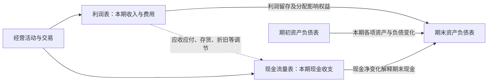

**怎么看图：** 利润解释权益变化的一部分；现金流解释现金及现金等价物变化；资产负债表保存经营活动留下的应收、存货、设备、债务等结果。

**简化边界：** 实际权益还有出资、分红、其他综合收益等变化；货币资金与现金及现金等价物口径也可能不同，因此应核对报表附注，不能只对两个表格里的名字。

把三表连起来最容易卡住的地方，是误以为每笔业务都要同时在三张表中出现。事实是：有的交易同时影响三表，有的只在资产负债表内部换形态。**以下是原创补充推演**，帮助你在后文完整算例之前建立方向感，均忽略税费和减值。

假设出售成本 6 万的现有商品，售价 10 万，客户暂未付款。利润表记录收入 10、成本 6，利润增加 4；资产负债表的应收增加 10、存货减少 6，净资产增加 4，权益也因利润增加 4；当时没有收付款，现金流量表不会凭空多出 10 万。三表之间没有矛盾，客户欠款保留了“利润尚未变成现金”的痕迹。

客户下一期付清 10 万时，现金增加 10、应收减少 10，资产总额和权益均不因这次收款而增加；现金流量表出现经营流入 10，利润表不会再赚一次。若你算出的第二期利润又多了 10，就说明把收回旧账误当新销售。

再看借款买设备：借到 20 万使现金和负债同时增加，买设备花 20 万又使现金减少、设备增加。经营利润当时可以完全不变，但现金流表会分别保留筹资流入和投资流出；不能因为净现金变化为零，就说这两笔活动无关紧要。它们给未来留下了折旧、利息、还本和产能。

实际核对时，先查现金从期初怎样变到期末，再查权益变动能否由利润、分配和其他变动解释，最后看应收、存货、设备和债务的变化是否与业务一致。**练习：** 公司偿还借款本金 5 万，为什么不能直接扣 5 万利润？**参考答案：** 现金和负债同减 5 万，属于偿还融资义务；借款时没有确认收入，还本时通常也不是费用。利息另按其性质处理。

### 核心知识点：从数字走到经营判断

#### 24. 同型分析与趋势分析，让规模差异不再遮住问题

同型分析也叫共同比分析：把利润表项目除以收入，把资产项目除以总资产，看结构占比；趋势分析则观察同一项目跨期变化。

趋势还要剔除合并范围变化、季节性、一次性项目和口径变更；两个年份不一致的口径，算得再精确也不可比。

#### 25. 周转率，衡量同一份资源能支持多少业务

```text
总资产周转率＝营业收入÷平均总资产
存货周转率＝营业成本÷平均存货
应收账款周转率＝赊销收入÷平均应收账款
```

平均值可以先用期初与期末的简单平均，但季节性强或变化大时应改用更密集数据。无法取得赊销收入时，分析者常以营业收入近似，并标明误差。

存货占用增加，可能来自积压，也可能是为长交期原料作必要储备，应结合业务判断。计算存货周转须以成本作分子，与存货的成本口径匹配，不能随手换成销售额；下一点直接查看美的实际存货与应收、应付的变化。

#### 26. 现金转换周期与营运资金：资金究竟压在哪个环节

企业通常要先备货，再交付，再等客户付款；供应商若允许延期结算，会承担一部分垫资。现金转换周期就是对这一时间结构的概括。

```text
存货天数≈平均存货÷营业成本×期间天数
应收天数≈平均应收账款÷同口径赊销收入×期间天数
应付天数≈平均应付账款÷同口径赊购额×期间天数
现金转换周期≈存货天数＋应收天数－应付天数
```

赊购额缺失时用营业成本近似可能误差很大，季度口径也不能直接套全年 365 天。天数反映时间，资金占用还要考虑应收按售价、库存和采购按成本形成的差别。

**书外真实案例：美的 2026 年 9 月末，不能只盯一项应收。** 原报告的合并余额如下，均换算为亿元；对照期为上年末，不是上年同期：

| 项目 | 2025 年末 | 2026 年 9 月末 | 变化 |
| --- | ---: | ---: | ---: |
| 应收账款 | 404.50097 | 520.31439 | ＋115.81342 |
| 存货 | 646.28834 | 566.26338 | −80.02496 |
| 应付账款 | 1036.80491 | 929.71502 | −107.08989 |
| 应付票据 | 271.21881 | 482.44581 | ＋211.22700 |

数据来自[三季报第 6—7 页](https://static.cninfo.com.cn/finalpage/2026-10-30/1225645132.PDF)。只看到应收增加，容易说“钱都压在客户那里”；只看到库存减少，又可能说“周转全面改善”。表中实际有多个方向：应收增加可能占资，库存减少可能释放资金，应付账款减少与应付票据增加也需要放在一起理解。票据是支付与信用安排的一部分，不能当应付款已经彻底消失。

**为什么仍不能把四行变动相加，就宣布解释了经营现金流？** 因为还有预付款、合同资产、合同负债、其他经营项目，以及汇率、合并范围、减值和非现金结算等影响。本期资产变化还不等于现金变化。与第 21 点的采购付款增加一起看，可以形成调查问题，却不能凭主表直接写成“公司为增长主动备货”——期末存货余额实际上下降，更需要检查期间变化和结构。


**图解：** 同一经营链同时受库存、客户和供应商影响。要判断哪一环节改善，最好读多个季度平均余额、账龄和结算条件，而不只比较两个期末。

**仅作口径演示：** 假设日销售 1 万、日成本及采购 0.6 万，应收 60 天、库存 40 天、应付 30 天，简化占用为 60＋24−18＝66 万，不能把 70 天现金周期直接乘日销售得出 70 万。业务按同样条件扩大一半，稳定占用约变为 99 万，多出的 33 万必须有资金来源；这些是假设数字，不是从美的余额推得的结果。

**练习：** 美的存货期末余额下降，能直接认定存货周转天数缩短吗？**参考答案：** 不能；仍需期间平均存货、成本流量与季节性。余额下降也可能与采购、产品结构或减值有关。

#### 27. 短期偿债能力，不能只靠一个流动比率

```text
流动比率＝流动资产÷流动负债
速动比率＝速动资产÷流动负债
```

速动资产通常排除存货及变现能力较弱的项目，但不同资料口径可能不同。比率衡量缓冲，不等同于现金到账承诺，也不存在对所有行业都合适的固定及格线。

如果流动资产主要是难以出售的库存，账面比率充足也未必能及时还债。应把预计收款日期与付款、还债日期放在同一时间表里，检查缺口和可用融资；只比较资产负债总数，会遗漏时间错配。

#### 28. 长期偿债能力，要同时观察杠杆与利息负担

```text
资产负债率＝负债总额÷资产总额
利息保障倍数＝息税前利润 EBIT÷利息费用
```

EBIT 是扣利息和所得税之前的利润，比较时应统一是否剔除非经常性项目。负债总额含经营性负债，不能全部当作有息贷款；利息保障倍数也不反映本金何时偿还。

**补充例子：** EBIT 为 50 万、利息为 10 万，保障倍数为 5。若下年 EBIT 降为 10 万，利息没有同比下降，缓冲就消失了。负债率高低要结合行业、资产稳定性、币种和期限判断，金融企业尤其不适合套普通制造业阈值。

#### 29. ROE 与杜邦分析，把股东回报拆成三种来源

净资产收益率 ROE 衡量一段时间内每单位股东权益对应的净利润。一个口径一致的简化分解是：

```text
ROE＝净利润÷平均股东权益
   ＝净利率×总资产周转率×权益乘数
权益乘数＝平均总资产÷平均股东权益
```

合并分析中，应匹配总净利润与总权益，或将归母净利润与归母权益配套；不能分子用归母、其他环节却混用全部股东口径。

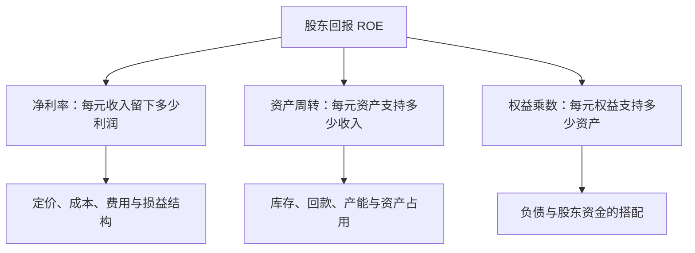

**怎么看图：** 同样的 ROE，可能来自产品赚钱、资源转得快，也可能主要靠杠杆。

理解杜邦分解，可以先看分子分母如何抵消：净利润/收入，乘收入/平均资产，再乘平均资产/平均权益，剩下的正是净利润/平均权益。它是一条会计关系，作用在于把“回报高”改成三个可调查的问题：卖一元能留多少钱，资产一年能支持多少销售，以及用了多少负债和股东资金。

**书外真实案例：美的 2026 年前三季度的 ROE，先把口径读对。** 报告列示加权平均净资产收益率 **18.06%**，同比增加 **1.27 个百分点**，而归母净利润同比增加 9.27%。同表期末归母权益为 2235.19 亿元，较上年末仅增 0.13%。利润增长率、ROE 和权益增幅是不同量，不能互相替代。[三季报第 2 页](https://static.cninfo.com.cn/finalpage/2026-10-30/1225645132.PDF)

如果只用“413.93 亿元归母净利润÷期末权益”，并不能复算公告的加权平均 ROE。分母涉及期间资金变化与适用计算口径；报告第 7 页还显示库存股较上年末增加。回购、分配和权益变动都值得查，但不能仅凭这个余额就精确归因 ROE 提升。更不能把九个月 ROE 直接叫作已经实现的全年收益率。

杜邦分解在这里提供的是调查顺序：先看销售每一元留下多少合并利润，再看同口径平均资产支持多少收入，最后看资产与股东权益怎样搭配。归母指标不能随手与集团总权益混接。若加权平均 ROE 与简单两期平均法不同，应记录口径差异，不要为了凑数调整分子。

**再用一个短算式隔离杠杆效应，以下不是美的数据：** 两项资产都投入 100 万、EBIT 为 12 万。全部用股东资金，忽略税时期初权益回报为 12%；若借款 50 万、年利率 6%，利润为 9 万，除以 50 万期初权益得到 18%。若 EBIT 降至 2 万，前者仍为正 2%，后者则为负 2%。借款没有提高产品本身的赚钱能力，却放大了股东结果；本金到期风险还没有包含在这个算式里。

现实中权益很小或为负时，ROE 的常规比较意义会减弱。使用真实报表，应将加权平均、简单平均和期初权益演示明确分开。

实际应用可先解释最近几年 ROE 变化的主要来源，再问来源是否可持续：利润率改善有无一次收益，周转提高是否靠压库存过度，权益乘数上升是否伴随短债增加。**练习：** ROE 从 15% 升到 20%，同时净利率、周转率均不变，最先查什么？**参考答案：** 先查权益乘数与权益分母为何变化，包括借款、回购、分红和减值；不能直接据此认定产品竞争力提高。

#### 30. ROIC、资本成本和经济利润：赚钱还要超过资金的机会成本

投资资本回报率 ROIC 关注经营使用的资本产生了多少税后经营收益；加权平均资本成本 WACC 反映债权和股权资金对应的要求回报。下面是便于理解的常见分析口径，不是所有行业唯一算法：

```text
NOPAT＝调整后的经营 EBIT×（1－适用税率）
ROIC＝NOPAT÷平均投入资本
WACC＝股权权重×股权成本＋债务权重×债务成本×（1－适用税率）
经济利润≈NOPAT－投入资本×WACC
```

NOPAT 是税后经营利润，尽量排除融资结构与非经营项目影响；投入资本可从有息债务加权益、扣除非经营现金等角度调整，也可从净经营资产计算。必须口径一致。WACC 的估计通常采用市场价值权重，税盾能否利用也有条件。

先弄清“资本成本”为什么不只等于借款利息。债权人要利息，股东也放弃了其他投资机会，并承担较后的索偿顺序；股东没有寄来利息账单，不代表他的资金没有要求回报。WACC 是对相应风险的资金要求回报的估计，不是保证能够实现的收益率。

**书外真实案例：伯克希尔 1985 年退出纺织业。** 巴菲特在当年股东信中回顾，一些更新设备的方案按单厂测算可以降低成本，但竞争者也会更新，行业价格随后下降，企业在投入更多资本后仍难获得足够回报。1985 年 7 月，伯克希尔决定关闭纺织业务。这里引用的是另一位经营者的历史记录，用来解释本书资本回报主题，并非肖星书中的原案例。[1985 年股东信：纺织业务关闭](https://www.berkshirehathaway.com/letters/1985.html)

把决策拆成三步就容易理解：第一，设备改善确实可能节约每件产品的生产成本；第二，如果整个行业都做相同投资，客户会通过降价拿走部分乃至大部分节约；第三，利润留下得不多，投入资本却变大，新增回报可能达不到资金要求。错误不一定发生在成本计算，而可能发生在“成本节约会全部留给股东”的竞争假设。

因此，ROIC 不是只在扩建后算一个漂亮比率，更应在扩建前追问新增资本的收益由谁取得。历史平均回报高，也不能证明下一个项目有效；原业务优势可能暂时掩盖新项目的低回报。反之，这段历史并不证明所有纺织或重资产投资都失败，要重新分析当时的竞争与价格条件。

**公式演示，非伯克希尔实际项目：** 投入资本 1000 万、NOPAT 80 万，ROIC 为 8%；若匹配的资本成本为 10%，经济利润约为 80−1000×10%＝负 20 万。这是机会成本缺口，不是现金账户又被扣 20 万。新增项目投入 200 万、每年新增 NOPAT 12 万，增量回报只有 6%；即使总利润增长，仍应质疑这笔新增投入。在严格假定 12 万等于从下一年末开始无限持续的净现金、无增长时，净现值为 12/10%−200＝负 80 万；真实项目不能跳过建设期、追加投入和寿命。

增长怎样由再投资与新增回报共同形成，可参照 [Damodaran 的增长推导](https://pages.stern.nyu.edu/~adamodar/New_Home_Page/valquestions/growth.htm)。资本成本的概念与误用参照其[资本成本论文](https://pages.stern.nyu.edu/~adamodar/pdfiles/papers/costofcapital.pdf)。这些用于校准本笔记的补充教学，不是原书给出的具体项目。

实务中新增产能常需几年才成熟，不能简单用本年利润增加除以本年资产增加便认定项目失败。应追踪一批投资的投产时间、利用率、利润和现金，并用一致口径与资本成本区间比较。**练习：** 为什么设备降本方案看似合理，整体投资仍可能不好？**参考答案：** 还需考虑竞争者行动与售价变化；节省成本若被降价抵销，新增资本就未必获得足够回报。

#### 31. 行业、战略、执行，共同塑造财务数字

行业影响需求波动、议价能力、资产投入与资金周转；战略决定企业选择怎样的客户和竞争方式；执行影响这一选择能否落地。

分析顺序可以是：先找行业正常区间，再看公司选择，最后查实际结果。财报能提供证据，但无法单独证明因果；毛利下滑可能来自降价、原料涨价，也可能来自低毛利产品占比上升。

#### 32. 增长、利润与风险，要放在同一条资金链里看

销售增长会带来更多利润机会，也可能需要增加库存、应收款和设备。新增业务如果回款慢、毛利低、资本投入大，增长反而可能压低资本回报并扩大融资缺口。

判断时把三件事放一起：新增利润是否可持续，新增资本是否有效，现金能否覆盖扩张与到期义务。成熟企业评价长期经营能力时，利润提供重要信息；快速扩张、财务困境或融资脆弱阶段，现金约束可能更迫切。不存在一张表在所有场景永远最重要。

### 延伸知识：读真实财报时还需要补上的三块

#### 33. 附注、审计意见和管理层讨论，是理解数字的上下文

本点属于补充阅读方法。主表告诉你金额，附注解释会计政策、组成、估计与限制；审计意见表达审计师对报表整体的意见，不是对投资回报或未来偿债的保证。

管理层叙述与数字不一致时，应继续核查；不能仅凭一个异常比率宣判造假。主表、附注和经营解释需配合使用，可参照 [SEC 的报表与附注说明](https://www.sec.gov/investor/pubs/begfinstmtguide.htm)。

#### 34. 自由现金流有用，但“经营现金流减资本开支”只是一个口径

本点为估值衔接的补充。常见简化自由现金流等于经营现金流减资本开支，用来看经营所得在长期资产投入后还剩多少；公司整体自由现金流 FCFF 和股东自由现金流 FCFE 则需要不同调整。

资本开支可能用于维持现有业务，也可能用于扩张，二者对未来现金流的含义不同。但“维护性”与“扩张性”往往无法从一行数字直接分开，不能为了让估值更高，就将必要设备更新一律归为可取消的扩张。

不要把这种简化数当作可直接分红金额；也不要忽略股权激励稀释、租赁、并购及债务偿还等因素。估值时，现金流归谁、折现率归谁，必须匹配。

#### 35. 好公司与好买价，需要分开判断

这是对本书分析框架的投资应用延伸。财报帮助评估经营质量和历史表现，买入价值还依赖未来现金流、风险和支付价格。高利润企业如果价格已经包含过度乐观预期，仍可能带来差的投资结果。

用财报研究股票时，把“企业经营判断”与“估值假设”分栏记录，也记录什么变化会让自己改判。本笔记提供阅读方法，不提供某只股票的买卖结论。

### 难点贯通：亲手走一遍三张表

下面是**原创补充算例**，不是原书案例。金额统一为万元；公司期初尚未经营，各项余额为零。为突出三表关系，忽略增值税、所得税、坏账、汇率及其他复杂项目；假设利息现金流归筹资活动，折旧全部计入当期费用。

#### 第一步：发生了哪些交易

| 次序 | 业务 | 对资产负债表的主要影响 | 对当期利润的影响 |
| --- | --- | --- | --- |
| 1 | 股东投入现金 100 | 现金＋100，投入资本＋100 | 无 |
| 2 | 银行借入现金 50 | 现金＋50，借款＋50 | 无 |
| 3 | 现金买设备 60 | 现金－60，设备＋60 | 购买本身不直接影响利润 |
| 4 | 买商品 40，支付 30，余款未付 | 现金－30，存货＋40，应付账款＋10 | 尚未销售，不直接影响利润 |
| 5 | 销售收入 80，收到 50，余款未收 | 现金＋50，应收账款＋30 | 收入＋80 |
| 6 | 上述已售商品成本为 25 | 存货－25 | 成本＋25，利润－25 |
| 7 | 支付当期工资、租金等 15 | 现金－15 | 费用＋15，利润－15 |
| 8 | 确认当期设备折旧 6 | 设备账面净额－6 | 费用＋6，利润－6 |
| 9 | 支付并确认借款利息 3 | 现金－3 | 利息费用＋3，利润－3 |
| 10 | 向股东现金分红 10 | 现金－10，权益－10 | 无，属于利润分配 |

#### 第二步：利润表怎么算

| 项目 | 金额 |
| --- | ---: |
| 营业收入 | 80 |
| 减：营业成本 | 25 |
| 毛利 | 55 |
| 减：工资、租金等当期费用 | 15 |
| 减：当期折旧 | 6 |
| 简化 EBIT | 34 |
| 减：利息费用 | 3 |
| 税前利润 | 31 |
| 所得税费用：为教学简化设为零 | 0 |
| **净利润** | **31** |

它赚了 31 万，不等于它本期从客户那里净收到 31 万，也不等于可以随意拿走 31 万。

#### 第三步：现金流量表怎么算

| 类型 | 计算 | 净现金流 |
| --- | --- | ---: |
| 经营活动 | 客户回款 50－采购付款 30－工资租金 15 | 5 |
| 投资活动 | 购买设备－60 | -60 |
| 筹资活动 | 股东投入 100＋借款 50－付息 3－分红 10 | 137 |
| **本期现金净增加** | **5－60＋137** | **82** |

设备折旧不再扣一次现金。取得贷款与投入资本没有出现在收入里，却出现在筹资现金流里。

#### 第四步：期末资产负债表怎样平衡

| 资产 | 金额 | 负债与权益 | 金额 |
| --- | ---: | --- | ---: |
| 现金 | 82 | 银行借款 | 50 |
| 应收账款 | 30 | 应付账款 | 10 |
| 存货：40－25 | 15 | 股东投入资本 | 100 |
| 设备净额：60－6 | 54 | 留存收益：31－10 | 21 |
| **资产合计** | **181** | **负债与权益合计** | **181** |

现在能同时对上三条线：

```text
资产＝82＋30＋15＋54＝181
负债＋权益＝50＋10＋100＋21＝181
期末现金＝期初现金 0＋本期现金净增加 82＝82
```

#### 第五步：为什么净利润 31，经营现金流只有 5

```text
净利润                                  31
加：计入利润但未发生当期现金支出的折旧      6
加：本例归为筹资现金流的利息费用            3
减：应收账款增加                         30
减：存货增加                             15
加：应付账款增加                         10
经营现金流                                5
```

这是本算例全部事实下的闭合调节，不是任意公司的通用完整公式。应收款让一部分收入还没变现金；存货使一部分现金还没变费用；应付款则让公司暂时不用支付部分采购款。**这就是利润与现金不同、但又能够相互解释的原因。**

### 把这些知识用起来：一次真实财报阅读练习

选一家业务容易理解的非金融企业，取得同口径连续三年的年报。先写问题，再找数字。

1. **用三句话描述生意。** 卖什么、卖给谁、客户为什么愿意付钱；暂时不看股票涨跌。
2. **看投入。** 主要资产是什么？近三年增加的是设备、存货、应收款还是现金？新增投入为哪个业务服务？
3. **看利润来源。** 收入、毛利、主要费用和净利润如何变化？用业务事实解释变化，避免只写“同比增加”。
4. **核对回款。** 经营现金流与净利润为什么不同？应收和存货的变化能否解释？特殊事项是否影响可比性？
5. **看效率与负担。** 选合适的周转率、ROE、ROIC与债务指标；口径和计算过程都留在笔记中。
6. **找可比对象。** 比同行、比历史，并解释战略差异；不用跨行业的“标准答案”硬打分。
7. **写出有限结论。** 哪些证据支持经营改善？最可能推翻判断的两件事是什么？哪些信息还不知道？

可以用这张小表组织结论：

| 判断 | 支持证据 | 另一种解释 | 下一步验证 |
| --- | --- | --- | --- |
| 补充示例：回款可能变慢 | 应收增长快于收入，账龄拉长 | 年末大客户交付集中 | 看期后收款、信用条款与客户情况 |
| 补充示例：扩张暂时占用现金 | 设备投入增加，投资净流出 | 投资低效或重复建设 | 看产能利用率、订单与后续资本回报 |

如果你是管理者，练习的输出可以是“优先催收哪类款项、减少哪类低效库存、如何评价新增投资”；如果你是普通读者，能把数字说成一段可验证的经营故事，就已经获得了本书最重要的能力。

### 易错点速查

| 常见误读 | 更准确的理解 |
| --- | --- |
| 买设备花了钱，所以当年全是亏损 | 先看资产确认，再看折旧、减值和用途 |
| 收到钱就是收入 | 借款、出资、预收款等需要分别判断 |
| 净利润就是老板能取走的钱 | 还要看现金、经营需求、债务和分配条件 |
| 现金流不能粉饰 | 分类、交易时点、保理、关联交易等仍需核查 |
| 投资现金流为负一定危险 | 先看买了什么、为什么买、回报和资金来源 |
| 高 ROE 一定是好公司 | 拆开利润率、周转与杠杆，检查分母和特殊收益 |
| 高毛利一定优于低毛利 | 看周转、费用、资本投入与竞争路线 |
| 账面净资产就是公司出售价值 | 账面计量与市场价值、未来价值并不相同 |
| 财报看懂了，就知道股价会涨 | 未来与买入价格仍需独立分析 |

### 自测：能解释这些问题，就抓住了主干

1. **赊销 10 万，尚未收款，通常先影响哪些项目？** 满足收入确认条件时，收入与应收款增加；销售成本等还需另行结转；当时不因这笔赊销产生客户回款。
2. **偿还贷款本金会降低当期利润吗？** 通常不会；它减少现金和借款。利息费用的确认是另一件事。
3. **折旧为什么可以在间接法里加回？** 因为它降低了起点利润，却不代表当期再付一次现金；仍需考虑长期设备投入。
4. **一家公司的现金增加，为什么可能更危险？** 增加可能来自短期举债，而经营仍在流血，未来偿债压力反而更大。
5. **ROE 提升，应先拆哪三项？** 净利率、总资产周转率、权益乘数，并统一利润和权益归属口径。
6. **公司 ROIC 为 7%、资本成本估计 10%，能说明什么？** 在这些口径与估计成立时，经营回报未达到资金要求回报；不能只因净利润为正就认定创造价值。
7. **应收款突然增加，为什么不能直接认定造假？** 增长、季节性、客户信用政策及收款时间都可能解释；异常是调查起点，不是结论。
8. **为什么说增长可能消耗价值？** 新增长可能占用很多资金，却只产生低于资本成本的新增回报，同时加重现金压力。

### 来源与阅读边界

本笔记不逐字摘录原书，未复制第三方书评。公开目录用于核对主题覆盖；会计与公司财务部分用通行知识和一手资料校准，真实数据表注明公司、期间与原公告；标为计算演示的数字才是假设。图示为本笔记的教学整理。国际准则资料用于解释概念，不表示可以忽略中国准则、行业差异及具体报告期要求。

| 资料 | 用途与边界 |
| --- | --- |
| [清华大学肖星主页](https://www.sem.tsinghua.edu.cn/info/1205/32025.htm) | 作者与早期版本核验，不据此推断全文内容 |
| [对外经贸大学图书馆书目](https://opac.uibe.edu.cn/opac/book/3d543fc78e2c850406c5a1cca06efe33) | 2022 年版书目信息、出版方与主旨 |
| [得到第三版目录](https://www.dedao.cn/ebook/detail?id=A1De6QkaNRMlK5yxrdmnEBXY97ZL23nRlM3o6zvGDekj1QgA84VbpqJOPLgxEJlY) | 主题索引；未把读者评论当作作者原文 |
| [财政部基本准则](https://www.mof.gov.cn/zcsjtsgb/gztsgb/201407/t20140723_3578373.htm) | 要素、权责发生制及计量概念 |
| [财政部存货准则](https://www.mof.gov.cn/zhengwuxinxi/zhengcefabu/2006zcfb/200805/t20080519_23107.htm) | 存货成本、结转与跌价概念 |
| [财政部固定资产准则](https://www.mof.gov.cn/zhengwuxinxi/zhengcefabu/2006zcfb/200805/t20080519_23104.htm) | 固定资产与折旧概念 |
| [财政部年报工作通知](https://m.mof.gov.cn/czxw/202501/t20250106_3951168.htm) | 资产减值与应收款风险提示的一手核验 |
| [SEC 财务报表入门](https://www.sec.gov/investor/pubs/begfinstmtguide.htm) | 报表分工、附注与经营解释 |
| [IFRS 基金会 IAS 7](https://www.ifrs.org/issued-standards/list-of-standards/ias-7-statement-of-cash-flows/) | 现金流类别与基本概念 |
| [IFRS 基金会 IFRS 15](https://www.ifrs.org/issued-standards/list-of-standards/ifrs-15-revenue-from-contracts-with-customers/) | 履约与收入确认逻辑；不替代特定合同判断 |
| [IFRS 基金会 IAS 38](https://www.ifrs.org/content/dam/ifrs/publications/pdf-standards/english/2021/issued/part-a/ias-38-intangible-assets.pdf?bypass=on) | 内部研发确认的概念解释 |
| [Damodaran：资本成本](https://pages.stern.nyu.edu/~adamodar/pdfiles/papers/costofcapital.pdf)与[资本回报教学](https://pages.stern.nyu.edu/~adamodar/New_Home_Page/cfemailspr11.html) | ROIC、资本成本及计算口径的补充校验 |
| [Damodaran：增长的基本驱动因素](https://pages.stern.nyu.edu/~adamodar/New_Home_Page/valquestions/growth.htm) | 资本再投资、平均与增量回报的补充校验 |
| [美的集团 2026 年三季报](https://static.cninfo.com.cn/finalpage/2026-10-30/1225645132.PDF) | 书外真实案例：合同资产、减值、利润分类、现金流、经营资金与 ROE；报告未经审计 |
| [伯克希尔 1985 年股东信](https://www.berkshirehathaway.com/letters/1985.html) | 书外真实案例：纺织投资与竞争对资本回报的影响 |

**尚未覆盖：** 原书各版具体企业案例的完整数据和推导、每个问答小节的全部细节、适用于特定公司的复杂收入合同及会计处理。后续拿到原书，可以按原章逐项补充，并把本笔记中的“主题覆盖”升级为可核对的阅读记录。

---

[返回书籍索引](<README.md>) · [财商学习与实践路线](<财商进阶合订本.md>)


---

<a id="book-02"></a>

[单独打开本篇](<聪明的投资者 - 本杰明·格雷厄姆/读书笔记.md>)

## 《聪明的投资者》读书笔记

> 作者：本杰明·格雷厄姆（Benjamin Graham）；英文名：The Intelligent Investor。  
> 版本说明：初版发表于 1949 年；常见评注版保留格雷厄姆后期修订文本，另加入 Jason Zweig 的评注。Zweig 又有更新版本，不能把新增评论、现代产品和案例都算作格雷厄姆原著内容。用户所持中文译本未确认。  
> 分析依据：公开目录、Zweig 本人介绍与访谈、监管机构投资者教育资料，以及对经典概念的原创教学解释；书外案例另核对伯克希尔原信、美国财政部证词、Vanguard 官方基金资料表与美的集团公告。未取得用户版本全文。  
> 覆盖范围：原书二十章的主要主题，归并为 32 个知识点；不逐个复述历史公司案例，不承诺覆盖所有脚注与版本差异。  
> 更新日期：2026-11-11

版本与评注的区别参见 [Zweig 官方书页](https://jasonzweig.com/books/the-intelligent-investor/)；章目参照 [O'Reilly 的授权电子书目录](https://www.oreilly.com/library/view/the-intelligent-investor/9780061745171/)。以下章节号按常见修订版正文二十章；中文小标题为概括，不冒充某个译本原文。标明“书外真实案例”的事件据一手资料核验，不冒充原著案例；计算演示与应用流程为本笔记编写。

### 先看这里：它究竟教你什么

**一句话概括：把股票当作企业权益，以合理价格和风险安排购买，建立能让自己长期坚持的判断与纪律。**

“聪明”主要指独立判断、耐心、自我约束和愿意承认不知道，不是预测每一次涨跌的天才。你可以研究得很深，也可以承认自己不愿长期研究，采用更简明的防御路线；危险在于既没有研究，又期待持续获得专业选股的结果。

七个最值得记住的结论：

1. **投资与投机要分清。** 没有分析支撑、只期待下个人出更高价的交易，不能因持有时间变长就自动升级为投资。
2. **市场报价不是你的老师。** 它提供交易条件，你有权暂时不交易。
3. **买得便宜，要相对于价值。** 股价跌过、单价低、历史涨得少，都不等于便宜。
4. **给错误留余地。** 安全边际承认预测会错，并且要防止误判导致无法承受的损失。
5. **优先选择你能执行的方案。** 高难度策略与高自信不是同一回事。
6. **费用、过度交易和情绪是可控制的损耗。** 未来市场回报无法保证，这些损耗却会真实发生。
7. **数字标准有时代背景，原则更长久。** 原书的利率、公司规模和筛选阈值，不能直接变成今天任何市场的买入指令。

它对提高财商最直接的帮助，是把“我觉得会涨”改成四个问题：**我买的是什么？依据是什么？价格给了多少容错？我承担得起什么结果？**

### 全书主线与知识覆盖

| 正文位置 | 主要问题 | 本笔记覆盖 |
| --- | --- | --- |
| 第 1—3 章 | 投资边界、通胀、市场历史 | 1—5 |
| 第 4—5 章 | 防御型投资者的组合与股票选择 | 6—10 |
| 第 6—7 章 | 进取型投资者应避开什么、研究什么 | 21—24 |
| 第 8 章 | 怎样面对市场波动 | 11—13 |
| 第 9—10 章 | 基金与投资顾问 | 25—27 |
| 第 11—12 章 | 基本分析与每股收益 | 15—18 |
| 第 13—15 章 | 企业比较、不同类型选股 | 9、17、21—22、29 |
| 第 16 章 | 可转换证券与认股权证 | 28 |
| 第 17—19 章 | 历史案例、股东与管理层、分红 | 19—20、29 |
| 第 20 章 | 安全边际 | 14、30 |

正文负责建立判断框架；Zweig 的评注帮助解释现代市场中的应用和行为问题。下面将两者能确认的共同原则与补充教学分开，不把互联网时代的基金产品当成 1949 年已存在的原著建议。

### 核心知识点

#### 1. 投资，是分析、保护本金与合理回报共同组成的过程

原书第 1 章的投资概念包含充分分析、对本金安全的重视及适当回报。它不是任何资产绝不下跌的担保，也不是“好公司永远都能买”。

**财商收获：** 每笔资金先标清目的。没有证据支撑的部分就承认是押注，不用“长期投资”掩盖缺少判断依据。

#### 2. 投机可以存在，最危险的是自己没有意识到在投机

原书并非宣称所有投机都不合法或不道德，而是要求你知道自己在做什么。区分的关键不是持有几天，也不是证券有没有名气，而是回报理由：你能否依据资产、盈利、价格和风险作出有保护的判断，还是主要押注接下来会有更高报价。相同证券可以被不同的人以不同方式使用，持有多年也不能自动补出缺失的分析。

判断一笔交易，先写下收益依据、价格保护和失效条件。若主要依据只是别人愿意更高价接手，就应承认其中投机成分；一次赚钱不能倒推方法可靠，一次亏损也不能单独证明分析毫无价值。

最常见的失控从“改名”开始：原先打算短线交易，下跌后临时改口“价值投资要有耐心”，但没有新增任何企业证据。问题不是没有立即卖出，而是原来的退出依据被情绪悄悄删除。后来再跌，他可能继续用更多钱摊低成本，使一笔有界的尝试变成整个家庭的风险。

因此，边界应落实在资金用途和书面规则上。先把必要生活支出、确定要用的钱和长期投资计划分清，再讨论是否保留试验性资金。不同账户能帮助记录，却不能隔离经济后果：如果不断从核心资金补钱，名义上的“小账户”仍会吞掉大账户。杠杆尤其会使账户跌幅之外再出现利息和强平约束。

**原创风险算例：** 假设总投资资金 100 万，其中 5 万是你明确接受可能全部损失的试验，其余 95 万先假设不变。试验亏掉 80%，总额变成 96 万，总体损失 4%；若亏损后再从其余资金转入 15 万继续押注，原来的风险安排就已经失效。这里的 5% 只是展示边界的假设，不是建议所有人配置这一比例，也不是允许不研究的理由。

检查一笔交易，可以暂时遮住买入成本，写下“从今天开始，还愿意以这个规模承担它吗？依据是什么？何种事实会改变决定？”买入价会影响税费和实际损益，却不会因为你想回本，就成为企业价值的支撑。

**自查题：** 一笔交易最初有研究依据，后来债务违约风险大增，但你只因不愿亏损而继续持有，原来的“投资”标签能否保证安全？**参考答案：** 不能。判断需要随证据更新；承认风险变化、减小规模或退出，都可能比维护标签更重要。Zweig 对行为约束的说明可参见[其 CFA 讲稿](https://jasonzweig.com/wp-content/uploads/2016/10/CFA-Graham.pdf)，本节资金边界的计算为补充教学。

#### 3. 防御型与进取型，区分的是投入方式和能力要求

防御型希望降低严重错误与管理负担，进取型愿意持续承担额外研究、判断和执行工作。主要区别在投入方式和能力要求，不能按“敢重仓所以进取”划分。防御路线也要检查期限、分散和费用；进取路线则必须能说明额外工作怎样改善判断。

**书外真实案例：2008—2017 年，巴菲特与 Protégé 的十年比较。** 巴菲特选用跟踪标普 500 的低成本指数基金，对方选择五只基金中的基金，间接持有两百多只对冲基金。2017 年信披露，指数基金十年累计增长 **125.8%**；四只完成十年观察的组合分别为 **21.7%、42.3%、87.7%、27.0%**，另一只于 2017 年清算，不能假装其观察期完全相同。[2017 年股东信，PDF 第 10—11 页](https://www.berkshirehathaway.com/letters/2017ltr.pdf)

这个真实比较让“更多专家、更复杂流程”与“最终投资结果”分开了。对方并非没有研究，而是额外研究、调整与多层费用没有在这次比较中转化为更好的净结果。学习本书时，应把进取理解为愿意付出并验证额外努力，而不是默认复杂方案天然优于简单方案。

但它也不是所有主动管理必败的实验。五只组合并非随机抽样，风险暴露与指数不同，十年环境也不是所有未来环境。正确收获是提出检验标准：多承担了什么风险、付出了什么费用、选择了什么可比较基准，最后是否获得了补偿；不能仅看名气或工作量。

如果你选择进取路线，应能持续产出经营分析、估值区间、反证条件和事后复核。若大部分时间只是读重复的评论，额外投入可能没有形成优势。若选择防御路线，则要接受它同样会经历市场波动，而不是在最困难时临时改成预测涨跌。

**计算演示：** 20 万资金若真能在相同风险、扣除成本后多取得 2 个百分点回报，一年增加 4000 元；如果投入 200 小时，相当于每小时 20 元的假设增量。这里并未证明那 2 个百分点存在，只提示时间和机会成本也应计入决策。

**练习：** 能否因十年比较中的指数胜出，就认定任何指数产品都适合自己？**参考答案：** 不能。还要检查所跟踪市场、集中度、费用、汇率、资金期限和风险承受力。此例是书外实践，不应误称为格雷厄姆原著中的指数基金案例。

#### 4. 通胀会侵蚀购买力，名义本金不变也可能变穷

名义回报是账户金额的变化，实际回报还要扣除物价影响。简化计算为：

```text
实际收益率＝（1＋名义收益率）÷（1＋通胀率）－1
```

**补充例子：** 一年名义赚 4%，物价涨 6%，实际购买力变化约为 1.04÷1.06－1＝负 1.89%。账户余额增加并不等于消费能力增加。

第 2 章因此提醒读者不能只看固定金额收益。但股票也不是任意期限必然跑赢通胀：企业可能无法涨价，利润率可能受挤压，买入估值也影响结果。抗通胀要看具体经济机制，不靠资产标签许愿。

#### 5. 学历史，是认识循环与估值，不是找到精确时钟

第 3 章用长时期市场背景讨论估值和预期。历史有助于看见繁荣时普遍乐观、低迷时普遍悲观，也提醒你当前价格已包含多少期待。

不要把书中某年市盈率和利率看成永远有效的红绿灯。值得继承的是比较价格与经营基础，警惕“这次任何价格都合理”。

#### 6. 资产配置先解决承受能力，再讨论选哪只股票

第 4 章讨论股票与高等级债券的组合。原书的股票区间与均衡配置建议属于历史框架，不能不问期限、币种和未来支出就机械套用。心理上愿意忍受下跌，与经济上能等恢复，是不同条件。

**书外真实案例：Vanguard LifeStrategy 60/40 Fund 的 2022 年。** 该基金的官方资料说明其策略约为 60% 股票、40% 债券；截至 2026 年 9 月的资料表列示，2022 年基金回报为 **−16.00%**，2023 年为 **＋15.49%**。数据包含分红和资本收益分配再投资、扣除基金费用，是该基金的历史回报，不代表所有 60/40 组合。[Vanguard 官方资料表第 1 页](https://workplace.vanguard.com/assets/corp/fund_communications/pdf_publish/us-products/fact-sheet/F0914.pdf)

这个结果首先纠正“分散之后不会亏”的想法。股票和债券各有风险，债券也会因利率、信用和期限变化跌价；把它们组合起来，并不承诺每次相互抵销。其次，投资者的钱是否可以等待，比自己是否喜欢这个比例更先需要回答：若必须在亏损年份支付确定支出，实际选择与能够长期持有的人不同。

用上述已发生的两年回报作标准化计算，不另编行情：期初设为 100，2022 年末为 84，2023 年末为 84×1.1549＝**97.0116**。第二年涨幅看起来接近第一年跌幅，仍未回到原点。这里暂不考虑个人税费、申赎和币种兑换；不能把这个单位值当作实际基金净值。

这也不能反过来证明 60/40 永久失效，更不能根据这两年就替所有人确定配置。应先将短期必要支出、应急资金和长期目标区分，再检查候选组合在不利情景下的金额损失、流动性和币种是否合适。工作收入与投资若同时暴露于同一行业，家庭整体风险还可能高于投资账户显示的程度。

选定安排后，复核应由资金用途、收入稳定性和负债等变化驱动，不能仅因某类资产最近上涨，就宣称自己的承受能力也提高了。现代期限与风险原则可参照 [Investor.gov 配置说明](https://www.investor.gov/introduction-investing/getting-started/asset-allocation)。

**练习：** 看到上述基金 2023 年上涨，能否认定 2022 年底必须用的钱也适合事先投入这种组合？**参考答案：** 不能。后来反弹不会改变当时的付款期限，也不保证未来反弹何时出现。这一案例用于理解风险与期限，不推荐该产品。

#### 7. 再平衡，是恢复原定风险，不是知道明天谁会涨

某类资产上涨后会在组合里占更大比重。再平衡把组合带回预先设定的范围，也可以利用新增资金完成，减少不必要的卖出。

**补充例子：** 原有股票 60 万、债券 40 万，股票涨到 90 万、债券仍为 40 万。股票占比约 69.23%；若目标仍为 60%，总资产 130 万对应股票 78 万，可将 12 万股票换成债券。这个计算没有预测股票接下来一定跌。

要事先规定按时间还是按偏离幅度检查，并考虑交易成本和税收；目标本身不合适时，应重新制定计划，而不是盲目恢复旧比例。[Investor.gov 再平衡说明](https://www.investor.gov/additional-resources/spotlight/formerdirectorlorischock-directors-take/it-time-rebalance-your-investment-portfolio)

#### 8. 债券的“固定收益”，不等于价格固定或没有风险

债券要分别看信用风险、利率风险、通胀风险、流动性和赎回条款。固定票息债券通常在市场利率上升时跌价；期限越长等因素可能使敏感度更高。

**补充例子：** 旧债每年付 3 元，市场新债同等风险可付 5 元，旧债往往需要降低价格才有吸引力。持有到期的思路仍依赖发行人能履约，并且你确实不需要提前出售。

高收益债的高利率通常包含更高违约风险，不能把收益率提升理解成免费午餐。[SEC 利率风险说明](https://www.investor.gov/introduction-investing/general-resources/news-alerts/alerts-bulletins/investor-bulletins-86)、[SEC 高收益债说明](https://www.investor.gov/sites/default/files/ib_high-yield.pdf)

#### 9. 防御型股票筛选，是把风险挡在买入之前

第 5、14 章重视企业规模、财务稳健、盈利稳定、分红记录、适度增长及不过高的购买价格。这些要求共同构成防御，不是拿某一个指标就结束研究。

原书具体规模门槛、市盈率、市净率及历史年限有其时代背景。今天分析轻资产企业和新会计口径时，要理解筛选目的，不能把数字组合当成自动盈利机器。

#### 10. 分散化，是承认自己可能看错

分散要覆盖不同企业风险，必要时也考虑行业、市场、币种和资产类型。买很多名称，不代表风险来源分散；十只依赖同一个商品价格的股票仍可能同时受损。

分散不能消灭市场整体下跌，也不能使明显过高的价格变合理。它的作用是减少单一错误对整体的破坏。[澳大利亚 Moneysmart 分散化说明](https://moneysmart.gov.au/how-to-invest/investment-diversification)

#### 11. 市场先生：把报价当作选项，不把情绪当作命令

原书第 8 章把市场想成不断提供买卖价格的交易伙伴。你可以接受合适报价，也可以不成交。寓言要解决的是：价格变化会诱导你用涨跌评价企业与自己的判断，然而报价与生意价值不是同一个量。

**书外真实案例：1973 年的《华盛顿邮报》公司。** 巴菲特在 1993 年信中回顾，买入时该公司股价已经大幅下跌；他将这次投资直接联系到格雷厄姆的“市场先生”。信中还说明，1973 年投入约 1000 万美元，到 1993 年持仓价值超过 4 亿美元、当年取得股息约 700 万美元。[1993 年股东信，市场风险讨论及 Katharine Graham 段](https://www.berkshirehathaway.com/letters/1993.html)

这些后来的成果能说明该项投资最终成功，却不能反过来证明“当时只要敢买下跌股就行”。真正应学习的是当时决策要依据什么：业务能否持续赚钱、管理层是否善待股东、买入价格是否留下余地。多年后收益漂亮，是结果验证；它不是事前可以跳过研究的理由。

报价提供的是一个选项。如果生意证据没有同幅恶化，较低报价可能改善未来回报条件；若客户、竞争或偿债能力已经永久受损，价格下跌也可能是在传递重要信息。“市场先生情绪化”不能成为拒绝坏消息的借口。该报业公司的历史经验，也不能保证今天所有媒体仍具有当时的经营条件。

实际操作时，将一次大跌拆成三栏：报价发生什么变化，经营事实发生什么变化，原估值中哪条假设需要调整。只有第一栏变了，不必立刻交易；第二栏有长期影响，就要重估。无法核实的地方写“未知”，而不是把坚持持有自动叫作独立思考。

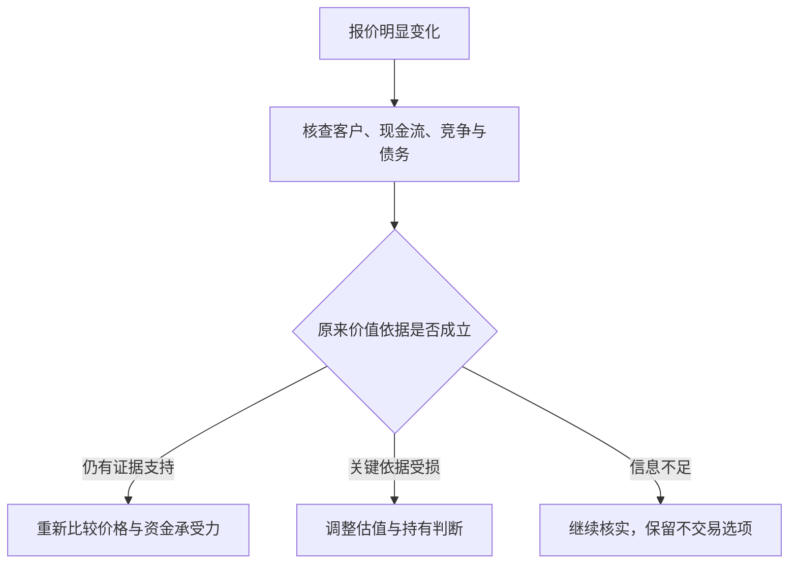

**图解：** 下跌只是入口，不能直接跳到“便宜了”或“坏了”。**练习：** 华盛顿邮报的成功是否证明跌得越多越安全？**参考答案：** 不证明。安全取决于下跌后支付的价格与可靠价值依据，以及资金能否承受等待；历史成功不是普遍规律。

#### 12. 价格是交易条件，价值是有依据但不确定的估计

价格容易看见，价值需要判断盈利能力、资产、竞争、债务和未来现金流。价值不是自己最喜欢的目标价，也不是买入成本。

一个实用习惯是先研究合理价值区间，再对照报价；如果先迷恋涨幅或目标价，随后搜集理由，分析容易变成自我辩护。

#### 13. 波动不是全部风险，永久损失和被迫出售更关键

格雷厄姆关注本金受损，而不只是报价起伏。资产价值、融资安排、期限和生活需要共同决定损失能否承受；没有卖出，不等于经济价值没有受损。

**书外真实案例：LTCM 在 1998 年濒临崩溃。** 美国财政部 1999 年国会证词披露，1997 年末长期资本管理基金资产接近 **1300 亿美元**，资本约 **47 亿美元**，总资产与资本之比约 **28 倍**。这是表内粗略杠杆，不能当作包括全部衍生风险的完整尺度。[美国财政部 1999 年证词](https://home.treasury.gov/news/press-releases/rr2991)

这个资金结构把一个重要问题摆到估值之前：即使认为价差最终会回归，资本能否承受它先向不利方向扩大？损失侵蚀权益后，相同资产规模对应的杠杆会更高，追加抵押品和融资收缩又可能迫使卖出。预测最终方向，与有能力等到兑现，是不同能力。

LTCM 是复杂机构事件，不能按一个杠杆比率概括所有原因，也不能据此断言所有套利都会失败。对个人可迁移的检查是：债何时到期、何时必须用钱、市场恶化时是否还要补现金。风险管理要让研究判断有机会接受长期事实检验，而不是让一次资金断裂提前终止。

**练习：** “我愿意长期持有”能否解决短期借款到期？**参考答案：** 不能。心理上的耐心不会改变合同现金需求。

#### 14. 安全边际，是为估值错误与坏情况预留缓冲

第 20 章把安全边际作为核心概念。余地可以来自价格低于保守价值、偿债覆盖充分、资产负债表稳健等；其前提是估值与风险判断本身有证据。如果每个预测都必须实现才能赚到合理回报，就没有为误差留出多少空间。

**书外真实反例：2016 年收购 PCC，2020 年承认付价过高。** 伯克希尔 2020 年信说明，当年约 **110 亿美元的减记几乎全部对应巴菲特在 2016 年收购 Precision Castparts 时的错误**：他对正常盈利潜力过于乐观。信中仍认可企业与管理者，却承认对未来平均利润和购买价格判断错误。[2020 年股东信，PDF 第 2—3 页](https://www.berkshirehathaway.com/letters/2020ltr.pdf)

这说明“买的是好公司”并不能替代安全边际。先把企业称为行业优秀者，再把优秀推导成很高的正常利润，最后为这个利润付高价，可能在不知不觉中把多个乐观假设叠加。外部冲击发生时，被暴露的既有当期经营压力，也有原先付价的脆弱性。

同样不能把减记直接等同于当年现金流出 110 亿美元：收购付款发生在更早时期，减记反映账面价值调整。这个数字也不是一份完整的最终投资回报计算。它真正提醒投资者，估值中的“正常盈利”需要承压验证，保守措辞不等于保守假设。

**如何将教训变成做法？** 先写出销量、利润率、维护支出和资本结构的证据，再对最敏感的变量做不利情景。不要先选一个想买的价格，再调增长率让模型显示便宜。即使承压价值高于价格，仍要查债务到期和被迫出售风险，因为账面价值等待实现需要资金条件配合。

**仅作分母演示：** 假定保守价值为 80 元、价格 56 元，折价为 (80−56)/80＝30%；由价格上涨到该价值的空间是 (80−56)/56≈42.86%，二者不是同一百分比。若后续证据使保守价值降到 50 元，原来的“三成安全边际”就已不成立。这是假设演算，不是 PCC 的估值复原。

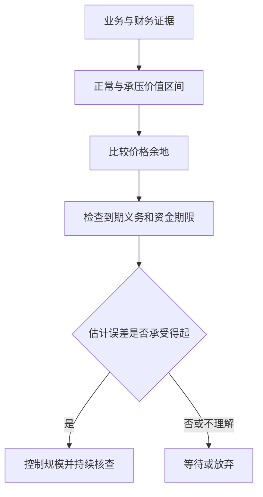

**练习：** 已买入的企业后来公布减值，能否说“非现金，所以安全边际没变”？**参考答案：** 不能。要研究减值是否意味着原来的盈利或资产价值假设失效；非现金计量仍可能承认过去真实的资本损失。

#### 15. 估值应当有区间，不要被小数点迷惑

第 11 章讨论证券分析对普通投资者的意义。你不必得到唯一精确价格，但应理解结论依赖哪些前提。增长率、利润率、资本投入和折现要求稍变，估值可能相差很大。

**补充例子：** 一个简化永续模型中，稳定现金流 10 元，要求回报 10%，零增长估值为 100 元；若要求回报提高到 12%，估值降至约 83.33 元。该模型极度简化，只用于显示敏感性，不能直接给真实公司估价。

看懂模型的条件比背公式更重要。越远期、越不稳定的收益，越不适合假装预测精准。

#### 16. 企业成长和股东高回报之间，还隔着价格与资本投入

好行业、好产品不必然带来好投资。预期增长可能已被计入高价格，增长本身也可能需要大量新资本、借债或增发。

因此要问：增长最终归现有股东多少？要投入多少？价格已经预付了多少？低增长并不自动好，高增长也不自动坏，关键在于事实和价钱是否匹配。

#### 17. 市盈率、市净率是检查工具，不是价值本身

```text
市盈率 PE＝每股价格÷每股收益
市净率 PB＝每股价格÷每股净资产
```

低 PE 可能因利润正处周期高点，也可能因为市场预见利润下降；低 PB 可能因资产价值被低估，也可能因为资产无法产生足够收益。净资产为负、盈利为负时，常规比率的含义会明显改变。

**补充例子：** 某企业今年 EPS 为 10 元、股价 50 元，看似只有 5 倍 PE；若正常年份 EPS 只有 2 元，实际常态盈利对应 25 倍。第 14 章的筛选纪律应该这样理解，而不是机械寻找最小比率。

#### 18. 每股收益要读质量、周期和稀释，不只读表面增长

第 12 章提醒读者研究每股数字的形成过程。市盈率的价格容易看到，盈利分母却需要检查：是否经常、处于什么周期、使用多少资本、被多少股数分享。单年高利润可能恰在景气高点，历史平均也可能掩盖结构性衰退。

**书外真实案例：美的 2026 年三季报怎样被误读为“全年正常利润”。** 原表披露前三季度归母净利润 **413.93371 亿元**、增长 **9.27%**；第三季度单季归母利润为 **149.47334 亿元**、增长 **25.93%**。同一份报告的累计扣非归母利润却下降 **22.49%**。这是不同期间和定义的真实数字，不能选增长最快的一项替代全部盈利能力。[三季报第 2 页](https://static.cninfo.com.cn/finalpage/2026-10-30/1225645132.PDF)

第一步是对齐期间。把前三季度利润机械乘 4/3，得到约 **551.91 亿元**，只是隐含“第四季恰等于前三季的季度均值”；它没有处理季节性，更不是已实现全年业绩。若用这个数字计算市盈率，必须标为自己的情景假设，不能装成报告披露。

第二步是拆损益。公司解释扣非差异涉及外币项目与相关衍生工具的分类；报告还列有其他投资和公允价值变动项目。不能把归母增长直接称为主营盈利增长，也不能无条件把扣非当作唯一的正常利润。应逐项判断哪些与持续经营相关、哪些可能反复发生、哪些只是某一期间的计量结果。[三季报第 2—4、8 页](https://static.cninfo.com.cn/finalpage/2026-10-30/1225645132.PDF)

第三步才是每股分析。前三季度基本每股收益 **5.54 元**、同比增加 **11.24%**，增长率并不等于归母利润的 9.27%。每股指标还涉及普通股股东收益及加权平均股数等口径，应查回购、增发和潜在稀释，而不是假设股数始终不变。这里没有取得足够信息来将差额全部归因于某一次回购。

周期企业还要进一步按正常销量、售价、单位成本和固定费用重建盈利。**简化计算演示：** 卖 100 万件、单价 100 元、单位变动成本 60 元、固定费用 2000 万，忽略税息时利润为 2000 万；售价降至 90 元、其他不变，利润便降至 1000 万。收入只跌 10%，利润却跌 50%，因此不能把景气高点的低 PE 自动当便宜。这不是美的成本结构测算。

**练习：** 为什么即使真实公告没有错误，投资者仍会算出误导性的市盈率？**参考答案：** 可能混用单季与累计、机械年化、错误正常化盈利，或忽略股数变化。先把分母研究清楚，才谈价格是否留有余地。

#### 19. 分红是资本配置的一种方式，不是凭空增加财富

第 19 章讨论股东、管理层和分红政策。留存利润应当有合理用途，管理层需要证明留在公司里能带来足够收益；但高分红本身也不是优秀的全部证据。

比较分红、留存、回购时，应看再投资机会、财务状况、价格和税收。股票拆分只是把同一权益拆成更多份额，不会自动创造经营价值。

#### 20. 股东应评价管理层，不把所有解释照单全收

管理层替股东运用资本，应根据长期每股经营结果、资本回报、报酬安排和对外沟通来评价。规模扩张和高管名气不等于股东利益增长。

这是第 19 章主题的实践延伸。普通股东的信息和影响力有限，不能以“我会监督”替代事前选择；重要的是识别激励是否匹配、解释能否核验，以及自己是否愿意继续承担这种治理结构。

#### 21. 进取型投资，需要可识别的优势和完整研究

第 6—7、15 章涉及更主动的投资方法。它要求识别为什么某些证券被忽略、为什么报价可能偏离价值，以及自己有哪些证据；并不保证多花时间就一定赚得更多。

真正的进取路线常常意味着更谨慎的研究和更耐心的等待。若研究能力无法覆盖复杂情形，保持简单也符合本书精神。

#### 22. 便宜资产与价值陷阱，只差几个关键前提

低于账面净资产买入，只有在资产具有可回收价值、义务可控，而且价值能归属股东时，才可能提供保护。账面便宜若伴随持续亏损、资产难卖和资金消耗，折价可能只是问题的一部分。

**书外真实案例：伯克希尔纺织设备的清算。** 1985 年退出纺织业后，伯克希尔在 1986 年初拍卖相关设备。原信所列出售金额还包含拍卖前数月的部分处置；这批设备原价约 **1300 万美元**、账面净值 **86.6 万美元**，出售总收入仅 **163,122 美元**，计入必要处置费用后净收益低于零。[1985 年股东信，设备拍卖段](https://www.berkshirehathaway.com/letters/1985.html)

这不是说会计一定错了，而是说明“仍可使用”“账上还有价值”和“有人愿意以该价格买走”不同。若整个行业都缺少有利可图的用途，专用设备的转售价值会很低，拆除和搬运还可能增加成本。因此，研究低 PB 或净资产折价，必须逐类问谁会买、以什么用途买、费用和债务如何扣除。

同一历史也不能推出所有工业资产都无价值。资产所在位置、通用程度、需求和处置方式不同，回收结果会不同。**练习：** 能用设备新购置价作为清算价值下限吗？**参考答案：** 不能；重置成本回答重新买入要花多少，清算价值取决于当前买方及处置代价。

#### 23. 特殊机会，必须把失败情景也放进计算

并购、清算、重组等事件可能形成不同于普通经营估值的机会，但它们依赖事件完成、时间、融资、监管等条件。历史书中的机会描述不能替代今天的具体交易分析。

**补充例子：** 以 90 元买入，成功后得 100 元，失败后可能只值 60 元。如果成功概率为 80%，粗略期望终值是 92 元；看似正的 2 元差额还未扣时间和成本，概率估计又可能错。

事件套利并不是“有公告就稳赚”。对多数普通读者，理解为什么有价差即可，不必把它变成自己必须掌握的操作技能。

#### 24. 新发行与热门证券，报价可能对卖方更有利

第 6 章强调避免在发行热潮中放松标准。企业和承销方了解自身情况，也可能选择市场情绪良好的时期融资；买方不能因为“新”“抢手”“明星机构参与”而免除分析。

这不是说所有新股都差，而是提醒你考虑交易双方的动机、历史数据是否完整、锁定期及潜在供给，以及价格给了多少保护。

#### 25. 投资顾问应帮助你作出合适决定，不只是给出热点名单

第 10 章讨论投资者与顾问的关系。需要了解顾问的资质、报酬来源、利益冲突、研究依据与服务边界；复杂术语和坚定语气不能替代这些信息。

自己不必重复所有专业工作，但应能复述投资在赚什么钱、会在什么情况下亏损。无法解释的推荐，不应因“专家说了”就被视为充分分析。

#### 26. 基金解决部分管理负担，却不能消除底层风险

第 9 章讨论基金；现代低成本广泛分散基金的具体应用也常见于 Zweig 的评注和投资者教育资料。持有基金意味着间接持有其资产，必须理解投资范围、集中度、费用和约束。

指数基金也会下跌，主动基金也可能有合理用途。比较时先统一风险与基准，再看成本和长期可验证结果。[Investor.gov 基金说明](https://www.investor.gov/introduction-investing/investing-basics/investment-products/mutual-funds-and-exchange-traded-funds-etfs/mutual-funds)

#### 27. 成本会复利，行为损耗可能更大

管理费、交易价差、佣金、税收和频繁换手都会侵蚀结果。Zweig 的现代解释特别适合用来理解这一点；本文算例只是数学演示，不是收益预测。

**书外真实观察：** 第 3 点的十年基金比较中，巴菲特特别指出多层固定收费的持续负担；但不能把整个表现差距都归因为费用，因为策略和风险也不同。[2017 年股东信，PDF 第 10—11 页](https://www.berkshirehathaway.com/letters/2017ltr.pdf)

**只演示费用复利：** 本金 10 万，假设每年毛回报固定 7%、将年费简化为直接减去 0.2% 或 1.5%，30 年后约为 72.0 万或 49.8 万。这个计算隔离费率影响，不是上述真实基金的收益复原。

费用率也未必包含所有交易成本；“零佣金”不能等同于零成本。账户因为恐慌追涨杀跌造成的损耗，还可能超过显性费用。[SEC 费用影响说明](https://www.sec.gov/oiea/investor-alerts-bulletins/investoralertsib_fees_expensespdf)

#### 28. 可转换证券、优先股和认股权证，要拆开权利与代价

第 16 章着重可转换证券与认股权证；优先股在其他章节亦有讨论。可转债将债权与转股选择结合，但票息、转股条件、赎回条款和发行人信用共同决定价值；优先股也不等同于存款。

“上涨有股性、下跌有债性”不能当成保本承诺。必须查具体条款和清偿顺序。[新西兰 FMA 的债券类型与风险说明](https://www.fma.govt.nz/consumer/investing/types-of-investments/bonds)

#### 29. 企业对比与历史案例，训练的是识别模式

第 13、17、18 章安排公司比较与案例。读它们的价值是练习区分经营事实、财务结构、市场预期与价格，而不是记住几十年前哪家公司后来涨跌。

阅读案例可以固定问四件事：当时能知道什么？人们忽略了什么？价格包含什么？结论是否被后见之明美化？本笔记没有原样重演书中全部历史公司数据。

#### 30. 安全边际与分散化要一起用，不能只做其中一半

你可能判断某只股票便宜，但估值仍会错；你也可以充分分散，却把整个组合买得很贵。前者需要限制单个判断的破坏力，后者需要在组合层面注意价格与预期。

格雷厄姆的思路不是找一个完美数字，而是让研究、价格、分散、财务安排和行为纪律共同工作。暂时没有适合机会时，不交易也是一种决定。

#### 31. 定期投入可以降低择时负担，但不保证收益

本点为防御路线的补充应用。把稳定结余按计划投入，有助于减少反复猜测入场点的负担；价格低时同样金额能买更多份额，价格高时买得较少。

**补充例子：** 两次各投 1000 元，价格分别 10 元和 5 元，买到 100 份和 200 份，平均成本约 6.67 元。但若资产价值不断下降，买得更多也可能扩大损失。

应区分“工资逐步到手后投资”与“已持有大笔现金却刻意分期投入”，两者机会成本不同。纪律必须建立在适合的资产、期限和现金安排上。

#### 32. 用书面规则约束自己，比发誓保持理性更可靠

本点是全书原则的实践重组。投资前记录目标、资金期限、选择依据、主要风险、持有规模及何时重新评估。这样才能区分后来到底是企业变化，还是自己情绪变化。

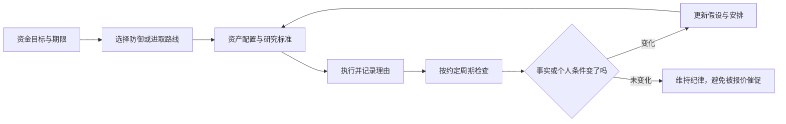

图示强调“有变化就更新，无变化也不必强行交易”。纪律不是顽固，承认错误是纪律的一部分。

### 三个难点，用小算例再看一遍

#### 难点一：便宜和安全边际到底差在哪里

**原创例子：** 公司未来正常情况下可能值 100 元，乐观情况下值 150 元，悲观情况下值 55 元。

| 报价 | 相对乐观价值看 | 相对保守情景看 | 应有的认识 |
| --- | --- | --- | --- |
| 120 元 | 似乎还能涨 25% | 容错很少 | 不能只选择最乐观故事 |
| 80 元 | 看上去折价更多 | 仍高于悲观价值 | 需要认真判断坏情景及承受能力 |
| 50 元 | 折价很大 | 低于当前悲观估计 | 继续检查估计、债务和治理是否漏项 |

价格低于保守估值只是证据之一。如果公司的债务条款使普通股在坏情景下归零，不能只用一个简单估值区间遮住这个风险。

#### 难点二：亏损为什么这么需要避免

```text
恢复原本金所需收益率＝亏损比例÷（1－亏损比例）
```

| 先亏损 | 回到原点需要上涨 |
| ---: | ---: |
| 10% | 约 11.11% |
| 25% | 约 33.33% |
| 50% | 100% |
| 75% | 300% |

这是纯算术，不说明所有下跌都该立刻卖出；它解释为什么本金保护、避免过度杠杆和控制单个错误很重要。长期复利需要你还有资本，并且有时间留在场内。

#### 难点三：好公司为什么也会让人亏钱

**原创例子：** 公司每股收益现在为 2 元，买入价格 100 元，即 50 倍 PE。五年后 EPS 增至 3 元，但市场只给 25 倍 PE，股价为 75 元；忽略分红税费，价格回报为负 25%。企业确实增长了，投资者仍然亏损。

这里没有预测“高 PE 一定跌”。它说明投资结果包含两部分：企业创造了什么，以及买入时已经为未来支付了多少。分析不能只有第一部分。

### 你能实际学到什么

| 能力 | 原来容易怎样想 | 学完后怎样问 |
| --- | --- | --- |
| 辨别投资理由 | 大家都看好，所以可以买 | 支持价值的证据是什么？ |
| 管理价格情绪 | 涨说明对，跌说明错 | 企业事实改变了吗，价格提供什么条件？ |
| 区分适合与刺激 | 越复杂越专业 | 我有能力长期执行吗？ |
| 识别风险 | 不波动就安全 | 是否存在永久损失、通胀或资金错配？ |
| 评价专业服务 | 历史冠军最可靠 | 承担了什么风险、收费多少、利益如何一致？ |
| 制订计划 | 等市场稳定再说 | 我可以先写下哪些无需预测的规则？ |

建议先做一页“个人投资原则草稿”，内容包括：资金用途和期限、需要保留的流动资金、研究投入程度、允许的资产范围、分散原则、费用检查、再平衡方式、复盘周期。这里不替你填写固定比例；那些需要结合真实情况决定。

然后挑一项已经了解的资产，只写一页研究：业务或资产是什么；收益从哪里来；最可能亏损的三种原因；价格是否合理；什么证据会改变判断。如果无法写清，先继续学习，比急于找到交易动作更有价值。

### 原书、评注与今天的应用，哪些不能混为一谈

- **格雷厄姆的长期原则：** 企业所有权视角、投资与投机区分、价格纪律、风险保护、适当分散及情绪管理。
- **格雷厄姆的历史工具：** 当时的股票债券比例、利率对比、具体筛选阈值、净流动资产机会和历史证券案例，需要放在当时市场结构中理解。
- **Zweig 的评注：** 用较新的市场经验、基金和行为解释帮助应用原则；不是格雷厄姆亲自评论互联网泡沫或后来的金融产品。
- **本笔记的补充：** 家庭资金用途、数学例子、图解、书面规则、对现代产品的风险说明，不冒充书中逐字结论。

本书不是短线择时教材，也没有承诺便宜资产一定迅速被市场发现。有些企业价值确实会持续下滑；耐心必须配合事实更新。重视安全不等于拒绝一切风险，而是知道风险为什么值得承担、怎样避免承担不起的结果。

### 自测与参考答案

1. **持有五年就一定算投资吗？** 不一定。应看买入依据、分析和风险安排，时间本身不提供充分分析。
2. **市场先生报价下降，应该立即买入吗？** 不一定。先检查价值是否也下降，以及价格是否真正有吸引力。
3. **安全边际能保证不亏吗？** 不能。它是对判断错误和坏情景的缓冲，前提与估值也可能错。
4. **为什么高收益债不能替代低风险储蓄？** 高收益通常补偿更高信用风险，还可能有价格和流动性风险。
5. **进取型投资者是否应该提高杠杆？** 不能这样推导。进取强调研究和判断投入，并非冒险程度。
6. **再平衡为何不需要预测？** 因为它是恢复适合目标的风险分布，依据是规则与偏离，不是猜测下一次行情。
7. **一家公司 EPS 增长，股东为什么仍可能亏钱？** 买入价格过高、估值倍数下降或其他条件变化，都能抵消经营增长。
8. **本书最适合普通人带走的东西是什么？** 一套能执行的原则：看懂、看价、留余地、适当分散、控制成本、保持独立并允许修正。

### 来源与仍需补充的内容

| 已核对资料 | 在本笔记中的用途 |
| --- | --- |
| [Zweig 官方书页](https://jasonzweig.com/books/the-intelligent-investor/) | 版本与新增评注性质 |
| [O'Reilly 授权目录](https://www.oreilly.com/library/view/the-intelligent-investor/9780061745171/) | 正文二十章主题对应 |
| [Zweig 的 CFA 讲稿](https://jasonzweig.com/wp-content/uploads/2016/10/CFA-Graham.pdf) | 行为、投资与投机、安全边际的概念核对 |
| [Zweig 本人关于新版的访谈](https://www.morningstar.com/podcasts/the-long-view/jason-zweig-revisiting-intelligent-investor) | 作者原著与后续现代解释的区别 |
| [Investor.gov 资产配置](https://www.investor.gov/introduction-investing/getting-started/asset-allocation) | 期限、风险承受与配置的补充 |
| [Investor.gov 再平衡](https://www.investor.gov/additional-resources/spotlight/formerdirectorlorischock-directors-take/it-time-rebalance-your-investment-portfolio) | 再平衡原理与费用考虑 |
| [Moneysmart 分散化](https://moneysmart.gov.au/how-to-invest/investment-diversification) | 分散的作用与边界 |
| [SEC 债券利率风险](https://www.investor.gov/introduction-investing/general-resources/news-alerts/alerts-bulletins/investor-bulletins-86) | 固定票息债券与利率关系 |
| [SEC 高收益债](https://www.investor.gov/sites/default/files/ib_high-yield.pdf) | 信用风险补充 |
| [Investor.gov 共同基金](https://www.investor.gov/introduction-investing/investing-basics/investment-products/mutual-funds-and-exchange-traded-funds-etfs/mutual-funds) | 基金风险、历史业绩与费用 |
| [SEC 费用影响](https://www.sec.gov/oiea/investor-alerts-bulletins/investoralertsib_fees_expensespdf) | 长期费用机制 |
| [FMA 债券类型](https://www.fma.govt.nz/consumer/investing/types-of-investments/bonds) | 混合证券与条款风险 |
| [伯克希尔 1985 年信](https://www.berkshirehathaway.com/letters/1985.html)、[1993 年信](https://www.berkshirehathaway.com/letters/1993.html) | 书外的资产清算与华盛顿邮报案例 |
| [伯克希尔 2017 年信](https://www.berkshirehathaway.com/letters/2017ltr.pdf)、[2020 年信](https://www.berkshirehathaway.com/letters/2020ltr.pdf) | 书外的十年基金比较、正常盈利与付价错误 |
| [美国财政部 1999 年证词](https://home.treasury.gov/news/press-releases/rr2991) | LTCM 杠杆事件的一手记录 |
| [Vanguard 官方基金资料表](https://workplace.vanguard.com/assets/corp/fund_communications/pdf_publish/us-products/fact-sheet/F0914.pdf) | 2026 年 9 月资料表所载 2022、2023 年历史回报 |
| [美的集团 2026 年三季报](https://static.cninfo.com.cn/finalpage/2026-10-30/1225645132.PDF) | 实际期间、利润口径与每股指标练习 |

尚未逐页核对中文译本、各版 Zweig 评注差异、历史公司案例和附录。这里不把书中旧数值变成当代荐股标准，也不把原创算例当作未来收益预测。若补充原书，下一步可以逐章核对具体阈值、案例背景及作者当时的限制条件。

---

[返回书籍索引](<README.md>) · [财商学习与实践路线](<财商进阶合订本.md>)


---

<a id="book-03"></a>

[单独打开本篇](<巴菲特股东信 - 沃伦·巴菲特/读书笔记.md>)

## 巴菲特股东信：按主题整理的读书笔记

> 作者：沃伦·巴菲特（Warren E. Buffett）。这里的“股东信”指伯克希尔官网原始书信，不对应某一种中文选编本。  
> 资料范围：选读并核对 1977、1983、1985、1986、1987、1989、1991、1992、1996、1999、2007、2008、2010、2011、2012、2013、2014、2016、2018、2020、2022、2023、2024 报告年度的代表主题，补充 2025 年感恩节信息的作者与传承说明；书外案例另使用贵州茅台 2026 年三季报与美国财政部 1999 年证词。不是全部年份逐封精读。  
> 组织方式：35 个知识点，关键小节直接解释原信真实企业与书外公告，保留必要公式演示，另附三个计算练习，全文四幅示意图；原信原则与补充教学分开，给出具体年份链接。  
> 更新日期：2026-11-11

**先把年份分清：** 年度信通常按报告年度命名，发表于下一年。巴菲特的 **2024 年度信署名日期为 2025-02-22**；2025-11-10 的信是感恩节信息，其中说明他不再撰写年度报告中的信。官网已将 Greg Abel 的年度信单列，不能把其 2025 报告年度信当作巴菲特写作。[巴菲特年度信目录](https://www.berkshirehathaway.com/letters/letters.html)、[2024 年度信](https://www.berkshirehathaway.com/letters/2024ltr.pdf)、[2025 感恩节信息](https://www.berkshirehathaway.com/news/nov1025.pdf)、[Abel 年度信目录](https://www.berkshirehathaway.com/letters/gealetters.html)

本笔记只提炼所列代表年份的主题，不把某年持仓、利率、会计规则或现金数字描述成当前状态，也不根据巴菲特历史交易给出现在的买卖建议。

### 先看这里：这些信的共同问题是什么

**一句话概括：把自己当作企业的长期共有人，研究一门生意能产生多少真实收益、谁在配置这些收益，以及你付出了什么价格和风险。**

股东信比“投资名言合集”更有用，因为它们把原则放进了真实取舍：为什么买或不买、为什么留存现金、为什么回购、怎样解释会计数字、犯了什么错，以及规模变大后原来的方法为什么需要调整。

最值得带走的八个结论：

1. **看每股价值，不只看企业规模。** 收入和利润总额增长，未必让原股东变得更富。
2. **优质企业要能长期创造超出资本成本的收益。** 品牌、成本优势等要落实成经济结果。
3. **增长需要算代价。** 只有新增投入能获得足够回报，增长才有价值。
4. **真正属于股东的收益，要扣除维持竞争力所需投入。** 折旧加回不等于设备可以永远不更新。
5. **资本配置是管理层的核心工作。** 再投资、收购、还债、分红和回购之间，要比较机会成本。
6. **现金与稳健负债结构提供生存能力。** 机会只有在你无需被迫退出时才有意义。
7. **长期持有有条件。** 生意、价格、管理和风险值得信任，才有耐心的依据。
8. **普通人最该学习的是判断方法。** 伯克希尔有保险资金、经营现金流与制度优势，个人无法直接复制其资金结构。

### 一张图看伯克希尔思路

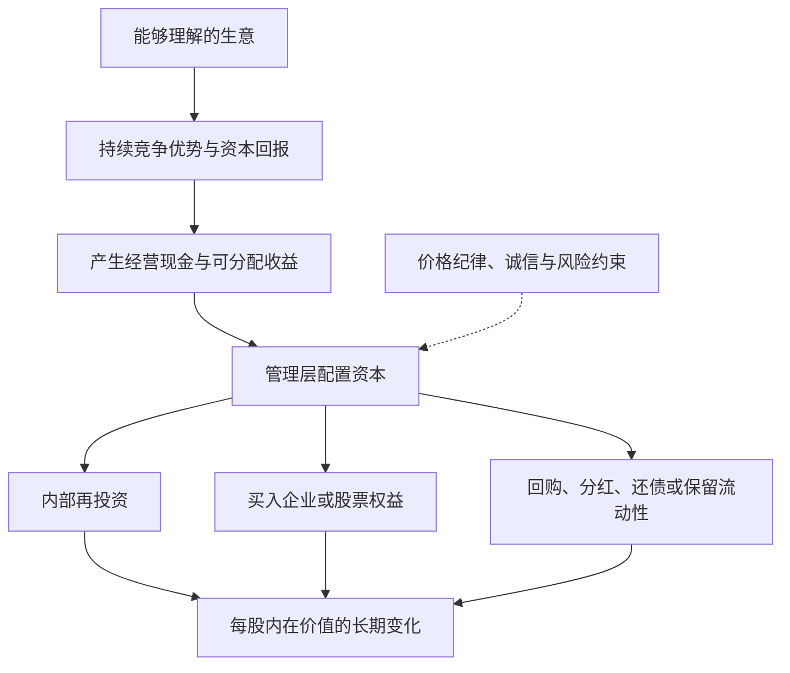

这是一张**补充示意图**。重点是现金的再次配置决定后续复利；每一步都要看价格与风险。它不是说企业只要有现金，就必然能找到高回报项目。

### 主题一：作为企业共有人思考

#### 1. 买股票，是买企业的一部分

1977 年信把股票选择与收购企业放在同一种研究逻辑下：理解业务、长期前景、管理者与购买价格。[1977 年信](https://www.berkshirehathaway.com/letters/1977.html)

**补充解释：** 如果没有交易软件报价，你仍愿意依据利润、资产、客户和竞争拥有这门生意吗？这能帮助区分“研究企业”与“等待别人接盘”。

#### 2. 计分单位应该是每股，而不只是总量

1983 年信明确以每股内在价值的长期进展衡量成绩，而非公司规模。[1983 年信](https://www.berkshirehathaway.com/letters/1983.html)

分析并购、增发和股权激励时，因此要同时看新增价值与新增股数。仅仅“公司更大了”不足以证明交易有利。

#### 3. 内在价值，是未来可取得现金的现值估计

1989 年信以未来现金流入流出的折现说明内在价值，并强调它不同于账面价值。[1989 年信](https://www.berkshirehathaway.com/letters/1989.html)

**补充解释：** 同样 100 元，今天收到与十年后收到并不等价；未来还存在不确定性。估值需要说明现金归谁、何时取得、还需投入多少，以及采用什么要求回报。

不是把增长率填进模型就能得到“真价格”。分析者对未来有不同合理判断，内在价值应视为区间；债务、现金、少数股东等口径必须配套。

#### 4. 市场价值、账面价值与经济价值会偏离

1987 年信指出，账面数与实际商业价值可能差异很大；业务表现与投资者付出的购买成本也需要分开评价。[1987 年信](https://www.berkshirehathaway.com/letters/1987.html)

这也不意味着可以无视会计数字。先理解数字如何形成，再判断它有没有遗漏经济价值，比直接喊“账面没意义”更有用。

#### 5. 能力圈最重要的是边界

能力圈不是给行业贴上“懂或不懂”的永久标签，而是知道哪些关键变量可以形成可靠判断，哪些仍只是猜测。1996 年信强调，判断范围有多大不如边界是否清楚重要。[1996 年信](https://www.berkshirehathaway.com/letters/1996.html)

**原信中的真实处境：1999 年，面对快速变化行业的吸引力。** 巴菲特在这一年信件的投资讨论中明确说，预测快速变化行业的长期经济状况超出他们的判断边界；即使别人的判断看起来被上涨股价验证，他们也不据此模仿。[1999 年信，末段投资讨论](https://www.berkshirehathaway.com/letters/1999htm.html)

这个选择很容易被误读成“认定新行业没有前途”。其实他说的是自己不能可靠预测谁能长期赚钱，而不是社会不会因技术进步受益。行业会发展、产品受欢迎、某家公司能保留利润、当前股价合理，是四个不同判断。能回答第一个，不等于后三个也有答案。

同封信对 GEICO 的经营则给出具体的客户、营销和资金信息，显示他的研究能够进入保险业务的实际机制。这个对照比“懂传统、不懂科技”的行业标签更重要：理解意味着能将客户行为、竞争成本与资本结果串起来，且知道哪些估计可以被后续结果检验。

因此，使用一个产品只是研究入口。你还要说明客户为何续费，竞争者为何不能轻易复制利润，以及维持优势要投入多少。关键数据没有披露时，应缩小结论，比如只确认销售增长，不扩大成长期经济性已经证明。

**边界：** 1999 年的自我限制不是所有投资者永远不得研究新技术的规则，也不证明伯克希尔后续所有技术投资都与能力圈冲突。能力可以扩展，但应由可验证的研究进展证明，不能由买入后的自信宣布。

**练习：** 别人买入一家公司后上涨，是否证明你也已具备研究它的能力？**参考答案：** 不证明。价格结果没有替你解释收入质量、竞争和估值；应先找出自己仍不能回答的关键问题。

#### 6. 所有权视角还包括信息责任

2024 年信将报告理解为向股东解释“拥有什么”和“怎样思考”，不仅罗列法定数字，也应承认问题。[2024 年信](https://www.berkshirehathaway.com/letters/2024ltr.pdf)

**补充应用：** 读管理层信件时，检查是否说清盈利来源、困难、资本用途及错误，还是只重复口号。诚恳语言是一个信号，仍需要用数据、行动与多年记录核查。

对自己的投资也可以这样做：每年向“未来的自己”写一页报告，说明发生了什么、为什么继续持有、先前哪里判断错了。

### 主题二：识别真正好的生意

#### 7. 护城河，要能保护资本回报

护城河要回答：利润这么好，为什么竞争者没有把它分走？它是阻止优势被侵蚀的机制，不是名气的同义词。2007 年信把这种问题落实在伯克希尔真实持有的生意上。[2007 年信](https://www.berkshirehathaway.com/letters/2007ltr.pdf)

**原信案例：喜诗糖果，1972—2007 年。** Blue Chip Stamps 在 1972 年收购喜诗，之后 Blue Chip 并入伯克希尔。2007 年信给出了下面的经营对照，金额为美元：

| 指标 | 1972 年收购时 | 2007 年 |
| --- | ---: | ---: |
| 年销量 | 1600 万磅 | 3100 万磅 |
| 销售额 | 3000 万 | 3.83 亿 |
| 税前利润 | 不到 500 万 | 8200 万 |
| 经营所需资本 | 800 万 | 4000 万 |

来源为[2007 年信，PDF 第 6 页喜诗段](https://www.berkshirehathaway.com/letters/2007ltr.pdf)。原信以持久竞争优势解释其结果，同时指出现金销售减少应收需求、较短的生产配送周期降低库存占用。

理解这个案例，要逐步看。首先，销量增长并非与利润同速爆发；这迫使我们研究价格、产品和成本，而不能只用“行业高速成长”解释成功。其次，更多利润没有要求经营资本按同样幅度增加，经营资金便更容易离开糖果业务，投向其他机会。最后，品牌优势只有落实成持续选择、盈利和资本效率，才成为股东的经济利益。

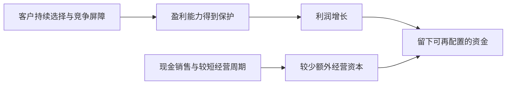

**图解：** 好生意不仅要赚到利润，还要避免为了维持这些利润不断吞回所有现金。

**不要从表里多推一步。** 销售额除以磅数的变化不是同质产品价格指数，可能包含产品结构和其他变化；税前利润除以某个期末资本，也不能直接冒充同口径税后 ROIC。这个案例更不证明今天任何带“品牌”标签的股票都值得高价购买。

核查另一家企业是否有类似优势，应寻找可持续的客户选择与单位经济性，并观察新竞争、渠道变化和替代品。**练习：** 利润率高但需要投入极大的资本，能否据此认定具有喜诗式经济特征？**参考答案：** 不能，还要看资本回报与可释放现金，不能只比较利润率。

#### 8. 少量追加资本就能增长的生意，复利条件更好

1987 年信讨论一些企业以较少新增资本扩大收益，同时释放资金用于其他机会。[1987 年信](https://www.berkshirehathaway.com/letters/1987.html)

这里并不是说重资产行业全部差。基础设施可能在可靠需求和合适监管回报下创造价值；关键是资本需求、风险和回报匹配，而非只按“轻”或“重”打分。

#### 9. 通胀考验的不只是涨价能力，还有补充资本需求

1983 年信的经济商誉讨论，把通胀下的盈利增长与维持业务所需资本放在一起看。[1983 年信](https://www.berkshirehathaway.com/letters/1983.html)

不要把“拥有很多实物资产”直接等同于抗通胀。资产替换成本上升也可能成为负担；还要考虑客户能否接受涨价。

#### 10. 成长与价值不是两套互斥的投资

1992 年信指出，增长本来就是价值计算中的一项因素，其作用取决于增长所需投入及其回报。[1992 年信](https://www.berkshirehathaway.com/letters/1992.html)

“价值股”不是低 PE 的同义词，“成长股”也不是任何价格都合理。应比较未来净收益、风险和当前支付金额。

#### 11. 优质企业也可能因买得过贵而成为差投资

2020 年信承认收购 Precision Castparts 时对正常盈利潜力过于乐观，因而付价过高；这与认可管理者和业务质量并不矛盾。[2020 年信](https://www.berkshirehathaway.com/letters/2020ltr.pdf)

**顺着这个真实事件理解：** 即使企业在自身设备和经营资本上回报很好，收购者支付的价格还可能远高于这些资本。收购价格越高，未来必须兑现的收益要求也越高。原信将错误归到对正常盈利的估计和付价，而没有将其简单归咎于经营者；这正是把公司质量与投资价格分开的含义。

#### 12. 时间帮助好生意，也会暴露坏生意

2023 年信回顾芒格对伯克希尔路线的影响：从廉价但平庸的企业，转向以合理价格拥有更优秀的企业。[2023 年信](https://www.berkshirehathaway.com/letters/2023ltr.pdf)

这是一种研究方向，不是“好公司永不卖”的口号。若竞争优势消失、治理恶化、价格脱离合理范围或自身资金条件改变，仍需重新评估。

### 主题三：资本怎样分配，决定复利能否继续

#### 13. 资本配置者，要把公司现金与最佳替代机会比较

经营者决定如何把业务做好，资本配置者还要决定利润留在原业务、买别的业务、还债或交还股东。1986 年信把配置资本列为总部的关键工作；现金已经在公司里，不代表继续投入没有机会成本。[1986 年信](https://www.berkshirehathaway.com/letters/1986.html)

**原信案例：从纺织业务抽出资金，到最终退出。** 1985 年信回顾，1967 年伯克希尔以纺织业务释放的资金进入保险、收购 National Indemnity；资金既来自收益，也来自减少库存、应收和固定资产占用。纺织业务仍持续多年，到 1985 年 7 月才决定关闭。[1985 年信：纺织业务回顾](https://www.berkshirehathaway.com/letters/1985.html)

这一历史把两个决策区分开：现有工厂是否继续运营，与新增一元资金是否继续投入同一行业，并不必然有相同答案。企业可以在承担现有业务责任的同时，把新增可用资金配置到更好的机会。若管理层只允许讨论“在原行业怎样扩张”，便人为缩小了股东资金的选项。

退出同样不是一开始便轻易作出的正确选择。巴菲特在原信中承认，原先预期纺织业务能保持适度现金回报，但后来持续耗用资金，自己退出太迟。教学上的重点是给继续投入设置证据条件：原来预期何时该实现，什么变化说明长期经济性已不成立，是否把既有投入变成继续投入的借口。

原业务利润高也不能证明下一笔投资好。资本配置应比较新增项目的回报和风险，而不只是历史平均成绩；对收购还要比较支付价格，对回购要比较每股价值，对还债要考虑融资成本和到期约束。投资于别处也不是天然正确，保险业务的成功并不能使每一次跨行业收购合理。

**仅作公式演示：** 假设盈利 100 万，其中留存 50 万；留存资金下一年带来 20% 的新增收益，则多赚 10 万。若新增回报仅为 4%，只多赚 2 万。两种方案都叫增长，但是否值得取决于匹配的要求回报；这些不是伯克希尔项目数据。

每股视角还要求查股数。若增长靠大量发行新股取得，原股东每一份权益对应的价值可能没有增长。**练习：** 连续多年不分红能否证明复利更快？**参考答案：** 不能，必须证明留存资金最终创造了足够的每股价值；规模扩大本身不是答案。

#### 14. 留存利润必须有理由，分红也没有放之四海的答案

2012 年信详细讨论再投资、收购、回购和分红的选择。留存是否有利，依赖公司能否有效使用资金及股东的实际处境。[2012 年信](https://www.berkshirehathaway.com/letters/2012ltr.pdf)

不要从伯克希尔的历史不分红政策推出“所有好企业都不分红”，也不要把高股息率当成可持续回报承诺。

#### 15. 回购是否创造价值，核心在价格和资金条件

2022 年信解释，减少股数会提高继续持有者的比例，但高价回购会损害他们；“回购”这个动作本身不保证创造价值。[2022 年信](https://www.berkshirehathaway.com/letters/2022ltr.pdf)

回购同时改变两个量：公司少了一笔现金，继续持有的股东所对应的股数也减少了。只看第二项，很容易得出“回购越多越好”；只看现金减少，又会忽略以折价买回权益可能给剩余股东带来的利益。正确比较是每股内在价值的变化，而不是回购公告金额或每股收益是否机械上升。

**原信案例：伯克希尔 2020 年的回购。** 当年公司花费 **247 亿美元**，回购相当于 **80,998 股 A 类股**的股份；巴菲特称，这使继续持有者在各项业务中的相对权益提高约 **5.2%**。他同时给出两项理由：认为每股内在价值会改善，并且回购后仍有充足资金应对机会和问题。[2020 年信，PDF 第 5 页](https://www.berkshirehathaway.com/letters/2020ltr.pdf)

5.2% 说明剩余股东对应的份额变化，不是当年利润增长率，也不是说回购花的钱消失后公司价值完全不变。回购仍须用公司现金支付；是否划算取决于买入价格与估计价值，以及资金是否真有余裕。原信表达的是管理层的判断，不能据此取得一个外部独立验证的精确内在价值。

下面用短算式将这笔实际决策的两个方向拆开，**仅演示数学，不复原伯克希尔估值**：假设回购前全部股权内在价值 V 为 1000 万元，包含 100 万可自由支配且按面值计入价值的现金；总股数 N 为 100 万股，每股内在价值 V/N＝10 元。公司用这 100 万现金 C 回购并注销股份，回购价为 P。忽略税费、交易费用、融资和经营变化，回购后：

```text
剩余股权价值＝V－C
剩余股数＝N－C/P
回购后每股内在价值＝(V－C)/(N－C/P)
```

式中金额和股数单位必须匹配，且剩余股数应大于零。用这个关系可以逐项计算：

| 回购价 | 买回并注销股数 | 剩余价值 | 剩余股数 | 每股内在价值 |
| --- | ---: | ---: | ---: | ---: |
| 5 元 | 20 万股 | 900 万 | 80 万股 | 11.25 元 |
| 10 元 | 10 万股 | 900 万 | 90 万股 | 10.00 元 |
| 20 元 | 5 万股 | 900 万 | 95 万股 | 约 9.47 元 |

在这些假设下，低于回购前每股内在价值回购，剩余每股价值提高；按相等价格回购，中性；高于价值回购，剩余股东受损。这里没有凭空创造新的工厂收益，而是公司以不同价格向退出的股东购买权益，改变了价值在退出者和留下者之间的分配。

为什么 EPS 上升仍可能误导？再假设回购所用的闲置现金没有收益，原业务一年利润 100 万且不变。即使按 20 元高价回购，利润除以 95 万股，EPS 仍由 1 元升到约 1.053 元；但每股内在价值已经由 10 元降到约 9.47 元。股数减少可以改善每股盈利表象，不能证明付价合理。

现实还要先检查资金条件。若这 100 万其实是季节性备货、偿债或承保赔付需要的资金，支出会损害经营与韧性，“其他条件不变”的算例就不成立。若借债回购，利息、违约风险和资金机会成本也要计入；若回购股份随后用于股权激励，实际净股数未必按公告金额所暗示的幅度减少。

实务阅读应把回购授权、实际执行金额、实际平均价格、注销或其他用途、期末及加权平均股数分开看。估计价值本来就有误差，因此不能将公司管理层说“低估”直接当作事实。

**练习：** 本例用 100 万按 8 元回购并注销，其他假设相同，每股价值是多少？**参考答案：** 注销 12.5 万股，剩余 87.5 万股，每股 900/87.5≈10.286 元。它说明低于假定价值回购的方向，不证明真实市场中 8 元一定便宜。

#### 16. 用股票收购，付出的是一部分未来权益

2014 年信回顾 Dexter 鞋业收购错误，强调用伯克希尔股票支付的经济代价不能只看当年账面金额。[2014 年信](https://www.berkshirehathaway.com/letters/2014ltr.pdf)

因此并购要比较取得资产的价值与交付对价的内在价值。EPS 暂时增加、交易被称作“协同”，都不能替代这一比较；也应检查负债和潜在整合成本。

#### 17. 少数股权与整家公司，都可以是资本配置选项

1999 年信把投资资产与经营企业分别展示；2012 年信也说明，整体收购并不天然优于持有部分优秀企业。[1999 年信](https://www.berkshirehathaway.com/letters/1999htm.html)、[2012 年信](https://www.berkshirehathaway.com/letters/2012ltr.pdf)

**补充解释：** 有控制权可以决定管理与现金用途，但价格可能更高、退出更困难；小股东更易调整仓位，却无法主导资本分配。两种结构有不同权利和约束。

对普通人，买上市股票通常是少数股东位置，因此不能假设自己买入后就能让公司改正治理问题。

### 主题四：读懂经济收益，而不只盯报表结尾

#### 18. 所有者收益，要考虑维持业务真正需要的支出

1986 年信提出 owner earnings：从报告收益调整有关非现金项目，再考虑维持长期竞争位置和业务规模所需的资本支出及必要营运资金。它不是财报中一项标准化现成指标。[1986 年信](https://www.berkshirehathaway.com/letters/1986.html)

**原信真实案例：FlightSafety 的模拟器投入。** 2007 年信披露，1996 年收购 FlightSafety 时，税前经营利润为 **1.11 亿美元**，固定资产净额 **5.70 亿美元**；到 2007 年，税前经营利润为 **2.70 亿美元**，固定资产净额 **10.79 亿美元**。收购以来累计折旧 **9.23 亿美元**，资本支出却累计 **16.35 亿美元**，主要投入用于匹配新机型的飞行模拟器。[2007 年信，PDF 第 7 页](https://www.berkshirehathaway.com/letters/2007ltr.pdf)

这些数字说明为什么“利润加折旧”不是可永远提走的钱。折旧降低了会计利润，计提时没有再付现金；但真实经营仍须购买和更新设备。若把折旧全部加回，却忘记维持竞争位置的投入，就会高估长期可分配能力。

同时必须保留边界：上述 **16.35 亿美元不是已经确认的维持性资本支出**，其中包含增长与设备更新；累计资本支出比折旧多 **7.12 亿美元**，也不是可直接从某一年利润扣除的数字。案例教的是识别必要投入，不是教我们只靠两行报表就准确分开维护与增长。

```text
教学用近似关系：
所有者收益＝报告收益＋适当非现金调整
           －维持性资本支出－必要营运资金增加
```

现金流归属要一致，不能从集团税前经营利润出发，再随意解释为普通股东税后所得。实务上应调查设备寿命、更新计划、产能变化与长期投入，形成区间；非现金股权激励也可能稀释股东，不能因没有即时付款便让经济代价消失。

**书外真实对照：贵州茅台 2026 年前三季度。** 集团经营现金流净额 **840.59 亿元**、同比增长 **120.07%**。公司说明主要涉及财务子公司不可随时支取的同业存款到期收回，以及吸收集团成员单位存款的变化。[三季报第 2—3、10—11 页](https://static.cninfo.com.cn/finalpage/2026-10-31/1225649896.PDF)

这提醒我们在扣维护支出之前，还须认清现金来自哪项业务。财务子公司的资产收回与存款负债变化，不等于酒业当期创造的可持续收益；合并经营现金也不等于普通股东可以全部取走的钱。只扣两条存款项目，仍没有完整剥离金融业务及内部抵销，不能把剩余数直接叫酒业所有者收益。

**仅作算式演示：** 无债务企业利润 100 万、合适折旧调整 30 万、必要维护投入 45 万、营运资金增加 10 万，近似所有者收益为 75 万；这不是以上任一公司的估值。**练习：** 能否将茅台的 840.59 亿元直接作为永续现金流？**参考答案：** 不能，业务范围、可持续性、资本需求和股东归属均尚未统一。

#### 19. 会计净利润与经营表现，需要拆开看

2018 年信解释，权益投资未实现价格变动进入当期损益后，伯克希尔合并净利润会出现很大波动，未必等于旗下经营企业同幅变化。[2018 年信](https://www.berkshirehathaway.com/letters/2018ltr.pdf)

这不意味着投资损失永远可以忽略。短期波动与长期价值损失要分别判断，也不能把管理层喜欢的“调整后利润”自动当成唯一真相。

#### 20. 透视收益，帮助看见未分配但属于你的经营成果

1991 年信讨论 look-through earnings，把重要被投资企业留存的经营收益纳入经济观察，并考虑相关税负，而不仅看收到的股息。[1991 年信](https://www.berkshirehathaway.com/letters/1991.html)

也不能把透视收益直接当可用现金。你未必能强制分配，资金可能被低效投资消耗；税收、控制权及现金流限制仍重要。

#### 21. 经济商誉与会计商誉，不是同一件事

1983 年信区分真实商业优势产生的经济价值与会计记录；后续年度信反复提醒，不同会计呈现不能取代经济分析。[1983 年信](https://www.berkshirehathaway.com/letters/1983.html)

既不能见商誉就认定优质，也不能见商誉就认定造假。应回到购买价格、取得资产的赚钱能力、减值假设与后续结果。旧信中的商誉摊销会计规则有历史背景，不应照搬到今天。

### 主题五：保险、资金来源与风险承受

#### 22. 浮存金是暂时持有但最终负有义务的钱

1996 年信解释，保险通常先收保费、后支付赔款，从而形成可暂时运用的浮存金；它并不属于股东自由支取的权益。[1996 年信](https://www.berkshirehathaway.com/letters/1996.html)

浮存金的账面口径涉及准备金和其他项目，不能简单等于当年保费，也不能把它类比成个人信用卡额度后照搬投资。

#### 23. 浮存金有没有优势，取决于成本和稳定性

保险先收保费、后付赔款形成时间差。暂时掌握的资金有价值，但最终负有赔付义务；承保定价不足，取得资金便要付出经济成本。低成本浮存金不是整个行业自动具有的属性。

**原信中的正反对照：1999 年与 2011 年的伯克希尔。** 1999 年信报告承保亏损约 **14 亿美元**，浮存金成本为 **5.8%**。2011 年信则披露全年承保利润 **2.48 亿美元**、年末浮存金 **705.71 亿美元**；截至当时连续九年承保盈利，合计约 **170 亿美元**。[1999 年信：保险经济性](https://www.berkshirehathaway.com/letters/1999htm.html)、[2011 年信，PDF 第 7、9 页](https://www.berkshirehathaway.com/letters/2011ltr.pdf)

对照说明，不能因为保险公司收到了保费、持有大量投资资产，就把资金说成免费。1999 年的承保亏损是取得和管理保险义务的代价；2011 年的承保盈利则意味着承保本身赚钱，投资收益还在其外。相同的“浮存金”名称，经济价值取决于产生它的业务质量。

数字的口径也值得学习：1999 年披露的成本率不能用当年亏损随手除以某个期末浮存金去强行复算，成本应与相应期间的平均资金匹配；2011 年年末浮存金不是全年平均数，更不能把九年累计承保利润除以它当作当年收益率。

为什么不能靠降低保费无限扩大浮存金？保费先到账，赔付可能多年后才充分显现；若最初少估损失，早期利润和资金规模都会看起来不错，随后补提准备才暴露成本。1999 年信也强调准备金估计的不确定性。核验应看多年的赔付发展、准备金和承保结果，而非只看当年现金流入。

资金稳定性与赔付时间必须同时检查。个别保单最终会赔付，总体资金能否稳定依赖持续的合理承保；若新业务减少而旧赔款到期，原先持有的资产必须能够及时变现。不能因为集团长期投资业绩不错，就忽略短期赔付和市场冲击可能同时发生。

**仅作成本演示：** 平均浮存金 1000 万、承保亏损 50 万，简化成本为 5%；投资若只赚 40 万，两项合计仍亏 10 万。这不是某一年的伯克希尔报表。**练习：** 2011 年的良好记录能否保证此后每年承保盈利？**参考答案：** 不能；原信也没有作这种保证，灾害、竞争和估计偏差仍会改变结果。

#### 24. 保险的纪律，是价格不够时愿意不做生意

2011 年信列出的承保原则包括理解风险、审慎估计损失、给出合理保费，并在无法获得合适价格时放弃。[2011 年信](https://www.berkshirehathaway.com/letters/2011ltr.pdf)

**补充应用：** 这能推广到其他决策：不是所有收入都值得追，必须计算承担了什么义务。明知道某个客户价格不足以覆盖长期服务成本，却因“竞争对手也接”而接受，可能损害企业。

用于个人投资时，也可以问：我是否因为账户里有钱或别人都在买，就认为必须立刻成交？没有合适条件时，放弃并不是没有能力。

#### 25. 流动性是生存条件，也是危机时的选择权

2010 年信强调现金与稳健资金来源，使伯克希尔能够抵御大额保险损失，并在别人被迫收缩时行动。[2010 年信](https://www.berkshirehathaway.com/letters/2010ltr.pdf)

不能照抄某年的现金金额或比例。保险集团有巨额潜在赔付，个人有生活开支、债务和职业收入，流动性应与自己的义务匹配。

#### 26. 杠杆改变了你是否能等到判断兑现

2008 年信置于金融危机背景，揭示信用、融资和交易对手问题怎样互相放大；报价与会计盈利并不能代替真实偿付能力。[2008 年信](https://www.berkshirehathaway.com/letters/2008ltr.pdf)

**书外真实案例：** 1998 年 LTCM 濒临崩溃之前，1997 年末资产近 1300 亿美元、资本约 47 亿美元，表内粗略杠杆约 28 倍。美国财政部在 1999 年证词中以此说明规模和融资放大的风险。[财政部证词](https://home.treasury.gov/news/press-releases/rr2991)

此例不是伯克希尔的投资经历。它说明资产判断之外，还必须承受不利价格与融资要求；若资金先耗尽，最终估值判断就没有机会兑现。单一杠杆比率仍不足以完整描述衍生品和流动性风险。

关心的不是单一“借款比例”，还有利率、期限、担保条款、追加抵押要求和收入稳定性。长期投资不能自动抵消短期融资风险。

#### 27. 衍生品要拆解合约，不靠名称判断安全

2008 年信谈到衍生品的交易对手、合约与估值问题，伯克希尔自身也持有相关合约；其观点不能简化成“所有衍生品都不能用”。[2008 年信](https://www.berkshirehathaway.com/letters/2008ltr.pdf)

**补充解释：** 需要看最大赔付、到期方式、保证金、提前终止、交易对手信用与现金需求。两份表面相似的合约，若一份要求每天追加保证金，另一份没有同样条款，风险路径可能差很多。

普通读者最该学会问“最坏时谁要付多少钱、什么时候必须付”，而不是看到专业机构使用就假设适合自己。

### 主题六：管理、行为与长期学习

#### 28. 选人和授权相互依赖，分权不是放弃监督

1986、1987 年信解释伯克希尔对优秀经营者的信任与较少干预的方式，同时把总部注意力放在重要人选和资本上。[1986 年信](https://www.berkshirehathaway.com/letters/1986.html)、[1987 年信](https://www.berkshirehathaway.com/letters/1987.html)

**补充应用：** 授权有效的前提是人可靠、目标与激励明确、信息能够回到总部、关键风险有人负责。不能用“巴菲特不管细节”作为忽视内控的理由。

评价管理层时，结合长期每股成果、资本配置与股东待遇；仅有聪明和勤奋仍不够，利益是否一致、沟通是否诚实同样重要。

#### 29. 组织也会从众，聪明人可能共同做出糟糕决定

1989 年信讨论组织惯性：有钱就找项目、替领导偏好寻找论据、照抄同行等现象，会侵蚀独立判断。[1989 年信](https://www.berkshirehathaway.com/letters/1989.html)

个人也会这样：先喜欢某只股票，再只搜索支持它的材料。写出反论点、替代方案和“不买”的条件，是可操作的纠偏办法。

#### 30. 承认错误要具体，修正要及时

2020 年信说明一项收购中对正常盈利估计过高；2024 年信进一步强调，识人或资本配置失误发生后，拖延纠正会加重问题。[2020 年信](https://www.berkshirehathaway.com/letters/2020ltr.pdf)、[2024 年信](https://www.berkshirehathaway.com/letters/2024ltr.pdf)

**补充应用：** 复盘不要只写“市场不好”。分开记录事实错误、估值过高、现金安排不当、执行偏离，以及当时无法预知的冲击。

也要避免结果偏见：赚到钱的过程可能不可靠，亏钱的过程可能仍合乎事前概率。认错是更新证据和行动，不是以自责代替改进。

#### 31. 长期成果可能由少数成功决定，但事前不能随意押注

2022 年信回顾可口可乐、美国运通等长期持有案例，说明少数重要成功和时间可以在整体结果中发挥很大作用。[2022 年信](https://www.berkshirehathaway.com/letters/2022ltr.pdf)

**补充解释：** 这不意味着随便买一堆高风险资产、等一只暴涨。必须有合理研究、价格、风险上限和避免整体毁灭的安排，才能让真正成功的业务有时间增长。

也不要仅用原始成本上的股息率决定是否继续持有；新增投资和持有选择都应看今天的价值、价格与替代机会。

#### 32. 规模会限制机会，过去的高回报不能机械外推

1991 年信直说，资本基数扩大后，能够显著影响整体结果的机会更少。[1991 年信](https://www.berkshirehathaway.com/letters/1991.html)

个人资金小确有灵活性，但这不自动变成研究优势。学习巴菲特时要区分普遍原则与机构规模、声誉、资金结构带来的特殊条件。

#### 33. 对多数非专业投资者，成本和简单性值得重视

2013 年信给出非专业投资者通过低成本指数方式持有一组企业的思路；2016 年信讨论多层费用如何侵蚀专业管理的结果。[2013 年信](https://www.berkshirehathaway.com/letters/2013ltr.pdf)、[2016 年信](https://www.berkshirehathaway.com/letters/2016ltr.pdf)

**补充解释：** 巴菲特积极选企业，与他认为很多人不必选股，并不矛盾：所需能力和条件不同。不要以他的长期持仓集中，推导自己也应该集中。

2013 年信提到为家人信托安排的特定比例，有明确对象和背景，不是所有人的通用配置。指数同样有市场、集中、币种和产品风险；学习原则比照抄数字更重要。

#### 34. 继任与文化，是企业价值的一部分

2023、2024 年信和 2025 感恩节信息提供了继任与延续经营理念的背景。读信时应区分作者个人能力与能够延续的制度。[2023 年信](https://www.berkshirehathaway.com/letters/2023ltr.pdf)、[2025 感恩节信息](https://www.berkshirehathaway.com/news/nov1025.pdf)

继任不是只选一个名字，还包括激励、信息、治理与文化。知名创始人仍在，也不能跳过这些问题。

#### 35. 财富最终服务于生活，幸运也参与了结果

2025 感恩节信息把人生、幸运、慈善安排与传承放进同一叙述，提醒读者财富不只是一个账户数字。[2025 感恩节信息](https://www.berkshirehathaway.com/news/nov1025.pdf)

**补充应用：** 提高财商不应只变成“尽可能提高年化收益”。更完整的目标是保留生活选择、减少不必要的脆弱性、为重要责任准备资金，并知道自己愿意怎样使用财富。

把成果全部归功于天赋，容易过度自信；把不利全部归咎运气，又会失去学习机会。可以同时承认环境作用，并改进自己能控制的储蓄、学习、判断和风险安排。

### 公式复习：与真实企业案例分开的计算练习

#### 练习一：为什么利润相同，企业价值可能不同

以下金额统一为万元，全部是假设；为了突出概念，忽略税收变化、债务和复杂会计调整。

| 项目 | A 企业 | B 企业 |
| --- | ---: | ---: |
| 报告净利润 | 100 | 100 |
| 加回合适的非现金折旧调整 | 20 | 20 |
| 维持业务所需设备投入 | 15 | 70 |
| 必要营运资金增加 | 5 | 20 |
| **简化所有者收益** | **100** | **30** |

A 为 100＋20－15－5＝100；B 为 100＋20－70－20＝30。同样的会计利润，不代表同样的长期可提取收益。这里只比较经营现金基础，**尚未比较购买价格**：A 若贵得过头，也不一定比 B 更值得买。


维持性投入没有一个可以从所有公司报表中直接抄下来的准确数值，因此需要附注、业务理解与区间分析。图只是帮助理解资金去向，不是标准化自动估值程序。

#### 练习二：浮存金为什么既有价值又有风险

假设某保险业务一年平均可运用浮存金 1000 万，在这一年的简化计量下：

| 场景 | 承保结果 | 投资收益 | 两者简化合计 |
| --- | ---: | ---: | ---: |
| 定价合理、投资正常 | 盈利 20 | 40 | 盈利 60 |
| 低价抢业务、投资正常 | 亏损 80 | 40 | 亏损 40 |
| 定价合理、投资亏损 | 盈利 20 | -100 | 亏损 80 |

这是机制示意，不是保险公司完整利润模型，尚未计入全部资本、税费与准备金变化。浮存金规模越大，并不必然越好；**资金成本、损失分布、运用方式和偿付能力必须一起看。**

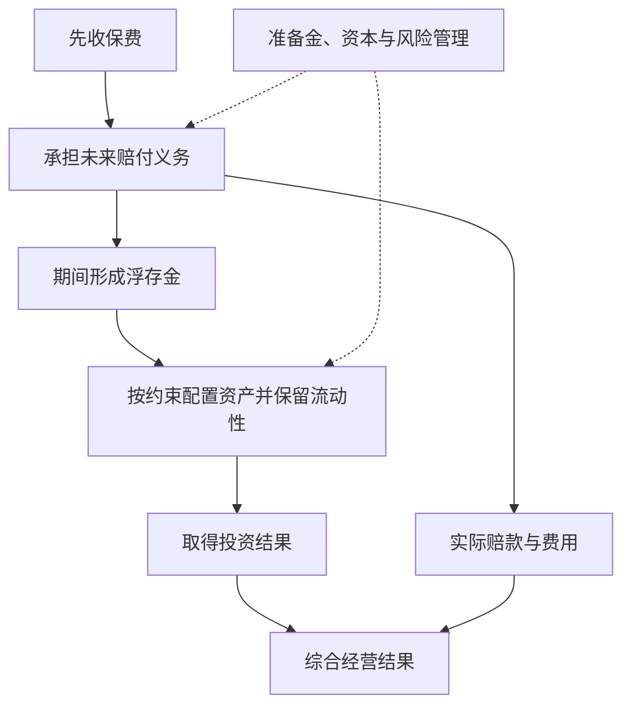

这也解释为什么个人不能用普通短期借款模拟保险资金：还款期限、资金稳定性、成本、规模和风险管理机制都不同。

#### 练习三：有增长，不一定创造价值

假设企业有 100 万可分配资金，可以选择：

- 项目甲：每年新增税后经营收益 5 万，持续经营仍需承担业务风险。
- 项目乙：每年新增税后经营收益 15 万，但预测更不确定。
- 其他选择：还债、保留现金、回购或分红。

不能仅以甲乙都能增加利润就认为两者都值得做。还要比较资本成本、现金时间、追加投入、失误情景和机会成本。若相应要求回报为 10%，甲的 5% 回报可能不足；乙的 15% 看上去较好，但必须核查其估计是否可靠。

**财商训练：** 每当看到“扩大规模”“利润增长”，补问一句“多用了多少钱、承担了什么新风险”。这比单记某年的伯克希尔回报率更容易迁移到自己的决策中。

### 读这些信时，最容易学错的地方

| 容易形成的口号 | 应补上的条件 |
| --- | --- |
| 买好公司就不用看价格 | 经营质量与购买价格共同决定回报 |
| 长期持有就是永远不卖 | 原先的经营与风险判断需要持续成立 |
| 不需要预测 | 不必精确预测短期市场，但估值仍包含对企业未来的判断 |
| 浮存金是免费资金 | 是否低成本取决于承保结果、稳定性和偿付约束 |
| 回购总是利好 | 价格、财务承受能力及替代用途都重要 |
| 现金多说明看空股市 | 可能服务于赔付、经营、收购与流动性；不能只猜宏观观点 |
| 经营利润比净利润好，所以调整后数都可靠 | 调整要逐项解释，不能一味排除真实成本 |
| 集中持有才能成功 | 个体能力、资金结构、信息和承受能力不同 |
| 伯克希尔买了，我也该买 | 成本、条件、期限、权利和信息时点可能完全不同 |
| 巴菲特成功，所有解释都已被证明 | 成功记录仍包含环境、机会与幸存者因素，需要独立检验 |

股东信同时是管理者向股东解释公司的文件，不是随机实验，也不是完整学术理论。评价某段话时要保留公司立场、当时背景和后来变化；关注其论证，避免把作者名望替代证据。

### 按财商目标使用：一张企业研究卡

每研究一家企业，尝试用下面十个问题写一页答案，不必先建立复杂模型：

1. **业务：** 谁为哪些产品或服务付钱？竞争者为什么不能轻易替代？
2. **能力边界：** 哪些关键因素我确实理解，哪些只是听说？
3. **收益：** 利润中有多少能转成可持续现金，维持业务还要花多少？
4. **资本回报：** 现有资本赚得怎样，新增资本是否有合适回报？
5. **管理：** 管理层过去如何使用资金，对待股东是否一致？
6. **融资：** 债务、保险义务或其他承诺，可能在何时要求现金？
7. **每股结果：** 增发、回购和分红，怎样改变每份权益？
8. **价值与价格：** 保守、正常、较好情景分别依赖哪些前提？
9. **推翻条件：** 哪两三种事实会让原判断不再成立？
10. **自身安排：** 即使研究正确，仓位与资金期限是否允许等到结果？

完成后找一位观点不同的人，或自己站在反方，挑战最关键的假设。对普通读者而言，能写清“不知道哪里”，往往比迅速生成一个精确目标价更有价值。

### 代表年份阅读地图与来源

表内年份均为报告年度；官网信件一般于下一年发表。每行只说明本文取用的主题，不表示那封信仅讨论这些内容。书外对照另使用[贵州茅台 2026 年三季报](https://static.cninfo.com.cn/finalpage/2026-10-31/1225649896.PDF)与[美国财政部 LTCM 证词](https://home.treasury.gov/news/press-releases/rr2991)，没有把这些事件冒充巴菲特原信案例。

| 原始资料 | 本文取用主题 |
| --- | --- |
| [1977](https://www.berkshirehathaway.com/letters/1977.html) | 以企业所有权方式选股 |
| [1983](https://www.berkshirehathaway.com/letters/1983.html) | 股东原则、每股价值、经济商誉 |
| [1985](https://www.berkshirehathaway.com/letters/1985.html) | 纺织业务退出、资金重新配置与决策复盘 |
| [1986](https://www.berkshirehathaway.com/letters/1986.html) | 资本配置、授权、所有者收益 |
| [1987](https://www.berkshirehathaway.com/letters/1987.html) | 账面与经济价值、资本效率 |
| [1989](https://www.berkshirehathaway.com/letters/1989.html) | 内在价值与组织惯性 |
| [1991](https://www.berkshirehathaway.com/letters/1991.html) | 透视收益与规模约束 |
| [1992](https://www.berkshirehathaway.com/letters/1992.html) | 成长、价值与新增资本回报 |
| [1996](https://www.berkshirehathaway.com/letters/1996.html) | 能力圈、浮存金 |
| [1999](https://www.berkshirehathaway.com/letters/1999htm.html) | 经营与投资口径、能力边界、浮存金成本 |
| [2007](https://www.berkshirehathaway.com/letters/2007ltr.pdf) | 喜诗的资本效率、FlightSafety 的设备投入与商业质量 |
| [2008](https://www.berkshirehathaway.com/letters/2008ltr.pdf) | 危机、融资及衍生品风险 |
| [2010](https://www.berkshirehathaway.com/letters/2010ltr.pdf) | 流动性与抗冲击能力 |
| [2011](https://www.berkshirehathaway.com/letters/2011ltr.pdf) | 浮存金成本和承保纪律 |
| [2012](https://www.berkshirehathaway.com/letters/2012ltr.pdf) | 分红、留存与资本用途 |
| [2013](https://www.berkshirehathaway.com/letters/2013ltr.pdf) | 非专业投资者与指数化思路 |
| [2014](https://www.berkshirehathaway.com/letters/2014ltr.pdf) | 以股票支付并购的机会成本 |
| [2016](https://www.berkshirehathaway.com/letters/2016ltr.pdf) | 专业管理费用与投资者净结果 |
| [2018](https://www.berkshirehathaway.com/letters/2018ltr.pdf) | 会计净利润与经营表现 |
| [2020](https://www.berkshirehathaway.com/letters/2020ltr.pdf) | PCC 收购估值失误、正常盈利判断及实际回购 |
| [2022](https://www.berkshirehathaway.com/letters/2022ltr.pdf) | 回购价格、长期成功及局限 |
| [2023](https://www.berkshirehathaway.com/letters/2023ltr.pdf) | 芒格对投资路线的影响与传承 |
| [2024](https://www.berkshirehathaway.com/letters/2024ltr.pdf) | 沟通责任、承认并纠正错误 |
| [2025-11-10 感恩节信息](https://www.berkshirehathaway.com/news/nov1025.pdf) | 年度信作者交接、人生与财富用途 |

### 自测：能回答这些，就抓住了核心

1. **企业利润增长，为什么股东未必更富？** 还要看资本投入、股数变化、资金使用与购买价格。
2. **所有者收益为什么不能简单等于净利润加折旧？** 需要扣除维持竞争力的资本投入及必要营运资金，且非现金调整应逐项判断。
3. **浮存金为什么不是股东权益？** 它对应未来赔付等义务，只是暂时由公司持有和按要求运用。
4. **为什么低价回购可能提高每股价值？** 如果价格低于合理内在价值且资金安排适当，减少股数所增加的份额可超过支付现金损失的价值。
5. **怎么判断护城河不是口号？** 寻找持续的定价、成本、复购、份额与资本回报证据，并分析竞争者怎样可能突破。
6. **为什么规模越大越难重复过去的高收益？** 足够影响整体的大机会更少，交易与资本配置约束更多。
7. **普通人应该照抄哪一部分？** 学研究、价格、费用、风险与诚信原则；不照抄历史持仓、机构杠杆和特定信托比例。
8. **2025 年发表的年度信与 2025 年度信相同吗？** 不同。巴菲特 2025-02-22 发表的是 2024 报告年度信；Abel 的 2025 报告年度信另列，2025 感恩节信息也不是年度报告信。

尚未覆盖每年全部业务、行业细节、税制与会计变更、早期合伙人信及全部投资记录；这些需要按专题继续读原文。本文已覆盖代表性投资与经营原则，但不应被理解为“巴菲特全部观点”或今天伯克希尔的完整经营分析。

---

[返回书籍索引](<README.md>) · [财商学习与实践路线](<财商进阶合订本.md>)


---

<a id="book-04"></a>

[单独打开本篇](<投资最重要的事 - 霍华德·马克斯/读书笔记.md>)

## 《投资最重要的事》读书笔记

> 作者：霍华德·马克斯（Howard Marks）  
> 英文原作：The Most Important Thing: Uncommon Sense for the Thoughtful Investor，2011 年  
> 版本说明：原书与后来的 Illuminated 评注版有区别。后者加入其他投资者的评论；本笔记围绕马克斯原书的 20 章思想整理，不把评注者观点自动归到马克斯名下。中文译者和具体版次未指定。  
> 分析依据：出版社目录、作者公开投资备忘录、公司正式财报与美联储历史资料，未取得用户原书。较晚备忘录和真实财报仅作为书外教学，不作为“原版已写过这些后来事实”的证据；作者回顾、公司披露与本笔记推断分别标明。  
> 覆盖范围：主要章节与 30 个核心知识点，侧重价值、价格、风险、周期、心理及决策方法。  
> 更新日期：2026-11-11

### 先看这里：这本书讲什么

**一句话概括：投资的关键，是在不确定的未来面前，以合适的价格承担自己理解、能承受、并得到足够补偿的风险。**

书名里的“最重要”不是只有一个秘诀。马克斯不断从不同角度解释：只懂价值却不懂价格，只会判断却不懂风险，或者懂道理但受情绪驱动，都可能让投资失败。全书讨论的是判断框架，不是一个固定买卖公式。[出版社原书框架及评注版说明](https://cup.columbia.edu/book/the-most-important-thing-illuminated/9780231162845/)

最值得记住的七个结论：

1. **好公司不一定是好投资。** 好坏还要结合买入价格和未来真正实现的结果。
2. **想与平均结果不同，就需要有依据地与平均观点不同。** 单纯反对多数人没有优势。
3. **风险不只是价格上下波动。** 还包括永久损失、流动性、杠杆和无法按计划持有。
4. **高风险意味着更宽的结果范围，不意味着确定的高收益。**
5. **周期和情绪会改变机会的价格。** 不必能预测拐点日期，仍可以评估当下是否过分乐观或悲观。
6. **好过程不保证每次有好结果。** 运气使单次输赢不能直接证明能力。
7. **防守的目的，是在不利情境中保留继续参与的能力。** 它不等于永远不承担风险。

### 全书主要内容与知识地图

下面把原书 20 章归为七组，标题是本笔记的中文概括。[原版章节目录见出版社页面](https://cup.columbia.edu/book/the-most-important-thing-illuminated/9780231162845/)

| 原书章节 | 核心主题 | 需要学会回答的问题 |
| --- | --- | --- |
| 1—2 | 第二层思维、市场效率及局限 | 我凭什么比市场的综合判断更有优势 |
| 3—4 | 价值、价格与价值关系 | 买到的东西值多少，现在付了多少 |
| 5—7 | 理解、识别、控制风险 | 哪些情境会让我遭受难以恢复的损失 |
| 8—10 | 周期、心理钟摆、负面影响 | 当下价格包含怎样的情绪和融资条件 |
| 11—13 | 逆向、寻找便宜、耐心等待 | 为什么别人不愿买，而我有理由参与 |
| 14—16 | 知道未知、理解位置、运气 | 我不知道什么，能否承受预测出错 |
| 17—20 | 防御、避免陷阱、增加价值、综合运用 | 怎样把这些认识组成一致的决策方式 |

### 核心知识点：先明确自己的优势

#### 01. 第二层思维：不仅判断事情，还判断价格中的预期

第二层思维不是把结论说得更复杂，而是把两件事分开：企业发生了什么，以及投资者已经为怎样的前景付出了多少价格。判断经营改善，并不能跳过第二件事直接得出投资有利。[作者对第二层思维的说明](https://www.oaktreecapital.com/insights/memo/i-beg-to-differ)

**直接看真实财报：** 美的集团 2026 年前三季度收入同比增长 1.19%，归母净利润增长 9.27%，扣非归母净利润却下降 22.49%。公司在三季报中把扣非变化主要联系到汇率与相关风险管理工具收益的分类差异。这组事实本身就不支持只用一个增长率概括经营。[美的官方三季报，第 2—4 页](https://static.cninfo.com.cn/finalpage/2026-10-30/1225645132.PDF)

第一层分析应该先核对口径：归母利润、扣非利润和现金流分别是什么，哪些项目造成分化，相关收益与损失是否经济匹配。不能看到归母增长就宣布全面改善，也不能看到扣非下降就把同样幅度直接叫作主营业务衰退。连第一层事实都未拆清时，复杂的估值故事只是放大不确定性。

第二层才进一步问：公告前的市场原本预计什么，价格已反映多少，以及自己的估计到底比共识乐观还是悲观。**本笔记没有公告前同口径预期、当前估值或市场隐含假设的完整证据，所以不能把这些数字称作超预期或低于预期。** 数据难看并不自动表示价格低估，数据好看也不自动表示仍有收益空间。

这里的真实案例还有一个教训：仅仅找到公司对分类差异的解释，仍不等于证明盈利可以持续。需要继续检查匹配关系、实现与未实现损益、业务本身变化和资本需求。市场预期也不能从单一股价唯一反推，因为同一价格可以包含不同的增长、风险与持有期限假设。

读者可以在这一节直接完成三栏记录：已披露事实、公司解释、尚缺的预期与价格证据。**参考判断：** 目前能够确认利润口径分化并提出下一步问题，不能形成买卖结论。完整勾稽和原表在[真实财报图解](<实战案例/2026三季报图解.md>)，但本节的核心是识别每一层到底需要什么证据。

#### 02. 与众不同是必要条件之一，不是充分条件

主动投资想得到不同于市场的结果，持仓或判断通常也要不同。但不同可能来自更深入的研究，也可能只是无知和固执。

提出不同于市场的判断，需要说明市场漏看了什么事实、自己的估计为何更可靠。仅说“别人恐惧我贪婪”，无法区分便宜机会与真正的坏资产。

#### 03. 市场有效意味着竞争很强，不是价格永不出错

大量聪明参与者会迅速消化公开信息，所以显而易见的机会不容易长期存在。与此同时，情绪、约束、信息差异和强迫交易也可能使价格偏离合理范围。

**补充解释：** 不能从“市场有时犯错”直接跳到“我可以稳定赚钱”。还需要证明你能识别错误、在成本后有优势，并在价格修复前坚持得住。这是对原书市场效率主题的展开。

#### 04. 先问自己知道什么，再问市场明天怎样

公司现金流、债务结构和合同条款通常比宏观拐点更具体；但即使研究了很多，也必须识别能力边界。承认不知道，可以避免在没有优势的领域承担过大风险。

能读懂历史财报，不代表能精确判断未来利率和汇率。把知识分为已核实事实、合理估计、无法判断三层，有助于控制自信。[作者区分不同投资态度：Us and Them](https://www.oaktreecapital.com/docs/default-source/memos/2004-05-07-us-and-them.pdf)

### 核心知识点：价值与价格

#### 05. 价值来自资产能够提供的经济利益

价值最终关联资产能向出资者提供的经济利益。利润、经营现金流、可分配现金与价值不是同一个量；从一张财报走向估值，需要继续处理维持经营的投入、资本需求、负债和利益归属。[作者后续讨论：The Calculus of Value](https://www.oaktreecapital.com/insights/memo/the-calculus-of-value)

**真实例子：贵州茅台 2026 年前三季度合并经营现金流净额为 840.59 亿元，同比增长 120.07%，而销售商品、提供劳务收到的现金增幅约为 3.41%。** 报告解释，合并经营现金流大幅变化主要涉及财务子公司的同业存款到期收回，以及吸收集团成员存款的净变化。[贵州茅台官方三季报，第 1—3、10—11 页](https://static.cninfo.com.cn/finalpage/2026-10-31/1225649896.PDF)

因此，840.59 亿元不是“当期卖酒产生、股东随时可取走的钱”。合并范围中包含金融业务，就需要理解存款、资金运用和相应负债；即使只考察实体经营，也仍须考虑维持业务的投入、必要营运资金及其他现金义务。把一个经营净额直接乘以估值倍数，会跳过这些环节。

同样，不能减掉两项存款相关的同比变化，就称剩余为纯酒业现金流。同比变化不是本期金额，两项也不代表全部金融业务，内部交易与抵销仍未处理。这些限制不是为了否认报表，而是确保拿去估值的量真正回答“可持续、归属于谁的经济利益”。

**必要的折现算术：** 假如一年后能确定收到 110 元，按 10% 折现，现值为 100 元。这只是数学演示，现实企业的未来现金与折现条件都不确定。必须先研究现金从哪来、需要留下多少、哪些变化使它减少，再考虑如何折现；公式不能替代前面的经营判断。

本例能帮助理解为何好看的现金增速不等于价值同比增长同样幅度，却没有得出茅台的合理价格。练习的合格答案应说明还需要哪些经营、投入与负债资料，而不是在缺少这些材料时填出一个精确估值。[本例数据勾稽](<实战案例/2026三季报图解.md>)

#### 06. 价值是估计区间，不是精确真值

未来经营和折现条件都不确定，所以一个看似精确的估值常隐藏很多假设。用区间和情境思考，比假装知道精确到小数点的价值更诚实。

合理价值区间不是已经确定的客观常数，区间中点也不自动成为精确答案。应解释哪些变化会使价值落到区间下方，以及不同估计对买入价格的影响。估值表格越复杂，不等于输入越可靠。

#### 07. 好资产与好价格必须分开评价

企业、行业的前景，与买入价格是否划算必须分开。一个产业改变世界，不保证所有公司都成功；即使选中了成功者，也可能支付了过高价格。

**马克斯本人在 2000 年初发表的 bubble.com 是可直接核对的事前材料。** 当时他没有否认科技、电子商务和通信会改变生活，而是把问题转向：谁能成为赢家，以及现在为其权益付出多少才合理。[2000 年备忘录原文](https://www.oaktreecapital.com/docs/default-source/memos/2000-01-02-bubble.pdf) 这比事后笼统说互联网是泡沫更有教学价值，因为它展示了如何在承认技术前景的同时质疑价格。

这里至少有三项不确定性：产业发展规模、企业能够获取并保留多少收益、当前价格对未来提前支付了多少。前一项正确，后两项仍可能错误。只要把“世界会需要它”直接等同于“任何价格都能买”，价值判断就被产业叙事替代了。

反过来，后来出现大幅调整，也不能证明科技进步是假的；更不能据此将每一个新行业都归为同类泡沫。需要重新检查收入转化为现金的能力、竞争和资本投入，以及价格中包含的期待。该备忘录是作者当时观点的证据，不是证明他每次择时都准确的完整业绩记录。

**自测与参考答案：**“互联网后来确实改变世界，所以当时所有高估值都合理”缺少什么？缺少公司层面的价值捕获、持续性和价格比较。技术正确、企业成功与投资回报，是相连但不等价的三个判断。

#### 08. 买入价格在很大程度上决定未来空间

一个价格已经要求经营、融资和市场情绪都非常顺利的投资，对坏消息的容错通常较小。如果买入时已经充分反映悲观预期，结果只需没有那么差，也可能有较好回报。

这不是“越跌越买”的规则。要同时确认价值是否也在下降。如果合理价值的降幅大于报价降幅，资产即使跌价也可能变得更贵；要比较的是价格相对价值的关系。[作者第二层思维备忘录](https://www.oaktreecapital.com/docs/default-source/memos/2015-09-09-its-not-easy.pdf)

#### 09. 安全边际是在估错时留出空间

安全边际不是一个保证赚钱的固定折扣，而是通过更保守的估计、更有利的买价、更强的资产负债表或合同保护，为不利结果保留余地。

相对保守估值打折买入，能容纳一部分判断误差；但债务和经营变化若使实际价值大幅下降，原先的“折扣”仍会失效。安全边际要建立在可信的价值分析上，而不是只看与历史高价的差距。

#### 10. 价值陷阱：看似便宜，实则价值持续流失

低市盈率可能来自周期顶部利润，低市净率可能伴随资产减值或无法变现。价格便宜的原因必须讲得通。

**数学演示（假设利润与价格）：** 当年每股利润 10、股价 50，对应 5 倍市盈率；若正常年份每股利润只有 2，则对应 25 倍。分母处于周期高点，会把估值看得过于便宜；同时还需分清暂时低迷与结构性衰退。

### 核心知识点：风险究竟是什么

#### 11. 波动是一个风险信息，不是风险的全部

马克斯更关心永久资本损失及不利情境，而不是仅用历史价格标准差概括风险。没有频繁报价的资产也可能很危险；价格经常变化的资产也未必必然遭受永久损失。

边界是：波动仍会通过杠杆、生活用款、赎回或心理压力让人被迫卖出。因此不能把“波动不等于风险”读成“波动无所谓”。[作者相关讨论：A Look Under the Hood](https://www.oaktreecapital.com/insights/memo/a-look-under-the-hood)

#### 12. 承担更多风险，不保证得到更多回报

通常需要更高的预期回报吸引人承担不确定性，但预期不是承诺，合同票息也不等于最后实际回报。风险补偿还可能在竞争中被压低，出现承担更多风险却得到更少保护的情况。

**真实的事前观察来自马克斯 2007 年的 The Race to the Bottom。** 在后来公开对话中，他回顾当时看到贷款机构通过放松条件争取业务，指出资本提供者竞争可能同时压低收益要求、弱化保障。这份备忘录写在全球金融危机全面爆发之前，属于可核对的当时判断，而非事后补写。[2007 年备忘录入口](https://www.oaktreecapital.com/insights/memo/the-race-to-the-bottom)、[作者对当时观察的公开回顾](https://www.oaktreecapital.com/insights/memo/conversation-at-panmure-house)

把这种竞争看作一场拍卖就容易理解：希望获得贷款业务的人，可能接受更低利率、更少约束或更弱的借款人。赢得交易不代表赢得好投资；如果得到的保护比减少的报酬还差，未来不利情境反而更难承受。供需旺盛带来的热闹，会掩盖交易条款本身的恶化。

**纯算术示例，非真实债券：** 100 元买入，一年后有 90% 概率收回 110 元、10% 概率归零，预计收回只有 99 元。纸面正常履约收益为 10%，预期名义收益却为 −1%。真实违约概率、回收率和发生时间不能这样随手假定，这个式子只是展示“承诺”与“综合结果”不同。

风险补偿也不是挑出高期望就结束。即使更低买价改善平均结果，仍要检查极端损失、资金用途、多个资产共同出问题的可能，以及概率估计是否可信。不能因为最后顺利履约，就回头宣称当时不存在风险。

这个案例支持的是研究条款与价格的必要性，并不能把所有宽松融资都判为将要违约，更不能从一篇正确预警推出危机发生的精确日期。

#### 13. 风险常在大家觉得安全时积累

普遍乐观会压低风险补偿、推高估值、鼓励借债和降低审查标准。因此过去一段时间平稳，并不能证明未来也安全。

长期未出问题可能诱使融资者接受更高杠杆和更少保护，表面的稳定便可能伴随内部脆弱性增加。需要观察行为是否更激进，而不仅仅看最近有没有亏损。[作者对风险的后续回顾](https://www.oaktreecapital.com/insights/memo/risk-revisited-again)

#### 14. 风险控制不等于拒绝所有风险

完全回避不确定性，也可能付出购买力损失、目标无法实现或机会成本。真正的管理，是判断哪些风险值得承担、承担多少，以及出错后会怎样。

同一项投资，对长期闲置资金与近期必须支付的费用，风险意义不同。选择应当结合资金用途，而不是只看产品标签。[作者后续论述：The Indispensability of Risk](https://www.oaktreecapital.com/insights/memo/the-indispensability-of-risk/)

#### 15. 杠杆缩小能够活下来的结果范围

杠杆会把小幅资产变化转成更大的权益变化，也可能使你在分析最终兑现前被迫行动。它改变的不只是收益率，而是能够继续持有的结果范围。

**真实事件是 1998 年 LTCM 濒临失败。** 美联储历史资料记录，该基金在 1997 年末向投资者返还资本，却没有相应缩减投资规模；1998 年危机中，原本期待收敛的价差反而扩大。其后由私人金融机构注资安排避免仓促清算，纽约联储参与协调但未投入自身资金。[美联储历史资料](https://www.federalreservehistory.org/essays/ltcm-near-failure)

表面上，许多头寸押的是相似资产价差，不是简单押市场涨跌。然而，融资、流动性和共同平仓压力可以使这些交易一起恶化。等待未来收敛需要资本与对手继续支持，数学上的长期关系不能替你支付眼前的资金要求。

**只作杠杆算术：** 资产 100、负债 80，权益为 20；资产降到 85、暂时假设负债不变，权益只剩 5，下降 75%。这不是 LTCM 的真实账表，而是解释为什么资产跌幅与资本损失不是同一个比例。

实际判断要检查融资期限、保证金、可变现性以及损失时是否被迫出售，不能只看常态下的波动。LTCM 事件不证明所有杠杆或价差策略都失败，但足以反驳“市场中性就不需要担心生存条件”这种过强结论。

#### 16. 流动性与资金期限也是风险

某资产长期可能有价值，但若短期无法变现，而你短期必须用钱，就有错配。价格低不代表一定适合持有者。

退出期限远于资金使用期限时，不能只比较预计收益。还要考虑锁定、交易深度、估值透明度和被迫出售的折价。耐心需要资金条件支撑，不能只靠意志。

### 核心知识点：周期与心理钟摆

#### 17. 周期意味着变化，不能把现状永久外推

繁荣会吸引投资和融资，新增供给与过度扩张又可能压低回报；衰退会促使收缩，逐渐创造改善条件。不同周期可能相互作用，但长度和幅度没有固定刻度。

高利润可能吸引扩产；新增供给逐步释放后，先前的高利润可能消失。不能机械地把一年的好业绩乘很多年。周期分析需要具体行业依据，不是看到上涨多年就断言明年必跌。

#### 18. 信贷周期会放大经济与价格变化

融资宽松时，借款容易、条款放松，更多交易得以完成；当信心逆转，融资收缩又迫使出售和缩减投资。资产价格与资金可得性会互相强化。

收购价格上涨使账面抵押价值看起来更高，进而支持更多借款；一旦价格下降，这个循环可能反转。研究投资时要问“如果不能再轻易融资，会怎样”。[作者历史备忘录：The Race to the Bottom](https://www.oaktreecapital.com/insights/memo/the-race-to-the-bottom)

#### 19. 心理钟摆：现实小变动，评价可能大摆动

同样的数据，在乐观环境中容易被解读为暂时困难，在悲观环境中容易被解读为永久崩溃。情绪会改变投资者愿意支付的价格。

企业利润变化与市场愿付的估值倍数变化可能同时发生，因此价格变化不只来自利润本身。钟摆只是解释框架，没有告诉你哪一天到顶或触底。[作者对心理的后续说明：Sea Change](https://www.oaktreecapital.com/insights/memo/sea-change)

#### 20. 识别我们在哪里，比精确预测下一步更务实

可以评估价格、融资条件、风险偏好和市场叙事是否偏向极端，而不声称知道下周走势。这些判断可以影响整体风险姿态，但不应被包装成精确择时能力。

估值偏高、融资条件激进、参与者普遍不讨论损失，提示认真检查防御；它仍可能持续很久。准备和预测的区别在于，准备允许多种未来，预测往往押一个结果。

#### 21. 恐惧、贪婪、从众与嫉妒会干扰决策

“别人已经赚了很多”不是资产价值的证据，却很容易降低自己的标准。职业压力、排名和面子，也会使人参与自己并不理解的事情。

**补充练习：** 决策前分别写“我希望得到什么”和“支持投资的事实是什么”。如果第二栏只有别人赚钱、名人参与或过去上涨，应回到分析，而不是用情绪补足证据。

### 核心知识点：逆向、耐心与防御

#### 22. 逆向投资依赖价格错误，而非人少

逆向投资需要指出价格为什么错，不是只证明参与者少。群体可能因恐慌低估资产，也可能因真实损伤而合理撤退；必须从资产、结构和价格中区分。

**真实实践：2008 年危机中的橡树。** 马克斯在 Taking the Temperature 中回顾，橡树在危机前准备了储备资本；雷曼破产后，Bruce Karsh 团队从 9 月中旬到年底大规模投入困境债务。他解释当时关注的，是较高顺位债权及低买价提供的保护，而非确定市场已经见底。[作者关于当时决策的回顾](https://www.oaktreecapital.com/insights/memo/taking-the-temperature)

这段材料是参与者事后的公开叙述，不能当成独立审计的全部业绩。其教学价值在于让“别人恐惧我买入”变成具体条件：先有能够投入的资金，再研究偿付结构与价值，即使经营出现不利变化，买价和权利顺序是否仍留下空间。缺少这些条件，单靠逆向勇气并不能复制其决策。

这里也能看见周期与准备的关系。好时期融资容易、保护被削弱，值得积累警惕；恐慌时被迫出售增多，才可能出现价格与价值分离。但同样的低价既可能是折扣，也可能是资产永久受损的反映，所以要继续核查而不是自动买入。

资金期限同样关键。若自己需要短期偿债、必须等待新融资，可能在机会出现时没有行动能力。所谓耐心不只是愿意等，也是持有资金与资产的安排允许等。原文没有让读者相信任何下跌都会恢复。

**自测与参考答案：** 橡树当时买入，能否证明它准确预知最低点？不能。该叙述强调在可接受条件下采取行动，本来就不要求先确定底部。学习对象是证据、价格、权利结构和准备，而不是事后最低价的神话。

#### 23. 便宜货通常令人不舒服，但不舒服不是证据

如果所有人都能轻松确认安全、有吸引力，价格通常已反映许多优点。机会常伴随争议、复杂性或短期问题。

**补充解释：** 这不是鼓励专挑难懂的资产。复杂性可能意味着你根本无法判断价值。只有当不舒服的原因可分析、价格提供补偿且资金能承担时，才值得继续研究。

#### 24. 耐心等待不等于永远看空

机会不好时可以维持标准，而不是为了有动作而行动。但等待也有代价：现金回报、购买力、目标期限和错失机会都需要评估。

预先写明什么价格、质量和风险条件值得参与，定期复查；如果只说“等更便宜”，却永远不愿更新，就可能把耐心变成拖延。书中的耐心是有准备的等待。

#### 25. 防御投资重视少犯致命错误

防御是保留在不利环境里继续决策的能力，可以体现为较低买价、较少杠杆、较可靠的资产负债表和匹配现金用途；它不是永远只持现金，也不是所有年份都必须领先。

**真实的动态调整材料是马克斯 2020 年的 Calibrating。** 他回顾当年 3 月不同时间发表的判断：市场下跌、价格降低时讨论分步买入；反弹改变价格之后，又重新检查积极程度。文中坚持不把“可以开始买一些”说成“已经知道唯一底部”。[2020 年备忘录原文](https://www.oaktreecapital.com/docs/default-source/memos/calibrating.pdf)

这使防御从一个永久标签变成相对价格和条件的选择。相同资产，在不同价格下值得承担的程度可能不同；同一经济前景也可能因买价下降而出现更多补偿。逐步调整则承认未来仍有多种路径，避免把全部决定压在某一天的预测上。

还要区分债权与股票。债权上行常受合同限制，避免严重违约很重要；股票可能由少数持续增长的赢家贡献较大收益。为了不出现任何短期波动而退出所有赢家，也不是完整防御。因此要结合资产的损益结构，而不是统一套一个“有利润就卖”的动作。[作者对两类资产的后续讨论](https://www.oaktreecapital.com/insights/memo/fewer-losers-or-more-winners/)

**算术演示，非历史组合：** 100 先涨 50% 再跌 50%，剩 75；先涨 20% 再跌 20%，剩 96。它解释下行破坏为何值得防范，但不证明保守组合永远更好。如果严重下跌未发生，承担较多风险者可能长期领先。

评估防御应看保护是否真实、代价是否事先接受、机会成本是否合理，以及多个环境中的表现。上述备忘录记录的是作者判断随当时条件更新，不是提供一套已验证的机械择时公式。

#### 26. 分散要看共同失败原因

一篮子资产可能共同依赖低利率、同一行业或同一融资来源。分散名称不等于分散真正风险。

评估家庭风险时，还要检查收入、房产和证券是否高度依赖同一个行业；共同依赖会使它们在行业低迷时同时承压。将投资放回整体财务状况，比单看每项资产的独立回报更有用。这是把原书风险思想用于个人决策的补充。

### 核心知识点：不确定性、运气与评价

#### 27. 用一组情境替代单一路线

未来不是唯一可预测的结果。应描述正常、较差、严重不利等情境，以及每种情况下现金流、偿债和退出会怎样。

预计销量增长的同时，也计算持平和下滑时是否仍能覆盖固定费用。情境概率可能很不精确，不能因表格写了百分比就误以为不确定性已被消除。

#### 28. 单次结果不能证明决策质量

评价决策需要回到当时信息与风险，不能只靠结果。一个真实而有意思的观察对象，就是马克斯本人后来最受认可的预警。

在 2000 年初的 bubble.com 中，他先承认此前的谨慎在当时行情中显得错误，再继续陈述对投机行为的担忧。到 2025 年回顾时，他又明确说那次预警后来得到迅速印证。[2000 年原文](https://www.oaktreecapital.com/docs/default-source/memos/2000-01-02-bubble.pdf)、[2025 年本人回顾](https://www.oaktreecapital.com/insights/memo/on-bubble-watch)

把两份材料放在一起，比只读“成功预言泡沫”的标题更有帮助。决策当时并没有结果保证；先前看起来落后，也不自动说明风险判断毫无根据。后来迅速应验，使一次判断格外容易被记住，但它仍不足以单独证明完整预测能力，更不能倒推他知道具体转折日期。

因此应区分判断内容：发现价格和叙事中存在脆弱性，与准确知道脆弱性何时暴露，不是同一能力。前者可以支持调整承担，后者需要另外的证据。若把每次正确方向都说成精准择时，就会夸大经验能够提供的东西。

在后来的 You Bet! 中，马克斯明确把过程与实现结果分开，强调未知信息和随机性会影响结果。[作者关于决策质量的说明](https://www.oaktreecapital.com/docs/default-source/memos/you-bet.pdf) 这不等于亏损时一律归咎运气：仍须检查是否遗漏可得信息、规模是否合理、是否为坏结果准备过。

实用复盘分两步：先尽量遮住结果，评估当时资料、价格、反证与承担；再加入结果，检查它提供了什么新信息。即使长期成绩也需看环境、杠杆、成本和未发生但曾承担的失败路径。真实成功案例是研究起点，不是可以停止质疑的终点。

#### 29. 看风险调整后的贡献，而不是只看涨了多少

牛市中承担更大市场风险的人可能赚得更多，却未必创造了更多能力价值。比较表现需要考虑市场环境、杠杆、基准、成本与风险承担。

相对于市场的额外收益，可能来自分析能力，也可能来自更多杠杆、更集中暴露或暂未显现的尾部风险。仅凭收益数字无法排序，还需要检查完整过程和下行情景。

#### 30. 把原则组合起来，避免单项走极端

只讲安全可能永不行动，只讲逆向可能不停接下跌资产，只讲耐心可能变成不肯认错。真正的框架需要同时回答价值、价格、风险、资金期限和反证条件。

**补充解释：** 一项机会可以有估值折扣，却因无法承受锁定期而不适合你；也可以是好企业，却因价格已很充分而缺少吸引力。投资决策是多条件权衡，不是寻找一句永远正确的口号。

### 难点算例：好公司为什么也可能是坏投资

以下为原创教学例子，所有金额按每股计算，忽略股息、成本和税费，不对应实际证券。

假设现在每股利润为 5，三年后利润增长到 6，经营确实改善 20%。但价格还取决于市场愿意支付多少倍利润。

| 情景 | 买入价格 | 三年后估值假设 | 三年后价格 | 简单持有收益 |
| --- | --- | --- | --- | --- |
| A：初始支付很高预期 | 150（30 倍） | 20 倍 | 120 | −20% |
| B：初始支付较低预期 | 75（15 倍） | 20 倍 | 120 | +60% |

两种情景面对同一家企业、同样的经营增长，却有不同结果。这里并未证明 15 倍便宜或 30 倍昂贵；估值是否合理还取决于质量、增长、风险和其他机会。算例只说明：**公司表现与买方回报之间，隔着买入价格。**

### 难点图解一：价值、预期和价格如何相互作用

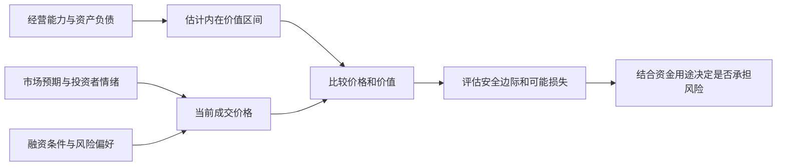

图中价值和价格分别形成，最后再比较。它们会相互影响，但不应被混成同一个数字。“市场今天报价多少”与“你估计它能提供多少经济利益”是两个问题。

### 难点图解二：风险为什么会在繁荣中增长

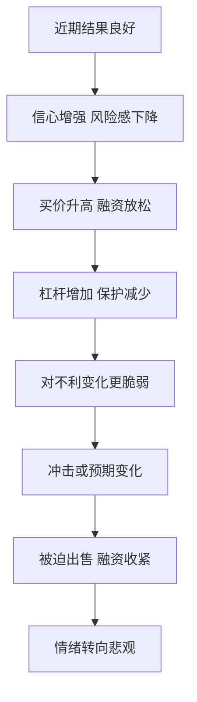

这只是机制示意，没有固定时间表。它不表示每次上涨都会立即崩溃，也不表示所有悲观市场都有便宜机会；它提醒读者观察价格背后的风险积累。

### 如何把这本书用于自己的决策

可以将一次投资研究写成一页，逐项填入真实资料：

| 问题 | 应写出的内容 |
| --- | --- |
| 我买的究竟是什么 | 资产、权利、现金来源，而不只是代码或概念 |
| 我估计值多少 | 区间、关键假设、最敏感的变量 |
| 现在支付多少 | 当前价格包含怎样的增长与风险预期 |
| 我与市场哪里不同 | 具体事实或解释差异，不是“我更有信心” |
| 可能错在哪里 | 竞争、债务、估值、执行、资金期限等 |
| 最差会怎样 | 永久损失、被迫退出和生活资金影响 |
| 为什么值得承担 | 价格提供的补偿与其他选择相比如何 |
| 什么会改变判断 | 可验证的反证与复查时间 |

**补充练习：** 找一个历史上由热门转冷门的行业，分别重建当时的乐观与悲观解释。不要用已经知道的结局给当时的人贴标签，而是检查哪些信号当时已经可见，哪些只是事后才知道。

### 常见误读

- “风险不是波动”，不等于可以无视净值波动、保证金或短期用款。
- “逆向”，不等于自动买入跌得最多的东西。
- “好价格”，不等于绝对价格低或离历史高点很远。
- “知道周期位置”，不等于能预测转折日期。
- “防守”，不等于永远追求零亏损，也不等于永不投资。
- “运气重要”，不等于研究无用；它要求以更长样本和更完整过程评价能力。
- “有安全边际”，不等于估值一定正确或永远不需要重新评估。

### 回顾自测

1. **为什么利好兑现后也可能下跌？** 因为之前价格可能预期了更好的结果。
2. **风险越高，为什么不保证赚得越多？** 因为更高不确定性同时扩大了不利结果范围。
3. **安全边际能防止什么，不能防止什么？** 可以留出部分误差空间，不能修复完全错误的价值判断或所有极端情境。
4. **如何区分逆向与固执？** 前者有证据和价格依据，也愿意面对反证；后者只维护原立场。
5. **好公司与好投资之间还差什么？** 买价、未来实际结果、风险与持有者条件。
6. **单次成功为什么不够？** 因为运气和隐藏风险可能暂时没有暴露。

### 来源与资料边界

- [Columbia University Press：The Most Important Thing Illuminated](https://cup.columbia.edu/book/the-most-important-thing-illuminated/9780231162845/)：用于原书 20 章结构及评注版区别。
- [作者备忘录：I Beg to Differ](https://www.oaktreecapital.com/insights/memo/i-beg-to-differ)与[It's Not Easy](https://www.oaktreecapital.com/docs/default-source/memos/2015-09-09-its-not-easy.pdf)：第二层思维、逆向及价格的重要性。
- [Us and Them](https://www.oaktreecapital.com/docs/default-source/memos/2004-05-07-us-and-them.pdf)：知识边界与不同风险态度。
- [The Calculus of Value](https://www.oaktreecapital.com/insights/memo/the-calculus-of-value)：作者后续对价值与价格的澄清；文中当时的市场判断没有转成今天的建议。
- [Risk Revisited Again](https://www.oaktreecapital.com/insights/memo/risk-revisited-again)、[The Indispensability of Risk](https://www.oaktreecapital.com/insights/memo/the-indispensability-of-risk/)与[A Look Under the Hood](https://www.oaktreecapital.com/insights/memo/a-look-under-the-hood)：风险概念与个人约束。
- [The Impact of Debt](https://www.oaktreecapital.com/insights/memo/the-impact-of-debt)：杠杆与生存空间。
- [The Race to the Bottom](https://www.oaktreecapital.com/insights/memo/the-race-to-the-bottom)与[Sea Change](https://www.oaktreecapital.com/insights/memo/sea-change)：融资行为及心理变化。
- [You Bet!](https://www.oaktreecapital.com/docs/default-source/memos/you-bet.pdf)：决策过程与结果的区别。
- [Fewer Losers, or More Winners?](https://www.oaktreecapital.com/insights/memo/fewer-losers-or-more-winners/)：防守、股债差异和风险回报关系的后续说明。

- [2000 年 Bubble.com 备忘录](https://www.oaktreecapital.com/docs/default-source/memos/2000-01-02-bubble.pdf)、[Taking the Temperature](https://www.oaktreecapital.com/insights/memo/taking-the-temperature)与[2020 年 Calibrating](https://www.oaktreecapital.com/docs/default-source/memos/calibrating.pdf)：互联网估值、2008 年机会准备及 2020 年风险调整的作者原始论述或事后回顾，不能当作独立审计的业绩证明。
- [美的 2026 三季报](https://static.cninfo.com.cn/finalpage/2026-10-30/1225645132.PDF)、[茅台 2026 三季报](https://static.cninfo.com.cn/finalpage/2026-10-31/1225649896.PDF)与[核验表及图解](<实战案例/2026三季报图解.md>)：第 01、05 点书外财报教学材料；报告期间、单位与归属口径在原位说明。
- [美联储：LTCM 濒临倒闭](https://www.federalreservehistory.org/essays/ltcm-near-failure)：第 15 点杠杆与融资约束案例。

本笔记没有检验个人投资组合，也没有推导一套普适估值参数。待提供具体中文版本后，可以继续核对原书案例、译名与评注者的不同意见。图表由本笔记编排；真实财报与历史事件在原位附来源，只有明确标为数学演示或假设算例的数值为教学设定。

---

[返回书籍索引](<README.md>) · [财商学习与实践路线](<财商进阶合订本.md>)


---

<a id="book-05"></a>

[单独打开本篇](<思考，快与慢 - 丹尼尔·卡尼曼/读书笔记.md>)

## 《思考，快与慢》读书笔记

> 作者：丹尼尔·卡尼曼（Daniel Kahneman）  
> 原书：Thinking, Fast and Slow，2011 年。简体参考版：胡晓姣、李爱民、何梦莹译，中信出版社，2012 年，ISBN 9787508633558；见[对外经济贸易大学图书馆书目](https://opac.lib.uibe.edu.cn/opac/book/b0acae873a7a226eb38de2c9ce39a774)。用户持有版本尚未确认，不混用不同译本页码。  
> 分析依据：出版社公开介绍与试读、作者研究和公开资料，结合原创概念解释；未取得用户原书，不声称逐页精读。  
> 覆盖范围：五部分框架、34 个主要知识点、概率与风险难点、财商应用和复盘练习。  
> 更新日期：2026-11-11

### 先看这里：它能怎样提高财商

**一句话概括：人经常在不知道自己用了什么捷径的情况下作出判断；改善决策，需要识别容易出错的情境，再用概率、外部数据和事先设计的流程约束直觉。**

本书最有价值的地方，不是让你记住一串偏差名称，而是帮助你发现这些常见错误：觉得熟悉就相信，听到故事就判断，赚了钱就认定自己厉害，亏了钱就只想回本，看见风险就忘了概率，看见机会就忘了代价。

先记住六个结论：

1. **直觉很有用，但自信不能证明直觉正确。** 要看环境是否有稳定规律，以及自己是否得到过有效反馈。
2. **先问同类情况通常怎样，再看这个案例有多特别。** 基础概率能为故事提供约束。
3. **一次结果不能完整代表决策质量。** 好方法可能暂时亏钱，错误判断也可能碰巧赚钱。
4. **损失和收益的感受受参照点影响。** 买入价格、历史高点和心理目标，常常会悄悄左右选择。
5. **把风险放进整体中审视。** 单独看每次涨跌，与看总体目标、相关性和承受能力，可能得到不同判断。
6. **用可重复的检查流程，代替“我以后一定更理性”。** 记录预测、比较备选方案、查证反面证据、事前复盘，通常更容易落实。

知识点中的真实研究、真实财报与教学推论分别注明。研究使用的虚构题目不等于虚构研究；必要的数学演示另作标注。财商应用不冒充原书投资策略。

### 全书五部分怎样连接

卡尼曼在[出版社公开试读](https://us.macmillan.com/books/9780374275631/thinkingfastandslow/)中说明了五部分的组织方式。下面按主题重组，便于把知识点连起来。

| 部分 | 核心问题 | 本笔记覆盖 |
| --- | --- | --- |
| 两种思考方式 | 判断如何快速产生，何时需要审查？ | 1—7：双系统、注意力、流畅性、联想、故事、替代、光环 |
| 启发式与偏差 | 为什么直觉常常不擅长统计？ | 8—15：样本、锚定、可得性、情感、基础概率、合取、回归 |
| 过度自信 | 为什么我们高估理解、预测和控制能力？ | 16—21：后见之明、有效性错觉、模型、专家直觉、外部视角、乐观 |
| 选择 | 人怎样感受收益、损失和风险？ | 22—31：参照点、价值函数、概率加权、心理账户、框架等 |
| 两个自我 | 当下感受与事后记忆为何不一致？ | 32—34：体验、记忆、峰终、聚焦与幸福 |

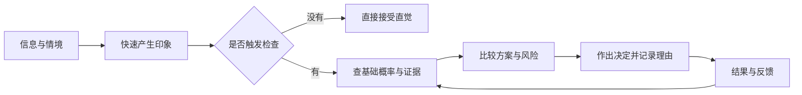

这张图是本笔记的应用整理。快速印象不可避免，关键是让重要决定经过必要检查，并能在之后得到真实反馈。

### 第一部分：两种思考方式

#### 1. 系统 1 与系统 2 是理解思考的模型

系统 1 指快速、自动、往往不费力的处理，系统 2 指需要注意力的计算、推理和自我检查。它们是理解加工方式的模型，不是大脑里两个独立器官。快不等于错，慢也不保证对；关键是答案有没有接受与任务相称的检查。

**真实研究：球拍与球的认知反思题。** Frederick 在 2005 年发表的研究使用了一个问题：两样东西合计 1.10 美元，球拍比球贵 1 美元，球多少钱？这是实际研究采用的题目，不是声称现实中发生过这笔购买。[原研究及发表信息](https://www.aeaweb.org/articles?id=10.1257/089533005775196732)

直觉容易给出 0.10 美元，因为 1.10 很自然地被拆成 1 和 0.10。但把这个答案放回条件就会发现：球若为 0.10，球拍应为 1.10，合计变成 1.20，违反题设。设球价为 x，正确关系是 `x+(x+1)=1.10`，因此 x=0.05，球拍为 1.05。难点不在代数，而在于是否在“已经有一个顺口答案”之后继续验证。

这说明快速处理可以迅速产生候选答案，审查过程则要检查全部约束。只把同一个答案在心里重复三遍，不能算充分审查；把它代回原条件，才做了有机会发现错误的动作。研究中的表现也不能直接当作一个人的整体智商、道德或投资能力标签。

用于财商时，可以把这种检查迁移到财报：利润增长、收入增长和现金增加是否被当成同一个问题？买入理由是否同时满足价格、风险和期限约束？这些是本笔记的应用推论，不是该实验已经证明能提高股票回报。慢思考的价值取决于检验质量，而非思考时长。

#### 2. 注意力有限，复杂判断会相互挤占资源

注意力有限，投入某项任务时，其他显眼的信息也可能被漏掉。重要判断因此需要安排检查步骤，不能依赖“有问题我自然会看到”。

**真实实验：数传球时漏看大猩猩。** Simons 与 Chabris 在 1999 年的研究中，让参与者观看传球录像并完成注意任务；不少人没有报告画面里经过的意外对象。实验使用了不同条件，不能把某一条件的漏看比例当作所有场景的固定比例。[两位作者的原论文](https://www.chabris.com/Simons1999.pdf)

这里不是参与者的眼睛收不到信息，而是正在执行的任务影响了什么进入注意。财报阅读的对应做法是把“查利润”和“查现金、债务、附注”分为明确步骤；后者不是看完前者后必然自动发生的过程。这个迁移是学习方法上的启发，并非实验直接测得的投资效果。

#### 3. 认知轻松：容易处理的信息更容易显得可信

熟悉、重复、表达清楚的信息常让人产生顺畅感。这种感觉有时被误当作真实或优质的证据。相反，陌生或难读的信息会让人觉得不可靠，即使内容本身未必有问题。

#### 4. 联想与启动：当前情境会影响接下来容易想到什么

一个词、情境或记忆能激活相关内容，使某些解释更容易进入头脑。这有助于理解信息并非在真空中被处理。但具体的社会启动实验效果，需要分别看证据。

卡尼曼在[2012 年公开信](https://www.nature.com/news/polopoly_fs/7.6716.1349271308!/suppinfoFile/Kahneman%20Letter.pdf)中已讨论社会启动研究的重复验证问题。不能把本书每个生动实验都当作普遍规律，也不能据此否定全部判断与决策研究。

#### 5. 所见即全部：大脑倾向于用已有信息拼成完整故事

信息不足时，我们未必感到“还不知道”，反而容易把当前掌握的少量事实组合成连贯解释。故事越顺，就越容易忽视缺失的内容。

**书外真实财报练习（截至 2026-11-11）：** 根据美的 2026 年三季报，可以各拟一个标题：“前三季度归母净利润增长 9.27%”和“前三季度扣非归母净利润下降 22.49%”。先遮住另一条，记录自己由第一条产生的印象，再把它们同时列出来，并加入同一报告中收入增长 1.19%、经营现金流下降 29.58% 两项。四个指标合看，已经足以说明一条标题不能代表全部信息。[原报告第 2 页](https://static.cninfo.com.cn/finalpage/2026-10-30/1225645132.PDF) 两个标题来自同一份报告，却选择了不同信息；这里是自我观察练习，不是已经实施的心理实验，更没有证明所有读者必然受到同样影响。

继续把记录分成“表中事实”“我的解释”“尚缺资料”。例如“经营全面向好”与“主营业务全面恶化”，都比单项数字能支持的结论更宽。补全表格后，应查看非经常性损益明细和公司解释，而不是只挑能维护第一印象的一行。**参考答案方向：** 合理的修正未必是从乐观变悲观，而可能是承认各指标分化，暂缓总体判断；无论最先看到哪个标题，都使用同一份核对清单，才不会让最先看见的信息充当全部证据。

#### 6. 问题替代：用容易的问题回答困难的问题

真正的问题可能是“这家公司未来产生的现金能否支持当前价格”，大脑却回答了“我喜不喜欢它的产品”。容易回答的问题产生了明确感觉，于是被误当成原问题的答案。

#### 7. 光环效应：一个突出特点染色了其他判断

一个人的能力、外貌或名望令人印象深刻，可能连带影响我们对其诚信、专业范围和观点正确性的评价。负面印象也能产生类似扩散。

### 第二部分：直觉为什么容易误读统计

#### 8. 小数定律错觉：以为小样本也应稳定代表总体

小样本通常比大样本波动更大，极端表现更常出现。如果只看几个案例，就容易把随机起伏解释成可靠规律。

#### 9. 锚定：最先接触的数字会牵引后续估计

最先接触的数字可能牵引后续估计，即使它与目标并无可靠关系。锚定不是“用了参考价就一定错”，而是参考数字未经验证，却影响了判断尺度。

**真实实验：随机转盘与联合国成员估计。** Tversky 与 Kahneman 的 1974 年论文报告：不同组先接触到 10 或 65，再估计非洲国家在联合国成员中的占比，两组估计中位数分别为 25% 和 45%。这是历史实验的结果，不是今天的联合国成员比例。[原始论文公开副本](https://www.csc2.ncsu.edu/faculty/mpsingh/local/Social/f24/wrap/readings/Tversky%2BKahneman-heuristics-biases-1974.pdf)

转盘没有提供成员国信息，但估计仍向它靠拢。把机制迁移到股票时，应当追问自己围绕的是盈利与现金的独立估计，还是历史高价、买入价或别人的目标价。历史价格可能包含信息，却需要论证，不能仅因曾经出现过就成为合理价值。

可操作的检查是先记录独立估值区间与依据，再查看外部报价；若两者差异很大，明确是哪项新证据改变了估值。单纯把别人给出的数字上下调一点，仍可能没有摆脱原锚。

#### 10. 可得性：容易想起不等于更常发生

鲜明、近期、反复出现的案例更容易被想起，于是可能被误认为发生频率高。判断的对象从真实比例变成了记忆的便利程度。

#### 11. 情感启发：喜欢与害怕会影响风险判断

对某事有好感时，人可能同时提高对收益的估计、降低对风险的估计；反感时则反过来。这样形成的风险收益判断，看似来自分析，实际上可能来自同一个总体感觉。

#### 12. 代表性与基础概率：像某一类，不等于很可能属于那一类

一个对象符合某种典型印象时，人容易忽略该类别原本多常见。正确判断通常既需要个案特征，也需要基础概率。

**真实研究与证据边界：** 卡尼曼在诺贝尔演讲中回顾了工程师／律师基础比例实验：给定类别构成后，人物描述仍可能使判断忽略基数；他同时指出，某些显式基数忽略结果对研究设计敏感，并非牢不可破。[作者回顾，印刷页 476](https://www.mit.edu/~shaslang/mprg/kahnemannNobelLecture.pdf)

这说明应先问总体由哪些类别组成，再问个案特征的区分能力；同时也应接受研究边界，不能宣称人类无论何时都会忽略基数。下面只用清楚标注的假设数字演示贝叶斯计算，不将其当成实验数据。

理解它的关键是分清两种问题：**若对象真的有问题，信号多大概率会出现？** 与 **若信号已经出现，对象多大概率真的有问题？** 前者从真实类别出发，后者从观察到的信号出发，分母完全不同。把两者混起来，就会把筛查能力误认为筛查后的确定程度。

可以把基础概率看成检查之前的人群构成，而把信号看成一种筛选。假如绝大多数对象本来都正常，即使正常者只有一小部分被误标，也可能涌入很多案例。筛选有价值，却不代表被选中的对象大多数必然属于目标类别。既要看它抓住了多少目标，也要看它带进来多少非目标。

下面的示意中，真正有问题的 100 份材料提供了 80 个标记，而正常的 9,900 份材料提供了 990 个误标。我们收到一个标记时，它来自哪条路径尚未知，因此正确的比较是 80 与全部 1,070 个标记，而不是 80 与最初的 100 个问题对象。

**财商应用中的对应关系：** 一个“公司可能有风险”的指标，不能只展示它曾经命中过哪些坏公司，还应检查它在正常公司里有多常见。同样，“成功企业常有某特征”，不意味着“有某特征的企业常成功”。这不是说指标无效，而是要求同时检查命中、误报和样本本来的构成。

**练习与参考答案：** 假设方法的识别率与误报率保持不变，但基础比例由 1% 上升为 10%，在 10,000 份材料中会怎样？真实问题 1,000 份，标记 800 份；正常 9,000 份，误标 900 份；标记中实际有问题的比例为 `800÷1700≈47.06%`。同一种信号，在不同总体中含义会变化。现实中还必须验证方法表现是否能迁移，不能随意假定不变。

#### 13. 合取谬误：细节更多的故事，概率不会因此更大

“A 与 B 同时发生”属于“A 发生”的一部分，因此概率不能更高。故事更符合人物形象，不等于包含更多条件的事件更容易发生。

**真实研究：琳达问题。** Tversky 与 Kahneman 的研究给参与者阅读一位关注社会议题的虚构女性简介，再比较“银行出纳员”和“银行出纳员且积极参加女权运动”等描述。研究中出现了把合取项排在单一项之前的回答。琳达是实验人物，真实的是研究及其观察结果。[卡尼曼本人对原研究的回顾，印刷页 468—469](https://www.mit.edu/~shaslang/mprg/kahnemannNobelLecture.pdf)

不必猜琳达真正是什么人，集合关系已经给出限制：每位兼具两种特征的人都在第一类里，第一类还可能有不满足第二条件的人。因此“更像”与“更可能”必须分开。

分析企业时，同理要把“增长”与“增长且提高利润率且成功出海”区分。后者也许是更吸引人的完整故事，但每增加一个必须同时满足的条件，不能凭叙事吸引力提高联合概率。题目措辞和理解方式会影响实验回答，不能因此给某个真实投资者贴认知缺陷标签。

#### 14. 回归均值：极端表现后往往不再同样极端

观测到极端结果后，下一次不再同样极端，可能来自不完全相关的测量和暂时因素，并不必然由奖励、惩罚或某种干预造成。回归均值也不等于所有个体最终都相同。

**真实历史研究：高尔顿对身高的分析。** 高尔顿 1886 年关于遗传身高的论文研究了父母与成年子女身高的关系：按父母身高分组后，极高或极矮父母的子女平均表现没有同样极端。这里讨论的是条件平均，不是每个高个子父母的孩子都更矮。[论文原文的大学存档](https://www.york.ac.uk/depts/maths/histstat/galton_reg.htm)

这个结果的关键是两代身高相关但并非完全一致。按照一个变量挑出最极端组后，另一个不完全相关变量的组平均，可能更接近其总体平均。它不需要一股神秘力量把每个人往中间拉，也不能被解释成人类一代代趋向同一个身高。

把逻辑迁移到投资排名时，某基金一年的极高收益可能同时包含能力、市场暴露和偶然顺风。按当年收益挑冠军，往往同时挑中了有利偶然因素；下一年这些因素不再同样有利，即使能力未变，名次也可能回落。这里是统计原理的应用分析，不是高尔顿研究过基金。

尤其要防止把它变成“股价跌多了必涨”。股票历史高点不是已验证的稳定价值中心；盈利、利率、竞争和股本会改变，原来所谓正常水平也会变化。只有先证明某变量存在相对稳定的关系，才谈得上研究回归；即便样本里存在，也还需考虑交易成本和样本外表现。

检查一段解释时，应问：极端样本是怎样选出来的？比较变量相关程度如何？正常水平是否改变？有没有把自然回落误当成管理措施的效果？这比单说“回归均值”更能帮助判断。

#### 15. 直觉预测需要考虑信息可靠程度

弱信号不应支持非常极端的预测。若个案信息与最终结果的关联不强，合理预测通常应更靠近参考群体的平均情况。

#### 难点图解一：基础概率如何改变信号的意义

**补充教学算例，数字全部假设：** 10,000 份材料中实际有问题的占 1%。某筛查方法能标记其中 80%，同时会误标 10% 的正常材料。

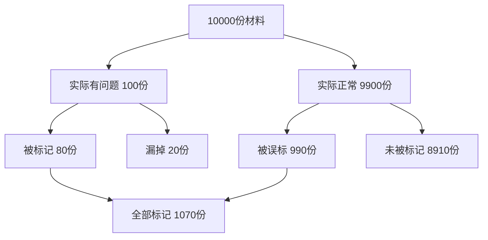

被标记后确实有问题的比例为：

`80 ÷ (80 + 990) ≈ 7.48%`

80% 是“有问题时被发现”的概率，不是“被发现时确实有问题”的概率。因为正常材料数量很大，少量比例的误标也会产生很多案例。实际使用还需要确认筛查表现、基础比例和人群是否可比。

### 第三部分：为什么我们容易过度自信

#### 16. 理解错觉与后见之明：结果出来后，过去显得过分清楚

知道结果后，人容易重构当时的判断，觉得事情本来就明显。成功者的路径被写成必然，曾经存在的其他可能被抹掉。

#### 17. 有效性错觉：有把握的感觉可以超过证据质量

判断的自信程度，常受故事一致性影响，不只受预测能力影响。资料即使有限，只要互相看起来吻合，人也可能很笃定。

#### 18. 简单规则有时优于无约束的临场判断

人评估同类对象时容易受到顺序、心情和不相关信息影响。预先确定指标和处理方式，可以提高一致性。模型不需要很复杂才有帮助。

#### 19. 专家直觉的可靠性需要条件

卡尼曼与加里·克莱因指出，直觉技能的形成需要环境具有可学习的规律，以及足够的学习机会与反馈。主观确信本身不能验证能力；参见二人的[原始论文](https://bear.warrington.ufl.edu/brenner/mar7588/Papers/kahneman-klein-2009.pdf)。

判断一项经验是否真的训练了直觉，可以拆成三个问题。首先，环境里是否存在相对稳定、足以支持预测的线索？其次，当事人是否经历过足够多且相关的案例？最后，反馈是否及时、清楚，能让他知道自己为什么对或错？只是工作年限很长，并不保证这三项成立。

专业能力的适用范围应按任务划分。会计规则核对与远期股价预测的线索稳定程度、反馈速度不同；前一任务上的熟练不能直接证明后一任务的预测能力。

反馈质量差时，人尤其容易从结果中学错。承担巨大隐含风险，短期也许连续获利；如果每次获利都被解释成判断高明，训练出的可能是过度自信。反之，一个过程合理的决定遇到罕见坏结果，也不能仅因损失就把全部方法推翻。记录事前依据、概率和环境，能帮助区分可重复信号与偶然回报。

这与第 1 点的关系是：可靠直觉往往来自长期学习，而不是天生免于偏差；慢分析也应尊重已经验证的领域经验，而非每次从零计算。遇到陌生领域、结构改变或反馈模糊时，应提高独立核查的比例。

**练习与参考答案：** “我经历过三个牛市，所以能准确预测下一次拐点”，缺了什么？至少缺少完整预测记录、失败样本、事前明确的拐点定义和能区分市场顺风的评价。经历丰富是相关信息，是否形成可靠技能仍要另行验证。

#### 20. 外部视角：先找参考类别，再讲自己的特殊故事

内部视角关注眼前计划的细节；外部视角看类似项目通常花多久、成功率多高、常出现什么问题。计划谬误往往来自只看理想流程，忽略同类项目的实际分布。

#### 21. 乐观偏差与事前验尸：提前讨论失败的可能路径

乐观能支持行动，但过度乐观会低估成本、竞争和偶然性。事前验尸的做法，是假设计划已经失败，请参与者独立写出可能原因，从而让不受欢迎的信息更容易被说出来。

### 第四部分：收益、损失与风险选择

#### 22. 期望值、效用与参照点：相同金额不一定带来相同体验

期望值是不同结果按概率加权后的平均数；效用考虑结果对人的实际意义。前景理论进一步强调，人常按相对参照点的变化来感受结果，而不只看最终财富。

#### 23. 敏感性递减：越远离参照点，同样增量的感觉可能越小

从没有到获得一小笔钱，心理变化可能大于在已经获得很多之后再增加相同金额。损失一侧也存在类似的非线性。人对变化的感觉通常不是一条直线。

#### 24. 损失厌恶与禀赋效应：失去已经拥有的东西格外难受

损失厌恶比较的是参照点两侧的感受：失去一项东西与得到同等东西，心理分量未必相同。禀赋效应则指拥有某物后，愿意放弃它所要求的价格，可能高于尚未拥有时愿意付出的价格。

**真实实验：被分配到杯子的人与没有杯子的人。** Kahneman、Knetsch 与 Thaler 在 1990 年的实验中把杯子分配给部分参与者，再观察交易与估价；持有者愿意出售的价格与未持有者愿意购买的价格出现差距。杯子确实被分配和交易，不是拿一个虚构收藏者的故事证明结论。[三位研究者的原论文](https://econreadinggroup.github.io/assets/Kahneman%20et%20al.%20%281990%2C%20JPE%29.pdf)

这个设计有意思的地方是，分配改变了谁拥有物品，而不是先由最喜欢杯子的人自愿买入。于是“卖方本来就特别喜欢”不能轻易包办差异。但单个实验也不能穷尽所有解释：交易程序、理解程度和经验等都会影响表现；不能据此认为所有市场都存在固定倍数的估值差。

要把损失厌恶与风险厌恶分开。前者关心相对参照点的失去有多难接受，后者关心是否愿意承担不确定性。为避免承认损失而扩大下注，恰好可能表现为承担更多风险。股票持仓行为的现实研究见第 28 点。

对应财务决策，应分别列出未来现金、风险、成本，以及“这已经属于我”的感受。情感价值可以真实存在，却不能直接证明市场价值更高。“如果现在持有现金，还会以当前价格购买吗”可以帮助重新比较，但税费、流动性和组合约束仍要纳入，不能把这一问当成自动卖出规则。

#### 25. 概率加权与四重模式：概率变化的心理分量不均匀

人可能把极小概率赋予过大权重，对接近确定的变化又格外敏感。收益与损失情境结合概率，会产生不同的风险偏好。这是常见倾向，不是人人必然遵守的规律。

| 情境 | 常见倾向 | 帮助理解的补充例子 |
| --- | --- | --- |
| 高概率收益 | 更偏向确定结果 | 接受略小但确定的收益 |
| 高概率损失 | 愿意冒险避免损失 | 为避免确认损失而选择更大的风险 |
| 低概率收益 | 偏好小概率大收益 | 为极低中奖机会支付费用 |
| 低概率损失 | 偏好消除风险 | 为小概率重大损失购买保障 |

不要把购买保险简单判作错误：损失规模、承受能力、保障条件和费用都重要。这个框架解释心理倾向，不替代具体经济分析。

可以用四个**完全假设的选择题**逐格理解它。第一，确定得到 90 与 90% 概率得到 100、10% 得到 0：两者金额期望值均为 90，但接近确定的收益可能格外有吸引力。第二，确定损失 90 与 90% 概率损失 100、10% 不损失：期望损失相同，后者却保留了“完全逃过损失”的希望，可能令人愿意冒险。风险偏好随着收益或损失的框架改变，而不只是因为期望金额不同。

第三，确定得到 10 与 1% 概率得到 1,000：小概率大奖容易占据想象，选择者可能赋予这 1% 超出其线性比例的心理权重。第四，确定损失 10 与 1% 概率损失 1,000：同样的小概率，因为对应灾难般的损失，又可能让人愿意付出确定成本来避免。现实选择还会受金额大小、个人资源与描述方式影响，不能据此预测每一个人的答案。

注意，**概率加权不等于把概率估计错了**。一个人可能知道 1% 就是每百次约一次，却在决定愿意付出多少钱时，把这个机会或风险看得特别重。判断事实概率与评价结果吸引力，是两项不同的心理任务。前景理论把相对参照点的结果感受、敏感性变化和概率权重结合起来；不能只用一句“人都讨厌亏损”解释四种情况。

**练习与参考答案：** 为什么有人既买彩票，又购买保险？两种行为可能都涉及对低概率结果的较大心理权重，只是一个追求巨大收益，一个避免巨大损失。但这不是对具体选择是否合理的最终评价。保险还可帮助承担不起的风险转移，彩票也可能被当作娱乐支出；仍需看价格、条款、能力与目标。

#### 26. 罕见事件：想象鲜明时可能高估，经验不足时又可能低估

稀少事件的判断容易受呈现方式影响。文字描述中的灾难可能被过度关注；只看自己短期经验，又可能因为从未遇到而忽略它。

#### 27. 窄框架与宽框架：不要把每次波动都当成完整人生

逐笔孤立地看收益和损失，可能让人对短期波动过度反应。把决策放在总体目标和长期规则中，有助于减少临时情绪的支配。

#### 28. 心理账户、沉没成本与处置效应

心理账户给钱或资产贴上来源、用途与盈亏标签；沉没成本是已无法收回的投入；处置效应是更容易兑现盈利、继续持有亏损的行为倾向。三者有关联，不能只凭一次持有或卖出就判断动机。

**真实证券账户研究。** Odean 在 1998 年发表的研究分析一家折扣券商 10,000 个账户在 1987—1993 年的交易，观察到投资者较倾向兑现盈利而非亏损；研究还检查了再平衡、股价相关成本等替代解释。[原论文及方法](https://onlinelibrary.wiley.com/doi/10.1111/0022-1082.00072)

研究不是只数“卖出的赢家比输家多”，还必须考虑当时账户里分别有多少可卖的赢家与输家，否则行情较好时本来就可能有更多盈利股票。这个分母问题对个人复盘同样重要：需要比较有机会兑现的盈亏，而非只挑两笔令人印象深刻的交易。

数据支持的是样本中的行为模式，不能读取每个账户主人的内心。作者也区分了损失相关偏好与错误的均值回归信念等解释。因此，不能把所有持有亏损股票的行为都说成不理性。

个人可以检查：继续持有的理由是否仍指向未来价值与风险，还是只剩“卖了就证明我错了”？再把税费、组合和资金需求列入比较。这样使用研究，是为了提出更好的问题，而不是从一项群体现象直接生成买卖信号。

#### 29. 后悔、默认与不作为：行动方式也会影响感受

相似后果下，人对主动改变造成的损失，可能比对维持默认造成的损失更后悔。因此“什么都不做”容易显得安全，即使它也有代价。

#### 30. 偏好逆转：单独评价与并排比较可能改变排序

某些属性容易单独判断，另一些属性只有比较后才看得清。不同评价方式可能让同一个人给出不一致的选择。

#### 31. 框架效应：同一个事实的说法会改变选择

相同结果换成“保住多少”或“损失多少”的说法，可能改变选择。需要先把两种描述转换到相同终局，再判断其差别究竟来自后果还是措辞。

**真实实验，假设题设：1981 年的疾病决策问题。** Tversky 与 Kahneman 给不同组描述一场预计危及 600 人的假设疾病。在“救活”框架下，72% 选择确定救活 200 人；在结果对应的“死亡”框架下，只有 22% 选择确定死亡 400 人。另一选项在两个版本中是同一风险分布。疾病情境是实验题设，不是真实疫情记录。[原论文，第 453 页](https://psych.hanover.edu/classes/cognition/papers/tversky81.pdf)

| 统一成最终结果 | 救活框架 | 死亡框架 |
| --- | --- | --- |
| 确定方案 | 200 人存活 | 400 人死亡 |
| 风险方案 | 1/3 全存活、2/3 无人存活 | 1/3 无人死亡、2/3 全死亡 |

在题设总人数固定的条件下，每一行两种说法对应相同结果，但不同组的选择比例变化明显。这个实验不表示每个人换个说法都会反转，也不是说承担风险必然错误；它说明措辞可以影响偏好。

读投资宣传时，可把“保本机会”“损失概率”“成功率”统一写成结果、概率、期限与费用，再问损失幅度是否被省略。只有统一了这些条件，才知道是在比较真实不同的方案，还是同一方案的不同包装。

#### 难点图解二：收益、感受与决策分三层

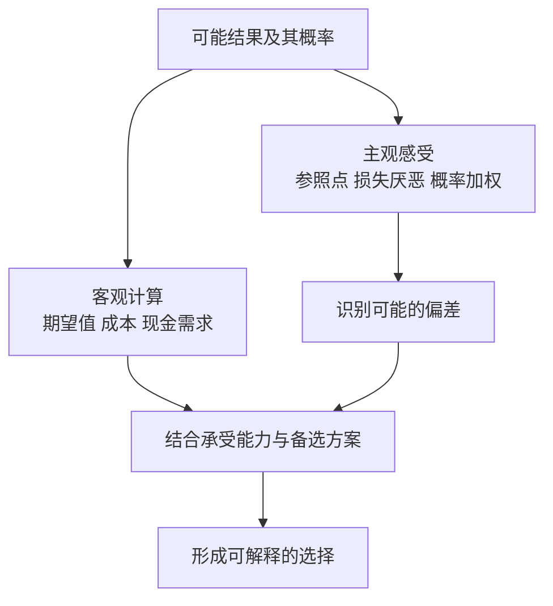

**补充算例：** 一次假设机会有 50% 概率赚 200 元、50% 概率亏 100 元，金额期望值为 `0.5×200−0.5×100=50 元`。期望值为正不等于对每个人都值得承担：若损失会影响必要支出，或概率估计不可靠，判断就不同。前景理论解释感受如何影响选择，并不要求人接受一切正期望机会。

### 第五部分：两个自我与幸福

#### 32. 体验自我与记忆自我

体验自我对应当下正在感受的生活；记忆自我负责对经历作整体评价，并影响下一次选择。一次经历的事后评价，未必准确汇总了其中每个时刻。

#### 33. 峰终定律与时长忽视

对一些经历的事后评价，受最强烈时刻和结尾影响较大，对持续时间考虑较少。它是特定条件下观察到的倾向，不是所有记忆遵守的公式。

**真实随机研究：肠镜检查后的回忆。** Redelmeier、Katz 与 Kahneman 在 2003 年发表的研究纳入 682 名患者；随机分组后，一组在结尾增加一段相对不痛的过程。这组对整个经历的事后不愉快评分较低，尽管检查时间更长。[研究原文](https://www.amherst.edu/system/files/media/0678/colonoscopy%202.pdf)

这里要分清三种量：经历了多久、过程每一时刻怎样、事后如何概括。增加的结尾没有删掉此前经历，却改变了回忆中的整体评价。这正说明“记得没那么难受”与“经历的总负担更少”不是同一命题；研究也不能单独隔离所有记忆机制。

用到投资复盘时，可把期末收益与完整净值、最大回撤、持有时间和资金压力并排记录。这样不会只因最后一个月反弹就把前面全过程改写成轻松获利。这是对记忆偏差的应用思路，原研究没有测量证券投资效果；研究程序也不是日常诊疗建议。

#### 34. 聚焦错觉：正在关注的因素，看起来比平时更能决定幸福

当人集中思考收入、城市、职位或某件物品时，容易高估该因素对日常生活的全面影响，忽略习惯、关系、时间使用及其他条件。

书中关于收入与幸福的具体研究有特定年份、人群和测量方式。本笔记不把某个历史收入阈值当作跨国家、跨时期的普遍标准。

### 财商应用：给重要决定做一次认知检查

以下流程是综合应用，不是作者给出的投资配方。

| 检查步骤 | 要回答的问题 | 主要防什么 |
| --- | --- | --- |
| 写清目标 | 这笔钱何时要用？我希望解决什么问题？ | 问题替代、聚焦 |
| 建立参考类别 | 类似情况通常怎样？失败案例占多少？ | 基础概率忽视、小样本 |
| 分开事实与叙事 | 哪些是已发生的事实，哪些是预测或愿望？ | 所见即全部、光环 |
| 统一比较口径 | 期限、费用、税费、流动性是否可比？ | 框架效应、偏好逆转 |
| 写出失败路径 | 什么情况会使判断错误？能否承受？ | 过度乐观、罕见风险忽视 |
| 查看整体影响 | 与已有风险是否重叠？是否影响必要现金？ | 窄框架 |
| 留下事前记录 | 预计什么、依据什么、何时复查？ | 后见之明、结果偏差 |

### 两个可以立即做的练习

**练习一：给一条“很有说服力”的观点拆层。** 写下它的结论、三个事实、两个假设、一个反面解释，以及仍缺少的信息。如果发现只有故事没有可核对数据，先降低确信程度。

**练习二：建立一页决策记录。** 记录日期、目标、选项、概率范围、可能损失、选择理由和复查时间。复盘时分别评价过程与结果，不能只用是否赚钱决定当时是否理性。

可以把记录写成：`我认为 X 可能发生，依据是 A/B；若出现 C，我会降低判断；目前最不确定的是 D。` 这会迫使模糊信心变成可检验的主张。

### 怎样批判性地读这本书

双系统是有用的解释框架，不是对所有认知过程的完整解剖。慢思考可能只是为原有偏见寻找更多理由；知道偏差名称，也不代表自己能自动避免。

书中实验的证据强弱并不一致。社会启动等具体例子受到重复验证方面的质疑，不能照单全收；同时，不能由部分例子有问题就宣布统计推理、前景理论和所有行为研究都无效。应按具体主张检查原研究、后续验证与适用条件。

许多偏差是群体层面的倾向，不能仅凭一次行为给个人贴标签。对他人的判断，最好先问数据与情境；对自己的改善，最好设计流程和环境，而不是只要求更用力思考。

### 回顾：八个自测问题

1. **系统 2 为什么不保证正确？** 注意力有限，而且慢处理也可能沿用错误假设或为偏见辩护。
2. **为什么成功三次不证明有能力？** 样本过小，还需区分运气、风险、筛选与稳定表现。
3. **基础概率与个案证据怎样配合？** 先用同类频率建立起点，再按证据的区分能力调整。
4. **回归均值是否意味着跌得多就会涨？** 不是；正常水平可能变化，价格也不是固定能力加随机噪声那么简单。
5. **损失厌恶与风险厌恶相同吗？** 不同；在某些损失情境中，人反而愿意承担更大风险。
6. **正期望值为什么仍不足以决定行动？** 还需考虑概率可靠性、承受能力、流动性及替代方案。
7. **如何降低后见之明？** 留下事前概率、证据和备选路径，按当时信息复盘。
8. **两个自我为什么与消费有关？** 事后回忆的美好，不一定等于日常体验的舒适。

### 来源与待补充内容

| 已查阅来源 | 用途 |
| --- | --- |
| [Macmillan：官方书页与公开试读](https://us.macmillan.com/books/9780374275631/thinkingfastandslow/) | 作者、书籍五部分结构及研究主题 |
| [对外经济贸易大学图书馆：简体版书目](https://opac.lib.uibe.edu.cn/opac/book/b0acae873a7a226eb38de2c9ce39a774) | 2012 年参考版译者、出版社及 ISBN |
| [卡尼曼：诺贝尔奖演讲文本，MIT 镜像](https://www.mit.edu/~shaslang/mprg/kahnemannNobelLecture.pdf) | 启发式、选择与框架研究的一手资料入口 |
| [卡尼曼与克莱因：Conditions for Intuitive Expertise](https://bear.warrington.ufl.edu/brenner/mar7588/Papers/kahneman-klein-2009.pdf) | 专家直觉的适用条件 |
| [卡尼曼 2012 年关于社会启动的公开信](https://www.nature.com/news/polopoly_fs/7.6716.1349271308!/suppinfoFile/Kahneman%20Letter.pdf) | 可重复性问题的作者本人说明 |
| [普林斯顿大学：作者演讲索引](https://kahneman.scholar.princeton.edu/lectures) | 原作者关于直觉、体验与记忆的进一步学习入口 |

正文用自己的话解释概念；真实实验、历史研究及财报在知识点原位注明来源，研究的假设题设与真实过程分别说明。图解、计算推导和应用练习为教学整理，不冒充原书引文。尚未核对用户版本的全部章节与案例，也未对全书所有实验进行系统证据综述。取得原书后，可继续补充逐章定位与译文差异。

---

[返回书籍索引](<README.md>) · [财商学习与实践路线](<财商进阶合订本.md>)


---

<a id="book-06"></a>

[单独打开本篇](<学会提问 - 尼尔·布朗、斯图尔特·基利/读书笔记.md>)

## 《学会提问》读书笔记

> 作者：尼尔·布朗（M. Neil Browne）、斯图尔特·基利（Stuart M. Keeley）  
> 原书：Asking the Right Questions: A Guide to Critical Thinking。本笔记按**原书第 12 版**的主要框架整理。简体参考版为许蔚翰、吴礼敬译，机械工业出版社，2021 年，ISBN 9787111680925；见[新华书店书目信息](https://item.xhsd.com/items/110000103245062)。  
> 版本说明：本书有多个原书版本及不同中文装帧、对照版，章节组合与练习可能不同。用户持有版本未确认，本稿不声称对应全部版本，不使用混合页码。  
> 分析依据：出版社公开目录、书目信息与核心概念整理；没有用户提供的原书，未逐页核对全部例证。  
> 覆盖范围：主要提问框架、32 个知识点、论证图解、财报与投资宣传应用、练习及检查表。  
> 更新日期：2026-11-11

### 先看这里：这本书教什么

**一句话概括：面对一个有说服力的观点，先弄清它在主张什么，再逐层检查理由、假设和证据，最后形成与证据强度相称的判断。**

它教的不是怎样让别人回答更多话，而是怎样判断一段话是否值得相信。表达者可能是真诚的，论证仍可能薄弱；结论可能恰好正确，给出的理由仍可能不够。

用于提高财商时，它最重要的作用，是帮助你拆开这些不同层次：

- 产品宣传说了什么，与合同承诺了什么。
- 公司业绩确实改善了什么，与市场故事推断了什么。
- 一个人曾经赚钱，与其方法是否能持续有效。
- 某项投资可能有收益，与它是否适合你的目标和约束。

最值得先掌握的六件事：**找到结论、问出理由、澄清词义、挖出假设、检查证据、考虑别的结论。** 不必每次把全部问题机械问完，先抓住最影响结论的环节。

### 全书结构与阅读路线

[Pearson 第 12 版官方目录](https://www.pearson.com/en-us/pearsonplus/p/9780137501731.html)可核对全书的提问顺序。下面用简短主题概括，不逐字复刻目录。

| 章节主题 | 主要任务 | 本笔记对应 |
| --- | --- | --- |
| 第 1 章：提问的态度和方法 | 从被动接受转向主动判断 | 1—4 |
| 第 2—3 章：论题、结论、理由 | 先把论证找出来 | 5—8 |
| 第 4 章：语言中的歧义 | 确认双方讨论同一件事 | 9—10 |
| 第 5 章：价值与描述性假设 | 找出没说出口的桥梁 | 11—13 |
| 第 6 章：推理谬误 | 检查支持关系有没有断裂 | 14—15 |
| 第 7—8 章：证据质量 | 评估经验、权威、观察与研究 | 16—21 |
| 第 9 章：替代原因 | 避免仓促认定因果 | 22—23 |
| 第 10 章：统计信息 | 检查数字怎样产生和呈现 | 24—27 |
| 第 11 章：遗漏信息 | 找到可能改变判断的缺口 | 28 |
| 第 12 章：合理结论 | 超越非黑即白 | 29—30 |
| 第 13 章：思考障碍 | 对自己的偏见也保持警惕 | 31—32 |

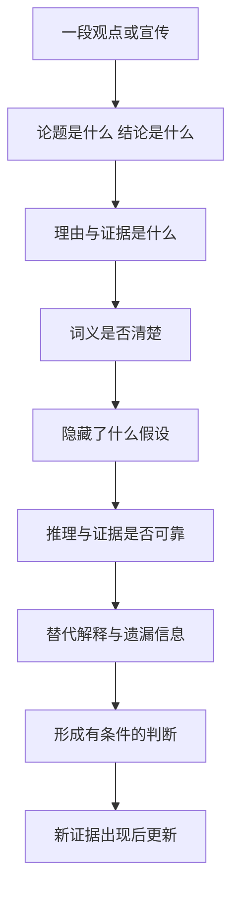

文字理解：先确认自己没有误读别人，再评价其论证；最后得到的可以是支持、反对、部分支持，也可以是信息不足。批判性思考不是每次都要推翻原观点。

### 一、先建立合适的提问态度

#### 1. 批判性思维：按理由和证据决定相信到什么程度

这里的批判不是刻薄、挑刺或永远反对，而是主动检查一个结论的支持是否充分。它允许承认别人说得好，也允许修正自己的原判断。

#### 2. 海绵式与淘金式思维：吸收信息和筛选信息需要配合

海绵式强调学习、理解和记忆；淘金式强调选择、质疑和判断。没有知识储备，质疑容易变成空泛怀疑；只吸收不检查，又容易把观点都当成事实。

#### 3. 弱势与强势批判：是否也愿意检查自己偏爱的观点

弱势批判把提问当成维护既有立场的工具，只挑对方的问题；强势批判对双方使用相近标准，也愿意改变自己。

#### 4. 好的提问需要好奇、谦逊和尊重

谦逊指承认知识与判断的局限，好奇指愿意理解不同解释，尊重指不把观点分歧直接变成人格攻击。这些态度能让更多信息进入讨论。

### 二、先找出论证，再评判它

#### 5. 论题：这段话究竟想回答什么问题

论题可能是描述性的，讨论事实如何；也可能是规定性的，讨论应该如何做。两种问题所需的支持不同：知道会发生什么，不自动决定该怎样选择。

#### 6. 结论：作者希望你接受的主张是什么

结论不一定在最后一句，也不一定有“所以”作为提示。寻找结论时，问“作者最终想让我相信什么或做什么”。如果无法准确复述，就还不适合反驳。

#### 7. 理由与证据：为什么这些信息支持这个结论

理由是支持结论的陈述，证据为这些陈述提供依据。两者可以交叉：一份可靠统计既可能是证据，也可能被直接作为论证的理由。

#### 8. 论证结构：前提成立，还需要推理连得上

一个论证需要分别检查：事实是否可靠，事实与结论是否相关，以及支持力度够不够。前提是真的，不表示随它而来的所有结论也是真的。

**真实财报：美的 2026 年前三季度利润分化。** 报告披露归母净利润为 413.93 亿元，同比增长 9.27%；扣非归母为 287.88 亿元，同比下降 22.49%。公司同时解释了汇率及相关风险管理工具分类的影响。[原报告第 2—4 页](https://static.cninfo.com.cn/finalpage/2026-10-30/1225645132.PDF)

第一步，只写原表支持的命题：两种利润口径变化方向不同。不要立刻把归母增长改称主营全面改善，也不要把扣非下降改称主营全面恶化。

第二步，找从数字走向经营结论的桥梁。如果要判断可持续盈利增强，需要了解利润组成、经营业务和损益的持续性；公司给出的分类解释是应核验的线索，不能替代对全部经营因素的分析。尤其不能把两种利润的全部差额都归为某一项汇兑收益。

第三步，单独检查从经营判断走向投资行动的桥梁。即使确认竞争力改善，仍需购买价格、市场隐含预期、风险与资金期限的信息。报告没有因为利润增长就自动证明当前股票便宜。

因此，当前材料能支持的是“应拆开研究利润构成及其变化”，而不是直接买入或卖出。这里练习的重点是把事实、解释和行动三层分开；[完整原表与计算](<实战案例/2026三季报图解.md>)可用于核对，但本节的推理已经成立，不依赖读完另一篇才理解。

#### 难点图解一：理由和结论之间，往往藏着假设


这个补充示意只展示部分桥梁，不能当成完整估值方法。它说明：即使起点事实正确，仍需核查转化过程和当前价格，才能靠近投资结论。

### 三、检查语言和未说出口的前提

#### 9. 歧义：同一个词是否承载了不同意思

一个词有多种解释，而这些解释会改变结论时，就必须澄清。歧义不限于形容词，也包括数字的单位、期间和定义。

**真实事件：1999 年火星气候轨道器失联。** NASA 的任务资料说明，英制与公制单位未正确转换造成导航计算错误，使探测器过分接近火星。这不是一次“算得不够精确”，而是传递的数值与接受方预期的意义没有对齐。[NASA 任务记录](https://science.nasa.gov/mission/mars-climate-orbiter/)

这里可学到的逻辑检查是：双方即使使用相同名称，也未必指向同一测量量。财报中的“增长”“净利润”“现金”“亿元”，同样必须连着期间、主体、单位和定义阅读。数字在一个环节没有单位，后面再精确的小数也修复不了最初的口径错误。

NASA 的事故调查还涉及组织和检验流程；不能把复杂事故简化成某个人粗心。这个案例用于说明定义对齐为什么是推理前提，不是据此认定所有含糊表达都会造成同样严重后果。

#### 10. 情绪用词与说服性定义：有些语言先替你作了评价

“聪明资金”“落后观念”“优质赛道”等词，会把赞许或贬低放进描述里，使读者在核查事实前已经站队。有时定义本身就把想证明的结论装了进去。

#### 11. 价值假设：不同结论可能来自不同的优先级

价值假设涉及什么更重要，例如收益与安全、效率与公平、眼前消费与未来储备。分歧有时不是事实不清，而是双方排序不同。

#### 12. 描述性假设：关于世界如何运作的隐含信念

描述性假设声称某些事实或因果关系成立，例如过去规律会继续、样本代表总体、某措施能够改变结果。它们即使没有明说，也可能支撑整段论证。

#### 13. 怎样挖出假设：寻找理由到结论之间缺失的桥梁

把理由和结论写下来，再问：还必须相信什么，才能从这里走到那里？最值得查的假设，是一旦不成立就会改变结论的那一条。

**接着分析第 8 点的真实美的财报。** 从归母利润增长走向持续经营能力增强，需要增长与持续经营有关；从持续经营增强走向投资有吸引力，又需要价格尚未充分反映这些信息。这是两条不同的推理链，不能只用同一个 9.27% 填补。[实际数据与说明](https://static.cninfo.com.cn/finalpage/2026-10-30/1225645132.PDF)

可以做反事实检查，但要明确这只是检验假设：若增量主要来自不稳定损益，经营结论还成立吗？若价格早已反映很高的未来增长，行动结论还成立吗？这些问题不是在宣称实际公司必然处于上述状态，而是定位需要哪些证据。

随后把问题转为可查资料：第一条查利润调整表、分部与多期表现，第二条查价格及估值中的预期。能想象出一个反例，只说明原推理并非必然；要判断现实中哪种解释更合理，仍需要证据。

区分关键假设与一般背景也很重要。某项不确定性只有在它足以改变价值、风险或选择时，才值得成为本轮重点。把所有未知都列出来却不分轻重，会让分析失去方向。

### 四、识别推理谬误，但不要沉迷贴标签

#### 14. 常见谬误：理由看起来热闹，却没有完成支持任务

识别谬误最有用的方式，是说清哪一步没有成立，而不只是报出名称。以下是补充示例：

| 常见问题 | 补充例子 | 怎样继续问 |
| --- | --- | --- |
| 人身攻击 | “他没赚过大钱，所以分析必错” | 分析的数据和推理具体错在哪里？ |
| 稻草人 | 把“控制风险”改说成“永远不投资” | 对方实际主张是什么？ |
| 虚假两难 | “现在买，否则永远没机会” | 还有等待、少量研究或其他选择吗？ |
| 诉诸人气 | “大家都买，所以可靠” | 人气能证明哪个关键属性？ |
| 不当诉诸权威 | “名人推荐，所以适合你” | 专业领域、证据与个人条件是否匹配？ |
| 循环论证 | “这是好产品，因为它很优秀” | 是否给出了独立理由？ |
| 滑坡 | “错过这次，以后一定越来越穷” | 中间每一步的因果证据是什么？ |
| 转移话题 | 被问费用，却不断谈使命 | 原问题是否得到回答？ |

有些风险链条或专家判断确实有根据，不能只因形式相似就自动判为谬误。

#### 15. 理由有问题，不等于结论必然相反

一个人用错误理由支持结论，只能说明这条论证不充分，不能直接证明结论为假。这是批判性思维中非常重要的克制。

### 五、检查证据有多好

#### 16. 证据的分量取决于它要支持多大的结论

证明“这件事可能发生”，一个可靠案例也许有用；证明“多数人都会这样”，就需要代表性的资料；证明“某措施导致了变化”，还需要更强的因果识别。

#### 17. 个人经验、见证与案例：具体，但可能不具代表性

个人经验容易理解，也能提供重要线索；局限在于样本小、记忆有偏、条件可能不同，且不容易看见没有成功的案例。

#### 18. 权威证据：看专业适配、透明度和独立性

专家与机构提供的信息有价值，但必须核对专业范围、原始证据和可追溯性。信誉可以帮助决定先调查什么，不能替代对关键主张的核验。

**真实监管案例：Theranos 对产品使用情况的陈述。** SEC 在 2018 年公布的民事指控中称，公司曾声称技术被美国国防部用于特定场景，而监管调查认为该部署说法不实。公司与 Holmes 当时同意解决相关指控但不承认或否认指控；这里引用的是该时点的指控和和解公告，不把它写成后来的刑事裁决。[SEC 原公告](https://www.sec.gov/newsroom/press-releases/2018-41)

“被重要机构采用”如果属实，可能是值得研究的外部证据；但把这句话写进介绍的人，并不等于那家机构本身。要拆成：谁在作声明，谁能独立确认，实际使用范围是什么，是否足以支持技术能力或商业前景。

因此，应寻找可核对的验证、合同或独立测试，而不是把多个转述同一句宣传的渠道，当成多份独立背书。本例支持的是核查权威声明来源的必要性，不是说知名人物或专业机构都不值得信任。

#### 19. 个人观察与调查：看到什么，也受观察方式影响

调查必须连着收集方式阅读：谁有机会进入样本，谁主动参加，谁没有回答，以及调查究竟测了什么。更多回答能减少某些随机波动，却不能自动修复选人方式的偏差。

**真实对照：2014 年 TIME 读者投票与苏格兰公投。** TIME 自己公布的网上读者投票共 16,418 票，57.5% 支持独立；同年的正式公投结果是支持 44.7%、反对 55.3%。[TIME 对自身投票的报道](https://time.com/3394671/scottish-independence-poll-time-com-yes/)、[英国政府公布的公投结果](https://www.gov.uk/government/news/scottish-independence-referendum-whats-next)

这不意味着网上投票的加法错了，也不能把 TIME 的读者投票直接叫作失败的代表性民调。两者的人群和参与机制不同：愿意在网站点击的读者，不能未经证明就代表有资格投票并实际参与的选民。

所以看到“上万人支持”时，先问这一万人是谁，再问人数够不够。对应股票研究，论坛投票、产品爱好者群调查、只展示愿意回复的客户，都必须检查同一问题。结论应先限定为被观察到的样本；要推广到总体，需要额外的抽样与代表性依据。

#### 20. 研究证据：看设计是否与主张匹配

研究结论的强度，取决于设计能排除哪些其他解释。仅观察到两组不同，不一定能把差别归因于你关心的因素。

**真实研究：预测训练与“高手选拔”不是同一种证据。** Mellers 等人的 2014 年论文报告，在地缘政治预测比赛中把参与者随机分配到不同训练及协作条件；但把第一年成绩最好的约 2% 集中到第二年的精英团队，是按既有成绩选拔。[原论文的方法与结果](https://faculty.wharton.upenn.edu/wp-content/uploads/2015/07/2014---psychological-strategies-for-winning-a-tournament.pdf)

随机分配有助于让初始差异在平均意义上得到平衡，因此训练组与对照组的比较更接近“训练有没有作用”。精英组则已经经过成绩筛选，不能把它与其他组的全部差距都解释成分组后某一次培训的效果。你必须先知道每组是怎样形成的，再看柱状图。

这一区别直接适用于理解课程或投资服务宣传：主动报名的人、主动留下评价的人、被筛选出的成功者，可能本来就与其余人不同。要检查起点、退出、共同环境和测量口径；单看期末结果，可能把选择过程当成教学效果。这里是从研究设计提炼的检查方法，不是在指称某家具体课程无效。

随机设计也不是结束检查的口令。任务参与、样本退出、结果计量和可推广范围仍须分析。研究中的参与者、任务和期限，与普通人的股票账户不同，不能直接推出照做便能获得同样收益。

**自测：**能否把精英团队第二年领先，解释为任何人只要被放进同样团队就能达到该水平？不能，原来的选拔与后来的团队环境同时存在，不能把选择差异抹掉。

#### 21. 类比：相似之处必须与结论相关

类比能帮助理解，也可以提示可能性；但两件事表面相像，不意味着决定结果的机制相同。需要检查相似点与差异点哪一个更重要。

### 六、寻找替代原因

#### 22. 一个结果可能有多个解释

看到变化后，人容易接受第一个顺手的原因。寻找替代原因，是主动检查还有什么可能产生相同结果。它要求比较解释的证据，而不是无穷无尽地提出想象。

#### 23. 相关、先后和因果是不同关系

两个量一起变化，可能是 A 影响 B、B 影响 A、第三个因素同时影响两者，或偶然关联。A 先发生、B 后发生，也不足以单独证明 A 导致 B。

#### 难点图解二：为什么同一组相关数据支持不同解释

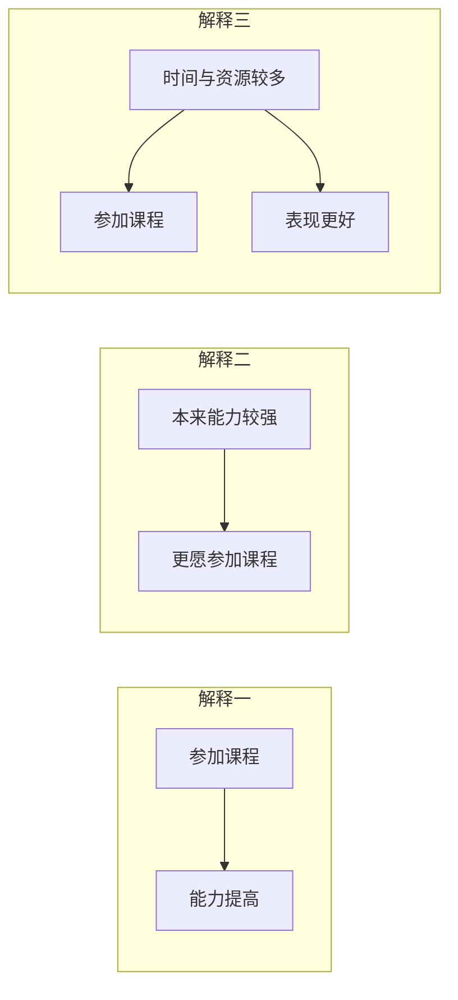

这是假设性示意，不是在评价某门真实课程。观察到“参加者表现更好”后，需要进一步区分课程作用、自我选择与共同因素；不能只挑自己喜欢的一条路径。

### 七、把数字看清楚

#### 24. 百分比要有分母、基期和口径

百分比必须与分母、基期、期间和指标定义一起阅读。“增长一倍”与“增加一个百分点”不同；某个净额的增长，也不等于其中一项收入的增长。

**真实财报：茅台 2026 年前三季度经营现金流。** 合并经营现金流净额由上年同期约 381.97 亿元增加到 840.59 亿元，同比增幅为 120.07%；销售商品、提供劳务收到的现金同期只增加约 3.41%。[原报告第 2、10—11 页](https://static.cninfo.com.cn/finalpage/2026-10-31/1225649896.PDF)

先把分母写清：`(840.59−381.97)÷381.97` 约为 120.07%，显示值经舍入。这是经营净现金的增幅，不是销售收款的增幅。经营净额把多项流入和流出加减后得到，某项支出减少，也会使净额增长。

再核对范围：合并报表包含财务子公司的项目。两项存款相关行的同比变化，合计解释了约 93.99% 的经营现金流增量；它们的变化不能被重命名为卖酒回款。[公司说明及原表](https://static.cninfo.com.cn/finalpage/2026-10-31/1225649896.PDF)

所以“经营现金流大幅增长”有公告支持；“卖酒回款翻倍”没有。即使把两项同比贡献减掉，也只得到其余项目的同比净变化，不是本期酒业现金流。这个案例说明：百分比的算术可以完全正确，语言中的分母或指标替换仍可能把结论带错。详细正负号可在[原表计算](<实战案例/2026三季报图解.md>)复核。

读任何收益率、满意度或增长率，都可以依次写出本期、基期、两期差和总体。缺一项，就先缩小结论，不替来源补上未经证明的含义。

#### 25. 平均数会隐藏分布

算术平均数、中位数和众数回答不同问题。总体平均不错，不代表多数人都不错；极端值可能显著拉动平均数。还应查看离散程度、分组和样本数量。

#### 26. 收益率需要看复利、波动和完整期间

收益率需要同时说明观察期间、现金流、复利算法、费用和是否实际实现。“年化”是一种把不同期间转成可比尺度的计算，不表示已经经历完整一年。

**真实监管案例：把最初三周外推成年化 2,700%。** SEC 在 2023 年对 Titan 的行政处理公告中指出，其加密策略宣传使用高达 2,700% 的假设年化表现，却未充分说明依赖最初三周表现持续一年的假设。Titan 在不承认或否认监管认定的条件下同意相关处理。[SEC 原公告](https://www.sec.gov/newsroom/press-releases/2023-153)

这里应依次拆开三个问题：三周实际测到了什么，怎样把三周换成一年，以及后面几十周为何能保持同样条件。即使换算公式没有算错，外推前提也可能很强；一个短窗口的极端表现，更不能自动成为客户完整持有一年的真实收益。

只为了说明计算，若短期增长为 r、期间为 d 天，按全年持续复利的假设可写成 `(1+r)^(365/d)−1`。这里没有代入虚构公司业绩，也不反推 Titan 每一天的实际收益；公式强调的是，指数放大会把“以后也一样”的假设放大。

比较表现还要区分算术平均与资金复合增长。纯数学演示：先涨 50% 再跌 50%，财富乘数为 `1.5×0.5=0.75`，不会回到原点。这个小算式仅用于理解算法，真实的主体案例仍是上面的监管披露。

**读宣传时的检查顺序：**先找完整期间和真实账户或假设模型的标识，再看追加资金、费用、回撤与基准，最后才比较年化数字。没有这些条件，漂亮百分比无法独立证明投资能力。

#### 27. 测量指标未必就是你真正关心的东西

一个指标可以被准确测量，却没有充分代表真正关心的目标。问题不只在算术，还在指标与目标之间的联系是否成立。

**真实事件：大众汽车排放测试。** 美国 EPA 的执法资料说明，涉事车辆使用能识别测试条件的软件，在测试与正常使用情境中的排放控制表现不同；相关民事和解涉及约 59 万辆汽车。[EPA 对案件与和解的记录](https://www.epa.gov/enforcement/volkswagen-clean-air-act-civil-settlement)

因此，“在某个测试里通过”不能脱离测试方式，直接等同“日常使用也达到相同表现”。本案涉及被识别的规避机制；不是一般统计误差，更不是证明所有测试或认证无效。

股票研究也应检查类似的代理关系：注册人数是否代表付费需求，订单是否可取消，收入是否转换成利润和现金。每次都要问目标是什么、指标怎样生成、哪些行为能改变指标而不改善目标。只有把这条链讲清，数字才有解释力。

### 八、遗漏信息与合理结论

#### 28. 重要遗漏：哪些缺失信息可能改变结论

任何表达都会省略信息，关键是被省略的部分是否重要。常见缺口包括反例、成本、失败比例、适用人群、时间范围、风险、替代方案和不同利益方的影响。

#### 29. 多个合理结论：支持、反对之外还有条件与程度

证据支持的结论有不同强度。可以确认一项事实，同时对原因、持续性和行动保留判断；这并不矛盾。

**回到美的实际利润分化。** 同一份三季报支持“归母增长”和“扣非下降”两个事实。非经常性损益净额为 126.05 亿元，且报告解释了部分分类影响；这些材料要求进一步研究利润构成，而不是简单选一个数字代表整家公司。[原报告第 2—4 页](https://static.cninfo.com.cn/finalpage/2026-10-30/1225645132.PDF)

| 层次 | 现在可以怎样说 | 尚不能越过的缺口 |
| --- | --- | --- |
| 事实 | 两种利润口径变化不同 | 不能把扣非直接叫主营利润 |
| 解释 | 分类与非经常项目值得拆解 | 不能把全部差额归给同一原因 |
| 持续性 | 需要更多分部和多期资料 | 不能凭单期累计数据确认长期趋势 |
| 行动 | 尚需估值与风险分析 | 不能直接得出当前买卖结论 |

形成多个结论，不是允许所有说法同样正确。每往下一层，都增加了需要证明的内容。末尾加一句“仅供参考”，也不能补上缺失的证据。

实际选择可与研究结论分开：信息不足时继续核查或暂缓承诺；是否值得追加研究，取决于信息价值、成本与后果。不必为了显得果断，把一个证据有限的判断写成绝对句。

#### 30. 信息不足时，确信程度与行动强度也可以降低

没有完整证据时，不必假装已经知道答案。可以继续核查、寻找低成本试验、缩小承诺，或暂缓决定。不同决定需要的证据强度，应考虑后果与可逆性。

### 九、把提问也用在自己身上

#### 31. 思考障碍：愿望、身份和熟悉感会改变证据标准

确认偏差会让人偏好支持自己的信息；信念固着让被削弱的观点仍难放下；可得性和光环效应让鲜明案例与好印象获得过大权重。知道这些名称只是开始。

#### 32. 好问题应帮助交流，并留下可复查的判断

有效提问通常先准确复述对方，再指出最重要的不确定处。问完以后，应把已确认事实、待核查假设和当前结论分开记录，便于新信息出现时更新。

### 综合复盘：回到已经讲过的真实材料

遮住前面各节的分析，只保留原始来源，再尝试完成下表：

| 真实材料 | 要独立检查什么 | 参考答案方向 |
| --- | --- | --- |
| 第 26 点 Titan 年化宣传 | 三周窗口如何变成一年，哪些条件是假设 | 区分观察期与外推期，不能把假设年化当作客户完整一年真实收益 |
| 第 19 点网上读者投票 | 一万多份回答能否代表正式选民 | 先查入样与参与机制；样本大不自动解决代表性问题 |
| 第 8、13、29 点美的财报 | 利润事实经过哪些桥梁才到投资行动 | 分开事实、可持续性、价格及个人约束，逐层补证据 |
| 第 24 点茅台现金流 | 净额增速是否能代表单项销售回款 | 保持分母、合并范围与指标定义一致 |

这项复盘不再另编一家公司。重点是你能否从真实材料自己找出推理缺口，而不是记住本笔记的结论。原始来源就在对应知识点附近，核对时同时保留日期和数据口径。

### 一页可复用的提问清单

面对重要观点，优先回答下面十二问：

1. 我们究竟在讨论哪个问题，是事实判断还是行动建议？
2. 对方希望我接受的结论是什么？
3. 支持结论的理由有哪些，是否与结论相关？
4. 哪些关键术语需要具体定义？
5. 结论体现了怎样的价值优先级？
6. 哪些没说出口的事实假设连接了理由与结论？
7. 推理是否出现跳跃，或者只用情绪、身份和人气代替证据？
8. 证据来自哪里，收集方式能否支持这么大的结论？
9. 是否存在反向因果、共同因素或其他合理解释？
10. 数字的分母、期间、分布、费用和口径是什么？
11. 哪些遗漏的信息最可能改变我的判断？
12. 目前可以得出多强的结论，什么新证据会让我改变看法？

不需要在闲聊中逐条盘问。涉及投入大量金钱、时间、长期承诺的决定，更值得完整使用这套检查。

### 练习：每天拆一条观点

选一条财经评论或商品宣传，限时十分钟，写五行：

```text
结论：对方主张什么？
理由：主要支持是什么？
假设：哪个未说出口的条件最关键？
缺口：哪一条信息最可能改变判断？
当前判断：支持到什么程度，下一步查什么？
```

一周后比较自己的记录：是否更容易分清事实、推断与建议？是否经常只挑不喜欢的观点检查？是否能够在证据不足时保留判断，而不急于站队？

### 阅读边界

批判性思维不能代替专业知识。会提问能发现一份财报分析的缺口，但要回答这些问题，仍需会计、行业与估值知识。也不能把“可能存在另一个解释”当作足以否定全部现有证据的理由。

证据并非必须完美才有用。合理目标是提高判断质量，让确信与行动匹配证据，而不是把标准提高到永远无法作决定。知识较多的一方值得被认真听取，同时仍需要清楚说明依据。

这本书的框架适用于检验论证，不宜用来否定他人的感受。一个人在表达难过时，可能需要先被听见；事实判断、价值选择和情感支持，是不同的交流任务。

### 回顾：八个自测问题

1. **批判与反对有什么区别？** 批判检查依据，可以接受或修正观点；反对只是可能的结果之一。
2. **事实为真，结论就一定成立吗？** 不一定，事实与结论之间还需要合理联系。
3. **价值假设与描述性假设有何不同？** 前者关心什么更重要，后者关心世界事实上怎样运作。
4. **发现谬误是否证明结论为假？** 不证明，只说明该论证存在缺陷。
5. **为何案例不能自动代表总体？** 个案的选择方式与条件可能特殊，失败和未被观察者可能被忽略。
6. **相关关系至少要检查哪些方向？** 正向、反向、共同因素与偶然关联。
7. **平均收益为正是否说明多数人赚钱？** 不说明，需要分布、中位数、亏损比例和计算方式。
8. **好的结论为什么常带条件？** 因为证据、人群与环境有范围，条件让判断更准确也更容易更新。

### 来源与待补充内容

| 已查阅来源 | 核验用途 |
| --- | --- |
| [Pearson：原书第 12 版官方书页](https://www.pearson.com/en-us/subject-catalog/p/pgmtitle/P200000002371/9780137501731) | 作者、版本与总体教学目标 |
| [Pearson+：第 12 版目录](https://www.pearson.com/en-us/pearsonplus/p/9780137501731.html) | 主要章节与提问框架 |
| [新华书店：中文第 12 版](https://item.xhsd.com/items/110000103245062) | 中文参考版译者、出版社、年份与 ISBN |
| [Investor.gov：Performance Claims](https://www.investor.gov/introduction-investing/general-resources/news-alerts/alerts-bulletins/investor-bulletins-47) | 财商应用中对业绩宣传的核查原则 |

白话解释、分析步骤和练习为本笔记整理；真实事件、公司数字和研究结果在对应知识点附原始来源，纯计算演示另行标注。书外材料不冒充原书案例或引文。尚未取得用户所用版本，因此未覆盖其全部练习及版本独有增补；后续可按原书逐章补足定位。

---

[返回书籍索引](<README.md>) · [财商学习与实践路线](<财商进阶合订本.md>)


---

<a id="book-07"></a>

[单独打开本篇](<超级预测 - 菲利普·泰特洛克、丹·加德纳/读书笔记.md>)

## 《超级预测》读书笔记

> 作者：Philip E. Tetlock、Dan Gardner（菲利普·泰特洛克、丹·加德纳；中文译名因版本而异）  
> 原作：*Superforecasting: The Art and Science of Prediction*，2015。简体版也以《超预测》为名；繁体版《超級預測》由日月文化出版。  
> 分析依据：出版社资料、公开目录、作者团队的方法说明、Good Judgment Open 评分说明和相关原始研究；未取得用户所持版本全文。  
> 覆盖范围：全书十二章的主要主题、34 个核心及延伸知识点；不复述全部人物案例，不声称逐页精读。章名用主题意译，不对应特定中译本页码。  
> 阅读目的：学会对不确定的事情作出有依据、可检验、可修改的判断，并用于投资决策。真实事件和研究结果在对应知识点附来源，数学演算与练习另外标注为教学补充。  
> 更新日期：2026-11-11

**详细阅读建议：**先通过概览了解全书，再重点读第 09、12、16—18、20、26、33 点。它们展开了“怎样找基础概率、怎样更新、怎样评分、怎样转成决策”的完整过程；其余知识点用于补充背景。需要案例的知识点直接结合真实事件、研究或业务实践讲解；纯公式演算另标假设，不把它们当作真实记录。

### 先看这里：这本书真正教你什么

预测能力不是“总能猜中结果”，而是长期把不同结果的可能性估得更合理。一个人说某事有 80% 概率发生，后来没发生，不能仅凭这一次就判定他不懂；但如果他反复说 80%，实际只发生约一半，他的自信就出了问题。

本书把判断从口才比赛变成可以记录、评分、改进的工作。核心顺序是：**问清问题 → 找基础概率 → 拆解原因 → 给出概率 → 接收新证据 → 更新 → 评分复盘。**

你最值得带走的五个变化：

- 从“我看好这家公司”，转成“我对哪一个经营结果、在什么期限内，有多大把握”。
- 从“我的故事很有说服力”，转成“同类事情通常怎样，这次有哪些可靠的不同”。
- 从“改观点等于认输”，转成“证据变了，合理的判断也应该变”。
- 从“这一次赚了，所以分析正确”，转成“判断质量要与运气、买入价格和承担的风险分开”。
- 从“寻找永远正确的专家”，转成“建立一套可重复检查的思考过程”。

书籍信息见 [Penguin Random House 官方书页](https://www.penguinrandomhouse.com/books/227815/superforecasting-by-philip-e-tetlock-and-dan-gardner/)；中文书名与版本可核对 [长荣大学 HyRead 书目](https://cjcu.ebook.hyread.com.tw/bookDetail.jsp?id=122604)。

### 全书主线与覆盖地图

| 章节主题 | 主要解决的问题 | 本笔记对应内容 |
| --- | --- | --- |
| 1 乐观的怀疑者 | 预测有边界，为什么仍值得改进 | 知识点 1—4 |
| 2 知识的错觉 | 为什么确信和解释能力会误导判断 | 5—7 |
| 3 给预测评分 | 怎样让预测接受检验 | 15—19 |
| 4 超级预测者 | 好成绩有多少来自能力和运气 | 20—21 |
| 5 思维能力 | 拆解、基础概率和不同视角 | 8—11 |
| 6 数字与概率 | 如何表达不确定性 | 12—18 |
| 7 信息与更新 | 多看新闻为什么不一定更准确 | 13、22—23 |
| 8 持续改进 | 如何通过反馈训练判断 | 24—25、34 |
| 9 团队 | 如何让讨论增加信息而非制造从众 | 26—28 |
| 10 领导者的难题 | 如何同时承认不确定性与作出行动 | 29 |
| 11 能力边界 | 遇到罕见事件和不可预测变化怎么办 | 30—31 |
| 12 下一步 | 如何把预测变成组织与个人习惯 | 32—34、练习 |

这张表是阅读导航，不表示一个概念只在某一章出现。公开目录可在上面的馆藏书目中核对。

### 一、先改变你对“预测”的理解

#### 01．概率判断与结果断言是两回事

“会发生”把判断压成一个二元答案；“发生概率约 65%”保留了不确定程度。实际结果最终是发生或不发生，但在结果揭晓前，你拥有的只是有限信息。

#### 02．好问题必须可结算

好预测题至少有对象、事件标准、截止时间和判定来源。“以后会更好”可以不断改解释，难以检验；清晰事件则允许第三方在结果出现后独立结算。

**真实历史事件：2014 年苏格兰独立公投。** 9 月 18 日举行的正式公投，最终支持独立者占 44.7%，反对者占 55.3%。[官方结果说明](https://www.gov.uk/government/news/scottish-independence-referendum-whats-next)

用这个真实事件说明题目定义，可以问“在这次正式公投的有效票中，支持独立的比例是否超过一半”。它比“苏格兰将来会不会独立”清楚：前者有指定投票、阈值与结果来源；后者可能混入下一次投票、谈判和无限期未来。这里是在复盘题目应怎样写，不是在宣称自己事前预测成功，也不冒充比赛的原始题目。

对相等、取消、推迟或无法取得结果的处理，应在预测开始时约定，不能揭晓后为保住成绩改规则。一次投票的结果也不能回答所有更长时期的政治问题。

**把同样方法用于当前的真实公司。** 以 2026-11-11 为提问时点，美的 2026 年三季报已经披露，不能再当作未揭晓成绩；可研究的问题是全年扣非归母净利润是否严格高于上一年可比值。练习可约定以截至 2027-05-31 公开的年度报告及正式更正为准，相等判“否”，缺乏同口径数据则记“无法结算”。截止日是练习约定，不是披露日预测。[已知的三季报输入](https://static.cninfo.com.cn/finalpage/2026-10-30/1225645132.PDF)

定义清楚之后才去调查历史基数、季节性和第四季度信息，并在结果公布前登记概率。为了表格完整随手填一个百分比，不会让题目更科学。

#### 03．挑选努力能改善答案的问题

有的事情靠简单规则就能判断；有的事情在所需期限内几乎没有可靠信息。最值得投入的，是可以通过资料、比较与分析显著改善判断的问题。

对财商的意义是分配研究时间。用一小时核对公司现金流，可能比用一小时猜明天开盘的涨跌更有学习价值。并不是所有问题都必须给一个漂亮数字；资料不足也是有用结论。

#### 04．预测距离越远，误差来源通常越多

复杂系统会出现反馈、政策变化、行为适应和偶发冲击。能对某个短期、定义明确的事件取得较好成绩，不代表能准确预测二十年后的市场格局。

因此应同时说明预测期限和适用范围。对遥远未来可以使用情景与宽区间；对即将公布的经营数据，可以分析更具体的变量。不要把短期预测比赛的结果无限推广。

#### 05．专业头衔、口才与预测成绩要分别评估

领域知识有价值，但一个人懂得解释历史，不等于他对未来的概率判断一直准确。公开表达的激励也可能偏向鲜明、肯定、容易传播的观点。

检查专家时，不只找他说对的几次，而要找完整记录、失败案例、预测期限和比较基准。也不能反过来得出“专家都没用”；该书批评的是不受检验的权威，不是知识本身。

#### 06．狐狸式思考与刺猬式思考

“刺猬”倾向用一个强大的解释框架理解各种现象；“狐狸”更愿意同时使用多个有限模型，承认例外，并在证据变化时调整。

#### 07．直觉是起点，反思负责检查

鲜活故事容易让人忽视基础概率；刚看到的新闻容易被高估；已经表态后容易只搜支持证据。这些心理倾向会影响概率估计。

实践时可以分两步写：第一反应是什么；随后有什么证据支持、什么证据反对。目的不是消灭直觉，而是避免把熟悉感和确信感当成证据。对认知偏差的系统学习，可结合《思考，快与慢》。

### 二、如何把一个模糊判断拆成可分析的问题

#### 08．费米式拆解：先求可解释的数量级

遇到不知道答案的问题，可以把它拆成较容易估计的部分。例如估算某地潜在订阅收入，可以依次考虑目标人数、触达比例、付费比例、客单价与续费情况。

拆解的价值在于暴露假设：到底是人数不确定，还是转化率不确定？乘出一串小数不等于精确，多个有偏的输入还可能放大误差。先给合理范围，再找最影响结论的变量。

#### 09．基础概率：先看类似事情通常怎样

基础概率提供一个独立于个案故事的起点：类似的事情通常怎样？关键不只是找到很多历史记录，还要解释为什么这组记录与当前问题可比。

**真实业务实践：飓风路径锥使用历史预报误差。** 美国国家飓风中心的传统路径锥按过去五年官方路径误差设置各预报时效的范围，各预报时效采用约 67% 的历史误差覆盖口径。2026 年 NOAA 又说明将试验覆盖 90%、区分速度与方向误差的椭圆方案。[NHC 历史误差说明](https://www.nhc.noaa.gov/verification/verify4.shtml)、[NOAA 2026 年产品说明](https://www.noaa.gov/news-release/national-hurricane-center-to-issue-new-forecast-cone-graphics-for-2026-hurricane-season)

这个例子不是直接计算某一二元事件的基础发生率，而是相邻的“外部视角”：不只盯着本次中心预测线，还利用同类预测以前错过多远，形成不确定范围。用哪几年、哪种预报时效和哪种系统误差作为参照，都会影响范围的含义；传统与试验产品也不能混读。

迁移到企业增长判断，先确定行业、规模、所处阶段、增长口径和观察期，再看目标增长在完整样本里多常见。只挑今天仍然存续的公司，或只挑已经成功推出产品的公司，会改变原问题；更多同类成功故事不能弥补失败样本缺席。

参照组越窄，业务可能越接近，但样本也可能越少。较宽与较窄参照可以同时保留，比较结论对选择有多敏感。结构变化时要说明历史类比在哪里失效，并扩大不确定范围，而不是仅用“这次不同”跳过所有比较。

**自测：**路径锥外是否必然没有影响？不是。各时效的历史误差覆盖比例不等于整条未来路径必然以同一概率全部落在范围内，中心位置的误差范围也不等于风雨影响范围；同理，公司的利润增长参照率，也不是股票上涨概率。参考类别和目标变量必须同时对齐。

#### 10．外部视角与内部视角要互相校正

外部视角看同类案例的分布；内部视角看当前个案的具体原因。只看外部会忽略真实变化，只看内部则容易被精心包装的故事带走。

参照组不是唯一正确答案。可以分别选较宽和较窄的同类组，观察结论变化。如果换一个合理参照组，估计就大幅改变，应承认模型不稳定，而不是掩盖分歧。

#### 11．至少提出一个竞争解释

看到营收增长，不要立即认定护城河加深。也可能是涨价、并购、一次性大单、渠道压货或行业整体景气。找能区分这些解释的证据，比继续搜“营收增长”的新闻更有价值。

竞争解释不是为了机械唱反调，而是防止只验证第一种想法。每个解释都应有它更容易出现的可观察现象。

#### 12．贝叶斯更新：新证据改变旧概率

贝叶斯更新的难点不在公式，而在区分两个问题：“如果项目会成功，我有多大机会看到这条消息？”与“既然看到了这条消息，项目成功概率是多少？”它们看起来相似，答案却通常不同。前一个问题描述消息产生的机制，后一个问题才是你想更新的判断。

**真实材料中的更新问题：美的 2026 年三季报。** 摘要中扣非归母净利润下降 22.49%，但同页说明提到汇兑损失与相关衍生工具收益的分类差异。[原报告第 2 页](https://static.cninfo.com.cn/finalpage/2026-10-30/1225645132.PDF)

看到后一条信息后，原先把扣非降幅直接等同主营恶化幅度的解释就需要重查：分类因素与经营因素可能同时存在。报告没有提供足以计算“主营恶化概率”的先验和似然比，所以这里不编一个精确后验。贝叶斯思路帮助提出问题：这条信息更支持哪些解释，它在相反解释下是否也可能出现，是否只是已知材料的重复。

**下面仅为公式演算，数字均为假设，不是公司或研究的实际记录。** 一条进度信号如何改变概率： 你判断一批复杂设备是否能按期交付，初始概率为 40%。随后看到消息：“关键部件已经通过验收。”为了把逻辑讲清楚，假设在确实按期交付的项目中，80% 会在这个时点出现此消息；在最终延期的项目中，也有 40% 会出现此消息，因为其他环节仍可能拖期。

先不要套公式，把情境放大成 1000 个虚构的类似项目：

| 实际结局 | 初始项目数 | 出现验收消息的比例 | 既属于该结局、又出现消息的数量 |
| --- | ---: | ---: | ---: |
| 按期交付 | 400 | 80% | 320 |
| 延期交付 | 600 | 40% | 240 |
| 合计 | 1000 | — | 560 |

你现在处在“已经看到消息”的 560 个项目中，其中 320 个按期交付。因此更新后的概率是 `320÷560≈57.1%`。好消息确实提高了概率，但没有把它提高到 80%。原因是延期项目本来更多，其中也会出现相同消息。

这个过程可以写成通行概率公式，作为理解本书的教学补充，并非要求每次预测都手算：

```text
后验赔率 = 先验赔率 × 似然比
赔率 = 概率 ÷ (1 − 概率)
似然比 = P(证据 | 事件发生) ÷ P(证据 | 事件不发生)
后验概率 = 后验赔率 ÷ (1 + 后验赔率)
```

本例先验赔率为 `0.4÷0.6=2/3`，似然比为 `0.8÷0.4=2`，所以后验赔率为 `4/3`，再换回概率就是 `4/7≈57.1%`。赔率在这里表示发生与不发生的相对可能性，不是投资产品的赔付倍数。

现在可以看清什么叫“有区分能力的证据”。如果一条口号在按期项目和延期项目中出现的比例都为 90%，似然比为 1，判断就不该因为它改变。消息听起来多积极并不关键，关键是它是否更支持一种结局。相反，如果另一项检测几乎只在成功项目中通过，它的更新力度就应更大。

还要防止重复计数。三家媒体转载同一份验收公告，只是同一证据有了三次曝光，不能把似然比 2 连乘三遍。即使两条消息文字不同，也可能都来自同一生产进展；第二条的作用要在“已经知道第一条”的条件下判断。只有适当的条件独立假设成立，才可以直接使用各自的似然比连续相乘。

在真实投资研究中，这些百分比通常不能精确取得。这时贝叶斯方法最有用的部分是提问习惯：原来的可能性是多少？这条证据在相反情境下也常见吗？我有没有重复计算同一个原因？可以用合理范围做敏感性分析，而不是编造精确数字来让模型显得专业。

**小练习：**其他条件不变，如果初始按期概率只有 10%，同一条消息会把概率提高到多少？先验赔率为 `1/9`，乘 2 得 `2/9`，转回概率为 `2/11≈18.2%`。同样的好消息，在不同起点上不会产生相同的最终把握。

#### 13．证据的区分能力比新闻热度更重要

如果一条消息无论哪种结果发生都很常见，它对判断帮助有限。管理层说“我们有信心”通常不如可核验的订单履约与回款信息有区分能力。

反过来，一条不起眼但直接推翻关键假设的信息，可能需要大幅更新。问“这条证据在另一种结果下也会出现吗”，可以帮助你抵抗标题带来的情绪变化。

#### 14．概率可以细分，但不要制造虚假的精确

只有“可能／不可能／五五开”三个档位，会损失有用的信息。60% 与 85% 应当意味着不同的把握和不同的防备。

但 62.371% 也不自动优于 60%。如果证据薄弱，给出中心估计并解释主要不确定因素，通常比多写几位小数诚实。精度要由信息支持。

#### 15．小概率会发生，50% 也不等于一无所知

一个可信的 10% 判断，本来就允许少数事件发生。不能在事后把“低概率”改写成“不可能”。与此同时，50% 可能表示充分分析后的势均力敌，也可能表示没有研究，两者理由不同。

因此记录数字之外，还要记录依据。靠所有问题都答 50% 可以避免极端错误，却不一定有预测技能。

### 三、如何判断自己是不是进步了

#### 16．校准：你的自信与实际频率是否匹配

校准关心概率语言是否可信：长期来看，被赋予相近概率的事件，实际发生频率是否相符。它不要求每一小组结果都恰好与概率一致。

**真实专业实践：ECMWF 检验季节预测的可靠性。** 欧洲中期天气预报中心的官方用户指南把可靠性图与 ROC 图用于季节预测评估，并持续监测预报系统表现。这里依据的是指南中 2023 年的存档版本，不把某一张历史评估图当成当前系统成绩。[官方检验指南](https://confluence.ecmwf.int/pages/viewpage.action?pageId=311146420)

可靠性检查的思路是：把历史预测按相近概率归组，计算这些预测对应的事件后来有多常发生。如果经常报很高概率的那组实际上发生得明显更少，就需要检查过度自信、模型偏差或样本是否可比。只展示某一次预报特别准，无法替代这项长期检查。

这里的分组是统计工具，并不要求报十次 70% 就必须有七次发生。有限样本会波动，相关事件也会减少独立信息：同一次天气系统影响多个地区，或同一种商品价格影响多家公司，不能简单看成很多互不相关的验证。

投资预测日志也应事先确定记录范围，不在结果出来后删掉尴尬题目；概率、日期、事件定义和最后结果都保留。若只挑重仓、成功或最容易解释的事件，得到的是筛选后的自信记录。

校准好还不等于信息丰富。始终报总体发生率的人可能不算失真，却无法指出哪次风险特别高。因此需要把校准、区分能力和综合评分放在一起看，不能用一个“命中率”包办。

#### 17．区分能力：你能不能辨别不同风险的事件

如果一类事件总体发生率为一半，永远报 50% 可能整体校准尚可，但没有区分具体事件。更好的预测应该有依据地区分哪些更容易发生、哪些更不容易。

不过“敢报 95%”本身不等于区分能力；还要看高概率组是否确实更常发生、概率与实际频率是否吻合。研究中用于描述这些能力的指标并不完全相同，不能只凭一张看起来很陡的图判断好坏。

#### 18．Brier 分数：给概率错误一个可计算的代价

如果只按“有没有猜中方向”评分，报 51% 与报 99% 会被当成一样。这会奖励含糊表达，也无法区分谨慎错误与非常自信的错误。Brier 分数把预测概率与最终结果之间的距离平方，使概率表达本身也承担责任。

**真实使用场景：** IARPA 的 ACE 项目要求把判断与后来发生的真实事件对照检验；预测比赛以概率评分组织反馈，避免仅保留猜中故事。[IARPA 项目说明](https://www.iarpa.gov/research-programs/ace) 第 26 点给出了实际研究表里的 Brier 分数，下面解释这类分数怎么算，演算数值不冒充比赛原始记录。

二元事件的一种常见写法为：

```text
单题分数 = (p − y)²
p：事前预测概率，0 到 1
y：结果发生记 1，没发生记 0
多题成绩：这些分数的平均值；越低越好
```

先看一题。报 80%，结果发生时分数为 `(0.8−1)²=0.04`；没发生时为 `(0.8−0)²=0.64`。分数越低越好，所以非常肯定地判断错误，会比稍微偏向一边的错误付出更大代价。这里的“代价”是评价指标，并不是实际账户盈亏。

**纯计算演示：为什么不能只追求方向命中率。** 假设甲把十件事全报 80%，实际八件发生。其平均分为：

```text
(8×0.04 + 2×0.64) ÷ 10 = 0.16
```

乙把同样十件事全报 100%。他也有八次方向正确，但平均分为 `(8×0+2×1)÷10=0.20`。两人命中率同为 80%，甲在这组结果上的概率评分更好。丙全报 50%，平均分为 0.25；他在这十题的已知结果上得分较差，但是否漏用了信息，还要回看事前证据，不能仅由事后八次发生倒推出当时就该报 80%。

这个评分还有一个值得理解的数学性质。假设真实发生概率为 q，你报告 p，预期分数可以化成：

```text
预期分数 = q×(1−p)² + (1−q)×p²
         = (p−q)² + q×(1−q)
```

第二项由事件本身的不确定性决定，第一项在 p=q 时最小。因此，在这个模型下，如实报告自己最合理的概率判断，优于为了显得勇敢而夸大把握，或为了避免背责而全部写成五五开。真实世界的 q 通常不知道，这个式子用于说明评分为什么鼓励诚实，不是告诉你能直接查出真实概率。

Good Judgment Open 对全部互斥结果的误差求和。二元事件中还会加上“不发生”的误差，因此分数是上式的两倍、范围为 0—2；上面的单事件口径范围为 0—1。**比较成绩前必须统一口径。**[GJ Open 官方评分说明](https://www.gjopen.com/faq)

还应把评分与决策后果分开。对一个日常小事件预测错，与漏掉严重风险，可能在 Brier 分数上相同，现实损失却不同。这个指标适合评价概率判断，不能独自决定资金应投多少、是否值得行动。比较不同预测者时，还需统一题目、期限和基准；否则专挑容易题的人可能显得更优秀。

**动手算：**你报 60%，结果没有发生，单事件分数为 0.36；若报 30%，则为 0.09。这个结果只能说明后一个判断在这一次得分较好，不能凭一题证明他的长期方法更强。

#### 19．有分数，还要有公平的基准

预测容易的题与困难的题，分数不能直接横比；等到结果几乎确定再预测，也不能与提前几个月的人公平比较。应在相同问题、相近时间、相同评分规则下，与基础概率、简单模型或群体结果比较。

GJ Open 会按预测有效期间的每日分数汇总。这提醒我们：不要只挑最终最接近结果的一次判断。更早发现变化也是一种价值，但具体计算必须按平台规则，而非自行挑选有利的日期。[GJ Open 官方评分说明](https://www.gjopen.com/faq)

#### 20．优秀成绩要排除运气与筛选效应

事后挑出表现最好的人，再解释他为什么成功，会混入运气和筛选效应。需要检查他在未用于选拔的新问题上是否仍有表现，以及环境是否同时改变。

**真实跟踪研究：超级预测者的第二年检验。** Mellers 等人的研究把第一年表现最好的约 2% 组成精英团队，再看第二年成绩；论文报告这组仍显著领先。[原研究的 Tracking 部分](https://faculty.wharton.upenn.edu/wp-content/uploads/2015/07/2014---psychological-strategies-for-winning-a-tournament.pdf)

重要之处在于观察进入了新的预测期，不只是反复展示被选中时那一份漂亮成绩。这比采访一位猜中的人、把他的生活习惯解释成成功原因，更接近对可重复能力的检验。

但还不能把全部优势解释成固定天赋。选拔后团队环境也改变，参与投入、协作和信息处理可能共同影响结果。合理结论是这组人在研究条件下展现了可持续的预测优势，而不是任何领域、任何期限都保证准确。

纯数学可以说明为什么选拔效应值得认真对待：1024 人各自独立猜十次公平硬币，十次全中的人数期望为 `1024×(1/2)^10=1`。这只是计算演示，不是实际比赛记录，也不表示每次必定恰好一人全中。现实市场有技能与风险暴露，不能把它直接等同硬币。

所以评价基金或预测者时，应先看选拔前如何界定样本，再看未参与选择的新时期，最后检查费用、共同风险和规则变化。单次冠军与稳定优势之间，需要跨越这三层证据。

#### 21．能力、知识、训练、投入共同起作用

本书强调的是可培养的思考习惯，而不是宣称智力和专业知识毫无用处。愿意做功课、能理解基本数量关系、能纠正错误，都有帮助。

研究中的成绩来自特定任务和制度，不能推导成“普通人随便看新闻就能击败所有专业人士”。IARPA 的项目本身就同时研究如何收集、加权、组合概率判断，并用真实结果检验。[IARPA：ACE 项目](https://www.iarpa.gov/research-programs/ace)

### 四、如何更新、合作与长期练习

#### 22．关注信息不等于不断消费新闻

有价值的是新信息对关键变量的影响，不是新闻数量。应该事先列出需要跟踪的事项，例如需求、客户付款、成本、债务到期与竞争格局。

如果一条新闻与这些变量无关，可以记录但不改概率。这样能防止判断随信息流剧烈摇摆。

#### 23．通常小步更新，但关键证据可以要求大幅改变

反应不足是维护旧观点；反应过度是把每条新消息当成世界重写。合理更新幅度取决于证据强弱。

“频繁小幅更新”不是禁止大幅调整。如果核心客户合同已明确终止，原来建立在合同续签上的收入判断可能需要重做。保持一致指方法一致，不是数字永远不动。

#### 24．让观点成为待检验的假设

当“我持有这只股票”变成“我是懂这家公司的聪明人”，反对证据就容易被当成人身攻击。减少这种身份绑定，可以让修改判断更轻松。

练习写一句话：“如果出现什么证据，我会显著降低原来的估计？”如果答案永远是“那只是暂时困难”，这个判断可能已无法证伪。

#### 25．持续测试状态：把复盘用于修改方法

改进需要有明确问题、及时反馈、持续练习和对错误来源的分析。单纯回忆“这次没想到”很难形成技能。

可以把错误分成：问题定义不清、基础概率选错、遗漏重要因素、证据重复计算、更新太慢、信心过度。下一轮只选择一两个改进点，以便观察是否有用。

#### 26．先独立思考，再交换理由

团队的价值来自信息被补充、理由被检查和错误被纠正。人数多不会自动增加独立证据，也不保证判断一定更好。

**真实比赛：比较有无训练与团队协作。** 2014 年预测研究的表 1 给出第一年下列平均 Brier 分数；数越低越好，这里采用论文的完整结果评分口径。[原论文表 1](https://faculty.wharton.upenn.edu/wp-content/uploads/2015/07/2014---psychological-strategies-for-winning-a-tournament.pdf)

| 第一年的条件 | 问题开放首周 | 中间两周 | 最后一周 |
| --- | ---: | ---: | ---: |
| 独立预测、无训练 | 0.44 | 0.40 | 0.31 |
| 独立预测、概率训练 | 0.40 | 0.36 | 0.29 |
| 团队预测、无训练 | 0.42 | 0.33 | 0.22 |
| 团队预测、概率训练 | 0.35 | 0.30 | 0.19 |

先比较相同时间窗口，不能拿临近揭晓时的团队成绩与很早的个人成绩竞争。表中的 0.35 也不是“35% 题目错误”，Brier 是概率误差分数；论文使用的是开放至少一个月的问题来做这部分时段比较。

再看组织方式：该研究中的团队能够交流信息和理由，并接受怎样帮助团队提高判断质量的指导。不能把结果简化为“开会人数越多，预测越准”，也不能从这张表直接推出股票收益。[研究方法](https://faculty.wharton.upenn.edu/wp-content/uploads/2015/07/2014---psychological-strategies-for-winning-a-tournament.pdf)

据此可以设计自己的讨论流程：先各自写下事件定义、概率、依据和反证，再同时公开；找出分歧究竟来自不同事实还是不同假设；核查最能改变分歧的资料，最后独立更新。这个流程是本笔记的应用设计，不是声称原实验逐项使用了完全相同的会议步骤。

保留分歧往往比强迫一致更有价值。若一方认为需求更强，另一方认为成本更高，应分别记录可核验条件，待新资料出现时更新。这样结果揭晓后才能知道哪项推理有效，而不是只留下一个妥协数字。

#### 27．汇总可以减少个人噪声，但权重需要依据

均值、中位数或加权结果可以作为讨论起点。表现记录、专业信息、预测是否及时，都可能影响权重。

但不能因为某人地位高就给最高权重，也不能把同一来源的十个转述当成十份独立意见。汇总方法应靠后续成绩检验，不能只因听起来复杂就采用。

#### 28．概率“极化”有条件，不能机械加码

概率极化是把汇总概率适当推离 50%，研究中用于处理平均值可能没有充分体现的信息整合。它需要信息结构和模型支持，不能当成提高自信的口令。

**真实研究：对信息重叠建模。** Satopää、Pemantle 与 Ungar 的论文把预测者掌握的部分重叠信息纳入模型，分析适当的极化幅度如何随重叠程度变化。[作者公开论文](https://arxiv.org/abs/1406.2148)

理解它可以从一条实际研究原则出发：多个概率背后若包含不同的有效信息，汇总可能得到任何单个人都没有的依据；若大家的信息大体相同，多人同意就没有同等分量。信息重复与信息补充，应该产生不同的更新力度。

因此，读多家机构报告时，先追到原始公告、数据或访谈来源。十份报告可能只是同一条材料的十种转述。模型论文给出的是特定假设下的理论说明，不能据此在股票群里看到多数看涨，就把 70% 机械调成 90%。参数与表现仍需独立验证。

#### 29．承认不确定性仍然可以果断行动

领导与投资都不可能等到 100% 确定。可以同时说“当前证据偏向这个方案”“还有这些风险”“满足某个条件就调整”。

果断应落实为清楚的行动责任和触发条件；谦逊应落实为对证据保持开放。朝令夕改与拒绝修正，都不是理想状态。

#### 30．大问题需要一组相互关联的小问题

“这家公司是不是优秀企业”太宽。可以分成需求是否稳定、客户是否续约、经营现金是否跟上利润、竞争是否压价、资本开支是否产生回报等。

这些小问题能够帮助形成整体判断，但不能把相关概率直接相乘。它们可能受同一个经济周期驱动。需要明确条件关系，才谈得上计算联合概率。

#### 31．罕见冲击与可预测性边界

有的重大变化很难提前以明确问题和稳定概率描述。对此，预测技能应与承受冲击的能力结合：保留余地、减少单一假设依赖、研究失败情景。

本书对预测能力较乐观，也讨论能力的限制。不能因为会用概率语言，就宣称已掌握“黑天鹅预测公式”。在财商学习中，稳健的资产负债安排可以补偿一部分预测不足。

#### 32．预测、因果解释与价值判断要分开

“某政策可能发生”是预测；“该政策将通过什么机制影响利润”是因果判断；“政策是否公平”是价值判断。它们可能互相关联，但一个问题答得好，不能代替另两个问题。

买股票时尤其容易把“我喜欢这家公司的产品”变成“它的股票应该上涨”。喜好不是关于价格与回报的证据。

#### 33．预测不直接等于行动：还要考虑后果

这是把本书用于财商时最重要的一步转换，也是补充教学：预测回答“什么可能发生”，行动还要回答“如果发生或不发生，我分别会得到和失去什么”。后果不同，同一个概率可以对应完全不同的选择。

**真实事件：2020 年 WTI 近月合约出现负价。** 2020 年 4 月 20 日，WTI 2020 年 5 月期货合约在到期前出现负价格。EIA 当时解释，需求冲击、可用存储约束与临近到期时的交易流动性共同作用；其他期限和基准的原油并非全部变成负价。[EIA 当时的分析](https://www.eia.gov/todayinenergy/detail.php?id=43495)

这个事件使“我看好未来油价”与“我可以一直持有这张近月合约”等判断的差别非常具体。前者预测未来价格，后者还要求处理到期、实物交割、仓储、换月、现金和交易对手。方向后来即使符合预期，也不能补回此前因合约约束被迫退出的损失。这里没有替任何交易者编造事前概率或实际盈亏。

从概率走向行动，必须把预测对象与所持工具对上，再列出不同结果下实际承受的后果。下面的纯数学演算进一步说明概率与收益结构为何不能混同，金额均为教学假设。

**计算演示：同样 70% 把握，两种结果结构。** 机会甲成功赚 20 单位，失败亏 60 单位；机会乙成功赚 10 单位，失败亏 10 单位。为了聚焦计算，假设均只有这两种结果、收益在同一时点实现，暂不计费用与其他约束。

```text
甲的期望净结果 = 0.7×20 − 0.3×60 = −4
乙的期望净结果 = 0.7×10 − 0.3×10 = 4
```

如果只问“判断正确的把握是否超过一半”，两者看起来一样；考虑后果之后，差别就出来了。由一般形式 `p×盈利−(1−p)×亏损>0`，可以得到：

```text
需要的成功概率 > 亏损金额 ÷（盈利金额 + 亏损金额）
```

甲需要超过 `60÷80=75%` 才有正的金额期望，乙只需超过 50%。这里的门槛依赖固定二结果、相同时点等简化假设；真实股票收益有更复杂的连续分布，不能只选两个对自己有利的价位就认为算完了风险。

更进一步，即使乙的期望值为正，也没有告诉你应该投入多少。如果失败损失会影响房租、偿债或其他必要支出，或者许多机会其实会在同一冲击下同时失败，平均值仍然不足以支持行动。需要分别考虑一次损失、连续损失、资金期限以及概率估计本身可能错误。

股票里还多了一层价格。公司收入增长有 80% 概率，不等于这只股票上涨有 80% 概率。市场也许早已按更高增长定价，经营增长兑现时，估值反而下降。必须先定义你预测的是经营事实还是资产回报，再建立二者之间的模型，不能把前者的概率直接贴到后者上。

因此，一份完整记录至少有三个部分：对事件的预测；不同情景下的经济后果；个人或组合的约束。预测部分用合理评分检验，行动部分用成本、风险和结果复盘。把它们分开后，你才能识别“预测很好但买贵了”“判断一般但赔率有利”，以及“过程有问题却碰巧赚钱”等不同情况。

**小练习：**某机会有 80% 概率赚 1、20% 概率亏 4，是否可以因胜率高就积极参与？金额期望恰好是 0，计入费用后会更差；即使不计费用，也没有获得承担风险的平均补偿。先把概率与后果配在一起，再谈行动。

#### 34．保留事前记录，防止事后记忆变形

结果揭晓后，人会觉得征兆早就明显，也容易忘记自己曾经有多肯定。记录日期、概率、证据、反证与更新条件，才能分辨真正的学习与事后编故事。

复盘时先遮住结果，重新检查当时信息是否支持判断，再看结果。你需要纠正的是可重复的思考错误，而不是强迫每个坏结果都有一个“早该知道”的解释。

### 难点图解一：一轮完整的预测

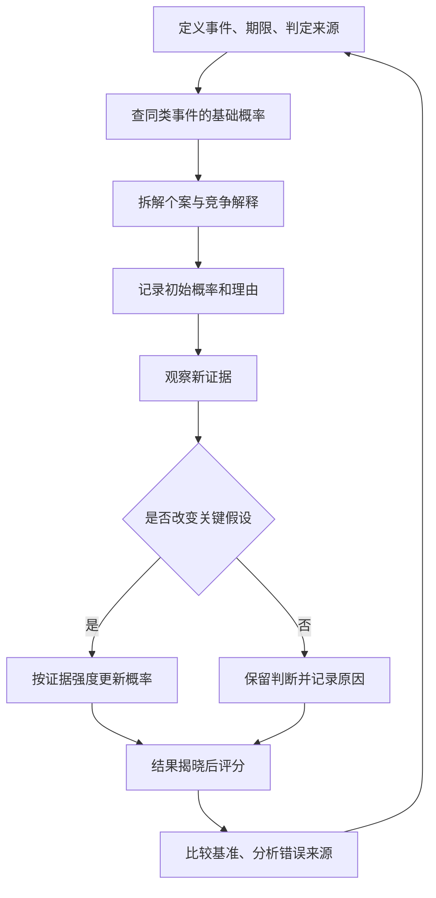

**怎么看：**这是一条带反馈的工作流程。“更新”不是随意改答案；每次修改都保留理由。最终评分是为了改进下一轮，不是为了寻找一次正确答案的荣耀。

### 难点图解二：概率不是投资建议

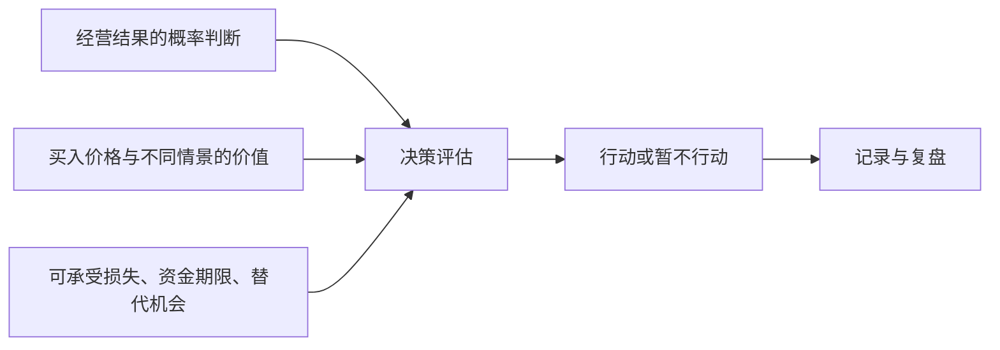

**怎么看：**预测只提供决策的一部分输入。一个经营结果即使很可能发生，也可能已被股价充分反映；好的预测不能自动生成好的投资回报。

### 难点图解三：用一组数据理解校准与评分

以下为原创构造的教学数据，不是真实研究结果：

| 四次预测 | 预测概率 p | 实际 y | 单事件 Brier 分数 |
| --- | ---: | ---: | ---: |
| A | 0.80 | 1 | 0.04 |
| B | 0.60 | 0 | 0.36 |
| C | 0.30 | 0 | 0.09 |
| D | 0.70 | 1 | 0.09 |
| 平均 | — | — | 0.145 |

同四题若每次都报 50%，平均分为 0.25；这个小样本中，上述预测更好。若按 GJ Open 的二元全结果求和口径，两者分别为 0.29 与 0.50。

**不能得出的结论：**四道题不足以证明稳定技能，也不足以测量“70% 档位”的长期校准。这里仅用于学会计算，不用于宣传某种准确率。

### 把方法用于财商：一个完整练习

选一家你能理解业务的公司，只使用公开资料，暂时不买卖。

1. **写清问题。**选择一个年度报告可以核验的经营指标，不用“有没有投资价值”这样无法直接结算的问题。
2. **找参照。**查看公司多年表现与合理同业，记录样本过少、业务变化或统计口径的限制。
3. **拆成因素。**例如收入可以分为销量与价格，利润还涉及成本、费用、税与非经常项目。
4. **给初始概率。**写出中心估计和最重要的三个依据，不使用没有来源的精确数字。
5. **写反证。**列出哪些信息会让你降低估计，哪些信息会提高估计。
6. **设置更新时间。**财报、经营公告或关键条件变化时更新；不是每次价格波动都改判断。
7. **结算后评分。**保留所有预测记录，避免只展示看对的案例。
8. **另做价格判断。**即使经营预测不错，也要另外研究价格、潜在回报与风险，不能跳过估值。

可复制的记录格式：

| 日期 | 可结算问题 | 概率 | 主要依据 | 最强反证 | 下次更新触发条件 | 结果与分数 |
| --- | --- | ---: | --- | --- | --- | --- |
| 自行填写 | 先约定截止日与数据口径 | 自行估计 | 列事实与来源 | 列可能推翻的假设 | 明确事件或日期 | 揭晓后补齐 |

### 作者方法的简明复习卡

选值得研究的问题；把问题拆小；结合基础概率和个案；随证据适度更新；考虑相反力量；使用有依据的概率精度；平衡自信与谨慎；复盘时防止后见之明；善用团队；持续练习这些平衡。这里是对附录方法的简写，执行时仍须按具体问题调整。[作者团队公开的十项方法](https://goodjudgment.com/philip-tetlocks-10-commandments-of-superforecasting/)

### 自测：真正理解了没有

1. **预测 80% 的事没发生，能否证明预测者很差？**不能单凭一次结论判断，要看长期记录、校准、评分与比较基准。
2. **为什么多读十篇新闻未必有帮助？**可能只是同一信息的重复，也可能没有改变任何关键假设。
3. **为什么要先找基础概率？**它提供独立于个案故事的参照，减少过度相信特殊性的倾向。
4. **10% 概率是否可以忽略？**不能，还要看发生后的代价与自己能否承受。
5. **如何识别真正的改进？**在新问题与公平比较条件下，方法和成绩持续改善，而不只是事后解释更顺。
6. **看对企业增长就能买股票吗？**不能，价格、利润质量、回报结构与个人约束仍需独立分析。

### 来源与边界

- [英文出版社书页](https://www.penguinrandomhouse.com/books/227815/superforecasting-by-philip-e-tetlock-and-dan-gardner/)：原作、作者与主题。
- [长荣大学 HyRead 馆藏书目](https://cjcu.ebook.hyread.com.tw/bookDetail.jsp?id=122604)：繁体版信息与目录。
- [IARPA ACE 项目](https://www.iarpa.gov/research-programs/ace)：研究目的与方法范围。
- [宾夕法尼亚大学作者主页](https://psychology.sas.upenn.edu/people/philip-tetlock)：作者及研究背景。
- [作者团队公开方法](https://goodjudgment.com/philip-tetlocks-10-commandments-of-superforecasting/)：附录方法的简明核对。
- [GJ Open FAQ](https://www.gjopen.com/faq)：评分口径、日度记录与比较。
- [预测者选拔说明](https://goodjudgment.com/how-to-become-a-superforecaster/)：训练、组队与选拔的区别。
- [概率图表说明](https://goodjudgment.com/faq_analytics_charts/)：问题定义与结果选项。
- [信息多样性与预测汇总原始研究](https://arxiv.org/abs/1406.2148)：概率极化及信息重叠的条件。

本笔记覆盖主要方法与实践逻辑，在相关知识点原位解释真实预测研究、专业实践和公司材料，不含全部历史案例。贝叶斯赔率算例、公司分析流程、决策期望算例和自测为补充教学；它们帮助理解原书思想，不冒充书中原例。预测研究中的优势不意味着对所有领域、所有期限都有效，也不能转化为股票获利保证。

---

[返回书籍索引](<README.md>) · [财商学习与实践路线](<财商进阶合订本.md>)


---

<a id="book-08"></a>

[单独打开本篇](<股票大作手回忆录 - 埃德温·勒菲弗/读书笔记.md>)

## 《股票大作手回忆录》读书笔记

> 作者：埃德温·勒菲弗（Edwin Lefèvre）  
> 英文原名：Reminiscences of a Stock Operator，初版 1923 年  
> 版本：未指定中文译本；章节定位采用英文原作的 I—XXIV 章，不套用某个中文版本的页码。  
> 分析依据：公开英文原文的主题检索与重点段落核对、出版社书目信息，以及美联储、监管机构和央行的历史资料。没有用户提供的中文原书。书内文学化叙述与独立可核验的书外事件分别标明；数字推导仅作为数学演示。  
> 覆盖范围：全书主要主题与 28 个核心知识点，重点覆盖交易心理、市场判断、持仓与风险、失败教训及后半部的信息与市场操纵主题；不是逐段翻译或每个故事的复述。  
> 更新日期：2026-11-11

### 先看这里：这本书讲什么

**一句话概括：一个擅长观察价格的人，如何在反复赚钱、亏损和重新开始中，理解交易真正考验的是判断、时机、持仓、风险和自我控制。**

先把人物关系讲清：本书由勒菲弗创作，以虚构人物拉里·利文斯顿（Larry Livingston，也写 Lawrence Livingston）的第一人称讲述，主要原型是杰西·利弗莫尔（Jesse Livermore）。它带有传记素材，但经过文学加工，不能把主人公的每段叙述都当作利弗莫尔本人逐字口述的历史档案。出版社也把它描述为经过小说化处理的故事。[出处：出版社书目](https://www.panmacmillan.com/authors/edwin-lefevre/reminiscences-of-a-stock-operator/9780857190567)

最值得带走的六个认识：

1. **方向正确不等于能赚钱。** 入场太早、仓位太大、资金撑不到趋势出现，都可能使正确判断变成实际亏损。
2. **大行情中的持仓，比猜中许多小波动更重要。** 但“拿得住”有前提：原先依据仍在，风险仍可承受。
3. **价格表现是需要尊重的事实。** 对行情的解释再漂亮，也不能替账户承担损失。
4. **希望和恐惧容易用反地方。** 人常对亏损抱希望，对盈利却急于兑现。
5. **仓位、流动性和执行会改变策略。** 小资金能做的事，大资金不一定做得到；纸面盈利也不等于随时能兑现的现金。
6. **市场经验应当变成规则和记录。** 只记得大赚的故事，记不住为何亏损，不能形成可重复的能力。

读完可以学会识别交易中的自我欺骗、区分“好判断”和“好交易”，并把模糊的经验整理成可以复核的决策过程。它没有提供一个经过现代统计检验、读完就能直接执行的完整机械交易系统。

### 主要内容与全书思路

本书的原始章节多用罗马数字命名。下面是便于理解的**主题归组**，不是伪造的中文章节标题；某些主题会跨章重复出现。[原文与完整目录](https://www.gutenberg.org/files/60979/60979-h/60979-h.htm)

| 原作范围 | 主要内容 | 这一部分解决什么问题 |
| --- | --- | --- |
| I—IV | 报价板、观察价格、对赌行经历，转向实际交易后的挫折 | 为什么同一套方法换个市场环境就可能失效 |
| V | 老交易者的启发，从小波动转向大势与持续持仓 | 为什么“判断对了却赚不到” |
| VI—IX | 时机、联太股票经历、市场总体环境及大规模操作 | 方向、入场与仓位如何相互影响 |
| X—XII | 商品交易、棉花操作、他人的观点对独立判断的干扰 | 为什么丰富的信息和权威意见也可能让人犯错 |
| XIII—XIV | 债务、心理压力、等待机会与恢复交易能力 | 为什么急着翻本会破坏原本的能力 |
| XV | 咖啡交易及意外外部干预 | 为什么供需判断正确仍可能输给制度与时机 |
| XVI—XVIII | 小道消息、内部人、人的行为与交易经验 | 如何分辨事实、利益动机和诱人的说法 |
| XIX—XXIV | 历史上的市场操纵、股票销售、公众情绪及信息传播 | 为什么不能把热闹的价格、报道和推荐直接当成价值 |

整体线索是：**观察价格 → 在真实市场受挫 → 学会判断大势和时机 → 管住仓位和心理 → 识别市场参与者的动机。**

### 核心知识点：市场和判断

#### 01. 先观察，再形成解释

主人公早期通过记录价格及随后走势来检验自己的观察。这种方法的价值，不是证明每种图形都有效，而是把“我觉得”变成“我事先记录过，后来是否发生”。[原文 I 章](https://www.gutenberg.org/files/60979/60979-h/60979-h.htm)

观察价格后，先写下预计发生什么、多久内发生、什么现象算判断错误。定期检查原始记录，比事后说“我早就看出来了”更有信息量。边界是：少量成功案例不能证明稳定规律，还要看全部样本和失败案例。

#### 02. 价格可能先变化，解释随后才出现

交易者面对的是已经发生的成交，而完整原因往往晚到。书中反复提醒，不应因为暂时找不到新闻解释，就否认异常价格行为。

这不意味着“价格永远正确”或“基本面没用”。价格也会含噪声、误判和人为影响。更准确的理解是：**价格是当前需要处理的事实，解释是仍需检验的假设。** 对已经触发的风险，不应只靠一个尚未证实的解释拖延处理。

#### 03. 先判断市场环境，再判断单个标的

在整体上涨、整体下跌和横盘环境中，相同的个股信号可能有不同含义。主人公逐渐从抓每一笔小波动，转向研究总体条件及市场主方向。[原文 V、VIII 章](https://www.gutenberg.org/files/60979/60979-h/60979-h.htm)

在多数股票上涨时，一家公司上涨未必说明你的选股能力很强。要区分来自市场的推动与来自个股的额外表现。边界是：总体方向的判断同样可能出错，不能用“大势一定向上”取消退出条件。

#### 04. 最小阻力方向：问市场更容易往哪里走

书中的“最小阻力方向”，可以理解为在当时供需和市场情绪下，价格较容易继续运动的方向。它不是神秘指标，也不是保证未来路线不变的定律。

利好出现后价格很难继续上行，反而卖压很重，可能说明先前的强势需要重新评估；利空出现后跌不动，也可能提供另一种信息。这里观察的是“消息与反应之间的关系”，不能只凭一次反应下结论。

#### 05. 价格高低不等于贵贱，也不自动决定方向

涨过很多不代表马上要跌，跌过很多也不代表马上要涨。书中关注的是后续运动是否支持自己的交易方向，而不是执着于过去见过的价格。[原文 VII 章](https://www.gutenberg.org/files/60979/60979-h/60979-h.htm)

上涨后的资产可能继续上涨，也可能已透支预期；下跌后的资产可能出现机会，也可能继续恶化。单看价位无法回答估值问题，需要另做价值分析，不能把趋势交易原则冒充估值结论。

#### 06. 不要把自己的持仓变成观点的理由

正确顺序是“根据证据形成观点，再决定持仓”；常见错误是“因为已经买了，所以持续寻找看多理由”。主人公强调，不能让已经拥有的头寸替自己思考。[原文 VIII 章](https://www.gutenberg.org/files/60979/60979-h/60979-h.htm)

持仓偏见常表现为对同一条经营数据改变评价：买入前重视危险，买入后却急于解释成暂时问题。可以自问：“如果现在空仓，我还会以同样理由买入吗？”这只是识别偏见的辅助问题，不能替代完整决策。

### 核心知识点：时机和持仓

#### 07. 方向与时机是两道不同的问题

“以后会跌”不等于“现在适合做空”。原作第 VIII 章有一个具体教训：叙述者在 1907 年大跌前已经看空总体环境，却多次因为过早建立空头而亏损。后来，他注意到大型铁路公司的融资安排，以及争取有限资金的迹象，才把原先的方向判断与当时的资金紧张联系起来。**这是原书的文学化交易叙述，不是本笔记独立核验的历史成交记录。**[原作 VIII 章](https://www.gutenberg.org/files/60979/60979-h/60979-h.htm)

重点不是铁路融资公告构成永远有效的卖出信号，而是“有一个看空理由”和“价格开始按这个理由运行”之间可能有很长距离。资金紧张的判断可以比下跌提前很久；持仓却每天承受价格变化、融资和心理压力。后来市场下跌，也不会退还先前为过早参与支付的损失。

**可独立核对的历史背景**是，1907 年 10 月 Knickerbocker Trust 停业，恐慌波及其他机构，股票抵押借款的资金条件急剧紧张。美联储历史资料记录，10 月 22 日相关拆借利率年化报价骤升，随后进一步攀升。[美联储：1907 年恐慌](https://www.federalreservehistory.org/essays/panic-of-1907) 这能支持“融资条件是实际约束”，却不能替小说中的个人判断时间和成交作证。价格方向之外，资金可得性与持有成本本身就会决定谁还能继续等待。

把它分为三层就容易理解。方向判断讨论未来较可能发生什么；时机判断讨论现在有哪些证据值得开始承担；仓位判断讨论在证据兑现之前，自己还能承受什么。任何一层不成立，都可能使最终方向正确的想法变成失败交易。叙述者后来更看重总体条件，不能据此抹去此前的失败路径。

**算术演示，非历史数据：** 100000 元权益承担 500000 元的线性空头敞口，标的价格先逆向上涨 10%，会亏掉 50000 元，尚未计算成本。即使后来跌回预想位置，已经被迫退出的人也无法获得后续结果。这个算式只展示规模如何放大路径风险，不是对书中头寸的复算。

现实应用是分别记录方向依据、参与条件与降低承担的条件。不能为了等待宏观判断正确，无限延长一笔已无法承受的交易。**自测：**“后来果然跌了”能证明最初仓位合理吗？不能，它只涉及终点方向，没有验证途中风险和执行能力。

还要警惕叙述者自己的确定语气。书中把事后回看的条件说得十分清楚，真实决策时的信息缺口却不能因此消失。本节提炼的是决策结构，不是替历史经验提供统计有效性证明。

#### 08. 等待信号也是决策

市场没有义务每天提供机会。书中的等待既包括入场前等待条件成熟，也包括已经建立合理头寸后等待行情展开。无事可做时频繁交易，可能只是用操作缓解焦虑。

没有符合条件的机会时，记录“无符合条件的交易”比降低条件硬做一笔更有纪律性。前提是原先条件经过思考；无限期等待一个模糊的“完美时刻”也可能只是回避决策。

#### 09. 看对以后，还要拿得住

第 V 章写到，老交易者 Partridge 收到建议：卖掉已上涨的 Climax Motors，等回调再买回。他拒绝的重点，是卖出后可能失去原有头寸。叙述者也回顾自己多次先获利离场，却等不到预想回调，眼看价格继续上行。**人物与对话属于小说化原作的叙述证据，不是经过审计的真实交易样本。**[原作 V 章](https://www.gutenberg.org/files/60979/60979-h/60979-h.htm)

这个场景解释了“看对却赚得少”的具体机制。原本只需完成方向判断和持有决策，现在主动增加两项任务：能否在回调前卖出，以及能否在回调后及时买回。第二项还有心理障碍：卖出后若继续上涨，人容易因为不愿买得比刚才贵而一直等待。所谓降低成本，可能换来长期空仓。

所以，持仓能力不是被动忍耐，而是避免让每次短期变化都重新启动整套决策。原先依据没有失效、风险仍可承受，就没有必要仅因“已赚了一点”而改变计划。书中强调的是让主要行情发挥作用，不是从每个局部波动都挤出额外收益。

但 Partridge 的回答不能推广成永不退出。同一章也讨论总体条件逆转后离场，以及不必追求最高、最低的最后一点价格。继续持有处理正常波动，退出处理依据失效或风险越界。真正有问题的是盈利时按短期情绪卖，亏损时临时搬出长期信念。

原文没有给出机械区分正常回调与趋势结束的唯一指标，所以读者仍需在自己的方法中明确定义。不能把后来上涨倒写成“当时显然应持有”，也不能把一次卖出后下跌当成反复操作更好的证明。

**自测与参考答案：** 如果故事中的卖出建议后来恰好成功，持仓思想是否被推翻？没有。单次结果不足以比较两种方法，还需连同成本、错过的行情、失败的重入和全部样本评估。这个故事首先教我们识别：为了多赚一点，究竟新增了哪些判断任务。

#### 10. 放弃吃到最低点和最高点的执念

极端价位通常只有事后才知道。想吃尽整段行情，可能导致入场过早、离场过晚，或在已经赚到可观利润后仍拒绝退出。

不必吃到完整波段，一段行情中合理取得的部分收益也可能符合原计划。卖出后又涨了，不自动说明原决定错误；要看卖出时掌握的信息与规则。以事后最优结果审判每一次行为，会使任何真实决策看起来都失败。

#### 11. 试探仓位：先让市场给反馈

书中描述先建立一部分头寸，观察后续表现，再决定是否扩大。这体现的是在信息不完整时逐步承担风险，而不是第一次就把全部判断押上。[原文 VII 章](https://www.gutenberg.org/files/60979/60979-h/60979-h.htm)

试探仓位的作用是让初始损失保持可控，并让后续增加取决于事先设定的确认条件。边界是：试探本身也有成本；反复试探很多相同风险的资产，合起来仍可能是大仓位。

#### 12. 顺势加仓与亏损摊平不是一回事

原作第 VII 章强调，初次头寸得到有利反馈后才考虑第二次投入，同时明确提醒，这不是对无止境金字塔加仓的推荐。第 XIV 章又叙述了具体过程：先对不再领涨的股票建立空头，等市场整体转弱、既有头寸普遍出现浮盈后，再扩大承担。**这是文学化原作记录的做法，不是当代收益验证。**[原作 VII、XIV 章](https://www.gutenberg.org/files/60979/60979-h/60979-h.htm)

两处结合，才能看清加仓理由：不是投入得还不够多，而是先前假设获得进一步反馈。相反，棉花失误中继续买入以抗拒下跌，依据的是维护自己的立场。两种操作都增加数量，证据方向却不同。

价格有利也不等于新增头寸免费。**以下只是风险算术，非书中成交：** 账户 100000 元，50 买 500 股，保护位 47，计划风险 1500 元。价格到 54 再买 500 股而保护仍在 47，总计划损失变成 `500×3+500×7=5000 元`。市场给了正反馈，操作却将风险从 1.5% 提高到 5%。

若市场结构确实允许将两批保护位提高到 51，从入场成本计算，最终净损失为 1000 元；从当前 54 算，1000 股回落到 51 会令权益减少 3000 元。前一个数字讨论累计操作的本金损失，后一个讨论此刻权益回吐。两者都没有包含跳空、费用和成交不确定性。

不能为了把算式变漂亮而随意提高保护位。如果位置处于正常噪声里，频繁退出可能破坏方法。合理顺序是先判断失效位置，再核对全部批次风险，最后决定是否增加以及增加多少，而非先加仓再寻找安慰自己的数字。

书中经验提供判断框架，却没有统一适合所有品种的加仓比例。长期定投、价值配置或再平衡有不同依据，不能只因第二次买价更低就归为错误摊平。关键是新增承担有无新证据支持，整体损失是否仍可承受。

### 核心知识点：风险和执行

#### 13. 先处理已知错误，不等市场替你解围

当事实证明原判断不成立，承认小错误可以阻止它变成大损失。书中讨论的核心是及时接受错误，不是要求所有资产都使用同一个固定百分比止损。

当可核查的买入依据已经被明确否定，继续持有若只剩“不想承认亏损”，那么“等回本”便已替代原交易理由。应检查的是失效条件，而不只是账户颜色。

#### 14. 头寸大小会决定你能否冷静思考

同样一段波动，在小仓位下只是可观察的信息，在过大仓位下却可能触发恐慌和被动平仓。杠杆把资金约束带进决策，使你无法无限等待。

为什么规模会改变判断？因为人在承受不起损失时，容易把每一条新消息都理解成威胁，反复盯盘，或者不愿面对账户。此时所谓“心理问题”未必能靠更强意志解决：如果一次正常波动就影响房租、还款或睡眠，结构本身已经要求人持续对抗无法承受的压力。降低规模，可能比反复责备自己更直接。

**可独立核对的案例是 1998 年 LTCM 危机。** 官方历史资料记载，该基金具有很大规模与杠杆，危机中多类价差向不利方向运动，私人金融机构随后安排注资以避免仓促清算。[美联储历史资料](https://www.federalreservehistory.org/essays/ltcm-near-failure) 这个案例说明，即使拥有专业人员和模型，也不能凭“最终会恢复”的判断无限持有；融资、资本和退出市场的容量可以先形成硬约束。

但不能从这份机构资料推断某个交易者当时恐惧或失去自控。资金约束是可以核对的事实，心理反应则需要另外证据。把两者分开，恰好能避免将所有失败都解释成个人不够坚强：有些结构即使由非常冷静的人执行，也无法承受。

现代风险管理常把数量写成“允许承担的金额÷每单位到退出位置的损失”，并再核对最小交易单位、资金、保证金、流动性与成本。例如允许计划损失 1000 元，每股风险 5 元，忽略费用可以得到 200 股。这个式子只负责把已确定的条件换成数量，不负责证明方向正确，也不负责寻找保护位。若保护距离只有随意拍出的 1 元，算出来的 1000 股就可能是一种精确的错误。[补充资料：CME 头寸规模教育](https://www.cmegroup.com/education/courses/trade-and-risk-management/proper-position-size)

还要检查合计风险。五笔各自可接受的头寸，如果都依赖同一市场方向，压力来时可能一起恶化。生活用途也是约束：一个准备长期承担波动的人，若下月必须把钱取走，实际承受范围与口头计划并不一致。所谓“资金管理”，不仅是一个百分比，而是让价格路径、退出安排、现金需求与自己的能力彼此兼容。

这里不提供适用于所有人的固定风险比例。可学到的能力是：当自己总无法执行时，除了研究心理，也回头检查规模；当某项交易无论怎样缩小都不适合账户时，接受不参与。放弃一项无法承受的机会，也是完整决策。

#### 15. 流动性决定纸面盈利能否兑现

价格屏幕显示的最后一笔成交，不代表全部持仓都能以该价兑现。原作讨论大头寸需要等待市场有足够承接时退出，说明数量本身会改变交易难度。[原作 VII、XIV 章](https://www.gutenberg.org/files/60979/60979-h/60979-h.htm)

**书外真实事件：2010 年 5 月 6 日闪崩。** CFTC 与 SEC 联合工作人员报告记载，当日市场已经剧烈波动、流动性趋薄；一个卖出程序计划卖出 75000 份 E-mini 合约。冲击中，一些流动性提供者暂停或退出，期货与股票市场之间的联系又传递了压力。[联合调查报告](https://www.sec.gov/news/studies/2010/marketevents-report.pdf)

这不是“成交很多，所以总能卖出去”。成交量记录已经交换了多少，流动性则关心此刻还剩多少愿意接近当前价承接的订单。同一批头寸快速往返可以制造较大成交量，但不保证市场能吸收新的单向卖盘。想退出的人同时增加、愿意接盘的人减少，执行价可能迅速偏离此前报价。

对应本书，纸面盈利只按某个可见价格估值，兑现还需要对手、数量和时间。如果策略只有“价格到这里就退出”，却未检查可成交数量和订单方式，它缺少一部分实际条件。规模越大，这个缺口越重要。

报告解释的是一次特定事件的市场机制，并不证明某个订单单独造成全部闪崩，也不证明书中方法能在当时获利。它使原书的提醒更具体：风险不仅是最终方向错误，也包括需要行动时，市场没有提供预期的成交条件。

#### 16. 不同交易场所不能照搬同一套方法

主人公早期在对赌行中利用报价规律获利，进入真实市场后遭遇报价滞后、成交和成本等差异。对赌行的客户通常押的是价格变化，并非每笔都对应真实证券买卖。[原文 I—IV 章](https://www.gutenberg.org/files/60979/60979-h/60979-h.htm)

可迁移的认识是：一套方法必须考虑撮合方式、手续费、延迟、保证金和流动性。模拟账户没有明显问题，不意味着真实订单也能以同样价格完成。更换品种或交易制度时，需要重新验证。

#### 17. 意外事件可能从价格以外改变结果

书中咖啡交易说明，供需分析之外还存在制度、外部干预和持有成本等风险。主角自认分析正确，也不能据此消除实际损失。[原文 XV 章](https://www.gutenberg.org/files/60979/60979-h/60979-h.htm)

应区分“没想到的事件”和“根本没有管理不确定性”。不可能预测所有冲击，但可以不让单一判断占满全部生存空间。书中的具体事件属于历史叙事，不宜直接类比为某个当代政策会怎样出台。

**真实制度变化：2015 年 1 月 15 日，瑞士国家银行宣布取消每欧元 1.20 瑞郎的最低汇率政策。** 这一决定和此前政策的存在均可从央行当日公告及后续官方说明核对。[瑞士央行当日公告](https://www.snb.ch/en/publications/communication/press-releases/2015/pre_20150115)、[央行对取消政策的说明](https://www.snb.ch/en/publications/communication/speeches/2015/ref_20150424_tjn)

它直接改变了把政策边界视为交易前提的分析。即使某段历史里汇率受到政策约束，也不能把该边界当成自然定律，更不能据此无限增加规模。过去观察到的价格范围，部分可能来自一项会调整的制度，而不是市场永远不会越过那里。

本节没有重建某个账户当时的报价、止损成交或损失，也不借政策调整声称能够事前预测。它说明需要写清自己的判断依赖哪些制度条件，以及条件改变后怎样重新评估。书中咖啡故事提供叙事启发，央行公告则提供可独立核验的现实事件；二者的证据层级不同。

#### 18. 生活安全与交易资金要有边界

主人公在恢复财务状况后，讨论了将部分资金放到不易被自己再次用于投机的安排中。这提醒读者，赚钱能力不等于保住钱的能力。[原文 XIV 章](https://www.gutenberg.org/files/60979/60979-h/60979-h.htm)

将日常开支、应急储备与高波动试验资金分开，避免一次冲动把本来可以退出的交易变成不得不坚持。这里提炼的是用途隔离思想，不是建议照抄书中历史性的具体金融安排。

### 核心知识点：心理与学习

#### 19. 希望和恐惧常被用反

人在亏损时容易希望价格回来，在盈利时却害怕利润消失，因此倾向于留住亏损、迅速卖掉盈利。问题不是必须消除情绪，而是不能让情绪替换原有条件。

对亏损单问“如果继续恶化，我何时退出”；对盈利单问“支持持有的条件是否仍在”。这比简单喊“克服恐惧”更可操作。盈利交易也可能应该退出，关键是证据和计划，而非一律反着情绪做。

#### 20. 想回本，会把市场变成私人债务人

第 XIII—XIV 章把债务压力与判断失常放在同一条叙事线上。叙述者说，债权人的催逼使他难以专心；处理债务负担、重新取得只能支持有限头寸的帮助后，他刻意约六周不去容易诱使自己下单的经纪行，等待认为合适的机会。**这些细节来自文学化原作，不能据此认定破产或借款是可复制的翻身方法。**[原作 XIII—XIV 章](https://www.gutenberg.org/files/60979/60979-h/60979-h.htm)

值得学的不是后来赚了多少钱，而是他识别到两种压力。客观资金约束意味着有限资本无法承受太多试错；行为约束意味着知道自己随时能交易，就可能为缓解急迫感而勉强寻找机会。他改变所处环境，减少把“我必须恢复”错误翻译成“现在有机会”的可能。

“回本”把标准从市场条件移到过去成本。原本该问是否符合参与条件，债务却把问题改成这次够不够补缺口。机会没有变化，人可能扩大数量、推迟退出、降低门槛。过去的损失因而通过行为进入下一次损失。

**仅作恢复幅度计算：** 100000 元降到 90000 元后，回到原值需要约 11.11%，不是 10%；再损失 5000 元，只剩 85000 元，需要约 17.65%。这些并非原书记录，用于说明急于翻本可能让目标越来越远。

恢复时应分别审查正常方法损失、执行偏离和适用环境，而非用“心态不好”包办一切。暂停也应有具体目的，例如整理记录、恢复规模约束和核实研究依据；它不等于休息后保证盈利。

**自测与参考答案：** 原作后来出现财务恢复，是否证明此前承担过大的做法合理？不能。一个幸存者能够讲述恢复，不代表所有处境相似的人都恢复了。这个故事说明压力怎样改变行为，却不能替代完整失败样本与策略检验。

#### 21. 独立判断不等于拒绝新信息

第 XII 章的 Percy Thomas 不只是随口给消息的人。叙述者把他描写成棉花知识丰富、分析有系统、表达极有感染力的专家；正因如此，自己逐渐用对方的解释替换了原有观察，继续买入棉花，后来承认遭受重大损失。**这是有出处的叙事案例，不是独立审计的交易档案。**[原作 XII 章](https://www.gutenberg.org/files/60979/60979-h/60979-h.htm)

问题不是专业知识没价值，而是三件事被混在一起：对方了解行业，对方的解释很有说服力，因此自己当前头寸就合理。前两项即使成立，也不能直接推出第三项。懂供需的人仍可能判断错时机，同一观点也可能不适合另一人的资金和仓位。

值得停下来看的变化，是叙述者从“市场怎样表现”转向“我要继续买，阻止它下跌”。交易不再只是表达分析，而是在维护原分析与自尊。继续投入不再需要新证据，反对证据则不断被解释掉。

可以把外部建议拆成两栏：新增了哪些可核对事实，提出了哪些仍需检验的推断。独立判断不是拒绝专家，也不是永不改口；它要求知道自己为何改变，并对新承担负责。把观点借来容易，把依据和退出责任一并想清楚，才是真正学习。

#### 22. 自信与固执的区别在于能否被事实纠正

自信让人能在正常波动中执行；固执让人在依据已经消失后继续维护面子。二者表面上都像“不动摇”，实际判断标准完全不同。

事先写下哪些证据会让自己改变看法；出现后真的改变，比临时高喊“坚持信念”可靠。自信应来自对过程和风险的理解，不能只来自一次大赚。

#### 23. 把亏损分为正常成本与执行错误

一次亏损可能来自不可避免的不确定性，也可能来自违反自己的方法。只以盈亏评价交易，会把侥幸赚钱的错误行为奖励出来。

**补充解释：** 建两列记录：“是否按照事先计划行动”和“最后赚亏多少”。四种组合都可能出现。这个二维复盘表是本笔记的教学工具，书中没有给出同款表格；它用于把书中的自我审查思想变成可检查动作。

#### 24. 经验必须落成可复核的记录

记住自己的错误，必须具体到“在哪种条件下，做了什么，后果是什么”。只说“下次要更冷静”，无法指导下一次操作。[原文 I、V 章](https://www.gutenberg.org/files/60979/60979-h/60979-h.htm)

记录应从“我总是卖飞”这样的情绪评价，转向可核查问题：实际退出依据是否与计划一致、偏离反复发生在哪里。这样才能形成改进方案。记录也要包括没有交易的决定，避免只保留能讲出故事的样本。

### 核心知识点：消息、利益与公众行为

#### 25. 小道消息常在提供方向感，而非可靠知识

原作第 VI 章提供了一个比“消息都骗人”更细致的案例。叙述者观察联太股票后做多，经纪人 Ed Harding 出于自认可靠的消息和善意劝他退出；他不仅卖掉多头，还反手做空。随后公司宣布提高股息，价格走强，他回补时又遇到明显的成交价偏离。**这是文学化叙述，动机与成交细节均按书中说法呈现，不冒充独立历史结论。**[原作 VI 章](https://www.gutenberg.org/files/60979/60979-h/60979-h.htm)

这个故事不能教“永远相信自己，别听别人”。叙述者也可能观察错；问题是没有获得足以自己核查的新证据，却因信任对方的聪明、关系与善意，改变了整个方向。而“原先多头可能不合适”，并不自动等于“立即做空一定合适”，他把一次提醒扩展成了另一项判断。

消息应分层处理：对方提供什么事实，事实来自哪里，它如何影响原假设，是否足以支持具体行动。诚实的人也可能传递错误消息；有利益的人也可能提供真实事实。动机影响怎样检查信息，却不能独自决定真假。

消息越确定，越容易让人忽略仓位与成交条件。书中回补价格偏离说明，即使意识到错误，也未必能按刚看到的报价撤销。判断失误与执行损失可以叠加，不能只把学费归结为听错消息。

把一条推荐写成三栏：已证实事实、未证实推断、使结论失效的证据。这样不会保证正确，却能发现在哪一步交出了判断权。**自测：**“他是好朋友，没有害我”为何不足以支持交易？因为动机可靠不等于信息完整，更不等于信息足以决定方向、数量与时机。

#### 26. 内部人了解企业，不等于了解整个市场

某个人即使了解公司经营，也可能不了解整体资金环境、其他参与者行为和短期价格。书中对内部意见的反思，不是鼓励寻找更隐秘的信息，而是提醒不同知识有不同适用范围。

“今年销售很好”无法单独回答“这一事实是否已经计入价格”“当前估值是否合理”。企业事实、估值和交易时机应当分别分析。

#### 27. 市场中的叙事可能带有销售目的

后半部大量讨论股票推销、市场活跃度制造和公众信心。对普通读者最有价值的，是理解信息如何与持仓利益结合，不能只看一条推荐有没有专业词汇。[原文 XIX—XXIV 章](https://www.gutenberg.org/files/60979/60979-h/60979-h.htm)

书中人物有时把操纵视作行业技巧，这是当时叙述的视角，不是本笔记对这些做法的认可。今天阅读这些章节，重点应放在识别利益冲突和虚假热度，而不是照着设计交易行为。

#### 28. 人性会重复，但历史价形不会精确复制

贪婪、恐惧、从众和不愿认错，有跨时代的相似性；市场制度、参与者和信息速度却持续变化。因此，可以借鉴行为机制，不能据一段百年前的行情推断今天同样走势必然再现。

一个成功者的故事也缺少完整对照组：做过类似事情但失败的人，未必留下同样著名的回忆录。读本书最稳妥的方式，是提取待检验的原则，而不是把传奇当成收益证据。

### 难点图解一：为什么看对方向仍会亏钱

以下是原创教学示意，不是历史收益图。

```mermaid
flowchart TD
    A[预计长期会涨] --> B{什么时候参与}
    B --> C[过早参与且仓位过大]
    B --> D[等待条件并控制仓位]
    C --> E[短期反向波动]
    E --> F[资金或心理无法承受]
    F --> G[被迫退出]
    G --> H[后来上涨也无法获益]
    D --> I{原有依据仍成立吗}
    I -->|是| J[按计划持有并管理风险]
    I -->|否| K[退出或重新评估]
```

这张图说明，预测只是第一步。真正结果还经过时机、仓位、执行和持有能力。即使选择右边路径，仍然可能亏损；图示只解释过程，不承诺结果。

**补充数值例子：** 用 10 万元资金承担价值 50 万元的价格敞口，忽略利息和成本，标的下跌 10% 会产生约 5 万元损失，即资金的 50%。标的后来恢复，并不能帮助已经被迫退出的人。这里仅演示线性杠杆损益，真实产品的保证金和强平条件可能不同。

### 难点图解二：持有、止损和加仓如何不互相矛盾

```mermaid
flowchart TD
    A[已有头寸] --> B{原交易依据是否失效}
    B -->|是| C[按预定条件退出]
    B -->|否| D{风险是否超出限额}
    D -->|是| E[降低风险或退出]
    D -->|否| F{是否满足事先的加仓条件}
    F -->|是| G[核对加仓后总风险]
    G --> H[允许范围内增加]
    F -->|否| I[继续观察或持有]
```

“拿得住”解决的是不要因为噪声随便离场；“止损”解决的是依据失效或风险失控；“加仓”解决的是怎样在反馈有利时扩大参与。它们针对不同条件，不是互相否定的口号。图示是对书中思想的教学整理，原书没有这份机械规则。

### 读完能怎么用

先把本书用于训练判断质量，而不是立刻扩大实际交易。可以选一段已经结束的历史行情，遮住后面的部分，做以下练习：

| 要记录的问题 | 有信息量的写法 | 没有信息量的写法 |
| --- | --- | --- |
| 为什么考虑参与 | 指出可观察条件及可能反证 | 感觉要涨 |
| 何时承认错误 | 依据失效条件、价格条件或时间条件 | 看情况 |
| 能承担多少损失 | 金额、仓位与风险敞口一起写 | 应该问题不大 |
| 为什么继续持有 | 原条件仍在，风险符合计划 | 不舍得卖 |
| 为什么退出 | 条件变化或达到预定退出规则 | 忽然害怕 |
| 怎样复盘 | 分开评估过程、结果和运气 | 赚钱就是对 |

观察一次价格后，先写下决定，再揭开后面的行情。这个顺序能减少事后合理化。练习的成果是一份可检查记录，不是对未来获利能力的证明。

### 哪些地方要保留判断

- **它是叙事作品。** 没有连续、完整、可审计的交易样本，不能据此估算策略的胜率、最大回撤或未来收益。
- **有些经验靠主观判断。** “大势”“行为正常”“时机成熟”都需要进一步定义，无法仅凭几句格言直接回测。
- **作者描写不等于科学验证。** 直觉成功故事不能证明直觉可靠；破产后的复起也不能证明高杠杆值得复制。
- **市场结构存在时代差异。** 历史中的对赌行、交易撮合、融资环境与今天不同，应用时需要重新核实具体制度。
- **叙事中对错误的解释可能不完整。** 不应把所有亏损归因于“不够自律”；方法本身也可能没有优势，或者适用环境已经变化。
- **与价值投资不冲突，也不等同。** 本书主要讨论投机交易者怎样面对价格和头寸，不足以代替公司估值、长期资产配置或财报分析。

### 回顾自测

1. **为什么最后看对也可能亏钱？** 因为中途波动、时间、杠杆、成本或退出时机会让资金先耗尽。
2. **持有和死扛怎么区分？** 看原依据、风险限额及退出条件是否仍然成立，而不只看持有时间。
3. **盈利后能不能无限加仓？** 不能，需计算加仓后的总风险、退出距离及流动性。
4. **听取专家意见怎样保持独立？** 提取可核查事实和论证，自己确定它是否改变原判断。
5. **一笔赚钱交易一定做对了吗？** 不一定，违规冒险也可能暂时得到好结果。
6. **本书最不该照抄的是什么？** 传奇人物的规模、杠杆和历史操纵行为，以及未经检验的确定性判断。

### 来源与范围说明

1. [Project Gutenberg 英文原文](https://www.gutenberg.org/files/60979/60979-h/60979-h.htm)：用于核对主要故事、概念和罗马数字章节。该站将原作标为美国公有领域；本笔记使用自己的中文概述，不转录现代中文译文。
2. [Project Gutenberg 书目信息](https://www.gutenberg.org/ebooks/60979)：作者、语言、作品信息及公开版本入口。
3. [Pan Macmillan 出版社书目](https://www.panmacmillan.com/authors/edwin-lefevre/reminiscences-of-a-stock-operator/9780857190567)：核对文学加工性质及主人公的现实原型关系。
4. [CME：Proper Position Size](https://www.cmegroup.com/education/courses/trade-and-risk-management/proper-position-size)：仅用于现代头寸规模的教学补充，不作为原书内容的来源。

5. 美联储历史资料：[1907 年恐慌](https://www.federalreservehistory.org/essays/panic-of-1907)与[LTCM 濒临倒闭](https://www.federalreservehistory.org/essays/ltcm-near-failure)：融资、仓位与市场环境的书外事实，不用于反向证明书中个人成交。
6. [SEC/CFTC：2010 年 5 月 6 日市场事件报告](https://www.sec.gov/news/studies/2010/marketevents-report.pdf)：市场深度与流动性变化。
7. [瑞士央行 2015 年 1 月 15 日公告](https://www.snb.ch/en/publications/communication/press-releases/2015/pre_20150115)：取消欧元兑瑞郎最低汇率安排的事实。

尚未覆盖的是某个指定中文译本的译者差异、译注及全部历史案例细节。图表为本笔记编排；书内故事属于文学化叙述，书外历史事件有独立来源，明确标出的数学演示是假设计算，三者不互相替代。

---

[返回书籍索引](<README.md>) · [财商学习与实践路线](<财商进阶合订本.md>)


---

<a id="book-09"></a>

[单独打开本篇](<海龟交易法则 - 柯蒂斯·费思/读书笔记.md>)

## 《海龟交易法则》读书笔记

> 作者：柯蒂斯·费思（Curtis Faith，亦译柯蒂斯·费斯）  
> 英文原名：Way of the Turtle，McGraw Hill，2007 年  
> 版本：未指定中文译本；本笔记对应费思的这本书，不是迈克尔·卡沃尔的海龟历史著作。  
> 分析依据：出版社信息与目录、作者参与公开的原始海龟规则、交易所合约资料、原始研究论文及监管机构历史报告。未取得用户原书，不声称逐页精读；历史规则、书外真实案例和假设数学演示分别标明。  
> 覆盖范围：全书主要主题、32 个知识点，包含交易心理、完整系统、原始参数、风险、绩效与回测。原始规则与本笔记的教学补充分别说明。  
> 更新日期：2026-11-11

### 先看这里：这本书讲什么

**一句话概括：把交易变成一套能承受不确定性、控制仓位、反复执行并接受检验的系统，而不是不停寻找“下一次必涨”的答案。**

作者是海龟培训计划的参与者，书中既回顾训练与交易经历，也讨论如何判断一套方法是否真的有优势。规则简单，不代表执行容易；同一套方法会让人经历长时间不顺、连续亏损，以及盈利大幅回吐。书的价值很大一部分就在解释这些困难。[出版社书目](https://www.mheducation.com/highered/mhp/product/way-turtle-secret-methods-turned-ordinary-people-into-legendary-traders.html)

最重要的六个认识：

1. **优势是长期分布上的优势，不是下一笔必胜。**
2. **买卖信号只是系统的一部分。** 交易什么、买多少、怎样退出、怎样应对成本同样重要。
3. **仓位由波动和资金承受力决定。** 名义金额相同，不代表风险相同。
4. **趋势交易常以许多小亏换少数较大盈利。** 如果总提前卖出盈利单，可能把系统原有优势破坏掉。
5. **回测漂亮不等于未来可靠。** 参数挑选、样本、成本、幸存者偏差和执行假设都会影响结果。
6. **纪律必须建立在方法有依据的前提上。** 坚持无优势的规则，只会稳定地执行错误。

### 全书主要内容地图

以下为按原版目录对应的中文主题概括，中文译本标题可能不同。[目录核对：图书馆书目](https://librarycatalog.cityofwoodland.gov/Record/.b18118562)

| 原版章节 | 主要问题 | 本笔记的重点 |
| --- | --- | --- |
| 1—2 风险与海龟心智 | 人为什么会做出不利于自己的交易 | 偏见、损失厌恶、结果与过程 |
| 3—4 训练经历与思考方式 | 同样接受训练，为什么执行不同 | 概率思维、耐心、规则一致性 |
| 5—6 优势与优势消失 | 优势从哪里来，为什么会被破坏 | 期望值、入场与退出、市场环境 |
| 7—8 绩效与资金管理 | 怎样衡量收益和承担风险 | 波动、回撤、仓位、组合限制 |
| 9—10 系统构件与实例 | 怎样把想法组成可测试的系统 | 市场、过滤器、信号、退出、规模 |
| 11 回测问题 | 为什么历史结果会骗人 | 过拟合、样本和交易成本 |
| 12—13 稳健性 | 如何减少对偶然参数与行情的依赖 | 指标稳定性、跨市场检验、系统分散 |
| 14 与结语 | 如何面对自己的弱点 | 可执行的方法、持续学习 |
| 原始规则附录 | 海龟当年具体怎样操作 | 突破、N、头寸单位、止损与限额 |

整体逻辑是：**先接受不确定性 → 找到可检验优势 → 用仓位保护资金 → 执行完整规则 → 持续检查优势和风险。**

### 核心知识点：概率与心理

#### 01. 交易系统必须完整

一个“突破就买”的想法不是完整系统。还要说明交易哪些市场、每次买多少、何时止损、何时退出盈利头寸，以及如何执行订单。否则结果不好时，很难知道问题出在信号、仓位还是执行。

同样的入场信号，配上不同仓位和退出规则，会形成不同的收益与损失分布。比较策略时，必须比较整套规则，而非只比较买点。[原始规则入口](https://www.tradingblox.com/originalturtles/originalturtlerules.htm)

#### 02. 趋势跟随是在响应价格

海龟通过突破识别可能形成的趋势，再跟随价格，而不是先给出目标价。突破会失败，所以系统必须接受反复小额试错。

突破失败和按规则退出，本来就是趋势跟随可能付出的代价；若长期趋势收益覆盖不了这些损失和成本，系统优势也可能不存在。趋势跟随不能免除验证。

#### 03. 胜率和期望值是两回事

胜率回答多少次赚钱，期望回答把盈利、亏损和成本合起来后，平均结果怎样。趋势方法尤其不能只看胜率：如果一部分收益来自少数持续很久的行情，频繁落袋为安可能同时切掉方法的收益来源。

**真实研究可以怎样看？** Hurst、Ooi、Pedersen 在 2017 年发表的趋势研究，把时间序列动量的历史模拟扩展到 1880 年，并比较不同市场和环境。他们研究的是明确构建的策略及历史数据，不是只展示某位海龟的大赚故事。[作者机构发布的论文](https://www.aqr.com/-/media/AQR/Documents/Insights/Journal-Article/AQR-JPM-Fall-2017.pdf)

这提供的学习方向，是用完整结果分布检验方法，而不是拿一次漂亮交易作答案。它不等于费思的 20/55 日规则已经得到同样验证；模拟的规则、样本、交易成本与风险目标不同，结果不能互相借用，更不能当作今天的收益承诺。

**以下仅是算术演示，不是上述论文或海龟业绩：** 若胜率 40%，平均盈利 3R、平均亏损 1R、每笔成本 0.1R，则期望为 `0.4×3−0.6×1−0.1=0.5R`。R 指事前定义的风险金额尺度。若实际执行把平均盈利截成 0.5R，暂时保持其他条件不变，期望就变成 −0.5R。这里假设胜率不变只是为了隔离退出方式的影响，现实修改后要重新检验整套分布。

正期望也不排除连亏。纯数学上，独立且亏损概率固定为 60% 时，事先指定的五笔都亏的概率是 `0.6^5≈7.78%`；这不是一百笔中出现任意五连亏的概率。真实交易还可能受同一行情影响而相关。

因此要同时检查平均值、尾部、收益集中度与承受能力。研究支持的只能是一定假设下的历史分布，不是下一笔必胜。**自测：** 能否因读到长期研究为正，就直接接受未经核对的个人策略？不能，必须确认自己执行的规则与证据指向的是同一个对象。

#### 04. 单次结果无法评价整体方法

好方法可能连续亏损，坏方法也可能连赚。需要观察足够多、相对独立且覆盖不同环境的样本。几十笔高度相似的交易，未必比几笔更能代表不同情境。

高度相关品种的同期盈利，可能主要来自同一个市场冲击。记录多笔交易不等于获得同样多的独立证据，不能把交易次数直接等同于证据强度。

#### 05. 损失厌恶会改变收益分布

人容易尽快卖出盈利头寸来获得确定感，却愿意拖延接受亏损。在需要少数大趋势贡献收益的系统中，这样会截断有利的一端、放大不利的一端。

解决思路是事先确定条件并复查执行，而不是在交易中临时追求舒服。提前离场一次可能恰好避开回落，但长期是否有利，要对全部退出记录一起分析。

#### 06. 纪律和方法适配同样重要

纪律不是无视现实地永远坚持。一套平均回撤很深、很久才出现大盈利的系统，可能超出某个人的资金期限和心理承受力。选择适合自己的规则，应发生在研究和计划阶段，而不是持仓中随意修改。

无法承受策略可能出现的回撤时，不宜仅因某策略年化收益高就选择它。真实可执行的较低风险方案，可能优于纸面上更漂亮却会中途放弃的方案。

### 核心知识点：海龟原始规则

下面是历史规则的概念摘要，不是当前所有市场的通用参数。历史参数依据作者署名的公开规则文件；本笔记以自己的话解释，并把书外真实材料与假设数学演示分别标注。[公开规则原站](https://www.tradingblox.com/originalturtles/originalturtlerules.htm)；[同文 PDF 镜像，供核对](https://www.tradingwithrayner.com/wp-content/uploads/2014/11/OriginalTurtleRules.pdf)

| 项目 | 历史规则核心参数 |
| --- | --- |
| 入场 | 系统一前 20 日突破；系统二前 55 日突破 |
| 趋势退出 | 系统一反向 10 日突破；系统二反向 20 日突破 |
| 波动单位 | N 为真实波幅的 20 期平滑值 |
| 单位规模 | 一个 Unit 的 1N 波动约对应资金的 1% |
| 初始保护距离 | 通常为 2N |
| 顺势加仓 | 通常每有利移动 0.5N 增加一个 Unit |
| 单市场限额 | 最多 4 Units |
| 组合限额 | 紧密相关同向 6；较松相关同向 10；全部同向 12 Units |

#### 07. 真实波幅 TR：把跳空算进去

普通高低差只看当天内部范围，可能漏掉隔夜跳空。真实波幅用三个距离中的最大值：

`TR = max(H−L, |H−C前|, |L−C前|)`

H 是当天最高价，L 是最低价，C前是前一交易日收盘价。**数学演示（假设价格）：** 昨收 100，今天最高 106、最低 104，日内高低差只有 2，但 TR 为 6。隔夜从 100 跳到 104 以上的风险不能忽略。

#### 08. N 是波动尺度，不是方向预测

原始算法先用 20 个 TR 的简单平均初始化，再递推：

`N今日 = (19×N昨日 + TR今日) / 20`

N 越大，说明近期价格通常波动更宽；它不告诉你下一步上涨还是下跌。这里平滑系数为 `1/20`，不能直接与所有软件默认的“20 日 EMA”混为一谈，后者常用不同系数。实际计算必须确认定义。

#### 09. 先把价格波动换成金额波动

不同合约每个报价点对应的钱不同。先算 `每手的1N金额 = N × 每点价值`，再决定手数，才能跨市场比较。

**数学演示（假设合约）：** A 合约波动 2 点、每点值 100 元，1N 是每手 200 元；B 合约波动 20 点、每点值 5 元，1N 是每手 100 元。A 的报价波动较小，金额风险却更大。不能只看屏幕价格变化多少。

#### 10. Unit 是波动标准化后的头寸单位

Unit 是按波动金额确定的头寸单位，不是固定一手。原始规则的规模思想是先把价格波动转成一手的金额波动，再决定多少手接近账户的风险尺度。[作者公开的原始规则](https://www.tradingblox.com/originalturtles/originalturtlerules.htm)

`每个 Unit 手数 = 向下取整[资金基数×1% ÷ (N×每点价值)]`

用**真实合约规格**看中间一步：CME 的 Micro E-mini S&P 500 期货，乘数是每指数点 5 美元，最小跳动为 0.25 点，对应每手 1.25 美元。这里的“点”和“最小跳动”不同：一个完整指数点包含四个最小跳动。[CME 官方合约规格](https://www.cmegroup.com/markets/equities/sp/micro-e-mini-sandp-500.contractSpecs.html)

如果把每跳 1.25 美元误当成每点价值，头寸计算会扩大四倍。这不是交易观点错误，而是单位错误。真实产品名称也必须查清：同属一个指数的不同规格合约，乘数可能不同；不能因为图表看起来一样，就沿用另一份合约的数量。

**仅为算术，N 并非实际测量值：** 假设某时点 N＝20 指数点、资金基数为 100000 美元，则一手的 1N 波动金额为 `20×5=100 美元`；1% 尺度为 1000 美元，一个 Unit 为 10 手。若保护距离是 2N，到保护位的计划损失约为 2000 美元，而不是 1000 美元。真实保证金、交易成本和组合限额还须另外检查。

波动变大时，在资金基数相同的条件下，计算出来的手数会变少；但 N 是过去波动的估计，不保证未来冲击也处于同一范围。若向下取整为零，表示最小合约已超过这项尺度，不能为了参与而自动四舍五入成一手。

这个现实规格例子把三个问题分开了：N 衡量多少价格变化，乘数规定变化值多少钱，Unit 决定持有多少数量。后面 N＝2、每点价值 100 元的加仓表采用另一组纯教学数字，不能误读成该 CME 合约的实测交易。

#### 11. 1% 波动单位，不等于单笔最多亏 1%

**这是最常见的理解错误。** 如果一单位的 1N 等于资金 1%，保护距离是 2N，那么该单位从入场到保护价的计划损失约为 2%，还未计成本和跳空。1% 描述的是规模标准，2N 描述的是距离。

实际止损成交可能比预设价差，因此“计划损失”不是保证的最大损失。多个单位和多个市场还要合并评估，不能把每一笔的数字孤立看待。

**另设一组数学演示，供本节与后面的加仓表使用：** 资金基数 100000 元，N＝2 点，每点每手 100 元。按第 10 点公式，一个 Unit＝1000÷200＝5 手。100 点买入，初始保护位按 2N 放在 96，距离为 4 点，所以计划损失为 `5×4×100=2000 元`。把它误记成 1000 元，等于只计算了 1N 波动，却忘了实际保护距离有两个 N。原始规则中的规模与保护距离，是两项要相乘的条件。

再加入顺势扩仓。为了只观察逻辑，固定 N，不考虑本次交易中的重新定规模、成本和跳空；每上涨 0.5N，也就是 1 点，增加 5 手。按规则同步调整前面单位的保护位后，四批入场是 100、101、102、103，常规等间隔情况下最终保护位为 99。第一批到保护位亏 500，第二批亏 1000，第三批亏 1500，第四批亏 2000，总计 5000 元。后面的加仓表逐行列出每一步，不能把四批一律当成“每批 1%”。

这里还有一个更难的区别：在价格到 103 时，前面三批已经有浮盈 1500、1000、500，共 3000 元；第四批刚建仓。此刻若 20 手都从 103 回到 99，净值将回吐 `20×4×100=8000 元`。其中 3000 是已经出现但未兑现的浮盈，另外 5000 是相对全部入场成本的净损失。所以“这笔操作从入场算最多计划亏 5000”和“当前净值可能回落 8000”，在这些假设下可以同时成立。

这也说明有浮盈并不等于新增头寸免费。风险管理需要知道自己在问什么：相对本金的损失、相对当前权益的回吐，还是保证金不足的可能性。若存在其他相关品种，压力可能同时发生；若开盘跳过保护位，实际回吐又可能超过上述计划。

**练习与参考答案：** 四批建完后，若只能统一在 98 成交退出，总损失是多少？四批分别亏 1000、1500、2000、2500，合计 7000 元；从 103 时的净值看回吐 10000 元。区别仍然是此前 3000 元浮盈。这个练习说明为什么保护价只能是行动触发条件，不能被当成保险赔付上限。

#### 12. 20 日与 55 日突破使用已完成交易日

向上超过此前若干日最高价对应做多信号，向下低于最低价对应做空信号。把当天尚未结束的数据提前放进计算，可能制造前视错误。

原始规则采用盘中穿越触发，而非默认等当天收盘；开盘已越过信号时还要考虑真实开盘与成交价格。若修改成收盘信号，就是另一个策略变体，需要单独测试。

#### 13. 系统一有“上次突破是否盈利”的过滤

系统一并非遇到每次 20 日突破都交易。作者公开的原始规则规定：若该市场上一次突破按规则本应盈利，新的短周期突破被跳过；计算时既包括实际参加的突破，也包括被跳过的突破，且不区分上次是多头还是空头。亏损突破的具体口径，是在出现盈利的 10 日退出前，价格先向不利方向移动 2N。[原始规则 PDF，Entries 部分](https://www.tradingwithrayner.com/wp-content/uploads/2014/11/OriginalTurtleRules.pdf)

这是一条**真实公布的历史规则**，不是本笔记为解释行情临时设计的过滤。它要求维护两类记录：实际成交账回答账户发生了什么；理论突破账回答按规则该把前次信号判为什么。没有真实下单，也不能因此删掉理论突破，否则过滤状态会停留在很久以前的一笔真实交易。

| 当时已经知道的状态 | 系统一下一步怎样处理 |
| --- | --- |
| 前次突破按规则为亏损 | 新的合格 20 日突破可以进入后续规模检查 |
| 前次突破按规则为盈利 | 跳过新的短周期信号，同时保留 55 日补救安排 |
| 当前信号被跳过 | 仍按规定跟踪理论结果，为后续判断保存记录 |
| 市场继续形成 55 日突破 | 按补救安排检查，避免始终被短周期过滤挡在行情外 |

表格把原规则拆成状态流程，不是一份覆盖所有日内细节的实现程序。尤其不能先读完整段历史，知道某次突破最终亏损，再把这个未来结果用于决定更早时点的信号；记录必须沿时间向前更新。重叠信号、一天内多次触发和跳空，仍需在具体实现中确定处理顺序。

系统二的 55 日突破不采用这项盈利过滤。两种系统有时可能在类似价格进入，却不应因此把逻辑混在一起。软件的现代默认参数也可能不同于历史参数。[Trading Blox 的规则实现说明](https://tradingblox.com/docs/users-guide/17-built-in-systems-and-blox/turtle-system-rules/)

**自测与参考答案：** 为什么仅查询“账户上一笔是否赚钱”不够？因为原规则的判断对象是突破历史，包含未真实成交的信号。理解这一点比记住“20 日买入”更重要：同样的入场数字，加上不同状态记录，实际已经是不同方法。

#### 14. 55 日系统与补救信号各有作用

长期系统接受符合条件的 55 日突破，不使用上述盈利过滤。短期系统保留 55 日补救，是为了在跳过短期信号后，仍有机会参与持续扩展的趋势。

20 日信号被盈利过滤跳过，不会取消随后 55 日突破的补救职责。这项衔接是原规则的一部分；具体两个系统怎样分配资金，需要事先确定。

#### 15. 加仓依据有利运动，而不是亏损补救

历史规则通常在有利移动 0.5N 后增加一单位，间距以此前实际成交价为基准，并受单位限额约束。实际成交滑点会改变下一次加仓位置。

**数学演示（假设成交）：** 计划在 100 附近入场却实际成交 100.4，N 为 2，那么下一次加仓基准通常应以 101.4 考虑，而非假装仍在 100 成交。成本和成交事实必须进入后续规则。

#### 16. 加仓后要同步管理保护位置

标准规则在增加单位后会调整先前单位的保护位置，以免新旧仓位风险无限叠加。正常按 0.5N 间隔加仓时，保护位置常集中到最新单位入场价后方 2N；出现跳空或异常间隔时，不应机械假设所有保护位完全相同。

最需要理解的是：加仓、止损和总风险必须作为一个整体计算。只记住“最多四单位”，却不调整保护和计算总暴露，不能称为理解了系统。

#### 17. 保护性止损与趋势退出是两种条件

前者限制不利变化，后者在价格反向突破通道时结束趋势持仓。系统一多头通常关注反向 10 日低点，系统二关注 20 日低点；空头对称处理。

应执行先触发的适用退出条件，不能为了等通道信号而忽略已经触发的保护位。趋势退出可能把浮盈还回很多，这是允许利润扩展所付出的代价，不等于可以忽视风险。

#### 18. 更紧的止损不是免费的改进

公开规则还说明过 Whipsaw 替代方法：更紧的 0.5N 保护距离，退出后满足条件可以重入。它与标准 2N 方法不同，不能混拼成“只取优点”的版本。

**补充解释：** 更紧的保护减少单次计划损失，却可能提高被正常噪声洗出的次数、手续费和心理负担。评估时要比较总体期望和执行成本，而不是只问一笔最坏亏多少。

### 核心知识点：组合与资金管理

#### 19. 分散的是风险来源，不只是品种名称

同时做多几种高度相关的商品，可能相当于押同一个经济因素。原始规则设置分层单位限额，就是为了避免表面分散、实质集中。

多个代码可能同时对同一种原材料价格敏感，不能仅凭代码不同就认定机会相互独立。历史相关性也会变化，压力时期的共同下跌可能比正常时期更强。

#### 20. 同向单位限额不等于固定最大亏损

单品种、相关组和全组合的限额同时生效；达到任一约束，就可能无法继续增加。12 个同向单位不意味着账户最大只会亏 12%，因为单位按 1N 标准化，保护距离、跳空和同时波动都可能放大损失。

**补充解释：** 风险限额是限制暴露的工具，不是对未来损失的保险。账户需要考虑各头寸的实际保护距离、现金和保证金压力，不能仅数单位。

#### 21. 回撤之后，仓位应该能随之收缩

资金下降却维持原有手数，会使每次交易占剩余资金的比例越来越高。海龟历史上采用名义资金基数管理，并有亏损后的主动降档；这与普通账户实时净值直接复利不是完全同一结构。

**数学演示（假设资金）：** 资金从 100 降到 80，若每次仍可能损失 10，风险从 10% 上升到 12.5%。一般教学重点是让风险预算随承受能力下降，而不是将历史名义账户细则照搬到所有个人账户。

#### 22. 保证金不是风险的价格标签

保证金是建立或维持期货头寸的资金要求，不是亏损上限。真实的损益由合约数量、价格变化、乘数和成交过程决定，必要时还会涉及交割与额外资金要求。[CME 的头寸与风险教育](https://www.cmegroup.com/education/courses/things-to-know-before-trading-cme-futures/position-and-risk-management)

**真实事件：2020 年 4 月 20 日，WTI 2020 年 5 月合约结算价为每桶 −37.63 美元。** 这发生在该合约临近到期时。EIA 的解释涉及需求骤降、可用储存能力和近月合约流动性；它同时指出，较远月合约及其他原油价格并未因此全部变成负数。[EIA 当时的市场说明](https://www.eia.gov/todayinenergy/detail.php?id=43495)、[CFTC 对该合约事件的报告](https://www.cftc.gov/media/5296/InterimStaffReportNYMEX_WTICrudeOil/download)

这个事件使两个常见误解失效。第一，商品“总有实物价值”不代表某个时间、地点和交割义务对应的合约不会出现负价。第二，只交了部分保证金，不代表损失只能止于那笔保证金。不能承接实物、储存或融资的参与者，其可等待时间与有实际经营能力的参与者不同。

对应海龟规则，N 与单位规模解决的是按既有波动尺度配置头寸；它们不能代替合约月份、换月、可交割性和异常价格机制的检查。历史波动较小，也不能保证临近到期的未来风险小。

这里没有重建任何海龟账户当日的信号、成交或损益，不能说趋势方法一定赚到了负油价行情，也不能说所有持有人都会遭受同样损失。能确认的是：真实交易条件可以超出朴素价格直觉，风险系统必须能够处理这种可能性。

#### 23. 要同时观察回撤幅度和持续时间

回撤是净值从此前峰值下降的比例。相同 20% 回撤，三周恢复与三年未恢复，对资金用途和执行压力不同。

**补充算例：** 下跌 d 后，回到原值需要上涨 `d/(1−d)`。跌 20% 需涨 25%；跌 50% 需涨 100%。这说明避免过深损失不仅是心理需要，也关乎复利基础；它不意味着能事先精确知道最大回撤。

#### 24. 少数大盈利对系统可能至关重要

趋势方法的利润可能不均匀分布。连续几次失败后选择性跳过下一个信号，有可能恰好错过主要盈利交易。

但也不能用“下次可能是大行情”支持无限亏损。需要在研究阶段估计合理回撤范围、建立运行监测，并在事先约定的评估时点审查，而不是每次亏损后随意切换，又在每次盈利后突然扩大。

### 核心知识点：评估优势与回测

#### 25. MFE、MAE 与 E-ratio：分开研究入场反馈

MFE 是观察期内相对入场最有利的移动，MAE 是最不利的移动；以入场时的波动尺度归一化后，可以跨品种比较。E-ratio 用平均归一化有利移动除以平均归一化不利移动，研究特定时间窗口内的入场倾向。

**补充解释：** 这不等于实际利润率。达到过最高点，不代表真实系统在最高点卖掉；观察窗口、做空方向和成本口径也会影响结论。它是拆解系统的工具，最终仍需看完整策略结果。对应原书第 5 章 Trading with an Edge 中的 The Edge Ratio 小节；中文译名随版本而异。

#### 26. 收益、波动、回撤不能压成一个数字就完事

常见评估方法包括复合年化收益 CAGR、风险调整收益和最大回撤。CAGR 的教学公式为 `(期末净值/期初净值)^(1/年数)−1`，假设不存在未调整的中途资金进出。

Sharpe 常以平均超额收益除以超额收益标准差；MAR 常以年化收益与最大回撤相比。比较时必须统一数据频率、费用及净值定义。波动指标也可能漏掉难以在短样本中观察的尾部风险。[补充资料：CFA 绩效指标](https://rpc.cfainstitute.org/topics/performance-attribution/risk-adjusted-performance)

#### 27. 稳健的衡量要减少端点和单次事件的支配

书中讨论 RAR、R-cubed 等稳健指标，是为了避免起止日期或某次最大回撤过分决定评价。RAR 从资金曲线回归趋势估计年化增长，不能把它简单当作 CAGR 的另一个名字。

CAGR 对样本起止点敏感，末段行情可能明显改变计算结果；这不等于系统整体突然变好。各种稳健指标仍依赖定义和样本，本笔记不以某个指标阈值宣称可靠。[Trading Blox 对 RAR 的定义](https://www.tradingblox.com/docs/users-guide/22-appendices/glossary-of-terms/)

#### 28. 过拟合：把历史噪声当规律

过拟合不是单纯“参数很多”，而是不断利用已见结果改变问题，最终把历史答案写进规则。Bailey 等人的《回测过拟合概率》研究把这种选择问题作为检验对象：从许多候选中挑出历史赢家，会使样本内的优胜表现不能直接代表样本外能力。[研究原文](https://www.davidhbailey.com/dhbpapers/backtest-prob.pdf)

一个真实的研究要求因此变得清楚：不能只保存最终获胜的回测，还要知道研究中比较过哪些变体、为何淘汰其他结果。规则最后只留下几个参数，并不意味着选择过程只有一次机会。**纯计数演示：** 10 种入场、5 种退出、4 种保护距离和5种过滤，已经是 1000 个组合；这个数字不是作者或海龟实际做过的测试记录。

还要区分开发数据与评估数据。假如看过所谓测试期的结果后，据此修改规则，这段数据就参与了开发。把文件继续叫作“测试集”，不会恢复独立性。这不是说一旦调整就不许继续研究，而是要诚实记录新版本已经使用哪些证据，再寻找新的验证方式。

实际市场还会改变测试程序的适用范围。2020 年负油价前，CME 已在 4 月发布支持负价格的准备与测试通知。[CME 2020 年 4 月 8 日公告](https://www.cmegroup.com/notices/clearing/2020/04/Chadv20-152.html) 这提醒研究者：若代码默认价格必须大于零，或数据处理把负价当错误删去，回测看似平稳也可能只是遗漏了真正困难的市场状态。这里是对真实制度变化的研究方法应用，不是该公告在证明某项策略优劣。

因此，检验至少要区分三件事：策略有无经济或行为依据，统计选择是否制造了假优势，数据和执行模型是否正确。多留一段样本不能自动修好合约处理错误；程序算得准确也不能修好筛选偏差。**自测：** 结果不好后只修改一次规则，原测试期还能算完全未参与选择吗？不能。

#### 29. 样本和市场选择会制造假优势

只测试今天还活着的资产，会漏掉退市或消失的失败者；只挑选趋势最明显的年份，也会高估趋势策略。使用当时无法得知的成分、修订后数据或最终收盘价，可能引入前视偏差。

用今天仍然存续的公司名单回测过去，会漏掉已经退市或消失的样本，相当于提前使用了存续信息。测试应尽量还原每个历史时点实际可选的范围。这里是对书中样本与可靠性主题的教学展开。

#### 30. 交易成本和执行假设可以吃掉纸面优势

成本不只是手续费，还包括买卖价差、滑点、冲击和期货换月等。预设触发价不等于真实成交价，限价单可能根本不成交。

对毛优势很小的系统，忽略滑点可能直接改变盈亏结论。改变合理的成本假设后就完全失效的系统，需要特别审视。[CFTC 对模拟交易局限的说明](https://www.cftc.gov/LearnAndProtect/AdvisoriesAndArticles/fraudadv_tradingsystem.html)

#### 31. 稳健系统追求一片可用区域

稳健性讨论的是：方法的解释是否只依赖几个恰巧有利的历史位置。费思强调不要迷信孤立的最优参数；真实研究中也需要主动扩大环境与样本，而不是只展示一条漂亮曲线。

**可核对的研究实例：** Hurst、Ooi、Pedersen 的 2017 年论文使用跨商品、股指、债券和货币的长期资料构建时间序列动量，比较多个历史阶段，并讨论费用、成本及市场相关性。[论文原文](https://www.aqr.com/-/media/AQR/Documents/Insights/Journal-Article/AQR-JPM-Fall-2017.pdf) 它所示范的是把同一个明确方法放进更多环境检查，而不是从过去挑一个最适合的方法再宣称普遍有效。

这仍然是历史模拟。早期资料质量、可交易性、成本估计和策略选择都需要审查；它也不是费思原始海龟参数的同义词。读者应先问具体测试了什么，再问结果怎样，不能把所有标着“趋势跟随”的成绩汇成同一份证明。

参数邻域是另一项检查。若一个周期非常好，相邻周期却完全失效，应研究它是否由少数入场日期决定。不能为了避免这个问题，就要求去掉最大盈利后仍获利：少数大趋势本来可能是方法结构的一部分。正确用途是识别收益集中度，而非偷偷改掉收益分布后审判另一套系统。

组合层面同样要看共同失败原因。多个系统名字不同，若依赖相同市场、方向或流动性环境，压力时仍可能一起亏损。平时相关性低也不等于危机时独立。稳健性因此既包括参数，也包括市场、时间、成本与风险来源。

读完这一节应能提出比“哪个参数最好”更有用的问题：哪些条件下机制仍成立，哪些变化会使自己降低信心，实际执行与研究假设是否一致。答案依然是有条件的证据，不能变成对未来收益的保证。

#### 32. 方法会衰退，需要监测而不是迷信

方法需要监测，原因不仅是价格规律可能改变，还包括实现系统可能偏离原定规则。只看最终盈亏，会把这两类问题混成一件事。

**真实事件：Knight Capital 的 2012 年交易事故。** SEC 的行政命令记载，系统部署与旧功能问题使订单路由程序在处理 212 笔客户订单时，约 45 分钟内产生数百万次成交，形成大量非预期头寸，最终损失超过 4.6 亿美元。[SEC 行政命令](https://www.sec.gov/files/litigation/admin/2013/34-70694.pdf) 这是自动执行和控制失效的案例，并非海龟策略的运行结果。

把它放回系统交易框架，研究逻辑正确只是第一步。还要核对实际发出的订单是否等于计划订单，累计头寸是否越界，数据、合约与程序版本是否正确，以及异常时怎样停止继续增加承担。机器严格执行的如果是错误状态，速度反而会放大损失。

因此，运行记录应同时保存策略信号、订单、成交、风险和版本。遇到异常，先辨别是正常不利行情、规则本身失效，还是实现根本没有按规则工作。不能用“长期坚持”掩盖执行错误，也不能因为一次正常止损就随意更换参数。

这里不能断言某一种风控设置必然阻止 Knight 的全部损失，也不把机构系统事故直接等同于个人交易。它能支持的结论是：真实系统必须有过程监测，回测曲线无法替代这部分工作。

### 难点算例：N、单位、止损和加仓一次算清

以下为数学演示，全部数值为假设，不对应任何实际产品或历史业绩。假设资金基数 100000 元、N＝2 点、每手每点价值 100 元，忽略手续费、滑点、保证金限制，N 在本次示例中固定。

- 一个 Unit 的规模：`100000×1%÷(2×100)=5 手`。
- 一个 Unit 波动 1N 的损益：`5×2×100=1000 元`，即 1%。
- 100 点入场、96 点保护：距离 2N，计划亏损 `5×4×100=2000 元`，即 2%。
- 每次有利移动 0.5N＝1 点增加一单位。

| 已持有单位 | 各单位入场价 | 示例共同保护价 | 全部触发时相对各入场价的总计划损失 |
| --- | --- | --- | --- |
| 1 | 100 | 96 | 2000 元 |
| 2 | 100、101 | 97 | 3500 元 |
| 3 | 100、101、102 | 98 | 4500 元 |
| 4 | 100、101、102、103 | 99 | 5000 元 |

最后一行计算：`[(100−99)+(101−99)+(102−99)+(103−99)]×5×100=5000`。

这说明：不能说“每单位 2%，四单位必定总风险 8%”，因为先前单位保护位同步改变；也不能说“四单位还是最多亏 2%”。还要区分**相对入场成本的亏损**与**从当前浮盈回撤到保护位的损失**。若在 103 观察，全部 20 手回到 99，净值会相对当时减少 8000 元，其中包含已经拥有的浮盈回吐。

```mermaid
flowchart LR
    A[真实波幅 TR] --> B[平滑得到 N]
    B --> C[N乘每点价值]
    C --> D[单手金额波动]
    E[资金基数与风险尺度] --> F[算每单位手数]
    D --> F
    F --> G[结合保护距离计算计划风险]
    G --> H[检查加仓与组合限额]
```

读图顺序是先统一波动单位，再统一金额，最后才决定数量。N 不等于手数，保证金也不等于损失预算。

### 难点图解：系统为什么需要整个闭环

```mermaid
flowchart TD
    A[确定市场与数据] --> B[计算波动与通道]
    B --> C{是否符合入场及过滤条件}
    C -->|否| D[等待并记录]
    C -->|是| E[计算规模并检查组合风险]
    E --> F{允许增加风险吗}
    F -->|否| D
    F -->|是| G[执行订单并记录实际成交]
    G --> H[管理保护位 加仓与趋势退出]
    H --> I[记录净结果与执行偏差]
    I --> J[按预定周期检验方法]
    J --> A
```

图中每个环节都可能出错。一个优秀的入场条件，无法自动修复过大仓位、成交不真实或退出设计不匹配的问题。

### 可以怎样用这本书训练决策

先做纸面练习或历史演练，把以下七项写清：交易范围、数据口径、入场、规模、保护、退出、执行成本。每一项都要能让另一个人看懂后作出相同判断。

再做三组比较：

1. **完整规则与临时干预。** 记录提前退出、跳过信号、取消保护分别改变了什么。
2. **单笔与组合。** 先计算单品种风险，再把相关品种放在一起，检查风险是否集中。
3. **纸面与执行。** 对比理论触发价和可成交价，检查细小优势是否被成本抹去。

输出可以是一张日志：日期、信号、N、资金基数、单位数、保护价、组合风险、实际成交、偏离原因。学习成果是能完整说明风险和规则，而不是背出“20 日买、10 日卖”。

### 回顾自测与边界

- **为什么低胜率也可能盈利？** 取决于平均盈亏和成本，不能只看猜对次数。
- **1% 与 2N 怎么对应？** 单位按 1N≈1% 配置，2N 距离约为该单位 2% 的计划损失。
- **为什么不能直接复制网上软件默认值？** 软件实现与历史参数可能不同，过滤、成交和数据口径也会改变策略。
- **更紧止损一定更好吗？** 不是，频繁退出、重入和成本可能抵消单次损失降低。
- **为什么系统要有趋势退出？** 否则只知道什么时候买，却没有办法确定盈利持仓何时结束。
- **回测最好的参数最可靠吗？** 不一定，可能是筛选噪声的结果。

历史海龟计划的业绩叙述不是当前收益承诺。本笔记没有完成对某个当代市场的回测，也没有证明原始参数今天仍有正期望。公开规则中部分账户制度和操作细节带有历史背景；真要实现系统，还须明确数据、换月、触发顺序、跳空和成本，不能凭这个摘要直接认定实现正确。

### 来源与待补充内容

1. [McGraw Hill 原版书目](https://www.mheducation.com/highered/mhp/product/way-turtle-secret-methods-turned-ordinary-people-into-legendary-traders.html)：作者、原版与出版信息。
2. [图书馆原版目录](https://librarycatalog.cityofwoodland.gov/Record/.b18118562)：章节结构。
3. [作者参与公开的原始规则入口](https://www.tradingblox.com/originalturtles/originalturtlerules.htm)和[同文 PDF 镜像](https://www.tradingwithrayner.com/wp-content/uploads/2014/11/OriginalTurtleRules.pdf)：历史参数与规则细节。
4. [Trading Blox 规则实现说明](https://tradingblox.com/docs/users-guide/17-built-in-systems-and-blox/turtle-system-rules/)及[术语表](https://www.tradingblox.com/docs/users-guide/22-appendices/glossary-of-terms/)：过滤逻辑与研究指标；软件默认值未当作原始海龟参数。
5. [CME 风险管理教育](https://www.cmegroup.com/education/courses/things-to-know-before-trading-cme-futures/position-and-risk-management)：现代保证金与风险的补充解释。
6. [CFA 风险调整绩效](https://rpc.cfainstitute.org/topics/performance-attribution/risk-adjusted-performance)：绩效评价补充。
7. [Bailey 等：回测过拟合概率](https://www.davidhbailey.com/dhbpapers/backtest-prob.pdf)：研究方法补充，不是书中逐字内容。
8. [CFTC 模拟交易局限](https://www.cftc.gov/LearnAndProtect/AdvisoriesAndArticles/fraudadv_tradingsystem.html)：实际执行与假设回测的差异。

9. [CME 微型标普 500 期货规格](https://www.cmegroup.com/markets/equities/sp/micro-e-mini-sandp-500.contractSpecs.html)、[2020 年 4 月负价格准备通知](https://www.cmegroup.com/notices/clearing/2020/04/Chadv20-152.html)、[EIA 对负油价的解释](https://www.eia.gov/todayinenergy/detail.php?id=43495)及[CFTC WTI 中期调查报告](https://www.cftc.gov/media/5296/InterimStaffReportNYMEX_WTICrudeOil/download)：真实合约、市场事件与系统假设边界。
10. [Hurst、Ooi、Pedersen：趋势跟随长期研究](https://www.aqr.com/-/media/AQR/Documents/Insights/Journal-Article/AQR-JPM-Fall-2017.pdf)：历史模拟研究，不能等同于原始海龟规则或实际账户收益。
11. [SEC：Knight 2012 事件行政命令](https://www.sec.gov/files/litigation/admin/2013/34-70694.pdf)：真实执行控制失效案例。

尚待指定中文版本后核对的部分包括译名、译注、书内全部测试表，以及 R-cubed 等扩展指标的具体实现。这里解释其用途，不编造未经核实的公式或历史结果。真实事件、合约规格与研究各在原位附来源；明确标为数学演示的价格、账户和盈亏分布仅服务于计算，不是当时交易记录。

---

[返回书籍索引](<README.md>) · [财商学习与实践路线](<财商进阶合订本.md>)


---

<a id="book-10"></a>

[单独打开本篇](<以交易为生 - 亚历山大·埃尔德/读书笔记.md>)

## 《以交易为生》读书笔记

> 作者：亚历山大·埃尔德（Alexander Elder）  
> 原版：Trading for a Living: Psychology, Trading Tactics, Money Management，Wiley，1993 年  
> 新版：The New Trading for a Living，Wiley，2014 年，结构和内容经过修订扩展。  
> 版本处理：用户没有指定中文译本。本笔记先整理原版共同主干，再明确标注新版及作者后续发展的内容；不把所有新方法倒推为 1993 年原版内容。  
> 分析依据：两版出版社目录、作者官网与公开交易日志、配套手册、访谈、指标平台官方说明，以及监管机构资料。未取得用户原书，属于公开资料与核心概念整理；真实事件、作者自行公布的交易记录与必要数学演示分别标明。  
> 覆盖范围：心理、方法、资金管理、主要技术工具、三重滤网、风险限制和日志，共 35 个核心知识点；不是对每个历史图形的逐图复述。  
> 更新日期：2026-11-11

### 先看这里：这本书讲什么

**一句话概括：把交易当成需要自我管理、明确方法和资金纪律的专业活动，而不是依靠刺激、直觉或某个神奇指标。**

作者用三个 M 组织自己的框架：Mind（心态）、Method（方法）、Money（资金管理）。如果方法没有优势，冷静也不能凭空赚钱；如果风险失控，再好方法也可能来不及发挥；如果执行不断变形，研究得到的规律也很难实现。[1993 年原版出版社信息](https://www.wiley.com/en-us/trading-for-a-living-psychology-trading-tactics-money-management-p-9780471592242)

最值得记住的六点：

1. **先管理自己，再管理头寸。** 急于证明、翻本或追求刺激，会改变原计划。
2. **技术指标描述的是不同方面。** 趋势、动量、成交量和市场宽度不是一回事。
3. **先辨别市场环境，再使用工具。** 在趋势里用震荡思维，容易不断逆势；在横盘里追每次突破，容易反复亏损。
4. **先定失效与退出条件，再决定数量。** 不能先买到自己兴奋，再寻找一个愿意接受的止损。
5. **单笔风险和连续亏损要分别限制。** 控制一笔大损失，不自动控制很多笔小损失。
6. **记录让经验能累积。** 没有事先计划和事后复盘，很难分辨方法、执行和运气。

“以交易为生”是书名，不代表读完即可取得稳定收入。本书帮助建立训练和决策框架；能否盈利仍取决于方法优势、成本、执行、资金与市场环境。

### 先分清版本与内容地图

| 内容 | 本笔记的版本归属 |
| --- | --- |
| 个人与群体心理、图表、趋势和震荡指标 | 1993 原版主干，2014 版保留并调整 |
| 成交量、持仓量、时间、市场宽度与情绪 | 原版已涉及，新版结构与部分工具有变化 |
| Elder-ray、Force Index、三重滤网 | 原版的重要工具与系统思想 |
| 冲动系统 Impulse System | 作者后续发展，2014 新版单列；官方手册注明最初见于 Come Into My Trading Room |
| 2% 与 6% 风险规则 | 本笔记按 2014 新版明确列出的章节解释，不把两者整套表述自动归为 1993 原版 |
| 交易工具分类、计划评分、系统化记录 | 按新版的明确结构补充说明 |

书的阅读顺序可以概括为：**为什么会失控 → 市场群体怎样行动 → 图表提供什么信息 → 怎样组合工具 → 先限制风险 → 记录并改进执行。**

原版与新版目录均可核对：[原版](https://www.wiley.com/en-us/trading-for-a-living-psychology-trading-tactics-money-management-p-9780471592242)、[2014 新版](https://www.wiley.com/en-ca/the-new-trading-for-a-living-psychology-discipline-trading-tools-and-systems-risk-control-trade-management-p-9781118443927)。

### 核心知识点：心理和市场

#### 01. 三个 M 是相互制约的系统

心态负责按事实行动，方法负责给出可检验条件，资金管理负责让错误不会过早耗尽资源。不能把其中任何一项当成万能补丁。

连续亏损后，先分辨是方法在当前环境中不适用、执行偏离，还是头寸过大。仅用“我心态不好”解释所有亏损，可能漏掉方法本身没有优势。

#### 02. 区分谋生目标与对轻松获利的幻想

交易收入不稳定，学习也需要时间、成本和反馈。把每月生活费用强行转成每天的盈利指标，容易迫使自己在没有机会时操作。

必须每天赚到一笔生活费，是个人资金需求，不是市场提供的交易信号。生活资金与学习资金的边界，应在交易之前确定。作者的访谈也强调，训练过程远比轻松赚钱的宣传漫长。[作者访谈](https://traderlife.co.uk/interviews/pod-chats/trader-interview-dr-alexander-elder/)

#### 03. 识别自我破坏式行为

典型表现包括取消保护、越亏越加、为了报复市场扩大规模、赚钱后突然失去限制。它们往往不是缺少某个指标，而是没有按原先标准行动。

**补充练习：** 记录“我正在想什么”和“计划要求做什么”，尤其在连续盈利或亏损之后。行为可以被具体检查，比笼统指责自己贪婪或胆小更有帮助。

#### 04. 承认失控并建立外部规则

原书借用互助组织的思路，强调承认问题、减少自欺、日复一日遵守承诺。这里是作者的交易管理类比，不是把所有亏损者诊断为成瘾或心理疾病。

暂停条件应写成可检查的行为：是否反复违背事前计划、是否绕过风险上限、是否无法解释自己的下单理由。发现这种模式后暂停并复盘，比相信下一次会突然自律更具体。具体触发阈值属于个人管理制度，不应冒充原书统一参数。

#### 05. 价格是参与者行动的结果

成交价体现买卖双方在特定时刻达成的交易，不是企业价值的精确测量。群体的恐惧、兴奋和时间压力可以反映在价格与成交量中。

**补充解释：** 一根很长的上涨柱，说明该时间段价格显著上升；它不直接证明参与者知道未来，也不告诉你谁一定“更聪明”。从可观察行为到原因解释之间，仍存在推断。

#### 06. 管理比预测更容易形成可执行动作

与其执着于明天一定怎样，不如写清：如果上涨、横盘、下跌，分别如何处理。作者强调把控制力放在自己的行动上。[作者访谈](https://www.mql5.com/en/articles/339)

无法控制价格是否突破，却能控制是否参与、投入多少、失效后何时退出。一个预测可能正确却无法执行；一个条件计划则可以应对多种未来。

### 核心知识点：图表和工具

#### 07. 支撑与阻力是观察区域，不是保证反转的墙

过去成交集中的价位，可能影响参与者的记忆和行为，因此成为观察区域。但价格可以穿越，且突破后也可能再次回到区间。

过去多次止跌的区域，只能说明当时存在承接，不代表未来买方永远充足。使用这类位置时，需要规定什么算突破、何时确认失效，不能把线画得越精确就越相信。

#### 08. 趋势与交易区间需要不同思路

趋势环境中，价格更容易延续方向；区间环境中，靠近边界后的回摆可能更明显。识别环境本身有滞后和误差。

强趋势中的“超买”可能持续，横盘中的小突破也可能反复失败。工具并非互相矛盾，而是回答不同环境的问题。

#### 09. 形态、缺口和长影线要放回背景

原版讨论趋势线、缺口与形态；新版还专门讨论 Kangaroo Tails（袋鼠尾形态）。这些都在观察尝试突破、被拒绝或供需变化的迹象，不能脱离趋势、成交和后续行为独立断言。

长下影说明该周期内价格曾下探后回升，但可能是需求增强，也可能是短暂反弹。先描述发生了什么，再提出待验证解释，能减少看图说故事。

#### 10. 指标分类比堆叠指标更有用

指标是对数据提出不同问题的计算方式。均线帮助观察平滑方向，动量工具描述变化速度或相对强弱，成交量工具加入交易活跃程度，市场宽度则考察参与上涨或下跌的范围。先有问题，再选工具，才知道数值变化应该改变哪部分判断。

**用实际指标定义检查“多重确认”：** StockCharts 文档给出的常见 MACD，是两条收盘价 EMA 的差；柱状图又是 MACD 与其信号线之差。其冲动系统同时观察 EMA 方向与 MACD 柱状图方向。这里确实有不同计算，但包含重叠的价格输入。[MACD 柱状图定义](https://chartschool.stockcharts.com/table-of-contents/technical-indicators-and-overlays/technical-indicators/macd-histogram)、[冲动系统实现](https://chartschool.stockcharts.com/table-of-contents/chart-analysis/chart-types/elder-impulse-system)

由此作出的教学判断是：看到均线、MACD 和柱状图同时改善，不能直接当作三次独立实验，更不能把三个随意假设的成功概率相乘来制造确定性。它们可以具有互补用途，但是否增添预测信息仍需研究。图表软件确实提供这些工具，不等于软件证明了组合能赚钱。

不同周期的指标也未必在“互相矛盾”。较长周期工具可以回答背景方向，较短周期工具可以描述正在发生的回调；两者本来就在问不同问题。问题在于有没有事先分工，而不是能否把全部颜色调成同一边。

可以把工具写入工作单：哪个限制方向，哪个帮助选择结构，哪个触发执行，哪个只是辅助背景。若几个指标都在回答最近是否上涨，就先查是否冗余；若准备新增一项，必须解释它要解决什么已识别的问题，而非只因刚经历亏损。

**自测与参考答案：** 指标越多，独立证据一定越多吗？不一定，要检查原始输入和定义。这节没有重建某个历史时点的技术信号，也没有声称任何指标当时一定正确；它直接使用真实工具定义，训练对证据来源的识别。

#### 11. 移动平均线用平滑换取滞后

均线把一段价格压成趋势信息。较短周期更敏感，也更容易受噪声影响；较长周期较平滑，但变化时反应较慢。

想让均线既永不滞后、又完全不受假突破影响，是互相冲突的要求。选择参数必须结合用途和成本，不能只寻找过去最漂亮的一条线。

#### 12. MACD 线、信号线与柱状图不相同

常见定义：MACD 线是快 EMA 减慢 EMA，信号线是 MACD 的平滑值，柱状图是两者之差。典型 12、26、9 参数是常见设置，不是所有市场的最优答案。

柱状图上升意味着它相对上一期变高，不一定已转为正数，也不等于价格已确立上涨趋势。**符号辨析：** −3 变为 −1 是负值区间里的改善，不是已经强于零轴。[官方指标计算说明](https://chartschool.stockcharts.com/table-of-contents/technical-indicators-and-overlays/technical-indicators/macd-histogram)

#### 13. ADX 看趋势强度，不直接告诉多空方向

方向运动系统的 +DI、−DI 与 ADX 作用不同。ADX 上升可能对应更强上涨，也可能对应更强下跌。把“ADX 高”解释为“该买入”，会混淆强度和方向。

急剧下跌也可能让趋势强度指标升高。需要把方向与强度放在一起看。出版社对新版有关公式还有勘误，若自行编程应核对公式而不只抄某个截图。[ADX 官方说明](https://chartschool.stockcharts.com/table-of-contents/technical-indicators-and-overlays/technical-indicators/average-directional-index-adx)

#### 14. 超买与超卖不是立即反转命令

RSI、随机指标、Williams %R 等观察价格相对近期行为的位置或动量。它们进入极端区域，可能提示回摆，也可能反映趋势很强。

RSI 超过常见阈值后继续上涨，并不是数学失效；错误可能是把一个状态标签当作确定卖点。指标阈值需要结合环境、时间周期与完整规则。[RSI 的定义与限制](https://chartschool.stockcharts.com/table-of-contents/technical-indicators-and-overlays/technical-indicators/relative-strength-index-rsi)

#### 15. 背离是警报，不是时间表

价格创出新高，而某个动量指标没有同步创高，通常称为顶背离；低点情况相反。这可能说明运动力度发生变化，却不保证马上反转。

**补充解释：** 一辆车减速仍然可以继续前进。类似地，趋势可能在背离出现后继续一段时间。背离定义、比较窗口和确认条件不清楚时，事后解释空间很大。

#### 16. 成交量提供参与程度，但不能单独说明动机

成交量告诉你交易活跃程度，不会直接说明每笔交易的最终目的。OBV 等工具把价格方向和成交量合并观察，但它们仍是概括。

放量下跌可能涉及止损、调仓、套期保值或长期看空，不能从一项数据直接认定某种动机。需要结合价格位置和后续变化。[OBV 官方说明](https://chartschool.stockcharts.com/table-of-contents/technical-indicators-and-overlays/technical-indicators/on-balance-volume-obv)

#### 17. 持仓量与成交量不同

期货成交量是期间交易了多少，持仓量是仍未了结的合约数量。新开仓与平仓对持仓量的影响不同。原版也介绍 HPI 等把价格、成交与持仓结合的工具。

同一批头寸来回交易能产生大量成交，未必大幅增加未平仓合约。不能把成交活跃简单等同于新增资金方向。具体合约、换月与统计口径也要核对。

#### 18. 时间周期是分析的一部分

周线向上与日线回调可以同时成立，因为它们观察的是不同窗口。先确定预计持有时间，再安排较长周期背景、主要分析周期和执行条件；不能在不利时临时换一张图替原判断辩护。

作者常用约五倍的相邻时间尺度组织分析，这是一种方法选择，不是市场定律。三重滤网的第三层也可以是价格触发和订单安排，不一定要求打开第三张更短周期图。下一个重点节将直接使用作者公开的 AMT 记录说明周期怎样分工。

数据何时可得同样重要。尚未收盘的周线仍会变化，不能把周五才确定的值用于模拟周二已知的决定。使用实时更新中的周线与只使用已完成周线，都必须事先定义，不能为了让历史成绩更好而混用。

#### 19. 市场宽度检查“有多少人在参与”

新高—新低数量、上涨与下跌家数等工具，观察指数上涨背后是否有较广参与。新版还讨论站上一定周期均线的股票占比。

指数创新高可能只由少数权重股推动，普通股票表现却较弱。宽度背离提示结构需要检查，但不能单独证明大盘即将下跌。样本范围、退市和成分变化会影响比较。

#### 20. 情绪与持仓报告提供背景，不是秘密答案

调查共识和不同参与者的持仓可以辅助判断拥挤程度。报告分类、发布时间和经济动机都必须理解，不能把某一类机构一概当作总能判断正确的人。

商业参与者的空头可能是给现货业务套保，而不是纯粹预测价格下跌。COT 是特定口径的持仓分解，并且存在数据日与发布日期的间隔。[CFTC 官方报告说明](https://publicreporting.cftc.gov/stories/s/r4w3-av2u)

#### 21. Elder-ray：把高低价与均线作比较

常见 Bull Power 用最高价减 EMA，Bear Power 用最低价减 EMA，观察价格向均衡上方和下方伸展的程度。它们是作者设计的工具，不是直接测量真实买卖资金。

**数学演示（假设数据）：** 均线 100，最高 104、最低 98，对应 +4 与 −2。数值描述相对位置，不自动得出未来方向。需要结合均线方向和工具规则。[作者配套手册](https://6e6fa188-f273-4932-86c0-66af721f16a8.usrfiles.com/ugd/6e6fa1_60651ebd50ca4ea0bd0421f83dce9e74.pdf)

#### 22. Force Index：把变动幅度与成交量联系起来

单期力量指数的核心计算为 `(本期收盘−上期收盘)×本期成交量`，再根据用途进行平滑。它结合方向、幅度与参与量，但不是企业基本面价值指标。

**数学演示（假设数据）：** 上涨 2 元、成交 1000 股，单期值为 2000；上涨 1 元、成交 5000 股，值为 5000。不同股票的绝对数值不能在不归一化时直接比较。[Force Index 官方计算说明](https://chartschool.stockcharts.com/table-of-contents/technical-indicators-and-overlays/technical-indicators/force-index)

### 核心知识点：把工具组成方法

#### 23. 三重滤网的三层承担不同任务

三重滤网让不同层次分别承担方向、结构与执行职责。通过较长周期的方向条件，不等于马上买；出现较短周期回调，也不等于价格已经恢复。第三层还要确定实际触发和可执行风险。这是原版的重要框架，具体工具与参数存在实现变体。

**作者公开的真实交易叙述可以帮助理解分工。** 在 2015 年官方出版物 Step by Step Trading 的 AMT 交易日记中，埃尔德展示周线与日线：用周线作战略判断，用日线决定进入和退出，记录计划入场 92.52 美元、目标 97 美元、保护 91.12 美元。[作者官方日记，图 34—36](https://s3-us-west-2.amazonaws.com/elderdownload/wp/wp-content/uploads/20180314155306/Step_by_Step_Trading_Elder.pdf)

这份案例是作者对自己交易的公开记录，未在这里取得券商流水独立审计；它体现多周期分工，**不是原始三重滤网的唯一参数，也不是每条机械规则都被严格遵守的验证。** 尤其作者自己说明，他进入时周线冲动系统尚未转成中性，认为日线条件与保护安排足以支持行动。这是书外后续案例中的裁量与例外，不能偷偷删掉这句，把它包装成所有滤网标准通过的完美样本。

从记录中可以依次问：周线提供了哪项背景，日线显示了什么可行动结构，真正的入场条件是什么，保护位又如何限制失败。每一层都必须回答自己的问题。若只有“周线看好”而没有后三项，交易计划还没有完成。

计划数字的算术也能直接复核：目标距离为 `97−92.52=4.48`，保护距离为 `92.52−91.12=1.40`，事前比例为 3.2。这个比例来自作者公开的计划，不是本笔记编出的价格；但它只是计划结构，并不保证实际成交、退出或最终平均收益都保持 3.2。

实际使用还需要独立完成数量、费用、组合额度和订单检查。作者日记的价值在于让这些决策能够被追问，而不是让读者照抄当时价位。**自测：** 能否据一笔作者披露的盈利操作证明三重滤网有效？不能，它缺少全部样本和对照，也包含明确的裁量行为。

#### 24. 通道方法依赖边界与趋势环境

价格通道围绕均衡区域设置上下边界，可以辅助观察偏离程度和规划目标。不同通道算法并不相同，也不是保证价格必须返回中线的约束。

横盘时靠近上沿可能是减仓观察区，强趋势中却可能连续贴着上沿运行。先说明策略是跟随趋势还是交易回摆，再决定如何使用边界。

#### 25. 奖励风险比要和成功概率一起看

目标距离与保护距离的比值，是事前结构，不是已经实现的平均盈亏。一个看似 5:1 的目标如果几乎无法达到，也未必有优势。

**数学演示（假设分布）：** 每次赚 3、亏 1，若成功率只有 20%，忽略成本，期望 `0.2×3−0.8×1=−0.2`。不能为了得到好看的比值，把目标画得很远或保护位挤得不合理。

#### 26. 先决定退出依据，再由它反推仓位

保护价应与市场结构、策略失效或波动相联系。随后用可承受金额除以单位损失，决定数量。先定数量再把保护价改到“刚好不疼”，容易让风险服从情绪。

合理保护距离增大时，可以减少数量；不必为了维持原仓位，把保护设置在正常噪声里。[CME：按保护距离与资金风险确定规模](https://www.cmegroup.com/education/courses/trade-and-risk-management/proper-position-size)

### 核心知识点：资金管理与执行

#### 27. 2% 规则限制的是计划损失，不是买入金额

按新版明确的风险章节，2% 限制的是单笔到保护位的计划损失，占账户权益的比例；不是买入金额比例，也不是每次必须用满。它是作者的管理框架，不能保证实际最多只损失这些。

真实交易制度说明为什么必须保留“计划”二字：美国 SEC 的投资者教育指出，止损单触发后通常转为市价单，执行价格可能明显偏离触发价；止损限价单限制价格，却可能无法成交。[SEC 投资者教育：订单类型](https://www.investor.gov/introduction-investing/investing-basics/how-stock-markets-work/types-orders) 因此，设置一个保护价不等于购买了定额赔付保险。

**以下保留为必要算术，全部价格为假设：** 当前权益 100000 元，2% 为 2000 元。若入场 50、合理保护 48，每股计划风险 2 元，忽略费用可计算 1000 股，名义金额 50000 元。它绝不是只允许买价值 2000 元的资产。

若合理保护实际应在 47，距离变为 3 元，就应先重新计算数量，而不是为了保留 1000 股把保护硬挪近。逐股交易的简化上限为 `向下取整(2000÷3)=666 股`；若另为每股预留 0.2 元成本与执行偏差，则为 `向下取整(2000÷3.2)=625 股`。真实交易单位还要向下调整。预留值也不是保证覆盖所有跳空。

这个计算次序不能颠倒：先定义什么情况说明方法失效，再计算从可执行入场到该位置的损失，最后由资金上限反推数量。保护依据决定距离，资金管理决定数量；它们不能相互冒充。

另外，单笔满足 2% 不代表账户允许新增。还要检查第 28 点的月度额度、相关持仓和现金条件。实际订单机制与作者的风险框架一起理解，才能避免把一个整齐百分比误读成真实世界的损失上限。

#### 28. 6% 规则同时计算本月亏损与未平仓风险

这里按 2014 新版第 51 节 The Six Percent Rule 说明：以月初权益为基数，把本月已发生的亏损与现有持仓相对入场价、到当前保护位的计划风险加总，检查是否还有新增风险空间。它不是单纯规定“最多持有三只股票”。

**数学演示（假设账户）：** 月初资金 100000，本月已亏 2500，现有持仓计划风险 2500，距离 6000 的额度只余 1000。即使新交易满足单笔 2% 上限，也不能再加入 2000 风险。

要区分两种情形。第一，亏损与未平仓风险合计占满额度，但实际亏损尚未达上限：新版后续例子允许在已有头寸有利运行、合理提高保护位或兑现头寸后，重新计算可用风险；不能为挤出额度随便把止损收得过紧。第二，实际月亏损已达 6%：停止当月新增交易并复盘，不能靠重新计算来恢复开仓。作者 2015 年的官方入门书也明确强调后者。[作者后续说明：Step by Step Trading，How to control risk](https://s3-us-west-2.amazonaws.com/elderdownload/wp/wp-content/uploads/20180314155306/Step_by_Step_Trading_Elder.pdf)

计划限额仍无法保证阻止跳空超额损失；保护位到成本，只是按规则计算的入场本金风险降为零，浮盈回吐和成交不确定性仍存在。

**风险占用与释放的数学演示：** 另设月初权益 100000 元的账户，本月已实现亏损 2000 元；现有 A、B 两笔按入场成本到当前保护位计算，各占用 1500 元。合计已占用 5000 元，距 6000 元剩 1000 元。此时一项新机会希望承担 1500 元，虽然小于单笔 2% 上限，也不能直接加入，因为总额会到 6500 元。

若 A 有利运行，并且按照合理的退出逻辑把保护提高到入场成本，按这项规则的计算口径，A 的开放风险由 1500 降到零。账户现有占用变为 `2000+0+1500=3500 元`，余量为 2500 元，才可以重新评估那笔 1500 元的新机会。释放的是规则计算中的本金风险，不是把真实市场变成零风险；A 的浮盈仍可回吐，也仍会遇到跳空。

另一条路径中，若 A 不是提高保护，而是在原保护位亏损 1500 元退出，不能说“持仓少了一笔，所以释放 1500”。原来 A 的未平仓风险消失了，却变成本月已发生亏损；合计仍是 `3500+1500=5000 元`。这正是把已发生亏损纳入计算的意义：止损退出不会自动为不断试错刷新一整份预算。

如果本月实际亏损累计已经到 6000 元，就进入暂停当月新增交易的情形。不能把盈利头寸的浮盈随意抵消亏损记录，也不能通过转账、重新命名账户或临时改变统计月份来恢复额度。具体账户制度还需预先明确跨月头寸、成本与权益计算，不能在触及限制后才选对自己有利的口径。

**练习与参考答案：** 上述 A 在保护位止损后，若有人只查看“当前 B 还有 1500 风险”，便认为还可增加 4500，错在哪里？漏掉了本月已发生的 3500 元亏损，实际只剩 1000 元。这是资金账与风险账必须一起维护的原因，也解释了为何“账户里还有现金”不是是否能新开仓的充分条件。

#### 29. 组合相关性可能让多笔同时出问题

多个名字不同的头寸可能依赖同一风险因素。每笔都有保护价，也不保证组合在压力时独立退出；相关性、流动性和融资条件可能同时改变。

**1998 年 LTCM 提供了现实教训。** 官方历史材料记载，其投资横跨政府债券、抵押证券、股票及多种衍生工具，但危机中的避险与流动性变化使许多原本期待收敛的价差一起向不利方向扩大。[美联储历史资料](https://www.federalreservehistory.org/essays/ltcm-near-failure)、[1999 年官方工作组报告入口](https://home.treasury.gov/news/press-releases/report3097)

这说明分散品种不等于分散生存条件。不同交易若都依赖持续融资、较好流动性或同一风险偏好，遇到这些条件变化时就可能共同受损。平时观察到的相关性，也不保证在压力情境下保持不变。

放回埃尔德的框架，2% 与6%是计划损失管理，还需要了解损失是否会同时发生、是否可能越过保护价，以及现金能否支持现实执行。不能仅把各笔纸面止损相加，就认为所有风险已被封顶。

这个事件不是对埃尔德策略的历史回测，也不说明 LTCM 当时采用其规则；它提供的是组合机制的真实例子。学习目标是识别共同失败原因，不是拿一次机构失败替代自己对全部持仓的分析。

#### 30. 回撤后的恢复需要先保护能力

亏损后急着加大规模，可能把一次正常不顺变成无法恢复的损失。恢复过程应先检查规则、减少不必要的风险和复查执行，而不是立即设定回本期限。

**补充算例：** 100 降到 80，恢复到 100 需要 25% 收益；降到 50 则需要 100%。规模管理的目的之一，就是防止账户落入越来越难恢复的状态。

#### 31. 手续费、滑点和订单选择属于方法本身

订单方式决定怎样把判断变成成交，不能放在方法之外。SEC 的投资者教育区分了常见订单：市价单不保证执行价格；限价单要求价格达到限制，却不保证成交；止损单达到触发条件后通常变成市价单；止损限价单则在触发后保留价格限制。[真实订单机制说明](https://www.investor.gov/introduction-investing/investing-basics/how-stock-markets-work/types-orders)

这对应一个实际取舍：更重视尽快退出，还是更重视不接受差于某个水平的价格。市场快速变化时，两者未必同时满足。止损限价单避免了某些不利价格成交，但也可能留下继续持有的风险，不能把它一概叫作更安全的止损。

费用还会进入完整期望。买卖价差、手续费与实际滑点可能使毛优势变成净劣势。缩短时间周期后，单次目标可能变小而交易次数增加，这时同样成本占目标的比例更高。不能只把信号变多看作机会增加。

**仅作成本算术：** 若每次预期毛收益 20 元，往返费用和滑点平均 25 元，净期望是 −5 元；这是数学展示，不对应某个真实产品费率。真实费率、盘口、订单规模和撮合方式需要另外取得。

本节依据实际订单机制解释成交不确定性；具体触发方式和适用制度仍须按市场与交易服务核对。

#### 32. 模拟与回测检验逻辑，也有局限

回测和模拟应检验规则、数据与成本，也必须承认它们没有覆盖真实运行的所有风险。程序按什么逻辑设计，与生产环境最终发出了什么订单，是两层问题。

**真实案例：2012 年 Knight Capital 的系统事故。** SEC 调查材料记载，错误部署与遗留功能导致大量非预期订单；开市前出现了与问题相关的自动邮件，但未形成有效处置。[SEC 2013 年调查公告](https://www.sec.gov/newsroom/press-releases/2013-222) 这里不把事故解释成交易者心理，也不假定该机构使用了本书方法；它说明执行控制失败可以独立于市场方向判断造成损失。

对个人学习框架的可迁移含义，是把“策略信号、发送订单、实际成交、累计风险”分别记录并核对。模拟中得到一条盈利曲线，不会自动验证代码部署、异常状态、账户接口和停机处理。没有实际成交数据，也不能声称按理论触发价完成过全部交易。

统计检验仍是另一道关卡。只挑选最佳参数、使用未来才可知的数据，或在同一根日线同时碰到目标和保护时一律选择有利顺序，都能让模拟虚高。运行控制正确不能修好这些研究错误，研究逻辑正确也不能替代运行控制。

**自测与参考答案：** 自动化是否等于消除了纪律问题？没有，它把一部分责任转向规则定义、实现验证和过程监督。这个案例不能证明某一项检查必然避免所有损失，但能解释为什么只测收益公式远远不够。

#### 33. 交易日志是学习系统，不只是盈亏流水

日志要让后来的人能够复原当时知道什么、计划什么、实际做了什么，而不仅是最后赚亏多少。作者公开的 AMT 记录正好说明这一点：同一交易同时保存数字表和周、日线图，并记录分次退出。[作者 Step by Step Trading 的 Good records make good traders 与 Your visual diary](https://s3-us-west-2.amazonaws.com/elderdownload/wp/wp-content/uploads/20180314155306/Step_by_Step_Trading_Elder.pdf)

这份材料有一个值得直接复算的差别：计划入场是 92.52 美元，数字记录中的买入价为 92.85 美元。若仅为比较而保持原目标 97、保护 91.12，实际入场后的距离就由计划的 4.48／1.40，变成 4.15／1.73，比例约为 2.40。**后一个比例是本笔记根据公开数字做的比较计算，不是作者宣称最终实现的收益风险比，也不据此猜测为何成交更高。**

这就是日志为何不能只留事前截图。计划、执行与事后结果并不相同：即使方向判断一样，价格差异也会改变数量、潜在回吐和目标结构。要诊断问题，必须知道差异发生在哪一环，而不能把全部结果统称为“技术好”或“心态差”。

记录还应保留例外。作者在该日记中承认一项进入条件的裁量，不能在复盘时将它抹掉，只保留成功结果。若自己的执行也出现偏离，要记录当时理由，后来才能区分规则需要改进，还是临场决定改变了方法。情绪则记具体想法和动作，不必用“贪婪”给自己贴总标签。

这是一份作者选择公开的案例，既非完整交易数据库，也非独立审计业绩。它能示范怎样留下可追问的记录，却不能证明同类形态总能获利。**练习与参考答案：** 为什么应同时保存计划价和成交价？因为只保留其中一个，就无法分辨分析与执行的差异，也无法正确复核当时风险。

### 新版与后续发展补充

#### 34. 冲动系统看趋势和动量是否同向

冲动系统以均线方向与 MACD 柱状图方向组合标色：两者都上升为绿，都下降为红，不一致为中性。常见参数使用 13 期 EMA 与常见 MACD 设置。

其重要用途是过滤逆着冲动的行为，而不是见绿就无条件买、见红就无条件做空。作者官方手册明确说这一方法最初见于 Come Into My Trading Room，2014 新版将其纳入；不能写成 1993 原版独有的完整系统。[作者手册](https://6e6fa188-f273-4932-86c0-66af721f16a8.usrfiles.com/ugd/6e6fa1_60651ebd50ca4ea0bd0421f83dce9e74.pdf)、[平台实现定义](https://chartschool.stockcharts.com/table-of-contents/chart-analysis/chart-types/elder-impulse-system)

#### 35. 交易工具、目标与记录需要一起选择

新版明确扩展股票、ETF、期权、期货、外汇等工具讨论。相似价格观点，用不同工具表达，风险结构会不同：持有期限、保证金、到期、时间价值和成交方式都会改变结果。

看对方向不意味着任何期权头寸都会获利，因为时间流逝和波动率变化也会影响价格。不要因为某工具名义投入小就认定风险小。新版的目标设置、计划评分与日常作业，都是为了让研究、执行和反馈形成同一过程。

### 难点图解一：三重滤网到底过滤什么

```mermaid
flowchart TD
    A[长周期 识别允许方向] --> B{是否有明确方向条件}
    B -->|没有| C[等待]
    B -->|有| D[中间周期 寻找反向回摆]
    D --> E{是否出现合适结构}
    E -->|没有| C
    E -->|有| F[执行层 等待价格触发]
    F --> G[核对保护位 规模与组合额度]
    G --> H{全部条件允许吗}
    H -->|是| I[执行并记录]
    H -->|否| C
```

第一层决定大方向，第二层选择较合适的结构，第三层控制执行时点。长周期允许做多，并不等于马上买；日线超卖也不能跳过第一层。图为教学整理，不是已经验证的自动交易程序。

### 难点图解二：单笔额度与月度额度的关系

```mermaid
flowchart LR
    A[月初权益] --> B[月度风险预算]
    C[本月已发生亏损] --> D[占用预算]
    E[未平仓计划风险] --> D
    B --> F[剩余可用风险]
    D --> F
    G[新交易单笔上限] --> H[允许新增的风险]
    F --> H
    H --> I[结合保护距离计算数量]
```

允许新增的风险同时受单笔和总体约束。账户还有现金，不代表还有风险额度；某笔交易的纸面保护位已经到成本，也不意味着真实跳空风险等于零。

### 完整数值练习：不要把仓位和风险混淆

以下为数学演示，全部数值为假设；设可按单股交易、成本暂忽略，不对应任何具体市场规定。

月初权益 100000 元，本月已亏 2500 元，现有头寸计划风险为 2500 元。为明确计算口径，假设当前其他头寸浮盈浮亏合计为零，且没有资金进出，因此当前权益为 97500 元。新机会的入场价 40、保护价 38、目标 46。

1. 单笔按当前权益的 2% 框架最多计划风险 `97500×2%=1950 元`；月度 6% 额度仍按月初权益计算。
2. 月度剩余预算：`6000−2500−2500=1000 元`。
3. 每股计划风险：`40−38=2 元`。
4. 数量受更紧约束：`min(1950,1000)÷2=500 股`。
5. 名义买入金额：`500×40=20000 元`。
6. 事前目标收益与风险之比：`(46−40)/(40−38)=3`，并非未来实际收益保证。

若预留费用和滑点，数量还要减少。若真实产品按整手交易，须向下调整到允许的交易单位。若突然只能在 36 成交退出，实际亏损为 2000 元，超过原计划的 1000 元，这正说明保护价不是保险。

### 实际应用：把交易计划写成别人也能检查的记录

| 时点 | 应记录什么 | 用途 |
| --- | --- | --- |
| 研究前 | 资金用途、分析周期、允许的风险 | 先确定边界 |
| 决策前 | 市场环境、信号、反证、入场与保护 | 防止事后编理由 |
| 下单前 | 单位损失、数量、剩余额度、成本 | 检查规模 |
| 执行后 | 实际成交、滑点、是否按计划 | 区分想法与现实 |
| 结束后 | 盈亏、过程质量、异常、可改进项 | 形成反馈 |
| 定期复盘 | 重复错误、不同环境表现、成本和回撤 | 决定下一步训练 |

一个适合入门的练习，是连续记录 20 个历史或模拟案例，保持同一套定义，中途不为解释结果而改规则。20 个案例不足以证明有统计优势，但可以暴露计划中最明显的歧义和执行问题。

### 常见误读与自测

- **三重滤网是三种指标多数投票吗？** 不是，它们承担方向、回摆与触发的不同职责。
- **RSI 超卖一定要买吗？** 不是，强下跌可以持续超卖。
- **MACD 柱状图由 −3 变 −1，是否已经转正？** 没有，只是向上变化。
- **2% 规则是否只允许买入总值为资金 2%的资产？** 不是，它限制到保护位的计划损失。
- **本月已经亏了 5%，还能因为单笔小于2%而随意再开吗？** 不能，还要看整体剩余风险空间。
- **冲动系统是不是 1993 原版就有的完整程序？** 不应这样归属；它是后续发展并进入新版的工具，也不能代替完整计划。
- **心理好是否足以盈利？** 不足以，还需要成本之后有优势的方法与合适规模。

书中的技术工具是作者的方法论与经验，不等于已对所有市场证明有效。固定百分比不是适合每个人的风险答案；本笔记没有做当代品种的回测，也没有把短期技术信号与企业长期价值分析混为一谈。

### 来源与待补充内容

1. [Wiley 1993 原版](https://www.wiley.com/en-us/trading-for-a-living-psychology-trading-tactics-money-management-p-9780471592242)与[2014 新版及勘误](https://www.wiley.com/en-ca/the-new-trading-for-a-living-psychology-discipline-trading-tools-and-systems-risk-control-trade-management-p-9781118443927)：作者、版本和结构。
2. [作者官网配套工具](https://www.elder.com/product-page/elder-disk-for-metastock-v2-0)及其[官方手册](https://6e6fa188-f273-4932-86c0-66af721f16a8.usrfiles.com/ugd/6e6fa1_60651ebd50ca4ea0bd0421f83dce9e74.pdf)：三重滤网、Elder-ray 和冲动系统归属。
3. [作者访谈：MQL5](https://www.mql5.com/en/articles/339)、[作者访谈：TraderLife](https://traderlife.co.uk/interviews/pod-chats/trader-interview-dr-alexander-elder/)：训练、心理和实践背景。
4. [作者 Entries and Exits 的出版物预览](https://www.everand.com/book/343296333/Entries-and-Exits-Visits-to-Sixteen-Trading-Rooms)与 [Step by Step Trading 官方 PDF](https://s3-us-west-2.amazonaws.com/elderdownload/wp/wp-content/uploads/20180314155306/Step_by_Step_Trading_Elder.pdf)：辅助核对作者对 2% 和 6% 的解释，并使用 Step by Step Trading 图 34—36 的 AMT 交易计划与日志。该案例属于作者后续公开的自行记录；2014 新版第 51 节的风险释放细节已另外核对，不把后续著作自动归入 1993 原版。
5. StockCharts 的[MACD 柱状图](https://chartschool.stockcharts.com/table-of-contents/technical-indicators-and-overlays/technical-indicators/macd-histogram)、[ADX](https://chartschool.stockcharts.com/table-of-contents/technical-indicators-and-overlays/technical-indicators/average-directional-index-adx)、[RSI](https://chartschool.stockcharts.com/table-of-contents/technical-indicators-and-overlays/technical-indicators/relative-strength-index-rsi)、[Force Index](https://chartschool.stockcharts.com/table-of-contents/technical-indicators-and-overlays/technical-indicators/force-index)与[冲动系统](https://chartschool.stockcharts.com/table-of-contents/chart-analysis/chart-types/elder-impulse-system)：核对指标定义，不用于宣称投资表现。
6. [CME 头寸规模](https://www.cmegroup.com/education/courses/trade-and-risk-management/proper-position-size)、[CFTC 持仓报告](https://publicreporting.cftc.gov/stories/s/r4w3-av2u)和[模拟交易说明](https://www.cftc.gov/LearnAndProtect/AdvisoriesAndArticles/fraudadv_tradingsystem.html)：补充现代术语和执行边界。

7. [SEC：订单类型](https://www.investor.gov/introduction-investing/investing-basics/how-stock-markets-work/types-orders)、[Knight 事件执法公告](https://www.sec.gov/newsroom/press-releases/2013-222)与[美联储：LTCM 濒临倒闭](https://www.federalreservehistory.org/essays/ltcm-near-failure)：订单、执行控制及组合风险的书外真实案例。

尚未逐项核对指定中文译本的译名、图例、完整 HPI 计算和所有新版交易评分细则。历史事件、真实机制和作者公开的 AMT 日志在原知识点附来源；其中作者自行记录不等于独立审计业绩。流程图与练习由本笔记编排，只有明确标为数学演示的数值是假设，公式结论限于已说明的口径。

---

[返回书籍索引](<README.md>) · [财商学习与实践路线](<财商进阶合订本.md>)


---

<a id="book-11"></a>

[单独打开本篇](<被讨厌的勇气 - 岸见一郎、古贺史健/读书笔记.md>)

## 《被讨厌的勇气》读书笔记

> 作者：岸见一郎、古贺史健  
> 简体版参考：渠海霞译，机械工业出版社，2015 年，ISBN 9787111495482。书目信息已与[广西大学图书馆馆藏](https://opac.gxu.edu.cn/bookInfo_01h0501087.html)核对。  
> 分析依据：公开目录、出版社介绍及阅读指南，结合核心概念的原创解释。当前没有用户提供的原书，属于**公开资料与知识框架整理**，不声称逐页精读或核对全部论证。  
> 覆盖范围：五夜对话主线、28 个主要知识点、难点图解、原位真实案例、应用练习与争议边界；不复述全部对话和案例。
> 案例性质：下文现实案例均为本笔记补充，依据当事人公开叙述、机构原始资料或研究介绍；与本书概念的联系属于分析者的解释，不冒充书中案例，也不把个案当作阿德勒理论已获证实。  
> 更新日期：2026-11-11

### 先看这里：这本书最值得学什么

**一句话概括：把生活的决定权从过去的标签和别人的评价中拿回来，在与人合作、承担责任的过程中，建立自己的价值感。**

它采用青年与哲人的对话，介绍作者理解的阿德勒思想，是一部哲学式的生活讨论。五夜结构可在[英文出版社的阅读指南](https://www.simonandschuster.com/books/The-Courage-to-Be-Disliked/Ichiro-Kishimi/9781501197277)中核对。它并非阿德勒亲笔著作，也不宜把书中每个强烈措辞都视作已经得到验证的心理学定律。

最值得带走的六件事：

1. **过去有影响，眼前仍可能有选择。** 理解来路之后，还要寻找下一步能改变什么。
2. **事实、评价和行动要分开。** “这次没通过”和“我这个人没有价值”不是同一回事。
3. **不必把所有人的认可当成行动许可证。** 认真做自己的事，同时接受评价无法完全控制。
4. **课题分离之后仍需合作。** 明确谁负责什么，是为了减少控制和纠缠。
5. **自我接纳、他者信赖、他者贡献相互支持。** 既能承认不足，也能与人建立关系。
6. **今天的生活本身有价值。** 可以有远期目标，但不要把现在全部变成等待成功的候场时间。

读完这份笔记，应该能更清楚地区分：我想做的事与我怕被评价的事、我的责任与别人的选择、真实能力差距与对整个人的否定。它最有用的场景包括讨好、比较、边界不清和迟迟不敢行动。

### 五夜对话怎样连成一条线

下表使用主题概括，方便理解，各版本的章节译名可能不同。主要结构与[日文原出版社目录](https://www.diamond.co.jp/book/9784478025819.html)、[掌阅简体版目录](https://se.zhangyue.com/book/detail?appId=e4de9a67&bookId=11873464&bookType=1)交叉核对。

| 主题位置 | 这一夜主要回答什么 | 本笔记对应知识点 | 与下一步的关系 |
| --- | --- | --- | --- |
| 第一夜：人能否改变 | 我是不是只能由过去决定？ | 1—5：解释、目的、生活方式、过去、情绪 | 先找回行动空间 |
| 第二夜：人际关系与自卑 | 为什么比较、冲突和逃避会束缚人？ | 6—13：人际视角、自卑、竞争、权力斗争、人生课题 | 看清自己如何进入关系 |
| 第三夜：课题分离与自由 | 我究竟应该对什么负责？ | 14—18：认可、边界、协作、自由、主动改变 | 减少把他人的评价当成命令 |
| 第四夜：共同体与平等 | 不讨好以后，怎样与人相处？ | 19—23：整体论、归属、横向关系、鼓励、存在价值 | 自由并不以孤立为终点 |
| 第五夜：接纳、贡献与当下 | 幸福感如何进入日常生活？ | 24—28：接纳、信赖、贡献、平凡、当下 | 把认识落在日常选择里 |

```mermaid
flowchart LR
    A[看见解释与选择] --> B[发现比较和逃避]
    B --> C[分清课题与责任]
    C --> D[建立平等与合作]
    D --> E[在当下接纳和贡献]
```

**怎么看这张图：** 前半本帮助人从“我必须如此”中松动出来，后半本回答松动之后怎样生活。只读到课题分离，就容易把全书理解成“谁也别管谁”；继续读到共同体和贡献，才看得见作者想建立的关系。

### 第一夜：从“我只能这样”到“我还能怎么做”

#### 1. 我们体验到的世界，包含自己赋予的解释

人面对的并不只是外部事件，还包括对事件的理解。同一件事可以被读成否定、提醒、机会或风险，随后引出不同的情绪和行动。这是全书讨论主观意义的入口。

**边界：** 解释能够调整，不代表现实伤害可以靠换个想法消失。低薪、歧视和违约等问题还需要实际资源、制度或行动来处理。

#### 2. 目的论：观察行为正在帮助自己达成什么

原因视角问“什么经历使我这样”，目的视角问“我现在这样做，正在回避或获得什么”。作者强调后者，因为如果只把行为归给不可改变的过去，行动就可能被搁置。但这是一种理解行为的哲学视角，不能直接推导成“每个症状都由本人为了某个目的而制造”。

这里的转换，是把解释问题继续推进为行动问题。理解行为的来路之后，再考察它的眼前收益和长期代价：当下是否减少了不舒服？是否保住了熟悉的状态？是否同时阻断了反馈？这些都应是需要核查的问题，不能预先当成答案。

**真实材料：Tim Urban 对自己拖延的叙述。** 他在 2013 年的文章中回忆，大学毕业论文直到截止前 72 小时才开始写；他还描述自己写文章时不断转去浏览无关内容。这是本人回忆和自我解释，不是研究者对其进行的临床评估。[来源：Urban 本人《Why Procrastinators Procrastinate》](https://waitbutwhy.com/2013/10/why-procrastinators-procrastinate.html)。

用目的视角分析，首先不问他“究竟是不是一个懒人”，而看这种做法暂时完成了什么：按他的叙述，无关浏览提供了眼前的轻松，写作被后移；这与他希望完成作品的长远目标并不一致。**一个行为可以在眼前有用、在长期有害。** 因此，指出它的功能并不是赞同它，也不是断言他自由选择了所有后果。

再往下一步，改变就不能只靠责骂人格。可以检查任务是否清楚、启动成本是否过高、反馈是否来得太迟，以及眼前的放松是否只能通过拖延得到。将任务缩小、把休息与工作明确安排，是可尝试的行动设计；这是本笔记的应用建议，不是 Urban 这一经历已经验证有效的治疗方案。

**最容易错的推理：** 既然拖延可能让人暂时轻松，那么所有迟迟不行动的人都在逃避。这个结论不成立。资源不足、任务不明确、照护负担和健康状况也可能影响行动；必须先了解事实。目的也未必是清醒策划的阴谋，不能把观察行为功能偷换成责备当事人故意痛苦。

**练习：** 这份材料能证明“拖延者都想失败”吗？**参考答案：不能。** 它至多提供一个人如何描述自己行为的材料；眼前追求轻松与长远希望完成工作可以同时存在。对自己实际的拖延记录，可以分别写下当时避开了什么、付出了什么代价，再试一个可承受的调整，而不是给自己下人格判决。

#### 3. 生活方式：反复使用的解释和应对习惯

这里的“生活方式”不只是作息或消费习惯，而是较稳定的看法：我是什么样的人、别人是什么样的人、我怎样才能得到安全和价值。比如“必须表现完美才配被接纳”，就会影响学习、工作和亲密关系。

维持旧方式常有熟悉、可预测的好处，改变则要承担不确定。书中所谓勇气，包含愿意承受这部分不舒服；它不意味着只要下决心，所有困难都会迅速消失。

#### 4. 过去不能重写，但它不必成为对未来的唯一判决

作者将关注点放在“怎样使用已经发生的经历”。承认曾经受伤，与寻找当下的支持和选择，可以同时进行。这里最重要的区分是：**对未来承担一些行动责任，不等于对过去遭受的伤害承担过错责任。**

必须保留医学边界。书中对创伤的激烈表述不能按字面理解成创伤不存在。美国国立精神卫生研究所说明，创伤后应激障碍可能伴随持续症状并影响日常生活，并非所有经历创伤的人都会发展成这种障碍；这些反应也不能简单视作主动选择痛苦。[来源：NIMH 的创伤后应激障碍说明](https://www.nimh.nih.gov/health/publications/post-traumatic-stress-disorder-ptsd)。这项知识用于纠正误读，不是替任何具体人物作诊断。

**真实材料：乔布斯怎样回述离开苹果。** 在 2005 年斯坦福毕业演讲中，他回忆离开苹果后曾感到迷茫，后来开展新的事业，并在苹果收购 NeXT 后回归。这是当事人多年后的回顾，包含他对经历的意义解释。[来源：斯坦福发布的演讲原稿](https://news.stanford.edu/stories/2005/06/youve-got-find-love-jobs-says)。

这个材料能帮助理解的是：已经发生的职业挫折，与此后仍可能出现的行动空间，并不矛盾。它不能证明所有失业都会带来更好的结果，也不能让人倒推“当时的伤害是必要的”。这是在已知后来结果的条件下形成的叙事，不能当作当时就能预见未来的证明；只看成功者，还会漏掉遭遇类似挫折却未获得同样机会的人。

应用时可以把问题拆成三层。**事件层**确认发生过什么、谁承担什么责任，不因当事人后来恢复就改写事实。**影响层**承认经历留下的情绪、身体反应、资源损失与关系变化，不把持续困难视为道德失败。**行动层**才讨论目前有哪些支持、选择和可承受的小步。第三层的存在，不会使前两层变成假的。

这种拆法也能防止两种相反的误读。一种是把过去视作决定一切的命运，因而不再寻找机会；另一种是要求当事人只要换个想法就立即恢复，因而忽略环境和实际损失。本书较有帮助的部分，是在不抹去事实的前提下寻找可以行动的位置，而不是保证任何人都能复制某位成功者的结局。

**练习：** 乔布斯后来回归苹果，能否证明“挫折本身对每个人都有益”？**参考答案：不能。** 后续结果不能单独识别挫折的因果作用，也不能反映所有经历相似事件的人。用于自己的真实经历时，应列出现有资源与下一步选择，而不是强迫自己把所有痛苦解释成礼物。

#### 5. 情绪有时会承担沟通或控制的功能

书中用愤怒讨论目的：有些争执中，人把提高音量当作让对方服从的方式。这个提醒的实用之处，在于把“我现在很生气”与“所以我可以伤害别人”分开。

**边界：** 愤怒并非总是有意识制造的，也可能是自动出现的反应。较合理的用法是学习识别情绪后的行为选择，而不是要求自己不得生气，或拿这个概念揣测别人的真实动机。

### 第二夜：看懂自卑、比较和关系中的拉扯

#### 6. 人际关系视角：很多痛苦带有“别人如何看我”的成分

作者用人际关系解释许多烦恼：羞耻、嫉妒、孤独、地位焦虑等，经常离不开与他人的联系。把这种成分找出来，有助于从抽象的“我很差”转向具体的问题。

“一切烦恼都来自人际关系”应当理解为书中的强烈理论视角，不宜当成排除疾病、环境、资源不足等原因的普遍结论。

#### 7. 自卑感：意识到自己与理想之间有差距

感到不足并不自动构成问题。若差距能被具体描述，它可能提供学习方向：我暂时不会做什么，还需要练习什么。关键是别把一项能力的不足扩展成整个人没有价值。

比较有时提供信息，但要留意比较对象和条件是否相似。别人的起点、资源和经验可能与你不同，把这些差异全部归结为个人价值，会误判问题。

#### 8. 自卑情结：把差距变成永远不行动的理由

书中区分自卑感与自卑情结：前者是感到不足，后者则把不足固定成“所以我做不到”的结论。当理由不再接受具体检验，它就可能保护我们免于承担尝试的风险。

**边界：** 经济、身体和制度上的限制可能真实存在。不能只凭别人尚未行动，就指责对方在找借口。先确认限制，再谈可选择的部分。

#### 9. 优越情结：夸大地位也可能是在保护脆弱的自我评价

书中认为，一些炫耀、借权威抬高自己或贬低他人的行为，可能是在补偿自卑。表面上非常自信，实际上仍把价值寄托于“我必须比别人高”。

这不是一套远程诊断他人的方法。展示成果、表达自信不等于优越情结；分析行为的功能，比给人贴标签更有帮助。

#### 10. 人生不是一场决定人格高低的排名赛

追求进步与追求压过别人不同。前者可以以自己的目标和状态为参照，后者让价值感永远依赖相对排名；即使短暂领先，也很容易害怕被超越。

现实中考试、招聘和商业都有竞争。这里可借鉴的是：承认竞争机制，同时不把竞争结果升级为“赢家值得尊重、输家没有价值”的人格等级。

#### 11. 权力斗争：争论可能从解决问题变成迫使对方认输

当对话的目标从“事情怎么处理”变成“你必须承认我更强”，双方更容易升级冲突。此时继续寻找更有杀伤力的话，通常不能解决原问题。

退出权力争夺也不意味着放弃权利。必要时结束争执、留存事实、寻求协调，都与平等沟通相容。被持续侵犯时，没有义务无限耐心地陪对方辩论。

#### 12. 人生三大课题：工作、交友、爱

作者把人与社会的联系归为三类：工作中的协作，朋友之间的信任，以及更亲密的爱与家庭关系。这些课题要求人在不同距离上与他人建立连接，不能靠彻底回避关系全部解决。

工作关系首先需要清楚的协作和履责，不要求彼此都亲密；友谊涉及自愿交往与相互信赖；亲密关系则需要更深入地协商生活安排。区分这几类关系，是为了理解不同责任，不是把人机械地装进三个格子。

爱的课题强调尊重独立的人格。亲近不赋予监控、占有或替对方决定一切的权力。关系不合适时，讨论改变或结束关系，也可以是认真面对课题。

#### 13. 人生谎言与使用视角：识别自己怎样回避重要课题

“人生谎言”描述一种可能：先想回避某件事，再找到一个让回避显得无可奈何的解释。相应地，使用视角把注意力从“我缺少什么条件”转向“已有条件怎样使用”。

但设备、资金或照护负担确实可能构成门槛。这个概念适合自我提问，不适合替别人宣布“你的困难都是假的”。更好的问题是：还有什么条件能补上，或者哪一步可以缩小？

### 第三夜：课题分离与被讨厌的勇气

#### 14. 认可可以令人开心，但不宜成为活着的唯一凭证

如果行动总以得到赞许为前提，目标会不断随着他人的期待改变。别人不表态时，你就难以判断自己做得是否合适。这使自主性逐渐让位于对评价的监测。不过，摆脱对认可的依赖，并不等于摆脱反馈。

两者的差别，体现在评价怎样进入决策。依赖认可时，路径容易变成“别人不赞同 → 我不够好 → 必须改到别人高兴”；较自主的路径是“别人不赞同 → 他具体指出了什么 → 理由是否成立 → 决定保留或修改哪一部分”。后者仍重视别人的信息，只是不把对方的态度直接当作裁决。

**真实材料：Pixar 的 Braintrust 评议。** Ed Catmull 在本人著作的公开节选中介绍，Pixar 定期组织创作人员评议制作中的电影，要求坦诚指出问题；他也承认，担心显得愚蠢、冒犯别人或遭到报复，会阻碍这种坦诚。[来源：Catmull 本人《Inside the Pixar Braintrust》](https://www.fastcompany.com/3027135/inside-the-pixar-braintrust?partner=rss)。

这个做法把“受到批评”放回改进作品的过程：讨论的价值，是增加对作品问题的认识，不是让参会者都感到自己已经完美。联系本书来看，既不必为了被接受而隐藏问题，也不能把自主理解为拒绝听到问题。这里借用的是一种反馈安排，不是宣称 Pixar 采用了阿德勒心理学。

如何在反馈中保留自主判断？先分清反馈的对象：是事实有误、推理有缺口、承诺未完成，还是表达偏好不同？前几项可以核查，偏好也可以讨论，但都不宜直接扩展为整个人是否值得尊重。然后为修改写出理由：要修正的是哪个问题，有什么依据，是否会引入新的代价。这样才把“听取意见”变成学习，而非讨好。

当然，反馈制度也受到权力关系影响。面对掌握评价权的人，沉默不必然说明个人没有勇气；组织同样需要减少羞辱和报复的风险。不能把一家公司的管理者自述当成受控实验，更不能据其成绩断言某种制度单独造成了成功。

**练习：** Braintrust 的存在是否说明“别人提出什么都照做”才算开放？**参考答案：不说明。** 从材料可确认的是坦诚交流的重要性，不能推出每条意见都正确。更好的做法是查清批评指向的事实与理由；对成立的问题负责，同时允许有依据的分歧存在。

#### 15. 课题分离：谁主要承担选择的后果，谁就应拥有相应决定权

课题可以理解为需要某个人面对的选择和责任。书中的分离方法，帮助我们辨认哪些事能由自己承担，哪些事只能邀请对方参与，不能替对方完成。“谁承担后果”是重要线索，但现实中一个决定的后果常由多人共同承受，不能只靠这一个问题就分清所有责任。

特别容易误用的一步，是把“我控制不了结果”误认为“我不需要为过程负责”。自主权、能力限制、承诺与共同安排是不同维度。自己的行动应认真负责；他人的评价无法保证；共同事项需要协商。课题分离处理的是这些边界，不能删掉所有令人不舒服的义务。

**真实材料：Simone Biles 在东京奥运会的退出与团队协作。** 美国体操协会 2021 年报记载，她退出团体比赛后续项目后，仍在场边为队友加油，其他队员接续完成比赛。报告将健康与安全列为这次退出的重要背景。[来源：USA Gymnastics 2021 年报，第 8 页](https://static.usagym.org/PDFs/About%20USA%20Gymnastics/2021annualreport.pdf)。

这个事件适合用来分辨“边界”与“脱离关系”。停止某一项参与，并不必然等于停止一切支持；与此同时，团队存在需要，也不能使一个人的健康和安全失去分量。这里讨论的是公开可见的行动，不推测她的隐秘动机，也不以本书概念解释她的医学状态。

以下是**本笔记的职责分析**，不是对当时内部决策过程的复原。第一层是本人可以报告的实际状态，以及需要专业人员参与判断的安全条件；外界的期望不能替代这些信息。第二层是团队需要处理的比赛安排，退出造成的调整确实存在，不能只用“别人的课题”加以忽略。第三层是公众评价，它可以存在，但不能代替前两层的事实与职责判断。

因此，两个极端都不充分。只说“团队需要你，所以必须继续”，会忽略能力和安全边界；只说“这是个人选择，所以不必沟通任何影响”，又会忽略共同事务。较完整的做法是说明实际限制、确认可承担的部分、配合必要的调整，同时承认自己无法保证所有人满意。边界与合作是在同一件事里完成的。

从这个案例也不能推出普通合作中的任何临时退出都合理。具体还要看约定、紧急情况、他人权益及可行的替代安排；更不能仅凭最终奖牌结果，倒推当时继续或退出哪条路径必定最好。

**练习：** 她退出后仍支持队友，能说明什么？**参考答案：** 至少说明退出某项行动与维持合作并非逻辑上的矛盾；不能据此证明每个退出决定都正确，也不能推出必须用额外付出来换取保护自身安全的资格。判断仍应回到当时的事实和责任。

#### 16. 分离课题之后，可以支持、协商和合作

不接管对方的人生，并不妨碍关心对方。区别在于：你是提供帮助，让对方保留行动能力；还是把自己的意志包装成帮助，要求对方照办。

对未成年人、病患或受托事务，职责不能随意撤销。较合理的做法是按能力与约定逐步增加自主性，同时履行必要照护。这是把书中思想用于现实情境时需要补上的区分。

#### 17. 被讨厌的勇气：容许合理选择带来不一致的评价

人无法同时满足所有人的期待。如果每次行动都要求无人不满，很多合理边界就无法表达。书名所说的勇气，可以理解为愿意承担一部分不被认可的可能，而不是刻意制造反感。

**真实材料：Malala 对继续发声的公开说明。** 她在 2014 年诺贝尔和平奖演讲中回顾，女孩受教育受到阻碍时，自己选择公开发声；同一演讲中，她感谢父母和教师给予的支持。[来源：Malala Fund 发布的本人演讲](https://malala.org/news-and-voices/malala-nobel-speech)。

这个材料把“行动的理由”与“能否得到所有人许可”分开：她在演讲中给出的理由，是儿童受教育与平等的诉求，而非让每一个反对者先满意。联系本书，可以学习的是先说清自己坚持的价值与责任，再判断如何行动；并不需要以被讨厌的程度衡量勇气。

这里尤其不能把遭受暴力压迫与普通的人际分歧混为一谈。反对有时只是不同偏好，有时却意味着真实危险；保护安全、寻找支持与改变制度，都比一句“不要在乎别人”更具体。也不能拿一个公开人物的选择要求所有处于风险中的人同样行动，或者认为求助、暂退就缺乏勇气。

**被讨厌本身不是正确性的证明。** 别人指出事实错误、失信或伤害时，应认真处理；别人不喜欢自己的合理选择，则不必自动放弃。Malala 的公开叙述帮助看清这种区别，却不是验证阿德勒理论普遍有效的实验，也不能据此推断她每个阶段的心理状态。

#### 18. 关系的改变可以由自己开始，但不能保证对方配合

“等对方先改变，我才改变”容易形成相互等待。自己可以先调整表达、兑现承诺、退出辱骂或提出清楚的协作条件。这种主动性不依赖对方先授予许可。

主动改变只保证自己的选择有所不同，不保证关系修复。对方拒绝协作时，还要依据事实决定是否继续、调整距离或寻找其他支持。自主性也包括承认自己无法单方面维持一段关系。

#### 难点图解一：分清责任，同时留下协作空间

```mermaid
flowchart TD
    A[遇到让我焦虑的事情] --> B[列出事实 约定 决定权与后果]
    B --> C{哪些部分由我承担}
    C --> D[我的行动与承诺]
    C --> E[对方的选择与评价]
    C --> F[共同事项或照护职责]
    D --> G[准备 行动 修正并负责]
    E --> H[表达诉求 提供信息 接受无法控制]
    F --> I[协商边界 明确分工 履行职责]
    G --> J[观察结果 再调整]
    H --> J
    I --> J
```

**文字版：** 先核对事实和约定，再分出自己的行动、对方的选择和需要协商的共同事项。自己的部分认真承担，对方的部分表达请求，共同部分明确分工。这张图是本笔记的应用整理，加入了现实中的共同责任，避免把所有关系硬切成互不相干的两半。

### 第四夜：自由之后，如何与人连接

#### 19. 个体心理学的“个体”，强调人是不可分割的整体

这里的个体不是鼓励孤立自利，而是提醒读者把思想、情绪、身体反应和行为放在一起理解。不能一方面坚持行为属于自己，另一方面又把所有行为后果都推给某个脱离自己的部分。

整体理解不等于否认自动反应或身体因素，也不要求人能够随意控制全部心理过程。实用重点是增加理解和责任感，而非增加自责。

#### 20. 共同体感觉：我属于这里，也能为这里做一点事

课题分离的终点不是不再需要任何人，而是形成有边界的连接。共同体感觉包含对他人的关心、归属感，以及把他人视为可以合作的伙伴。

共同体可以大于某一个班级、公司或朋友圈。某个小圈子的评价，不代表整个世界的判决。不过，寻找更大的归属不能成为要求个人无限服从集体的理由；人仍然保有边界和退出不适合环境的空间。

#### 21. 横向关系：承认差异，但不把人格排成高低

纵向关系把人分为有资格评判的一方和接受评判的一方；横向关系强调人格平等。经验、职责和权限可以不同，人格尊严不必因此分级。主管能够决定工作安排，不意味着其人格比员工更高；员工提出疑问，也不等于否定主管所有职责。

**真实研究材料：Google 对团队效能的内部研究。** Project Aristotle 的公开介绍将心理安全列为重要相关因素，同时列出可靠履责、结构与清晰度等因素；“心理安全”在这里指成员可以提出问题、承认不足，而不因这些人际风险受到羞辱。[来源：Google re:Work 原始研究介绍](https://rework.withgoogle.com/intl/en/guides/understand-team-effectiveness)。

它帮助说明，允许发问与要求履责可以同时存在。若把平等理解为不能指出错误，就难以改进；若把负责理解为可以羞辱人，也会损害真实信息的交流。横向关系关心的是以怎样的方式讨论差异，而不是宣布所有人有相同权限或相同专业判断力。

研究边界同样重要：这是组织内部的观察和分析，不能只凭相关性认定某一个因素造成全部绩效差异，也不是对本书“横向关系”概念的直接检验。Google 的结果不能无条件推广到所有团队。用于实践时，应同时检查成员能否说出问题，以及交付标准、分工和后果是否清楚。

#### 22. 鼓励：帮助对方看见能力与贡献，减少用评价控制人

书中对表扬和惩罚的批评，针对的是用“我认可你，你才有价值”的方式塑造依赖。鼓励更侧重事实、感谢与支持，让对方形成自己的判断。

这不意味着日常赞美一概有害，也不意味着教育中不能给反馈。更有用的判断是：这句话在帮助理解和成长，还是只在交换服从？

#### 23. 存在价值：人的价值不能只用即时产出来计量

如果“有用”被理解成持续赚钱、获奖或解决问题，就容易把老人、病人、儿童以及暂时需要帮助的人排除在外。书中讨论存在本身的意义，提醒人们不要只按行为结果衡量价值。

可以肯定人的价值，同时评价某个行为是否合适。接纳一个人，不等于支持其所有行为；要求改正行为，也不必否定整个人。

### 第五夜：把接纳、信赖和贡献放进今天

#### 24. 自我接纳：承认现状，然后决定可以怎样改善

自我接纳不是强行宣称自己很优秀。它允许一个人准确承认目前的能力与局限，同时不把这些事实推导成“我没有价值”。能力评价回答能否完成某项任务；人格尊重回答怎样对待一个人，两者不能互相替代。

接纳之所以能带来改进，是因为行动需要一个真实起点。只肯接受优秀的自己，就可能回避反馈；只肯接受失败者的标签，又会把改进空间提前封死。接纳要求更精确地描述问题：具体不会什么、哪个步骤出错、哪些条件尚未具备，而不是用一个总评价覆盖全部生活。

**真实材料：资深外科医生主动邀请观察。** 阿图·葛文德在 2011 年亲述，自己邀请退休外科医生 Robert Osteen 观察手术，对方指出了他未留意的操作与配合细节。这是本人记录的改进经历，不能据此断言教练适合所有人或必然改善医疗结果。[来源：Gawande 本人《Personal Best》](https://www.newyorker.com/magazine/2011/10/03/personal-best)。

这件事与本节的联系，在于“已经具备专业能力”和“仍有必要接受反馈”可以同时为真。接受观察不需要先把整个自己判定为不合格。我们也不必据此替当事人判断是否已达到某种心理状态；能够直接学习的是把问题暴露出来以供检查的行动方式。

这一概念怎样连接到信赖？如果把每次提问都看成暴露低人一等，关系就容易变成资格考试；如果把暂时的不足看作可以讨论的信息，就有机会向他人提出明确请求。信赖意味着给这种交流留出空间，但对方是否有能力帮助、反馈是否合理，仍需判断。自我接纳不是放弃选择帮助者。

再往前一步，接纳还能为贡献留下位置。一个人不需要在所有事情上都优秀，才有资格参与共同任务；同时，不会的部分也不能假装会，以免把风险转给他人。承认边界、选择能负责的工作、遇到困难及时说明，比用表面自信维持形象更可靠。

**练习：** “有不足”能否推出“应把所有决定交给比自己强的人”？**参考答案：不能。** 接纳使我们更愿意利用可靠帮助，但不会取消自己的判断与责任。对自己的真实任务，可以写下一个已确认的短板、一个能提供具体反馈的人，以及自己负责完成的修正动作。

最后，不要把贡献重新变成接纳条件。暂时无法工作、处于恢复期或需要照护的人，同样值得尊重。人的存在价值不应等到产出达标才被承认；这与第 23 点相连，也是避免把本书读成效率训练手册的关键。

#### 25. 他者信赖：愿意建立关系，不以控制对方来消灭全部不确定

书中区分基于条件、担保的信用与关系中的信赖。信赖强调愿意以伙伴的态度与人相处，而不是先把所有人视为敌手，要求他们不断证明绝不会伤害自己。

这属于人际姿态，不是取消风险管理。借款、合作和涉及安全的事情仍需核实、约定与保护。书中的信赖也不要求你留在欺骗或伤害持续发生的关系里。

#### 26. 他者贡献：把注意力放到自己能提供的价值

当价值感只来自“别人觉得我怎么样”，注意力容易陷入反复审视自己。关注贡献，则转向“这件事对谁有帮助，我能承担哪一部分”。劳动、照护、分享与合作都可能成为贡献；衡量的重点是实际需要，而不是自己是否成为最显眼的人。

**真实材料：CERN 开放 Web 软件。** CERN 的历史说明记载，1993 年 4 月 30 日，机构将三项 Web 软件组件置于公有领域，允许外部使用、复制、修改和传播；后来发布新版本时又调整了开放方式。[来源：CERN《Licensing the Web》](https://home.cern/science/computing/the-birth-of-the-web/licensing-web/)。

这个事件呈现了一种可见的贡献：让已有成果能够被他人接续使用，而非要求每位使用者先与提供者建立私人交换关系。它可以帮助理解贡献如何超出直接熟人圈。不过，这是机构的具体历史决策，不能用来推断每个参与者的心理动机，更不能推出个人应无条件放弃报酬或权益。

把第 24—26 点连起来，三者处理的是不同障碍。**自我接纳**回答“我有不足，是否仍能进入关系”；**他者信赖**回答“关系中有不确定，是否仍愿意给合作留下空间”；**他者贡献**回答“进入关系后，我怎样参与实际事务，而不只监测自己的评价”。它们相互支持，不是先完成一项才准许进入下一项的资格考试。

三者缺一时，容易出现不同偏差。缺少接纳，贡献可能变成不停证明自己配得上关系；缺少信赖，帮助可能伴随对他人每一步的控制；缺少对真实需要的关注，接纳和信赖又可能停留在自我感受，没有转化为负责任的参与。这里说的是检视自己行为的方向，不是根据他人某个举动就给其人格下结论。

判断贡献是否走偏，可以核对三个问题：对方或共同事务实际需要什么？我愿意并有能力承担到哪里？结果不被采用或没有得到称赞时，我是否仍允许对方保留选择？这些问题将帮助与控制分开，也让贡献有机会长期持续。

还需要区分贡献感与贡献效果。主观觉得自己有用，能够提供意义感；但涉及他人的工作时，仍要核查帮助是否实际发生，不能以出发点良好免除纠错。边界、报酬、休息和必要的资源保护，也可以是持续贡献的条件，并非贡献的反面。

**练习：** CERN 的开放决定能否证明“只有不收钱的工作才算贡献”？**参考答案：不能。** 一个案例展示了一种分享方式，无法排除其他方式。是否提供了有价值的帮助、是否尊重相关人的选择和权益，与是否获得合理报酬是不同的问题。

#### 27. 接受平凡：不靠特别成功或特别失败来获得位置

当人相信“普通就等于没有价值”，可能走向两端：只有夺冠才算活着，或者干脆以失败、反抗和破坏来证明自己特殊。两种方式都可能被“必须与众不同”牵引。

接受平凡不等于拒绝抱负。可以追求很高的目标，同时承认今天尚未出色的自己，也值得得到基本尊重。目标是方向，不必成为存在资格考试。

#### 28. 活在当下：过程本身构成人生，意义在参与中形成

如果把人生看成只为到达终点而走的路，现在便容易被视为必须忍耐的空白。书中强调认真经历当下：今天的工作、交流、练习和贡献，本身就是正在发生的人生。

作者把贡献看作方向感的重要来源。这可以帮助人寻找意义，却不代表存在唯一适合所有人的生活目标。享受、好奇、休息和关系，也不需要全部折算成生产效率。

#### 难点图解二：接纳、信赖、贡献怎样相互支持

```mermaid
flowchart LR
    A[自我接纳<br/>看清不足而不否定自己] --> B[他者信赖<br/>愿意把别人当伙伴]
    B --> C[他者贡献<br/>在能力与边界内参与]
    C --> D[感到自己属于关系与共同体]
    D --> A
```

**文字版：** 能承认自己的不完美，就不必把全部精力用来防止别人看见不足；愿意与人合作，就有机会参与有意义的事情；参与又能让人体验归属。这是一种帮助理解的关系图，不是必然有效的心理治疗流程，几个方面也可以同时发展。

### 四组最容易混淆的概念

| 容易混淆 | 真正需要分开的地方 | 可以问自己的问题 |
| --- | --- | --- |
| 接纳自己／放弃改善 | 接纳现状提供起点；放弃改善则不再寻找可行步骤 | 我承认事实之后，是否还有一个可做的小动作？ |
| 课题分离／推卸责任 | 分离是说清决定权和职责；推卸是甩掉已经承担的义务 | 我是否履行了承诺和共同事项中的分工？ |
| 被讨厌的勇气／随意伤害人 | 前者接受评价差异；后者忽视行为后果 | 对方是在表达偏好，还是指出我的实际伤害？ |
| 贡献／讨好 | 贡献关心实际帮助；讨好把回报和认可当作隐含条件 | 如果没有称赞，我还认为这件事值得做吗？ |

### 把原理用到自己的真实决定：一份完整复盘

前文已经把现实材料放进相关知识点。实际运用时，不必给自己编一个励志故事，也不要急着套用名人的结局。选择最近一个确实发生、仍有记录可核对的决定，按下面六步复盘。这是本笔记的应用方法，不是原书的正式量表。

1. **先还原事实。** 写下发生时间、当时已知的信息、相关约定和自己的实际行动。把别人实际说过的话与自己的推测分开；不知道的部分保留为空。
2. **区分影响与功能。** 记录自己真实感受到的压力，以及做法当时带来的眼前好处、随后产生的代价。只提出可检验的解释，不因某种解释听起来深刻就认定它是真的。
3. **分清三类责任。** 哪些行动由自己决定，哪些评价由别人作出，哪些后果涉及共同安排？共同事务还要写明需要谁参与，避免用课题分离绕过协商。
4. **筛选反馈。** 把具体事实错误、推理问题、承诺问题与偏好差异分开。前几项需要核查，后一项可以协商；任何一项都不自动成为整个人的价值判决。
5. **确定一个可负责的修正。** 写清做什么、何时做、需要什么支持。这里评价的是行动的可行性，不是要求一次改变所有习惯。
6. **检查合作与边界。** 修正是否回应真实需要，是否侵占他人的决定权，是否超过自己的能力和资源？根据后续信息再调整，而非只检查是否得到称赞。

复盘材料留在自己可接受的范围内即可。不愿公开敏感经历，并不代表不够勇敢；反思的价值在于更准确地判断和行动。

### 我能学到什么，以及怎样练习

#### 练习一：区分材料能支持什么

重读第 2、4、21 节，分别给材料标记“本人回忆”“本人事后解释”“组织观察研究”。每项写出一个不能推出的结论。

**参考答案：** Urban 的自述不能代表所有拖延者；乔布斯的成功结局不能证明挫折普遍有益；Google 的观察结果不能单独证明某种关系方式造成所有绩效差异。这样既能从真实材料学习，也不把案例当作口号的证明工具。

#### 练习二：给真实烦恼画责任边界

选择自己一件真实烦恼，写三栏：我能决定的、对方决定的、需要共同协商的。每栏只写一个下一步；同时查是否存在承诺、共同权益或必要照护职责。

**自查标准：** “我控制不了结果”后面，是否仍保留了自己能够认真履行的行动？“这是共同事项”后面，是否写明需要沟通的内容？若只有要求对方改变，没有自己的动作或协商安排，边界还没有真正落地。

#### 练习三：用真实反馈练习自我接纳

拿一份自己已完成的作品或工作记录，请合适的人指出一个具体可改善之处。只记录对方确实观察到的问题；如果反馈笼统，继续澄清它指向的事实。随后选一项自己愿意负责的修正。

**自查标准：** 是否既没有因为不舒服就拒绝反馈，也没有把任何批评都照单全收？能说清采纳或不采纳的理由，比证明自己毫无缺点更有用。涉及专业风险的任务，应由相应专业人员提供判断。

#### 练习四：验证一次贡献是否有用

找一件自己实际准备提供的帮助，先确认对方是否需要，再确认投入范围。完成后检查帮助是否发生、是否有需要修正的信息，以及自己是否暗中要求对方以服从或持续称赞回报。

**自查标准：** 合理的帮助允许接受者表达真实需要和不同意见；贡献者也保有时间、资源与退出边界。没有获得称赞不必然说明帮助无效，获得称赞也不能替代效果核查。

### 哪些地方要保留判断

#### 用于财商时：保持自主，也保持可纠正

以下是本笔记的教学延伸。面对亲友推荐、群体情绪或社交媒体上的财富比较，可以把本书用在三个地方：

- **不靠跟随购买认可。** 别人赚钱，不意味着你必须买同样的东西。先说明自己的目标、资金期限和能理解的风险。
- **不靠坚持错误证明独立。** 自主判断需要证据；发现原判断错误时修正，与为了面子扛下去完全不同。被多数人反对，本身也不是你正确的证据。
- **不把一次盈亏变成人格评价。** 获利不能自动证明高明，亏损也不能证明整个人没有价值。复盘的是资料、推理、风险与执行。

课题分离不能替代财务知识，也不意味着推荐者可以不对自己的陈述负责。你能做的是查证信息、理解约束并记录理由；他人如何评价你，不应成为资金决策的主要依据。

#### 对书中论述的必要保留

**第一，书中的强断言需要降到合适的使用范围。** 目的论、人际关系视角和课题分离可以启发思考，却不能单独解释所有精神痛苦、社会困境和复杂责任。特别是创伤相关内容，要区分作者的哲学表达与现有医学认识。

**第二，对话形式有启发性，但并不等于完成了证据检验。** 哲人的论证适合拿来反思；读者仍可追问有没有反例、哪些条件下不适用、有哪些现实成本。一个观点让人有力量，不自动证明它对所有人都成立。

**第三，个人选择与社会条件同时存在。** 资源不足、权力不对等和照护负担会限制选择。强调行动空间有价值，但不应把“还有哪些办法”偷换成“你的困境全怪你自己”。

**第四，边界不能代替沟通，贡献不能代替自我照顾。** 很多事情需要谈清职责、提供支持、调整环境。只在脑中宣布课题分离，现实问题并不会自行解决。

**第五，它更适合作为反思和练习的入口。** 如果读完只是获得一套批判别人的术语，例如给人贴上自卑情结、人生谎言、寻求认可的标签，通常偏离了这本书最有用的部分。

### 回顾：八个自测问题

1. **目的论与原因视角有什么不同？** 前者关注当前行为在达成或回避什么，后者关注它如何形成；实践中可以结合使用。
2. **自卑感与自卑情结如何区别？** 差距可以成为改进方向；若差距被固定成永远不能行动的理由，就需要重新审视。
3. **判断课题归属时看什么？** 决定权、后果、承诺和共同职责，而非单凭自己想不想承担。
4. **不追求所有人的认可，是否还能听取批评？** 能。反馈是否有事实依据，与说话者是否喜欢自己，是两个问题。
5. **为什么课题分离后还需要共同体感觉？** 分清边界帮助建立可持续的合作，自由并不以孤立为终点。
6. **横向关系是否取消岗位层级？** 不取消；它要求在职责不同的情况下仍尊重人格平等。
7. **贡献与讨好怎么区分？** 看实际帮助、边界与隐含交换，而非只看行为表面是否在帮助人。
8. **活在当下是否意味着不做计划？** 不意味着。可以有计划，同时承认今天的行动与体验本身有价值。

### 来源与核验说明

以下资料用于核对书目、五夜结构、公开可见主题、现实案例与重要边界。现实材料均在对应知识点原位说明并引用；白话拆解、概念联系、关系图和练习为本笔记的原创分析，不作为原书引文。本人叙述、机构记录和观察研究具有不同证据性质，不将其混写成理论验证。涉及原书主题以五夜定位，未编造页码。

| 来源 | 本次用于核验的内容 |
| --- | --- |
| [Diamond：日文原版官方页面](https://www.diamond.co.jp/book/9784478025819.html) | 作者、原版出版信息、公开目录中的主要概念 |
| [Simon & Schuster：英文版官方页面与阅读指南](https://www.simonandschuster.com/books/The-Courage-to-Be-Disliked/Ichiro-Kishimi/9781501197277) | 对话形式、五夜结构、读者讨论方向 |
| [Atlantic Books：英文版官方介绍](https://atlantic-books.co.uk/book/the-courage-to-be-disliked/) | 自主、边界及摆脱过度讨好的总体主题 |
| [广西大学图书馆：简体版馆藏记录](https://opac.gxu.edu.cn/bookInfo_01h0501087.html) | 简体版作者、译者、出版社、年份与 ISBN |
| [掌阅图书馆：简体版公开目录](https://se.zhangyue.com/book/detail?appId=e4de9a67&bookId=11873464&bookType=1) | 简体版公开可见的章节与小节主题 |
| [NIMH：创伤后应激障碍](https://www.nimh.nih.gov/health/publications/post-traumatic-stress-disorder-ptsd) | 对“创伤不存在”作必要的医学边界校正，不用于替代本书内容 |

| [Tim Urban：本人关于拖延的文章](https://waitbutwhy.com/2013/10/why-procrastinators-procrastinate.html) | 第 2 节：公开自述的行为及眼前收益，避免替他人诊断动机 |
| [斯坦福：乔布斯 2005 年毕业演讲](https://news.stanford.edu/stories/2005/06/youve-got-find-love-jobs-says) | 第 4 节：当事人回顾挫折与后续行动；不将成功者叙事当作普遍因果证据 |
| [Ed Catmull：Pixar Braintrust 著作节选](https://www.fastcompany.com/3027135/inside-the-pixar-braintrust?partner=rss) | 第 14 节：创作反馈与坦诚讨论，区分认可和改进信息 |
| [USA Gymnastics：2021 年报，第 8 页](https://static.usagym.org/PDFs/About%20USA%20Gymnastics/2021annualreport.pdf) | 第 15 节：Biles 退出比赛后续项目及继续支持队友的机构记录 |
| [Malala Fund：2014 年诺贝尔和平奖演讲](https://malala.org/news-and-voices/malala-nobel-speech) | 第 17 节：本人说明发声理由，同时讨论支持与实际风险 |
| [Google re:Work：团队效能研究介绍](https://rework.withgoogle.com/intl/en/guides/understand-team-effectiveness) | 第 21 节：心理安全与履责并存；保留观察研究的因果和推广边界 |
| [Atul Gawande：本人文章《Personal Best》](https://www.newyorker.com/magazine/2011/10/03/personal-best) | 第 24 节：专业人士主动接受观察，不据个案宣称干预必然有效 |
| [CERN：Web 软件开放历史](https://home.cern/science/computing/the-birth-of-the-web/licensing-web/) | 第 26 节：开放已有成果供他人使用，贡献不等于无条件放弃权益 |

**仍未完成的部分：** 未获得用户持有版本，未核对全部对话、例证和译文差异。此稿力求覆盖主要知识框架，不能据此声称覆盖了原书每一个细节；有原书后可进一步按章节补充证据、语境和准确定位。

---

[返回书籍索引](<README.md>) · [财商学习与实践路线](<财商进阶合订本.md>)


---

<a id="case-01"></a>

[单独打开本案例](<实战案例/2026三季报图解.md>)

## 拿两份真实财报练习：美的的利润分化，茅台的现金流增长

> 这是书外的实战教学案例，用来练习《一本书读懂财报》、巴菲特股东信及逻辑类书籍的方法。分析截止日：**2026 年 11 月 11 日**。  
> 材料：美的集团、贵州茅台的 **2026 年第三季度报告**，均未经审计。本文金额统一换算为人民币亿元，主要比较 **2026 年 1—9 月与 2025 年 1—9 月**；不是只比较第三季度。  
> 表中“公告数据”来自原表；“公司解释”是报告中的解释；“教学分析”是据此开展的推理。虚构算例单独标注。这里不分析当前股价，也不据此给出买卖结论。

读这篇时，先记住一个问题：**看到一个漂亮或难看的数字，应该再查什么，才能理解这门生意？** 两家公司让我们看到不同方向的误判。利润增长未必意味着所有经营指标改善；经营现金流大增，也未必来自产品销售的大幅增长。

建议分两次读：先完成美的案例，理解利润口径和现金收支；再看茅台案例，练习合并范围、负号和基数。最后遮住答案做练习。

### 一、动手前先对齐四件事

| 要核对什么 | 本次怎么处理 | 忽略后的典型错误 |
| --- | --- | --- |
| 时间 | 流量指标统一为前三季度累计；时点余额另行注明 | 把单季增长率与九个月现金流放在一起解释 |
| 单位 | 美的原表为千元，除以 100,000 得亿元；茅台原表为元，除以 100,000,000 得亿元 | 两家公司直接抄数字比较，差出一千倍 |
| 范围 | 使用集团合并报表；归母利润单独标明 | 用母公司现金流解释整个集团；把全部股东利润与归母利润混算 |
| 指标名称 | 营业收入、归母净利润、扣非归母净利润、经营现金流分别记录 | 把扣非利润直接叫作主营业务利润，把现金余额叫作利润 |

例如，美的原表经营现金流为 40,187,380 **千元**：

```text
40,187,380 × 1,000 元 ÷ 100,000,000 元/亿元 = 401.87380 亿元
```

写公式看似慢，却能避免单位错误悄悄进入整张研究表。本文显示数通常保留两位小数，计算先使用原始精度，因此相加偶尔会有 0.01 亿元的显示舍入差。

原始公告与页码都放在文末；也保留了[人工核验的数据与计算结果](<实战案例/数据/2026三季报核验数据.json>)，方便复算。页码均指从封面开始数的 PDF 第几页。

### 二、美的：同一家公司为什么会出现四个方向不同的数字？

#### 1. 先描述发生了什么，暂时别评价好坏

| 公告数据：2026 年前三季度 | 金额，亿元 | 同比 |
| --- | ---: | ---: |
| 营业收入 | 3,673.65 | +1.19% |
| 归属于上市公司股东的净利润 | 413.93 | +9.27% |
| 扣除非经常性损益后的归母净利润 | 287.88 | −22.49% |
| 经营活动现金流量净额 | 401.87 | −29.58% |

数据来源：[美的集团 2026 年第三季度报告，第 2 页](https://static.cninfo.com.cn/finalpage/2026-10-30/1225645132.PDF)。可对照[原表图片](<实战案例/图片/美的原表第2页.png>)。


**读图方法：**横轴表示各指标相对上年同期的变化幅度。这里比较的是增长率，不是不同指标的金额大小。归母利润向右，扣非利润和经营现金流向左，这不是计算矛盾，而是提醒我们拆开各自的定义。

假如只看到第一条新闻“净利润增长 9.27%”，容易形成“经营全面向好”的印象。只看到另一条“扣非下降 22.49%”，又容易认定“主营业务明显恶化”。两句话都把一个指标承担不了的结论压在它身上。更合适的第一份研究记录是：**收入小幅增长，归母与扣非利润分化，现金流同比下降；需要分别解释。**

#### 2. 归母与扣非之间，相差的到底是什么？

归母净利润回答：按会计口径，这段期间有多少利润归属于上市公司股东。扣非归母净利润在这个基础上，排除按披露口径认定的非经常性损益影响。两者都不是直接的收现金金额。

这份报告可以直接勾稽：

```text
归母净利润                 413.93371 亿元
减：非经常性损益净额       126.05401 亿元
等于：扣非归母净利润       287.87970 亿元
```

差额约为归母净利润的 **30.45%**。这说明这项调整足以明显影响读者对利润的印象；它本身还没有告诉我们哪些收益能持续、风险是否对冲充分、未来利润是多少。差额采用了所得税和少数股东影响后的净额，不能拿一项税前投资收益直接来替代。[原报告第 2—3 页](https://static.cninfo.com.cn/finalpage/2026-10-30/1225645132.PDF)


**公司解释：**报告把扣非利润下降主要联系到汇率变化，以及外币项目损益和相关风险管理工具收益被归入不同类别。这个解释值得检查，因为经济上相关的两笔损益，可能在“扣非”这个筛子里被区别对待。报告同时还列示了投资、公允价值变动等项目。因此，不能把 **126.05 亿元的全部差额**都说成外汇对冲收益。[原报告第 2—4 页](https://static.cninfo.com.cn/finalpage/2026-10-30/1225645132.PDF)

下面用一个**完全虚构的机制演示，金额不是美的实际数据**：

| 简化项目 | 对利润的影响 | 假设分类 |
| --- | ---: | --- |
| 暂不考虑汇率的经营利润 | +100 | 经常性 |
| 外币项目汇兑损失 | −20 | 经常性 |
| 对应衍生工具收益 | +18 | 非经常性 |
| 合计利润 | 98 | 100 − 20 + 18 |
| 按上述假设扣非后的利润 | 80 | 98 − 18 |

为突出分类，这个例子忽略税、少数股东及其他项目。如果你只看 80，会漏掉与汇兑损失相关的风险管理收益；如果只看 98，也不能因此宣布公司未来赚钱能力就是 98。你仍要查两笔交易的对象、期限、规模、是否实际匹配，以及哪些只是账面估值变化。

这里可以学到一个比“扣非更真实”更有用的方法：**从会计标签继续往下追到经济交易。** 某笔收益被列为非经常性，不自动代表它没有经济意义；某笔损失留在经常性项目里，也不自动代表主营竞争力发生了同等程度的变化。把两端都查过，才有资格讨论可持续盈利。

下一步资料需求可以写得很具体：汇率敞口和套期安排的附注、相关损益的实现与未实现部分、分部业务表现、毛利和费用变化。三季报的信息量有限，找不到的部分就保留为待核实事项，不用一个解释包办整家公司。

#### 3. 经营现金流下降，先拆收款和付款

经营现金流净额是经营现金流入与流出的差。净额下降，可能因为收款减少，也可能因为付款增加得更快。先做算术拆解，能排除一部分错误故事。

| 合并现金流量表项目，亿元 | 2025 年前三季度 | 2026 年前三季度 | 变化 |
| --- | ---: | ---: | ---: |
| 经营现金流入小计 | 3,484.27 | 3,574.01 | +89.74 |
| 经营现金流出小计，按支出正数列示 | 2,913.61 | 3,172.13 | +258.53 |
| 经营现金流净额 | 570.66 | 401.87 | −168.79 |

据[美的原报告第 10 页](https://static.cninfo.com.cn/finalpage/2026-10-30/1225645132.PDF)整理；[原表核对](<实战案例/图片/美的原表第10页.png>)。

```text
今年经营现金流
= 去年经营现金流 + 流入增加 − 流出增加
= 570.66085 + 89.74020 − 258.52725
= 401.87380 亿元
```


**读图方法：**起点和终点是两期经营现金流；中间两项解释为何从起点走到终点。增加的现金流入带来正贡献，增加的现金支出带来负贡献。图里没有价格走势，也没有对下一季度的预测。

继续往下看，销售商品、提供劳务收到的现金同比增加约 **64.87 亿元**；购买商品、接受劳务支付的现金增加约 **214.53 亿元**。因此，“经营现金流下降是因为销售收款金额同比下降”，与这两期报表的直接数字不符。采购付款增加是值得追查的明显项目。[原报告第 10 页](https://static.cninfo.com.cn/finalpage/2026-10-30/1225645132.PDF)

但不能跳到下一句：“所以一定是主动备货，没问题。”采购付款同时受采购量、采购价格、付款时点、结算工具和以往欠款影响。要区分这些解释，需要资产负债表和附注配合：存货数量或结构怎样变，应付款和票据怎样变，预付款是否变化，业务扩张是否需要提前付款。

同理，收款金额上升也不能证明回款质量全面改善。收入可能增长更快，账龄可能变长，某些客户可能延迟支付。金额变化只是观察起点，仍要看口径、规模及多期趋势。美的合并报表也有金融业务项目，不能把所有经营流量都当作单一制造业务的流量。

这一步练习的收获是：**先把“大词”拆成能核对的分项，再把分项连接到经营机制。** 现金流差不等于造假，现金流好也不等于不存在经营问题。

#### 4. 经营现金流下降，现金却增加更多，可能吗？

可能，因为期末现金不只受经营影响。美的这期合并报表中的现金及现金等价物净增加额，可以这样核对：

| 现金变化组成，2026 年前三季度 | 亿元 |
| --- | ---: |
| 经营活动现金流净额 | +401.87380 |
| 投资活动现金流净额 | +104.35372 |
| 筹资活动现金流净额 | −204.95169 |
| 汇率变化对现金及现金等价物的影响 | −5.01696 |
| **现金及现金等价物净增加额** | **+296.25887** |

去年同期现金净增加额约为 75.18 亿元。虽然今年经营现金流较低，但筹资现金净流出由约 688.43 亿元缩小到 204.95 亿元，其他变化合在一起，使总现金净增加额反而更高。这是合并现金流量表的勾稽关系；具体借款、还债和分配行为，要继续查筹资明细。[原报告第 10—11 页](https://static.cninfo.com.cn/finalpage/2026-10-30/1225645132.PDF)

如果一个人月收入减少，但当年偿还的债务也大幅减少，银行卡余额仍然可能增加更多。企业的逻辑类似：余额增加说明现金的最终变化，不独立证明经营赚钱能力改善。这里的现金及现金等价物也不能直接与资产负债表“货币资金”画等号，后者可能包含不符合前者定义的项目。

### 三、茅台：经营现金流增长 120.07%，能否说卖酒回款翻倍？

#### 1. 先找最能检验这个说法的数据

| 公告数据：2026 年前三季度 | 金额，亿元 | 同比 |
| --- | ---: | ---: |
| 营业收入 | 1,309.71 | +1.96% |
| 归母净利润 | 644.67 | −0.25% |
| 经营活动现金流量净额 | 840.59 | +120.07% |
| 销售商品、提供劳务收到的现金 | 1,435.23 | 约 +3.41% |

最后一行同比由原表两期金额计算，其余同比为摘要披露值。来源：[贵州茅台 2026 年第三季度报告，第 1—2、10—11 页](https://static.cninfo.com.cn/finalpage/2026-10-31/1225649896.PDF)。

这里最明显的问题是：经营现金流增长 120.07%，销售收款项目却只增长约 3.41%。前者是全部经营现金流入减流出的净额，后者是一项现金流入，它们天然不等价。即使没有财务子公司，少支付采购款、缴税时点变化等，也可能让两者差异很大。

**公司解释：**报告说明，经营现金流的大幅变化主要与财务子公司不可随时支取的同业存款到期收回，以及吸收集团成员存款的净变化有关。这里收回的是此前持有的金融资产，不能直接理解为新增卖酒收入。这个线索告诉我们，应查看金融业务相关的现金流项目，而不是直接把增长归因于白酒销量。[原报告第 3 页](https://static.cninfo.com.cn/finalpage/2026-10-31/1225649896.PDF)；[说明所在原页](<实战案例/图片/茅台原表第3页.png>)。

#### 2. 为什么卖酒公司的现金流表会出现存款项目？

合并报表描述纳入合并范围的集团整体。如果集团包含财务公司，合并后的经营活动就不只有生产和销售商品，还可能出现吸收存款、发放贷款、存放同业款项等金融业务流量。相同的“经营现金流”标题，背后的业务组合可以不同。

用生活中的**补充类比**理解：你同时记录一家餐馆和一家金融服务业务的现金账。合在一起的现金变化，不能只用每天卖出多少份饭来解释。查看餐馆生意，必须继续拆业务；查看整个经营主体的资金，也不能把金融业务的负债和资金需求忽略掉。

这个类比仅解释合并范围，不把财务公司的监管、存款或资金安排等同于普通个人借贷。阅读真实报告时，要看具体业务和附注，不能凭公司名称猜测所有现金都来自主产品。

#### 3. 最容易看错的地方：支出行的负数

下面两项保留报表中的正负号。第二项列在现金流出部分，“净增加额为负”进入流出合计时，会减少净支出。

| 原表项目，亿元 | 所在位置 | 2025 年前三季度 | 2026 年前三季度 |
| --- | --- | ---: | ---: |
| 客户存款和同业存放款项净增加额 | 经营现金流入部分 | −86.60 | −7.75 |
| 存放中央银行和同业款项净增加额 | 经营现金流出部分 | +125.07 | −227.15 |

数据据[原报告第 10—11 页](https://static.cninfo.com.cn/finalpage/2026-10-31/1225649896.PDF)换算；[第 11 页原表](<实战案例/图片/茅台原表第11页.png>)。

先计算第二项：去年的 125.07 是流出行的正数，压低经营现金流；今年的 −227.15 是流出行的负数，减去它时反而增加净额。对两期经营现金流差额的贡献为：

```text
经营净现金 = 流入 − 流出
该流出行对同比变化的贡献
= −（今年该行数值 − 去年该行数值）
= −[−227.1543959884 − 125.0727212736]
= +352.2271172620 亿元
```

第一项位于流入部分，直接取两期差：

```text
该流入行对同比变化的贡献
= −7.7490168437 −（−86.5974576825）
= +78.8484408388 亿元
```

注意，今年第一项**仍是负数**。它提供正的同比贡献，是因为比去年少了一部分净流出，不能说今年这项吸收存款净增加了 78.85 亿元。这里的 78.85 是“两期差额”，不是“今年项目金额”。

#### 4. 把变化接成一条可复算的链

```text
去年前三季度经营现金流                       381.9680215527
+ 存放央行及同业款项流出行变化的贡献         352.2271172620
+ 客户存款等流入行变化的贡献                  78.8484408388
+ 其余全部经营现金流项目变化的净贡献          27.5462186694
= 今年前三季度经营现金流                     840.5897983229
单位：亿元
```


这两项合计贡献约 431.08 亿元；经营现金流总增量约为 458.62 亿元。两者相除约为 **93.99%**。因此，可以说在这张报表的算术拆解中，这两项解释了绝大部分同比增量。这与公司给出的解释方向相符。

**但这里有一道必须守住的推理边界：**不能把 840.59 减去上述两项变化，就宣布得到了“纯卖酒经营现金流”。原因有三层：第一，我们减的是同比变化，不是本期全部项目金额；第二，只取了两项，没有剥离财务公司的全部现金流；第三，集团内部交易、其他业务和抵销也需要处理。剩下的 27.55 亿元同样是其他项目的**净变化合计**，不是本期酒业赚到的现金。

这张图最有价值的地方，是让你能够反驳一个具体但过强的说法：“经营现金流增长 120%，所以卖酒回款翻倍。”它并不直接回答公司值多少钱、是否值得买入，也不证明公司的现金流存在问题。

### 四、把书中的方法放回这些数字

| 书籍方法 | 在这两份财报里怎么用 | 做到哪一步才算学会 |
| --- | --- | --- |
| 肖星：三表联系与经营逻辑 | 美的利润分化查调整表，现金流变化查收支和资产负债项目 | 能区分数字变化与导致变化的经营原因 |
| 巴菲特：所有者盈余与资本需求 | 茅台合并经营现金流不能直接全部当股东可取走的钱 | 继续考虑业务范围、维持投入、营运资本、负债与归属 |
| 格雷厄姆：正常盈利与安全边际 | 不把前三季度利润机械乘 4/3，再套一个“便宜”的市盈率 | 能指出季节性、周期、一次性项目和价格假设 |
| 马克斯：第二层思维 | 别停在“利润增长是利好”或“扣非下降是利空” | 进一步问市场原先预期什么、价格反映了多少；本案例尚无这些证据 |
| 卡尼曼：锚定、替代问题、确认偏误 | 发现自己被第一个 +9.27% 或 −22.49% 定住 | 无论先看到哪条消息，都查看同一套数据和反证 |
| 《学会提问》：结论与隐含假设 | 检查“现金流增速等于产品回款增速”这个桥梁是否成立 | 能给出反例和更窄、更符合证据的结论 |
| 《超级预测》：问题定义与更新 | 把未来判断写成有期限、口径、判定来源的命题 | 概率写在结果公布之前，不能拿已经公布的三季报当预测成绩 |
| 三本交易书：规则与风险 | 财报研究只能提供研究输入，不能代替交易信号和执行规则 | 不把“解释得通”直接改写成“现在就开仓” |

例如，可以把一句笼统判断“美的以后会越来越好”，改成一条待研究的预测题：**下一份年度报告中，2026 全年某一明确口径指标是否超过 2025 年同口径值，以年度报告为判定来源；若重述历史数字，以可比重述值为准。** 接着才收集基数、季节性和后续信息，给概率。这里没有替你填概率，因为一份三季报不足以产生可靠的数值答案。

还要把预测与投资判断分开。即使你对某项指标改善的判断正确，也需要购买价格、机会成本、风险和资金约束，才能进一步讨论投资是否合适。这就是多本书放在一起之后的作用：各自补足一种能力，彼此不能替代。

### 五、你可以照着做的一次财报阅读练习

#### 第一轮：只提取，不评价

在公告中标记主体、期间、单位、审计状态；抄出收入、归母、扣非、经营现金流四项。每个数字保留出处页码。看到不熟悉的项目，先写原名，不急着起一个更好听的别名。

#### 第二轮：做三条勾稽

1. 归母净利润减非经常性损益净额，是否等于扣非归母净利润？
2. 经营现金流入减流出，是否等于经营现金流净额？
3. 经营、投资、筹资现金流加汇率影响，是否等于现金及现金等价物净增加额？

勾稽失败先排查单位、正负号、期间、合并或母公司、税前或税后，别先断言公告错误。

#### 第三轮：每个结论配一项反证检查

| 初步解释 | 需要继续核验什么 |
| --- | --- |
| 扣非变化受到分类影响 | 相关收益与损失是否在经济上匹配，主营业务是否也变化 |
| 采购付款增加压低现金流 | 是采购规模、库存、付款安排，还是偿付以前欠款 |
| 合并现金流增长来自金融业务项目变化 | 还有哪些金融流量，是否只在今年出现，多期如何比较 |
| 某项盈利可能持续 | 竞争、需求、成本、投入和会计估计是否支持这一假设 |

不要求第一天把所有问题回答完。练习的完成标准是：你知道哪些已经由原表支持，哪些只是解释，哪些资料还没查到。

#### 第四轮：写一段能被他人复核的结论

可以参照这个结构：

> 截至某日，我使用某份公告、某一期间、某一合并范围的数据，观察到 A 与 B 分化。算术上可用 C 和 D 勾稽；公司给出的解释是 E。该证据支持较窄的结论 F，但还不能证明 G。下一步需要查 H；取得 H 后，才决定是否修改判断。

这段话比“很看好”“现金流不错”长一些，却能让后来复盘的你看见自己当初究竟知道什么。

### 六、自测与参考答案

**题 1：美的原表 40,187,380 千元，是 401.87 亿元还是 4,018.74 亿元？**  
答：401.87 亿元。千元换亿元应除以 100,000，不能除以 10,000。

**题 2：美的归母利润 413.93 亿元、扣非 287.88 亿元，能否把差额直接叫作“造出来的利润”？**  
答：不能。它是按披露定义调整的非经常性损益净额。要研究具体组成、经济实质、实现情况和持续性；分类差异不等于虚假。

**题 3：美的经营现金流下降，是否说明销售收款金额同比下降？**  
答：这两期原表并不支持。销售收款金额同比上升，整体经营流入也上升；经营流出增加更多。但这不自动证明回款质量改善，仍要结合销售规模、应收款和账龄。

**题 4：茅台客户存款等项目从 −86.60 变为 −7.75 亿元，对现金流同比变化是正贡献还是负贡献？**  
答：正贡献约 78.85 亿元，因为负数的绝对值变小。但本期项目仍为负，不能叫作本期净吸收 78.85 亿元。

**题 5：茅台经营现金流增加 458.62 亿元，两项金融相关行解释约 431.08 亿元，剩余 27.55 亿元是不是酒业现金流？**  
答：不是。剩余是所有其他经营现金流行的同比变化净合计，既不是本期金额，也不是已剥离金融业务的分部结果。

**题 6：只凭这两份报告，能否判断哪只股票更值得买？**  
答：不能。本文还未研究可持续盈利、资本需求、当前价格和隐含预期，也没有比较个人资金约束。能读懂这份报告，是下一步估值与决策的基础。

### 来源、图表与继续阅读

- 美的集团（000333）：[官方披露 PDF](https://static.cninfo.com.cn/finalpage/2026-10-30/1225645132.PDF)，披露于 2026-10-30；[本地原件](<实战案例/原始公告/美的集团_2026三季报.pdf>)。重点：第 2 页摘要与说明，第 3 页非经常性损益，第 4 页项目变动说明，第 8 页合并利润表，第 10—11 页合并现金流量表。
- 贵州茅台（600519）：[官方披露 PDF](https://static.cninfo.com.cn/finalpage/2026-10-31/1225649896.PDF)，披露于 2026-10-31；[本地原件](<实战案例/原始公告/贵州茅台_2026三季报.pdf>)。重点：第 1—2 页摘要，第 3 页变动原因，第 10—11 页合并现金流量表。
- 四张彩色图是根据公告数据制作的教学图，不是原书插图或公司原图；[核验数据](<实战案例/数据/2026三季报核验数据.json>)与[绘图脚本](<实战案例/数据/生成财报图解.ps1>)一起保留。原表截图用于核对。
- 继续读：[财报书独立笔记](<一本书读懂财报 - 肖星/读书笔记.md>)、[巴菲特股东信](<巴菲特股东信 - 沃伦·巴菲特/读书笔记.md>)、[财商进阶合订本](<财商进阶合订本.md>)、[返回总索引](<README.md>)。
