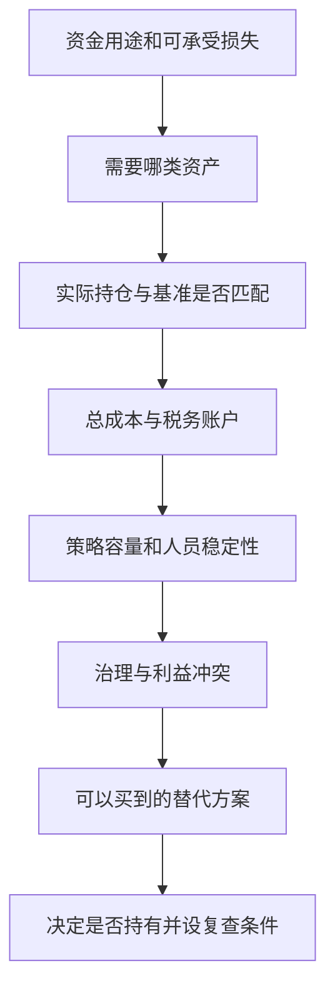

# 《共同基金常识》读书笔记

> 作者：约翰·博格（John C. Bogle，也译约翰·博格尔）；英文名：Common Sense on Mutual Funds。不要与他的另一本 The Little Book of Common Sense Investing 混为一书。  
> 版本：原书初版 1999 年；本篇以出版社列出的十周年修订版五部分、22 章框架为线索。Wiley 当前书页另列 ISBN 9781394378098、2025 年 12 月发行信息，这是该版本的发行信息，不能理解成作者在 2025 年重写。用户中文译本未确认。  
> 实际资料：出版社目录、作者公开演讲、学术论文、监管机构说明及基金公司原始披露。未取得全书，属于**基于公开资料的系统导读**；下面的教学推导与后来的案例均为补充，不冒充原书逐段分析。  
> 覆盖：28 个知识点，兼顾投资策略、基金选择、业绩评价、基金治理与受托责任。更新于 2026-11-12。

版本与目录见 [Wiley 出版社书页](https://www.wiley.com/en-us/shop/general-finance-investments/common-sense-on-mutual-funds-updated-10th-anniversary-edition-p-9781394378098)。

## 先理解这本书在解决什么

基金把许多人的钱交给一个机构共同管理。于是出现两个不同的问题：**这些资产能创造多少收益，以及资产创造的收益有多少真正留给出资人。** 博格最有价值的地方，是把第二个问题放到第一位。他关心的不是宣传材料里谁最耀眼，而是普通人经过几十年，扣除费用、税收和自己错误操作后，到底留下多少购买力。

本书并非只有“买指数”一句话。它还讨论资产配置、股票风格、债券、国际投资、规模、均值回归、销售机制、董事责任、组织结构与领导力。把这些问题连起来，才知道为什么一种看起来很简单的投资办法，会要求投资者具备相当严格的判断纪律。

读完应能做三件事：读懂基金费用和基准；区分基金表现与自己账户表现；在购买前问清基金管理人、销售方与持有人的利益是否一致。

## 主要框架与阅读路线

| 原书部分 | 核心问题 | 本篇重点 |
|---|---|---|
| 投资策略，第 1—4 章 | 长期收益从哪里来，怎样配置和简化 | 1—5 |
| 投资选择，第 5—9 章 | 指数、风格、债券、全球市场和基金筛选 | 6—13 |
| 投资表现，第 10—14 章 | 怎样识别业绩幻觉、规模与税收影响 | 14—21 |
| 基金管理，第 15—19 章 | 机构替谁服务，组织是否支持持有人利益 | 22—26 |
| 精神，第 20—22 章 | 创业、领导力与对人的责任 | 27—28 |

表格是主题导航；具体原书细节未全部取得。历史预测附录只提示其年代意义，不把 1999 年或 2010 年市场判断当成今天的预言。

## 核心知识点

### 1. 长期投资首先是让资产和用途匹配

“长期”不是把任何亏损都解释成还没等够。买基金前要确定这笔钱何时使用、最多能承受多大的中途损失、收入会不会同时受经济下行影响。几年后必须支付的学费，与几十年后才逐步动用的养老金，不能只因同一只基金过去收益高就采用相同组合。

博格的长期思路重视持续持有生产性资产。本文补充的现实判断是：持续持有需要现金流支持。若一场失业就迫使你卖掉股票，纸面的长期配置并不存在。先把家庭现金需求从风险投资中分出来，才谈得上让复利工作。

### 2. 股票回报要拆成企业贡献和估值变化

博格在公开演讲中把分红与盈利增长归为企业提供的投资回报，把市场愿意为同样盈利支付多少倍价格的变化称为投机回报。这是理解收益来源的框架，不是精确预测器。[作者 2002 年演讲](https://johncbogle.com/wordpress/wp-content/uploads/2019/08/Sapient-6-12-02.pdf)

白话说，企业每年多赚了一些钱，与投资者突然愿意出更贵的价格，是两回事。前者可能支持未来分红，后者也可能在情绪逆转时消失。评价过去十年的高收益，应追问其中多少来自盈利增长，多少来自买入时便宜、卖出时昂贵。

常用近似分解为：总回报 ≈ 股息率＋每股盈利增长率＋估值倍数变化的年化贡献。它忽略交叉项及分红再投资时点，不能把三个任意口径的百分比相加就当作精确答案；更不能将“估值上涨”每年永久外推。

### 3. 名义赚到钱，不等于购买力提高

账户回报需要再扣通胀影响。精确的实际收益率为 `(1＋名义收益率)/(1＋通胀率)－1`。基金展示的是某个币种的名义回报，家庭最终消费的却是住房、医疗、教育与日常商品，两者不能直接画等号。

同时也不能说“现金跑不赢通胀，因此一分现金都不要留”。现金的价值还包括防止紧急卖出、承接短期开支。保留流动性有成本，承担市场风险同样有成本；配置是在这些成本之间作选择。

### 4. 资产配置先决定你承担哪一种失败

股票可能在支出前大跌，长期债券可能因利率上升而跌价，短期现金可能长期侵蚀购买力。合理配置不是找到没有缺点的资产，而是避免同一类风险把所有目标一起击穿。

讨论股债比例时，先考虑目标、期限和承受能力，再考虑年龄。年龄只是粗略线索：有稳定养老金且支出少的退休者，与需要依靠账户支付全部生活费的人，风险能力并不相同。不要把“某年龄对应某比例”当成普遍规律。

还要把工资、房产、企业权益放入总资产视角。科技企业员工持有大量雇主股票，再买集中科技基金，名称不同却可能在同一冲击下同时受损。此处是教学补充，不表示原书为每一种家庭提供了统一配置答案。

### 5. 简单，是减少无补偿的复杂性

持有十只基金，未必比持有三只更分散；它们可能都重仓同一批公司。简化的目标是让每个工具有明确职责：提供股票增长、承接债券风险、满足现金需求，或者提供确有必要的地域分散。

每加一个产品，都应说明它解决什么已存在的问题、费用增加多少、与现有持仓重叠多少。无法回答这些问题时，“产品更多”更可能意味着决策负担更重。简单组合同样会跌，优点是你更容易看清自己究竟在承担什么。

### 6. 指数化的算术依据，比“专家都不行”更严谨

威廉·夏普 1991 年的论文给出一个常被说错的结论：在同一个定义清楚的市场里，按资金加权，主动资金整体的费前回报等于市场回报；如果其成本更高，费后整体回报就更低。这允许少数主动管理者胜出，且不自动说明专业基金这个子群体必然落后。[夏普论文原文](https://web.stanford.edu/~wfsharpe/art/active/active.htm)

用原创教学推导来看：在暂不考虑外部资金进出的简单期间，假设同一市场里被动资金期初占比为 `p`，主动资金期初占比为 `1－p`。市场回报为 `R市`，真正按该市场权重持有的被动组合费前也获得 `R市`，则有：

`R市＝p×R市＋(1－p)×R主`。

只要主动资金占比不为零，就得到 `R主＝R市`。主动持有人之间的超额收益在整体上相互抵销，交易与管理成本却不会自动消失。这里的“平均”是按钱加权，不是一百只基金各算一票，也不能把小盘基金拿去和大盘指数比较后宣布推翻算术。

这也解释了指数化并不需要先证明市场价格永远正确。即使市场存在明显错误，参与者仍共同拥有这个市场。你要主动作出偏离，必须回答自己凭什么在扣费后属于获胜的一侧，以及这个优势能否提前识别。

实际使用时，先写下可以购买的低成本替代方案，再要求主动方案说明额外价值。不要只因一只主动基金过去赢过，就跳过基准、风险、费用与未来可重复性的核查。

### 7. 1976 年的指数基金：好办法最初也可能卖不动

Vanguard 披露，First Index Investment Trust 于 1976 年 8 月 31 日推出，最初募集约 1130 万美元，远低于 1.5 亿美元目标。这是后来 Vanguard 500 Index Fund 的前身，案例数据来自机构自己的历史披露。[Vanguard 五十周年公告](https://corporate.vanguard.com/content/corporatesite/us/en/corp/who-we-are/pressroom/press-release-50th-anniversary-vanguard-500-index-fund-083126.html)

它说明投资产品的商业热度与投资方法的逻辑不是同一件事。指数基金不承诺找到下一位明星，卖点是透明、广泛持有与降低成本；在强调明星选股能力的环境中，这并不天然容易销售。

但也不能反过来认为所有募资失败的产品最终都会成功。这个历史案例的教学价值，是要求评价方法本身；今天有些热门产品合理，有些冷门产品也毫无价值。不要用“与大众相反”代替论证。

### 8. 指数名称不是风险说明书

跟踪宽基股票指数、单一行业指数、主题指数和杠杆指数，承担的风险很不一样。是否使用规则，并不决定它是否充分分散；几家权重极高的公司，可能主导一只名字听起来很广泛的基金。

选择指数产品时，阅读编制规则：股票范围、权重方式、调仓频率、成分数量和集中度。再看基金的跟踪差异、费率、规模、流动性及证券借贷等安排。低管理费只是起点；高交易成本与不合适的指数暴露，可能抵销表面便宜。

### 9. 费用会复利地侵蚀终值

费用不是一次性从收益中拿走一点。每年被扣掉的钱，未来也无法继续为你赚钱。SEC 关于基金份额的说明特别提醒：同一基金的不同份额可以共享同一个投资组合，却采用不同收费结构，因此给持有人的净回报并不相同。[SEC 基金份额说明](https://www.investor.gov/introduction-investing/general-resources/news-alerts/alerts-bulletins/investor-bulletins-61)

下面只是**计算演示**：初始投入 10 万元，假设每年费前回报稳定为 7%，分别每年扣除相当于收益率 0.2 和 1.2 个百分点的总成本，不追加资金、不计税，持续 30 年。简化后的年净回报为 6.8% 和 5.8%，终值分别约 71.97 万和 54.27 万，相差 17.70 万。现实按日计提费用，与这里直接减百分点的模型存在细微差别。

差异并不来自低费基金更会选股，而是同一份费前收益留给投资者的比例不同。若高费用方案想补回这笔差距，就必须持续创造额外费前收益；一次排名第一不能证明它能够做到。

核对时至少看管理费、托管及其他运营费用、申购赎回费用、顾问费、交易价差和可能的税收。不要把同一项费用重复相加：基金公布的净值回报通常已经扣除基金内部运营费用，但未必扣掉你个人支付的销售费、账户费或税。费率低也不代表适合你，先比较相同风险和功能，再比较成本。

### 10. 股票风格帮助解释持仓，不负责预测下一轮冠军

成长与价值、大盘与小盘，描述的是持仓特征。所谓“价值股”通常涉及价格相对于盈利或账面值较低，不保证企业值得投资；所谓“成长股”也不表示任何价格都合理。

若基金因重仓某一风格而获胜，不能把全部回报归于选股能力。应与对应风格基准比较，观察风格变化与持仓是否一致。风格轮动的存在，也不意味着投资者能通过不断换基金稳定获利；切换往往发生在旧风格刚落后、新风格已经涨价之后。

### 11. 债券基金的核心是现金流风险与利率风险

债券不是一个统一安全等级。看懂债基，至少要区分发行人违约风险、久期、币种与流动性。久期可粗略理解为价格对利率变化的敏感程度，期限很长的高信用债也可能大幅跌价。

进一步要区分单只债券与持续换仓的基金。前者在不违约且持有到期时有约定偿付安排；后者通常不断买卖债券，持有人并没有某日净值一定回到买入价的承诺。“底层多数是国债”和“基金净值不会跌”，中间并不存在逻辑等号。

### 12. 2008 年货币基金事件：低波动也需要流动性判断

SEC 记录，Reserve Primary Fund 在 2008 年 9 月将每份净资产值计为 0.97 美元，并出现赎回支付受限。2010 年 1 月的公告称，累计分配后投资者已收回每美元超过 0.98 美元；这不是当时每个人可即时拿回全部资金的保证。[SEC 当时问答](https://www.sec.gov/divisions/investment/guidance/reservefundmmffaq.htm)、[2010 年分配公告](https://www.sec.gov/newsroom/press-releases/2010-16-reserve-primary-fund-distributes-assets-investors)

这里有两个不同损失：资产价值受损，以及需要用钱时取不出来。即使最后回收比例较高，中间的等待也可能让持有人错过支付义务。

这属于书外历史补充，不是说所有货币基金具有相同风险，更不能把美国 2008 年制度原样套到今天其他市场。实际应检查底层资产、赎回规则和是否受存款保障；基金名称中有“现金”，不等于银行存款。

### 13. 国际投资必须同时看到分散收益和额外风险

原书设有全球投资专章。本篇不根据未完整取得的章节，为作者杜撰一个永远不变的海外仓位比例。对今天的读者，更有用的是把问题拆开：海外资产能否减少单一国家、产业和政策风险；增加的汇率、费用、治理与税务风险是否可理解。

海外基金收益要说明报告币种。如果当地股市上涨，相关货币对你的消费币种贬值，最终结果可能并不好。反过来，汇率升值也可能掩盖资产经营上的弱点。全球分散是一种避免过度押注的安排，不保证每一阶段都比本国市场赚钱。

### 14. 选基金不能只看过去收益排序

基金排名把过去压缩成一个顺序，却隐藏了大量问题：风险是否相同、存续时间是否相同、是否排除了关闭基金、经理是否已更换、规模是否已大幅增长、收益是否由少数偶然事件贡献。

原书讨论选择优秀基金与均值回归。补充一个实际检验：S&P 的 2024 年持续性报告发现，在其美国主动股票基金口径下，2020 年进入前四分位的基金，没有一只在随后四个年度每年都保持前四分位。[报告及方法](https://www.spglobal.com/spdji/en/spiva/article/us-persistence-scorecard-year-end-2024/)

这句话的意思很窄：**连续每年保持同一相对名次很难。** 它不意味着这些基金都亏钱，也不意味着没有基金取得良好五年累计回报。指数公司本身具有商业立场，因此应看清数据方法，而不把标题直接当结论。

实际筛选可以先剔除无法解释的高费用、频繁风格漂移和治理问题，再研究剩余基金的投资流程。研究重点应是“下一阶段如何产生收益”，而不是“如何把上一阶段的排名讲得更动听”。若你不具备判断流程的能力，承认这一点也可以导向合理的选择。

### 15. 均值回归不是“跌多必涨”

极端优秀的短期表现，可能同时包含能力和好运。再测量一次，好运未必重复，于是表现趋向普通；这不需要经理突然变笨。竞争、估值变贵与资金涌入，也可能压低过去优势。

但破产企业不会因为跌得足够多就恢复正常盈利。一个落后基金如果费用高、投资框架失效，回到平均也不是自然权利。应区分统计上的极端结果减弱，与经济机制真的改善；两者不能用一句“迟早轮到它”混在一起。

### 16. 相对表现与绝对目标要分开

市场跌 30%，基金跌 20%，它相对表现不错，持有人却仍损失了五分之一。如果这笔钱马上要用，相对胜出不能支付缺口。相反，基金涨 8% 而热门指数涨 20%，也不自动说明它未完成一个更低风险的目标。

评价应有两层：是否忠实实现原定策略，是否满足你的实际目标。先确定正确比较对象，再看结果；不能事后挑一个最容易击败的基准。基准应包含相同币种、分红处理和相近风险暴露。

### 17. 规模增长可能使旧业绩失去可复制性

一只小基金能集中研究少数小公司，在市场上慢慢建仓；规模扩大数十倍后，原来的机会未必容得下那么多钱。若它继续买同样的公司，可能推高成交价格；若换成大公司，则原来擅长的投资环境已经改变。

这就是“基金变得更成功，反而更难延续成功”的机制。管理公司的收费收入通常与资产规模有关，而持有人的收益率并不随规模自动提高，二者的利益可能出现张力。

这是原书资产规模主题的教学解释，不代表任何具体大型基金必然失败。宽基指数策略通常比小盘集中策略具有更大容量。实际查证可比较基金规模变化、持仓数量、持股占公司比例、换手率、现金比例以及是否主动限制申购；不能只看经理仍是同一个人。

### 18. 税收能穿透“我没有卖基金”的直觉

2025 年 1 月，SEC 公布 Vanguard 就目标日期基金相关披露问题达成总额 1.0641 亿美元的监管和解，涉及持有相关零售份额的美国应税账户投资者。Vanguard 未承认也未否认相关认定。监管记录中的关键链条是：2020 年机构份额准入门槛从 1 亿美元降至 500 万美元，部分投资者转向费用更低的机构份额，原基金为应对赎回出售已有收益的资产，留下来的应税账户持有人面临较大的资本利得分配与税负。[SEC 2025 年公告](https://www.sec.gov/newsroom/press-releases/2025-21)

为什么你没卖，也可能有税？因为投资者持有的是基金份额，基金内部出售资产是另一个层面的交易。特定税制允许或要求把已实现收益分配给持有人，持有人自己的买卖动作并非唯一触发因素。这个案例让“基金收益”与“我可继续复利的钱”之间的差别变得具体。

它也提醒我们，低费用品牌并不会消除制度和运营风险。费用下降对迁移者有利，却可能通过资金流动给另一组人带来成本。评价一个变化，必须问清谁受益、谁承担代价。

边界同样明确：这是特定美国基金和账户的历史事件，不是在解释中国公募基金当前税法。实际应用是先问账户类型和当地规则，再看基金分配记录、内部换手与披露；不能把本文当成跨司法辖区的税务操作指南。

图解对应上述历史事件的传导机制，不代表所有基金、所有国家采用相同税制。

### 19. 时间让收益复利，也让成本复利

持有时间延长，可以减少不必要的进出费用，也可能提高抓住企业长期增长的机会；但它同样会放大高费用和错误资产选择造成的损失。时间不会自动把一项糟糕投资变好。

因此，“长期持有”的前提应包括：工具仍适合目标、成本仍合理、基础风险没有偏离、家庭仍有持有能力。检查这些前提，与天天看涨跌是两种不同的工作。前者可能帮助你坚持，后者容易诱发临时改变计划。

### 20. 基金赚了多少，与你赚了多少不一定相同

基金常用时间加权回报描述策略表现；个人账户的资金加权回报还受何时投入和取出的影响。若大量资金在高涨之后才进入，个人收益可能低于基金长期回报。

不过，两种回报不同不全是“追涨杀跌”的证据。工资逐月到账、买房提款、继承财产进入账户，都能改变资金时点。不能把所有差距都责怪为投资者不理性。查证时应拿自己的日期、投入、取出和期末市值计算资金加权回报，再分析哪些操作可避免、哪些是生活需要。

### 21. 再平衡是维护风险结构

当股票大涨，原来平衡的组合可能变成股票占绝大多数。再平衡通过卖出偏高部分、补充偏低部分，或者调整新增资金，恢复计划中的风险比例。

它没有保证提高收益；在长期单边上涨中甚至可能落后于一直持有赢家。其主要作用是避免组合悄悄变成你本来不愿承担的赌注。用新增现金流调整通常可以减少交易，但具体还要考虑费用、税收和最低交易限制。

### 22. 管理原则比营销口号更难伪装

原书把基金管理单列为一部分，提醒读者把机构行为纳入投资评价。所谓稳定原则，应体现在行情变化后仍能观察到的做法：费用是否透明、是否坚持既定范围、业绩不好时是否解释原因、是否随意更换基准。

一句“长期主义”几乎没有检验价值。更有用的问题是：在吸引新资金与保护老持有人发生冲突时，公司做了什么；市场不热门时，它是否仍维护同样的策略纪律。这类证据需要连续观察，不能由一次发布会给出。

### 23. 销售关系会影响你看到的产品

销售方可能从不同产品或份额类别获得不同报酬。于是“被推荐”同时包含产品判断和销售激励，二者不能天然视为一致。基金被放在首页、获得醒目的推荐位置，也不是投资质量的直接证据。

实用做法是询问完整收费、可供选择的份额类别、是否存在成本更低而功能接近的替代产品，以及推荐方如何获得报酬。这里不是说收费服务没有价值，而是要能分辨你买到的究竟是建议、执行便利，还是单纯的销售。

### 24. 技术降低操作门槛，也可能提高错误操作频率

技术让查询、交易和记录更便宜，但容易操作并不等于应该频繁操作。若软件持续把短期排行榜、涨跌提醒和交易按钮推到眼前，投资者可能把原本长期的计划变成每天的反应游戏。

把技术用于自动转入、核对费用、追踪配置偏离和保存决策理由，比不断寻找下一个提醒信号更接近本书的精神。是否采用一个功能，取决于它能否改善决策，而不取决于它看起来多先进。

### 25. 董事和受托人应替真正的出资人说话

基金资产的所有者与管理公司股东并不总是同一群人。管理人希望收入增加，基金持有人希望扣费后结果更好；董事及其他治理安排的意义，就是处理这种潜在冲突。

普通人不必成为法律专家，也能检查少数重要问题：谁批准费用，谁监督关联交易，费用减免是否可能到期，规模扩大后是否共享成本节约。法律上有“独立”称号，仍需要实际行为来证明监督有效。

### 26. Vanguard 的组织结构是一种激励设计

Vanguard 官方说明，其成员基金持有管理公司，而这些基金又由基金持有人拥有。它与由外部上市股东持有管理公司的模式不同；官方也明确，不能据此声称公司严格按成本经营。[Vanguard 组织结构说明](https://corporate.vanguard.com/content/corporatesite/us/en/corp/why-vanguard/sets-us-apart/ownership.html)

这项安排的教学意义是减少部分利益分离：当服务对象与所有权链条接近，成本下降更有机会反馈给基金持有人。它不是神奇保证，仍需要人员、流程与监督配合；前面目标日期基金税务披露事件正好说明，好结构也可能出现具体问题。

也不要把这一法律结构泛化成“全球所有买过 Vanguard 产品的人都直接拥有同等公司治理权”。看机构声明时要区分成员基金、实际持有的基金份额、销售地区与具体法律权利。

### 27. 创业与领导力，应以服务结果检验

原书最后讨论创业、领导与人。能够可靠确认的是这些主题在原书结构中的重要性；由于未取得完整章节，本篇不编写作者私人故事或逐条管理格言。

结合前面已核验的指数基金历史，可以形成一个务实理解：创业不一定是制造更复杂的产品，也可以是把已有需求用更低成本、更透明的方式满足。领导者值得评价的成果，是制度能否持续服务客户，而不是个人声望是否越来越高。

### 28. 投资者的责任，是把选择变成能长期执行的制度

基金公司有责任，投资者也需要明确自己的责任边界：知道买了什么，知道钱何时要用，知道总成本，不依赖短期排名维持信心。把这些写成几条稳定规则，比凭情绪每天重新决定更可靠。

最终目标不是永远击败邻居，而是用合理风险支持生活。低成本、透明、分散与耐心彼此配合，任何一项都不是单独的万能解。最好的学习结果，是你能解释为何选择某个工具，也能说明在什么条件下应当重新审视它。

## 把一只基金从宣传页还原成投资工具

图的顺序很重要：先决定需要什么，再比较谁做得合适。如果从“最近最火的基金”出发，后面常会变成替已经心动的产品寻找理由。

## 练习与参考答案

**练习一：同一投资组合的两个份额，一个不收申购费但每年费用更高，另一个有申购费但年费用更低。前者一定便宜吗？**  
参考答案：不一定。要比较持有期、申购费折扣、持续费用、赎回费用及账户额外收费。长期持有时较高年费不断累积，短期持有时一次性费用可能更重要。份额字母在不同市场的含义不相同，必须读对应产品文件。

**练习二：基金连续一年进入前 10%，应该立即换入吗？**  
参考答案：这只能说明过去结果。先确认基准、风格、风险、规模、经理与费用，再判断未来过程是否可信；还要计算换出原基金的成本。排名本身不能完成筛选。

**练习三：基金没有卖，但收到应税资本利得分配，是否必然意味着记账错误？**  
参考答案：不是。特定基金结构和税制下，基金内部已实现收益可传导给持有人。Vanguard 历史事件就是实际例子；具体税额仍需按所在地和账户规则确认。

**练习四：高费基金 30 年后要追平第 9 节的低费方案，是否只需最后一年多赚 1%？**  
参考答案：不是。此前示意模型中终值约差 17.70 万，低费终值比高费终值约高 32.61%。每年的费用差通过复利累积；最后一次小幅超额回报不能自动弥补。

## 主要边界与继续阅读

- 博格主要讨论美国基金行业；交易规则、税务、销售制度与基金治理不能直接移植。
- 本篇覆盖原书主要主题，组织原则与领导力部分仅作范围内概述；没有全书原文，不能确认每个中文译本的术语与章节细节。
- 指数化并不消灭市场风险，低成本也不替代适当性判断。主动管理的总体算术约束不等于否认一切主动能力。
- 所有历史案例均为解释机制。监管文件中的历史认定和和解状态按来源表述，不扩写成未被证实的个人动机。

作者收益分解、夏普论文、监管记录、基金披露已在相应知识点直接链接。费用解释另可核对 [SEC 费用教育材料](https://www.sec.gov/files/ib_mutualfundfees.pdf)。读完后，拿自己实际能买到的一只基金，按上图填写一页核对记录；发现自己还无法说明持仓和总成本，就是下一步最值得补的知识。

---

[返回书籍索引](../README.md) · [财商学习与实践路线](../财商进阶合订本.md)
