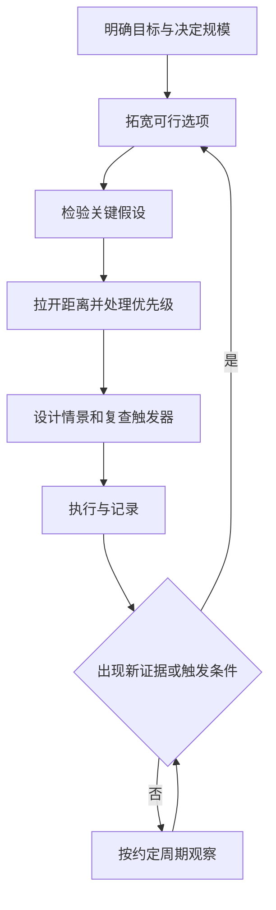
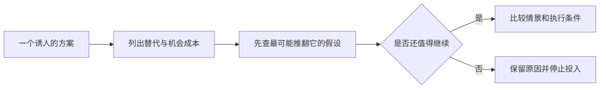

# 《决断力》读书笔记

> 作者：奇普·希思、丹·希思。英文原作 *Decisive: How to Make Better Choices in Life and Work*，2013 年初版；中文译本印次未指定。
> 资料范围：依据作者公开框架、出版社资料及相关原始研究整理，未取得完整原书逐页核对。重点覆盖 WRAP 四步及扩展选项、检验假设、拉开距离、应对判断错误的主要工具；亚马逊 2015 年股东信等后出材料标明为补充案例。更新：2026-11-12。

这本书的关键不是“赶快拿定主意”，而是建立一套让重要决定更可靠的过程。优缺点清单有用，但如果问题一开始就被限定错、证据被挑选、当下情绪占了上风，再工整的清单也可能为偏好的答案服务。

对股票与财商学习，它适合放在分析与行动之间：你已经有一些资料，接下来怎样决定继续研究、放弃、等待、试验或投入资源，并在发现错误时及时改方向？

## 四个环节与四类障碍

| 障碍 | 容易出现的决定 | WRAP 对应动作 |
| --- | --- | --- |
| 视野过窄 | 只问买还是不买这一只 | W：拓宽选项 |
| 确认偏误 | 只搜支持原判断的资料 | R：检验假设 |
| 短期情绪 | 因急迫、兴奋或恐惧改变目标 | A：拉开距离 |
| 过度自信 | 只为预期结果准备 | P：为可能判断错误作准备 |

四个动作依次对应 Widen、Reality-test、Attain distance、Prepare。它们是流程提示，不是一套经过证明在任何任务中都最优的算法。[作者书籍介绍](https://heathbrothers.com/books/decisive/)；[作者 WRAP 一页框架](https://heathbrothers.com/wp-content/uploads/resources/The_WRAP_Process_one_pager.pdf)；[出版社版本信息](https://www.penguinrandomhouse.com/books/215508/decisive-by-chip-heath-and-dan-heath/)。

## 核心知识点

### 1. 决策质量取决于过程，也受到运气影响

一个依据充分的决定可能遇到坏结果，一个草率决定也可能偶然成功。改善过程不是保证结果，而是让你更少遗漏本可发现的信息与替代方案。

复盘应分别评价：当时掌握了什么、怎样处理不确定性、执行是否符合计划，以及后来发生了什么。不要用事后的明显答案惩罚所有合理的不确定判断。

### 2. 优缺点清单只能比较已经进入视野的东西

它不能自动创造好选项，也不能保证每一项权重公正。如果你特别喜欢某个方案，可能把其优点拆成五条，把缺点合并成一条，清单便有了虚假的精确感。

所以在打分之前，先检查问题表述和候选范围。评分表是比较工具，不能替代选项发现、证据核验和价值取舍。

### 3. 把“要不要”改写成“有哪些办法实现目标”

“是否买这只股票”把注意力锁在一个对象；“这笔资金要服务什么目标，有哪些合适工具”才允许其他可能进入。两种问题并不等价。

扩展不要求无限搜索，而是避免把最早遇到的方案当作唯一候选。先明确需求、期限与约束，再决定哪些候选值得进一步研究。

### 4. 机会成本经常需要被主动唤起

Frederick 等人的 2009 年研究通过消费选择实验，发现提醒人们考虑被放弃的其他用途，会改变部分购买决定。研究中的 DVD 等是实验选择情境，不是某位真实消费者的完整财务故事。[原论文](https://bear.warrington.ufl.edu/brenner/mar7588/Papers/frederick-jcr-2009.pdf)。

关键机制是：预算约束虽一直存在，但“购买之外还能做什么”未必自动进入注意力。仅说“我认真想过”不保证已经想到了替代用途。

**补充应用：**研究一个付费课程时，把不买之后可用于其他学习、节省的时间和现金列出来；研究一家公司时，把持有现金、低成本分散工具和其他经营模式作为可比较方向。机会成本是最佳被放弃的可行替代，不是把世上所有错过的盈利加在一起。

### 5. 选项消失测试能暴露隐藏的替代方案

假设当前最喜欢的方案突然不可用，你会怎样实现原目标？这不是要求真的放弃它，而是暂时解除心理上的独占地位。

若回答完全为空，可能说明还没充分探索；也可能说明确有不可替代约束。继续追问替代为何不可行，才能区分“没想到”和“确实没有”。

### 6. 同时发展多个方案，能减少过早依恋

Dow 等人 2010 年研究让初学设计者以并行或串行方式制作网络广告原型，并比较反馈后的结果。在该任务中，并行条件的最终广告在点击和专家评价等指标上表现较好。[原论文](https://hci.stanford.edu/publications/2010/parallel-prototyping/ParallelPrototyping2010-final.pdf)。

并行的价值在于可以比较不同方向，批评也不必等同于否定唯一作品。它不证明任何行业同时做更多项目都会更好：研究时间、设计任务和反馈方式都有具体边界。

迁移到企业研究，可以先用相同篇幅分别写两三家公司的盈利来源与风险，再决定深入哪家。这里的“并行研究”并不意味着先买入每家公司；研究资源和资本投入是两回事。

### 7. 多方案必须有真实差异

把同一种想法换三个名称，不算拓宽选项。有效差异可以来自实现路径、规模、时点、资源需求或承担的风险。

也要防止为了满足形式，加入一个明显差的陪衬。那会让比较继续为原偏好服务。候选方案至少应有一种重要条件，在该条件下它可能是合理选择。

### 8. 从近处的有效做法开始，再寻找远处类比

如果同一问题已有较好的解决者，先调查其实际做法，比立即从零发明更节省资源。随后再比较同业经验，最后寻找其他领域的机制类比。

类比应对照结构：约束、激励、反馈和成本是否相似？只因两个行业都被称为“平台”，就照搬增长和估值模式，是名字相似而非机制相似。

### 9. 在必要时寻找“同时做到”的组合

有些冲突来自把目标误写成互斥：提高研究质量与减少无效盯盘可以通过调整流程同时改善。但资金、时间和注意力仍有限，并非任何取舍都能被聪明方案消除。

应先找能兼顾的结构，再诚实处理剩余冲突。不能用“我们都要”回避真实预算约束。

### 10. 假设是连接事实与结论的桥

“用户增加，所以利润会持续增长”隐藏了付费率、留存、获客成本、服务成本和竞争反应等假设。单看用户数据无法决定所有桥梁都成立。

把重要结论写成“只有在 A、B、C 条件成立时，才支持这个结果”。然后优先检验最不确定、且一旦错误就会改变决定的条件。

### 11. 主动寻找反证，要找能区分解释的事实

机械搜索“某公司利空”可能只会收集情绪化观点。更好的问题是：如果原判断错误，最可能先在哪个可观察指标上露出来？

例如“客户黏性强”与“补贴暂时留住客户”可能都带来高使用量，但在补贴减少后、续约定价时会有不同预测。证据要能区分假说，不能只重复同一表面现象。

### 12. 问“什么条件下反方会正确”，比简单站队更深入

这使讨论从身份冲突转成可检验条件。反方不必在所有方面都对，只要指出一个会改变决定的重要约束，就有价值。

也不要把“存在一种反例可能”当成否定全部证据。需要比较该条件的概率、影响和可预防程度，而不是把所有不确定性一律视为禁止行动。

### 13. 专家对过去的知识，未必转化为精确预测

可以向专家请教行业通常的失败原因、历史分布、执行难点和常见约束。要求其精确预测一年后价格，则可能超出同一专长的可靠范围。

专家最有用的贡献有时是纠正问题：你比较错了单位、忽略了权利结构，或把无法控制的因素当成可执行动作。不要只挑愿意给出确定答案的人。

### 14. 外部视角：先看同类情况通常怎样

在细看自己的故事之前，寻找适当参照类：类似项目多久完成、类似公司利润率如何变化、同类扩张失败率是多少。外部视角提供起点，内部证据再用于修正。

参照类不能随意挑。只看成功上市公司会漏掉退出者；把不同阶段、不同制度的企业混在一起，也可能误导。参考平均值时还要看分布，而非只记一条均值。

### 15. 放大观察能发现平均数背后的执行细节

外部视角防止认为自己处处例外，近距离观察则帮助理解真实流程。访谈、产品使用和现场资料可以暴露统计表没有描述的问题。

两者互相补充：一位客户的鲜明经历不能代表所有人，行业平均值也不能证明某家公司没有特殊困难。要让个案提出可检查的问题，再回到更广的数据。

### 16. 小规模试探要针对不确定假设

作者把先做有限尝试、获取反馈再扩大投入的办法称为 ooching。它适用于能低成本、较快、较安全地观察关键结果的任务。

试探前至少写清四件事：要学什么、怎样观察、付出多少、什么结果会改变下一步。否则试探容易变成已经决定之后的宣传，或者无限延长的拖延。

### 17. eBay 广告实验：试探的价值在于得到可区分的反馈

**书外补充研究：**这里使用的是 2014 年 4 月 8 日版本，晚于本书初版。eBay 的付费搜索研究通过改变广告投放，检查原本归因于广告的购买有多少真正是新增效果。研究发现品牌关键词广告在相应短期实验中没有可测量的增量收益，而不同类型用户的非品牌广告效果存在差异。[作者论文](https://faculty.haas.berkeley.edu/stadelis/tadelis.pdf)。

这里的关键不是“广告都无效”，而是停投或保留相应广告的比较，让原有假设接受了测试。仅看点击后购买，会把本来就想来买的人也算入广告功劳。

**投资迁移边界：**小额买一只股票后上涨，通常不能完成同样的因果检验。你无法把同一个市场随机分成平行世界，短期涨跌也未必揭示长期经营假设。可以先做模拟记录、独立估值和经营跟踪；不能因为叫“小试”，就把交易结果当作科学验证。

### 18. 试验也有外推和选择问题

短期促销可能吸引与长期客户不同的人；小规模服务的质量可能无法在大规模维持；只试容易成功的地区，会高估推广效果。

试验结束后，应问哪些条件会随规模变化。把样本内成功转为长期投资，需要新增证据，不能靠把预测数字简单乘以客户总量。

### 19. 可逆与不可逆决定应采用不同力度的流程

**书外真实案例：**贝索斯在亚马逊 2015 年股东信中区分难以逆转的一类决定，与可以较容易返回的另一类决定，强调不要对所有选择使用同样沉重的程序。[亚马逊官方原信](https://ir.aboutamazon.com/files/doc_financials/annual/2015-Letter-to-Shareholders.PDF)。

这是管理者公开表达的经验与方法，不是随机试验证明所有企业都应照搬。它提供的有效问题是：做错之后，能够撤回什么，恢复需多少成本，要多久？

在股票上，“有交易市场”不代表无代价可逆。卖出价格可能更低，流动性可能恶化；杠杆、税费和时间也会改变代价。可逆性需要按真实退出条件评估。

### 20. 拉开距离是降低一时情绪的垄断地位

情绪提供价值和需求的信息，不能全部删除。拉开距离的目的，是让当下的兴奋、面子和恐惧不成为唯一声音。

例如把“今天不买就觉得错过”与“资金未来用途”分别写出来，观察两个目标是否一致。承认情绪存在，比把情绪驱动的理由包装成确定估值更诚实。

### 21. 10/10/10 是换时间尺度，不是预测公式

这项工具源于苏茜·韦尔奇，希思兄弟将其纳入决策方法：考虑十分钟、十个月、十年后的感受和后果。数字是帮助切换视角的提示，不是这三个期限有特殊数学最优性。[韦尔奇本人介绍](https://suzy-welch.squarespace.com/)。

长远也不是永远压倒眼前。紧急现金需求、健康与家庭责任可能使短期约束很重要。工具的作用是让不同期限同时进入讨论，而非用遥远故事掩盖当下无法承受的风险。

### 22. 给朋友的建议，可以帮助看见自己回避的因素

设想你会给处于相同条件的朋友什么建议，能暂时减少对自我面子、已作承诺和拥有关系的依恋。但前提是把真实约束也告诉这位“朋友”。

如果省略了收入波动、债务和责任，给出的建议可能过于轻松。第三人称视角是检查工具，不是把个人价值观交给想象中的旁观者。

### 23. 核心优先级要能解决真实冲突

“既要高收益又要绝对安全”没有完成取舍。优先级应说明在重要条件冲突时，哪个目标先满足，哪些代价不能接受。

补充教学可以写为：先确保已知支出可支付，再讨论长期投资；研究未完成时不因价格上涨降低证据标准。它们是规则示例，并非对所有家庭相同的个性化方案。

### 24. 为未来设置区间，而非只写一个漂亮结果

预测可以保留中央情景，但要同时检查较差与较好情景。每种情景应由明确机制产生，不是把所有数字统一加减 20%。

较差情景可能是销量下降同时回款变慢；较好情景也可能要求更多库存和资本支出。因此准备工作不只是防损失，还包括成功时能否提供资源。

### 25. 事前验尸：先假定计划失败，再寻找可能原因

在重大投入前，假设到了复盘日方案已经失败，分别写下原因。这样能让原本不方便说的担忧进入视野，并把“很可能成功”的总论拆成具体脆弱点。

不要把想到的失败故事当作发生概率。它首先是一种风险发现方法，随后仍要核验证据、估计影响和确定应对。列出二十个灾难场景，不代表成功概率很低。

### 26. 也要做成功后的准备

如果新业务需求超预期，现金、人员、供应和服务质量可能受压。只准备失败时削减成本，可能遗漏增长带来的资源需求。

股票分析中同样要问：增长需要多少再投资？旧股东是否被稀释？账面利润提高时现金是否反而更紧？成功情景不是只把利润率调高。

### 27. 触发器让“到时候再看”变成有条件的复查

触发器可以是日期、事件、信息变化或资源上限。它应说明什么时候停止自动继续，并重新判断，而不必预先把每种情况都写成机械买卖。

例如观察一家公司，可以预定在年报发布、关键客户流失或融资条件明显变化时复核逻辑。价格阈值也可以是研究提醒，但不能用它替代现金流和风险分析。

### 28. 好触发器要防止被事后移动

若每次条件出现都临时解释为例外，触发器失去作用。可以事先说明阈值依据、数据来源、允许的例外和修改规则。

同时要避免过密触发：正常噪声若不断要求完整重审，人会逐渐忽略所有提醒。应围绕会改变决定的关键变量，而不是任何可观测指标。

### 29. 停止条件应同时处理时间与证据

“等到确定”可能永远没有终点。可以给研究设定交付日期与必要信息清单：届时得到什么就继续，缺什么就等待或放弃，并保留重启条件。

重要的是缺失信息的价值。如果无论结果如何都不会改变行动，继续搜集可能只是缓解焦虑；如果一条可取得的信息会推翻整个计划，则应优先调查。

### 30. 让反对者帮助改善决定，而非只负责挑错

可以先请参与者独立写下方案与风险，再讨论分歧，减少较早发言的人控制整个讨论。对反方要求具体证据，对支持方也采用相同标准。

最终决策权和执行责任应明确。讨论不是通过无穷辩论获得绝对一致，而是让关键分歧被看见、被处理，并知道何时需要重新打开问题。

### 31. 将四步做成一张有证据入口的工作卡

| 环节 | 必须产出的内容 | 质量检查 |
| --- | --- | --- |
| W | 目标、约束与真实替代方案 | 是否只有一个偏好和两个陪衬 |
| R | 关键假设、反证及可测试部分 | 什么信息会改变结论 |
| A | 不同期限后果与核心优先级 | 是否由一时情绪替长期目标作答 |
| P | 情景、资源准备、触发器 | 失败和成功时是否都能执行 |

这张卡是本篇补充教学，可嵌入[财商进阶合订本](../财商进阶合订本.md)的企业研究与复盘流程。没有证据的空格应保留为未知，不要为了填满表格编造判断。

### 32. 好流程要能重复使用，也要允许简化

大金额、长期、难退出的决定值得完整流程；低风险可逆决定可以简化。该图强调过程可返回，执行并不意味着必须维护原结论。

第二张图说明停止研究也可以是有效产出。发现一个无法满足的关键约束后，不必为了证明自己勤奋而继续搜集支持材料。

## 练习与参考答案

**题一：做了二十页分析，但只研究一家热门公司，最大缺口可能是什么？**

缺少真实替代和机会成本。资料很多不等于问题范围完整，应先核对资金目标及其他可行方案，再比较同一口径的信息。

**题二：小额买入后上涨 15%，能否说经营假设通过试验？**

不能。价格受很多因素影响，短期上涨不提供清楚的因果识别。应检查事先要验证的客户、利润、现金或竞争指标是否发生了相应变化。

**题三：到了预设复查日期，信息仍不充分，是否必须采取行动？**

复查与交易不同。可以继续等待、缩小研究范围或放弃，但应说明缺失信息、等待成本和下一次触发条件，不能只把日期向后移动。

## 这本书能帮你形成什么能力

它帮助你把“很想做一件事”变成“能够解释为什么选它、凭什么相信、何时应改变”。书中框架不是预测收益的公式，研究案例也不直接证明整套流程在所有情境下都有效。

可接着读[《清单革命》](<../清单革命 - 阿图·葛文德/读书笔记.md>)，把关键检查嵌入执行；再用[《对赌》](<../对赌 - 安妮·杜克/读书笔记.md>)区分过程、概率与结果，避免一次成功或失败就推翻整套方法。
