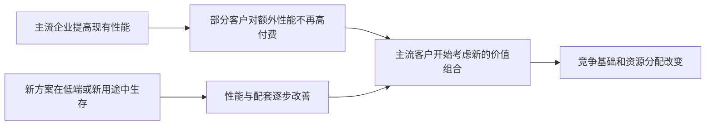
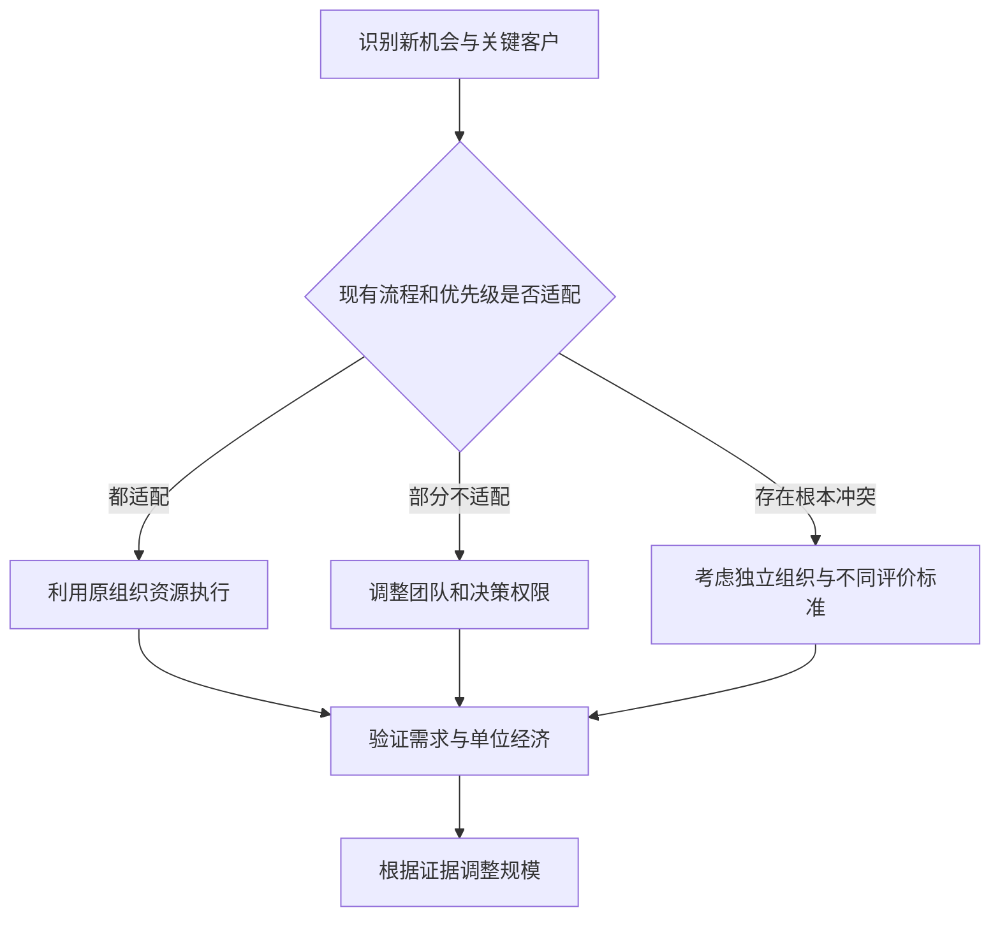

# 《创新者的窘境》读书笔记

> 作者：克莱顿·克里斯坦森（Clayton M. Christensen；中文书目也有其他音译，本目录采用已核对的“克莱顿·克里斯坦森”）。原作 *The Innovator’s Dilemma: When New Technologies Cause Great Firms to Fail*，Harvard Business School Press，1997 年；中文具体译本未确认。未取得全书，本文依据出版书目、作者所在研究机构、原始研究及公司资料整理主要问题与方法。低端/新市场的细分、后续商业模式框架及 2015 年澄清属于理论后续发展，不能全算成 1997 年初版原文。30 点为学习主题，不是章节编号。核验：2026-11-12。

本书提出一个令人不安的问题：企业认真听客户意见、把钱投入回报最好的项目、不断改善产品，为什么仍可能错失改变行业的新机会？作者认为，问题有时恰恰来自原有成功体系：当前客户和利润标准会持续筛掉规模小、早期性能不够、收益结构不同的新业务。

“颠覆”在这里是一种有条件的竞争过程，不是所有重大创新、爆款产品或新公司胜出的统称。对财商学习最有用的地方，是识别成熟公司财报看起来仍好时，哪些早期信号可能预示需求和竞争边界正在改变。[作者研究机构书目](https://www.christenseninstitute.org/about/clayton-christensen/)、[中文作者书目](https://search.worldcat.org/title/656529660)、[出版社介绍](https://store.hbr.org/product/the-innovator-s-dilemma-with-a-new-foreword-when-new-technologies-cause-great-firms-to-fail/10706)

## 一、先弄清作者究竟解释什么

### 1. 窘境是两种合理要求发生冲突

成熟企业要服务现有客户、维持利润、兑现投资者预期，同时又必须为未来需求准备。如果新业务早期不能满足旧客户，或者利润率、规模与既有标准不匹配，就很难在内部获得资源。

因此不能把问题简单归为管理者不聪明。最有价值的分析是问：现有激励和客户关系使什么项目容易获批，什么项目总被推迟？公司可能非常会创新，只是更擅长满足旧体系评价标准的创新。

### 2. 延续性创新可以非常激进

延续性创新沿现有主要客户看重的性能方向改善产品。它可以是小改进，也可以需要突破性科学和巨额研发。技术难度大不自动使它成为颠覆性创新。

这一点能纠正投资叙事中的常见混用：把芯片性能大幅提高称为重大创新没有问题，但若它仍服务原来高要求客户、沿原有竞争标准前进，就不能仅凭技术先进程度归类为经典颠覆。分类要看市场关系与竞争路径，不是发明听起来多震撼。

### 3. 颠覆性创新早期可能在主流指标上不够好

新方案可能更便宜、简单、便携或容易使用，却在主流客户重视的容量、精度或服务能力上不足。因此它初期不必立即抢走最赚钱的客户，而可能先在被忽略的客户或新用途里建立业务。

关键条件是它能够持续改善，并最终满足更广泛客户的要求。没有改善路径的小众产品可以长期小众，并不自动颠覆行业；早期便宜也不等于商业模式可持续。应把“起点特点”“进步能力”和“向主流扩展”三个环节分别验证。

### 4. 技术表现与客户所需表现不是同一条线

主流企业可能不断提高性能，但部分客户对额外提升的支付意愿逐渐下降。此时更低价格、更便利或更低使用门槛可能变得重要。

不能据此宣布技术终将无用。客户群体不同，某些专业需求仍会持续上升；性能也有多个维度。一项技术在容量上足够，不表示安全、可靠性或配套已经合格。分析时应说明针对哪个客户、哪个用途、哪种性能谈“足够好”。

这是条件性过程图，不是所有行业必然经历的时间表。若新方案无法改善、客户需求同步提高，或者原有企业成功调整，右侧结果就可能不出现。

### 5. 价值网络决定什么生意看起来值得做

价值网络包括企业服务的客户、合作的供应商、交付方式以及形成的利润和性能要求。同一项技术放入不同网络，经济吸引力可能不同。

不要把“网络”仅理解为互联网平台。大型设备供应链、经销渠道和专业客户体系都可以构成这种环境。研究新业务时，要问它能否使用旧渠道、服务成本是否不同、客户怎样评价产品，以及旧业务的成功标准是否会误伤新业务。

### 6. 硬盘历史：客户需要容量，另一批客户需要更小尺寸

本书早期研究的重要来源是硬盘行业。HBS 历史研究回顾指出，较大尺寸硬盘的既有企业主要围绕原有客户提高容量，新进入者则在更小尺寸及不同用途上寻找机会；随着性能改善，竞争边界发生变化。这个案例不是“尺寸越小必胜”，更不是所有原有企业都彻底消失。[Tom Nicholas 对理论历史的研究](https://www.hbs.edu/ris/Publication%20Files/21-014_8e2e8eb1-59d5-43e2-b8a6-32907b72cfc6.pdf)

机制可以分三步理解。首先，不同计算机用途有不同空间、容量和成本要求。其次，现有大客户的反馈使供应商优先改善旧产品，而不是投资它们暂时不需要的尺寸。最后，较小产品在其他用途发展，性能提高后才开始影响原有市场。

投资应用是不要只问新产品是否超过龙头旗舰产品，还要问是否服务另一批真实客户，以及这批需求能否支持技术和成本改善。边界是历史样本并非随机实验，企业命运也受融资、管理和其他技术影响；不能把硬盘的一段演化直接当作所有行业的统一规律。

## 二、为何好管理可能产生盲点

### 7. 听客户意见需要说明听的是谁

现有客户往往最清楚当前产品哪里需要改善，却未必代表尚未购买的人，也未必需要正在形成的新用途。问题不是客户愚蠢，而是不同客户的任务与约束不同。

企业应继续认真服务当前客户，同时为非客户和低端用途建立独立的观察渠道。投资者可检查公司市场研究是否只围绕最大客户，是否把新用途一律解释成低价值需求。不能从本书推出“不要听客户”，正确问题是不能只让一类客户决定全部未来资源。

### 8. 资源分配会在正式战略之前发生

基层与中层经理知道哪些项目容易获得预算，就会在提案阶段优先包装这些项目。公司即使宣布重视新业务，日常评价仍可能按旧业务利润规模筛选方案。

因此识别创新能力不能只看最高管理者演讲。要看预算审批、业绩考核、团队规模和客户归属是否适合新任务。形式上的研发投入大，不说明资金流向了最可能改变竞争边界的项目。

### 9. 小市场难以满足大公司的增长要求

规模越大的企业，需要的新增收入绝对额通常越高。一个值得小团队认真经营的市场，可能无法显著影响大公司的合并报表，因此长期排在资源队列末尾。

**数学演示**：收入 100 的业务增长 10% 需要增加 10；收入 10,000 的集团同样增长 10% 需要增加 1,000。一个早期市场即使成功，可能只够前者增长。数字仅说明规模与评价标准的关系，并不预测真实市场大小。

解决方向是匹配组织规模与机会规模，而不是要求新项目第一年就改变集团业绩。反过来，小团队也不能因为市场小就免于验证需求；规模适配只是使认真试验成为可能，不保证成功。

### 10. 高利润目标可能推动企业不断向上走

更高性能、更大客户和更高毛利率通常容易获得内部支持。原有企业让出低端后，短期产品结构和利润率甚至可能变好，从而强化原有选择。

这解释了为什么某些威胁出现时，财报不一定立即恶化。投资者要在利润之外检查客户结构和进入者的位置。但不能反过来把利润率上升当作即将衰败的证据；它也可能是真实竞争力改善。关键是是否同时出现低端需求转移与新方案向上发展的证据。

### 11. 自我替代改变创新收益计算

成熟企业推出新产品，可能替代原有利润；新进入者没有同样规模的旧利润需要保护。双方即使面对相同技术，也可能有不同投资激励。

Igami 对 1981—1998 年硬盘行业的结构模型研究，把能力差异和产品自我替代等机制放在一起估计。作者解释，在该样本与模型下，原有企业并非没有创新能力，但替代旧产品收益的影响会削弱其采用动机。[原始研究论文](https://www.journals.uchicago.edu/doi/abs/10.1086/691524)、[研究者在耶鲁的解释](https://news.yale.edu/2017/06/05/estimating-innovator-s-dilemma-qa-yale-economist-mitsuru-igami)

这说明“创新窘境”可以进一步拆成可研究的经济机制，不必只依靠企业故事。边界是结构模型结论依赖数据和假设，不能推广为所有成熟公司必然创新较慢，也不能直接推出某家公司该被卖空。

## 三、区分两条路径与常见误用

### 12. 低端颠覆从被过度服务的客户开始

在后续理论表述中，低端路径指部分客户不需要现有全部性能，新进入者能用适当成本结构提供更便宜而足够好的产品。随后进入者可能改善能力，逐步争取要求更高的客户。[研究机构理论说明](https://www.christenseninstitute.org/theory/disruptive-innovation/)

关键是不同经济结构，不是简单亏本打折。如果企业依靠补贴暂时低价，却没有可持续成本或收益模型，不能仅据此确认低端颠覆。还要问：原有企业为何不立即用自身规模回应，新进入者改善之后是否仍保留原来的成本优势？

### 13. 新市场颠覆从原本不消费的人或场景开始

另一条路径是让过去因价格、技能、时间或使用条件而无法消费的人开始消费。新产品与旧产品的初期客户和评价标准可能不同。

验证“非消费”时要具体：用户过去完全没有完成该任务，还是借助其他工具完成？所谓新市场是否只是从其他公司抢来客户？这决定进入者面对的竞争与成本结构。非消费并不意味着没有竞争，用户也可能选择继续不用、自己解决或采用低成本替代方案。

### 14. 钢铁小型厂案例：技术与向上迁移要一起看

研究机构用小型钢厂从较低要求钢材逐步进入更高等级产品的历史说明低端路径。Nucor 官方历史也记录，其首座小型钢厂于 1969 年投产，后来不仅满足内部用钢，还向外部客户销售。[理论机构的钢铁说明](https://www.christenseninstitute.org/theory/disruptive-innovation/)、[Nucor 企业历史](https://nucor.com/company/history/)

这不能缩写成“小厂比大厂好”。真正要分析的是生产技术、产品要求、成本结构与客户选择怎样逐步匹配。只进入较低要求市场，证明的是获得立足点；能稳定生产更高要求产品并赢得客户，才是向上迁移的证据。

投资应用是同时追踪质量资格、产品结构与资本投入。如果升级必须放弃原本成本优势，或进入者在升级前就耗尽资金，历史路径不会自动重现。企业官方历史也带有自我叙述性质，应与经营数据交叉核验，不能用一家公司成功来计算所有新进入者的胜率。

### 15. Netflix 案例必须区分 DVD 邮寄与流媒体

Netflix 官方历史记载公司成立于 1997 年、网站于 1998 年上线，2007 年开始流媒体服务。它不是一开始就以今天的流媒体形式出现。[Netflix 官方历史](https://www.netflix.com/tudum/articles/netflix-trivia-25th-anniversary)

对于希望立即拿到最新影片的门店客户，早期邮寄方式并不等价；对愿意等待、重视选择或便利的客户，则可能有吸引力。之后网络、设备与内容供给改变了能够交付的体验。这个案例属于原书出版之后发展的补充分析，不能写成 1997 年原书已经完整预言其后果。[HBS 对早期需求差异的说明](https://online.hbs.edu/blog/post/4-keys-to-understanding-clayton-christensens-theory-of-disruptive-innovation)

学习重点是把路径分阶段：初期为谁解决什么问题，旧企业为何没有按同样优先级回应，后来哪项性能和配套跨过门槛。不要把邮寄、订阅、流媒体和内容投资压缩成一次技术替换，也不能把竞争者结局全归于一个理论；财务结构、管理与执行同样需要分析。

### 16. 不是所有成功新公司都属于经典颠覆

作者在 2015 年澄清文中认为，Uber 不符合经典颠覆路径。[作者等人的澄清](https://hbr.org/2015/12/what-is-disruptive-innovation)

这一区分不否认企业创新与商业影响，而是提醒分类不能由成功结果倒推。一个新公司可能从主流客户出发，通过更好体验、渠道或资源配置赢得市场；那需要相应的竞争解释。若所有后来成功的企业都被称为颠覆者，理论便失去可检验边界。

对投资者，分类不是为了决定公司好坏。颠覆路径有它的资金、需求和升级风险；延续性创新也可以创造巨大价值。正确分类帮助选择需要验证的假设，而不是提供自动买卖信号。

### 17. 电动汽车讨论不能当成对某家后起公司的精确预言

原书涉及电动汽车的应用性讨论，发生在当时技术和市场条件下。它的教学价值是演示怎样寻找合适客户、性能标准和实验方式，而不是证明作者提前写出了后来所有企业的路线。

评价当代产品时，应重新检查起点客户、价格、性能和资源结构。高端起步、主流替代或新用途探索可能是不同路径。不能仅因产品使用新技术，就把它强行归入低端颠覆，更不能忽略后来的电池、基础设施与政策变化。

## 四、组织怎样容纳不同的机会

### 18. 资源、流程与价值标准要分别检查

资源是人员、技术、资金与设备；流程是组织反复做事的方式；这里的价值标准主要是判断项目优先级的规则，并非道德优劣。拥有优秀人员不表示既有流程适合所有新任务。

这一组概念及后来的商业模式表述在不同版本和后续著作中有发展，本文用它作为扩展工具，不把所有表述都归于初版同一章节。[研究机构的后续商业模式框架](https://www.christenseninstitute.org/theory/business-models/)

实践中分别问：资源是否够？流程是否适配？项目在旧优先级下是否永远排后？三种问题需要不同解决办法。只增加预算可能不能改变审批标准；只要求员工更有创业精神，也不能改变必须达到的大项目门槛。

### 19. 独立团队的目的在于保护不同评价标准

面对与原业务差异较大的机会，独立组织可以采用不同成本、客户和业绩标准。但新成立一个部门、另起一个名字，并不自动获得独立性。

要看它是否拥有足够的资源分配权，是否能接触适合自己的客户，是否因早期规模小就被集团取消，以及是否能选择适合的人员与流程。独立也带来重复投入和协调成本；如果新项目与原业务高度兼容，分拆反而可能丢失共享优势。

### 20. 组织安排应由匹配程度决定

先检查新任务是否能使用现有流程，以及是否符合现有优先级。两者都匹配时，可以在原组织推进；出现冲突时，需要更明确的专门机制或独立组织。

图中每条路线最后都要验证需求，组织独立不是需求存在的证据。它只可能改善试验条件，不能免除经营纪律。

### 21. 尚不存在的市场不能用成熟市场方法精确预测

没有稳定客户群、产品定义与价格时，详细五年收入预测往往掩盖基础假设薄弱。先了解客户在什么情况下愿意付钱，比先填完整市场规模表更重要。

可以将计划拆成假设、试验、学习与扩大投入。每轮试验应减少一种关键不确定性，例如使用场景是否成立、交付是否可靠、客户是否持续购买。不能把“不可精确预测”用作不检查现金消耗的借口；不确定性越高，越需要控制不可逆投入。

### 22. 失败要便宜到足以继续学习

早期试验可能改变产品和客户定位，资金与组织应允许合理调整。一次性建设过大能力，会使错误方向难以纠正，也容易诱发为了收回沉没成本而继续投入。

学习速度不是试验数量，而是每次行动是否区分了不同解释。大量免费用户不一定验证支付意愿，一位高度定制客户也不一定验证标准化产品。应事先说明什么结果支持继续，什么结果要求转向或停止。

### 23. 成熟业务与新业务需要不同指标

成熟业务可以强调稳定现金、效率和客户服务；早期业务可能先关注用途验证、留存、成本改善和重复交付。用同一利润额门槛评价两者，可能让新业务永远过不了关。

但不同指标不等于新业务永远不必盈利。随着阶段推进，证据要求应逐步转向可持续单位经济和资本回报。否则“我们仍在创新”可能成为长期低效投入的保护语。应明确阶段之间怎样过关，而不是让早期标签永久有效。

### 24. 并购也要看被购买的究竟是什么

收购可能得到技术、团队、渠道或适合新业务的组织方式。如果价值主要在独特流程和优先级，强行纳入旧体系可能损害被收购对象；若只是需要可转移资源，保留所有独立结构也未必必要。

投资研究不能只看收购标的处于热门领域，还要检查整合方式、人员激励、资本承诺和估值。并购价格可能提前支付全部潜在收益；新技术即使有前景，也可能在收购后的组织环境中难以发挥作用。

## 五、把理论用于股票研究，同时防止滥用

### 25. 检查龙头时观察被忽略的客户

除了跟踪龙头的最大客户与旗舰产品，也要观察谁因价格、复杂性或使用门槛而没有购买，谁只需要简化版本，以及这些人是否开始使用新的方案。

随后检查新方案是否有真实收入、持续使用和改善路径。社交媒体关注不能替代经营证据；龙头没有回应，也可能意味着市场确实不经济。需要同时保留“早期威胁”与“无价值噪声”两种解释，再用新证据区分。

### 26. 投资新进入者时不要把潜在空间当成必然收益

新产品能服务新用途，只说明机会可能存在。它仍可能无法盈利、被模仿、需要太多资本，或者在主流市场面对不同要求。原有企业也可能通过投资、合作或重新组织成功应对。

股票投资还涉及估值与融资稀释。即使企业最终扩大市场，投资者也可能因为买价过高或后续增发而收益不足。理论解释竞争过程，不能提供可靠的短期股价时间表，更不能为无限亏损估值背书。

### 27. 对研究方法保持同样的怀疑精神

经典案例有助于提出机制，却不自动给出普遍发生概率。研究需要明确样本如何选择、失败如何定义、观察窗口多长，以及分类是否在结果出现后改变。

历史企业可能在某一代产品失去领先，随后在其他领域恢复；也可能退出不是因为所讨论的技术。不能把“错过一代产品”等同于“公司永久消失”。相反，个别公司存活也不自动否定某条竞争机制，应检查它靠什么调整、在哪些市场仍保有位置。

### 28. 建立能被否定的颠覆观察表

| 待判断问题 | 可寻找的证据 | 不足以证明的材料 |
| --- | --- | --- |
| 初始客户是否不同 | 使用场景、付费客户构成 | 创始人说市场巨大 |
| 成本或使用门槛是否更低 | 交付成本、实际总价、学习要求 | 限时亏本促销 |
| 新方案能否持续改善 | 性能、可靠性、资格与成本趋势 | 一次技术演示 |
| 旧企业是否受组织约束 | 预算规则、利润门槛、客户结构 | 没有立即发新闻回应 |
| 能否进入更广市场 | 重复订单、标准化交付、留存 | 用户下载量 |

这张表属于补充研究工具。结论最好用“目前支持哪些条件、哪些未确认”表达，而不是只有“会颠覆/不会颠覆”的二选一。

### 29. 与其他书怎么连接

与《竞争战略》结合，可以检查行业边界和替代品；与《竞争优势》结合，可以研究新旧价值链；与《好战略，坏战略》结合，可以把威胁诊断转为资源选择。

一个尤其有用的交叉问题是：如果新方案改变客户愿意付费的东西，原来的成本优势和品牌还在解决同一个问题吗？优势不是静态资产清单，必须不断与客户任务对照。但变化也不意味着所有旧资产失去价值，服务网络、可靠性和资金能力仍可能支持调整。

### 30. 练习与参考答案

**练习一：** 技术性能提升十倍，就一定是颠覆吗？

参考答案：不一定。若仍沿主流客户原有需求改进，可能是激进的延续性创新。应检查初期客户、商业模式、竞争路径与后续市场迁移。

**练习二：** 龙头没有进入一个小市场，能否断定管理层缺乏远见？

参考答案：不能。小市场可能确实不适合集团增长要求，也可能是潜在新用途。应检查需求、经济性、改进路径与资源分配机制，不靠动机猜测。

**练习三：** 新业务独立后是否就解决了窘境？

参考答案：只可能改善组织适配。仍需合适客户、可持续经济结构、资源纪律和学习；若预算与评价仍完全按旧业务执行，形式独立也未必有效。

**练习四：** Netflix 的今天能否证明所有视频新进入者早期都值得买？

参考答案：不能。这忽略失败样本、阶段差异、融资与价格。一个历史案例帮助识别问题，不提供未经条件约束的成功概率，更不是估值结论。

## 能学到什么与来源导航

你应能区分延续性与颠覆性创新，理解客户和利润标准怎样影响资源选择，识别不同组织安排的适用条件，并把潜在威胁写成可验证假设。本文没有逐章覆盖原书全部磁盘、工程机械和行业数据；后续理论、历史研究和现代企业案例已与 1997 年原作区分。

| 资料 | 用途 |
| --- | --- |
| [出版书目](https://store.hbr.org/product/the-innovator-s-dilemma-with-a-new-foreword-when-new-technologies-cause-great-firms-to-fail/10706) | 原作身份与主要问题 |
| [作者机构介绍](https://www.christenseninstitute.org/about/clayton-christensen/) | 原作年份 |
| [颠覆理论机构说明](https://www.christenseninstitute.org/theory/disruptive-innovation/) | 后续分类与钢铁机制 |
| [商业模式后续框架](https://www.christenseninstitute.org/theory/business-models/) | 能力、流程与优先级 |
| [Nicholas 历史研究](https://www.hbs.edu/ris/Publication%20Files/21-014_8e2e8eb1-59d5-43e2-b8a6-32907b72cfc6.pdf) | 硬盘历史与理论发展 |
| [Igami 原始研究](https://www.journals.uchicago.edu/doi/abs/10.1086/691524) | 自我替代与创新激励 |
| [Netflix 官方历史](https://www.netflix.com/tudum/articles/netflix-trivia-25th-anniversary) | 公司与技术阶段 |
| [Nucor 企业历史](https://nucor.com/company/history/) | 小型钢厂起点 |
| [2015 年作者澄清](https://hbr.org/2015/12/what-is-disruptive-innovation) | 避免滥用术语 |

延伸：[《竞争战略》](<../竞争战略 - 迈克尔·波特/读书笔记.md>)、[《竞争优势》](<../竞争优势 - 迈克尔·波特/读书笔记.md>)、[《好战略，坏战略》](<../好战略，坏战略 - 理查德·鲁梅尔特/读书笔记.md>)。
