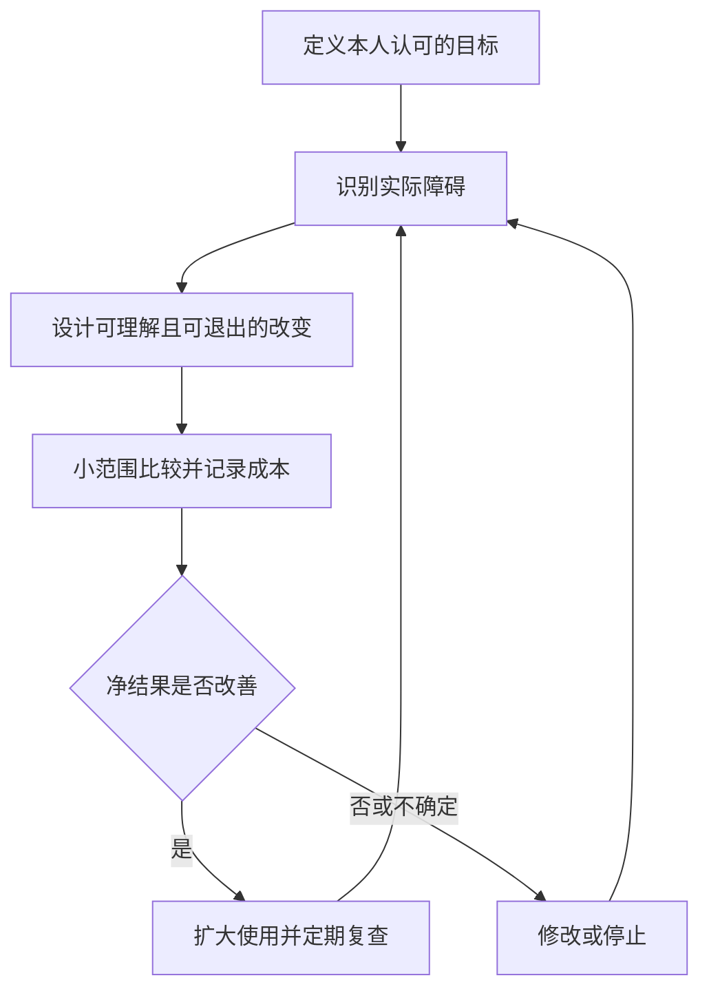

# 《助推》读书笔记

> 作者：理查德·塞勒、卡斯·桑斯坦。英文原作 *Nudge* 初版于 2008 年；本篇结合 2021 年 *The Final Edition* 的公开目录和作者说明，区分新版新增讨论。中文译本的具体印次未指定。
> 资料范围：基于出版社、作者公开前言、原始研究及研究者后续更新整理，未取得全书逐页核对。覆盖选择架构、默认、反馈、储蓄、借贷、保险、公共政策与伦理等主要主题；2022—2024 年研究明确作为书外补充。更新：2026-11-12。

这本书讨论的实际问题是：我们已经知道应该储蓄、比较费用、阅读条款，为什么还是经常没有做到？作者把注意力从“再讲一次道理”移到选择发生的环境：先出现哪个选项、不操作会怎样、退出要走几步、反馈是否及时，都可能影响结果。

对财商最有价值的启发，是把良好意愿变成可执行的安排，同时识别平台怎样安排你的选择。助推能改善某些行为，但不能解决收入不足、产品本身不合适或严重利益冲突。

## 内容地图与版本区别

| 主线 | 要解决的事 | 对财务决策的意义 |
| --- | --- | --- |
| 真实的人怎样选择 | 注意力、自控、惯性与社会影响 | 理解为什么知识与行动脱节 |
| 选择架构的工具 | 默认、反馈、映射、简化与容错 | 改造决定发生时的环境 |
| 金钱问题 | 养老储蓄、贷款、信用卡与保险 | 从购买率进一步检查长期利益 |
| 社会问题 | 器官捐赠、环境等 | 区分个人行为与整个制度的结果 |
| 争议与边界 | 谁决定什么更好、如何退出 | 防止帮助演变为操纵 |

2021 版明显加强了智能披露、妨碍办理的繁琐流程，以及默认方案的局限。下面按主题学习，不把不同版本硬拼成同一套章节编号。[出版社版本信息](https://www.penguinrandomhouse.com/books/690485/nudge-by-richard-h-thaler-and-cass-r-sunstein/)；[作者新版前言](https://behavioralscientist.org/thaler-sunstein-preface-to-nudge-the-final-edition/)。

## 核心知识点

### 1. 选择架构：选项的组织方式本身就有影响

产品数量相同、价格相同，展示顺序、默认勾选和取消路径不同，也可能得到不同选择。这些安排共同构成“选择架构”。设计者不只有政府，还包括雇主、银行、平台和为自己设置规则的人。

财务比较因此要分两层：产品的经济条件是什么？界面又把我的注意力引向哪里？前者决定成本与权利，后者影响你是否真正注意到它们。

### 2. 助推的定义有边界

作者所说的助推，是改变选择环境，同时保留选择自由，不靠禁止选项或显著改变经济激励来推动行为。把健康食品放在显眼位置与禁止购买某种食品，属于不同工具；提醒还款与大幅提高罚息，也不能混为一谈。

现实政策常把提醒、补贴、规定一起使用。评估时应拆开，不因一个项目使用了行为科学，就把所有效果算给助推。

### 3. “自由主义家长式干预”包含一项需要辩护的判断

这一名称把两件事放在一起：保留退出自由，并尝试使人获得其自己认可的较好结果。难点不在术语，而在“谁认定更好”。增加购买次数可能符合商家目标，却未必符合顾客利益。

因此，评价一个设计至少要知道目标、受益人、退出成本和评价结果的时间跨度。不能只因为人们没有退出，就推断他们满意；没有退出也可能来自不理解和拖延。

### 4. 快速反应与审慎思考各有用途

熟悉、低风险的日常判断不必全部重算。问题出在复杂费用、罕见重大选择、延迟后果等场景，直觉可能缺少足够反馈。助推的用途是让环境补上人的限制，而不是把所有直觉视为错误。

投资中的相应做法，是把重要费用和最坏现金需求放在交易确认之前，而非成交后再发送一份冗长说明。

### 5. 现状偏好可能让“什么也不做”成为有力选项

不行动可能来自转换成本、担心后悔、把默认视为推荐，也可能只是注意力不足。它们不等于同一种心理机制。

识别原因有实际意义：信息不足需要解释；步骤过多需要简化；真正不适合的人则需要方便退出。只有结果相同，不能证明所有人都犯了同样的认知错误。

### 6. 默认选项：自动加入能改变参与，也会锚住方案

Madrian 与 Shea 研究一家美国企业改变 401(k) 计划登记方式的情况：从主动报名，改为员工自动加入、可以选择退出。研究发现参与率明显提高，默认缴费比例和默认投资去向也对员工选择有很强影响。[原始研究说明，2000 年工作论文、2001 年正式发表](https://www.nber.org/papers/w7682)。

这不是“大家被说服后都算出了最优答案”。默认可能减少拖延，也可能被员工理解成雇主推荐。于是同一个工具同时产生两种后果：原来不参与的人开始储蓄；一些人也长期停留在未必适合自己的低缴费或资产选择上。

据此检查自己的自动扣款时，应分别问：**是否应该自动执行？执行什么金额与产品？何时重新检查？** 第一问的肯定答案不能替后两问作答。该企业研究也不能直接提供中国家庭的最优储蓄比例。

### 7. 默认不是永久授权，也不是最优性的证明

默认一旦设定，生活阶段、收入和现金需求仍会变化。合理安排要有容易发现的修改入口与定期提醒。

如果一个理财平台强调“大家都沿用推荐方案”，应进一步核对默认产品的费用、风险、销售报酬和适用条件。高沿用率既可能说明便利，也可能说明不关注，单凭这一指标无法区分。

### 8. 主动选择与个性化默认各有代价

让每个人必须选一次，可以避免完全不知情地接受默认，但也增加决定负担。个性化默认能更贴近需求，却依赖数据准确性，并引入隐私、误分类和利益冲突问题。

没有一种架构永远最好。选项差异很大、个人偏好多样时，主动选择更有价值；明确且普遍受益的低负担行动，简明默认可能更合适。这是需要测试的判断，不是按年龄自动替人决定所有金融配置。

### 9. 明天多存一点：把承诺放在未来收入增长时

Thaler 与 Benartzi 的 Save More Tomorrow 方案让员工预先同意：未来工资增加时，把其中一部分增加额转入退休储蓄。首次实施中，参与者平均缴费率在 40 个月间从 3.5% 升至 13.6%。这是特定参与群体的结果，不是所有员工或所有家庭的收益率。[2004 年原论文摘要](https://www.journals.uchicago.edu/doi/10.1086/380085)。

机制可以拆为三步：提前决定降低当下抗拒；随涨薪增加缴费，减轻“现在可花的钱被削减”的感觉；自动执行减少每次重新克服拖延的需要。退出仍然允许，不能把它说成强制锁钱。

第一批项目并非把所有人随机分组后得到的普遍因果估计。愿意加入的人可能本来就更想储蓄，因此不能说任何人照做都会从 3.5% 达到 13.6%。

**补充应用：**在确有收入增长时，预先讨论新增可支配收入如何分配，并同时保留应急资金和检查日期。若收入没有增加、债务压力很大，机械提高长期锁定储蓄可能损害流动性；改变环境不等于消除预算约束。

### 10. 先区分参与率、缴费率、账户余额与净财富

这四个指标回答不同问题。更多人开户，不等于每人储蓄足够；账户余额增加，可能伴随信用卡债务增加；退休账户中的钱，也可能在换工作时取出。

图中每一个箭头都需要额外证据。不能只看到第一步改善，就宣布最后一步已经成功。

### 11. 长期跟踪可能缩小最初看上去的效果

**书外更新：**Choi 等人在 2024 年关于自动储蓄政策的工作论文中，检查离职、雇主缴费归属、提前提取和退出自动加缴等因素。其结果提示：短期参与改善不能直接外推为同等幅度的长期退休财富改善。[原研究及版本日期](https://www.nber.org/papers/w32828)。

研究后续版本的部分估计有所调整，本篇不混抄不同版本的精确数值。重点是识别漏掉的现金流：账户有入金，也可能有提前出金；雇主承诺的匹配款，也可能尚未完全归属员工。

这并不否定自动储蓄的作用，而是改变评估问题。家庭的年度复盘不能只检查“有没有扣款成功”，还应检查负债、应急金、提前赎回及实际可支配资源。

### 12. 自控工具要给未来的自己留必要弹性

把储蓄放在收入到账之后自动完成，可以减少每月的谈判成本；但把全部现金锁住，可能导致紧急事件时借更贵的钱。

设计时要同时问：我在防止哪一种冲动？可能遇到哪一种合理例外？好的机制并非让任何反悔都不可能，而是让随意破坏计划更难、必要调整仍可做到。

### 13. 及时反馈能缩短行动与后果的距离

消费的满足即时出现，债务成本和机会成本往往很晚才显现。只显示“本月最低应还”，容易让人忽略剩余本金和未来利息。

反馈应围绕可采取的行动：累计费用、未偿余额、是否接近预定支出上限。纯粹增加弹窗数量不一定改善理解，过多提醒也可能让用户忽略全部提醒。

### 14. 映射：把复杂属性翻译成与自己有关的后果

“年管理费若干”“优惠期若干月”是产品属性；“按我的持有规模和期限，预计会付出多少费用”才是决策者能比较的后果。把前者转成后者，就是帮助建立映射。

金融产品比较应尽量统一金额、期限、现金流时点、费用和风险口径。一个产品按月显示费用，另一个按年显示收益，把两者直接摆在一起并不叫充分披露。

### 15. 智能披露不等于再塞一份更厚的文件

2021 版强调数据应便于实际比较和使用。关键不是文字数量，而是费用是否完整、口径能否统一、信息是否可提取，以及用户是否能看见适用于自己的情形。

原始合同仍然重要，但应让关键约束在决定之前可理解。只提供几十页文本、同时用醒目按钮催促成交，形式上给了信息，行为上仍可能阻碍判断。

### 16. 给复杂选择分层，避免过早比较无关细节

先判断需要解决什么问题，再比较合适类别，最后比较产品，通常比一次把全部商品排在一起更清楚。

例如补充教学中的顺序是：资金何时需要使用→能否承受本金变化与无法及时退出→比较相应工具→核对总成本。不要先按历史收益排名，再反向寻找理由解释它适合自己。

### 17. 容错设计：预先承认人会漏看和按错

好的流程应预见重复扣款、误填金额、忘记续期等常见失误，并在关键点提醒确认或提供合理纠正方式。

同样一项确认，如果放在风险最高的动作之前并写清后果，可能有价值；如果每一步都要求点击相同“我已阅读”，人会形成机械反应。容错应针对具体错误，而不是只增加免责文字。

### 18. 社会规范信息可以影响行动，但必须真实且合适

Hallsworth 等人对英国逾期纳税人开展两项大规模自然实地实验，涉及超过 20 万人。给催缴信增加社会规范等信息，提高了部分缴税行为；不同内容效果并不相同。[作者原论文](https://s3.amazonaws.com/fieldexperiments-papers2/papers/00391.pdf)。

这说明改变提醒内容可以影响既有义务的履行，不意味着“别人都买了”可以证明某项投资值得买。税款履行与证券价格发现是不同任务。

应用时还要检查事实是否准确、参照人群是否相关，以及描述坏行为很普遍是否会无意间使它显得正常。不能为了劝人行动编造“绝大多数人都这样做”。

### 19. 激励依然重要，助推不能代替产品经济学

如果一项产品费用高、退出困难、承担了用户不理解的风险，再友好的界面也不能使它自然变好。相反，精致界面可能把更多人推向不利交易。

研究选择架构时应始终回到：谁付费、谁获益、谁承担损失？销售方获客成本下降，与使用者福利提高，是两个不同结论。

### 20. 借贷选择要显露总成本和时间路径

低首付、低月供和短期优惠，容易让人把注意力集中在眼前负担。完整判断需要同时考虑本金、期限、利率变化、费用、提前清偿条件和极端现金需求。

这里的行为启发是把完整付款路径放在决定之前。具体贷款条款和制度随地区、产品、时间变化，本篇不把美国书中历史产品写成中国现行规则。

### 21. 保险选择应围绕无法承受的损失

人容易高估鲜明小风险，同时忽视低频但可能破坏家庭现金流的风险。保险讨论应先识别后者，再评估保障范围、除外责任、免赔额和保费。

并非所有小损失都不值得保，也不是保额越高越好。选择架构的作用，是帮助人把保费与真正获得的保护对应起来，而不是仅靠恐惧图像推动购买。

### 22. 器官捐赠提醒我们：登记选择不等于最终供给

默认同意、主动同意或强制表达选择，会影响登记与表态。但真正能够完成捐赠，还涉及医学条件、识别流程、家属沟通和医疗组织能力。

2021 版专门讨论把默认当作完整解决方案的误区。对财商的迁移很直接：签署意向、开户、首次购买是流程中的节点，不能代替最终使用效果与净福利。[新版目录](https://books.google.com/books/about/Nudge.html?id=Lus2EAAAQBAJ)。

### 23. 环境问题同时涉及行为与外部成本

让能源费用更清楚、提供可比较反馈，可能改善部分决策；但污染存在外部成本时，仅靠个人界面改变不一定足够。价格、基础设施、制度约束和技术也会影响行为。

阅读公共政策案例，应避免把工具之争写成二选一。助推可以与其他政策结合，但必须分别检查各自贡献和成本。

### 24. “淤泥”：不必要的麻烦也会改变结果

作者用 sludge 描述妨碍人完成有益行动的繁琐流程。注册很容易、取消却反复跳转，就是一种需要检查的结构；申请福利过于复杂也可能让符合条件者放弃。

并非所有摩擦都应该删除。验证身份、避免不可逆误操作可能有正当价值。判断依据是这一步保护了什么、是否与风险相称，以及有没有更低成本的方法实现同样目标。

### 25. 助推、操纵与欺骗应从透明和利益一致性区分

隐藏费用、假倒计时、偷偷勾选付费服务，会把人的认知限制转化为销售优势。不能因为这些做法也利用默认和注意力，就把它们与帮助用户实现自定目标混为一谈。

一个实用检查是：如果完整公开设计目的、默认后果和退出方法，使用者是否仍愿意接受？这不是充分的伦理证明，却能筛掉很多依赖误解才能奏效的设计。

### 26. 效果可能存在，却比热门故事小很多

DellaVigna 与 Linos 在 2022 年发表的研究比较了两类材料：两家美国助推机构的 126 项随机试验、约 2300 万人，与学术期刊中汇集的试验。前者平均目标行为变化为 1.4 个百分点，后者为 8.7 个百分点。[正式论文](https://doi.org/10.3982/ECTA18709)。

两组试验并非对同一项目、同一人群重复测量，因此不能把差异全部归因于规模。发表选择、试验设计与干预特点都需要分析。也不能将这个特定研究里的平均值当作“任何助推”的固定效果。

对读者的启发是：精彩案例适合提出可能机制，资源投入则需要看所有结果、效果分布、样本外应用和实施成本。只收集成功故事，会系统性高估改善空间。

### 27. 用绝对变化、成本和持续性一起评价

**数学演示：**某行为原来有 10% 的人完成，后来变为 11%，这是增加 1 个百分点，也是相对增加 10%。两种表达都可正确，但给人的感觉差异很大。

若成本极低、对象很多，1 个百分点也可能有价值；若代价很高或只是提前几天完成，则未必。评价要保留分母、期限、净新增效果和副作用，而非只选最大的百分比。

### 28. 平均改善不代表每个人都获益

同样的自动储蓄安排，对缺乏行动步骤的人可能有益，对现金已经紧张的人可能增加短期压力。平均数可能掩盖这些差异。

测试不能只看总体转化率，还应关注退出人群、投诉、错误选择、负债变化和重要弱势群体。尊重异质性也是保留容易退出与修改机制的理由。

### 29. 自己可以做选择架构师，但要先明确目标

以下是补充教学：将账户通知改为费用与预算提醒；把研究记录放在下单入口；设置定期检查自动扣款；让取消不再需要重新搜索所有路径。

每一项都应对应具体问题。若主要问题是收入波动，就优先检查现金储备和支出承诺；若主要问题是追逐热点，就减少刺激并加入决策记录。不要机械照搬别人的默认比例。

### 30. 一个完整的改进循环必须允许失败

图解的重点是目标、证据和退出形成循环。默认一旦上线，不代表工作结束；越是强大的行为工具，越需要持续检查是否仍符合使用者利益。

## 练习与参考答案

**一：某平台把默认购买按钮改大后，成交率提高，是否证明用户财商提高？**

不能。成交是平台行为指标；还需了解适配性、费用、用户理解、取消难度和长期结果。提高成交甚至可能加重不适合的购买。

**二：自动储蓄账户增加了 1 万元，能否说家庭财富净增加了 1 万元？**

不能仅凭该账户判断。需要同时看其他储蓄减少、债务增加、费用及应急提取。还要区分市场涨跌与新增缴费，这是不同来源。

**三：一个提醒实验效果显著，但只有很小的百分点变化，值得用吗？**

还不能直接下结论。检查实施成本、规模、持续性、目标价值和不利影响。统计显著只说明相应统计判断，不提供完整的经济或伦理评价。

## 可以带走的能力

你应能看出产品之外的选择环境，区分“更多人参与”和“参与者过得更好”，并为自己的财务习惯设计透明、可调整、能验证的流程。

接着可读[《错误的行为》](<../错误的行为 - 理查德·塞勒/读书笔记.md>)了解相关经济学问题如何形成，再用[《为什么》](<../为什么 - 朱迪亚·珀尔、达纳·麦肯齐/读书笔记.md>)检查效果究竟由什么造成。本篇没有给出个人最优缴费率或产品名单；那些决定需要个人约束及现行条款。
