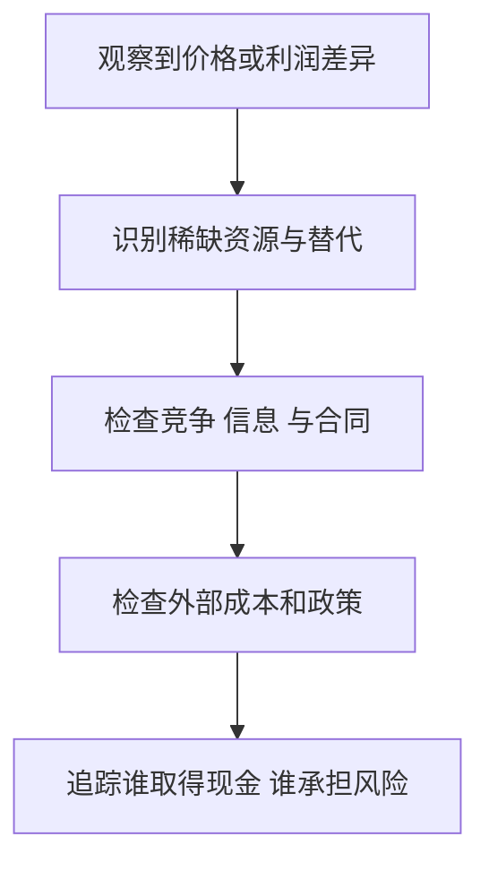

# 《卧底经济学》：价格背后的稀缺、信息与制度

> 作者：Tim Harford，蒂姆·哈福德。原作 *The Undercover Economist*，2005 年；本篇讨论第一部，非宏观续作 *The Undercover Economist Strikes Back*。具体中文译本未确认。  
> 依据：作者书页、公开目录、原始研究与官方历史资料。未取得全书，属于公开资料系统导读；按十章主线整理 28 点，后来的案例是补充教学。更新：2026-11-12。

## 阅读入口

这本书从咖啡店和超市走向交通、保险、金融市场、拍卖与发展中国家，串起一个问题：价格和制度如何协调分散的知识，又会在哪里失败？

对财商最有价值的是把“贵”“赚得多”“国家增长快”拆成具体机制。谁控制稀缺资源？收益归谁？交易双方知道什么？价格有没有包含对别人的成本？没有这些问题，宏观故事很容易替代企业研究。

| 原书问题 | 本文重点 |
| --- | --- |
| 咖啡店与超市 | 稀缺租金、定价与自我筛选，1—8 |
| 完美市场与交通 | 效率条件、外部性与分配，9—13 |
| 内幕、保险和金融 | 信息、风险与市场价格，14—19 |
| 拍卖 | 规则、竞标与赢家诅咒，20—22 |
| 贫困、全球化与中国 | 制度、贸易、增长和应用，23—28 |

见[作者对本书的说明](https://timharford.com/books/undercovereconomist/)及[馆藏章节目录](https://search.worldcat.org/title/424021243)。本篇提供机制解释，不逐章复述全部故事。

## 核心知识点

### 1. 稀缺是相对可替代选择而言

城市里有很多咖啡店，不代表车站出口某个位置没有稀缺性。消费者购买的可能是饮料、方便、时间和确定性共同组成的服务。

研究企业时，先辨认客户真正买什么。产品看起来简单，不等于提供它的资源没有稀缺性；反过来，地理位置好也不意味着经营者能永久取得全部收益，还要看谁控制位置和合同。

### 2. 经济租金不等于房屋租金

经济租金指某项资源得到的报酬高于维持其当前用途所需的最低报酬。它可能来自地段、能力、牌照、技术或其他难以替代的条件。

这不是对收入是否正当的直接道德判断。财商分析需要理解租金从哪里来、何时消失、由谁获取。对上市公司而言，稀缺资源如果属于供应商或房东，公司的高销售价格可能并不对应高资本回报。

### 3. 价格高与租金高，因果方向不能想当然

好的位置能够吸引付费客户，使商户愿意支付更高租金；因此租金有时是经营机会价值的结果，而不只是商品售价高的独立原因。

现实中合同与调整时滞会让影响双向传递。不能只说“因为房租贵，所以商品贵”，也不能否认租约对当前经营约束的影响。需要区分长期竞争决定与短期合同现金支出。

一个判断方向的方法是做反事实：若房东暂时减租，但客户愿付价格、竞争格局和产能都没有变，商户是否必然立即降价？未必，减租可能先变成商户利润。若附近新开很多可替代店铺，终端价格和可承担租金却可能一起下降。由此可见，观察两项价格同向变化，不足以确定谁单方面决定谁。

对公司研究，可以进一步区分短期租约保护与长期续租风险。地段或平台入口带来的利润，若在下一轮谈判被资源拥有者取走，股东就不能把当前超额利润永久资本化。真正的问题是稀缺资源的控制权与谈判结构，而不是哪项费用在利润表里名称最醒目。

### 4. 利润吸引进入，壁垒决定优势能否留下

若一个行业有明显收益而进入容易，新增竞争可能压低价格或推高稀缺投入成本。高利润持续存在，通常值得寻找进入限制与竞争反应。

研究护城河时，不能只列品牌与规模两个词。要说明对手难在哪里、客户为何不换、资本投入如何回收。即使优势真实存在，买入价格仍可能提前计入了过多好消息。

还可以反问：如果公司明天提价，客户最可能选择哪一个替代？这个问题能把抽象优势转化为具体竞争边界，也帮助识别优势是否已经被供应商或渠道拿走。

### 5. 价格歧视需要识别不同支付意愿

企业可以通过时间、地点、数量、优惠券或版本限制，让客户自行表达愿意支付多少。差价不总是生产成本差异，也不一定意味着同一客户被随机针对。

消费者应比较自己需要的完整条件。便宜票可能限制退改，贵版本可能提供你不需要的服务。投资者则要检查客户分组是否稳定、是否容易转售、竞争者能否破坏这种定价结构。

### 6. 超市布局和促销也是筛选机制

愿意花时间找优惠的人，可能更在意价格；更在意便利的人，可能愿意付高一点。价格比较的成本本身会影响最终选择。

但不能把所有货架安排都解释为精密算计。物流、保鲜、供应商合同和购物习惯也可能重要。一个经济学解释应当说明它依赖什么事实，而不是只凭结果猜测设计者意图。

### 7. 两部收费与捆绑需要按总成本评价

入会费加商品价格、硬件加耗材、基础服务加增值服务，都会改变消费者面对的真实价格。某一部分免费，不代表整套安排便宜。

**真实案例：Costco 的会员费调整。** 公司官方记录说明，2024 年 9 月起部分市场会员费上调。消费者实际评价的是会员资格与后续采购条件的组合，不能把一件便宜商品当作会员价值的完整证据。[公司说明](https://customerservice.costco.com/app/answers/answer_view/a_id/1013504/~/membership-fee-increase)

应用上要估算自己的真实采购篮子，而不是商家展示的最大可能节省；同时检查未使用的服务与为摊薄固定费而增加的非必要支出。这里没有断言会员费等于企业全部利润。

### 8. 降价与让利的效果，要看新增需求和替代

促销可能吸引新客户，也可能只是让原本愿意支付原价的人少付钱。收入变化与利润变化不同，优惠带来的未来留存也需要实际证据。

看公司营销时，最好追踪获客成本、回购、贡献利润与退出成本。只看到下载量或订单量，不能知道补贴后的业务是否可持续。增长指标是研究入口，不是结论。

### 9. 完美市场是基准，不是现实赞歌

在一组很强的条件下，价格能传递稀缺与偏好，把资源导向更有价值的用途。现实中信息、竞争、产权和外部性不完全满足条件，所以必须识别偏离在哪里。

本书的市场观点应连同这些条件理解。它不是说价格永远正确，也不是说任何政府干预都好或都坏。具体制度应比较它解决了什么问题、带来了什么成本，以及有没有更可行的替代。

### 10. 效率与公平是不同问题

一个配置可能不浪费互利机会，却仍然分配很不均。先讨论总收益，再讨论谁得到、谁失去，可以减少把价值判断伪装为技术结论。

投资者也应区分社会价值、企业利润和股东回报。有益服务不保证经营者赚钱，赚钱的企业也不保证任意价格都值得购买。三层判断都需要各自的证据。

更深一层，价格反映的支付意愿同时受到支付能力影响。一个人非常需要某种基本服务，却可能没有足够收入表达为较高出价。因此，市场在特定条件下实现资源配置效率的论证，不能直接回答初始收入分配是否合适。讨论再分配时，再去比较税收、公共服务、补贴和直接管价各自的激励与执行成本，才不会把效率术语当作回避公平的办法。

### 11. 外部成本让私人价格低于完整社会成本

开车者付油费和停车费，却可能未承担其对其他人的拥堵、污染和噪声影响。若这些影响没有进入决策，使用量可能偏离社会更合适的水平。

经济学的作用是明确成本发生在哪里、谁能改变行为、如何测量，而不只是宣布“应收费”。收费是否可执行、替代交通是否可得、低收入群体如何受影响，都属于完整分析。

### 12. 伦敦拥堵收费：用价格改变出行边际

**真实政策。** 伦敦 2003 年引入拥堵收费；TfL 2005 年发布的第三次年度报告总结 2004 年情况，报告收费区拥堵相对实施前平均减少约 30%。这是特定时期的拥堵指标，并非车辆总数下降相同比例，也不能当作永久不变的效果。[官方监测报告](https://content.tfl.gov.uk/central-london-congestion-charging-impacts-monitoring-third-annual-report.pdf)

机制上，一些人改变时间、路线、方式或取消低价值出行，价格帮助分配稀缺道路容量。但同期公共交通、道路条件和其他政策也需要纳入理解；简单前后对比不能包办所有因果归属。

对于财商，它训练的是“成本是否由决策者承担”。研究交通、能源和环保行业，可以追问未来哪些外部成本可能进入企业费用，哪些创新能够降低真实资源消耗。

还可以把政策结果拆成三种：道路上的总延误变化，收费及执行的资源成本，出行者之间的得失。收费收入本身是从一方转到另一方的资金流，不宜在社会成本中既当作司机损失又重复当作消失的资源；但征收系统、绕行和等待是真实资源消耗。只有把转移支付与资源成本分开，才能判断政策净效果，而不只是比较收了多少钱。

### 13. 征税和交易额度，是不同的信息安排

税费固定某项行为的价格，额度制度直接约束总量；现实设计可以混合使用。两者都需要监测、执行和对行为反应的认识。

美国酸雨计划提供实际制度例子：二氧化硫排放总量控制与额度交易相结合，让不同减排成本的参与者调整。[EPA 说明](https://www.epa.gov/acidrain/acid-rain-program) 这不表示污染问题已被市场自动解决，而是说明市场运行依赖清楚的规则与可信执行。

### 14. 信息不对称会改变交易双方的选择

卖方比买方更了解质量时，买方愿付价格可能反映平均质量；优质卖方不愿接受后退出，市场可能进一步变差。这个机制不能简单译为“消费者不够聪明”。

检验、保修、声誉和认证可以缓解问题，但要问这些承诺能否兑现。金融产品中的高收益承诺，若缺少资金用途、资产和责任信息，反而需要更严格检查。

### 15. 逆向选择与道德风险的发生阶段不同

逆向选择关注交易前类型难辨，保险中高风险者更积极投保是典型机制；道德风险关注交易后行为变化，保障可能改变使用和预防决策。

它们不等于投保者道德不好。人对成本与保障作出反应，可以是正常行为。好的设计要权衡保障、激励、可负担性和行政成本，不能用一个术语否定所有保险。

### 16. 医疗保险的真实效果需要同时看健康、财务与使用

**后续补充：俄勒冈医疗保险实验。** 研究利用 Medicaid 名额抽签形成的机会差异，考察获得保险对医疗使用、财务压力和健康指标的影响。研究项目报告医疗使用增加、财务保护改善，部分身体健康指标在特定观察期没有达到统计显著改善。[研究项目及结果](https://www.nber.org/oregon)

这提醒我们，保险的价值不是只有“减少就医”，增加使用也可能反映原先未满足的需要。另一方面，未显著也不能直接解释为所有健康效果为零，需要看精度、期间和指标。

该研究发生在原书之后，不能冒充哈福德当年引用的证据。它是检验书中保险机制的一项后续材料，无法直接替代中国医疗制度或个人医疗选择的分析。

抽签给出的是申请资格机会，并非强迫中签者都投保。按是否中签比较，较好保留随机化；若只比较实际投保者与未投保者，就可能重新引入健康需要、收入和行动能力差异。研究可以使用特定统计方法估计实际覆盖影响，但依赖额外假设。读者无需先掌握全部公式，也应知道“谁被随机分配”和“最终比较谁”是两件必须对齐的事。

### 17. 金融市场价格聚合信息，也会受到约束与错误影响

大量参与者交易可以把分散判断带入价格，但价格仍受融资、流动性、风险偏好和信息质量影响。难以轻易赚钱，不等于所有价格都等于某个确定内在价值。

普通投资者应先理解竞争和成本：自己掌握的信息是否已经公开？有没有合理基准？收益是否来自承担未识别的风险？市场不是只等读者发现的简单谜题。

### 18. 预测正确与投资获利之间隔着价格

一家企业盈利增长，可能已被高价格充分反映；新闻不如预期但没有更糟，也可能伴随价格上涨。回报取决于实际结果相对原先预期的变化，以及持有成本。

因此应同时写商业判断与价格判断。只知道行业未来更重要，不足以知道当下证券是否便宜。这个区分是从经济学解释走向投资分析的关键一步。

### 19. 理性参与者也可能共同制造脆弱结果

每个人都担心先退出的风险或被排名落下，可能跟随相似策略；价格变化又改变抵押能力与交易约束。局部看合理的行为，不一定使整体稳定。

但不能因为存在反馈就宣称所有上涨都是泡沫。需要分别研究现金流、融资、估值与市场结构。风险管理应考虑错误后果，而不是只争论自己是否比别人理性。

### 20. 拍卖规则影响谁进入、怎么出价和最终结果

拍卖不是简单把最高报价拿出来。公开或密封、单轮或多轮、多个标的如何组合、是否保留新进入者机会，都会影响竞标策略。

制度设计要考虑竞争、串通、信息发现与执行。收入高只是评价之一；资源后续是否有效使用、服务是否改善，也重要。投资者研究牌照或资源企业时，应把拿到权利与创造价值分开。

### 21. 英国 3G 拍卖：财政收入不等于买方投资成功

**真实历史。** 英国议会记录确认，2000 年 3G 频谱牌照拍卖完成报价约为 225 亿英镑；更精确的后续记录为 224.774 亿英镑。[议会当时答复](https://api.parliament.uk/historic-hansard/written-answers/2000/may/17/mobile-phone-licences)、[后续金额记录](https://hansard.parliament.uk/Commons/2002-04-24/debates/78b61098-11ab-4bda-a89f-06148cca5a45/MobileLicences)

这个事实说明竞标者为稀缺权利支付了巨额价格，却不能单独证明他们以后获得相应回报。还需建设网络、吸引客户、控制成本并应对技术变化。政府收入与企业投资回报是两个账户。

财商应用是看收购、拿地和并购新闻时，区分“成功竞得”与“值得支付”。管理层获得资源的能力，不能替代对取得成本、融资与未来现金的评价。

### 22. 赢家诅咒：赢得竞价，可能因为你最乐观

当各方估计的是共同价值而估计存在误差时，最高出价者可能恰好最过度乐观。知道自己赢了，本身就是需要纳入的信息。

这不是说任何拍卖赢家都会亏损。私人使用价值不同、信息质量与策略也不同。应在竞价前考虑估计误差和对手信息，而不是获胜后再寻找理由证明自己的报价。

**数学演示：**五名竞标者都估计一项共同现金流价值，判断分别为 80、90、100、110、120，真实价值并未因此变成 120。若最高估计者按自己的数值出价，其胜出可能主要说明误差偏乐观。数字只展示选择机制，不是英国频谱竞标者的真实估值，也不意味着真实价值必为这些数字的平均数。

实际纠正方法不是随便打固定折扣，而是研究信息精度、竞争者数量、共同价值成分和融资承受力。并购中也有相同问题：竞价越激烈，越需要解释为何自己拥有别人没有的协同或执行能力，而不能把“别人也想要”当作不断加价的充分依据。

特别要把报价所包含的权利列清。拿到牌照后还要支付建设、运营和客户获取成本，竞价时只算牌照本身会低估总投入；用未来营业收入替代未来可分配现金，又会高估回报。一个完整的出价上限应连接收入、成本、必要投入、风险和融资，而不能只与上一笔成交价比较。

若讨论的是消费者独特偏爱的收藏品，共同价值成分可能较小，最高出价不一定来自最大误差。先分辨私人使用价值与共同转售价值，才能知道赢家诅咒的分析在哪些部分适用。

### 23. 贫困不能只归因于人们不够努力

产权、基础设施、融资、治理、教育、健康和市场接入都会改变努力的回报。如果规则使长期投资难以获得收益，人们选择短期行为未必是缺乏远见。

本书的发展讨论帮助把个人选择放回制度环境；但不能把一个国家的全部结果归于单一变量。比较制度时，需要历史、地理与政治经济约束，也需要区分相关与因果。

### 24. 腐败和不确定规则会增加隐含交易成本

同样一个项目，如果审批、履约和收费缺乏可预期性，所需回报会变高，长期投资可能减少。非正式支付不仅是额外金额，也影响谁能进入与竞争。

企业研究可观察许可证依赖、政府客户、关联关系和合同执行，但不能凭国家或行业标签推定个别企业行为。结论要有具体披露和证据，避免宏观刻板印象。

### 25. 贸易收益来自分工，调整成本却落在具体人身上

开放可以扩大市场、引入技术与竞争，也可能让某些行业和地区受冲击。总量收益不能自动解决失业、迁移和技能转换问题。

对投资者，全球化既是销售机会，也是供应链、汇率和政策风险。研究出口企业时，要把客户需求、进口投入、结算币种和融资条件一起看，不能只看出口额增长。

### 26. 中国增长的分析，需要看多条机制共同作用

**后续资料：减贫的长期记录。** 世界银行与中国相关机构 2022 年联合报告按当时每日 1.90 美元国际贫困线口径，描述中国四十年间接近八亿人的贫困人口减少，并讨论经济转型、基础设施、市场机会与减贫政策。[报告发布说明](https://www.worldbank.org/en/news/press-release/2022/04/01/lifting-800-million-people-out-of-poverty-new-report-looks-at-lessons-from-china-s-experience)

这里必须保留当时贫困线和统计范围，不能把它与后来的购买力平价标准混用。长期事实也不允许把全部贡献都归给一个原因；报告本身讨论的是相互作用的因素。

对财商的启发是：宏观进步、居民机会与上市公司回报有关联，但不是同一个量。即使长期方向判断正确，具体行业的竞争、资本回报和证券价格仍需要独立分析。

### 27. 从价格追到制度，再从制度回到证据

这张图不是要求每次都寻找政府原因，而是避免只停留在终端价格。不同问题的关键环节不同，需要依据资料选择解释。

### 28. 把经济学解释变成可用的个人决策

买会员、课程、保险或投资产品，都可以沿这条路径检查。不是每项消费都要写复杂模型；金额、不可逆性和后果越大，越值得核验。图的重点是让自己的条件进入分析，而不只接受销售者给出的比较。

## 练习与参考答案

**题一：某商圈店铺销售很好，房东和商户谁最受益？** 需要租约、替代地段、品牌吸引力和竞争资料，不能只从人流量判断。优势可能由双方按议价能力分享。

**题二：拍卖成交价创新高，能否证明资产越来越值钱？** 只能证明当时有人愿意支付该价。未来现金、融资和估计误差仍需研究，最高出价可能包含过度乐观。

**题三：一个市场有信息问题，是否应完全禁止交易？** 不必立即得出这种结论。先比较披露、担保、认证、竞争、监管和禁止等方案各自的收益、成本与执行条件。

## 边界与联读

原书十章主要机制已覆盖，未核对全部历史叙述。宏观和医疗后续材料均标明为书外补充，不能用本篇替代现行政策或个人医疗咨询。可接《经济学原理》补模型、《置身事内》理解中国政府与经济联系、《贫穷的本质》学习如何检验具体干预。
