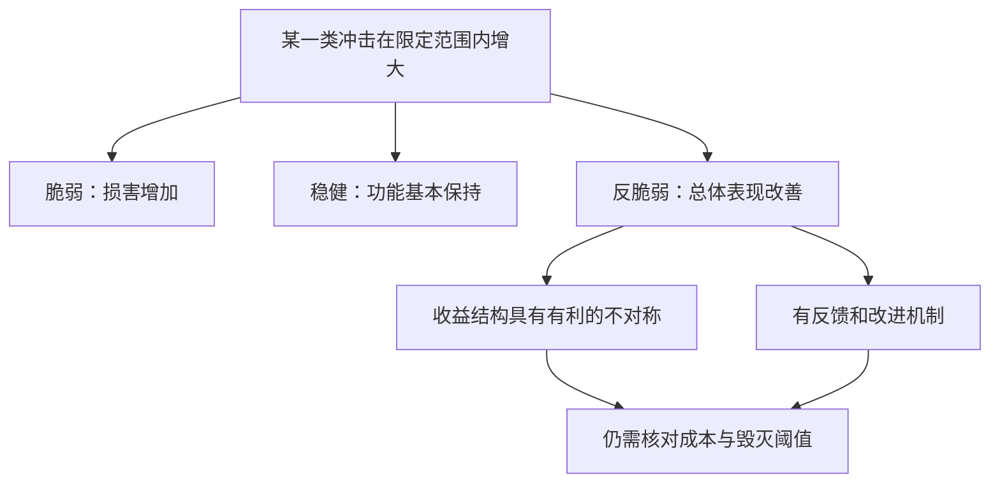

# 《反脆弱》读书笔记

> 原书：*Antifragile: Things That Gain from Disorder*。作者：纳西姆·尼古拉斯·塔勒布。资料核对日期：2026-11-12。
>
> 已确认英文原版 2012 年出版，另有 2014 年平装版；具体中文译本及页码未确认。本文是**基于公开资料的系统导读**，依据出版社信息、公开目录、作者与 Raphael Douady 的数学论文，以及机构一手案例资料整理。未取得完整原书，不声称逐页精读。28 个知识点为重新组织的教学结构；现实案例、计算与财商应用明确属于补充解释。

## 这本书最值得带走的东西

《随机漫步的傻瓜》提醒你别把运气误认成能力，《黑天鹅》提醒你别高估预测能力，《反脆弱》进一步问：**既然未来难以准确知道，能否改变自己的结构，使一部分不确定性成为帮助？**

作者区分三种状态：受到冲击后变差的是脆弱，能够维持功能的是稳健，在一定范围内能从扰动中改善的是反脆弱。重点不在于积极心态，而在于损失与收益怎样响应变化、错误能否被限制，以及反馈能否转化为改进。[出版社版本与主题说明](https://www.penguinrandomhouse.com/books/176227/antifragile-by-nassim-nicholas-taleb/)

本书最容易被误读成“折腾越多越好”“灾难使人强大”。正确的阅读方向应是：哪些刺激、对谁、在什么范围内、通过什么机制有益？若不能回答这四个问题，就还没有证明反脆弱。

## 主要内容与能力地图

| 原书主题 | 关键问题 | 本文知识点 |
|---|---|---|
| 反脆弱的三分法与系统层级 | 挺住与受益有什么不同？ | 01—05、16 |
| 对波动的压制与不当干预 | 表面的平静是否掩盖了隐患？ | 06—09、22 |
| 不依赖精确预测的行动 | 如何把损失约束放在预测之前？ | 10—12、20—21 |
| 选择权、技术与试错 | 何时应该先试再学？ | 13—19 |
| 非线性与凸性 | 同样平均条件，为什么结果不同？ | 04—05、20 |
| 减法、时间与伦理 | 删除什么、保留什么、谁承担代价？ | 23—28 |

以上对应公开目录中的主题，不把重组编号当作原文章节。[公开目录](https://books.google.ca/books?id=5E5o3_y5TpAC)

读图：分类必须指定冲击类型与范围。同一个系统可能对小故障有学习能力，对断电或资金链断裂却极度脆弱；没有对一切风险都无条件反脆弱的万能对象。

## 28 个核心知识点

### 01｜反脆弱是响应关系，不是勇敢的人设

一个人愿意冒险，并不说明他的财务结构能从风险中获益；一家公司经历危机后仍然存在，也未必证明危机改善了它。反脆弱讨论的是条件变化与结果之间的关系，不能仅根据坚强的叙述来认定。

检查时先选结果指标：持续服务能力、长期生产率、可用资金，还是某种收益？接着说明扰动变量。否则“变强”可能只是含糊评价，甚至在不同指标之间偷换了标准。

### 02｜脆弱、稳健、反脆弱不是一条道德等级表

稳健有时已经是合理目标。生命安全、合同履行和关键基础设施，不必为了追求“从冲击中获益”而故意冒险。反脆弱也可能属于某个更大系统，而代价由其中的个体承担。

所以读本书不能把谨慎视为懦弱。需要决定的是哪部分应该绝对保护，哪部分允许小规模变化，以及哪些试验根本不应进行。

### 03｜先问暴露，再问预测

“明年是否发生重大冲击”难以确定；“收入中断会不会让我无法履约”却常能通过资产负债和现金流核查。反脆弱思路把分析重点放到可改变的暴露上。

预测仍有价值，但它不能替代结构检查。如果整个计划必须依赖一个高度精确的宏观预测才能生存，预测误差就已经成为计划的一部分风险。

### 04｜凸性：波动的好坏，取决于结果曲线如何弯曲

“凸性”可以先理解为：好方向增加一点带来的收益，超过坏方向减少同样一点造成的损害。在一定范围内，如果结果对输入是凸的，那么输入围绕同一个平均值波动，平均结果可能高于输入始终停在平均值时的结果。反过来，若损失随着冲击强度加速扩大，就存在脆弱的非线性。

**纯数学演示，不是真实投资收益：**令结果函数为 `f(x)=x²`，输入始终是 10，结果为 100。若输入一半时间是 8、一半时间是 12，平均输入仍为 10，但平均结果是 `(64+144)/2=104`。差出的 4 来自曲线弯曲，不是预测更准确。换成 `f(x)=-x²`，相同波动使平均结果从 -100 降到 -104。

这个演示帮助理解 Jensen 不等式的直觉，但不能把任何实际资产直接当成平方函数。必须确认实际收益函数、成本、概率变化方式及有效区间；“波动率更高”本身也不总等价于数学上所需的保持均值的扩散。

作者与 Douady 的论文把脆弱与反脆弱联系到对离散程度、波动及非线性的敏感性。论文提供数学定义，不意味着所有人生建议已经得到实验验证。[作者论文](https://arxiv.org/abs/1208.1189)

用于决策时，最先应问：“坏一点和好一点的影响是否对称？坏很多时有没有突然坍塌？”如果两侧代价没有算清，仅说自己喜欢波动，没有实质意义。

### 05｜不对称与正期望不是一回事

一个机会可能损失有限、收益很大，但购买成本高到抵消潜在收益。金融期权的收益形状可以有凸性，扣除期权费后却完全可能亏损；价格已经补偿了卖方承担的一部分风险。

因此要分别看形状与价格。形状说明你在哪些状态下受益，价格和概率决定这份权利值不值得。作者强调选择权，不能被理解为所有彩票式投入都值得反复进行。

### 06｜刺激的强度、持续时间和恢复条件缺一不可

书中涉及“适量应激带来适应”的讨论，但有益刺激通常具有区间，超过阈值会造成伤害。小幅、短时、可恢复的扰动，不能直接类推到持续压力或灾难。

本笔记不把这些类比变成医疗、运动或心理干预处方。对身体和心理的具体建议需要相应专业证据；不能借“反脆弱”否认创伤、忽视休息，或责备经历伤害的人没有变强。

### 07｜真实实践：Netflix 的故障实验为何可能促进可靠性

Netflix 在提交英国议会的书面证据中说明，Chaos Monkey 会在工作时段选择生产环境的服务器并将其关闭，以检验服务在实例故障时能否继续运行，推动团队设计冗余和自动恢复。它并不是随机破坏后期待好运，而是通过特定故障暴露薄弱环节。[Netflix 2021 年一手书面证据](https://committees.parliament.uk/writtenevidence/36411/pdf/)

理解这个案例需要把三个层次分开。第一，某台服务器失效是局部损害。第二，服务仍然正常，是稳健性的表现。第三，试验发现问题、修复设计，使未来整体故障处理能力提高，才是与反脆弱相关的学习过程。

收益不是“故障”自动产生的，而来自测试条件、观测手段、修复行动和之后的复验。如果反复制造同一种故障，却没有修复和知识保留，只是在反复承受损失。

这份材料是机构对自己实践的说明，能够核验做法和目的，不是随机对照实验，也不能证明公司整体对所有冲击都反脆弱。把它用于个人理财，合理的迁移是测试备份、模拟收入中断后的支付安排；不合理的迁移是故意借高杠杆，把真正亏损当作训练。

### 08｜抹平小波动，有时会积累大脆弱

如果每次微小异常都被掩盖，系统可能失去发现问题的机会。短期指标持续平稳，不代表底层风险减少，也可能意味着风险延迟显现。

但这不是“所有稳定政策都有害”。某些波动本身会造成不可逆损失，及时控制是必要的。判断干预应比较它是否减少根因、是否只是推迟暴露，以及副作用是否大于收益。

### 09｜天真的干预：只计算行动的好处，不计算副作用

作者批评的一个对象，是看见问题就立即追加干预，却不比较不干预会怎样。复杂系统中的行动会改变反馈、激励和其他人的行为，因此直接效果不等于总效果。

评估时需要同时列出行动收益、行动损害、延迟成本和可撤回性。不能把“不作为”预设为正确，也不能因行动容易展示，就认定行动一定更负责。

### 10｜杠铃：保护底线与有限探索可以共存

杠铃思路把不可承受的风险与可承受的试验分开：关键部分追求可靠和可用，探索部分接受可能失败但能带来上行的尝试。它不是把整体风险平均分配，也不是简单购买两类标签不同的产品。

实际要核对安全端能否在需要时兑现，探索端是否真的封顶损失，两端是否依赖同一风险源。具体比例无法由书名或理念推出，更不能脱离个人负债、支出和期限指定仓位。

### 11｜现金和冗余：买的是不被迫行动的自由

闲置资源的成本容易看见，异常时避免被迫行动的价值却不容易出现在平时利润表中。现金、备用供应路径和替代人员的价值，部分来自它们在坏状态下仍能使用。

要避免把“冗余”当作无限多备份。备份如果同源失效、无法及时动用或维护成本过高，价值就会打折。合理的缓冲针对具体约束，而非越多越好。

### 12｜负债与不可逆承诺：把波动变成强制行动

同一项资产价格下跌，对没有近期支付义务的人和必须补充保证金的人，后果不同。债务到期、契约条款和资金追加要求，可能把暂时变化转成不可逆损失。

因此看风险不能只看资产，还要看负债和时间。长期正向前景不保证短期能够存活；“最终会回来”的判断，无法支付眼前已经到期的债务。

### 13｜选择权：有权继续，也有权停止

真正的选择权意味着随着信息增加，可以决定是否进一步投入，而不是从第一步就被迫完成所有后续承诺。分阶段安排的价值，是把“知道得更多”与“承担更多”连接起来。

要核对停止成本。声称可以退出，但退出会触发巨额罚款、声誉损失或连带责任，未必是可自由行使的选择权。一个项目的单笔投入小，也不代表总承诺小。

### 14｜真实实践：亚马逊把单向门与双向门分开

贝索斯在 2015 年致股东信中区分了难以撤回的重大决策与可以修正的决策：前者应仔细审议，后者可由合适的小团队更快处理。这是一家企业公开说明的决策原则。[亚马逊 2015 年股东信](https://ir.aboutamazon.com/files/doc_financials/annual/2015-Letter-to-Shareholders.PDF)

它与选择权的联系在于，决策流程应随可逆性变化。若能以有限成本试验并收集信息，等到所有问题都在纸面上解决才行动，可能错失学习；若决定难以撤回，快速试错的口号则可能造成永久伤害。

这不是要求每项决策都快，也不是“行动比思考重要”。第一步是识别真实的退出路径，第二步才是决定信息要求和审批速度。可逆的界限经常不是产品开关，而是对客户、员工、合同和外部人的影响。

同一封信讨论了成功试验可能补偿许多失败的想法，但企业管理者的自我解释，不能独立证明该原则造成了全部业绩。我们能够学习决策区分方法，不能从赢家的一封信推导“任何公司多试就能成为亚马逊”。

用于财商学习，可以先做小范围资料分析和可撤回的流程试验，再决定是否扩大研究投入。购买一种无法理解且退出困难的产品，则不能仅因为初始金额较小，就称为双向门。

### 15｜试错必须能积累信息，而非重复下注

有效试错至少需要四项条件：失败代价可控；结果能告诉你某个假设是否成立；依据结果改变行动；学习能够保留和复用。缺少后两项，失败只会重复。

金融市场反馈尤其容易混入噪声。一次盈利未必说明机制成立，一次亏损也未必说明机制失效。因此试验最好提前规定要观察的机制指标，不能只盯盈亏后随意改解释。

### 16｜整体的反脆弱，可能以个体的脆弱为代价

某个行业可以通过企业退出和新企业进入改善整体效率，但被淘汰的企业及其中员工不会因为“行业进步”自动获益。系统层面的学习与个体福利，是两个不同结论。

这条边界是本书伦理问题的核心之一。不能看到系统最终更好，就认为过程中所有损失都合理；更不能要求没有选择权的人替别人承担试错成本。

因此分析任何“失败有益”的说法，都要标出三个主体：谁承担损失，谁吸收知识，谁获得上行。如果三者分离，所谓反脆弱可能只是把脆弱转移给他人。

对公司治理的补充应用是审查奖金、追索机制、股东和债权人的风险分配。对个人则是确认自己究竟拥有收益权，还是只是承担别人决策的下行。这个问题不能用宏大的进步叙事代替。

### 17｜真实反例：Knight Capital 的错误没有被限制在局部

美国 SEC 的行政令记录，2012 年 8 月 1 日 Knight 的订单路由系统在约 45 分钟内产生大量非预期交易，最终相关头寸损失超过 4.6 亿美元。监管记录指出，公司整体资本阈值没有充分连接到阻止新订单的自动控制上。[SEC 2013 年行政令](https://www.sec.gov/litigation/admin/2013/34-70694.pdf)

这件事说明“小错误”不等于“小风险”。一处部署或控制问题，经由高速执行和缺少有效边界，可以迅速放大。错误最初发生在技术局部，财务后果却作用于整个机构。

不能把事故解释成“宝贵的反脆弱训练”。首先应问，是否有办法在损失还小的时候停止传播。试错的必要前提是错误可以被隔离，不能靠事后学到东西来证明事前结构合理。

财商上的对应检查是：单笔订单限额、总体暴露限额、追加承诺、异常停止机制是否真正连接到行动。纸面写着一个上限，若系统或合同仍允许无限扩大，那个上限就不是可靠边界。

本案例使用行政令中的事件与控制发现，不把它扩展成对所有自动交易的否定，也不将最终损失全部归于一个简化原因。

### 18｜真实实践：丰田让局部异常尽早进入反馈

丰田对生产方式的官方说明强调，发现异常时机器或操作人员可以停止生产线，防止缺陷继续流出，再通过改进减少复发。这是具体的异常检测与反馈安排。[丰田生产方式官方说明](https://global.toyota/en/company/vision-and-philosophy/production-system/)

它说明效率不只是让每个环节永远不停。短时停止可能减少后续返工与传播，但收益取决于发现问题、定位机制和完成改进。停止本身不是改进，保持运转本身也不是效率。

这里仅用“及时显露异常、阻止传播、改进流程”说明机制，不能据此宣布丰田全部业务反脆弱，或推导任何库存水平都最优。公司官方描述确认制度设计，不等于对所有实际执行结果的独立验证。

### 19｜实践与理论互相校正，避免事后倒置

书中批评把许多经由尝试积累的实践成果，事后全部归功于先有理论指导。对现实学习，有用的提醒是：会解释不等于会实施，会实施也不代表解释一定正确。

但不应进一步得出理论研究无用。理论帮助识别条件、设计测试并减少代价；实践提供失败信号和修正。真正需要警惕的是单向神话，而不是让两者相互替代。

### 20｜规模与非线性：放大十倍可能不只增加十倍风险

如果冲击越大，单位冲击造成的损害越大，就不能简单把小试验线性放大。容量、流动性、组织协调和市场影响都可能引入阈值。

纯数学演示：若某一范围内损失与负荷平方成正比，负荷从 2 增为 4，损失从 4 增为 16；这说明可能的非线性形状，不是任何真实公司的估计模型。现实需要根据机制和数据确认曲线。

对投资而言，小金额回测能够成交，不保证更大资金使用同样价格；低杠杆承受过的波动，也不能直接证明高杠杆能够承受。扩大前要重新检查约束，而不是只乘上一个系数。

### 21｜压力测试：比较结果怎样恶化，而非只报一个损失数

可以让关键输入朝不利方向逐步变化，查看损失是否加速，是否出现突然无法履约的阈值。重点不只是最坏数字，还包括哪个机制开始失效。

这种方法依然依赖选取的情景，不能覆盖所有未知事件。但它有助于发现：结论究竟对哪项假设最敏感，以及哪里值得减少承诺或增加缓冲。

### 22｜过度优化可能消耗应变能力

针对一个最可能情景把资源利用率推到极限，会让组织在偏离该情景时缺少余地。平常成本最低的安排，未必是跨情景总成本最低的安排。

相反，不能因为最优方案依赖假设，就拒绝所有效率改进。要比较节约了什么、牺牲了什么，以及那些被牺牲的缓冲是否在关键状态下不可替代。

### 23｜减法：先去掉确定的伤害，再追加不确定的好处

“Via negativa”在书中可理解为通过排除或减少来改善：删除不必要的依赖、复杂性和伤害，有时比叠加新工具更可靠。它适合在新增方案效果不清楚、原有问题却比较确定时使用。

这一原则不是“越少越好”的审美偏好。删掉保护、信息或必要资源，反而可能增加脆弱。判断减法应比较：去掉的究竟是负担还是缓冲？

以 Knight 案例作为补充回看，监管记录涉及旧代码、部署与控制问题；它提示复杂性必须有人管理，但不能简单推导“删除旧代码就足以避免所有风险”。安全需要了解依赖关系、验证改动和保留回退能力。减法同样是一项需要证据的行动。

在个人财商里，可先核对能明确识别的高费用、重复风险暴露和无法解释的条款。减少这些问题，不需要先预测下一只大涨股票；但退出成本、税费和合同义务仍需逐项核查。

### 24｜林迪效应：时间可以提供信息，但不是永恒保证

作者用林迪效应讨论某些不易耗损的观念或技术：存续时间可能是继续存续能力的证据。这里适合把时间当成筛选信息，而不是机械地说“存在多久就还会存在多久”。

个体生命与会老化的器物不能简单套用同一逻辑；制度、需求和环境变动也可能让历史存续失去代表性。老公司未必便宜，新技术也未必可靠，年龄不能替代机制和价格分析。

### 25｜自然与传统是待检验的线索，不是免证据通行证

长时间存在的实践可能包含难以口头说明的适应经验，值得先理解再修改。但自然界也有疾病，传统也可能保留不合理的权力与伤害。

因此可学习的态度是对复杂积累保持谨慎，明确改动成本和证据要求，而不是把“天然”“古老”当成自动正确。尤其涉及健康时，哲学类比不能替代临床证据。

### 26｜风险共担：提出建议的人是否承担后果

如果决策者拿走上行，严重下行却由别人承担，他可能有动力选择看起来稳定、实际隐藏尾部损失的安排。书中的伦理讨论要求关注风险分配，而非只听建议的自信程度。

风险共担也不是唯一质量保证。一个人自己下注，仍可能无知或过度自信；专业建议也不必通过与客户完全相同的财务暴露来证明价值。需要同时审查能力、证据、利益关系和问责。

### 27｜不要把保护自己变成转嫁伤害

拥有退出权的人可能在恶化时撤离，把无法退出的人留在原地。形式上自己保住了选择权，并不等于这种安排公平或值得推广。

设计试验与合同，应把外部人受到的影响纳入成本。尤其涉及公众安全、员工或环境时，“失败可以学习”不能替代责任与必要的审慎。

### 28｜反脆弱的学习：保留底线，改进模型，允许修正

学习方式也可以具有反脆弱特征：让错误尽早暴露、让修正成本低、保留判断记录、把新证据融入下一轮行动。与之相反的是把身份绑定在一个观点上，越失败越加码解释。

目标不是追求不断犯错，而是让不可避免的小错误产生信息，并避免它们变成毁灭性后果。完成一次复盘后，至少应能说清下一次会改变哪条流程，否则“我学到了很多”仍只是叙述。

## 从概念走向可执行的审查

读图：这里的“退出条件”是流程约束，不能保证市场一定让你按预期价格退出。必须同时核对交易机制与合同义务。

| 要检查的东西 | 反脆弱读法 | 常见误读 |
|---|---|---|
| 波动 | 在哪些范围内改变结果，曲线怎样弯曲？ | 波动越大越好 |
| 试错 | 失败能封顶、能反馈、能修正吗？ | 亏损自然带来成长 |
| 选择权 | 未来是否真的可以停止或扩大？ | 小额买入就没有风险 |
| 冗余 | 哪些坏状态下能够派上用场？ | 闲置就是浪费，或备份无限多最好 |
| 成功企业 | 哪个机制可以独立检验？ | 赢家说过的话都是成功原因 |
| 系统进步 | 谁承担代价、谁获得收益？ | 整体改善证明个体损害合理 |

## 练习与参考答案

**练习一：Netflix 故障测试与 Knight 交易事故都涉及系统出错，为什么不能归入同一种“有益试错”？**

参考答案：前者有特定测试目的、工程反馈和改善可靠性的安排；后者的错误迅速扩大，控制未能及时限制整体暴露。学习价值不是判断的唯一标准，还必须看事前的边界、可停止性与外部损害。Netflix 的具体做法也不能被无条件照搬到所有系统。

**练习二：某项结果函数在考察范围内是凸的，是否足以证明值得投入？**

参考答案：不足。还要核对价格、维护成本、概率分布、相关风险以及超出该范围时的表现。凸性描述形状，不自动给出正的净收益。

**练习三：把一个重大决定拆成十笔付款，是否就形成十次小试验？**

参考答案：不一定。若第一步已经承诺后续全部付款，或失败会触发共同违约，风险并未真正分段。只有各阶段有新增信息和真实停止权，分阶段才可能产生选择价值。

**练习四：用亚马逊的单向门与双向门原则，设计一张自己的研究流程卡。**

参考答案要点：写出待验证问题、可收集的新证据、最大时间或资金成本、退出后的剩余义务、扩大投入的门槛。不要把“可卖出”直接当成“可无代价撤回”，也不要把一个成功公司的原则当成收益保证。

## 来源与阅读边界

- [出版社书页](https://www.penguinrandomhouse.com/books/176227/antifragile-by-nassim-nicholas-taleb/)与[公开目录](https://books.google.ca/books?id=5E5o3_y5TpAC)：核对书目、章节主题；营销措辞不视为科学证明。
- [Taleb 与 Douady，2012，数学定义论文](https://arxiv.org/abs/1208.1189)：凸性、离散程度与脆弱的理论联系；本文用浅显演示说明，不声称穷尽证明。
- [Netflix 向英国议会提交的书面证据](https://committees.parliament.uk/writtenevidence/36411/pdf/)：原位用于第 07 节，机构自述有其证据边界。
- [亚马逊 2015 年股东信](https://ir.aboutamazon.com/files/doc_financials/annual/2015-Letter-to-Shareholders.PDF)：原位用于第 14 节，可逆性与试验原则。
- [SEC 关于 Knight 的行政令](https://www.sec.gov/litigation/admin/2013/34-70694.pdf)：原位用于第 17 节，补充用于第 23 节；事件口径为非预期头寸损失超过 4.6 亿美元，不与其他含费用总额混算。
- [丰田生产方式说明](https://global.toyota/en/company/vision-and-philosophy/production-system/)：原位用于第 18 节，异常停止与持续改进。

争议与缺口：本书跨越金融、技术、社会制度和医学，不能因为一个领域的数学性质成立，就认定所有跨领域类比均成立。某些观点属于作者的哲学与规范主张，真实案例只解释具体机制。本文未逐章核对全部原文、医学细节及附录证明，也不把文学化人物和古典寓言当作历史实验。对于财商学习，最可靠的收获是检查损失结构、可逆性和反馈，而非寻找一项号称不会受伤的资产。

---

[返回书籍索引](../README.md) · [财商学习与实践路线](../财商进阶合订本.md)
