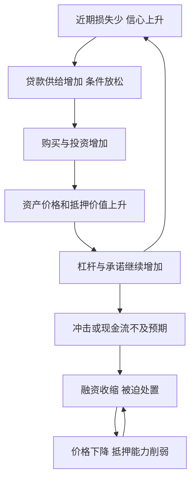
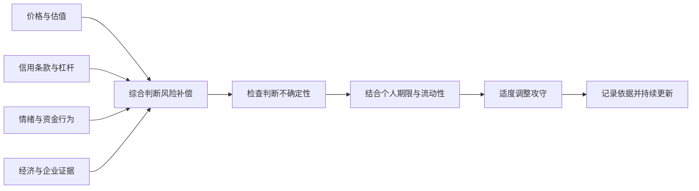

# 《周期》读书笔记

> 作者：霍华德·马克斯（Howard Marks）。  
> 英文原名：Mastering the Market Cycle: Getting the Odds on Your Side，2018 年出版。中文《周期》可核对中信出版社 2019 年版，刘建位译；用户没有指定具体印次。  
> 分析依据：出版社授权书目与目录、作者公开备忘录和访谈，以及 NBER、中央银行等原始资料。属于公开资料系统导读，未取得用户原书，不声称逐页精读。  
> 覆盖范围：十八章的主要主题，包括经济、盈利、心理、风险偏好、信用、困境债务、房地产、市场定位与成功的周期，共 30 个知识点。  
> 资料边界：2020 年、2022 年及作者 2023 年回顾等均为后续教学材料，不冒充 2018 年原版已讨论或已预测的事件。  
> 更新日期：2026-11-12

## 先看这里：这本书讲什么

**周期研究的用途，是理解当前条件让哪些结果更容易发生，从而调整风险承担；它不能提供下一次顶部或底部的准确日期。**

马克斯关心的是条件概率：同一种资产，在昂贵、乐观、融资宽松时，与便宜、恐惧、资金紧张时，面临的机会和危险不同。风险不仅来自经济坏消息，也来自投资者在好消息中放松保护、提高杠杆和支付高价。

这本书与《投资最重要的事》相连，但更集中解释变化过程：繁荣如何产生脆弱性，衰退如何创造下一轮条件，心理和信用如何把小变化放大。读完应能提出更好的观察问题，不应自认掌握了一个按年份运转的股市时钟。

## 十八章主题覆盖地图

| 原书章节主题 | 要解决的问题 | 本笔记位置 |
| --- | --- | --- |
| 为什么研究、周期性质与规律 | 周期有什么用，哪些“规律”不能机械化 | 01—04 |
| 经济、政府参与、盈利 | 实体活动与政策怎样影响企业 | 05—07 |
| 心理钟摆、风险态度 | 事实如何被不同情绪解释 | 08—10 |
| 信用、困境债务、房地产 | 资本供给怎样扩大波动 | 11—16 |
| 综合市场周期、应对、定位 | 怎样观察和调整承担的风险 | 17—24 |
| 应对的局限、成功周期、未来与总结 | 为什么仍会判断错，如何保持准备 | 25—30 |

目录与中文版本见[中信提供的授权电子书书目](https://read.douban.com/ebook/108437540/?dcs=provider-6578125-%E4%B8%AD%E4%BF%A1%E5%87%BA%E7%89%88%E7%A4%BE)及[英文出版书目预览](https://books.google.com/books/about/Mastering_The_Market_Cycle.html?id=8hhDDwAAQBAJ)。作者对资料时点的说明见[橡树官方图书页面](https://www.oaktreecapital.com/book)。

## 核心知识点

### 01. 周期是相互作用的过程，不是固定周期的钟表

“周期”容易让人想到每隔若干年重复一次。市场中更可靠的观察，是某些行为会产生反向力量：繁荣吸引供给，供给增加压低回报；损失使资本退出，退出又为未来改善创造条件。

时间、幅度、触发原因和参与者都可能不同。因此，不能仅因上涨了几年就断言明年必跌，也不能因历史上某次衰退很短就假定下一次很快结束。研究因果比数年份更重要。

### 02. 转折往往由前一阶段积累的行为推动

宽松融资、追逐回报和放松保护，通常发生在大家感觉安全的时候；资金退出、项目取消和风险价格上升，通常发生在大家悲观的时候。

这不是“好事必然变坏”的哲学口号，而是激励改变行为的机制。要观察新增资金做了什么、供应如何响应、负债是否累积，以及保护条款是否减弱，而不仅看价格方向。

### 03. 长期趋势与围绕趋势的波动必须分开

人口、技术和生产率可能改变长期水平；库存、信用与心理则可能使短期活动偏离趋势。两者相互影响，但不能因为有长期增长，就认为短期下跌无害。

同样，均值回归不保证回到某个固定历史价格。企业可能被技术淘汰，行业平均利润也可能改变。研究周期先要问基础结构是否仍然可比。

### 04. 周期位置改变概率分布，不决定单次结果

如果市场价格包含极高增长、融资容易、投资者忽略风险，那么潜在坏结果可能更严重，而预期补偿可能较少。反过来，低价和严苛条件有时会提高未来回报空间。但“有利”不等于下一期必涨。

**必要的数学演示：** 假设方案 A 有 60% 概率赚 20、40% 概率亏 10，期望是 8；方案 B 有 40% 概率赚 20、60% 概率亏 10，期望是 2。两者仍都可能亏损，且这些数字完全是假设，不对应真实周期或市场概率。

现实中最难的是估计分布。价格便宜可以提高某些情景下的收益，但债务、欺诈或经营永久恶化也可能使下行范围扩大。因此，不能仅凭“处于低谷”就随意填一个很高的上涨概率。

可操作的做法，是明确多个结果、各自条件与承受能力，再用新证据更新。周期研究应该让结论更有条件，而不是让判断更绝对。

**自测：** 后来亏钱能否证明当初概率判断错误？不一定，需要多次事前判断和完整过程；但也不能用“概率如此”长期回避检验。

### 05. 经济衰退的历史确认，不是实时交易信号

经济周期涉及就业、收入、生产和支出等广泛变化，不能只看一个季度数据。正式划分峰谷通常需要等待资料，使结论足够稳定。

**NBER 将美国 2020 年经济活动峰值定在 2 月、谷底定在 4 月；确认 4 月谷底的公告到 2021 年 7 月才发布。** 这段按其定义持续两个月的衰退，既短又深，说明长度不是唯一标准。[NBER 周期认定方法](https://www.nber.org/research/business-cycle-dating/business-cycle-dating-procedure-frequently-asked-questions)、[峰谷数据](https://www.nber.org/research/data/us-business-cycle-expansions-and-contractions)

这里的意义不是批评认定太慢，而是区分任务：历史研究需要可靠定年，投资者需要在不完整信息下管理风险。拿后来确认的谷底作为当时可用信号，会把未来信息偷带进策略。

谷底还不等于经济已经回到前期水平。活动可以开始回升，但就业、收入或企业损失仍未恢复。这个区别也适用于公司利润：停止恶化与恢复健康是两件事。

### 06. 政策会改变传导，却不能消除所有损失

政府与中央银行可以影响利率、流动性、支出和金融条件，但政策有时滞、约束和副作用。它们既可能减轻危机，也可能影响之后的风险偏好。

**2020 年 3 月 23 日，美联储设立一级与二级市场公司信贷工具，以支持公司债与相关融资市场。** 官方研究讨论了同期公司债市场压力和政策之后的流动性变化。[美联储 PMCCF 说明](https://www.federalreserve.gov/monetarypolicy/pmccf.htm)、[美联储关于公司债市场的研究](https://www.federalreserve.gov/econres/notes/feds-notes/the-corporate-bond-market-crises-and-the-government-response-20201007.html)

这说明，信用市场的路径不是只由企业当期利润决定。流动性支持和政策承诺，可以改变融资可得性与参与者行为。不过，宣布工具、开始实际购买与最终购买金额是不同事实，不能混为一谈。

也不能从一次政策成功推出所有资产都会被救、普通股损失一定被保护。政策目标通常不是保证每位投资者赚钱，资格、担保、期限和经济代价需要分别核查。未来政策反应更不能被当作无条件承诺。

**练习：** 确认支持公司债融资后，是否可以认定任何公司的股票都安全？不能。债务流动性、企业偿付能力与普通股价值仍然不同。

### 07. 企业盈利周期通常比总量经济波动更大

收入变化经过固定成本、利息和税费后，会放大成利润变化；行业供需、价格和企业融资结构又各不相同。因此，小幅经济放缓可能对应某些行业很大的利润下降。

分析时应拆开销量、价格、成本与资本结构。用 GDP 增长率直接预测某家公司利润，省略了太多机制。周期性企业在高利润时期看起来便宜，往往正因分母处于异常高位。

### 08. 心理钟摆改变同一事实的解释

乐观时，问题被看成暂时，增长被看成永久；悲观时，改善被怀疑，风险被不断扩大。事实与估值之间因此多了一层心理解释。

这不意味着情绪可以随意测量成精确指数。可以观察人们如何讨论损失、是否接受反证、是否把过去涨幅当作安全证据。极端语言是线索，还需要价格、融资和行为数据支持。

### 09. 风险态度的周期，常常与实际脆弱性反向

长期没有损失，会让人觉得风险变小，继而增加杠杆、降低要求。结果是主观上更安全，结构上却可能更脆弱。

损失发生后，人们可能把所有风险都拒之门外，即使某些价格已经提供较大补偿。研究者应同时问“资产可能发生什么”和“市场要求什么价格”，避免把风险厌恶程度当作资产真实风险。

### 10. 风险补偿不足，比风险名称更值得警惕

高收益资产通常有需要解释的风险，但低收益资产也可能因为价格太高、久期过长或隐含杠杆而危险。重要的是承担的风险是否得到充分补偿。

信用利差，是风险债务收益率相对可比较基准的差额；它不是确定可赚的额外收益。违约损失、流动性与期限等会消耗这部分补偿。利差很窄时，应问市场是否仍认真对待不利情景。

### 11. 信用扩张会同时创造繁荣和脆弱性

信用不是单纯的钱多钱少，而是借款规模、价格、期限、抵押和保护条款的组合。好时期违约少，出借人竞争项目，借款人更容易借到钱；借来的钱又支持需求与资产价格。

马克斯在 **2007 年 The Race to the Bottom** 备忘录中讨论竞争资本如何降低放贷要求。这份文件的日期可核验，说明相关担忧确实在危机全面爆发前提出；但不能据此说他准确预测了每个转折日期或证券跌幅。[作者原始备忘录](https://www.oaktreecapital.com/insights/memo/the-race-to-the-bottom)

要理解传导，需要沿借款人和贷款人两边看。借款人把过去收入外推，贷款人把过去低损失外推；抵押物涨价又使账面抵押覆盖显得更充分。看起来每一笔都合理，组合却可能共同依赖“价格继续上涨”。

**如何用：** 不只看贷款利率，还看首付、期限、债务保护、是否允许延迟付息、融资是否依赖短期滚续。条款变化可能在坏账出现前反映风险态度变化。

宽松并不意味着危机马上发生，风险可以积累很久。周期定位的价值是帮助调整防御程度，不是借一项指标宣布精确见顶。

### 12. 信用收缩会把个体问题变成集体压力

坏账或价格下跌使出借人收紧，借款人出售资产还债，卖出压力又压低价格，削弱抵押与资本。信用的反向过程可能比扩张更快。

不能把所有借款人视为相同。有稳定现金、长期融资和流动性储备的主体，承受力与依赖再融资者不同。分析“行业会复苏”之前，要确认具体企业能否活到复苏。

### 13. 信用窗口关闭与企业没有价值，是两种不同问题

一家企业可能有经营价值，却暂时无法融资；也可能融资问题只是经营已经不可持续的表现。二者在市场恐慌中容易混在一起。

要区分它们，需要现金流期限、资产可变现性、债务顺位和可信的经营预测。没有这些资料，低价既可能是机会，也可能合理反映永久损失。仅凭新闻标题说“市场恐慌过度”远远不够。

### 14. 困境债务机会来自低价与权利，不只是坏消息

困境债务投资研究企业遇到压力时，不同债权最终可能获得多少价值。它不等于买入跌得最多的股票，也不保证企业恢复后所有证券都获利。

**作者在 2023 年回顾称，橡树在 2007 年初至 2008 年 3 月期间筹备了约 110 亿美元困境债务储备基金；2008 年危机加深后，其团队按阶段部署资金。**[作者回顾 Taking the Temperature](https://www.oaktreecapital.com/insights/memo/taking-the-temperature)

这个案例首先说明准备发生在机会全面出现之前。研究、资金期限与授权，让团队能够在卖方被迫出售时行动；不是恐慌当天突然产生勇气。其次，困境债务的回收分析、法律权利和购买价，才可能构成投资依据。

这里依据作者自述，不把其选取的成功时期视作完整独立审计业绩。普通投资者也不能照搬机构基金的规模、融资与获取交易的能力。能学习的是提前形成可检验标准，而非模仿交易金额。

**自测：** 若只知道“某债券跌到面值的一半”，还缺什么？偿付能力、回收顺位、担保、期限、费用和重组路径。折价本身不能回答这些问题。

### 15. 债权与股权在周期中的收益形状不同

普通债务在正常履约时回报主要受合同限制，下行却可能很大；股权拥有剩余收益，回报空间和风险又不同。相同企业里，不同证券的安全程度与合理价格不能混为一谈。

讨论逆向投资时，应说明究竟买什么权利。买到优先债权的低价，与买入可能被稀释或清零的普通股，是不同判断。企业“活下来”不自动说明某一证券划算。

### 16. 房地产周期有长建设期和融资反馈

需求与价格上升时，开发活动增加；项目从决策到竣工需要时间，新增供给到达时需求可能已经变化。资产又经常成为抵押品，价格变化会影响下一轮融资。

**美联储关于大衰退的历史资料，把美国住房市场扩张、房价回落与金融压力联系起来。** 房地产问题并非只留在建筑业，而是通过家庭、金融机构和信用工具传导。[美联储历史资料](https://www.federalreservehistory.org/essays/great-recession-and-its-aftermath)

用本书框架研究，应同时看实物与金融两张表：在建供给、销售和空置，配上贷款期限、利率、抵押与资本。只看人口需求，可能漏掉短期过量供给；只看抵押价值，又可能把上涨形成的安全感当作稳定基础。

这里不是将 2008 年美国经验直接套到所有国家。土地制度、预售、贷款追索、银行结构和政策不同，会改变传导。可迁移的是检查延迟与反馈，不能照抄具体下跌幅度或时间。

### 17. 市场周期不是经济周期的同步复制

市场价格反映未来预期，因此可能在经济数据仍差时改善，也可能在盈利很好时下跌。资产价格还受利率、风险补偿和资金流影响。

看到“经济向好，股价却跌”不必立即认为市场失灵，应检查之前价格已经反映多少好消息。反过来，不能把股价反弹当成实体经济已经全面恢复的证明。

### 18. 给市场“测温”，需要多项证据

可以观察估值、融资条款、杠杆、发行质量、资金流与投资者语言。这些不是机械投票：它们可能来自同一个共同原因，也可能彼此冲突。

一份好的测温记录应该写来源、时点、历史可比性和解释。若大多数依据只是同一段行情引发的情绪描述，就不应当成多条独立证据。作者的测温方法是判断框架，不是一套公开验证的定量择时模型。

### 19. 后期繁荣的危险，常是要求不断降低

投资者为了维持过去的回报，可能接受更低信用质量、更长久期、更不透明结构或更高买价。表面收益率没有明显变化，承担的风险却在上升。

应研究“为了这点收益，我现在必须多接受什么”。这个问题比单问今年指数涨了多少更接近周期风险。但谨慎也有机会成本，不能因为存在风险就自动推导全部清仓。

### 20. 极端恐惧时，怀疑也要用于悲观故事

怀疑精神不是永远看空。当所有讨论都假设最坏结果，研究者也应检查这些假设是否有足够证据、是否已经被价格反映。

这不等于任何暴跌都值得买。某些企业确实会消失，某些证券会永久受损。对悲观保持怀疑，应与现金、权利和资本结构核查同时进行，而不是用“别人恐惧”替代研究。

### 21. 周期定位宜调整攻守程度，而非追求全进全出

风险承担可以通过质量、规模、杠杆、流动性、期限和价格门槛调整。它不一定只有持有股票和持有现金两个档位。

全进全出需要连续判断卖出与买回，还可能付出成本并错过变化。渐进调整同样不是保证更优，而是让行动强度与证据把握匹配。具体幅度需要投资者自身目标和约束，书中思想不能直接给出统一仓位。

### 22. 流动性与杠杆，决定你是否能等到判断兑现

**2022 年英国国债市场压力中，部分采用负债驱动投资（LDI）的基金，因衍生品和回购安排需要补充保证金或抵押品，面临卖出资产的压力；卖出又恶化市场流动性。英格兰银行实施了临时、有针对性的购债安排。**[英格兰银行机制复盘](https://www.bankofengland.co.uk/quarterly-bulletin/2023/2023/financial-stability-buy-sell-tools-a-gilt-market-case-study)

LDI 的目标涉及管理养老金资产与负债之间的利率风险，不等于简单押注国债上涨。即便一种策略在长期负债匹配上有目的，短期现金和抵押需求也可能造成压力。风险不能只看资产最终是否偿付。

这件事直接说明“我看得很长”不足以抵御被迫卖出。长期价值、短期保证金和市场承接能力是三种不同约束。多方同时需要现金时，过去正常时期的流动性估计也可能失效。[英格兰银行 2022 年金融稳定报告](https://www.bankofengland.co.uk/financial-stability-report/2022/december-2022)

本例发生在本书出版之后，不是马克斯的事前预测。**练习：** 资产信用较高，是否能抵消杠杆下的流动性风险？不能，信用、利率和即时现金需求需要分别管理。

### 23. 提前准备，比当场鼓励自己勇敢更可靠

机会出现时，研究清单、可用资金、决策权限和资金期限是否已经安排好，会决定能否行动。没有准备，看到低价也可能不知道究竟该承担什么。

作者 2008 年相关回顾可以启发这个问题，但不能忽略其自身也披露过基金杠杆压力。只挑“大胆买入”的一面，会把准备误写成没有风险的英雄故事。合理准备包括承认自己可能太早，预留后续不利空间。

### 24. 攻守都要检查机会成本

防御可能减少损失，也可能在上涨时落后；进攻可能抓住机会，也可能承担更深回撤。评价不能只选最有利于自己风格的时期。

记录时应同时写：为什么增加或减少风险、为此放弃了什么、哪些未来会使决定显得错误。防御不是永远正确，进攻也不是鲁莽的同义词；关键在于条件、价格与生存空间。

### 25. 正确过程仍可能遇到坏结果

概率有利不保证每一次成功，因此既不能把一次赚钱当成能力证明，也不能把一次亏损自动解释为方法无效。需要比较当时信息、判断逻辑、风险安排和后续结果。

反过来，“周期很复杂”也不能成为无法评价的借口。若每次预测都事后重新解释，方法就失去可检验性。应保留原记录并统计失误，而不是只收集名人的成功案例。

### 26. 成功本身可能降低下一阶段成功的条件

成功容易吸引资金、竞争者和更高期待，也可能使组织更自信、规模更大、反应更慢。投资方法在较小资金下有效，扩张后未必同样可执行。

因此，评价一家机构或企业时要问：增长是否改变了它原来的优势，过去轻松完成的事情是否变得拥挤，是否为了维护声誉而承担额外风险。成功周期讨论的是条件变化，不是说所有成功都必然失败。

### 27. 历史类比要同时寻找相似与差异

市场每次都不是完全新的，也不是过去的复印件。借鉴历史应先找机制：融资是否类似、价格是否包含相似预期、参与者是否受到同样约束。

再找差异：监管、信息传播、资金来源、产品结构和政策能力可能改变结果。只因为两张图形相似就预测同一结局，缺少因果基础。

### 28. 未来仍会有周期，但具体形式会变化

人类情绪、竞争和信用反馈可能继续存在，技术与制度又会改变发生速度和表现形式。周期不会因为大家读过一本书就消失，也不意味着过去的参数永远有效。

合理立场是保留对机制的理解，并更新数据和制度。既避免“这次完全不同所以无需风险控制”，也避免“以前如此所以未来必然如此”。

### 29. 不知道当前精确位置，也可以改善准备

即使不能判断处于周期第几阶段，也能降低不理解的杠杆、检查到期债务、提高资料质量、审视过度集中的风险。这些行动不依赖预测某个日期。

周期研究最实际的收获，往往是更清楚地知道自己承受不了什么。把全部价值放在预测下一次危机，会忽略许多可以现在完成的工作。

### 30. 把周期判断放进公司、证券与个人约束三层

行业低谷、企业健康、债券安全和个人可承受，并不是同一结论。最后应把市场条件落实到具体主体、具体权利和自己的资金期限。

本书提供一个观察变化的框架，不能代替财报、估值、法律权利和产品机制研究。本笔记没有判断 2026 年 11 月市场处于哪个精确阶段，也没有据此推荐证券或配置比例。

## 图解：信用如何形成自我强化

这是机制示意，不表示每次循环都有相同时间和强度。打断循环的因素可能来自经营调整、债务重组或政策，也可能伴随永久损失。

## 图解：把市场测温变成条件式行动

图中不输出“明天涨跌”。同样的市场判断，对不同负债和资金期限的人，可能对应不同的风险安排。

## 一页周期观察表

| 观察层 | 要记录的事实 | 不应直接推出 |
| --- | --- | --- |
| 经济 | 就业、收入、产出及修订 | 数据好就一定涨 |
| 企业 | 盈利、现金、订单、资本支出 | 单季增长可无限延伸 |
| 信用 | 融资价格、期限、保护与可得性 | 利率低就没有违约风险 |
| 市场 | 估值、发行质量、杠杆、资金行为 | 多数人乐观就一定马上见顶 |
| 自身 | 资金期限、现金需求与集中度 | 看长期就无需流动性 |

练习时选一个已经结束的时期，只使用当时已公开材料，写出至少两种可能路径。随后再看结果，检查哪些证据有用、哪些是事后才知道的。

## 自测与参考答案

1. **周期规律为什么不能直接变成日期？** 因为反馈存在，但触发、幅度、时间与制度不同。
2. **NBER 认定谷底为何不能回填成当时信号？** 公布时点晚于所认定的历史月份。
3. **信用很宽松时，风险为什么可能正在积累？** 放贷保护降低、杠杆上升与价格外推会增加脆弱性。
4. **困境债务为何不等同跌得多的股票？** 权利顺位、回收路径与价格结构不同。
5. **高信用资产为何仍可能引发被迫卖出？** 利率变化、杠杆和抵押需求可能先造成现金压力。
6. **防御导致短期落后，是否说明决定错误？** 要看当时信息、承担的风险与事先接受的机会成本，不能只看单期结果。

## 来源与资料边界

- [英文出版书目](https://books.google.com/books/about/Mastering_The_Market_Cycle.html?id=8hhDDwAAQBAJ)、[中信授权中文版书目](https://read.douban.com/ebook/108437540/?dcs=provider-6578125-%E4%B8%AD%E4%BF%A1%E5%87%BA%E7%89%88%E7%A4%BE)、[橡树官方图书说明](https://www.oaktreecapital.com/book)：题名、作者、结构与时点边界。
- [马克斯 2018 年公开访谈](https://www.goldmansachs.com/insights/talks-at-gs/howard-marks-2018.html)、[The Race to the Bottom](https://www.oaktreecapital.com/insights/memo/the-race-to-the-bottom)、[Taking the Temperature](https://www.oaktreecapital.com/insights/memo/taking-the-temperature)：作者思想与历史回顾，未当作完整业绩审计。
- [NBER 方法说明](https://www.nber.org/research/business-cycle-dating/business-cycle-dating-procedure-frequently-asked-questions)、[周期日期数据](https://www.nber.org/research/data/us-business-cycle-expansions-and-contractions)：事后定年与实时判断区别。
- [美联储大衰退历史](https://www.federalreservehistory.org/essays/great-recession-and-its-aftermath)、[PMCCF 工具说明](https://www.federalreserve.gov/monetarypolicy/pmccf.htm)、[公司债市场研究](https://www.federalreserve.gov/econres/notes/feds-notes/the-corporate-bond-market-crises-and-the-government-response-20201007.html)：住房信用与政策介入。
- [英格兰银行 2022 年报告](https://www.bankofengland.co.uk/financial-stability-report/2022/december-2022)、[LDI 事件机制复盘](https://www.bankofengland.co.uk/quarterly-bulletin/2023/2023/financial-stability-buy-sell-tools-a-gilt-market-case-study)：后续真实流动性案例。

尚未逐页核对指定中文译本的全部图表、原书所有轶事和完整注释；没有重建作者全部交易或检验当代择时成绩。图解与练习为本笔记编排，数学分布为明确假设，后续历史资料仅帮助理解机制。

---

[返回书籍索引](../README.md) · [财商学习与实践路线](../财商进阶合订本.md)
