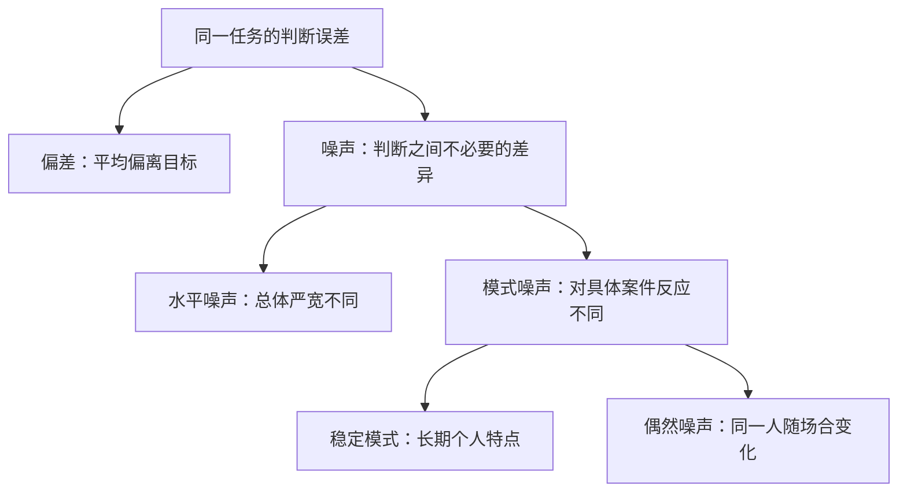

# 《噪声》读书笔记

> 原书：*Noise: A Flaw in Human Judgment*。作者：丹尼尔·卡尼曼、奥利维耶·西博尼、卡斯·桑斯坦。英文原版：2021 年。具体中文译本、译者和页码未确认。资料核对日期：2026-11-12。
>
> 实际范围：这是**基于公开资料的系统导读**，使用出版社、作者公开访谈、公开目录及一手研究与机构方法说明。没有取得完整原书，不声称逐页精读。30 个知识点按学习顺序重组；现实研究与财商流程为原位补充解释，不全部来自书中。本文的“噪声”指判断中不必要的差异，不是音量、新闻热度或股价波动的泛称。

## 先读懂全书最重要的区分

如果一组人总朝同一方向判断错，这是偏差；如果处理相同问题的人给出忽高忽低、缺乏合理依据的不同答案，这是噪声。一个系统可能平均看起来没有偏见，却因为每个人受到的判断不同而造成严重损害；也可能所有人高度一致，却一致地犯错。

本书把视线从“某个人为什么犯错”，扩大到“整个判断过程为什么产生不可接受的差异”。它推荐先测量分歧，再通过统一问题、独立判断、结构化评价和适当规则减少误差。[出版社书页](https://www.hachettebookgroup.com/titles/daniel-kahneman/noise/9780316451390/)、[卡尼曼与西博尼的作者访谈](https://www.mckinsey.com/capabilities/strategy-and-corporate-finance/our-insights/sounding-the-alarm-on-system-noise)

财商上的直接收获是：当几位分析者对同一家公司给出不同估值时，不急着挑自己喜欢的答案，而是逐层检查资料、定义、假设、权重和执行过程究竟在哪里分开。减少随意差异，不意味着市场未来变得可精确预测。

## 全书主题地图

| 原书主要部分 | 核心问题 | 本文对应 |
|---|---|---|
| 发现噪声 | 为什么相同案件会得到不同处理？ | 01—05、13 |
| 心智作为测量工具 | 如何拆分判断误差与不同噪声？ | 06—09 |
| 预测判断中的噪声 | 规则、模型与不可消除的不确定性 | 10—12、25—26 |
| 噪声如何发生 | 量表、模式、心理偏差和群体影响 | 14—17 |
| 改善判断 | 人员、信息顺序、结构化与聚合 | 18—24、27 |
| 适度噪声 | 一致性、成本、尊严与自由裁量 | 28—30 |

对应英文公开目录的六大部分，未照搬不同译本的章节标题。[公开目录](https://openlibrary.org/books/OL26554445M/Noise)

读图：这些是统计层面的区分。噪声不一定来自“随便猜”，稳定且自信的个人判断习惯，也可能在整个系统中造成噪声。

## 30 个核心知识点

### 01｜噪声的前提：差异是不应该存在的

两个人喜欢不同音乐，通常不是需要消除的判断错误。若两位承担相同职责的人，针对相同信息、相同目标和相同标准，给出差异巨大的处理，才值得检查不必要的变异。

所以先明确任务：大家是否在回答同一个问题？有些分歧来自目标、价值或资料不同，不能不经分析就归为噪声。把所有不同意见清除，可能损害探索与表达自由。

### 02｜偏差与噪声可以同时存在

偏差是平均方向的问题，噪声是离散程度的问题。把所有人的判断统一平移，可能修正平均偏差，却没有减少彼此之间的差异；让所有人使用同一规则，可能减少差异，却保留系统性错误。

这个区分能避免单一改进思路。面对一个判断系统，需要分别问“平均是否偏离”与“同样情况是否一致”，不能只看到其中之一。

### 03｜平均正确，不代表每个人受到公平处理

如果高估与低估在总体上抵消，报表上的平均误差可以接近零，但每个被高估或低估的对象仍然承担实际后果。保险费、授信额度、绩效评分等不是可以在不同人之间随意抵消的损益。

因此审查平均值之外，还应看分布和极端差异。一家机构不能仅以整体平均合适，证明个体处理合理。

### 04｜真正比较同一对象，才能识别分歧

不同分析者研究不同公司，估值不一样是正常现象；不同医生面对不同病例，诊断不一样也正常。噪声审查要尽可能控制案件信息，让多个人对同一批对象作出可比较判断。

否则你测到的可能只是案件组合不同。还要统一单位、时点、评价目标和信息范围；一人计算股权价值，另一人计算企业价值，不能先算差距再声称发现了判断噪声。

### 05｜真实研究：病理判断的一致性为什么要分类型看

Elmore 等人在 2015 年研究中，让 115 位病理医生对测试病例作判断，获得 6900 次判读，与三名专家形成的参考诊断比较。总体一致率为 75.3%；侵袭性癌病例为 96%，不典型增生为 48%。这里是研究中的一致率，不是全国临床误诊率。[JAMA 原始研究](https://jamanetwork.com/journals/jama/fullarticle/2203798)

这组数据首先说明，专业判断可以测量，而不是只能凭资历互相信任。其次，它说明平均数会掩盖任务难度差异：某些类别的判断边界，比其他类别模糊得多。改善资源应尽量对准分歧集中的问题。

还必须看研究如何做。研究以单张活检切片为判断基础，病例构成经过设计；参考标准也是专家共识，并非无需讨论的绝对真值。真实临床可能有更多材料、会诊和复核。不能把 `100%-75.3%` 直接解释成现实中患者被错误治疗的比例。

本节用于说明测量判断一致性的方法，不提供任何个体诊断建议。它同样提醒财务分析者：评价“准确率”之前，要确认参照标准、样本构成和实际流程是否一致。两个机构公开的准确率不同，有时首先是测量任务不同。

### 06｜均方误差：为什么偏差和噪声都要付代价

在一个目标值固定、用平方损失评价的简单情境中，可以把平均平方误差写成：

`平均平方误差 = 平均偏差² + 判断方差`

令 `J` 为判断值，`T` 为固定目标，`E[J]` 为平均判断。平均偏差是 `E[J]-T`，判断方差是判断围绕自身均值的平均平方距离。之所以用平方，是让正负误差不能互相抵消，并让大错受到更重惩罚。

**纯数学演示，数值不是来自真实机构：**假定目标都是 100，每组两个判断等权。

| 判断值 | 平均判断 | 偏差平方 | 判断方差 | 平均平方误差 |
|---|---:|---:|---:|---:|
| 90、110 | 100 | 0 | 100 | 100 |
| 110、110 | 110 | 100 | 0 | 100 |
| 100、120 | 110 | 100 | 100 | 200 |

第一组平均正确，仍有误差；第二组没有噪声，仍然错；第三组两者都有。这个小表说明，为何只纠正平均数或只追求一致，都不够。

边界是平方损失与固定目标的条件。实际决策可能更在意误放贷与误拒贷的不同代价，不能机械以均方误差替代价值判断。若目标本身是尚未实现的随机结果，还要区分不可消除的结果不确定性，不能把全部预测误差归咎于评判者。

### 07｜水平噪声：有些人整体更严，有些人整体更宽

把同一批对象交给不同评价者，有人普遍给低分，有人普遍给高分，这种整体严宽差异叫水平噪声。它与对某个具体对象的个人好恶不同。

识别时要先控制对象差异，再看评价者的平均倾向。简单按每个人自己的均值进行标准化也有风险：如果某人确实接触了更差的对象，强行拉平会抹掉真实差异。

### 08｜模式噪声：平均一样，具体判断仍然不同

两位评价者平均分可能相同，但一个更看重增长，另一个更看重现金流；他们对具体公司的排序会不同。这是“如何响应具体特征”的差异，不会被平均值消除。

若组织本来就要求不同视角探索，这种分歧可能有价值；若两人声称在执行同一个既定标准，却用了不同隐含权重，就需要澄清标准。模式差异只有与目标和职责结合，才知道哪些是不必要的。

### 09｜偶然噪声：同一个人也不总是同一把尺子

同一评价者在不同时间、顺序或状态下，可能对同一信息给出不同判断。这种时点间变动是偶然噪声，与长期稳定的个人倾向不同。

要测量它，需要适当间隔后的重复评价，并考虑记忆、学习和信息更新。若第二次已经有新证据，改变判断可能是正确更新，不能把变化本身当成不稳定的错误。

### 10｜预测与评价：有些答案能验证，有些标准需要先约定

预测未来销售额，可以等待结果核验；评价一个候选人是否“优秀”，常涉及目标和价值取舍。后者未必存在一个无需争论的真值，但仍可要求相同标准下的一致性。

先说明自己是在预测事实、评价质量还是决定行动。预测违约概率与决定是否放贷，并非同一问题，行动还要考虑价格、损失、约束和公平要求。

### 11｜客观无知：有些不确定性不是多想就能消除

即使最好的判断者，面对信息不足、复杂互动或随机事件，也不可能做到完美预测。观察到预测误差，不一定说明努力不够或存在某种心理偏差。

应把可减少的流程错误与问题本身的不确定性分开。承认后者，可以避免为不可达到的精度投入过多成本，也能阻止把一次合理范围内的意外当成职业失职。

### 12｜确定感不是准确性的测量器

一个解释顺畅、符合经验、让人没有疑问，可能只是各部分在头脑中很协调。主观确定与外部准确之间没有自动等号。

因此在重要判断中，要增加外部校验：历史预测表现、参照类、反证和另一种方法。不是禁止直觉，而是不能把“我很确信”当成所有检验的终点。

### 13｜噪声审计：把平时看不见的分歧显露出来

作者建议让承担相同职责的人，在独立条件下处理同一组典型问题，保留原始答案，再测量差异。即使暂时不知道正确答案，也能发现同一机构内部的严重不一致。[卡尼曼关于审计的本人访谈](https://behavioralscientist.org/a-conversation-with-daniel-kahneman-about-noise/)

**书中来源边界：**作者公开谈到过保险机构的匿名审计，但公司名称与底层原始数据没有在所用材料中完整披露。因此这里将其视为作者报告的项目经历，不把某个惊人百分比当成所有保险行业的普遍结论。

一次有用的审计，要先确定“多大差异不可接受”，再抽取有代表性的案件，避免只挑最模糊的对象制造震撼。人员应先独立评价，不能开会后再填写一致答案；最好既保留总判断，也保留关键子项和理由。

看到分歧后，下一步不是直接评选最差员工。要检查题目是否含糊、信息是否不一致、标准是否相互冲突，以及哪些差异来自合理专业判断。审计首先诊断系统，之后才判断是否涉及个人能力。

对财商学习，这可以成为一个小型真实资料练习：给研究伙伴同一份公开财报、相同期间和指标定义，先各自提取事实与形成判断。数字抄错、口径不同、假设不同和价值取舍不同，应分别处理，不能统一称为“意见不一致”。

### 14｜真实研究：同行评议也可能有很大分歧

Pier 等人在模拟 NIH 评审流程的研究中，组织 43 名评审者评价一组 25 份真实的肿瘤研究申请，发现评分和文字评价的一致性很低。申请集中在较高质量范围，包括首轮获得资助和修改后获得资助的项目。[PNAS 论文](https://www.pnas.org/doi/10.1073/pnas.1714379115)、[原论文可读副本](https://gwern.net/doc/statistics/peer-review/2018-pier.pdf)

它为什么与噪声有关？即使评审人都具备专业知识、收到相同评价要求，对“优势”“弱点”怎样换算成分数，仍可能各用一把尺子。术语一致，并不等于操作标准一致。

但这项研究不能被改写成“专家完全不会分辨好坏”。样本已经较优，研究更接近检验在相近申请之间能否稳定排序，而不是从明显差到明显好的全部项目中判断。样本范围缩窄，本来就会影响相关和一致性指标。

对投资研究也是如此：几位专业人士无法稳定区分几家相近企业，不等于他们无法识别明显的会计问题。应问在哪一类判断、哪一段难度范围内表现不足，再决定需要增加信息、改量表还是承认区分能力有限。

### 15｜量表含糊，会把语言分歧变成数字分歧

“优秀”“一般”“风险较高”在不同人心中可能对应不同标准。把词换成 1—5 分，并不会自动使它客观。

改进要给每一档可观察的描述和边界案例，并检查评分是否真的按同一规则进行。小数点越多，不代表测量越精确；一张没有定义的打分表，可能只是给直觉换了外观。

### 16｜匹配和光环：一个强烈印象会迁移到其他维度

人们容易把表达流畅、知名度高或一个突出的优点，转化为对其他能力的高评价。判断不同维度时，如果先有总体喜欢或讨厌，后面的小项就可能全部配合这个印象。

所以应尽量先评价相对独立的维度，再形成整体印象。这里的独立是减少不相关印象污染，不要求忽略真实存在的因果联系。

### 17｜群体讨论可能隐藏噪声，也可能放大噪声

一群人达成一致，不等于他们独立得到了相同结论。先发言者、权威身份和偶然的讨论顺序，可能把团队带向某条路径。

先独立写下判断，再分享理由，能够保留原本的信息差异。讨论时应重点分析分歧的证据来源，而不是尽快凑出看起来漂亮的共识。最终一致只是过程结果，不能替代正确性检查。

### 18｜决策卫生：提前减少错误入口

作者所说的决策卫生，是不等错误发生后才猜它来自哪一种偏差，而是在流程中减少常见污染：固定问题、分解评价、延迟总判断、保护独立性、记录信息和规则。

它类似预防措施，未必能指出某次具体避免了哪一个错误。因此评价要看一批任务的效果、成本和副作用，而不是要求每一项规则都在每次决定中制造可见收益。

### 19｜选择更合适的判断者：能力仍然重要

结构化流程不能完全补偿缺乏专业能力。任务知识、对反馈的利用、开放心态和持续校准，都可能影响判断质量。

但资历、职位和自信不应直接作为能力的替代。能评估时，尽量看与当前任务相关的记录；不能只因某人在一个领域成功，就推断他在所有领域都值得更大权重。

### 20｜信息顺序本身是一项设计决定

**真实方法：法证领域的线性顺序揭盲。**Dror 等人提出，让鉴定者先分析并记录现场痕迹，再接触用于比较的参考材料，并对随后改变判断保留说明与适当限制。这是公开的专业方法建议，而不是对某一真实刑案的胜负叙述。[美国司法项目办公室收录的原文摘要](https://www.ojp.gov/ncjrs/virtual-library/abstracts/letter-editor-context-management-toolbox-linear-sequential)

为什么不直接把所有资料一起给专家？因为某些后来信息虽与任务有关，也可能提前影响对原始材料的观察。顺序管理试图先保留一次较独立的观察，再允许有记录的更新。

它不是永远屏蔽相关证据，也不是禁止改变判断。问题在于改变是否来自真正的新信息，还是原先模糊处被预期答案重新塑造。把初始判断、信心和修订原因都留下，可以提高可审查性。

用于财报学习的补充方法，是先提取公告中的事实与口径，再看他人的目标价或总评级；看完后可以修改，但标出修改依据。这个迁移不是经验证的股票获利策略，而是减少先入为主的一种流程设计。

### 21｜独立判断再聚合：平均为何有时有帮助

在判断误差不完全同步时，把多份独立信息适当合并，能够降低部分随机误差。若大家都抄同一个来源，增加人数不会增加相同数量的信息。

不能只说“平均总是最好”。成员能力不同、偏差同向、目标不同或极端值来源异常时，都需要检查聚合方法。平均减少的通常是某些差异，不会自动消除共同错误。

### 22｜相对评价与参考样例：给尺子一个锚点

让评价者与明确的参照案例比较，有时比孤立打出“4 分”更容易对齐尺度。关键是参照案例的选择与解释，应对应评价目标。

相对排序也有局限：它只能说明谁相对更好，不能说明绝对质量是否合格；还可能随参照群体变化。一个组里的第一名，不必比另一个组里的第三名更强。

### 23｜真实制度实践：结构化面试为什么要统一问题和评分

美国人事管理局 OPM 对结构化面试的说明包括：候选人接受相同的预设问题，顺序一致，回答依据同一量表与标准评价。它把比较从随意聊天转向与岗位能力相关的信息。[OPM 官方方法](https://www.opm.gov/policy-data-oversight/assessment-and-selection/structured-interviews/)

统一的目的不是让面试毫无人情，而是避免有人被问容易展示优势的问题，有人被问完全不同的问题，最后却被放在同一张表上排序。标准预先确定，也减少了面试官先喜欢某人，再修改标准的空间。

实际改进仍需要验证。问题必须与工作相关，评分标准不能内含不合理偏见，评审者要知道各分值对应什么证据。机械重复同样的问题，只解决信息可比性的一部分，不保证公平或准确。

移到研究投资方案，可以让每个候选对象都回答同一组关键问题：收入如何产生、利润怎样变现、承担哪些债务、当前价格包含什么预期。不是让所有行业硬套同一指标，而是在相同目标下保持比较过程可解释。

### 24｜中间评估法：先拆问题，最后才作整体判断

书中的中间评估法把复杂决策拆成若干重要维度，先分别收集事实并评估，再在最后整合。这能延迟过早形成的整体印象，减少它对所有子项的污染。

**补充财商教学：**评估企业时，可把经营质量、财务稳健性、治理和价格分开记录。经营好不等于买入价格好，便宜也不能抹掉债务风险。若某个严重条件不可接受，还应设置明确约束，而非让其他优点通过简单加分把它抵消。

分解之前要避免重复计数。营收增长、利润增长和某个综合成长评分可能高度重叠，把它们各给很大权重，会让同一条信息被算好几次。

最后的整合也不必伪装成纯公式。可以保留专业判断，但要说明它如何偏离分项结果，以及出现了什么不能被原维度捕捉的信息。**直觉应被延迟、被记录、可质疑，而非被神化或全部禁止。**

### 25｜确定性规则可以减少重复判断中的不一致

如果输入与规则固定，确定性算法会给出同样输出，从而消除该环节中因评价者或场合变化导致的一部分噪声。简单规则有时已经足够，不一定需要复杂人工智能。

但输入可以有噪声，模型选择可以有偏差，现实也可能变化。具有随机采样的生成式模型更不是自动无噪声。讨论算法优势时，应明确是哪一种系统、哪一个环节及哪些输入条件。

### 26｜一致地犯错，比有分歧不一定更好

算法或规则可能把历史偏见固化，让每次输出都稳定却不合理。因此引入规则后，仍须检查目标、数据、误差分布、受影响群体与反馈渠道。

这也是偏差和噪声分解的实际意义。减少一种误差时，可能增加另一种；应比较总效果和不同错误的实际代价，而不是只追求输出一致。

### 27｜一次性重大决定，也能应用流程纪律

独特的并购或职业选择没有完全相同的重复样本，难以直接测量同类噪声。但可以把它拆成可比较的子判断，使用外部参照、独立意见和明确标准。

一次性不等于无法改进，也不意味着有了流程就能精确预测。流程的作用是减少可避免的混乱，让不可避免的不确定性被清楚看见。

### 28｜减少噪声有成本，不应无限追求

多请一位专家、增加一次复核、维护一套规则都需要成本和时间。收益取决于决定的重要性、错误代价以及规则是否真正改善判断。

因此应优先处理高后果、频繁重复、已经发现明显差异的任务。低影响且容易撤回的决定，过度审查可能造成更大拖延与负担。

### 29｜尊严与自由裁量：规则需要可解释的例外

完全机械的流程可能忽略个体特殊情况，让被评价者感到无法被倾听。合理的制度应让人能提供相关信息、理解决定依据，并有纠错渠道。

但“特殊情况”也可能成为重新引入随意差异的入口。更好的做法是说明例外条件、记录理由并定期审查，而不是选择永无例外或人人自由发挥两个极端。

### 30｜持续审查：流程改了，误差是否真的下降

引入新量表或规则后，应重新观察一致性、准确性、成本和分布后果。若只看到大家更一致，却不知道是否更接近目标，改进仍未得到充分验证。

研究流程也一样：不只统计分析报告数量，还要看有没有减少口径错误、遗漏和无理由变化。好的制度允许自身被修订，不把一次流程设计当成永久答案。

## 一套可以用于真实财报的低成本练习

这不是虚构公司案例，而是让读者用自己选定的一份**真实公开报告**执行的练习方案。先只练资料判断，不要求下单。

读图：目标是找到分歧产生的位置，不是强迫所有人得出同一个目标价。事实提取错误应纠正；尚无证据裁定的估计差异可以保留。

| 分歧类型 | 对应处理 |
|---|---|
| 使用了不同报告期间或财务主体 | 先统一问题与材料 |
| 同一数字抄录、计算或单位不同 | 回到原表核对 |
| 对会计项目含义理解不同 | 查附注、准则及公司说明 |
| 对未来增长或风险假设不同 | 写出依据、范围和更新条件 |
| 对相同风险的承受偏好不同 | 标明是价值或约束差异，别假装纯事实争论 |
| 相同信息下无理由随时间变化 | 检查偶然噪声与信息污染 |

## 自测与参考答案

**练习一：两位分析者对同一公司分别给出 100 和 120 的判断，目标值为 100。按第 06 节口径，偏差平方、方差和均方误差各是多少？**

参考答案：均值 110，偏差平方 100，方差为 `((-10)²+10²)/2=100`，均方误差为 `(0²+20²)/2=200`。这里分母为 2，因为是在计算给定两项等权判断的均方量，不是在估计总体方差的无偏样本统计量。

**练习二：病理研究总体一致率 75.3%，能否说现实中约四分之一患者被误诊？**

参考答案：不能。单张切片的研究条件、特定病例构成、专家共识参考标准，与全部实际临床流程不同。研究测量的一致率不能直接替换患者层面的诊断或治疗错误率。

**练习三：两人估值不同，一人用股权价值，一人用企业价值，这是噪声吗？**

参考答案：首先是任务定义不一致。需要统一口径或作合理转换，再研究剩余分歧。把所有数值差异称作噪声，会让改进方向错误。

**练习四：所有评审都按同一个有偏标准评分，是否已经解决本书讨论的问题？**

参考答案：可能减少了噪声，但保留或加剧了偏差。需要检查目标是否合理、标准是否有效、是否造成系统性不公平，以及总体错误代价。

**练习五：某团队开会以后高度一致，能证明判断可靠性提高了吗？**

参考答案：不能。可能是有效交换信息，也可能是权威锚定与从众。应保留会前独立判断、讨论中新增证据和修订理由，并在可验证时检查结果。

## 来源、争议与资料缺口

- [出版社书页](https://www.hachettebookgroup.com/titles/daniel-kahneman/noise/9780316451390/)及[公开目录](https://openlibrary.org/books/OL26554445M/Noise)：书目与主要部分定位。
- [作者访谈：系统噪声与决策卫生](https://www.mckinsey.com/capabilities/strategy-and-corporate-finance/our-insights/sounding-the-alarm-on-system-noise)：方法背景；作者观点不等于每个干预的独立实验证据。
- [卡尼曼关于噪声审计的访谈](https://behavioralscientist.org/a-conversation-with-daniel-kahneman-about-noise/)：第 13 节审计；匿名保险项目保留可核验性限制。
- [Elmore 等，JAMA，2015](https://jamanetwork.com/journals/jama/fullarticle/2203798)：第 05 节病理一致性研究。
- [Pier 等，PNAS，2018](https://www.pnas.org/doi/10.1073/pnas.1714379115)，[全文副本](https://gwern.net/doc/statistics/peer-review/2018-pier.pdf)：第 14 节真实申请的模拟评审研究；不外推到全部学科和所有质量区间。
- [法证信息顺序方法原文摘要](https://www.ojp.gov/ncjrs/virtual-library/abstracts/letter-editor-context-management-toolbox-linear-sequential)：第 20 节，方法建议与证据管理。
- [OPM 结构化面试](https://www.opm.gov/policy-data-oversight/assessment-and-selection/structured-interviews/)：第 23 节机构方法实践。

重要边界：关于何种差异“不必要”，经常包含规范与价值判断；一致性不等于真相；预测误差中存在不可减少的不确定性；书中的个别通俗案例不能代表全部心理研究。本文没有采用有因果争议的“饥饿法官”故事来证明吃饭决定判罚，也没有把作者的匿名审计当成公开可复算的数据集。尚未取得完整原书，未逐一核验全部司法史、案例统计和技术附录。对财商最可迁移的是一套可审查的比较流程，而不是保证投资正确的评分公式。

---

[返回书籍索引](../README.md) · [财商学习与实践路线](../财商进阶合订本.md)
