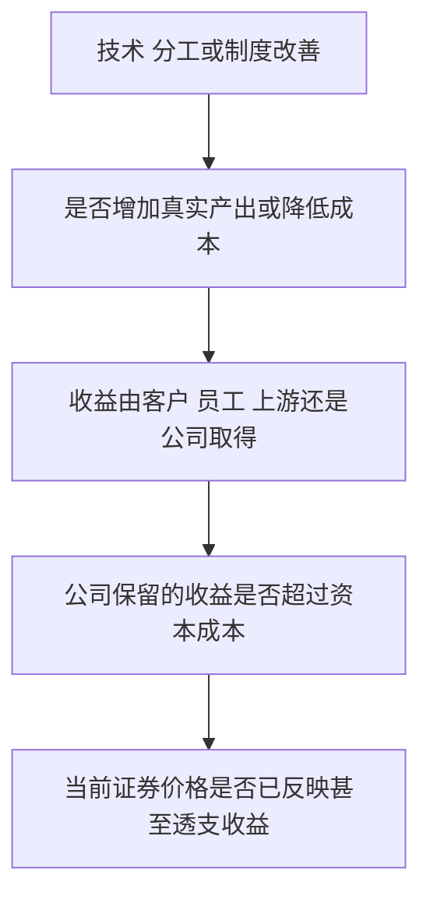

# 《国富论》读书笔记

> 作者：亚当·斯密（Adam Smith）。全名 *An Inquiry into the Nature and Causes of the Wealth of Nations*，1776 年初版。实际核对的公开英文文本由 Econlib 提供，依据 Edwin Cannan 1904 年整理本，以斯密生前 1789 年第五版为底本；不是把所有段落都当作 1776 年原版原貌。中文译本、页码未确认。
>
> 资料范围：公开原文的目录及重点章节检索分析，辅以官方历史资料；并未逐页精读全部五卷。本文以 36 个知识点覆盖主框架，重点展开分工、价格、竞争、资本、贸易与公共财政。十八世纪理论、作者举例与后来的真实案例分别说明。整理日期：2026-11-12。

《国富论》讨论的不是怎样把钱藏得更多，而是一个社会怎样持续生产更多生活所需，以及这些产出怎样在人们之间分配。斯密把分工、交换、资本积累和制度联系起来，也批评垄断、特权和商人利用政策限制竞争。

对财商最有用的启发是：**研究财富要看生产能力，研究利润要看竞争与分配，研究市场要看支撑它的制度。** 只记住“自利”和“看不见的手”，会漏掉书中大量关于公共服务、劳动者处境、企业治理与权力的讨论。

## 五卷怎样串起来

| 原书位置 | 主要问题 | 本笔记重点 |
| --- | --- | --- |
| 第一卷 | 分工怎样提高产出，价格与收入怎样形成 | 1—15 |
| 第二卷 | 资本如何分类、积累和使用 | 16—21 |
| 第三卷 | 欧洲经济发展与制度的历史路径 | 22—23 |
| 第四卷 | 重商主义、贸易限制与农业体系 | 24—29 |
| 第五卷 | 国家开支、税收与公共债务 | 30—36 |

版本说明和分卷目录见[公开原文入口](https://www.econlib.org/library/Smith/smWN.html)。下文引用卷、章定位，避免把不同译本页码混用。

## 核心知识点

### 1. 一国财富不能只用金银库存衡量

开篇把生活所需与劳动产出、交换所得联系起来。货币帮助取得产品，但社会真实生活能力还取决于生产、运输、技能和组织，而不是只有支付凭证的数量。

财商补充：资产价格上涨、账户余额增加和新增生产能力，是三个不同事实。它们可能相互支持，也可能暂时脱节。研究企业时，需要追问最终客户为何愿意付钱，不能只追踪融资额或市值。

### 2. 分工提高效率，不只是让每个人做得更快

第一卷第一章把分工的好处归为技能熟练、减少转换损耗，以及便于工具与机器改进。专注于较小任务，可以形成更深的经验；不用反复切换工具与场景，也能节约时间。

**原书证据的性质：**斯密以制针作坊说明合作分工，写到十人每日可制作约四万八千枚针。这是作者的历史叙述和计算，不是本文独立复核的工厂实验；不能把它直接视为已经隔离机器、培训等因素的因果估计。[第一卷第一章原文](https://www.econlib.org/library/Smith/smWN.html?chapter_num=4)

所以要学的是生产过程如何被重新组织，而不是记住某个效率倍数。把任务切得过细却没有协调、质量标准和稳定需求，也可能增加等待与返工。

### 3. 福特流水线帮助理解分工与技术怎样互相加强

**后来的真实案例：**美国国会图书馆历史资料记录，福特于 1913 年在 Highland Park 工厂引入移动装配线，汽车装配所需时间显著缩短。它把工序分解、标准化零件与移动输送结合起来，并非仅靠要求工人更努力。[官方历史资料](https://guides.loc.gov/this-month-in-business-history/october/ford)

这个例子说明，组织设计与资本设备可以共同提高效率。但不能把全部改善单独归因于分工，也不能据此说所有行业都适合相同流水线：产品变化频繁、需求量小或创造性判断较多时，过度标准化可能有代价。

用于公司研究，可以把效率提升拆成单位工时、良率、设备利用与在制品等待，而不是只听“智能化改造”这个名称。资本开支是否值得，要看真实改善能否覆盖投入与维护成本。

### 4. 分工深度受市场范围限制

第一卷第三章的重要逻辑是：专业化只有在有足够交易对象时才可持续。若一天只需要很少产品，让一个人只做其中一个细小工序可能无法养活他。

市场范围不仅是人口数量，还包括运输成本、购买力、交易信任与通达性。道路、通信与标准降低交易成本时，原先只能本地经营的专业活动可能获得更大市场。

这也解释规模与需求的双向关系：较大市场支持专业投入，效率改善又可能降低价格、扩大市场。但不意味着规模越大越好，协调成本和需求不确定性也会增加。

图是本文归纳的机制示意。它同时提醒读者：分工带来效率，也带来相互依赖，不能只画正向收益。

### 5. 交换不是要求对方无条件牺牲

第一卷第二章强调，人们经常通过说明对方能够获得什么来促成合作。卖方需要理解买方需求，买方也依赖他人的生产与专业能力。

这不等于斯密断言人只有自私动机，更不等于允许欺骗和强制。交易成立还依赖诚信、权利和执行条件；有共同利益只是合作的一部分基础。

投资者可据此审查商业模式：客户、员工、供应商与资本提供者各得到什么？如果长期利润只依赖一方持续承担未被补偿的成本，竞争、制度或关系变化可能暴露脆弱性。

### 6. 货币降低交换摩擦，但不能替代资源

第一卷第四章讨论货币怎样便利交易。它让人不必恰好找到同时需要自己产品、又拥有自己所需产品的交易者。

这一论述是古典经济学的货币起源解释，不应当作已经涵盖所有文明起源的统一历史证明。现实还涉及信用、记账、税收和政治制度。对今天的财商而言，应分别理解计价、支付和购买力储存三种功能，而不是把它们永久稳定地绑在一起。

### 7. 使用价值与交换价值不同，但斯密没有现代边际效用理论

水对生存非常重要，交换价格却可能低；稀缺钻石的日常使用价值较小，却可能很贵。第一卷第四章提出的价值问题，是理解价格与重要性不一致的入口。

现代边际分析会进一步区分总用途与新增一单位的用途，这属于后来的理论补充。不能把现代教材的完整解释倒写成斯密已经解决了所有价值问题。

财商上，社会必需品不必然给生产者最高利润；高价也不证明产品对社会最重要。股东回报还受竞争、资本投入和买入价格影响。

### 8. 劳动价值讨论要放回作者的历史框架

第一卷第五、六章用劳动讨论交换尺度及早期社会的相对价值，并进一步分析资本与土地收入加入后的价格构成。书中不同论述之间存在后世持续讨论的张力。

不要把它压成“商品价格永远等于劳动小时”，也不要把后来的马克思理论完整归给斯密。对现代估值，劳动投入是成本和能力的一部分，客户需求、稀缺、风险、资本和竞争同样影响价格；投入很多劳动不保证市场愿意支付相应价格。

### 9. 自然价格与市场价格：短期波动和长期进入条件

第一卷第七章把自然价格理解为能够支付通常工资、利润和地租的价格中心；市场价格则随实际供给与有效需求变化。两者之间的差距会影响资源进入或退出。

这不是现代证券的“内在价值”定义，也不是保证价格在某日回归的规律。行业进入可能很慢，资源具有专用性，制度也可能限制竞争。

用于研究企业，应问：眼前高利润是否吸引新供给，投入多久才能形成产能，哪些条件阻止竞争？只看当前利润率，就可能把周期高点当成永久能力。

### 10. 有支付能力的需求不等于全部需要

斯密的有效需求概念，关注能支持商品进入市场的需求；它与凯恩斯后来讨论总就业的“有效需求”不是可以不加说明互换的术语。

人非常需要某种产品却支付不起，仍可能无法在市场价格中表达需求。因此价格能提供稀缺与支付意愿信息，却不能独立回答分配是否公平。经济解释与价值判断应分别展开。

### 11. 工资、利润和地租是收入分配的不同关系

第一卷分析劳动者、资本持有者与土地拥有者的收入。区分这几类有助于理解产品销售收入怎样分配，却不能把十八世纪分类原封不动当作现代会计科目。

现代企业利润还包含折旧、研发费用、融资和税收等具体口径。看到工资或租金上涨，需要分析它如何影响成本、需求和资源吸引，而不应一概当成某一方无成本获得的利益。

### 12. 劳资议价不是永远对等

第一卷第八章注意到雇主与劳动者在组织、资源和等待能力方面不同。工资不仅受生产率影响，也受需求、法律与议价条件影响。

这使“斯密支持市场，所以必然主张越低工资越好”的理解站不住脚。对企业分析，高工资可能意味着成本上升，也可能帮助留住技能、改善质量和降低流失；需要检验净影响，不能仅用工资支出作单向判断。

### 13. 高利润可能是稀缺回报，也可能来自竞争受限

第一卷第九、十章把资本收益与竞争和进入条件联系起来。通常利润与短期超额收益要分开：后者可能吸引竞争，也可能被特殊权利保护。

研究高资本回报，应问客户为什么持续支付、竞争者为什么无法复制、优势属于公司还是上游资源拥有者。一个行业“大家都很赚钱”，有时反而意味着未来会吸引过多供给。

### 14. 地租提醒我们，价值增长不一定归经营者

第一卷第十一章讨论土地及其产品的收入。土地位置、质量与需求变化，使拥有者可能取得不完全来自自身新投入的收益。

现代补充：一家公司经营良好，若关键地段、知识产权或渠道入口属于他人，利润可能在续约时被重新分配。研究护城河不能只看客户端，还要查公司是否掌握关键投入的控制权。

### 15. 商业利益与公共利益不能直接画等号

斯密对同业限制竞争和商人影响政策保持警惕。企业追求自身利益，有时改善产品与效率，有时也可能争取排他权利，使消费者缺乏选择。

**后来的真实案例：**美国最高法院 1911 年对 Standard Oil 的判决，处理了石油跨州及对外贸易中的限制竞争和垄断问题。它可用于说明竞争需要制度边界，不是市场参与者会自动欢迎竞争。[最高法院历史判决卷宗](https://www.supremecourt.gov/pdfs/USReports/USREPORTS-221_PDFA.pdf)

这个案件发生在斯密之后，法律和产业结构都不同；不应由它断言任何大型企业违法，或把当时判决当作现行法律意见。财商上则应区分效率壁垒、合同安排与排他性权力：三者都可能支持利润，却有不同持续性与监管风险。

### 16. 资本存量与当期收入不是同一种量

第二卷把供未来生产使用的存量与日常消费联系起来。收入可以消费，也可以形成支持未来生产的资本；资本需要维护，不是永不消耗的财富机器。

读财报应对应区分资产余额、期间利润和现金流。买一项设备是资产形成，设备随后贡献收入并磨损；资产金额增加不自动证明生产能力按相同比例增加，更不证明投入回报合理。

### 17. 固定资本和流动资本的划分具有时代特色

第二卷第一章讨论机器、建筑等，以及需要在生产和交易中周转的资本。它帮助识别资金被占用在哪里，但不能与现代会计分类逐字对照。

现代应用需要同时看固定资产、库存、应收款和付款安排。销售增长会占用营运资金；即使利润增长，企业也可能因库存和客户欠款增加而缺现金。资本周转速度影响同样利润需要投入多少资金。

### 18. 储蓄的价值取决于怎样转成有用投资

第二卷第三章强调节俭与资本积累。它帮助人看到，当期不消费可以支持未来生产；但不等于每一笔金融储蓄都会自动转为高回报项目。

今天应补上投资质量、需求和金融传导。资金若流向重复建设或只靠再融资维持的资产，名义资本增加未必改善真实生活能力。家庭储蓄的审慎原则，与宏观经济在需求不足时的运行，也不能机械等同。

### 19. “生产性劳动”是历史分类，不能贬低现代服务业

斯密把一部分能固定在可售产品中的劳动与当期消费的服务区分。这是其资本积累分析的一部分，不代表今天可以据此否认医疗、教育、软件和物流的价值。

**现实核算对照：**现代国民账户把大量服务纳入生产，按增加值避免中间投入重复计算。[澳大利亚统计局核算方法](https://www.abs.gov.au/statistics/detailed-methodology-information/concepts-sources-methods/australian-system-national-accounts-concepts-sources-and-methods/edition-8/chapter-8-gross-domestic-product/measures-gdp)

对投资者，真正的问题是服务是否解决需要、能否收费、成本是否合理以及收益是否可持续。不能只因一项业务不制造有形物品，就判断它没有生产性。

### 20. 利息关系到借贷用途与偿还来源

第二卷第四章讨论借出资本和利息，并涉及当时的利率限制问题。作者的具体法律观点需要放回时代，不宜改写为现代所有信贷监管的统一答案。

财商补充：贷款创造使用资源的权利，也创造未来支付义务。应把贷款用途、资产回报、币种、利率重定价与到期时间放在一起分析。高利率可能补偿高风险，不是自动更好的资产。

### 21. 公司制扩大合作，也形成管理者与所有者的距离

第五卷讨论股份公司时，斯密注意到替他人管理资金与管理自身财产的激励差异。这可以连接现代代理问题，但不能推成股份公司必然无效。

董事会、披露、审计、激励与投资者退出权，都是后来发展出的治理安排。看上市公司时，应具体查资本配置、关联交易和长期激励，而不是只凭管理者持股多少判断是否完全一致。

### 22. 经济发展存在路径依赖

第三卷讨论欧洲城镇、农业与贸易发展的历史次序。既有土地制度、政治安排和交易权利，会影响哪种活动先发展、谁愿意进行长期投入。

这不是给所有国家规定唯一的农业—制造业—商业路线。读历史时，要把作者的比较、规范判断和当时资料局限分开。现代发展也受到国际市场、技术扩散与公共组织影响，不能只用一条阶段公式解释。

### 23. 稳定权利与司法降低长期合作的不确定性

若交易收益容易被任意夺走、合同无法执行，人们更难投入回收期长的项目。制度不只是交易之外的背景，而是影响资金成本与组织形式的组成部分。

稳定规则也不等于规则永不修改。对公司研究，应看主要权利由合同、法律还是临时优惠支持，以及规则变化时谁承担风险。需要正式资料支持，不能用地区或国家刻板印象代替证据。

### 24. 重商主义把国家利益与贸易收支绑得过紧

第四卷批评用金银流入、出口增加和进口限制衡量国家财富的做法。进口可以提供更便宜或更有用的产品，也可以作为生产投入，不能只把它看作财富外流。

出口商收入、消费者福利、财政收入和国家安全是不同问题。贸易顺差不是一个家庭的利润表，贸易逆差也不能直接等同国家每天亏钱；需要看跨境资产、负债及其用途。

### 25. 自由贸易理由要与分配和调整成本一起读

如果某些产品由外部更低成本提供，本地资源可以转向更有价值用途，这是斯密贸易论证的重要思路。严格的比较优势理论则通常与后来的李嘉图联系，不应把整套现代模型倒写进本书。

**后来的真实历史：**英国 1846 年废除谷物法，涉及粮食进口保护、地主利益、消费者负担和政治冲突。英国国家档案馆提供政策与争论的原始文件。[国家档案馆资料](https://www.nationalarchives.gov.uk/education/resources/the-corn-laws/)

这个例子说明贸易规则会改变不同群体的利益，并不证明废法立即解决了饥荒或所有人的贫困。英国议会历史明确指出，废法并未及时化解爱尔兰灾难。[议会历史说明](https://www.parliament.uk/about/living-heritage/evolutionofparliament/legislativescrutiny/parliamentandireland/overview/the-great-famine/)

应用时既检查总成本，也检查转岗、地区冲击和保障。承认调整成本，不等于自动支持永久保护；支持贸易，也不等于可以忽略承受代价的人。

### 26. “看不见的手”有具体语境，不是无条件最优证明

第四卷第二章的著名表述，出现在讨论资本用途、国内投资偏好与进口限制的语境。它说明个人追求自身利益可能产生未预谋的社会结果。[原章](https://www.econlib.org/library/Smith/smWN.html?chapter_num=27)

不能把这一段替换成“任何自利行为都对社会最好”。垄断、欺诈、外部成本和权利缺失，正是需要进一步分析的情况。也不能把它理解为不需要司法、公共设施或国家能力，因为第五卷详细讨论这些问题。

财商上最好的使用方式是问协调条件：参与者是否承担成本，客户有没有替代，信息能否核验，失败能否退出？机制成立需要条件，而不是一句名言。

### 27. 贸易政策例外与报复措施需要判断后果

斯密讨论国防、税负对应和某些贸易报复等例外，同时注意政策撤销的时机和就业调整。书的论证并非完全没有条件的政策口号。

不过，能够提出例外不等于任何利益集团都可以借例外永久排除竞争。要核对目标是否真实、工具是否针对目标、成本由谁承担、有没有更小代价的替代。历史观点与现行贸易法律必须分开。

### 28. 殖民利益与帝国公共成本可能错位

第四卷关于殖民地的长篇讨论，把垄断贸易、战争成本和公共财政联系起来。少数商人获利，不意味着全国纳税人也获得同样净收益。

现代财商可迁移的认识是：项目赚了钱，要问谁投入、谁承担尾部损失、是否有隐性补贴。私人成本收益与社会成本收益不同，不能用项目表面利润替代完整评价。

### 29. 斯密也批评把财富来源只归于农业

第四卷最后讨论重农主义等体系，反对将制造和商业简单排除在财富创造之外。这与他自身生产性劳动分类之间，需要在历史语境下细读，不能整理成一个无矛盾的现代教材模型。

读经典的目的不是要求作者提前解决后来所有问题，而是辨认其提出了哪些问题、推进了哪些解释，以及哪些部分已经需要修正。

### 30. 国家职责包含国防、司法及某些公共工程与机构

第五卷第一章并非主张政府只做极少的事。公共工程与机构如果具有广泛收益、私人难以收回全部成本，就需要讨论公共安排。[第五卷第一章](https://www.econlib.org/library/Smith/smWN.html?chapter_num=35)

这也不意味着任何公共项目都值得建设。项目的使用、维护、筹资和治理仍需要分析。社会回报高与项目可自行偿债，是两个不同命题；财政支持的对象和期限应明确。

### 31. 分工的社会代价使基础教育成为重要议题

同样在第五卷，斯密担心长期重复少数简单动作会限制劳动者的能力发展，因而讨论公共教育。这使他对分工的评价具有两面：生产效率提升与人的发展问题同时存在。

个人财商可以由此得到具体提醒：专业化应同时积累可迁移能力，而不只是适应一个极窄岗位。企业效率改善若长期依赖损害人员能力和安全，也可能积累成本，不能只看短期产量。

### 32. 公共设施怎样收费，取决于使用和外溢特点

道路、桥梁等收费安排，可以让使用者承担部分维护成本；但不是每种公共服务都容易排他收费，收费也可能影响使用和分配。

评价收费设施的投资价值，要问收费权、需求、维护责任和价格调整机制。所谓稳定现金流也有前提，公共属性可能带来限制，长期资产还需要持续支出；不能把收费总额当作股东可拿走的现金。

### 33. 税收四原则讨论公平、确定、便利与征收成本

第五卷第二章提出税收应考虑负担分配、规则确定、缴纳便利与经济性等原则。它们是评价制度的方向，不是一套可以直接计算所有现代最优税率的公式。[原章](https://www.econlib.org/library/Smith/smWN.html?chapter_num=36)

财商应用是比较税前与税后收益，同时核对税基、时点和权利。法定由谁缴纳与经济上由谁承担不同，企业可能通过价格、工资或投入调整分担负担；实际要看竞争和弹性。

### 34. 公债把支付推到未来，也可能隐藏战争与支出的成本

第五卷第三章讨论公共债务，重视利息、税收和长期财政约束。举债能够把资源提前使用，却不消除最终资源成本。

现代国家的本币制度、央行和债务市场与当时不同，应避免把十八世纪结论机械套用。分析应同时看支出用途、税基、利率、期限和币种，也要区分流动性困难与真实偿付能力不足。

### 35. 从国民财富到公司价值，需要补上三次检验

图是本文财商补充。社会进步不必然等于某家企业超额利润，公司盈利也不必然等于高价买入者获得好回报。每个箭头都需要不同证据，不能拿宏观增长替代估值。

### 36. 阅读经典要保留矛盾与时代条件

斯密提供了分工、竞争、资本与制度之间的系统联系，但并未提出今天全部宏观、金融与行为模型。好的笔记应说明哪些是原论证，哪些是后来补充，哪些仍有争议。

最有用的读法，是每读一章写出它解释的具体问题，再找机制相似的现实材料；遇到不一致之处，检查条件，而不是为了维护名家或反驳名家跳过细节。

## 练习与参考答案

**题一：新技术大幅提高行业效率，相关股票就一定值得买？** 不一定。效率收益可能进入降价、工资或上游收费；企业还要投入资本，股价也可能已反映改善。应沿第 35 点的四层路径核验。

**题二：分工越细越好吗？** 不一定。要有足够市场、协调能力和稳定流程，并比较中断风险与人员发展成本。福特说明一种成功组织改变，不是所有行业的固定模板。

**题三：“看不见的手”是否意味着不存在政府职责？** 不是。应把第四卷的具体论证与第五卷的司法、公共工程和教育讨论一起读，不能把一句话替代全书。

**题四：一家公司的会计利润增长，经济收益一定提高吗？** 还要看新增资本、机会成本、风险与未来维护支出。增加资本能提高总利润，却可能降低每单位资本的回报。

## 收获与资料缺口

这份导读覆盖五卷的主线和最适合财商学习的机制，未穷尽土地价格史、殖民地细节、税制分类及长篇历史证据。重点章节可以从公开原文继续核对，不能将本文当作全书逐页精读记录。

建议随后对读《经济学原理》校准现代概念，读《就业、利息和货币通论》理解总需求问题，再用财报笔记把生产能力、资本投入与股东现金流连接起来。
