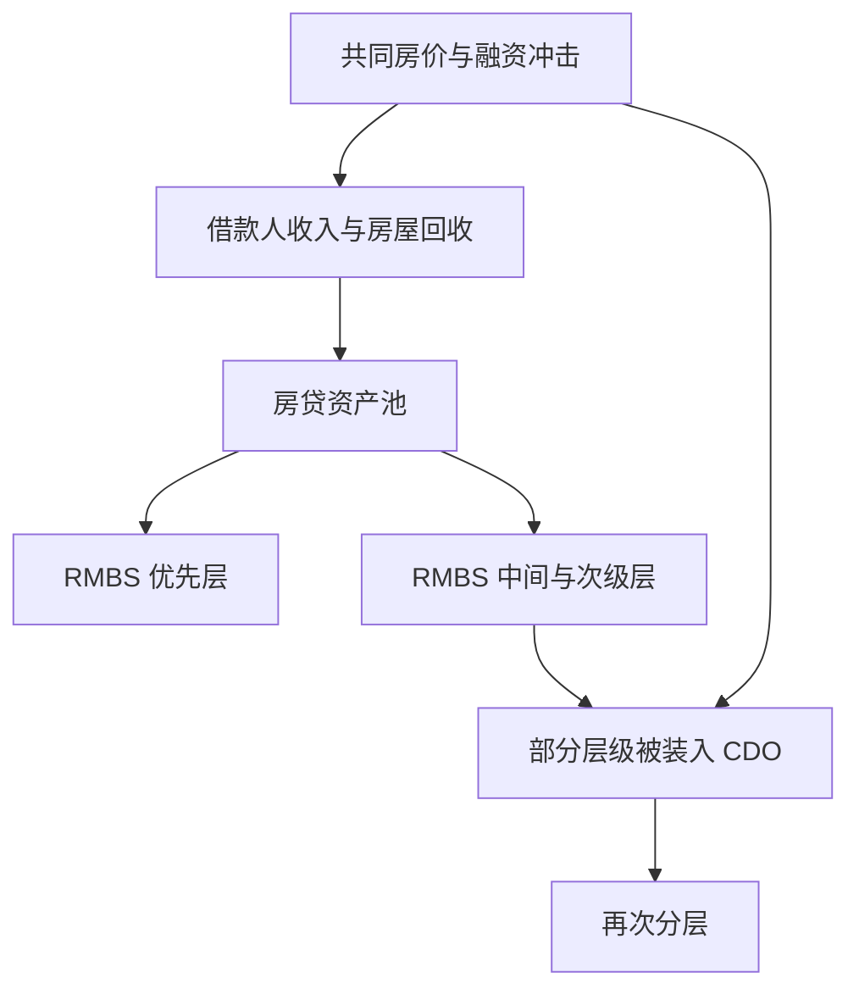
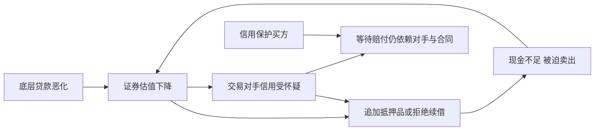

# 《大空头》读书笔记

> 作者：迈克尔·刘易斯（Michael Lewis）。原书 *The Big Short: Inside the Doomsday Machine*，W. W. Norton，2010 年。中文译本和页码未确认。本文基于出版社介绍、作者授权节选及监管、国会和美联储一手资料，整理原书主要叙事与相关金融机制；未取得全书，**不是逐章全文精读**。技术推导和后续监管案例明确作为补充教学，不把它们全部说成书中内容。本文讨论书籍，不以电影对白、改名人物或合并情节充当历史记录。

## 这本书最有价值的地方

书中少数投资者发现：很多房贷与证券的安全性，建立在房价持续上涨、借款人可以不断再融资的前提上。他们尝试利用信用衍生品押注这些证券恶化，并经历了费用支出、估值争议、投资人压力和交易对手风险。

最值得学的不是“大胆与所有人作对”，而是追问：钱最终从哪里来？谁检查资产？谁承担损失？专业机构的报酬是否与长期结果一致？即使判断正确，自己的合约和资金还能否撑到兑现？

原书是人物推动的金融纪实，强于呈现激励、盲点与交易者视角。它不是完整的危机宏观史，也不是可直接复制的做空教程。[出版社资料](https://wwnorton.co.uk/books/9780393072235-the-big-short)

## 先把故事与制度连接起来

| 叙事线索 | 要理解的问题 | 资料性质 |
|---|---|---|
| 史蒂夫·艾斯曼及团队研究贷款公司 | 财务报表为何可能掩盖贷款质量 | 作者采访与授权第一章节选 |
| 迈克尔·伯里研究贷款证券、寻找交易工具 | 判断错误定价后，怎样承担等待成本 | 作者授权节选，涉及当事人回忆 |
| 交易商与其他逆向投资者参与市场 | 信息为何存在，价格却迟迟不调整 | 原书主要叙事框架，本文不复原全部对白 |
| 评级、CDO、CDS 与投行资产负债表 | 风险怎样重新分配，又怎样集中 | 监管文件与补充机制讲解 |
| 市场失灵与危机爆发 | 个体获利为什么不等于社会受益 | 官方事件记录与独立分析 |

下文把主要知识组织为 36 点。英文缩写首次出现时解释；数字算例都是明示的教学演示，不能代替真实合约条款。

## 一、从最底层的贷款看风险

### 1. 一张证券的最终来源，是某个人或企业的付款

证券名称可以很复杂，但最终必须有人创造收入并支付现金。房贷证券的底层主要是借款人的还款以及违约后的抵押物回收，复杂结构不会凭空创造新的家庭收入。

分析时先把机构名称遮住，画出“谁付钱、为什么付得起、付不起怎么办”。如果必须靠下一轮资产涨价或融资才能完成付款，就不能只用历史利息收入证明资产安全。这种穿透思路同样适用于上市公司的应收账款、融资租赁和客户预付款。

### 2. 次级贷款不是“所有借款人都会违约”

次级房贷通常面向信用状况相对较弱的借款人，但不同贷款在首付、收入验证、利率、地区和承保年份上差异很大。风险高不等于损失必然为百分之百，更不意味着所有贷款都涉及欺诈。

判断贷款池，要看风险分布，不能只看平均信用分数。平均值相同的两个池子，可能一个比较均匀，另一个同时包含很安全与极危险贷款；二者对分层证券的影响可能不同。

### 3. 抵押物价值与还款能力，是两种不同的安全来源

稳定工资可以支持每月还款；房屋抵押则主要影响违约之后能收回多少。用房价上涨代替收入验证，相当于把持续经营的现金流保障换成未来出售资产的希望。

房价下跌可能让借款人失去再融资渠道，也提高贷款的损失率。但并非所有负资产借款人立刻停止还款，失业、储蓄、法律制度和个人选择仍有作用。完整分析应同时考虑违约概率和违约后的损失程度。

### 4. 低初始月供会掩盖后续偿付压力

有些贷款设置短期优惠利率、只付利息或低额付款安排，后续月供可能上升。负摊还则表示当期付款不足以覆盖应计利息，未付部分计入本金，债务余额反而增加。

因此要读的是整个现金流时间表，而不是销售材料上的第一年月供。利率重设、付款重算和贷款到期不是同一个时点，具体合同可能不同；不能把所有可调整利率贷款说成统一的“两年后翻倍”。

### 5. 再融资依赖会把房价与违约连成反馈

当借款人的还款计划是到期再借新钱，贷款安全就同时依赖房价、银行信贷标准和市场资金。房价不再上涨时，原本看似低风险的周转路径可能突然中断。

这不要求房价先暴跌。仅仅“涨不动”就可能使高额贷款无法覆盖交易费用或满足新的抵押率要求。随后被迫出售增加、价格承压，又让更多借款人失去融资空间。分析房地产与相关金融资产，要研究反馈，而非只外推前几年的违约率。

### 6. 发放后出售，会改变放贷人的激励

如果贷款发放者主要按数量赚手续费，而长期损失转移给后手，就可能更愿意扩大业务、放松审查。这个问题叫激励错位：作出决定的人与承担后果的人不完全相同。

**真实案例：华盛顿互惠银行。**美国参议院 2011 年调查，以该行及其相关贷款业务为案例，记录了高风险贷款扩张、内部警告与风险控制不足，并批评监管未及时纠正。这里引用的是国会调查结论，不把每项指责都称为法院已经作出的刑事判决。[参议院调查发布材料](https://www.hsgac.senate.gov/subcommittees/investigations/rep/senate-investigations-subcommittee-releases-levin-coburn-report-on-the-financial-crisis/)

应避免另一个极端：证券化不等于放贷机构完全不承担风险。它们还可能保留库存、担保、回购义务或部分证券。正因为风险没有彻底转走，资产恶化仍会反噬参与者。

### 7. 贷款增长能把早期坏账“稀释”在总量中

贷款刚发放时往往尚未出现全部损失，新贷款又快速进入分母，总体逾期率可能暂时漂亮。因此要按发放批次比较：同样经过六个月或十二个月，较新批次表现是否变差？

这叫账龄或批次分析。它避免把“资产还年轻”误读成“审查特别严格”。不同行业也有类似问题：新店快速开张可以掩盖老店衰退，新客户增长可以掩盖续费不足。必须比较相同成熟阶段。

### 8. 会计盈利必须与贷款实际回收交叉验证

**书中真实研究活动，由作者叙述。**授权第一章节选介绍艾斯曼与团队检查次贷公司数据、怀疑增长和会计处理掩盖业务质量的过程。其教学价值在于从披露资料核对盈利来源，而非把作者转述的每句判断都当成监管认定。[作者授权第一章节选](https://www.wbur.org/hereandnow/2010/05/14/the-big-short)

可迁移的检查方法是：利润是在收到现金时确认，还是在出售贷款、估计未来收益时确认？关键假设变动会让利润改变多少？坏账、提前还款和回购要求由谁承担？

如果利润依赖多年以后的现金流估计，就要检查模型假设和历史误差。确认收入早于回款本身不一定违规，但会增加估计风险，不能一概称作虚假利润。

## 二、证券化与分层：风险可以搬家，不能消失

### 9. MBS 是把房贷现金流组织成可交易证券

MBS 指抵押贷款支持证券，住宅房贷支持证券常写作 RMBS。结构把大量贷款放入资产池，按约定把现金支付给证券持有人。它有连接资金来源、分配期限风险的正常功能。

复杂性在于：投资者看到的是证券，不一定直接接触借款人。贷款服务、催收、担保与法律隔离都影响现金回收。购买一个证券代码，并不意味着你已经理解底层资产和执行权利。

### 10. 分层改变损失顺序，不改变底层总损失

优先层先取得约定支付，次级层先承担损失，这使同一资产池可以形成不同风险的证券。但“优先”只是相对于其他层级，不等于不会亏损。

**数学演示，非真实交易：**资产池本金为 100，最先承担损失的权益层为 5，中间层为 10，优先层为 85。暂时忽略利息、提前偿还、触发条款和时间。

| 资产池最终损失 | 权益层损失 | 中间层损失 | 优先层损失 |
|---|---:|---:|---:|
| 3 | 3 | 0 | 0 |
| 8 | 5 | 3 | 0 |
| 20 | 5 | 10 | 5 |

损失 8 时，中间层损失率为 3÷10＝30%；底层损失率仅 8%，中间层却已明显受伤。损失 20 时，优先层也开始受损。分层的核心不是把风险平均摊薄，而是让不同证券在不同损失区间承担风险。

检查真实产品，除了顺序，还要看信用增级、现金流触发机制和回收时间。上表只能解释原理，不能拿来替代评级模型。

### 11. 高评级主要是信用判断，不是随时原价卖出的承诺

信用风险关心约定款项能否支付；流动性风险关心需要出售时能否找到买家及成交价格；市值波动又受利率和风险偏好影响。高信用评级不等于这三种风险都很低。

一只证券即使最终偿付较好，中途也可能大幅跌价。对不用借钱且能持有到期的人，与必须每日补保证金的人，其生存意义完全不同。资产质量必须与持有方式一起判断。

### 12. 分散失效，往往来自大家共享同一个假设

房贷分布在不同城市，并不代表风险独立。全国融资条件、就业冲击和房价预期可能同时影响大量借款人。平稳时期观察到的相关性，也未必适用于压力时期。

理解这一点，可以用极端比较：一百笔互不相关的小损失，和一百笔都依赖同一种再融资条件的贷款，对优先层的危险不同。平均违约概率相同，尾部共同违约的概率不同，分层结果就可能差异巨大。

做投资组合时，也要穿透基金名称、公司行业和地区标签，检查是否共同依赖低利率、地产需求或同一批客户。资产数量多，不自动等于风险来源多。

### 13. CDO 可以把已有证券重新组合，再次分层

CDO 指担保债务凭证，其资产可以包含债券、贷款或其他证券。本书背景中尤其要注意：把房贷证券的中间层收集起来，再分成不同层级，会使结构更加复杂。

如果这些中间层都对同一种房价下跌敏感，重新包装并不会消除共同风险。看上去底层证券很多，但它们可能已经是各个池子中对损失最敏感的一段。分析不能停留在第二层产品的评级和名称。

### 14. 多层嵌套会增加模型、数据和治理负担

CDO 再持有 CDO 的结构，有时被称为 CDO 平方。嵌套越深，越难迅速确认共同底层资产、损失传导和合同触发条件；模型稍有误差，也可能在非线性分层中被放大。

但“复杂”不是“必定违法”的同义词。关键是复杂性是否服务真实融资需求、投资者是否理解，以及收益是否补偿新增风险。若产品只有销售人员能解释，而投资者不能自己还原现金流，应承认能力边界。

图是结构示意，不表示所有 RMBS 都进入 CDO。风险最终仍连着底层付款；层级变多，并不会增加借款人的工资。

### 15. 评级机构也面对收入、产能和声誉之间的冲突

**真实案例：SEC 工作人员 2008 年评级检查。**报告检查三家评级机构在次级 RMBS 与相关 CDO 评级中的做法，发现部分流程披露和记录不足、持续监测弱于初始评级，以及利益冲突管理问题。报告明确属于工作人员检查结果，不等于 SEC 委员会逐项作出司法性质裁决。[2008 年原始检查报告](https://www.sec.gov/files/craexamination070808.pdf)

发行人付费模式可能使机构在严格标准和保住业务之间产生压力，但不能凭此断言每名分析师都故意造假。模型局限、业务增长和组织流程，也可能共同导致错误。

学习要点是建立第二条核验渠道。把评级当作一项输入，继续检查底层质量、压力情景与评级变化；如果监管、投资授权和风控系统都只机械引用同一个评级，错误可能被同步放大。

## 三、CDS 与合成交易：押对方向仍不等于兑现

### 16. CDS 转移的是约定信用风险

CDS 即信用违约互换。保护买方向保护卖方支付费用，发生约定事件或损失时按合同获得补偿。它可以对冲已有信用风险，也可以用于建立信用方向敞口。

“像保险”只是一种帮助理解的类比，不能把它当成普通保险合同；是否须持有相关资产、怎样定义触发事件、如何结算，都要看产品和当时制度。房贷证券 CDS 还可能有针对利息短付、本金减记等安排，与标准企业 CDS 不完全相同。

### 17. 购买保护有持续成本，时间属于投资命题的一部分

看空资产并不意味着立刻获利。买方可能必须先支付多年费用；如果预期事件迟迟不发生，或者在合约到期后才发生，经济判断与交易结果就会分离。

**数学演示：**保护名义本金为 100 万元，简化为每年支付 2 万元、三年后平仓，已付费用共 6 万元。平仓收到 20 万元时，忽略其他成本的结果是盈利 14 万元，而不是 20 万元；若保护到期失效且未获赔，则费用可能全部损失。

真实交易还可能有首付款、融资、抵押品、交易费用和不同结算结构。不能只按“潜在赔付÷一年费用”计算收益率，也不能把整个名义本金当作必然获得的赔款。

### 18. 名义本金、净风险和最大损失不是同一个数字

名义本金是计算支付的基数；实际风险取决于持仓方向、合约抵销、违约回收、抵押品与交易对手。一个机构的买卖双边交易可能产生很大的名义总额，但净敞口相对较小。

然而净额也不代表一切安全：抵销能否法律执行、对手是否同一主体、现金流发生时间是否匹配，都会影响压力。读到“衍生品规模巨大”的报道，应先问统计的是总名义金额、净市值还是潜在损失。

### 19. 合成 CDO 不必再买一套真实房贷

通过 CDS 等合约，可以让一组投资者承担参考资产的信用损失，另一组投资者从恶化中获益。它增加的是围绕既有资产的信用风险合约，不必同时向新的购房者发放同等规模贷款。

因此相同的底层风险可以被多份合约引用。把“参考资产金额”直接当成新增住房融资，会误解资金流；认为衍生品零和就没有系统影响，也会忽略杠杆、抵押品和破产外部性。

### 20. 产品选择权和信息披露，是交易公平的重要部分

**真实案例：ABACUS 2007-AC1。**SEC 2010 年公布与高盛达成 5.5 亿美元和解安排，争议涉及合成 CDO 营销材料未充分披露对冲基金 Paulson & Co. 在参考资产选择中的作用及其做空利益。高盛 2010 年年报记载法院于当年 7 月 20 日批准和解。[SEC 和解公告](https://www.sec.gov/newsroom/press-releases/2010-123-goldman-sachs-pay-record-550-million-settle-sec-charges-related-subprime-mortgage-cdo)、[高盛 2010 年年报](https://www.goldmansachs.com/investor-relations/financials/10k/docs/2010-10-k.pdf)

这不是本书所有交易的共同模板，也不等于证券亏损本身就证明欺诈。关键问题是对投资决定有重大影响的信息是否充分披露，以及选资产的一方是否有相反的经济利益。

这里的约翰·保尔森是对冲基金投资者，不是时任美国财政部长亨利·保尔森。两人中文姓氏相同，不能混为同一个人。该和解发生在原书出版之后，作为后续官方案例补充。

### 21. 看对底层风险，还必须选择能活下来的交易对手

信用保护越值钱，保护卖方可能越困难。如果对方在应赔付时倒闭，纸面盈利未必变成现金。抵押品可以降低风险，却仍有估值、追加、法律执行和时间差问题。

**真实案例：AIG。**2008 年 9 月 16 日，美联储授权纽约联储向 AIG 提供最高 850 亿美元的担保信贷额度，用于应对到期义务和避免无序失败。这是当时的授权上限，不等于当天实际全部支付，也不是整个救助过程的最终总成本。[美联储原始公告](https://www.federalreserve.gov/newsevents/pressreleases/other20080916a.htm)

AIG 事件说明大型机构承诺也要接受压力检验；它的困境还涉及证券借贷等业务，不能把全部问题都归结为单一 CDS 合约。政府后来介入，也不能成为预先默认对手永远安全的理由。

### 22. 估值权会影响你什么时候“看见”盈利

不活跃的场外产品未必每天有大量独立成交。报价可能依赖交易商模型与主观输入；同一个人既是交易对手，又参与估值时，存在利益冲突的可能。

书中关于伯里的授权节选写到其研究贷款证券并面对交易与估值困难。这里把它当作作者对当事人经历的叙述，不将人物判断升级为每个交易商均违法的结论。[作者授权伯里节选](https://www.vanityfair.com/news/2010/04/michael-lewis-excerpt-201004)

实际可学的是预先确定估值来源、争议处理和退出条款。自己认为公允价值很高，与现在能按这个价格成交，是两件事。

### 23. 资金期限必须覆盖论证期限

如果投资逻辑可能需要三年验证，而资金随时可能被赎回、融资每周滚动，那么“最终看对”没有解决生存问题。基金经理还要面对委托人的容忍度，个人投资者也有生活现金需求。

所谓长期资金，不是口头声明长期持有，而是没有迫使你中途卖出的合同和现实负担。应把最坏持续费用、可能追加的抵押品和必要生活支出一起列出，再判断能承受多长等待。

### 24. 做空不同资产，表达的并不是同一个判断

看空房价、看空房贷信用、看空银行股票，针对的变量不同。房价可能下降但贷款仍正常偿付；银行股票可能因政策或融资改善反弹；信用保护也可能因期限或对手问题失效。

因此交易工具要与证据对应，而不是找到任何名字相近的证券就替代。本文不提供当前做空渠道和个别证券方案；书中的美国场外衍生品条件，也不能直接当作今天其他市场的可用规则。

## 四、从个人交易走向系统性危机

### 25. 金融机构可能同时卖产品、持库存和对冲

一家投行不是单一方向的头寸。销售、交易、融资与资产管理业务可能具有不同风险，部分部门做空不代表整家公司已经没有多头损失。

这解释了为什么“某交易员早就看空”与“该机构后来亏损”可以同时发生。分析银行需要合并风险视角，不能把一个成功团队的盈利当成集团整体安全的证据。

### 26. 短期融资会把市值下跌转化为现金危机

机构用短期资金持有较长期、较难出售的资产时，融资方提高抵押折扣或拒绝续借，就会形成即时现金缺口。即使某些资产最终能回收，机构也可能等不到那一天。

数学演示：价值 100 的证券原可借 95，机构自有资金支持 5；融资条件改为最多借资产价值的 80%，若价格仍是 100，就需补出 15。若价格同时下跌，缺口还会扩大。这里的抵押折扣变化，与资产已经发生最终信用损失不同。

### 27. 被迫出售能把一家的问题传给其他持有人

机构急售资产压低成交价，其他机构据此减记或面临追加抵押品，进一步出售，形成恶性循环。共同资产、短期融资和相同风控动作可能让原本独立的机构同步承压。

图解释了为什么看空方向的人也未必完全置身危机之外：他依赖的交易、托管和结算体系，可能正是被冲击的体系。

### 28. 危机有累积过程，不能只记住雷曼一个日期

贷款质量恶化、证券评级调整和融资紧张，在 2008 年秋天以前已经出现；贝尔斯登危机在 2008 年 3 月，雷曼于同年 9 月进入破产程序。秋季恐慌是放大阶段，不是所有问题突然从零开始。[FDIC 历史时间线](https://www.fdic.gov/history/2000-2009)

读历史时应给每项资料标记“当时已知”还是“事后披露”。如果用事后完整损失倒推每个人当时应该知道的一切，会制造虚假的简单感；但存在不确定性，也不等于所有预警都不可见。

### 29. 系统获救，不等于原股东获救

稳定支付、信贷和融资市场，可能同时伴随原股东稀释、管理层更替或部分投资者损失。政策对象与证券回报不能混为一谈。

这也是不能靠“太大不能倒”盲目买入的原因。政府可能保护某些经济功能，却不保护原来的股权价值。讨论历史救助时，要具体写明救的是谁的什么义务，而不是笼统说“政府保底”。

### 30. 解释危机不能只剩“人很贪婪”

贪婪难以解释为什么危机在特定时间、经由特定结构爆发。更有用的问题是：短期奖金、融资成本、资本约束、评级依赖和信息不对称，怎样使危险行为在当时看起来有利可图？

道德责任可以讨论，但不能替代机制。只有把激励和传导画清楚，才能判断改革是否改变了真正的问题；只换一批人，却保留同样的奖励和损失安排，未必能消除风险。

## 五、怎样把这本书变成财商与逻辑训练

### 31. 逆向思考的起点是可核验差异，不是反对多数

多数人可能错，也可能正确。有效的逆向判断至少要指出：市场依赖哪个假设、你有什么不同证据、为什么其他人没有充分反映它，以及什么事实会证明自己错了。

若唯一理由是“别人都很乐观”，只是情绪上的反向跟随。独立判断需要材料、计算和更新机制，而不是把孤立感误认为洞见。

### 32. 先研究别人为什么愿意与你交易

交易对手可能信息不足，也可能有不同期限、监管约束、对冲需要或更准确的判断。不要一看到对手报价就默认他愚蠢。

写下三种竞争解释：自己看到了错价；自己遗漏了合约风险；双方目的不同而价格未必错误。只有比较这些解释，才有资格谈优势。书中个别成功交易，不证明所有高赔率机会都来自市场失智。

### 33. 叙事选择会放大幸存者偏差

我们读到的是最终成功、能够接受采访并被作者选中的人。采取类似立场但时机错误、成本过高或资金耗尽的人，不一定同样进入故事。

所以不能从赢家数量估计策略胜率，也不能从人物性格反推成功原因。要检验策略，需要同时观察未成功案例、当时可获得的信息和完整成本。纪实作品擅长帮助理解经历，不能自动提供代表性样本。

### 34. 把事实、作者解释与自己的推断分成三栏

事实栏记录文件确认的贷款条款、公告日期和交易安排；作者解释栏记录人物如何理解这些事实；推断栏记录自己认为它们意味着什么。

例如“AIG 获得最高 850 亿美元额度”是公告事实；“它为什么对系统重要”包含官方判断和机制分析；“所以所有大型金融机构以后都会被救”则是未经证明的外推。分栏能显著减少故事对判断的偷渡。

### 35. 用现金流审查热门金融产品

财商补充检查顺序：找最终付款人；列全部费用；识别最先承担损失者；查看中途退出与估值；核对担保或保护的法律主体；再研究极端情况下哪些假设会一起失效。

这比先问历史收益率高不高更重要。高收益可能是风险补偿，也可能是暂时低估费用或损失；单靠漂亮的收益曲线无法区别。无法说明亏钱路径的产品，也谈不上真正理解赚钱路径。

### 36. 把危机故事转化为防错能力，而非英雄模仿

你最能稳定获得的收获，是减少对评级、名气、短期利润和复杂包装的盲信，学会检查自己的资金期限与风险集中。并非每个人都需要找到“下一次大空头”。

有时最好的决定是少承担一种无法理解的风险、保留流动性，或者暂时不交易。它没有故事结尾那样戏剧化，却更接近日常财商的可重复改善。

## 练习与参考答案

**练习一：本金 100、权益层 5、中间层 10、优先层 85 的简化结构，底层损失 12 时各层怎样？**

参考答案：权益层损失 5，中间层损失 7，优先层暂不损失；中间层损失率为 70%。忽略时间与其他条款时，总损失仍是 12，分层没有把它消除。

**练习二：一份保护每年付 2 万元，等待三年后收到 20 万元平仓款，盈利多少？还缺什么信息？**

参考答案：简化盈利为 14 万元。还需核对首付款、融资、交易费用、抵押品成本、税费和实际付款时间，不能把 20 万元称为净收益。

**练习三：房贷分布在十个城市，为什么仍可能高度集中？**

参考答案：借款人可能共同依赖相似的再融资、宽松信贷和全国房价趋势。地理标签不等于风险独立，需研究共同驱动因素和压力相关性。

**练习四：文章写“合成产品赔了钱，所以构成诈骗”，哪里不足？**

参考答案：亏损不能单独证明虚假陈述或重大遗漏。应核对披露、利益冲突、资产选择过程和适用法律；区分监管指控、和解条款和法院判决，不能混写。

**练习五：把“我能预测危机”改成一个可检验的研究问题。**

参考答案示例：某类贷款新发放批次在同账龄时的逾期是否连续恶化？恶化是否超出证券增级保护？这些信息何时披露、价格已反映多少？这个问题比笼统预测崩盘更便于取证和纠错。

## 资料与覆盖边界

本笔记展开贷款、证券化、分层、CDO、CDS、评级、融资反馈和逆向判断，简写人物私人经历和逐笔交易。授权节选支持有关艾斯曼与伯里的有限叙述，监管与官方材料支持相应制度案例；不把来源混成一种证据等级。

完整理解危机，还需补充宏观信贷、影子银行挤兑、监管制度和国际资金流。美国金融危机调查委员会报告包含多数意见与不同意见，可从 [政府出版目录](https://www.govinfo.gov/app/details/GPO-FCIC/summary) 继续查阅；不能把任何一份调查的全部因果判断表述为学界毫无争议的共识。
