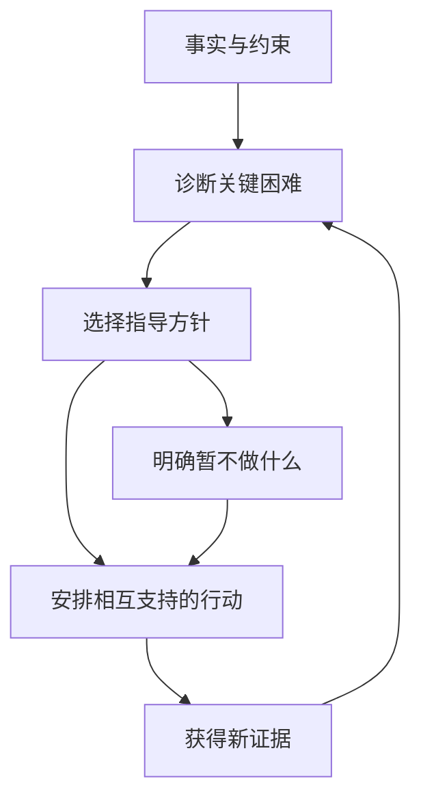
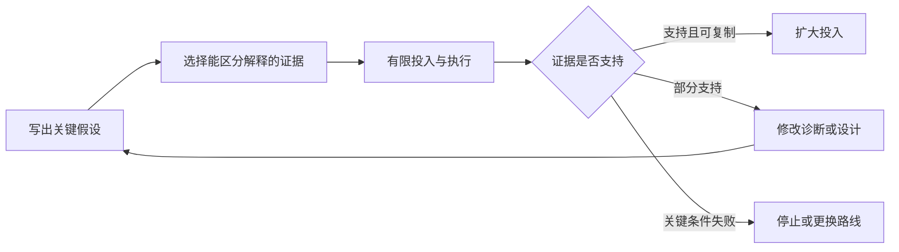

# 《好战略，坏战略》读书笔记

> 作者：理查德·鲁梅尔特（Richard P. Rumelt）。原作 *Good Strategy Bad Strategy: The Difference and Why It Matters*，Crown，2011 年，中文具体译本未确认。未取得全书；依据出版社书目、公开目录、作者署名文章和文中一手案例资料整理主要思想，属于系统导读与方法教学。30 个编号为自拟学习结构；不为未取得的原书段落编造页码。现代案例与财商练习均为补充。核验日期：2026-11-12。

很多所谓战略，只是愿望加上漂亮的表达：成为第一、提高利润、拥抱未来。本书最有价值的提醒是，战略必须面对具体困难，并解释有限资源为什么要这样投入。它不要求每次都准确预言未来，而要求判断、选择和行动之间有可检查的联系。

书的主要主题包括识别坏战略、战略内核、寻找力量来源，以及培养战略思考。本笔记重点帮助你读懂上市公司战略叙述：哪些内容确实解释了问题，哪些只是增长目标；管理层的预算和行动有没有兑现自己的判断。[出版社书目](https://www.penguinrandomhouse.com/books/208668/good-strategy-bad-strategy-by-richard-rumelt/)、[公开目录](https://library.tcdc.or.th/record/view/b00032491)

## 一、识别看起来像战略的东西

### 1. 战略从障碍开始

目标描述想去哪里，战略处理到达那里必须克服什么。目标可以很重要，但它不会自动告诉你客户为何不购买、成本为何过高、组织为何难以合作。

实用检查是把“提升”“打造”“领先”等词去掉，看看剩下的内容是否还说明了困难与行动。如果一个计划可以套在任何企业身上，通常没有提供足够诊断。也不要反过来认为只有危机中的公司才需要战略：增长机会同样存在资源、能力和竞争约束。

### 2. 坏战略不等于最后失败的战略

好判断也可能遭遇不利事件，坏判断偶尔也会因好运成功。书名中的“坏”主要针对思考与设计上的缺陷，而不是用结果给过去贴标签。

投资者尤其容易根据股价重新讲故事：上涨时把所有行动称作远见，下跌时把同样行动称作盲目。应当回到当时可得信息，检查关键假设、替代选择、资源约束与执行逻辑。事后结果提供更新证据，但不能替代对决策过程的评估。

### 3. 四种坏战略特征

作者归纳的典型问题包括：回避真正挑战，把目标当战略，战略目标本身没有可行抓手，以及用空泛术语代替分析。它们经常同时出现。[作者署名文章《The perils of bad strategy》](https://www.mckinsey.com/capabilities/strategy-and-corporate-finance/our-insights/the-perils-of-bad-strategy)

分析者可以把它们转成四个问题：困难到底是什么？打算改变哪项条件？近期由谁做什么？为什么这些动作能够起作用？这是本文的应用检查，不是保证成功的四步配方。某个战略文件没有写清细节，也可能因为商业保密，不能仅凭公开篇幅判定公司毫无思考。

### 4. 空话的危险在于无法检验

“以客户为中心”“提升协同”“引领数字化”不一定错，但如果不对应客户选择、资源配置和行为改变，就很难证明对错。空话可以让不同部门各自理解为自己原本想做的事，表面一致，行动仍然分散。

处理方法是要求翻译：客户的哪项成本会下降？哪个流程将改变？谁负责？放弃什么？使用什么证据判断有效？翻译之后依然没有区别的口号，可以作为价值宣言，却不能承担战略解释的工作。

### 5. 财务目标是结果要求，不是因果模型

营收增长、利润率提升或资本回报提高，通常是企业希望得到的结果。要实现它们，需要解释销量、价格、成本、周转或资本投入发生什么变化，以及竞争者为什么不会立即抵消收益。

目标越激进，越需要具体机制支持。把增长率从 10% 改成 20%，不会让市场规模、客户需求和团队能力随之翻倍。读预算时可以逐项写出“这个数字由哪项经营改变支持”，缺少解释的部分就是待验证假设，而不是确定成果。

### 6. 不能选择，常常比没有信息更致命

不同部门有不同诉求，组织容易用一长串优先事项维持表面平衡。但资本、人员和管理注意力都有上限，所有事同时优先，实际等于没有优先。

做出选择不仅意味着拒绝差项目，也可能意味着暂时拒绝不错却不适合当前约束的项目。判断战略清晰度，可以看管理层明确停止了什么、预算怎样改变、哪类机会被暂时放弃。会议口头一致而资源分配不变，通常不足以证明选择已经发生。

## 二、把战略内核讲明白

### 7. 三个部分：诊断、指导方针、协调行动

诊断解释核心困难；指导方针选择处理困难的总体方式；协调行动把选择落实为相互支持的具体步骤。三者不是文档格式要求，而是判断链：事实如何支持判断，判断如何支持行动。

图中有反馈环，所以战略不是写完后永远执行。若事实变化或诊断被推翻，需要修改方针和行动；只是不断改目标，却不修正因果解释，属于另一种忙碌。

### 8. 诊断不是把所有事实重新列一遍

现实信息很多，诊断的作用是找出对当前问题最关键的限制。它必须简化，否则无法集中行动；也必须能解释证据，否则只是偏见。

可用三层写法：先陈述观察，例如客户数上升但利润下降；再提出候选机制，例如低毛利订单占比提升、服务成本上涨或一次性损失；最后寻找区分机制的证据。不要一看到利润下降就宣布“管理不善”，因为这种结论太宽，无法指出可执行改变。

好的诊断还应说明为什么其他常见解释不够。若核心是库存结构，单纯提高总流量可能加剧问题；若核心是产品不适合客户，增加销售人员可能只是放大获客费用。诊断有用之处在于减少错误行动，而不是显示知道很多名词。

### 9. Target 案例：销售增长并不能定位利润问题

Target 在 2022 年第二季度披露销售与客流继续增长，同时营业利润为 3.21 亿美元，同比下降 87.0%；公司把库存调整措施列为利润压力的重要原因。这是该季度的实际结果与公司解释，不能推广为全年永久趋势。[Target 当季业绩公告](https://corporate.target.com/press/release/2022/08/target-corporation-reports-second-quarter-earnings)

若只看到利润下降，就诊断成“没有人来购物”，接着扩大促销和拉新，可能没有处理真正约束。这个案例提示把问题拆成需求规模、商品结构、库存与履约成本。已有客流并不保证商品以原定毛利售出，旧库存的处理也可能挤占未来经营空间。

投资应用是对管理层解释提出可核验追踪：库存金额和结构怎样变化，折价是否减少，采购是否调整，经营现金流如何反映。这不是认定公司的所有调整都正确；公告给出了检验起点，后续表现才帮助判断行动是否有效。诊断与“给公司找理由”不同，前者必须允许证据否定自己。

### 10. 指导方针必须排除一部分行动

指导方针处在抽象目标和具体任务之间，它说明遇到权衡时按什么原则分配资源。例如优先解决现有客户交付瓶颈，与优先进入新地区，会产生不同预算和人员安排。

一个方针若可以支持任何行动，就没有帮助选择。检验方法是提出两项冲突机会，观察方针能否给出倾向，并说明代价。它不需要预先决定所有细节，但应让各部门在分散决策时仍朝同一关键问题努力。

### 11. 协调行动不等于大量行动

相互支持的行动可以通过时间、资源、技术和组织安排配合。相反，十个好项目若争夺同一批工程师、争取互相矛盾的客户，组合起来也可能很差。

分析项目时可画依赖关系：哪一步是另一项成功的前提，谁需要先交付，瓶颈在哪里，失败后是否会连带其他项目。没有这些关系的任务清单，只描述工作量，未必形成战略。行动越多，越需要证明协调收益大于复杂性。

### 12. 英伟达早期图形芯片案例：把方针变成组织安排

鲁梅尔特在 2011 年署名文章中，用英伟达早期图形芯片竞争说明内核：面对性能竞赛压力，公司通过缩短新品节奏，并安排重叠研发团队、仿真验证等活动支持这一选择。这是作者对历史的分析性叙述，不是关于今天人工智能市场的预测。[作者原文案例](https://www.mckinsey.com/capabilities/strategy-and-corporate-finance/our-insights/the-perils-of-bad-strategy)

教学重点是动作之间的关系。如果只是要求工程师“更快推出”，但测试、驱动和制造衔接不变，速度目标可能转化为错误和返工。组织安排要处理实现目标的实际约束，而不是把压力往下传递。

对投资者，判断研发战略应找资源组织与产品周期是否匹配的证据，而不只是看费用增长。这个案例也不意味着越快越好：在不同技术成熟度、质量要求和客户采用周期下，过快迭代可能浪费资本。历史成功帮助解释机制，不能把某种节奏当成所有行业的标准答案。

### 13. NASA 案例：登月目标与登月方法是两回事

NASA 历史资料记录，1962 年 7 月 11 日宣布以月球轨道交会作为阿波罗登月方案。与让完整飞行器直接着陆等替代路线相比，这一选择涉及飞行器分工、质量、交会技术和开发任务的取舍。[NASA 官方历史](https://www.nasa.gov/history/60-years-ago-nasa-decides-on-lunar-orbit-rendezvous-for-moon-landing/)

“完成登月”表达目的；选择任务架构才开始回答怎样完成。架构一旦选定，后续设计、试验和资源安排才有共同边界。这个例子说明战略必须减少关键不确定性，使许多团队能够开展可协调的工作。

但历史成功不能证明当时方案毫无风险，也不能把复杂工程成就归为一次决定。方法选择、技术验证和组织执行共同重要。对于企业，类似问题是先确定解决客户问题的基本方式，再规定阶段试验，而不是从一个宏大愿景直接跳到收入预测。

## 三、寻找少量资源产生较大效果的地方

### 14. 杠杆来自关键约束，不来自增加口号强度

本书讨论的杠杆，可以理解为找到对结果有放大作用的位置。它可能来自识别变化、集中力量，或移除限制其他活动发挥作用的障碍。

不要把战略杠杆与金融负债杠杆混为一谈。前者关心因果位置，后者会放大财务收益与损失。提高负债并不能修复错误的产品定位，甚至可能减少等待与试错空间。财商应用中，先找到经营收益来源，再讨论融资结构，避免把资金更多误认为战略更强。

### 15. 近程目标是把难题变成可推进的任务

近程目标不是把长期目标的日期提前，而是选择凭当前或可取得能力能够完成、完成后又显著降低下一阶段困难的任务。它应有可观察结果和明确责任。

例如一项新业务尚未证明客户会支付，近期核心任务可能是完成真实付费测试，而非立即建立全国销售网。此处是教学情境，不是公司事实。目标的价值在于获得关键证据，避免在最大不确定性仍未解决时把资本大量锁定。

### 16. 链条式系统不能只强化已经很强的部分

在必须多项条件共同满足的系统中，某个关键环节失败会限制整体效果。投入最擅长或最容易展示的环节，未必提高系统产出。

**数学演示**：若三个独立环节必须全部成功，各自成功率为 90%、90%、50%，整体成功率为 40.5%。把第一个提高到 99%，整体为 44.55%；把第三个提高到 80%，整体为 64.8%。真实业务未必独立，也未必能直接用概率相乘；示意只用来说明应定位约束，而不是给管理问题制造虚假的精确度。

实际检查应包括依赖、容量和恢复能力。一个环节的改善会不会把瓶颈移到下游？旧瓶颈解决后，投资重点是否需要改变？瓶颈是一种动态关系，不是永久给某个部门贴上的标签。

### 17. 设计使不同选择相互支持

战略设计不是追求复杂，而是让有限资源围绕关键任务配合。产品范围、技术架构、渠道、组织激励和资金节奏应支持同一逻辑。

如果企业承诺高度定制，却用只能处理标准产品的流程；要求长期客户关系，却只奖励当期签单数量，就会出现内部抵消。外部投资者可从费用、员工激励和客户投诉观察这些矛盾，但需要保留公开信息不完整的限制。设计解释潜在机制，不意味着单凭一张图就能证明实际执行。

### 18. 聚焦是相对资源配置，不一定是业务越少越好

聚焦要求把足够力量集中到关键目标。多业务企业也可能聚焦于共同能力；单一业务企业也可能在产品、地域和客户上分散注意力。

因此不能用业务数量直接判断专注程度。更实用的是看新增资本、骨干时间和组织激励流向哪里，是否与核心诊断一致。停止项目的价值也不在于数量多，而在于释放的资源确实转向有证据支持的任务。

### 19. 增长必须带来价值，不能只是规模变化

增长会扩大收入，也可能扩大亏损、营运资金占用与组织复杂度。购买其他公司的收入尤其容易让报表增长快于内生能力。

补充财商计算：若新增资本长期回报低于资金成本，增长可能增加经营规模却减少经济价值。外部读者应关注新增业务的现金流、维护投入、客户获取成本与退出代价。高增长不是错误，但需要回答收益是否足以补偿投入与风险。

### 20. 微软手机业务减值：资源投入不能证明战略有效

微软 2015 年年报记录，手机硬件业务确认约 75 亿美元商誉及资产减值。应使用年报实际确认口径；当年 7 月新闻稿曾披露约 76 亿美元估计，二者不应混写成同一个精确值。[微软 2015 年年报](https://www.microsoft.com/investor/reports/ar15/index.html)

减值说明历史账面价值需要调整，不等于当年又支付了相同金额现金。它也不能单独告诉我们原始决策为何失误。战略分析要回到客户选择、生态、产品、竞争和组织整合的原始假设，检查哪些没有实现。

这个案例用于抵抗一个常见推理：既然投入很大、收购规模很大，战略就一定坚定且有价值。投入是需要解释的成本，不是成功证据。复盘也应避免反向简单化，把后来成功的业务当作当时唯一显而易见的选择；应比较当时可行方案与信息，而非利用后来知识责怪一切尝试。

### 21. 优势要看相对稀缺性与可保留收益

一种能力人人都容易获得，就可能成为参与竞争的基本要求，而不是超额收益来源。企业具有某种优势，也未必能以任何价格购买相关资产而获利。

对投资者，战略优势与投资优势是两层：前者解释企业能否持续创造收益，后者还要求证券价格没有提前支付过多收益。优秀战略可以被昂贵估值抵消；低价格也不能自动修复持续毁损价值的业务。不要用管理学故事替代估值。

### 22. 顺应变化要区分趋势、机制与时点

技术、成本结构、监管或客户习惯变化，可能重新分配优势。识别趋势之后，还要判断谁受益、收益怎样实现、需要多久，以及竞争者会怎样回应。

“方向正确”不保证期限正确。若资本支出早于需求兑现很多年，融资与折旧压力可能先出现。研究变化可分成技术可行、商业可行和规模可行三个阶段，各阶段证据不同；行业新闻不应直接替代企业现金流假设。

### 23. 惯性不总是懒惰

既有流程、客户承诺、人员技能和资源分配标准可能与旧业务高度适配，因此难以迅速调整。组织抵抗变化有时是担心损害仍在赚钱的活动，而不只是管理者固执。

解决惯性要辨认它来自哪里：流程不匹配需要改流程，激励冲突需要改评价，能力缺口需要培养或引入能力。仅更换口号甚至更换领导，未必改变日常资源选择。对新战略，应观察预算规则和责任机制是否真的变化。

### 24. 熵可以理解为组织在缺少维护时逐渐失序

这里是管理上的类比，不是把物理学公式直接应用于公司。项目不断增加、例外越来越多、职责越来越模糊，会让资源偏离原本重要的活动。

定期清理无效项目、统一必要标准和维护关键能力，可能与扩张同样重要。研究企业时不宜只赞赏新业务数量，还要看旧系统是否得到更新、重复流程是否减少、权责是否清楚。复杂度增长可能隐藏在管理费用和交付错误里，不能只用收入增长覆盖。

## 四、把战略当作可以更新的判断

### 25. 战略假设应当接受实验和反证

面对不确定性，可以先用规模有限、反馈及时的行动测试关键假设。实验不是把所有事情无限延后，而是在投入更多不可逆资源前获取重要信息。

应事先明确观察指标、验证时间、继续条件和停止条件。否则任何结果都可能被解释为“还需要更多投入”。还需识别试验与规模化的差别：少量高关注客户成功，不证明普通客户在常态服务下也会成功。

图中停止不是失败羞耻，而是学习后的资源选择。扩大投入也有条件：先确认结果可复制，不能把一次偶然成功当成稳定规律。

### 26. 独立判断需要主动寻找竞争解释

第一种解释往往最容易被记住，特别是它符合既有持仓和管理层叙述时。可以要求自己提出至少一个能解释相同事实、却导向不同决策的假设。

例如利润上升可能来自竞争优势，也可能来自周期价格或一次性收益。接着寻找能区分它们的数据，而不是平均对待所有解释。独立思考不是故意反对共识，而是让证据而非社交压力决定自己保留哪一种判断。

### 27. 预测结果与设计行动需要分开

预测讨论世界可能怎样变化；战略讨论在可用资源下怎样行动。即使无法准确预测销量，也能设计更有弹性的采购、阶段投入和备用方案。

反过来，预测正确也未必产生收益：买入价格太高、融资安排太脆弱或兑现时间太长，都可能使方向判断无法转化为回报。财商训练应该同时记录预测与行动逻辑，复盘时分别评价，避免把亏损全部归于“市场没按预期走”。

### 28. 评价管理层战略的六格表

| 格子 | 应写什么 | 常见空缺 |
| --- | --- | --- |
| 挑战 | 具体障碍与约束 | 只有市场空间 |
| 诊断 | 最关键机制及证据 | 只有结果指标 |
| 方针 | 资源取舍原则 | 什么都想做 |
| 行动 | 责任、顺序、相互依赖 | 只有项目名称 |
| 代价 | 资本、人员与机会成本 | 只列协同收益 |
| 反证 | 哪种事实要求修改 | 任何结果都合理 |

这张表是本文的补充工具。公开披露不足时，应写“未取得证据”，不能把空白自动判为不存在；同样，管理层写得完整也不保证执行。应通过后续资源与结果检查言行是否一致。

### 29. 把方法用在个人财商学习

个人目标“提高财商”过于宽泛，可先诊断目前最需要改进的是报表理解、估值、风险管理还是证据判断，再选择一条主线。行动可以是阅读一份年报、写一页研究、用新数据复盘同一家公司。

这里不假定你的资金、经验或持仓。学习设计应先形成能力，再考虑真实资金使用；模拟研究与实际交易的情绪和约束不同。近程目标可以是能解释利润和现金为何不同，而不必把短期投资收益当作学习质量的唯一证明。

### 30. 练习与参考答案

**练习一：** “未来三年营收翻倍，成为行业领导者”缺少什么？

参考答案：缺少关键挑战、竞争机制、资源取舍和协调行动。目标可以保留，但必须补充销量、价格、渠道或产品改变的依据，以及资本和人员条件。

**练习二：** 利润下降但销售增长，能否先诊断为流量不足？

参考答案：证据不足。应检查商品结构、折价、成本、库存与一次性事项。Target 案例表明两者可以同向增长与反向变化，不能用一项结果替代诊断。

**练习三：** 收购后确认减值是否等于当年流出相同现金？

参考答案：不是。减值主要是对账面价值的调整，现金支付时间和金额需要另查。它是检查原始战略假设的重要证据，不独立提供全部失败原因。

**练习四：** 试验失败后继续投入，是否一定是在坚持战略？

参考答案：要看失败是否触及预先定义的关键假设。如果核心条件被否定却不调整，可能是沉没成本影响；若只是可修复执行问题且有新证据支持，继续试验可能合理。不能仅凭“坚持”或“止损”两个标签判断。

## 能学到什么与来源导航

你应能把一个战略叙述拆成事实、诊断、方针、行动和反证，解释目标与方法的区别，并用资本配置检验口号。本文覆盖主要思想与若干力量来源，没有逐一复述原书所有军事、企业及个人访谈案例；作者的历史分析属于论证材料，不能当作随机实验所证明的普遍因果规律。

| 资料 | 用途 |
| --- | --- |
| [出版社书目](https://www.penguinrandomhouse.com/books/208668/good-strategy-bad-strategy-by-richard-rumelt/) | 原作与出版信息 |
| [公开目录](https://library.tcdc.or.th/record/view/b00032491) | 主题范围 |
| [作者署名文章](https://www.mckinsey.com/capabilities/strategy-and-corporate-finance/our-insights/the-perils-of-bad-strategy) | 内核、坏战略特征与英伟达历史叙述 |
| [NASA 月球轨道交会历史](https://www.nasa.gov/history/60-years-ago-nasa-decides-on-lunar-orbit-rendezvous-for-moon-landing/) | 目标与方法 |
| [Target 2022 年二季度公告](https://corporate.target.com/press/release/2022/08/target-corporation-reports-second-quarter-earnings) | 利润诊断 |
| [微软 2015 年年报](https://www.microsoft.com/investor/reports/ar15/index.html) | 资本投入、减值及复盘口径 |

延伸：[《竞争战略》](<../竞争战略 - 迈克尔·波特/读书笔记.md>)、[《超级预测》](<../超级预测 - 菲利普·泰特洛克、丹·加德纳/读书笔记.md>)、[《学会提问》](<../学会提问 - 尼尔·布朗、斯图尔特·基利/读书笔记.md>)。
