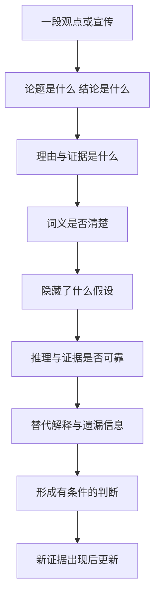
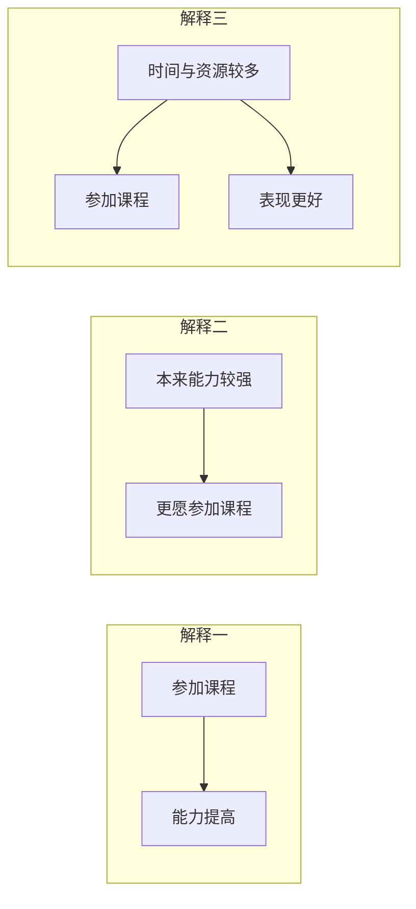

# 《学会提问》读书笔记

> 作者：尼尔·布朗（M. Neil Browne）、斯图尔特·基利（Stuart M. Keeley）  
> 原书：Asking the Right Questions: A Guide to Critical Thinking。本笔记按**原书第 12 版**的主要框架整理。简体参考版为许蔚翰、吴礼敬译，机械工业出版社，2021 年，ISBN 9787111680925；见[新华书店书目信息](https://item.xhsd.com/items/110000103245062)。  
> 版本说明：本书有多个原书版本及不同中文装帧、对照版，章节组合与练习可能不同。用户持有版本未确认，本稿不声称对应全部版本，不使用混合页码。  
> 分析依据：出版社公开目录、书目信息与核心概念整理；没有用户提供的原书，未逐页核对全部例证。  
> 覆盖范围：主要提问框架、32 个知识点、论证图解、财报与投资宣传应用、练习及检查表。  
> 更新日期：2026-11-11

## 先看这里：这本书教什么

**一句话概括：面对一个有说服力的观点，先弄清它在主张什么，再逐层检查理由、假设和证据，最后形成与证据强度相称的判断。**

它教的不是怎样让别人回答更多话，而是怎样判断一段话是否值得相信。表达者可能是真诚的，论证仍可能薄弱；结论可能恰好正确，给出的理由仍可能不够。

用于提高财商时，它最重要的作用，是帮助你拆开这些不同层次：

- 产品宣传说了什么，与合同承诺了什么。
- 公司业绩确实改善了什么，与市场故事推断了什么。
- 一个人曾经赚钱，与其方法是否能持续有效。
- 某项投资可能有收益，与它是否适合你的目标和约束。

最值得先掌握的六件事：**找到结论、问出理由、澄清词义、挖出假设、检查证据、考虑别的结论。** 不必每次把全部问题机械问完，先抓住最影响结论的环节。

## 全书结构与阅读路线

[Pearson 第 12 版官方目录](https://www.pearson.com/en-us/pearsonplus/p/9780137501731.html)可核对全书的提问顺序。下面用简短主题概括，不逐字复刻目录。

| 章节主题 | 主要任务 | 本笔记对应 |
| --- | --- | --- |
| 第 1 章：提问的态度和方法 | 从被动接受转向主动判断 | 1—4 |
| 第 2—3 章：论题、结论、理由 | 先把论证找出来 | 5—8 |
| 第 4 章：语言中的歧义 | 确认双方讨论同一件事 | 9—10 |
| 第 5 章：价值与描述性假设 | 找出没说出口的桥梁 | 11—13 |
| 第 6 章：推理谬误 | 检查支持关系有没有断裂 | 14—15 |
| 第 7—8 章：证据质量 | 评估经验、权威、观察与研究 | 16—21 |
| 第 9 章：替代原因 | 避免仓促认定因果 | 22—23 |
| 第 10 章：统计信息 | 检查数字怎样产生和呈现 | 24—27 |
| 第 11 章：遗漏信息 | 找到可能改变判断的缺口 | 28 |
| 第 12 章：合理结论 | 超越非黑即白 | 29—30 |
| 第 13 章：思考障碍 | 对自己的偏见也保持警惕 | 31—32 |



文字理解：先确认自己没有误读别人，再评价其论证；最后得到的可以是支持、反对、部分支持，也可以是信息不足。批判性思考不是每次都要推翻原观点。

## 一、先建立合适的提问态度

### 1. 批判性思维：按理由和证据决定相信到什么程度

这里的批判不是刻薄、挑刺或永远反对，而是主动检查一个结论的支持是否充分。它允许承认别人说得好，也允许修正自己的原判断。

### 2. 海绵式与淘金式思维：吸收信息和筛选信息需要配合

海绵式强调学习、理解和记忆；淘金式强调选择、质疑和判断。没有知识储备，质疑容易变成空泛怀疑；只吸收不检查，又容易把观点都当成事实。

### 3. 弱势与强势批判：是否也愿意检查自己偏爱的观点

弱势批判把提问当成维护既有立场的工具，只挑对方的问题；强势批判对双方使用相近标准，也愿意改变自己。

### 4. 好的提问需要好奇、谦逊和尊重

谦逊指承认知识与判断的局限，好奇指愿意理解不同解释，尊重指不把观点分歧直接变成人格攻击。这些态度能让更多信息进入讨论。

## 二、先找出论证，再评判它

### 5. 论题：这段话究竟想回答什么问题

论题可能是描述性的，讨论事实如何；也可能是规定性的，讨论应该如何做。两种问题所需的支持不同：知道会发生什么，不自动决定该怎样选择。

### 6. 结论：作者希望你接受的主张是什么

结论不一定在最后一句，也不一定有“所以”作为提示。寻找结论时，问“作者最终想让我相信什么或做什么”。如果无法准确复述，就还不适合反驳。

### 7. 理由与证据：为什么这些信息支持这个结论

理由是支持结论的陈述，证据为这些陈述提供依据。两者可以交叉：一份可靠统计既可能是证据，也可能被直接作为论证的理由。

### 8. 论证结构：前提成立，还需要推理连得上

一个论证需要分别检查：事实是否可靠，事实与结论是否相关，以及支持力度够不够。前提是真的，不表示随它而来的所有结论也是真的。

**真实财报：美的 2026 年前三季度利润分化。** 报告披露归母净利润为 413.93 亿元，同比增长 9.27%；扣非归母为 287.88 亿元，同比下降 22.49%。公司同时解释了汇率及相关风险管理工具分类的影响。[原报告第 2—4 页](https://static.cninfo.com.cn/finalpage/2026-10-30/1225645132.PDF)

第一步，只写原表支持的命题：两种利润口径变化方向不同。不要立刻把归母增长改称主营全面改善，也不要把扣非下降改称主营全面恶化。

第二步，找从数字走向经营结论的桥梁。如果要判断可持续盈利增强，需要了解利润组成、经营业务和损益的持续性；公司给出的分类解释是应核验的线索，不能替代对全部经营因素的分析。尤其不能把两种利润的全部差额都归为某一项汇兑收益。

第三步，单独检查从经营判断走向投资行动的桥梁。即使确认竞争力改善，仍需购买价格、市场隐含预期、风险与资金期限的信息。报告没有因为利润增长就自动证明当前股票便宜。

因此，当前材料能支持的是“应拆开研究利润构成及其变化”，而不是直接买入或卖出。这里练习的重点是把事实、解释和行动三层分开；[完整原表与计算](../实战案例/2026三季报图解.md)可用于核对，但本节的推理已经成立，不依赖读完另一篇才理解。

### 难点图解一：理由和结论之间，往往藏着假设


这个补充示意只展示部分桥梁，不能当成完整估值方法。它说明：即使起点事实正确，仍需核查转化过程和当前价格，才能靠近投资结论。

## 三、检查语言和未说出口的前提

### 9. 歧义：同一个词是否承载了不同意思

一个词有多种解释，而这些解释会改变结论时，就必须澄清。歧义不限于形容词，也包括数字的单位、期间和定义。

**真实事件：1999 年火星气候轨道器失联。** NASA 的任务资料说明，英制与公制单位未正确转换造成导航计算错误，使探测器过分接近火星。这不是一次“算得不够精确”，而是传递的数值与接受方预期的意义没有对齐。[NASA 任务记录](https://science.nasa.gov/mission/mars-climate-orbiter/)

这里可学到的逻辑检查是：双方即使使用相同名称，也未必指向同一测量量。财报中的“增长”“净利润”“现金”“亿元”，同样必须连着期间、主体、单位和定义阅读。数字在一个环节没有单位，后面再精确的小数也修复不了最初的口径错误。

NASA 的事故调查还涉及组织和检验流程；不能把复杂事故简化成某个人粗心。这个案例用于说明定义对齐为什么是推理前提，不是据此认定所有含糊表达都会造成同样严重后果。

### 10. 情绪用词与说服性定义：有些语言先替你作了评价

“聪明资金”“落后观念”“优质赛道”等词，会把赞许或贬低放进描述里，使读者在核查事实前已经站队。有时定义本身就把想证明的结论装了进去。

### 11. 价值假设：不同结论可能来自不同的优先级

价值假设涉及什么更重要，例如收益与安全、效率与公平、眼前消费与未来储备。分歧有时不是事实不清，而是双方排序不同。

### 12. 描述性假设：关于世界如何运作的隐含信念

描述性假设声称某些事实或因果关系成立，例如过去规律会继续、样本代表总体、某措施能够改变结果。它们即使没有明说，也可能支撑整段论证。

### 13. 怎样挖出假设：寻找理由到结论之间缺失的桥梁

把理由和结论写下来，再问：还必须相信什么，才能从这里走到那里？最值得查的假设，是一旦不成立就会改变结论的那一条。

**接着分析第 8 点的真实美的财报。** 从归母利润增长走向持续经营能力增强，需要增长与持续经营有关；从持续经营增强走向投资有吸引力，又需要价格尚未充分反映这些信息。这是两条不同的推理链，不能只用同一个 9.27% 填补。[实际数据与说明](https://static.cninfo.com.cn/finalpage/2026-10-30/1225645132.PDF)

可以做反事实检查，但要明确这只是检验假设：若增量主要来自不稳定损益，经营结论还成立吗？若价格早已反映很高的未来增长，行动结论还成立吗？这些问题不是在宣称实际公司必然处于上述状态，而是定位需要哪些证据。

随后把问题转为可查资料：第一条查利润调整表、分部与多期表现，第二条查价格及估值中的预期。能想象出一个反例，只说明原推理并非必然；要判断现实中哪种解释更合理，仍需要证据。

区分关键假设与一般背景也很重要。某项不确定性只有在它足以改变价值、风险或选择时，才值得成为本轮重点。把所有未知都列出来却不分轻重，会让分析失去方向。

## 四、识别推理谬误，但不要沉迷贴标签

### 14. 常见谬误：理由看起来热闹，却没有完成支持任务

识别谬误最有用的方式，是说清哪一步没有成立，而不只是报出名称。以下是补充示例：

| 常见问题 | 补充例子 | 怎样继续问 |
| --- | --- | --- |
| 人身攻击 | “他没赚过大钱，所以分析必错” | 分析的数据和推理具体错在哪里？ |
| 稻草人 | 把“控制风险”改说成“永远不投资” | 对方实际主张是什么？ |
| 虚假两难 | “现在买，否则永远没机会” | 还有等待、少量研究或其他选择吗？ |
| 诉诸人气 | “大家都买，所以可靠” | 人气能证明哪个关键属性？ |
| 不当诉诸权威 | “名人推荐，所以适合你” | 专业领域、证据与个人条件是否匹配？ |
| 循环论证 | “这是好产品，因为它很优秀” | 是否给出了独立理由？ |
| 滑坡 | “错过这次，以后一定越来越穷” | 中间每一步的因果证据是什么？ |
| 转移话题 | 被问费用，却不断谈使命 | 原问题是否得到回答？ |

有些风险链条或专家判断确实有根据，不能只因形式相似就自动判为谬误。

### 15. 理由有问题，不等于结论必然相反

一个人用错误理由支持结论，只能说明这条论证不充分，不能直接证明结论为假。这是批判性思维中非常重要的克制。

## 五、检查证据有多好

### 16. 证据的分量取决于它要支持多大的结论

证明“这件事可能发生”，一个可靠案例也许有用；证明“多数人都会这样”，就需要代表性的资料；证明“某措施导致了变化”，还需要更强的因果识别。

### 17. 个人经验、见证与案例：具体，但可能不具代表性

个人经验容易理解，也能提供重要线索；局限在于样本小、记忆有偏、条件可能不同，且不容易看见没有成功的案例。

### 18. 权威证据：看专业适配、透明度和独立性

专家与机构提供的信息有价值，但必须核对专业范围、原始证据和可追溯性。信誉可以帮助决定先调查什么，不能替代对关键主张的核验。

**真实监管案例：Theranos 对产品使用情况的陈述。** SEC 在 2018 年公布的民事指控中称，公司曾声称技术被美国国防部用于特定场景，而监管调查认为该部署说法不实。公司与 Holmes 当时同意解决相关指控但不承认或否认指控；这里引用的是该时点的指控和和解公告，不把它写成后来的刑事裁决。[SEC 原公告](https://www.sec.gov/newsroom/press-releases/2018-41)

“被重要机构采用”如果属实，可能是值得研究的外部证据；但把这句话写进介绍的人，并不等于那家机构本身。要拆成：谁在作声明，谁能独立确认，实际使用范围是什么，是否足以支持技术能力或商业前景。

因此，应寻找可核对的验证、合同或独立测试，而不是把多个转述同一句宣传的渠道，当成多份独立背书。本例支持的是核查权威声明来源的必要性，不是说知名人物或专业机构都不值得信任。

### 19. 个人观察与调查：看到什么，也受观察方式影响

调查必须连着收集方式阅读：谁有机会进入样本，谁主动参加，谁没有回答，以及调查究竟测了什么。更多回答能减少某些随机波动，却不能自动修复选人方式的偏差。

**真实对照：2014 年 TIME 读者投票与苏格兰公投。** TIME 自己公布的网上读者投票共 16,418 票，57.5% 支持独立；同年的正式公投结果是支持 44.7%、反对 55.3%。[TIME 对自身投票的报道](https://time.com/3394671/scottish-independence-poll-time-com-yes/)、[英国政府公布的公投结果](https://www.gov.uk/government/news/scottish-independence-referendum-whats-next)

这不意味着网上投票的加法错了，也不能把 TIME 的读者投票直接叫作失败的代表性民调。两者的人群和参与机制不同：愿意在网站点击的读者，不能未经证明就代表有资格投票并实际参与的选民。

所以看到“上万人支持”时，先问这一万人是谁，再问人数够不够。对应股票研究，论坛投票、产品爱好者群调查、只展示愿意回复的客户，都必须检查同一问题。结论应先限定为被观察到的样本；要推广到总体，需要额外的抽样与代表性依据。

### 20. 研究证据：看设计是否与主张匹配

研究结论的强度，取决于设计能排除哪些其他解释。仅观察到两组不同，不一定能把差别归因于你关心的因素。

**真实研究：预测训练与“高手选拔”不是同一种证据。** Mellers 等人的 2014 年论文报告，在地缘政治预测比赛中把参与者随机分配到不同训练及协作条件；但把第一年成绩最好的约 2% 集中到第二年的精英团队，是按既有成绩选拔。[原论文的方法与结果](https://faculty.wharton.upenn.edu/wp-content/uploads/2015/07/2014---psychological-strategies-for-winning-a-tournament.pdf)

随机分配有助于让初始差异在平均意义上得到平衡，因此训练组与对照组的比较更接近“训练有没有作用”。精英组则已经经过成绩筛选，不能把它与其他组的全部差距都解释成分组后某一次培训的效果。你必须先知道每组是怎样形成的，再看柱状图。

这一区别直接适用于理解课程或投资服务宣传：主动报名的人、主动留下评价的人、被筛选出的成功者，可能本来就与其余人不同。要检查起点、退出、共同环境和测量口径；单看期末结果，可能把选择过程当成教学效果。这里是从研究设计提炼的检查方法，不是在指称某家具体课程无效。

随机设计也不是结束检查的口令。任务参与、样本退出、结果计量和可推广范围仍须分析。研究中的参与者、任务和期限，与普通人的股票账户不同，不能直接推出照做便能获得同样收益。

**自测：**能否把精英团队第二年领先，解释为任何人只要被放进同样团队就能达到该水平？不能，原来的选拔与后来的团队环境同时存在，不能把选择差异抹掉。

### 21. 类比：相似之处必须与结论相关

类比能帮助理解，也可以提示可能性；但两件事表面相像，不意味着决定结果的机制相同。需要检查相似点与差异点哪一个更重要。

## 六、寻找替代原因

### 22. 一个结果可能有多个解释

看到变化后，人容易接受第一个顺手的原因。寻找替代原因，是主动检查还有什么可能产生相同结果。它要求比较解释的证据，而不是无穷无尽地提出想象。

### 23. 相关、先后和因果是不同关系

两个量一起变化，可能是 A 影响 B、B 影响 A、第三个因素同时影响两者，或偶然关联。A 先发生、B 后发生，也不足以单独证明 A 导致 B。

### 难点图解二：为什么同一组相关数据支持不同解释



这是假设性示意，不是在评价某门真实课程。观察到“参加者表现更好”后，需要进一步区分课程作用、自我选择与共同因素；不能只挑自己喜欢的一条路径。

## 七、把数字看清楚

### 24. 百分比要有分母、基期和口径

百分比必须与分母、基期、期间和指标定义一起阅读。“增长一倍”与“增加一个百分点”不同；某个净额的增长，也不等于其中一项收入的增长。

**真实财报：茅台 2026 年前三季度经营现金流。** 合并经营现金流净额由上年同期约 381.97 亿元增加到 840.59 亿元，同比增幅为 120.07%；销售商品、提供劳务收到的现金同期只增加约 3.41%。[原报告第 2、10—11 页](https://static.cninfo.com.cn/finalpage/2026-10-31/1225649896.PDF)

先把分母写清：`(840.59−381.97)÷381.97` 约为 120.07%，显示值经舍入。这是经营净现金的增幅，不是销售收款的增幅。经营净额把多项流入和流出加减后得到，某项支出减少，也会使净额增长。

再核对范围：合并报表包含财务子公司的项目。两项存款相关行的同比变化，合计解释了约 93.99% 的经营现金流增量；它们的变化不能被重命名为卖酒回款。[公司说明及原表](https://static.cninfo.com.cn/finalpage/2026-10-31/1225649896.PDF)

所以“经营现金流大幅增长”有公告支持；“卖酒回款翻倍”没有。即使把两项同比贡献减掉，也只得到其余项目的同比净变化，不是本期酒业现金流。这个案例说明：百分比的算术可以完全正确，语言中的分母或指标替换仍可能把结论带错。详细正负号可在[原表计算](../实战案例/2026三季报图解.md)复核。

读任何收益率、满意度或增长率，都可以依次写出本期、基期、两期差和总体。缺一项，就先缩小结论，不替来源补上未经证明的含义。

### 25. 平均数会隐藏分布

算术平均数、中位数和众数回答不同问题。总体平均不错，不代表多数人都不错；极端值可能显著拉动平均数。还应查看离散程度、分组和样本数量。

### 26. 收益率需要看复利、波动和完整期间

收益率需要同时说明观察期间、现金流、复利算法、费用和是否实际实现。“年化”是一种把不同期间转成可比尺度的计算，不表示已经经历完整一年。

**真实监管案例：把最初三周外推成年化 2,700%。** SEC 在 2023 年对 Titan 的行政处理公告中指出，其加密策略宣传使用高达 2,700% 的假设年化表现，却未充分说明依赖最初三周表现持续一年的假设。Titan 在不承认或否认监管认定的条件下同意相关处理。[SEC 原公告](https://www.sec.gov/newsroom/press-releases/2023-153)

这里应依次拆开三个问题：三周实际测到了什么，怎样把三周换成一年，以及后面几十周为何能保持同样条件。即使换算公式没有算错，外推前提也可能很强；一个短窗口的极端表现，更不能自动成为客户完整持有一年的真实收益。

只为了说明计算，若短期增长为 r、期间为 d 天，按全年持续复利的假设可写成 `(1+r)^(365/d)−1`。这里没有代入虚构公司业绩，也不反推 Titan 每一天的实际收益；公式强调的是，指数放大会把“以后也一样”的假设放大。

比较表现还要区分算术平均与资金复合增长。纯数学演示：先涨 50% 再跌 50%，财富乘数为 `1.5×0.5=0.75`，不会回到原点。这个小算式仅用于理解算法，真实的主体案例仍是上面的监管披露。

**读宣传时的检查顺序：**先找完整期间和真实账户或假设模型的标识，再看追加资金、费用、回撤与基准，最后才比较年化数字。没有这些条件，漂亮百分比无法独立证明投资能力。

### 27. 测量指标未必就是你真正关心的东西

一个指标可以被准确测量，却没有充分代表真正关心的目标。问题不只在算术，还在指标与目标之间的联系是否成立。

**真实事件：大众汽车排放测试。** 美国 EPA 的执法资料说明，涉事车辆使用能识别测试条件的软件，在测试与正常使用情境中的排放控制表现不同；相关民事和解涉及约 59 万辆汽车。[EPA 对案件与和解的记录](https://www.epa.gov/enforcement/volkswagen-clean-air-act-civil-settlement)

因此，“在某个测试里通过”不能脱离测试方式，直接等同“日常使用也达到相同表现”。本案涉及被识别的规避机制；不是一般统计误差，更不是证明所有测试或认证无效。

股票研究也应检查类似的代理关系：注册人数是否代表付费需求，订单是否可取消，收入是否转换成利润和现金。每次都要问目标是什么、指标怎样生成、哪些行为能改变指标而不改善目标。只有把这条链讲清，数字才有解释力。

## 八、遗漏信息与合理结论

### 28. 重要遗漏：哪些缺失信息可能改变结论

任何表达都会省略信息，关键是被省略的部分是否重要。常见缺口包括反例、成本、失败比例、适用人群、时间范围、风险、替代方案和不同利益方的影响。

### 29. 多个合理结论：支持、反对之外还有条件与程度

证据支持的结论有不同强度。可以确认一项事实，同时对原因、持续性和行动保留判断；这并不矛盾。

**回到美的实际利润分化。** 同一份三季报支持“归母增长”和“扣非下降”两个事实。非经常性损益净额为 126.05 亿元，且报告解释了部分分类影响；这些材料要求进一步研究利润构成，而不是简单选一个数字代表整家公司。[原报告第 2—4 页](https://static.cninfo.com.cn/finalpage/2026-10-30/1225645132.PDF)

| 层次 | 现在可以怎样说 | 尚不能越过的缺口 |
| --- | --- | --- |
| 事实 | 两种利润口径变化不同 | 不能把扣非直接叫主营利润 |
| 解释 | 分类与非经常项目值得拆解 | 不能把全部差额归给同一原因 |
| 持续性 | 需要更多分部和多期资料 | 不能凭单期累计数据确认长期趋势 |
| 行动 | 尚需估值与风险分析 | 不能直接得出当前买卖结论 |

形成多个结论，不是允许所有说法同样正确。每往下一层，都增加了需要证明的内容。末尾加一句“仅供参考”，也不能补上缺失的证据。

实际选择可与研究结论分开：信息不足时继续核查或暂缓承诺；是否值得追加研究，取决于信息价值、成本与后果。不必为了显得果断，把一个证据有限的判断写成绝对句。

### 30. 信息不足时，确信程度与行动强度也可以降低

没有完整证据时，不必假装已经知道答案。可以继续核查、寻找低成本试验、缩小承诺，或暂缓决定。不同决定需要的证据强度，应考虑后果与可逆性。

## 九、把提问也用在自己身上

### 31. 思考障碍：愿望、身份和熟悉感会改变证据标准

确认偏差会让人偏好支持自己的信息；信念固着让被削弱的观点仍难放下；可得性和光环效应让鲜明案例与好印象获得过大权重。知道这些名称只是开始。

### 32. 好问题应帮助交流，并留下可复查的判断

有效提问通常先准确复述对方，再指出最重要的不确定处。问完以后，应把已确认事实、待核查假设和当前结论分开记录，便于新信息出现时更新。

## 综合复盘：回到已经讲过的真实材料

遮住前面各节的分析，只保留原始来源，再尝试完成下表：

| 真实材料 | 要独立检查什么 | 参考答案方向 |
| --- | --- | --- |
| 第 26 点 Titan 年化宣传 | 三周窗口如何变成一年，哪些条件是假设 | 区分观察期与外推期，不能把假设年化当作客户完整一年真实收益 |
| 第 19 点网上读者投票 | 一万多份回答能否代表正式选民 | 先查入样与参与机制；样本大不自动解决代表性问题 |
| 第 8、13、29 点美的财报 | 利润事实经过哪些桥梁才到投资行动 | 分开事实、可持续性、价格及个人约束，逐层补证据 |
| 第 24 点茅台现金流 | 净额增速是否能代表单项销售回款 | 保持分母、合并范围与指标定义一致 |

这项复盘不再另编一家公司。重点是你能否从真实材料自己找出推理缺口，而不是记住本笔记的结论。原始来源就在对应知识点附近，核对时同时保留日期和数据口径。

## 一页可复用的提问清单

面对重要观点，优先回答下面十二问：

1. 我们究竟在讨论哪个问题，是事实判断还是行动建议？
2. 对方希望我接受的结论是什么？
3. 支持结论的理由有哪些，是否与结论相关？
4. 哪些关键术语需要具体定义？
5. 结论体现了怎样的价值优先级？
6. 哪些没说出口的事实假设连接了理由与结论？
7. 推理是否出现跳跃，或者只用情绪、身份和人气代替证据？
8. 证据来自哪里，收集方式能否支持这么大的结论？
9. 是否存在反向因果、共同因素或其他合理解释？
10. 数字的分母、期间、分布、费用和口径是什么？
11. 哪些遗漏的信息最可能改变我的判断？
12. 目前可以得出多强的结论，什么新证据会让我改变看法？

不需要在闲聊中逐条盘问。涉及投入大量金钱、时间、长期承诺的决定，更值得完整使用这套检查。

## 练习：每天拆一条观点

选一条财经评论或商品宣传，限时十分钟，写五行：

```text
结论：对方主张什么？
理由：主要支持是什么？
假设：哪个未说出口的条件最关键？
缺口：哪一条信息最可能改变判断？
当前判断：支持到什么程度，下一步查什么？
```

一周后比较自己的记录：是否更容易分清事实、推断与建议？是否经常只挑不喜欢的观点检查？是否能够在证据不足时保留判断，而不急于站队？

## 阅读边界

批判性思维不能代替专业知识。会提问能发现一份财报分析的缺口，但要回答这些问题，仍需会计、行业与估值知识。也不能把“可能存在另一个解释”当作足以否定全部现有证据的理由。

证据并非必须完美才有用。合理目标是提高判断质量，让确信与行动匹配证据，而不是把标准提高到永远无法作决定。知识较多的一方值得被认真听取，同时仍需要清楚说明依据。

这本书的框架适用于检验论证，不宜用来否定他人的感受。一个人在表达难过时，可能需要先被听见；事实判断、价值选择和情感支持，是不同的交流任务。

## 回顾：八个自测问题

1. **批判与反对有什么区别？** 批判检查依据，可以接受或修正观点；反对只是可能的结果之一。
2. **事实为真，结论就一定成立吗？** 不一定，事实与结论之间还需要合理联系。
3. **价值假设与描述性假设有何不同？** 前者关心什么更重要，后者关心世界事实上怎样运作。
4. **发现谬误是否证明结论为假？** 不证明，只说明该论证存在缺陷。
5. **为何案例不能自动代表总体？** 个案的选择方式与条件可能特殊，失败和未被观察者可能被忽略。
6. **相关关系至少要检查哪些方向？** 正向、反向、共同因素与偶然关联。
7. **平均收益为正是否说明多数人赚钱？** 不说明，需要分布、中位数、亏损比例和计算方式。
8. **好的结论为什么常带条件？** 因为证据、人群与环境有范围，条件让判断更准确也更容易更新。

## 来源与待补充内容

| 已查阅来源 | 核验用途 |
| --- | --- |
| [Pearson：原书第 12 版官方书页](https://www.pearson.com/en-us/subject-catalog/p/pgmtitle/P200000002371/9780137501731) | 作者、版本与总体教学目标 |
| [Pearson+：第 12 版目录](https://www.pearson.com/en-us/pearsonplus/p/9780137501731.html) | 主要章节与提问框架 |
| [新华书店：中文第 12 版](https://item.xhsd.com/items/110000103245062) | 中文参考版译者、出版社、年份与 ISBN |
| [Investor.gov：Performance Claims](https://www.investor.gov/introduction-investing/general-resources/news-alerts/alerts-bulletins/investor-bulletins-47) | 财商应用中对业绩宣传的核查原则 |

白话解释、分析步骤和练习为本笔记整理；真实事件、公司数字和研究结果在对应知识点附原始来源，纯计算演示另行标注。书外材料不冒充原书案例或引文。尚未取得用户所用版本，因此未覆盖其全部练习及版本独有增补；后续可按原书逐章补足定位。

---

[返回书籍索引](../README.md) · [财商学习与实践路线](../财商进阶合订本.md)
