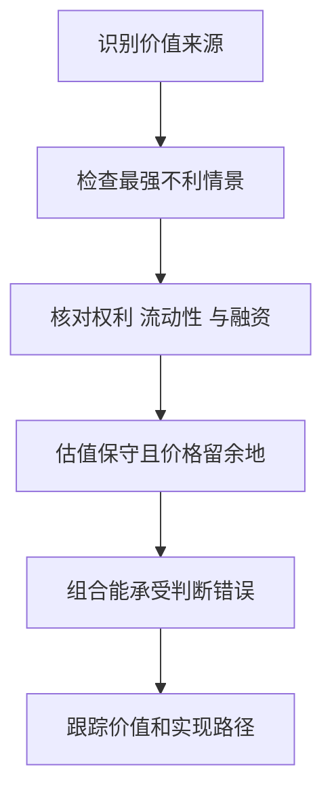

# 《安全边际》：先避免永久损失，再讨论收益目标

> 作者：Seth A. Klarman，塞思·卡拉曼。原作 Margin of Safety: Risk-Averse Value Investing Strategies for the Thoughtful Investor，HarperBusiness，1991 年，ISBN 9780887305108。具体中文译本与授权信息未确认，不把网上流传译稿当作已核验版本。  
> 资料范围：公开书目、目录、作者机构投资理念及原始金融案例支持的系统导读，未取得完整原书，不声称逐页精读。覆盖十四章主要主题，重组为 28 点。后续事件和教学推导不是原书预言。更新：2026-11-12。

## 核心问题与实际收获

投资首先要避免让一次错误摧毁继续参与的能力。你不能控制市场今年给多少回报，但可以控制购买价格、理解程度、融资结构和集中风险。卡拉曼讨论的是以保守判断组织投资，而不是追求每个季度都比别人涨得快。

读完应能够解释：价格与价值为什么会分离；哪些便宜可能是陷阱；现金为什么有成本也有选择价值；特殊事件为什么需要法律与时间分析；怎样把风险控制写进研究过程。

书目见[图书馆记录](https://openlibrary.org/books/OL24645155M/Margin_of_Safety)和[芝加哥公共图书馆](https://chipublib.bibliocommons.com/v2/record/S126C456080)，作者身份见[Baupost 官方介绍](https://www.baupost.com/Team/Seth-A-Klarman)。

## 主要内容地图

| 原书主线 | 核心问题 | 本文位置 |
| --- | --- | --- |
| 投资者容易失足之处 | 投机、华尔街激励、机构排名与垃圾债 | 1—7 |
| 价值投资哲学 | 目标、安全边际、风险与估值 | 8—16 |
| 研究与实施 | 机会、催化剂、改制、困境、组合与个人选择 | 17—28 |

## 核心知识点

### 1. 市场价格不是资产价值的裁判

上涨能吸引注意并提高信心，但不独立证明企业经济能力改善。下跌也可能是机会或坏消息，必须调查。

价值投资要求从资产、现金和权利反推可以支付的价格。若全部理由都来自价格最近涨得好，就没有完成独立价值判断。市场仍可能提供你遗漏的信息，因此独立不等于无视报价。

### 2. 投资与投机应按收益来源区分

如果主要依靠企业现金、资产兑现和有依据的价格差，分析可以围绕经济价值展开；如果主要押注以后有人更热情地买入，就更依赖市场情绪。

两者可能在同一资产上交织。诚实记录自己究竟依靠什么，比给行为贴一个体面名称重要。持有时间长，不会自动把缺少依据的购买变成投资。

### 3. 金融服务机构的利益可能与你不同

发行人希望筹资，承销商希望完成发行，销售机构可能依赖交易和产品费用，投资者则希望保留风险后的收益。各方可以合作，也可能出现冲突。

研究一项建议时应问谁付费、谁承担损失、推荐不同产品是否改变报酬。利益冲突不是建议必然错误的证明，却决定你需要怎样独立核验。不能因为资料包装专业就省略这一步。

### 4. 相对排名会改变风险承担

基金经理可能担心短期落后同业或基准，因而不愿持有现金，也可能追随热门资产以减少职业风险。但投资者真正关心的损失和期限，未必与排名考核一致。

个人可以不参加每一轮热门交易，却仍需要合理评价长期机会成本。避免排名压力不意味着永远拒绝基准比较；应当用适合目标的长期、成本后比较，而不是每周追逐名次。

### 5. 创新金融产品需要拆出基础现金流

复杂包装可以重新分配风险，也可能让风险更难看见。先问底层资产是什么、付款来自哪里、杠杆怎样发生、哪些事件会改变权利。

如果只有高收益宣传和结构名称，没有透明的现金与损失解释，便无法进行有效价值判断。复杂不自动等于危险，透明也不自动等于便宜；需要回到价格与承担条件。

### 6. 高收益债的高利率不等于高已实现回报

原书特别讨论 1980 年代垃圾债的错误观念。今天理解这一主题，仍应区分承诺票息、到期收益率和实际回收。违约、提前赎回、费用与交易价格会改变结果。

SEC 投资者教育资料将高收益债的高息与更高违约风险联系起来。[原始说明](https://www.investor.gov/introduction-investing/general-resources/news-alerts/alerts-bulletins/investor-bulletins/what-are-0)这不是说所有高收益债都应排除，而是不能只把票息当收益保证。

分析需要还原发行人的现金、资产、债务顺序和再融资。价格很低可能提供补偿，也可能反映回收很少；必须看具体义务和资金来源。

### 7. 表面稳定可能掩盖少见而严重的损失

**真实补充：Reserve Primary Fund 在 2008 年 9 月出现单位净值跌破 1 美元的情况，SEC 当时说明其公布净值为 0.97 美元，并涉及赎回支付限制。**[SEC 问答](https://www.sec.gov/divisions/investment/guidance/reservefundmmffaq.htm)

它提示“长期报价稳定”与“任何情况下本金和流动性有保障”不同。货币基金资产中仍可能有信用风险，集中赎回也可能改变变现条件。

这里不能把当年一只基金的事件推广为所有市场、所有货币基金都有同样风险，现行制度也有变化。实用做法是识别信用、久期、流动性和保障来源，而不是只凭历史波动小来定义现金替代品。

### 8. 先设损失约束，再讨论收益愿望

“希望每年赚某个比例”不会创造相应机会。机会不足时，为了完成目标而降低标准，可能使收益要求变成风险扩大机制。

可以先定义不可接受的后果：近期生活资金受损、必须追加保证金、长期计划被迫中断。再判断哪些投资安排与这些约束相容。这是目标管理，不是宣布未来不会亏损。

### 9. 永久资本损失与价格波动要分开

价格短期下跌可能不改变资产现金能力；企业经营永久受损、债权无法回收或普通股被注销，则不是等待报价恢复就能解决。

但波动也不能完全忽略：若存在借款、赎回或短期支出，价格变化会迫使交易，把账面损失转为实际后果。因此资产风险和投资者资金结构需要一起分析。

### 10. 安全边际来自对多种错误留余地

把安全边际拆开，会比只说“打七折”更有帮助。估值误差来自对正常盈利或资产用途判断不准；实现误差来自处置费用、等待期或治理限制；经营误差来自竞争和现金消耗；资金误差则来自自己的期限或融资安排。一个表面上很大的折价，可能同时被这些误差消耗。

分析者可以先列各层价值的证据：现金是否受限，资产出售是否有可靠买方，可持续收益是否已扣维持投入，股东是否有权获得分配。只有这些条件清楚后，价格折让才具有经济含义。先猜一个很高的价值再打折，不会因为折扣醒目就变保守。

价值估计可能过高，变现可能延迟，业务可能变坏，市场可能持续不认可。折价要覆盖这些风险，而不只是一个估值计算误差。

**数学演示：**保守估值 100、买价 70，并不意味着最大损失只有 30。实际价值若跌至 40，按该价格退出相对成本损失约 42.9%。安全边际是缓冲，不是保险合同。

### 11. 保守估值必须有依据，不能只把数字随意打折

对收入、利润、资产和资本成本的调整，应对应具体不确定性。任意把乐观结果乘 70%，可能仍很乐观；过度悲观也可能让所有机会看起来都不值得研究。

可列出正常与不利情景，并说明不利来自什么机制。估值区间的宽度反映知识边界，不能用一个精确折价比例掩盖缺少关键资料。

### 12. 多种估值方法用于交叉检查

交叉检查不是把三个数字平均。若资产法、盈利法和现金流法差异很大，先解释它们分别假设了什么：清算还是经营，当前能力还是未来增长，是否含债务和非经营资产。只有对象与口径统一，差异才可能提示真实不确定性。

更有用的表达是条件区间：在持续经营且不增长的条件下，价值来自哪些现金；若必须清算，哪些资产能回收、哪些费用先付；若成长成功，又需要新增多少资本。若最保守情景仍依赖多项乐观假设，就应修改区间，而不是单纯扩大折扣。

持续经营现金、清算、私有化或可比交易等视角，可以帮助发现不同假设。它们不是自动加总，也不应只挑最高结果。

若清算值很高而经营现金很差，要问资产能否真正出售、持续亏损是否会消耗价值、管理层是否愿意改变。差异本身常是研究问题的中心。

### 13. 有形资产也可能快速贬值

伯克希尔纺织设备的历史处置说明，专用资产即使购置成本高，行业需求不足时也可能实现很低价格。[1985 年股东信](https://www.berkshirehathaway.com/letters/1985.html)

因此，资产保护要看经济用途、其他买方、处置期限与负担。库存也可能过时，应收可能无法回收。账面折价不是现金底价，更不是资本损失上限。

### 14. 便宜与质量不能各自孤立

优质业务买得太贵可能没有余地，低质量业务若价格足够低也可能有价值，但需要更强的资产、时间与实现条件分析。

不能把“卡拉曼重视便宜”简化为只买衰退公司。其框架关注风险和价值之间的关系，证券类别和行业应服从实际机会，而不是风格身份。[Baupost 的机构理念](https://www.baupost.com/investment_philosophy)

### 15. 现金既有机会成本，也有未来选择价值

等待的价值在于保留日后行动能力，但不能只计算好处。现金会受通胀和机会成本影响，长期空仓也可能来自过度自信的择时。比较时应写明等待什么条件，以及目前研究不足和确实缺少合理价格之间的区别。

对个人学习者，现金管理还涉及明确期限的生活支出。资金不能承担长期等待时，不应因为某位基金经理可以持有多年，就假定自己也可以。这里不提供固定现金比例；书中的风险优先原则必须和具体资金用途结合，才可能转化为个人安排。

现金在上涨市场可能拖累相对表现，通胀也会侵蚀购买力；但它能应对义务，并在更好的机会出现时提供行动能力。

不能因为现金有价值就推出永远高比例持有，也不能因为现金回报低就必须全额冒险。比例应与实际资金目标、机会质量和流动性需要有关，本书不提供适合所有人的固定方案。

### 16. 风险控制要在买入时完成关键部分

投资后再补上“如果出事就卖”，可能来不及。流动性、相关性、杠杆、权利结构和资料可信度，都应在形成持仓之前评估。

止损能限制某些情景中的亏损，但跳空、市场关闭、流动性枯竭和执行失败可能突破计划。价值分析与执行安排应一起存在，不能各自承担对方全部责任。

图强调安全来自多层条件，没有任何一层能单独保证结果。

### 17. 机会可能来自制度约束和信息成本

某些投资者不能持有低评级、小规模或不符合指数的证券，某些机构需要在特定时间出售。复杂材料也可能提高研究成本。

这能解释价格偏离价值的可能来源，却不能证明每次强制出售都产生便宜。你仍需判断被卖资产是否值得拥有，以及自己有没有相应研究和持有能力。

### 18. 催化剂使价值实现更可见

资产处置、清算、合并、分拆、资本返还等事件，可能使市场价格与经济价值更快接近。事件越明确，某些时间不确定性可能降低。

但催化剂还带来执行、监管和融资风险。若事件失败后的价值很低，即使成功概率较高，也未必有正期望。不能把“很快会发生一件事”当成安全。

### 19. 微软与动视交易说明：宣布并不等于完成

**真实补充：英国 CMA 在 2023 年 4 月阻止原方案，后于同年 10 月批准经过调整、涉及云游戏权利安排的新方案。**[CMA 原方案说明](https://www.gov.uk/government/news/microsoft-activision-deal-prevented-to-protect-innovation-and-choice-in-cloud-gaming)、[后续批准说明](https://www.gov.uk/government/news/microsoft-concession-a-gamechanger-that-will-promote-competition)

案例显示，收购差价需要分析完成条件、条款改变和时间。公告收购价与现价之间的差额，不是可以直接称作无风险利息的钱。

实际研究要分别估计成功、延期和失败后独立经营的价值，并考察资金占用。不能因为后来完成，就倒推最早买入的人完全没有承担风险，也不能仅从阶段性受阻就断言永远无法完成。

### 20. 事件收益应按时间与失败后果比较

**数学演示：**花 95，成功取得 100，失败只值 70；假设成功概率 90%，未计时间和成本的期望终值是 97，期望差额 2。即使成功概率看起来很高，失败损失仍显著影响结果。

可再问两个问题。第一，怎样的成功概率才使未计成本的期望差额为零？解 `100p＋70(1−p)＝95`，得到约 83.3%。但这只是打平门槛，未补偿等待和风险，不是达到它就值得交易。第二，如果失败后的独立价值其实只有 50，打平概率会提高到 90%；尾部估值与成功概率同样重要。

如果事件预计半年完成，却拖延为两年，名义差额没变，资金占用和年化结果已经不同。实际收购还可能修改价格、支付方式或条款，不能把一次二元演示当作全部结果空间。用微软与动视案例学习的重点，就是把监管进展转换成条件更新，而不是看到报价便认定差额会兑现。

这个概率是教学假设，不是真实交易预测。如果完成时间延长、资金成本增加或失败价值更低，结果又会变化。年化计算可以辅助比较，但不能把不确定到期事件变成存款。

### 21. 分拆可能创造研究机会，也可能转移负担

分拆后公司可能因规模、指数或投资授权原因遭卖出，业务披露也可能更清晰。但新公司可能承担债务、养老金、关联采购或独立运营成本。

应读分拆文件，比较原集团中的利润与独立公司的完整费用。低关注度和被动卖盘是机会来源假设，不是价值证明。没有真实资产与盈利支持，复杂性不会自动带来回报。

### 22. 储蓄机构改制要保留历史与制度边界

原书讨论美国储蓄机构从互助形式转为股份形式的特殊机会。重点在转换后的资本、发行价格、认购安排和机构关注，而不是“存款人一定免费得到股票”。

具体参与权利取决于当时法律、章程、记录日和发行文件。本篇只说明历史研究思路，不给现行认购操作建议，也不能把美国历史安排直接套到其他国家的银行改革。

### 23. 困境投资首先分析请求权顺序

企业持续经营价值高于市场报价，不代表每一种证券都受益。担保债、无担保债、优先股和普通股，在重组中的位置不同。

旧 GM 的普通股最终注销，而业务资产继续由新主体经营，说明“公司获救”与“原股东获救”不同。[GM 官方股东说明](https://investors.gm.com/shareholders/stock-information)

在真正研究困境证券时，需要债权核定、优先顺序、合同、法庭程序和新资金安排。业务分析只是其中一部分，不能只靠低股价和名气参与。

### 24. 回收价值与回收时间必须一起估计

**数学演示**：不考虑额外风险，同样在两年后收到 100，若用 10% 的年回报要求折现，现值约为 82.6；在五年后收到则约为 62.1。这个差别只是时间价值，尚未扣法律支出或回收失败风险。

困境证券还可能先分配部分现金，之后多年等待剩余款项；收益应按各次现金流时间计算，而非用最终累计回收额除以买入价就称为年化回报。证券停牌、托管限制和非现金分配也会影响个人可执行性，不能只根据研究报告里的回收比例评估机会。

即使最终能收回一笔钱，漫长程序、费用、诉讼与资金占用也可能使回报不理想。越复杂的资产，越需要理解谁有权决定何时实现。

用很高的折现率统一处理所有不确定性可能不够。某些风险会使权利中断或改变分配，应当直接列出对应情景，而不只是让模型现值变小。

### 25. 杠杆可能使正确判断无法兑现

**LTCM 1998 年危机的官方历史说明，基金此前采用很高杠杆，市场压力和资金条件变化导致严重困境。**[美联储历史资料](https://www.federalreservehistory.org/essays/ltcm-near-failure)

一项价差以后可能收敛，并不表示投资者能承受收敛前继续扩大。融资方可以追加要求，相关资产可能同时失去流动性，强制出售又会压低价格。

这个案例不证明所有杠杆策略必败，而是说明资产价值与资金路径必须分开。个人读书应用可以从检查自己是否有被迫出售条件开始，而不是模仿机构的复杂仓位。

### 26. 分散应针对损失机制

一组事件交易可能分别涉及医药、科技和消费，但同时依赖监管批准或信贷市场畅通；一组资产折价股可能分别持有土地、厂房和证券，却都受同一融资收缩影响。行业名称不同，不代表坏结果独立。

可以把组合研究改写成共同压力表：若融资成本提高、市场成交减少、法律程序延长或同一商品跌价，哪些项目会一起恶化？这比仅数持仓个数更能发现集中风险。它仍不能穷尽未来相关性，因此保留误差空间与流动性约束仍有意义。

多个不同证券若共同依赖某次收购完成、同一银行融资或同一种商品价格，其风险并不独立。组合需要同时查看正常收益来源和压力损失来源。

不能为了分散而买不理解的资产，也不能因为有安全边际就忽视集中。任何单一估值都可能错，组合安排应让你有机会修正，而不是一次证明所有判断。

### 27. 买卖是持续比较，不是证明自己

买入成本影响已实现收益，却不决定未来机会。重新判断时，应比较从今天起可能获得的现金、承担的风险和替代用途，而不是为了回到成本价才愿意退出。税费和流动性会影响决定，但需要单列，不能把不愿承认错误包装成长期投资。

同样，价格上涨后仍有合理价值，不必只为锁定账面盈利而卖出；价格下跌后价值受损，也不必为了降低平均成本继续买入。动作应由新证据与价格关系决定。

持有某项证券之后，新增资金是否还应投入，需要重新比较价格、价值与替代机会。原先支付的成本不决定未来合理选择。

卖出也不必只因出现亏损或已赚某个比例。价值实现、论点失效、风险不适合或更好的机会，都需要事实支持。不要为了保持“价值投资者”身份而拒绝面对错误。

### 28. 个人应选择能理解和执行的方法

复杂特殊事件、困境债和私募资产可能需要大量法律、行业与交易资源。读懂框架不等于具备实施条件。可以把它们用于理解风险与评价基金，而不必亲自参与每一类资产。

三个终点都可以是合理结果。资本保全不是从不承担风险，而是不为无法解释的收益愿望承担失去控制的后果。

## 学习练习与参考答案

**为什么 90% 成功概率不自动等于好机会？** 要同时看成功收益、失败损失、时间和成本，第 20 点展示了概率与赔率必须一起计算。

**资产低于账面净值是否意味着有安全边际？** 不一定。资产可能贬值、经营亏损可能继续消耗净值，股东还可能无法推动实现。先检验经济价值。

**一只基金长期净值稳定，能否作为任何情况下的现金？** 不行。要检查信用、期限、赎回、保障和压力情景。Reserve Primary Fund 案例说明历史平稳不等于所有风险被消除。

## 边界与来源

本书不少机会来自 1980 年代美国特定市场与制度。本笔记保留思路，未把当时交易结构当作当下可复制策略；没有编造 Baupost 当前持仓、收益率或现金比例。作者机构理念是公开背景，不等同于原书每章内容。

建议与[《证券分析》](<../证券分析 - 本杰明·格雷厄姆、戴维·多德/读书笔记.md>)一起研究权利与资产，与[《投资最重要的事》](<../投资最重要的事 - 霍华德·马克斯/读书笔记.md>)比较价格、风险和周期。最终训练成果是一页包含反证、实现期限和资金限制的研究卡。
