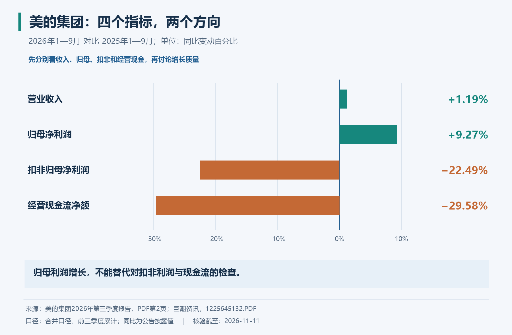
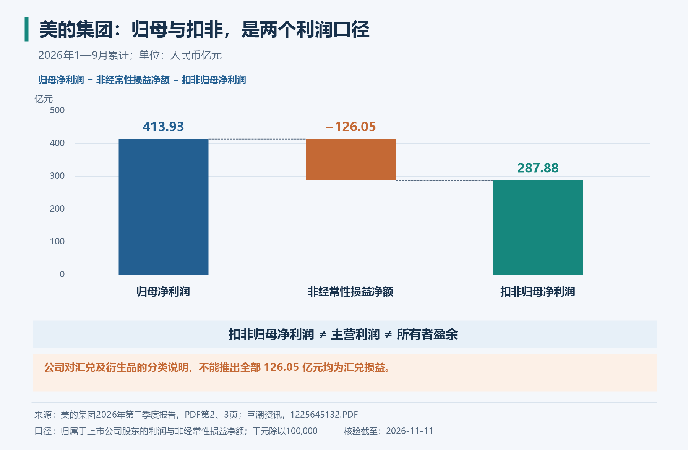
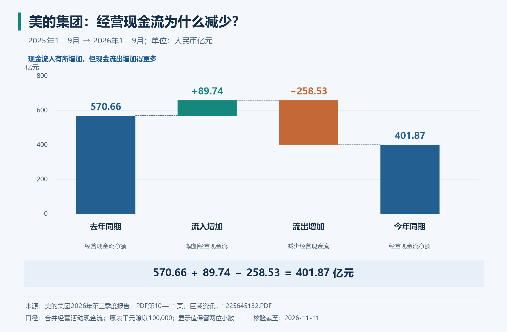
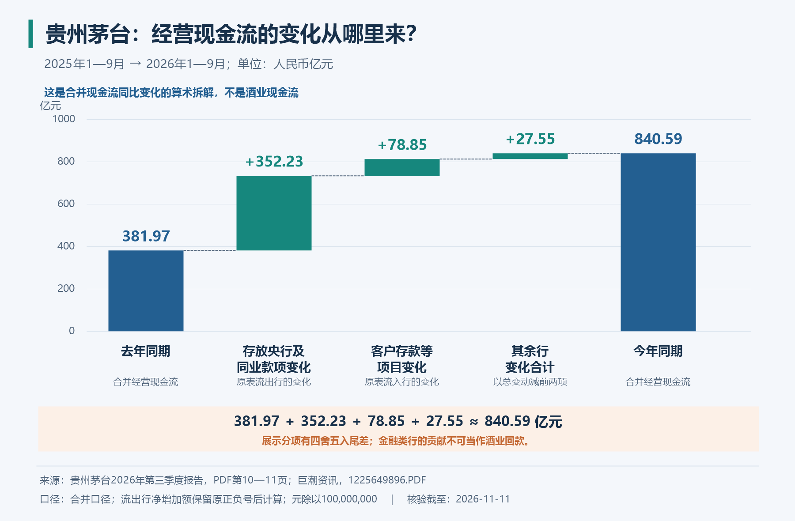

# 拿两份真实财报练习：美的的利润分化，茅台的现金流增长

> 这是书外的实战教学案例，用来练习《一本书读懂财报》、巴菲特股东信及逻辑类书籍的方法。分析截止日：**2026 年 11 月 11 日**。  
> 材料：美的集团、贵州茅台的 **2026 年第三季度报告**，均未经审计。本文金额统一换算为人民币亿元，主要比较 **2026 年 1—9 月与 2025 年 1—9 月**；不是只比较第三季度。  
> 表中“公告数据”来自原表；“公司解释”是报告中的解释；“教学分析”是据此开展的推理。虚构算例单独标注。这里不分析当前股价，也不据此给出买卖结论。

读这篇时，先记住一个问题：**看到一个漂亮或难看的数字，应该再查什么，才能理解这门生意？** 两家公司让我们看到不同方向的误判。利润增长未必意味着所有经营指标改善；经营现金流大增，也未必来自产品销售的大幅增长。

建议分两次读：先完成美的案例，理解利润口径和现金收支；再看茅台案例，练习合并范围、负号和基数。最后遮住答案做练习。

## 一、动手前先对齐四件事

| 要核对什么 | 本次怎么处理 | 忽略后的典型错误 |
| --- | --- | --- |
| 时间 | 流量指标统一为前三季度累计；时点余额另行注明 | 把单季增长率与九个月现金流放在一起解释 |
| 单位 | 美的原表为千元，除以 100,000 得亿元；茅台原表为元，除以 100,000,000 得亿元 | 两家公司直接抄数字比较，差出一千倍 |
| 范围 | 使用集团合并报表；归母利润单独标明 | 用母公司现金流解释整个集团；把全部股东利润与归母利润混算 |
| 指标名称 | 营业收入、归母净利润、扣非归母净利润、经营现金流分别记录 | 把扣非利润直接叫作主营业务利润，把现金余额叫作利润 |

例如，美的原表经营现金流为 40,187,380 **千元**：

```text
40,187,380 × 1,000 元 ÷ 100,000,000 元/亿元 = 401.87380 亿元
```

写公式看似慢，却能避免单位错误悄悄进入整张研究表。本文显示数通常保留两位小数，计算先使用原始精度，因此相加偶尔会有 0.01 亿元的显示舍入差。

原始公告与页码都放在文末；也保留了[人工核验的数据与计算结果](数据/2026三季报核验数据.json)，方便复算。页码均指从封面开始数的 PDF 第几页。

## 二、美的：同一家公司为什么会出现四个方向不同的数字？

### 1. 先描述发生了什么，暂时别评价好坏

| 公告数据：2026 年前三季度 | 金额，亿元 | 同比 |
| --- | ---: | ---: |
| 营业收入 | 3,673.65 | +1.19% |
| 归属于上市公司股东的净利润 | 413.93 | +9.27% |
| 扣除非经常性损益后的归母净利润 | 287.88 | −22.49% |
| 经营活动现金流量净额 | 401.87 | −29.58% |

数据来源：[美的集团 2026 年第三季度报告，第 2 页](https://static.cninfo.com.cn/finalpage/2026-10-30/1225645132.PDF)。可对照[原表图片](图片/美的原表第2页.png)。



**读图方法：**横轴表示各指标相对上年同期的变化幅度。这里比较的是增长率，不是不同指标的金额大小。归母利润向右，扣非利润和经营现金流向左，这不是计算矛盾，而是提醒我们拆开各自的定义。

假如只看到第一条新闻“净利润增长 9.27%”，容易形成“经营全面向好”的印象。只看到另一条“扣非下降 22.49%”，又容易认定“主营业务明显恶化”。两句话都把一个指标承担不了的结论压在它身上。更合适的第一份研究记录是：**收入小幅增长，归母与扣非利润分化，现金流同比下降；需要分别解释。**

### 2. 归母与扣非之间，相差的到底是什么？

归母净利润回答：按会计口径，这段期间有多少利润归属于上市公司股东。扣非归母净利润在这个基础上，排除按披露口径认定的非经常性损益影响。两者都不是直接的收现金金额。

这份报告可以直接勾稽：

```text
归母净利润                 413.93371 亿元
减：非经常性损益净额       126.05401 亿元
等于：扣非归母净利润       287.87970 亿元
```

差额约为归母净利润的 **30.45%**。这说明这项调整足以明显影响读者对利润的印象；它本身还没有告诉我们哪些收益能持续、风险是否对冲充分、未来利润是多少。差额采用了所得税和少数股东影响后的净额，不能拿一项税前投资收益直接来替代。[原报告第 2—3 页](https://static.cninfo.com.cn/finalpage/2026-10-30/1225645132.PDF)



**公司解释：**报告把扣非利润下降主要联系到汇率变化，以及外币项目损益和相关风险管理工具收益被归入不同类别。这个解释值得检查，因为经济上相关的两笔损益，可能在“扣非”这个筛子里被区别对待。报告同时还列示了投资、公允价值变动等项目。因此，不能把 **126.05 亿元的全部差额**都说成外汇对冲收益。[原报告第 2—4 页](https://static.cninfo.com.cn/finalpage/2026-10-30/1225645132.PDF)

下面用一个**完全虚构的机制演示，金额不是美的实际数据**：

| 简化项目 | 对利润的影响 | 假设分类 |
| --- | ---: | --- |
| 暂不考虑汇率的经营利润 | +100 | 经常性 |
| 外币项目汇兑损失 | −20 | 经常性 |
| 对应衍生工具收益 | +18 | 非经常性 |
| 合计利润 | 98 | 100 − 20 + 18 |
| 按上述假设扣非后的利润 | 80 | 98 − 18 |

为突出分类，这个例子忽略税、少数股东及其他项目。如果你只看 80，会漏掉与汇兑损失相关的风险管理收益；如果只看 98，也不能因此宣布公司未来赚钱能力就是 98。你仍要查两笔交易的对象、期限、规模、是否实际匹配，以及哪些只是账面估值变化。

这里可以学到一个比“扣非更真实”更有用的方法：**从会计标签继续往下追到经济交易。** 某笔收益被列为非经常性，不自动代表它没有经济意义；某笔损失留在经常性项目里，也不自动代表主营竞争力发生了同等程度的变化。把两端都查过，才有资格讨论可持续盈利。

下一步资料需求可以写得很具体：汇率敞口和套期安排的附注、相关损益的实现与未实现部分、分部业务表现、毛利和费用变化。三季报的信息量有限，找不到的部分就保留为待核实事项，不用一个解释包办整家公司。

### 3. 经营现金流下降，先拆收款和付款

经营现金流净额是经营现金流入与流出的差。净额下降，可能因为收款减少，也可能因为付款增加得更快。先做算术拆解，能排除一部分错误故事。

| 合并现金流量表项目，亿元 | 2025 年前三季度 | 2026 年前三季度 | 变化 |
| --- | ---: | ---: | ---: |
| 经营现金流入小计 | 3,484.27 | 3,574.01 | +89.74 |
| 经营现金流出小计，按支出正数列示 | 2,913.61 | 3,172.13 | +258.53 |
| 经营现金流净额 | 570.66 | 401.87 | −168.79 |

据[美的原报告第 10 页](https://static.cninfo.com.cn/finalpage/2026-10-30/1225645132.PDF)整理；[原表核对](图片/美的原表第10页.png)。

```text
今年经营现金流
= 去年经营现金流 + 流入增加 − 流出增加
= 570.66085 + 89.74020 − 258.52725
= 401.87380 亿元
```



**读图方法：**起点和终点是两期经营现金流；中间两项解释为何从起点走到终点。增加的现金流入带来正贡献，增加的现金支出带来负贡献。图里没有价格走势，也没有对下一季度的预测。

继续往下看，销售商品、提供劳务收到的现金同比增加约 **64.87 亿元**；购买商品、接受劳务支付的现金增加约 **214.53 亿元**。因此，“经营现金流下降是因为销售收款金额同比下降”，与这两期报表的直接数字不符。采购付款增加是值得追查的明显项目。[原报告第 10 页](https://static.cninfo.com.cn/finalpage/2026-10-30/1225645132.PDF)

但不能跳到下一句：“所以一定是主动备货，没问题。”采购付款同时受采购量、采购价格、付款时点、结算工具和以往欠款影响。要区分这些解释，需要资产负债表和附注配合：存货数量或结构怎样变，应付款和票据怎样变，预付款是否变化，业务扩张是否需要提前付款。

同理，收款金额上升也不能证明回款质量全面改善。收入可能增长更快，账龄可能变长，某些客户可能延迟支付。金额变化只是观察起点，仍要看口径、规模及多期趋势。美的合并报表也有金融业务项目，不能把所有经营流量都当作单一制造业务的流量。

这一步练习的收获是：**先把“大词”拆成能核对的分项，再把分项连接到经营机制。** 现金流差不等于造假，现金流好也不等于不存在经营问题。

### 4. 经营现金流下降，现金却增加更多，可能吗？

可能，因为期末现金不只受经营影响。美的这期合并报表中的现金及现金等价物净增加额，可以这样核对：

| 现金变化组成，2026 年前三季度 | 亿元 |
| --- | ---: |
| 经营活动现金流净额 | +401.87380 |
| 投资活动现金流净额 | +104.35372 |
| 筹资活动现金流净额 | −204.95169 |
| 汇率变化对现金及现金等价物的影响 | −5.01696 |
| **现金及现金等价物净增加额** | **+296.25887** |

去年同期现金净增加额约为 75.18 亿元。虽然今年经营现金流较低，但筹资现金净流出由约 688.43 亿元缩小到 204.95 亿元，其他变化合在一起，使总现金净增加额反而更高。这是合并现金流量表的勾稽关系；具体借款、还债和分配行为，要继续查筹资明细。[原报告第 10—11 页](https://static.cninfo.com.cn/finalpage/2026-10-30/1225645132.PDF)

如果一个人月收入减少，但当年偿还的债务也大幅减少，银行卡余额仍然可能增加更多。企业的逻辑类似：余额增加说明现金的最终变化，不独立证明经营赚钱能力改善。这里的现金及现金等价物也不能直接与资产负债表“货币资金”画等号，后者可能包含不符合前者定义的项目。

## 三、茅台：经营现金流增长 120.07%，能否说卖酒回款翻倍？

### 1. 先找最能检验这个说法的数据

| 公告数据：2026 年前三季度 | 金额，亿元 | 同比 |
| --- | ---: | ---: |
| 营业收入 | 1,309.71 | +1.96% |
| 归母净利润 | 644.67 | −0.25% |
| 经营活动现金流量净额 | 840.59 | +120.07% |
| 销售商品、提供劳务收到的现金 | 1,435.23 | 约 +3.41% |

最后一行同比由原表两期金额计算，其余同比为摘要披露值。来源：[贵州茅台 2026 年第三季度报告，第 1—2、10—11 页](https://static.cninfo.com.cn/finalpage/2026-10-31/1225649896.PDF)。

这里最明显的问题是：经营现金流增长 120.07%，销售收款项目却只增长约 3.41%。前者是全部经营现金流入减流出的净额，后者是一项现金流入，它们天然不等价。即使没有财务子公司，少支付采购款、缴税时点变化等，也可能让两者差异很大。

**公司解释：**报告说明，经营现金流的大幅变化主要与财务子公司不可随时支取的同业存款到期收回，以及吸收集团成员存款的净变化有关。这里收回的是此前持有的金融资产，不能直接理解为新增卖酒收入。这个线索告诉我们，应查看金融业务相关的现金流项目，而不是直接把增长归因于白酒销量。[原报告第 3 页](https://static.cninfo.com.cn/finalpage/2026-10-31/1225649896.PDF)；[说明所在原页](图片/茅台原表第3页.png)。

### 2. 为什么卖酒公司的现金流表会出现存款项目？

合并报表描述纳入合并范围的集团整体。如果集团包含财务公司，合并后的经营活动就不只有生产和销售商品，还可能出现吸收存款、发放贷款、存放同业款项等金融业务流量。相同的“经营现金流”标题，背后的业务组合可以不同。

用生活中的**补充类比**理解：你同时记录一家餐馆和一家金融服务业务的现金账。合在一起的现金变化，不能只用每天卖出多少份饭来解释。查看餐馆生意，必须继续拆业务；查看整个经营主体的资金，也不能把金融业务的负债和资金需求忽略掉。

这个类比仅解释合并范围，不把财务公司的监管、存款或资金安排等同于普通个人借贷。阅读真实报告时，要看具体业务和附注，不能凭公司名称猜测所有现金都来自主产品。

### 3. 最容易看错的地方：支出行的负数

下面两项保留报表中的正负号。第二项列在现金流出部分，“净增加额为负”进入流出合计时，会减少净支出。

| 原表项目，亿元 | 所在位置 | 2025 年前三季度 | 2026 年前三季度 |
| --- | --- | ---: | ---: |
| 客户存款和同业存放款项净增加额 | 经营现金流入部分 | −86.60 | −7.75 |
| 存放中央银行和同业款项净增加额 | 经营现金流出部分 | +125.07 | −227.15 |

数据据[原报告第 10—11 页](https://static.cninfo.com.cn/finalpage/2026-10-31/1225649896.PDF)换算；[第 11 页原表](图片/茅台原表第11页.png)。

先计算第二项：去年的 125.07 是流出行的正数，压低经营现金流；今年的 −227.15 是流出行的负数，减去它时反而增加净额。对两期经营现金流差额的贡献为：

```text
经营净现金 = 流入 − 流出
该流出行对同比变化的贡献
= −（今年该行数值 − 去年该行数值）
= −[−227.1543959884 − 125.0727212736]
= +352.2271172620 亿元
```

第一项位于流入部分，直接取两期差：

```text
该流入行对同比变化的贡献
= −7.7490168437 −（−86.5974576825）
= +78.8484408388 亿元
```

注意，今年第一项**仍是负数**。它提供正的同比贡献，是因为比去年少了一部分净流出，不能说今年这项吸收存款净增加了 78.85 亿元。这里的 78.85 是“两期差额”，不是“今年项目金额”。

### 4. 把变化接成一条可复算的链

```text
去年前三季度经营现金流                       381.9680215527
+ 存放央行及同业款项流出行变化的贡献         352.2271172620
+ 客户存款等流入行变化的贡献                  78.8484408388
+ 其余全部经营现金流项目变化的净贡献          27.5462186694
= 今年前三季度经营现金流                     840.5897983229
单位：亿元
```



这两项合计贡献约 431.08 亿元；经营现金流总增量约为 458.62 亿元。两者相除约为 **93.99%**。因此，可以说在这张报表的算术拆解中，这两项解释了绝大部分同比增量。这与公司给出的解释方向相符。

**但这里有一道必须守住的推理边界：**不能把 840.59 减去上述两项变化，就宣布得到了“纯卖酒经营现金流”。原因有三层：第一，我们减的是同比变化，不是本期全部项目金额；第二，只取了两项，没有剥离财务公司的全部现金流；第三，集团内部交易、其他业务和抵销也需要处理。剩下的 27.55 亿元同样是其他项目的**净变化合计**，不是本期酒业赚到的现金。

这张图最有价值的地方，是让你能够反驳一个具体但过强的说法：“经营现金流增长 120%，所以卖酒回款翻倍。”它并不直接回答公司值多少钱、是否值得买入，也不证明公司的现金流存在问题。

## 四、把书中的方法放回这些数字

| 书籍方法 | 在这两份财报里怎么用 | 做到哪一步才算学会 |
| --- | --- | --- |
| 肖星：三表联系与经营逻辑 | 美的利润分化查调整表，现金流变化查收支和资产负债项目 | 能区分数字变化与导致变化的经营原因 |
| 巴菲特：所有者盈余与资本需求 | 茅台合并经营现金流不能直接全部当股东可取走的钱 | 继续考虑业务范围、维持投入、营运资本、负债与归属 |
| 格雷厄姆：正常盈利与安全边际 | 不把前三季度利润机械乘 4/3，再套一个“便宜”的市盈率 | 能指出季节性、周期、一次性项目和价格假设 |
| 马克斯：第二层思维 | 别停在“利润增长是利好”或“扣非下降是利空” | 进一步问市场原先预期什么、价格反映了多少；本案例尚无这些证据 |
| 卡尼曼：锚定、替代问题、确认偏误 | 发现自己被第一个 +9.27% 或 −22.49% 定住 | 无论先看到哪条消息，都查看同一套数据和反证 |
| 《学会提问》：结论与隐含假设 | 检查“现金流增速等于产品回款增速”这个桥梁是否成立 | 能给出反例和更窄、更符合证据的结论 |
| 《超级预测》：问题定义与更新 | 把未来判断写成有期限、口径、判定来源的命题 | 概率写在结果公布之前，不能拿已经公布的三季报当预测成绩 |
| 三本交易书：规则与风险 | 财报研究只能提供研究输入，不能代替交易信号和执行规则 | 不把“解释得通”直接改写成“现在就开仓” |

例如，可以把一句笼统判断“美的以后会越来越好”，改成一条待研究的预测题：**下一份年度报告中，2026 全年某一明确口径指标是否超过 2025 年同口径值，以年度报告为判定来源；若重述历史数字，以可比重述值为准。** 接着才收集基数、季节性和后续信息，给概率。这里没有替你填概率，因为一份三季报不足以产生可靠的数值答案。

还要把预测与投资判断分开。即使你对某项指标改善的判断正确，也需要购买价格、机会成本、风险和资金约束，才能进一步讨论投资是否合适。这就是多本书放在一起之后的作用：各自补足一种能力，彼此不能替代。

## 五、你可以照着做的一次财报阅读练习

### 第一轮：只提取，不评价

在公告中标记主体、期间、单位、审计状态；抄出收入、归母、扣非、经营现金流四项。每个数字保留出处页码。看到不熟悉的项目，先写原名，不急着起一个更好听的别名。

### 第二轮：做三条勾稽

1. 归母净利润减非经常性损益净额，是否等于扣非归母净利润？
2. 经营现金流入减流出，是否等于经营现金流净额？
3. 经营、投资、筹资现金流加汇率影响，是否等于现金及现金等价物净增加额？

勾稽失败先排查单位、正负号、期间、合并或母公司、税前或税后，别先断言公告错误。

### 第三轮：每个结论配一项反证检查

| 初步解释 | 需要继续核验什么 |
| --- | --- |
| 扣非变化受到分类影响 | 相关收益与损失是否在经济上匹配，主营业务是否也变化 |
| 采购付款增加压低现金流 | 是采购规模、库存、付款安排，还是偿付以前欠款 |
| 合并现金流增长来自金融业务项目变化 | 还有哪些金融流量，是否只在今年出现，多期如何比较 |
| 某项盈利可能持续 | 竞争、需求、成本、投入和会计估计是否支持这一假设 |

不要求第一天把所有问题回答完。练习的完成标准是：你知道哪些已经由原表支持，哪些只是解释，哪些资料还没查到。

### 第四轮：写一段能被他人复核的结论

可以参照这个结构：

> 截至某日，我使用某份公告、某一期间、某一合并范围的数据，观察到 A 与 B 分化。算术上可用 C 和 D 勾稽；公司给出的解释是 E。该证据支持较窄的结论 F，但还不能证明 G。下一步需要查 H；取得 H 后，才决定是否修改判断。

这段话比“很看好”“现金流不错”长一些，却能让后来复盘的你看见自己当初究竟知道什么。

## 六、自测与参考答案

**题 1：美的原表 40,187,380 千元，是 401.87 亿元还是 4,018.74 亿元？**  
答：401.87 亿元。千元换亿元应除以 100,000，不能除以 10,000。

**题 2：美的归母利润 413.93 亿元、扣非 287.88 亿元，能否把差额直接叫作“造出来的利润”？**  
答：不能。它是按披露定义调整的非经常性损益净额。要研究具体组成、经济实质、实现情况和持续性；分类差异不等于虚假。

**题 3：美的经营现金流下降，是否说明销售收款金额同比下降？**  
答：这两期原表并不支持。销售收款金额同比上升，整体经营流入也上升；经营流出增加更多。但这不自动证明回款质量改善，仍要结合销售规模、应收款和账龄。

**题 4：茅台客户存款等项目从 −86.60 变为 −7.75 亿元，对现金流同比变化是正贡献还是负贡献？**  
答：正贡献约 78.85 亿元，因为负数的绝对值变小。但本期项目仍为负，不能叫作本期净吸收 78.85 亿元。

**题 5：茅台经营现金流增加 458.62 亿元，两项金融相关行解释约 431.08 亿元，剩余 27.55 亿元是不是酒业现金流？**  
答：不是。剩余是所有其他经营现金流行的同比变化净合计，既不是本期金额，也不是已剥离金融业务的分部结果。

**题 6：只凭这两份报告，能否判断哪只股票更值得买？**  
答：不能。本文还未研究可持续盈利、资本需求、当前价格和隐含预期，也没有比较个人资金约束。能读懂这份报告，是下一步估值与决策的基础。

## 来源、图表与继续阅读

- 美的集团（000333）：[官方披露 PDF](https://static.cninfo.com.cn/finalpage/2026-10-30/1225645132.PDF)，披露于 2026-10-30；[本地原件](原始公告/美的集团_2026三季报.pdf)。重点：第 2 页摘要与说明，第 3 页非经常性损益，第 4 页项目变动说明，第 8 页合并利润表，第 10—11 页合并现金流量表。
- 贵州茅台（600519）：[官方披露 PDF](https://static.cninfo.com.cn/finalpage/2026-10-31/1225649896.PDF)，披露于 2026-10-31；[本地原件](原始公告/贵州茅台_2026三季报.pdf)。重点：第 1—2 页摘要，第 3 页变动原因，第 10—11 页合并现金流量表。
- 四张彩色图是根据公告数据制作的教学图，不是原书插图或公司原图；[核验数据](数据/2026三季报核验数据.json)与[绘图脚本](数据/生成财报图解.ps1)一起保留。原表截图用于核对。
- 继续读：[财报书独立笔记](<../一本书读懂财报 - 肖星/读书笔记.md>)、[巴菲特股东信](<../巴菲特股东信 - 沃伦·巴菲特/读书笔记.md>)、[财商进阶合订本](../财商进阶合订本.md)、[返回总索引](../README.md)。
