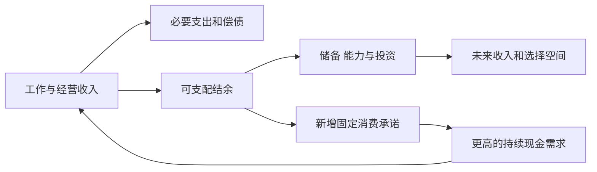
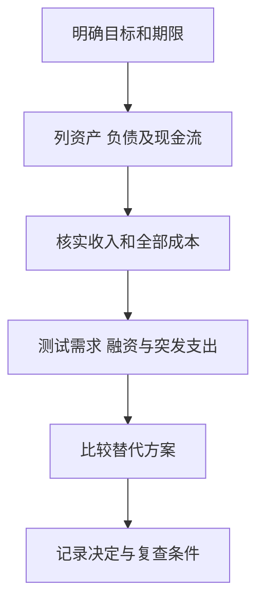

# 《富爸爸穷爸爸》：用现金流重新审视工作、消费与资产

> 作者：罗伯特·清崎（Robert T. Kiyosaki）。1997 年早版共同作者包括莎伦·莱希特（Sharon L. Lechter）；新版署名与编排有变化，不能把不同版本视为完全相同。莱希特的共同作者身份可见[本人履历](https://sharonlechter.com/full-bio/)。  
> 范围：基于作者公开说明、六课框架与一手财务教育资料整理，未取得用户指定版本全文，属于公开资料系统导读。重组为 28 个知识点；人物故事按作者叙述理解，不作为经过独立验证的致富实验。案例、会计校正及中国读者应用为补充。  
> 更新：2026-11-12。重点是财务意识，不能把美国历史税务、融资和房地产做法直接搬到其他制度环境。

## 先抓住最有价值的主张

收入高，不等于能留下财富。一个人的收入、消费、负债与资产会形成持续的资金路径；如果新增收入总被新增承诺消耗，就可能更加忙碌，却没有更多自主权。

本书的力量在于提出问题：我买的东西怎样影响未来现金？我是否只训练挣钱，没有训练保存与配置资金？我的工作有没有积累可迁移能力？它的局限也很明显：口号化的资产定义、成功故事与个别交易经验，不能代替会计、估值、法律与风险管理。

## 六课如何连起来

| 原书主线 | 本文解释重点 |
| --- | --- |
| 富人不为钱工作 | 不让恐惧和欲望独占决策，区分工作收入与资金安排 |
| 为什么教授财务知识 | 认识资产、负债、净值与现金流，校正特殊术语 |
| 关注自己的事业 | 建立个人资产与能力，不必人人辞职创业 |
| 税收历史与公司的力量 | 理解制度和组织形式，但不照抄旧税务结论 |
| 富人创造金钱 | 发现价值与组织资源，区分机会和冒险 |
| 为学习而工作 | 培养沟通、财务、管理与销售能力 |

框架据[作者官方说明](https://richdad.com/faqs/)核对。后面的障碍、行动与检查方法把这些主题连接起来；不以营销文案的强承诺替代证据。

## 核心知识点

### 1. 两位父亲是一种教学对照，不是两组严格研究样本

作者用“穷爸爸”和“富爸爸”呈现不同的金钱观：学历、职业安全、所有权、风险与学习各有不同权重。读者应提取问题，不能把两个人的叙述当作控制了时代、家庭与运气的因果实验。

受教育与财富不是互斥选择。财务知识可以补充职业教育，而不是证明知识、稳定工作或公共服务没有价值。把全书读成鄙视工薪劳动，会错过改善自身资金路径的具体任务。

### 2. 工资是重要资源，问题在于是否只有一条应对路径

工资为生活与投资提供资金，也往往是个人最可靠的财富积累来源。书中“不为钱工作”的表达，适合读成不要只用短期工资判断所有选择，而不是拒绝劳动收入。

真正值得检查的是：如果工作暂时中断，有哪些支出无法延期？技能能否转到其他雇主？收入增加以后是否留下部分结余？建立选择权可能从继续把工作做好开始，而非立即离职。

### 3. 恐惧和欲望会形成收入增加、承诺增加的循环

害怕缺钱推动加班，奖励自己的消费又增加固定支出，固定支出进一步提高对现有收入的依赖。这是一种可能的行为机制，不是对所有低储蓄家庭的诊断。

改善时先分开必要费用、已经承诺的费用和可选择消费。收入不足、疾病或照护责任可能比消费习惯更关键；不能只靠削减小支出解决结构性缺口。先画实际收支，再决定行动重点。

图示是资金关系，不是保证投资一定增加收入。风险、成本和损失也会减少结余。

### 4. 资产与负债：必须同时保留会计定义和现金流问题

清崎常把带来现金的东西称为资产，把消耗现金的东西称为负债。这种说法有提醒作用，却不是会计定义。按照财务报告概念框架，资产是由过去事项形成、受控制的现时经济资源；负债涉及转移经济资源的现时义务。[IFRS 概念框架](https://www.ifrs.org/issued-standards/list-of-standards/conceptual-framework/)

因此，一套自住房可以是资产，相关按揭是负债，维修与利息是费用或现金支出；不能因为每月花钱就把房子本身抹成一笔债。相反，一项产生正现金流的项目，仍可能资产高估、负债过多或未来会亏损。

应用时做两张表：第一张列你拥有什么、欠什么；第二张列这些项目一年内怎样收付款。书中现金流视角补充第一张表，不能取代它。这样才能同时理解“净资产为正”和“眼下缺现金”为何可以并存。

### 5. 净资产、收入和可用现金回答不同问题

净资产等于资产减负债，是某个时点的余额。收入描述期间内取得的经济收益，可用现金还受收付款时间、限制与融资影响。房产重估增加净资产，不等于银行余额增加。

**真实数据说明分布差异。** 美联储 2022 年家庭金融调查的原报告中，美国家庭净资产中位数为 19.29 万美元，平均数约 106.37 万美元，金额按报告使用的 2022 年美元口径列示。这是历史调查，不是今日财富门槛，也不是中国家庭标准。[SCF 原报告，表 2](https://www.federalreserve.gov/publications/files/scf23.pdf)

平均数远高于中位数，表明高净资产家庭对均值影响很大。读者不能把“平均家庭”当作多数人的实际情况，更不能由一张横截面调查推出某种习惯必定致富。对个人有用的动作，是持续记录自己的净值与现金，而不是拿错统计量制造焦虑。

### 6. 自住房兼有居住服务、价格风险与现金负担

自住房并非纯投资，也不是纯浪费。它提供居住服务，同时占用资金、承担维修、融资和价格风险。租房也要付费，合理比较应在相同居住条件和期间下进行。

需要分别计算首付款机会成本、利息、持有费用、交易费用与可替代租金，再讨论可能的价格变化。按揭本金偿还主要是现金减少和负债减少，不应全部当成会计意义的消费费用。是否买房要结合制度、期限、家庭需要和集中风险，本书口号不能替你完成比较。

### 7. 正现金流项目也必须扣全成本

租金大于月供，不代表房地产项目已经赚钱。空置、维修、税费、管理、保险、资本性更新与出售成本，都可能改变结果；月供中的本金与利息还要分开。

**数学演示：**一年租金 12 万元，运营现金支出 3 万元，利息 4 万元，本金偿还 3 万元，额外大修 4 万元，则当年现金净额为负 2 万元。这些是假设数字，用来说明“每月有租金”不等于没有资金压力；经济收益还要考虑资产价值、折旧及具体税制。

先按正常入住率和维护支出估计，再测试空置与融资变动。不要用最顺利的一年替代持有期的完整现金预算。

进一步比较项目时，可以按四层顺序做账：先看不考虑融资的经营收入减必要经营支出，再看借款利息与本金的现金要求，然后看大修等低频投入，最后看出售时能收回多少。这能避免用某一种融资方案暂时降低月供，就宣称资产经营能力改善。延长贷款期限可能改善近期现金，却同时改变总利息与长期责任。

还要给估计值标置信度。租约已签的租金、过去发生的维护费、尚未报价的大修和预期出售价格，证据强度不同。把它们混在一行“预计净收益”里，会遮住最需要核查的部分。若主要回报来自最后一项估值上涨，项目就不应只被宣传为稳定现金流投资。

### 8. 总回报由现金分配和价格变化共同构成

现金流很重要，但不能只追求分红率或租金率。高分红可能伴随价值下降，低分红也可能因为企业有好的再投资机会。需要比较投入成本、未来现金、权利和风险。

在股票上，分红不是从企业之外掉下的钱；公司支付现金后，其可用资产相应减少。不能把分红当成无成本赠送，也不能只因不分红就断言股票不属于资产。所有者最终关心的是成本后可获得的总经济回报。

### 9. 先支付自己，应理解为预留储蓄，不是违约

本书强调先给长期积累安排资源，避免消费完再看有没有剩余。可执行版本是把储蓄作为预算项目，同时尊重必要生活、税费和已经承担的合同义务。

若收入不足以覆盖基本开支，机械转走资金可能导致透支与逾期，反而损害净值。先建立真实预算、处理高成本负担，再决定可持续的储蓄额度；不能用“逼自己想办法”作为不支付到期债务的理由。

### 10. 自动化可以减少拖延，但默认安排也会产生错误惯性

**真实研究：**Madrian 与 Shea 研究一家企业退休计划改变默认加入方式后的行为，发现自动加入显著改变参与，同时默认缴费率和投资选项对参与者选择有强影响。这是具体企业政策变化的研究，不是证明任意自动方案都最优。[NBER 原研究](https://www.nber.org/papers/w7682)

对本书的应用是把“先积累”落实为可执行流程，例如收入到账后按已核对预算划拨。但还要定期检查金额、资金用途、账户费用与底层风险。自动化解决执行摩擦，不能替代对投资内容的选择。

如果默认比例过低，人可能长期储蓄不足；如果账户余额不足，自动划拨也可能带来费用。因此，把执行自动化与定期复核结合，比单纯强调毅力更完整。

### 11. 关注自己的事业，不等于必须创办公司

作者区分职业与个人资产积累：为雇主工作可以是职业，管理自身财富是另一项持续责任。后者可以包括技能、储备、养老金和分散投资，不仅是开店或持有房产。

能力建设也要考虑回报与可迁移性。一个副业若持续占用时间、现金和注意，却没有可检验需求，可能降低主业与生活质量。判断重点是投入与成果，不是“老板”身份本身。

### 12. 创业故事必须补上失败者和退出者

**真实统计：**美国劳工统计局追踪 2013 年诞生的私营经营场所，发现到 2023 年仍在运营的比例为 34.7%。统计单位是经营场所，关闭不必然等于创始人破产，也不能直接套作中国创业失败率。[BLS 原始说明](https://www.bls.gov/opub/ted/2024/34-7-percent-of-business-establishments-born-in-2013-were-still-operating-in-2023.htm)

这个事实提醒我们，看到成功企业主并不能估计自己创业的全部结果。还要考虑进入门槛、现金耗尽速度、个人担保、行业变化和退出价值。

可先用低成本方式验证付费需求，再增加不可逆投入。记录真实收入、获客成本、交付成本与重复购买；不要只统计点赞、询问或亲友鼓励。创业能力与投资能力相关，却不能相互自动替代。

### 13. 财务能力由多个环节组成

作者强调会计、投资、市场和法律知识的组合。可以转成四个问题：报表怎样表达业务；价格怎样联系未来现金；客户为何付费；合同赋予什么权利和责任。

任何一个环节缺失，另外三个都可能失去意义。懂产品但忽视债权顺序，可能高估股东所得；懂报表但不理解竞争，可能把历史利润外推过远。学习应围绕具体决策补短板。

例如读一家上市公司年报时，先看它卖什么、客户为何付款，再把收入、利润与经营现金流对起来；最后检查债务、关联交易和股东权利。这个顺序把本书的财务意识接入可核验资料，避免只因一家企业属于热门行业就跳过基本研究。

### 14. 公司形式不会把私人消费自动变成可扣除成本

本书有关公司和税收的论述带有美国制度与写作年代背景。注册实体能改变权责和合规要求，却不等于任何私人开销都可以由公司承担并抵税。

不同司法辖区、实体类型、支出用途、关联交易与申报规则差异很大。本文只提炼“理解制度会影响税后结果”这一原则，不提供照搬的避税路径。具体事务应先找当地正式规则，再对照真实交易；节税金额也不能独立证明交易值得做。

### 15. 杠杆改变的不仅是收益率，也改变生存条件

借款使同样本金控制更多资产，同时增加固定支付与被迫出售约束。判断长期方向正确，也可能在现金先耗尽时无法继续持有。

**数学演示：**用自有 20 和借款 80 买入价值 100 的资产，若价格下跌到 90、债务仍为 80，自有权益降到 10，损失 50%，还未计费用和利息。资产下跌 10% 与股东损失 10%不是同一件事。上涨同样会放大，但不能因此忽略亏损路径。

杠杆还应进行两种独立测试：资产价值下降多少会侵蚀权益，现金收入下降多久会造成付款困难。没有追加保证金的贷款，也可能因月度还款压力导致出售；能支付利息的项目，也可能因到期本金无法续借而失败。不能用其中一种测试通过，推断另一种风险已经消失。

### 16. 信息优势需要能够说明来源和合法使用边界

“看见别人没看见的机会”可以来自更细的公开研究、经营经验或更长时间尺度，不能把秘密消息和未经证实的传闻当作优势。

先写明优势在哪个环节：更理解客户、能估计成本，还是有不同期限？再设计反证。若所谓优势只剩“认识高人”“别人不敢买”，仍未说明为何价格与价值之间存在差异。

### 17. 机会来自资源组织，也可能来自被忽略的风险

发现一个便宜报价，下一步不是赞美自己敏锐，而是解释卖家为什么接受、是否有隐藏义务、权利是否清楚、资金何时交付。

价格低可能因为流动性差，也可能因为资产质量差。前者不保证有补偿，后者可能让折价完全合理。应把发现机会和完成尽调作为两件事，不能用成交兴奋感跳过第二步。

### 18. 为学习工作，要看能力是否真正增长

销售、沟通、谈判、财务和管理能力可以扩展职业选择。学习价值不完全反映在当期工资里，但低工资本身也不能证明岗位值得。

观察反馈质量：有没有承担新任务、接触完整流程、得到明确纠正、形成可展示作品？如果只是长期重复低价值工作，所谓“吃苦就是学习”可能是空话。比较岗位时，把健康、时间、待遇和能力积累共同列入。

### 19. 害怕亏损需要通过风险设计处理

对损失的恐惧有时阻碍必要学习，有时却正确反映了资金不能承受风险。不能把所有谨慎都叫胆小，也不能通过强迫冒险证明勇气。

先把可逆的小额试验与不可恢复的损失分开。可以先读公告、做纸面估值、记录预测，再用结果校正。真正重要的是以可承担代价得到有效反馈，而不是尽快参与交易。

### 20. 怀疑应转化为问题，而非永久否定

怀疑可以避免轻信，但如果只是反复说“不可能”“都是骗局”，就没有改进判断。把担心拆成可核验事项：资金在哪里、收益从哪来、谁审计、发生损失由谁承担。

同样，积极心态也不能替代证据。对于无法核实的关键事实，可以保留不参与的结论；不必把每一次拒绝都解释为错失机会。

### 21. 忙碌有时掩盖了对财务问题的回避

每天关注市场，不等于处理了债务、费用和现金期限。可以投入很多时间阅读，但一直不肯面对自己的实际账目。

给复查设置明确任务：核对一次总费用、更新债务到期表、查一条收入来源。这样能区分有产出的研究和只是缓解焦虑的信息消费。也要承认休息有价值，不能把所有空闲时间都货币化。

### 22. 习惯决定小决定能否长期累积

预算、储蓄和复盘需要重复，依赖临时热情很难坚持。安排宜简洁、可追踪，并能在收入变化时调整。

习惯形成不是永不偏离。遇到必要支出后，应检查是否需要改预算或恢复节奏，而不是因为一次中断就彻底放弃。长期复利需要持续性，但持续性来自适合现实的规则。

### 23. 自信要与承认不知道同时存在

懂一个领域不等于懂所有投资。成功之后更容易扩大到陌生领域，尤其当周围人把你当作“有财商的人”时。

可以给研究笔记设三栏：已核实、合理推断、尚不知道。第三栏不是失败记录，而是防止用身份替代知识的工具。决定的规模和不可逆程度，应与证据可靠性一起考虑。

### 24. 付费教育也需要评价投入产出

这本书容易激发继续学习的动力，但购买课程、社群或工具仍是一笔消费或投资决策。费用高、导师有名和学员案例亮眼，都不是效果保证。

核对课程具体技能、教学反馈、完整费用、退款条件和案例选择方式。个人亲身经历可能真实，但不代表所有学员的结果。先寻找公开教材、正式公告和低成本练习，可以更清楚地判断自己究竟缺什么。

### 25. 应急储备保护的是你不被迫改变计划的能力

**现实研究：**CFPB 2022 年结合 Making Ends Meet 调查与信用数据研究不同应急储蓄水平的家庭，发现储备与财务安全指标密切相关。这属于观察性关系，收入稳定性等因素也会同时影响储蓄和困难程度，不能把相关性全部解释为储蓄的单一因果作用。[CFPB 报告](https://www.consumerfinance.gov/data-research/research-reports/emergency-savings-financial-security-insights-from-making-ends-meet-survey-and-consumer-credit-panel/)

对本书的补充是：追求现金流资产之前，也要留意家庭本身的短期现金。账面投资回报高，如果遇到必要支出就只能折价卖出，计划会被迫中断。

储备规模与收入波动、家庭责任、保障和资金可得性有关，没有对所有人通用的比例。它不追求最高收益，而追求需要时可用。

### 26. 个人财务与企业研究可以用相同的核查顺序

先辨认资源和义务，再看收付，再看风险，最后讨论增加投入。无论是买房、持有股票还是发展副业，都需要这条顺序。

图示为综合应用。它把书的启发转成检查过程，不能保证通过检查就不会亏损。

### 27. 财务自由需要定义，而不是用一个宣传数字替代

不同人的必要支出、家庭责任和期望生活不同，所谓自由可能是减少加班、换工作、承担照护或在职业中选择更有意义的任务。

把目标写成时间、现金与约束，比“成为富人”更可执行。投资收入即使暂时覆盖支出，也要考虑税费、通胀、波动和资本消耗，不能把某年高分红当作永久工资。

### 28. 书的价值在于改善提问，落实仍靠完整证据

可以带走四个长期问题：我的资金路径是否清楚？新增承诺是否压缩选择？能力与资产是否持续改善？发生坏情况时是否仍能调整？

不必接受作者每项主张，才算从书中获益。尤其资产术语、借款、税务和创业叙事，应与更严格的资料共同使用。越有行动欲望，越要把推理写下来。

## 练习与参考答案

**练习一：一套自住房每月需要付款，是否应该从资产负债表删除？** 不应该。房屋价值与按揭负债分别列示，居住服务和未来收付另行分析。书中现金流说法不能取代正式分类。

**练习二：某项目租金高于月供，是否可以认定无风险？** 不可以。还缺空置、维修、税费、资本投入、贷款条件和出售风险；还应区分本金偿还与利息。

**练习三：本月收入增加，首先检查什么？** 看增加是否持续、必要责任是否变化、是否立即新增固定承诺，再安排储备与长期目标。没有个人信息，不能给统一比例。

## 如何接着读

财务概念接[《一本书读懂财报》](<../一本书读懂财报 - 肖星/读书笔记.md>)；行为与满足感接[《金钱心理学》](<../金钱心理学 - 摩根·豪泽尔/读书笔记.md>)；产品和成本接[《共同基金常识》](<../共同基金常识 - 约翰·博格/读书笔记.md>)。上述来源分别支持其所在案例与框架，所有现实研究均为本笔记补充，不伪装成原书逐章证据。
