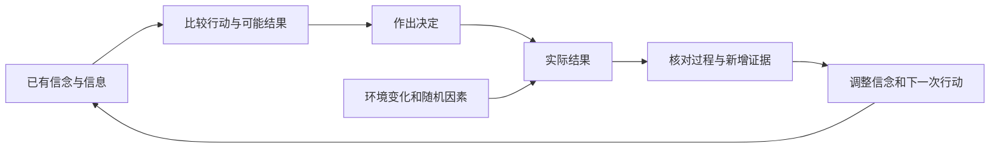
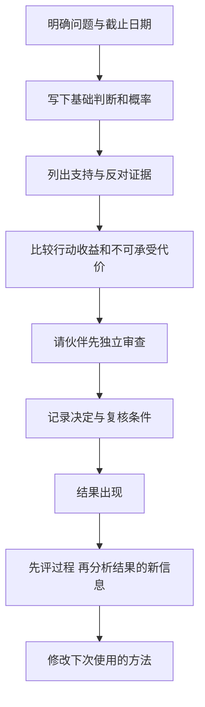

# 《对赌：信息不足时如何做出高明决策》读书笔记

> 作者：安妮·杜克（Annie Duke）。原书：*Thinking in Bets: Making Smarter Decisions When You Don't Have All the Facts*。核对日期：2026-11-12。
>
> 书目确认：英文原版由 Portfolio 于 2018 年出版；中文书名为《对赌：信息不足时如何做出高明决策》，中信出版社，2019 年，李光辉译，ISBN 9787508696492。[英文出版社](https://www.penguinrandomhouse.com/books/552885/thinking-in-bets-by-annie-duke/)、[新华书店版本记录](https://item.xhsd.com/items/110000100123707)
>
> 范围：本文是**基于公开资料的系统导读**，使用出版社、作者公开访谈与方法材料，以及原始研究和事件当事机构记录；未取得完整原书，不声称逐页精读。以下 28 点为主题重组，财商应用是补充教学。书名中的“对赌”不是鼓励赌博，也不是企业并购中的对赌协议法律教程。

## 先理解全书在解决什么问题

现实中，一个决定做得合理，仍可能遭遇坏结果；一个决定依据很差，也可能碰巧成功。如果只用最后的输赢评价决定，我们就会奖励幸运的错误，放弃遭遇不幸的正确方法。

杜克提出的“像下注一样思考”，是把隐含判断变成明确的信念、概率、收益与代价：我到底相信什么？有多确定？还有哪些可能？错了以后怎么知道，如何改进？她把扑克中的不完整信息与随机结果作为理解决策的入口，而不是要求读者学习牌局技巧。[作者官网关于结果导向的访谈整理](https://www.annieduke.com/how-to-make-the-right-decisions-even-when-you-dont-have-all-the-facts/)

读完可建立三种习惯：先评价过程再看结果；用概率表达不确定程度；通过记录和求真伙伴，把经验变成可以修正的知识。更好的过程提高长期表现的可能性，不保证任何一笔投资、一次选择必然成功。

## 主要内容如何连起来

| 全书主线 | 要解决的障碍 | 本文对应 |
|---|---|---|
| 人生包含隐藏信息和运气 | 把一次结果当作正确性的证明 | 01—05 |
| 把信念看成可检验的判断 | 非黑即白、先相信后辩护 | 06—11 |
| 从结果中学习 | 把成功全归能力，把失败全归运气 | 12—16 |
| 建立求真伙伴与讨论规则 | 一群人互相强化同一种偏见 | 17—22 |
| 在时间中观察决定 | 当下情绪压倒未来后果 | 23—28 |

这是按内容逻辑重组的地图，不是特定中文译本的逐章目录。

读图：从决定到结果之间，还存在自己控制不了的因素。反馈的作用是修正模型，不能省略分析，直接把结果贴上“聪明”或“愚蠢”的标签。

## 28 个核心知识点

### 01｜现实更像不完全信息的决策，不是一道答案全给出的题

扑克的借喻在于：你看不见全部信息，仍必须行动，而且合理行动不保证每次赢。现实中的竞争、招聘、经营和投资，也经常具有这种结构。

但现实与扑克有差异。牌局规则相对清楚，现实规则可能改变，概率也未必可精确估计。借喻帮助认识不确定性，不能证明所有人生问题都可化成固定赔率的赌局。

### 02｜决策质量与结果质量必须分开评价

决策质量取决于当时可获得的信息、有没有认真比较方案，以及收益和代价是否合理；结果质量则取决于实际发生了哪一种路径。它们有关，但不是同一个量。

**真实案例：2015 年超级碗的海鹰队传球。**比赛最后阶段，海鹰队在接近达阵的位置选择传球，被 Malcolm Butler 抄截，最终以 24 比 28 失利。球队当时的官方报道记录了这一结果。杜克以此讨论，为什么人们会由一次失败直接推断战术决定必然愚蠢。[海鹰队当日记录](https://www.seahawks.com/news/seahawks-come-up-a-yard-short-in-loss-to-patriots-in-super-bowl-xlix-116296)

正确拆法至少有三步。第一，承认结果确实很坏，不能用哲学淡化损失。第二，恢复决策时的信息：比分、剩余时间、暂停、可选择的打法和对手。第三，比较当时各方案的胜率及失败代价，而不是把已经看到的抄截当成必然事件。

本笔记没有重新建立完整战术模型，因此**不宣布传球一定是最优选择**。一次抄截既不能单独证明决定最差，也不能因为它是低概率坏结果，就自动证明决定正确。这是需要保留的双向边界。

移到投资上，一笔买入后上涨，只确认这一次实际路径有利；它没有独立证明估值、信息和仓位都合理。对下跌也一样，需要审查是否出现了当时忽略的证据，而不是自动归罪市场或自己。

### 03｜结果偏差：真实实验显示人会被结局影响

Baron 与 Hershey 在 1988 年发表五项研究，向参与者提供医疗决定或金钱选择的描述，再改变他们看到的结果。参与者往往给有利结果对应的决定更高评价，即使事前信息并未因此变得更好。[原始论文](https://bear.warrington.ufl.edu/brenner/mar7588/Papers/baron-hershey-jpsp1988.pdf)

这里必须区分：**研究真实进行过，研究中描述的医生、患者或金钱选择是实验题设，并非真实病例追踪。**它支持“知道结果会影响对决策的评价”，不意味着现实中所有评价都同样偏差，也不表示结果完全没有信息价值。

为什么结果仍然重要？因为连续、适当比较的结果可以提示模型有问题；实际失败也可能揭示原先未知的机制。但在评价一次决定是否尽责时，不能把当时不可能知道的信息，追溯成当时应该知道的东西。

一个实用方法是盲评：先遮住结局，让另一人只看当时信息与理由，给出过程评价；再揭示结果，讨论新增了什么证据。这样不能消除全部偏差，却能把“我不喜欢这个结果”与“这个过程有具体漏洞”分开。

### 04｜后见之明：结果发生后，其他分支很容易消失

人们知道结局后，常把它体验为比事前更容易预见。这会让复盘失去价值：原先的不确定被删掉，过去的决定就被放进一个答案已知的世界。

保留事前记录是最直接的防线。记录不只写主要预期，还要写替代路径、概率和改变判断的条件。不要只留最终一版，否则后来更新的信息会覆盖原先的认识。

### 05｜不要把“运气存在”用作不负责的借口

区分结果与过程，意味着更仔细地追责，而不是取消追责。错误的信息处理、忽略已知风险、违反事先约束，都可以独立评价，即使最后碰巧赚钱。

同样，连续不理想结果需要调查。若每次亏损都被解释成运气，且没有任何证据能改变方法，所谓概率思维就变成了自我保护的故事。

### 06｜信念也包含下注：行动会让判断产生代价

即使没有交换金钱，我们也在用时间、机会和信誉承诺某个判断。把信念当成下注，是问自己是否愿意承担它所隐含的后果。

这个问题主要用于自我审查，不应在每段谈话中挑战别人“敢不敢赌”。不愿下注可能源于资金约束、价值偏好或不喜欢赌博，并不能自动证明对方不相信自己的观点。

### 07｜用概率代替全有或全无

“我认为可能”“我非常确定”对不同人含义不一。给出概率可以迫使我们说明信念强度，并为以后检查留下记录。

但写下 73% 不会自动增加知识。概率可以是基于证据的主观估计，应解释从什么基准出发、哪些事实使它上调或下调。证据很粗时，使用合适范围往往比假装精确更诚实。

### 08｜概率校准：看一批判断，而不是责备一次意外

如果长期标为 70% 的事件，大约有七成发生，判断在这一概率区间内具有较好的校准。单个 70% 事件没发生，不足以判定原先概率错误；因为它本来就允许未发生。

**真实研究：地缘政治预测锦标赛。**Mellers 等人的研究考察概率训练、团队协作和表现追踪，发现这些安排可以改善特定预测任务的准确性。研究中部分分组采用随机安排，但“超级预测者”也包含根据既往成绩筛选的人，不能把他们的全部优势都说成训练造成。[2014 年原始论文](https://faculty.wharton.upenn.edu/wp-content/uploads/2015/07/2014---psychological-strategies-for-winning-a-tournament.pdf)

它给读者的启发是：判断可以被持续记录、评分和改进，而不是只能凭气势评价。适合练习的问题需要有清楚的截止日期、可核验的结果与相对稳定的定义。

校准还有一个局限：始终报同一个基础概率，有时可以校准得不错，却不能区分不同事件。好的预测还要有辨别力，在证据支持时区分高低概率。因此不要只追求“说得保守”，也不要把所有问题都写成 50%。

该研究不是股票交易实验。判断地缘政治事件更准确，不自动意味着能够在已反映信息的市场价格上获得超额收益；还必须考虑价格、成本和风险暴露。

### 09｜信息进入大脑后，不会自动获得正确标签

我们可能先形成印象，再寻找理由；熟悉、反复听到或符合身份的信息，更容易被接受。杜克强调主动审查自己的信念，而不是只挑别人的错误。

实务中可以区分“我在哪里听说”“原始证据是什么”“这个判断经过什么反证”。重复转载的十篇文章，可能只是同一信息源的十次回声，并不等于十份独立证据。

### 10｜聪明可能帮助求真，也可能帮助辩护

分析能力强的人能够发现漏洞，也能够为自己喜欢的结论构造更精巧的理由。能力和求真动机不能相互替代。

因此不应仅凭一段论证复杂、术语丰富，就提高信任。要检查它是否公平处理反例，是否允许结论被推翻，以及是否对支持与反对信息使用相同的审查强度。

### 11｜更新信念不等于承认整个人失败

如果把“我一直是对的”当作身份的一部分，新证据就容易被当成攻击。把身份改为“我能根据证据修正判断”，会减少维护旧答案的负担。

概率语言对此有帮助：从 70% 调整到 55%，是证据改变了判断，不必表演成从绝对正确跌落到绝对错误。但更新应有原因记录，不能为了跟随最近结果而来回摇摆。

### 12｜从结果学习：先做归因，再决定改什么

每个结果都可能包含过程、执行、外部环境和偶然因素。复盘不是给它们随意分配百分比，而是寻找能够改变下一次行动的证据。

可以分四栏记录：原先预测、实际发生、事前可知但遗漏的内容、事后才出现的新信息。第一类遗漏通常要求改进流程；新信息则可能要求更新模型。仅凭结果本身，不能准确识别每部分贡献。

### 13｜自利偏差：同一种结果，对自己和别人使用不同解释

自己的成功容易归功能力，失败容易归因运气；评价别人时可能反过来。结果是既学不到自己的错误，也学不到别人的优点。

一个有用的反向问题是：“如果相同记录属于一个我不喜欢的人，我会怎样评价？”这种提问只是检查工具，不会自动消除偏差，还需要事前标准与完整记录。

### 14｜比较替代解释，不必每次选出唯一原因

同一项经营改善，可能来自行业景气、管理调整、价格上涨或统计口径变化。证据不足时，保留几种解释比硬选一个更诚实。

下一步要问能找到什么资料区分它们。真正的学习来自让解释产生不同的可观察预期，而非列出许多听起来都可能的原因后就结束。

### 15｜先有基准，再讨论个案为何不同

面对一个特别有吸引力的故事，应先找相似对象的总体表现，再检查这个对象有什么足以改变判断的证据。基准不是最终答案，而是防止个案叙述把概率从零开始随意塑造。

选择参照类本身也需要判断。行业、阶段、政策、会计口径不一样，历史平均可能不合用。不能因为某个数字叫“基础概率”，就免于核对它是否适用于当前问题。

### 16｜胜率、赔率与承受能力必须一起看

高胜率并不保证值得行动，低胜率也不自动意味着糟糕。纯数学演示：若九成概率获利 1、一次失败损失 20，期望值是 `0.9×1-0.1×20=-1.1`。这不是任何真实产品的数据，只说明多数时候赢仍可能整体不利。

还要看损失是否能承受。即使算术期望为正，若一次失败就导致无法履约，也可能不适合实际参与。书中的概率思维不应脱离前面关于风险结构的检查。

### 17｜求真伙伴：支持你的目标，不必支持你的结论

一个有用的讨论小组，应奖励发现错误和提供新证据，而不只是保持气氛一致。伙伴的价值来自帮助看见自己遗漏的信息，以及要求解释判断变化。

求真不是随意尖刻。可以先确认对方的目标和情绪，再征得其愿意讨论具体决定的共识；不要在人只需要安慰时，把对话变成无休止的概率审讯。

### 18｜问责应围绕过程，不只围绕输赢

如果团队只奖励最后赚到钱的人，成员可能隐藏坏消息、冒不可见风险，或在失败后寻找替罪羊。更好的问责包括信息是否完整、是否比较方案、有没有遵守事先约束，以及新证据出现后是否更新。

问责也不能沦为检查表表演。评价者若先公布自己偏好的答案，下属可能学会如何迎合，而不是如何思考。尽量先收集独立判断，再讨论分歧，能减少这种风险。

### 19｜信息共享：把不利证据也带进房间

书中借用科学共同体的求真规范，其中一个要点是让相关信息成为共同资源。只分享支持自己判断的材料，会让团队拥有看似一致、实际被筛选过的证据。

完整不等于毫无边界地公开。保密义务与个人隐私仍需遵守；重点是在允许分享的范围内，不因为证据不利于自己而选择性隐瞒。若关键资料无法共享，应明确标注审查限制。

### 20｜按证据评价，不因来源喜欢或讨厌而定真假

评价信息应区分“来源可靠性”和“对来源的个人感受”。有偏好或利益关系的人也可能提供真信息，受尊敬的人也可能出错。

判断时既不能只看身份，也不能完全忽略来源。可靠记录、专业范围和利益冲突会影响证据权重；但最终仍要看具体材料是否支持具体结论。

### 21｜利益冲突与有组织的怀疑

讨论者应主动说明自己从某个结论中能得到什么，并制度化地检查反对证据。书中相关规范通常概括为 CUDOS：共享、普遍标准、无私利取向与有组织的怀疑；这里是原则的白话整理，不是说人能彻底没有利益。

怀疑应针对可检验的主张。要求别人证明所有可能的反例都不存在，属于不合理门槛。好的反对意见说明哪条证据不足、需要什么补充、补充后会如何改变判断。

### 22｜讨论不同意见，要先独立再整合

如果所有人先听最有权威者的意见，再依次发言，表面一致可能只是信息污染。先写下各自概率、关键事实和最不确定之处，再聚焦差异，通常更有助于定位问题。

这与第 08 节预测研究中的团队学习方向一致，但不能简化为“人越多越准”。同源信息、共同偏见和不平等的发言权，都可能使讨论放大错误。整合也不能机械取平均，要检查证据是否独立、成员的相关能力是否不同。

### 23｜时间折扣：当下的感受容易获得过多权重

立即的兴奋、挫败或痛苦，比未来的代价更鲜明。于是人们可能为了尽快结束不舒服，做出违背长期目标的选择。

书中提到从不同时间尺度看决定的办法，包括 Suzy Welch 的 10—10—10 思路。它是一种拉开视角的提醒，不是有科学最优性的固定时间公式；可改用与实际问题更匹配的期限。

### 24｜真实财商案例：事前承诺如何帮助储蓄

Thaler 与 Benartzi 的 “Save More Tomorrow” 计划允许员工预先承诺，把未来加薪的一部分用于提高退休储蓄。原始论文报告，在首次实施中，参与者平均储蓄率在 40 个月内从 3.5% 增至 13.6%。这是工资储蓄比例的变化，不是投资收益率。[2004 年原始论文](https://ab-d.com/wp-content/uploads/2014/05/thaler2004.pdf)

这与本书事前承诺的联系在于：冷静时先建立规则，让未来行动较少依赖一时的情绪和意志。把增加储蓄安排在未来加薪时，也改变了人们对当下可支配收入损失的体验。

需要先排除一种错误解释：“参与者后来储蓄更多，所以任何自动计划都一定有效。”首次实施不是把所有员工完全随机分到所有方案，加入与留存具有选择因素，且制度环境特定。研究提供真实实施结果和机制线索，不意味着每个人都会出现同样幅度变化。

更好的学习是检查设计：承诺发生在什么时候，触发条件是否清楚，执行是否自动，是否保留合理的修改与退出路径。它把未来要做的好决定，提前嵌入今天的流程。

用于个人财商，不必照搬美国退休账户制度或某个比例。可以把同样的原则用于事前约定复盘时间、重大交易的核查步骤或收入变化后的预算更新。若家庭现金需求发生实质变化，规则也应有复核机制；承诺不是要求僵硬地忽视新事实。

### 25｜情绪失控时，先识别状态，再恢复决策条件

扑克中的 tilt 指受到挫败等刺激后，情绪开始损害后续判断。书中把它引入一般决策，是提醒我们前一个结果可能污染下一个决定。

有用的做法是提前约定：哪些信号出现时暂停，暂停期间核查什么，何时恢复。不是每次难过都停止所有活动，而是避免在强烈情绪下扩大不可逆承诺。暂停的目的在于恢复条件，不是保证恢复后判断一定正确。

### 26｜从未来回看：成功倒推与失败预演要一起做

成功倒推从希望达到的结果出发，找出必须满足的条件；失败预演则先设想目标没有实现，再列出可能障碍。这让人不只沉浸在顺利的路径中。

作者后来在 2020 年《How to Decide》的公开练习页中，把两种方法并列，并要求区分自己的决定与外部因素。这是同一作者的后续方法材料，**不是本书原文或真实失败事件**，在这里用于帮助实际操作。[作者方法练习页](https://behavioralscientist.org/wp-content/uploads/2020/11/Premortem_Backcasting_Worksheet_2020.pdf)

执行时，先选一个具体目标与期限，再分别写出成功和失败可能经过哪些步骤。接着找能提前观察的信号，决定要补充什么资料、增加什么缓冲、删去什么不合理假设。若只写一堆悲观故事，却不改变方案，预演就没有完成。

还要警惕叙事反作用：能想象一个生动失败故事，不代表它概率很高；写出多条成功路径，也不代表胜率高。情景生成负责扩展可能性，概率与行动选择仍需证据。

### 27｜给情景概率与条件，避免把所有未来当成等可能

情景规划不只是乐观、中性、悲观三列。要说明分类是否互斥、是否遗漏重要情况，以及概率基于什么。若情景有重叠，简单相加就可能重复计算。

对资料很少的事件，可用范围并记录敏感性：当关键概率改变时，决定是否改变？如果答案对概率非常敏感，就值得继续搜集信息；如果多种合理假设下行动都一样，继续追求小数点可能只是拖延。

### 28｜决策日志：让未来的自己能公平审查过去

日志应在行动前记录目标、备选方案、主要证据、概率、代价、退出或复核条件。行动后补充结果与新证据，保留旧版本，避免用后来知道的信息改写历史。

它不是日记式宣泄，也不需要给每个小决定填表。优先用于代价较大、可重复、容易受情绪影响的判断。长期看，日志应帮助发现自己的特定弱点，而不是只积累更多文档。

## 如何把这些知识用在财商学习里

读图：这是一套学习流程，不是自动交易系统。概率只是决策输入之一，不能取代估值、合同、成本与风险承受能力。

### 一张可以直接使用的判断记录卡

| 栏目 | 应写清什么 |
|---|---|
| 待判断事件 | 可核验的定义、截止日期、结果来源 |
| 事前概率 | 当前估计、参照类及主要不确定性 |
| 关键证据 | 原始来源与日期，支持和反对分别记录 |
| 替代方案 | 包括等待或不行动，不能只比较两种喜欢的方案 |
| 代价 | 费用、最大可承受损失、机会成本及额外义务 |
| 更新条件 | 什么新事实会改变概率、流程或行动 |
| 复盘 | 当时可知的遗漏、后来新信息、执行偏差与下一步修正 |

这张卡是本笔记的补充工具，不是原书表格。它适合分析公告中的经营判断，也适合评估自己的储蓄计划是否真正可执行；不需要把每个问题都转成证券买卖。

## 练习与参考答案

**练习一：海鹰队传球被抄截，是否足以证明传球一定不如跑球？**

参考答案：不够。需要比较当时信息下各方案的结果分布；一次实际结局不能替代这项比较。同样，不能只以“坏运气”反过来宣布传球必然最优。

**练习二：Baron 与 Hershey 的研究是不是在追踪真实患者的手术结局？**

参考答案：不是。它是真实实验，参与者评价的是研究者提供的决策情境与结果。研究检验结果信息如何影响评价，不能当作对某种医疗方案有效性的证据。

**练习三：一组 70% 概率预测中有事件未发生，应立刻改成 50% 吗？**

参考答案：不应因单次未发生而机械下调。要根据新证据及一批可比较预测的校准表现更新，同时检查是否有辨别力。一个事件结局不揭示它原来“真正的概率”。

**练习四：储蓄率从 3.5% 升至 13.6%，能说投资收益提高了 10.1 个百分点吗？**

参考答案：不能。变化的是收入中用于储蓄的比例，增加 10.1 个百分点，不是资产收益率。首次实施也不能被描述成对所有方案的完全随机比较。

**练习五：在拿到下一份真实公司公告前，给自己的分析设定一个“停止辩护”的条件。**

参考答案要点：条件应可观察并与核心机制有关，例如原先依赖的业务口径不可比、关键现金流解释缺少支持、或新资料推翻主要假设。它触发重新分析，不自动等同于某个买卖动作。不要把“股价下跌”同时当作所有逻辑的唯一反证。

## 来源、争议与缺口

- [英文出版社](https://www.penguinrandomhouse.com/books/552885/thinking-in-bets-by-annie-duke/)与[中文书目](https://item.xhsd.com/items/110000100123707)：确认版本与主题。
- [作者官网访谈整理](https://www.annieduke.com/how-to-make-the-right-decisions-even-when-you-dont-have-all-the-facts/)：结果导向、信念与学习；访谈整理中的具体战术判断属于作者解释，本笔记未直接认定最优。
- [海鹰队 2015 年比赛记录](https://www.seahawks.com/news/seahawks-come-up-a-yard-short-in-loss-to-patriots-in-super-bowl-xlix-116296)：第 02 节事件事实。
- [Baron 与 Hershey，1988](https://bear.warrington.ufl.edu/brenner/mar7588/Papers/baron-hershey-jpsp1988.pdf)：第 03 节结果偏差实验；学生样本与实验题设有外推边界。
- [Mellers 等，2014](https://faculty.wharton.upenn.edu/wp-content/uploads/2015/07/2014---psychological-strategies-for-winning-a-tournament.pdf)：第 08 节概率训练与团队研究；不推导股票收益。
- [Thaler 与 Benartzi，2004](https://ab-d.com/wp-content/uploads/2014/05/thaler2004.pdf)：第 24 节真实储蓄实施；比例、期限与研究设计单独说明。
- [杜克后续公开练习，2020](https://behavioralscientist.org/wp-content/uploads/2020/11/Premortem_Backcasting_Worksheet_2020.pdf)：第 26 节方法补充，出自后作，不冒充本书原文。

主要边界：概率语言有助于明确判断，但错误概率加上漂亮表格仍然是错误；过程评价不能成为无视长期失败的借口；求真讨论不等于所有观点同样可信；一手研究对特定任务的证据，不能替一本通俗书的全部生活建议背书。本文尚未逐章核对原书全部牌局、人物回忆和引用细节，未给出未经核实的中文页码或长引文。

---

[返回书籍索引](../README.md) · [财商学习与实践路线](../财商进阶合订本.md)
