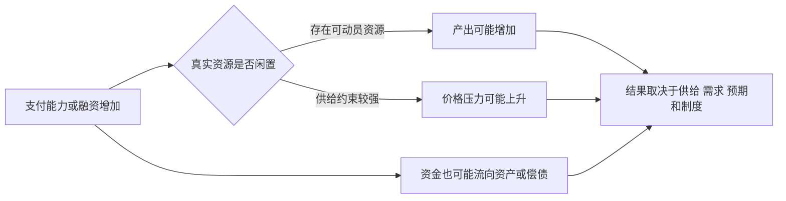
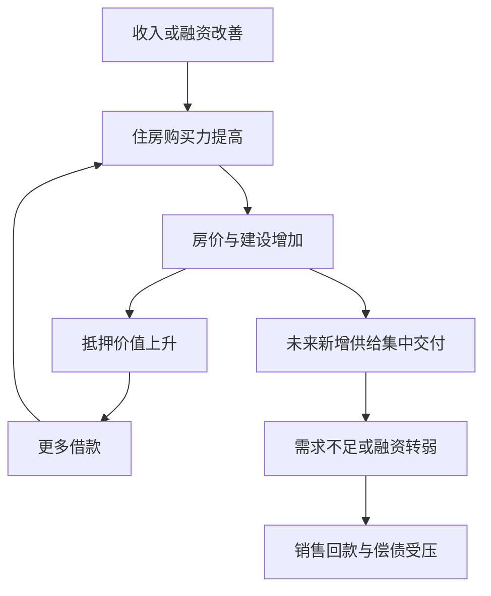

# 《小岛经济学》读书笔记

> 作者：彼得·希夫（Peter D. Schiff）、安德鲁·希夫（Andrew J. Schiff）。对应英文 *How an Economy Grows and Why It Crashes*，Wiley，2010 年；纸本 ISBN 9780470526705。中文版译者、印次未确认。本笔记讨论这本原作，不混入作者其他预测或后续著作。
>
> 资料范围：基于出版社公开目录、简介及可公开核对的经济学与历史资料整理的系统导读；未逐页核读整本原文。原书小岛、鱼、渔网与纸券故事属于寓言，并非真实发生的经济史；本文用它解释概念，不把故事当因果证据。现实对照已在知识点原位给出。整理日期：2026-11-12。

这本书把经济缩小到一个容易想象的小岛：人要生产食物，改善工具需要时间，储蓄可以支持投资，信用把不同人的资源连接起来，货币与金融制度也可能制造新的风险。它的优势是让读者看到金融数字背后的真实资源，弱点是寓言为了清晰而删去很多现实条件。

最值得带走的不是“某个学派永远正确”，而是三种能力：分清财富和财富凭证，分清生产性投资与仅靠涨价的投机，识别货币信用如何影响资源分配。同时要知道，储蓄、银行和宏观政策的现实机制，比一池鱼和几张纸券更复杂。

## 原书范围与立场

公开目录共 17 章，从想法、信用、扩张、储存、基础设施和贸易，推进到政府、货币、国际融资、服务业、货币兑换、住房繁荣及危机。叙事借小岛影射现实经济，并带有明显的自由市场、硬货币及奥地利学派取向；它不是把所有经济学立场同等展开的教材。[Wiley 书目及目录](https://www.wiley.com/en-us/shop/general-finance-investments/how-an-economy-grows-and-why-it-crashes-p-9780470768006)

以下 30 点按理解顺序重组。对作者的政策观点，会保留其机制，同时说明适用条件与其他解释，避免把寓言结论直接当作历史实证。

## 核心知识点

### 1. 财富是能满足需要的资源与能力，不只是账户数字

鱼可以被吃掉，渔网能够帮助未来捕鱼；一张代表鱼的凭证，价值取决于它能否换到鱼。账户数字增加而实际产品、服务或生产能力没有增加，并不意味着所有人的真实生活水平同比提高。

这个区分适合纠正把资产涨价一概视为社会财富创造的直觉。但现实中的知识、软件、医疗、物流和制度也能创造价值，不必把“真实”误解为只能摸到的物品。

### 2. 稀缺意味着改善一种生活，要放弃其他用途

时间、材料和注意力有限。制作工具所用的一天，不能同时用于当天捕鱼；投资设备的资金，也不能同时用于消费或另一项项目。这是机会成本：选择某项行动时放弃的最佳可行替代。

投资者不应只问项目能否赚钱，还应问它相对其他可行用途是否值得。机会成本并非一定等于银行利息，也可能包括流动性、风险承担和学习时间。

### 3. 储蓄可以支持从当期消费转向未来产能

在寓言里，暂时不吃掉的鱼让人可以花时间制作工具，而不至于在工具完成前挨饿。它形象地解释：生产未来产能也需要当前资源，不能只靠愿望。

但现实储蓄不一定是把实物放进仓库。家庭持有金融资产，企业使用融资购买设备、支付工资；社会层面最终要腾出相应劳动和材料。金融安排与真实资源约束必须同时成立。

误解在于把“任何减少消费都会自动形成有价值投资”当成定律。若没有合适项目、融资渠道或有效需求，减少消费未必立即增加产能，短期还可能降低企业收入。储蓄有用途，投资有质量，两者不能只用道德评价代替分析。

### 4. 资本品提高效率，但制造资本品也会失败

渔网的寓意是资本：使用时间较长、帮助未来生产的工具。投资要先付成本，收益在未来发生，因此必须面对技术、需求和执行风险。

资本品并非越多越好。不适合需求的设备、重复建设和维护成本过高的设施，都可能消耗资源而不产生足够回报。评价企业扩产，要问新增产量卖给谁、价格多高、成本多大，而不是只看投资金额。

### 5. 生产率提升可以让同样的劳动支持更多生活

若同样时间能提供更多有用产出，社会可以选择增加消费、减少劳动或投入其他领域。生产率不等于让每个人无限加班，而是工具、组织、知识和协作改善后的产出效率。

财商应用：企业利润提高可能来自生产率，也可能来自短期提价、补贴或压缩维护。前者通常更值得继续研究，后几种也可能有价值，但可持续性不同，需要在财报和经营信息中拆开。

### 6. 利润是信号，损失也是反馈

价格与成本之间的差额，会吸引资源进入某种生产；亏损则提示该用途可能不如替代方案。这个反馈是作者强调市场协调的重要理由。

不过，利润可能包含垄断租金、外部成本转嫁和信息优势。亏损也可能发生在具有长期社会价值、尚未成熟的项目上。不能把所有利润都当社会贡献，也不能把所有亏损都当资源浪费；先识别利润形成机制。

### 7. 分工让人专注，交换让优势互相连接

每个人都从头制作所有生活用品，通常难以形成专业化。分工与交换能让技能、工具和规模优势发挥作用；代价是彼此依赖增加，需要可靠的契约、物流和质量信息。

理解供应链时，可以同时看到效率与韧性：集中采购可能降低单位成本，也可能增加中断风险。经济分析不是在“全部自己做”和“全部外包”中选口号，而是比较具体成本和约束。

### 8. 贸易利益来自机会成本，不只来自谁绝对更强

一个地区即使在多种产品上都更高效，也可能通过集中于相对优势最大的活动获益。比较优势看的是生产某物所放弃的其他产出，而不是单看绝对劳动效率。

但总收益增加不代表每个人都自动获益。行业转换、技能重新匹配和地区调整可能让一些人承担明显成本。对现实贸易政策的判断，需要同时讨论总量、分配、国家安全和调整机制，不能只用岛上无摩擦交换覆盖全部问题。

### 9. 基础设施把单个生产者的收益连接起来

道路、港口、电力和通信可以降低许多企业的交易成本，存在网络效应；某个投资者未必能收回全部社会收益。作者强调资源和融资约束，这一点重要，但项目由谁建设并不能单独证明效率。

财商应用：基础设施投资额不是项目价值。需要检查需求预测、收费或财政回款安排、维护成本、利用率和债务期限。社会效益较高的项目，也可能不适合作为依赖短期现金偿债的商业投资。

### 10. 信用能把资源交给更有生产机会的人

有储蓄的人未必有项目，有项目的人未必有启动资源。信用可以把双方连接起来，借款人用未来收入补偿资金提供者。

应区分生产贷款、消费贷款和资产交易融资，但分类不是善恶判决。教育、搬迁、医疗等消费性质支出也可能改善未来收入或生活；某些名为生产投资的项目反而难以回收。最终需要判断用途、还款来源、风险和期限。

### 11. 利率补偿等待、风险与流动性，但不是只有一个来源

愿意延期消费、承担违约风险和放弃流动性，通常需要补偿。贷款利率还受到通胀预期、担保、市场竞争、监管及货币政策影响。

**数学演示：**名义利率 5%、物价上涨 3%，实际回报约为 `1.05 / 1.03 - 1 = 1.94%`，不是精确的 2%。这里只说明购买力计算，不代表当前可获得的产品收益，也没计税费和违约。

看见高利率，先问它补偿了什么风险。若本金无法收回，票面利息再高也不能提供实际收益；若资金被锁定很久，利率还要与期限条件一起比较。

### 12. 银行并非只把先收来的储蓄原样借出去

原书用仓库存鱼说明银行，很容易帮助初学者理解保管与借贷，却也容易造成误解。现代商业银行发放贷款时，通常同时形成贷款资产和客户存款，不必等另一名客户先存入完全相同金额。

**真实制度材料：英格兰银行 2014 年货币创造说明。**该文明确说明银行贷款创造存款，并讨论资本、流动性、盈利、风险、借款需求和货币政策对其约束；也反对把现实过程简单写成储备金固定倍数乘数。[英格兰银行原文](https://www.bankofengland.co.uk/quarterly-bulletin/2014/q1/money-creation-in-the-modern-economy)

这不意味着银行可以无限创造财富。新贷款创造支付能力，但真实资源仍受约束，贷款还会带来风险、跨行结算需求和资金成本。应把**会计上的存款创造**与**真实产能的增长**分开：前者可以很快，后者需要生产与投资兑现。

### 13. 银行的期限转换既有价值，也有脆弱性

储户希望资金方便支取，借款人希望长期使用资金；银行通过资产负债安排连接双方。好处是提高资金使用效率，风险是很多储户同时取款时，银行无法立即把长期贷款变成现金。

这叫流动性错配，不等于每一家银行必然亏损。长期资产价值不足是偿付能力问题，短期拿不出现金是流动性问题；恐慌性变卖可能让后者进一步变成前者。

### 14. 挤兑说明信任是金融资源，也说明制度很重要

**真实历史：美国 1930 年代初银行恐慌。**美联储历史资料讨论了银行失败、提现需求与货币收缩的相互作用。故事可以帮助理解“大家一起取钱”的困难，真实历史则还涉及金本位、银行结构和政策反应。[美联储银行恐慌史](https://www.federalreservehistory.org/essays/banking-panics-1931-33)

从中不能直接推出“所有信用活动都该取消”，也不能推出“任何机构都应无条件救助”。存款保障、最后贷款人、资本要求和损失承担规则，试图减少恐慌并控制道德风险；具体制度效果需要单独证据。

用于财报阅读，应关注负债稳定性、资产可变现程度和抵押安排，不只看账面净资产。这是寓言之外需要补上的现实维度。

### 15. 货币解决交换难题，也依赖共同接受

如果没有共同支付工具，交换需要双方恰好需要彼此的产品。货币可以作为交换媒介、计价单位和价值储存手段，但三个功能并不保证都稳定实现。

货币接受度来自支付网络、法律税收安排、制度信用和持有者预期等，不一定只来自某种商品储备。作者偏好硬货币约束，是一种制度主张；读者应讨论其稳定承诺的优点，也讨论供给调整和危机应对的代价。

### 16. 纸券增多不保证鱼增多，但价格不会机械同步

寓言中的“更多凭证追逐同样的鱼”帮助解释购买力竞争。现实中，货币需求、银行放贷、资源闲置、供给变化和资金流向都会影响价格，不能把发行量直接等同于同幅度的消费物价涨幅。

图是本文补充示意，不是作者原图。关键是把方向性直觉变成条件性分析，而不是从“发了钱”跳到确定的通胀倍数。

### 17. 通胀会改变分配，不是所有人损失相同

固定名义债权人的实际购买力可能下降，固定名义债务人的真实负担可能减轻；但工资、租金、税制与资产价格调整速度不同。谁先拿到资金、谁能调价，也会影响结果。

判断企业时，要看它能否把成本上升传给客户，库存和应收账款如何变化，浮动利率债务是否提高财务费用。“通胀利好所有实物资产”是过于粗糙的结论，维护成本、税费与估值同样重要。

### 18. 物价下降有不同来源，不能都称为好或坏

技术进步降低成本，同时提高产量，可能让消费者受益；债务压力下收入、需求和价格一起收缩，则可能加重还款困难。二者都表现为一些价格下降，机制却不同。

作者强调生产率带来的价格下降价值，这一点应保留；但若据此忽略债务通缩，就会漏掉金融系统反馈。判断降价时至少同时看产量、就业、名义债务和收入，不能只看价格箭头。

### 19. 1971 年关闭黄金兑换窗口，是具体制度变化

**真实历史：1971 年 8 月 15 日尼克松宣布停止美元对黄金的官方兑换。**美联储历史说明，布雷顿森林体系以美元及黄金承诺为核心，美元海外持有量、黄金储备与国际收支压力产生张力；此后体系又经历调整，不能把同一天简单说成所有货币立即自由浮动。[美联储历史资料](https://www.federalreservehistory.org/essays/gold-convertibility-ends)

原书的鱼券兑换情节可以用来理解承诺与储备不匹配，但寓言不等于完整历史。国际支付需求、国家政策和资本流动远比一间仓库复杂。

从这件事能学到：货币制度有规则，也有调整规则的政治条件。不能仅凭一次制度变化，直接推出几十年后某种资产的确定价格或某货币必然在指定年份崩溃。

### 20. 国际贸易逆差对应融资关系，不自动等于被占便宜

一个经济体进口超过出口，需要通过出售资产、借入资金等方式形成对应的国际收支安排。持续外部融资可能支持生产投资，也可能支持难以持续的消费和资产上涨。

判断好坏要看资金用途、回报、币种和外债结构。出口国也并非只是无条件“养活”进口国，它获得的是收入或金融资产，承担对应风险。贸易差额是会计结果，不能直接替代福利判断和道德评价。

### 21. 经常账户与储蓄投资关系是恒等式，不是单向因果

在一致的国民账户口径下，经常账户余额与国民储蓄减国内投资相联系。这个关系告诉我们几个总量必须同时成立，却不自动告诉我们哪一项变化引起另一项。

例如，外部融资变得容易可能影响国内支出，国内投资机会增加也可能吸引融资。用恒等式解释现实，需要补充行为机制、价格变化和制度条件；不能从一个等式直接推出唯一政策方案。

### 22. 服务业也能创造真实价值

原书对经济过度依赖某些服务及消费的批评，适合提醒读者检查收入是否依赖不可持续融资。但把服务业整体看成“不生产东西”会产生严重误解。

医疗、教育、物流、软件和维修可以直接满足需要，也能提高其他产业效率。**真实统计口径：国民经济核算把有价值的服务纳入生产，计算增加值以避免中间投入重复计量。**澳大利亚统计局的方法文档详细解释生产、支出和收入三种 GDP 计量。[官方核算方法](https://www.abs.gov.au/statistics/detailed-methodology-information/concepts-sources-methods/australian-system-national-accounts-concepts-sources-and-methods/edition-8/chapter-8-gross-domestic-product/measures-gdp)

这份资料支持统计概念，不证明所有被计入 GDP 的活动都提高福利。正确区分是可持续价值与资源消耗，而不是制造业天然有价值、服务业天然无价值。

### 23. GDP 与生活福利有关，但不是同一个东西

GDP 衡量一定期间生产的最终产品和服务的市场价值等核算内容，不等于所有家庭财富，也不直接衡量休闲、分配、生态和安全感。

建设后长期闲置的项目可能在建设时形成投资支出，但是否创造足够长期价值还要另查。反过来，一项免费但改善生活的活动，也可能没有被完整计入。财商需要同时阅读流量、资产质量和生活成本。

### 24. 房地产繁荣可能把价格信号和融资信号缠在一起

价格上涨让开发商增加建设，让买家觉得值得借更多钱，也让抵押品看起来更安全。如果真实居住需求、租金或收入跟不上，繁荣就越来越依赖再融资和继续涨价。

这幅图解释可能的反馈，不证明所有房价上涨都是泡沫。要核查人口、租金、供给、贷款标准和债务到期。对房地产企业，利润确认与销售回款可能不同步，必须阅读现金流和合同负债等相关信息。

### 25. 危机应对的争论，要把短期稳定和长期激励分开

作者担心救助使失败投资继续占用资源，并鼓励下一轮冒险。这是应当认真检验的激励问题。另一种担忧是，若关键支付与信贷网络突然断裂，原本可行的企业也可能被拖累。

两种风险可以同时存在。有效讨论应问：救谁，谁承担损失，支持持续多久，是否更换管理层，是否有退出条件，而不是只用“救助”或“不救助”两个词概括全部制度设计。

### 26. 量化宽松是资产购买，不等于所有人直接领现金

**真实案例：美联储 2008 年后机构 MBS 购买计划。**美联储项目说明显示，购买对象是由特定机构担保的抵押贷款支持证券，目的是改善金融条件；2009 年 1 月至 2010 年 3 月累计购买 1.25 万亿美元，属于实际购买阶段的口径。[美联储项目说明](https://www.federalreserve.gov/newsevents/reform_mbs.htm)

这类交易会改变资产持有结构与金融条件，和政府给居民转移支付不是同一会计操作。政策可能有资产价格、收入分配与长期激励影响，但不能仅由“央行扩表”推算居民即刻多得到同等现金。

用作者批评去提出问题是有价值的；把批评自动升级为已经证实的唯一因果，就越过了证据。也不能凭政策后没有马上出现恶性通胀，断言政策没有任何成本。

### 27. 节俭悖论提醒我们，个人经验不能直接放大成宏观结论

单个家庭少花钱可以增加结余；很多家庭同时减少消费，会降低商家收入，再影响工资和就业。在资源闲置、投资无法及时承接储蓄意愿时，总收入下降可能使实际储蓄并未如愿增加。

这不是反对个人审慎，也不证明所有消费刺激都有效。它说明短期需求约束与长期资源积累是两个层次。阅读本书时，把这一补充与作者储蓄观并列，才能避免在任何经济状态下使用同一个答案。

### 28. 奥地利学派的洞见和争议都应保留

强调分散知识、价格协调、资本结构和错误投资，能提醒人们别把社会当作可随意拨动的机器。对人为压低利率造成资源误配的担心，也能转化为可研究的行业问题。

争议在于：怎样实时识别“正确”利率，怎样分离政策、储蓄变化和金融创新的作用，衰退中的清算是否会造成额外的协调失败。寓言把条件固定之后容易得到鲜明结论，现实识别则需要数据和反事实比较。

因此，本书适合作为一个清晰立场的入门视角，与宏观教材和危机史对读；不适合作为不用检验其他证据的最终裁判。

### 29. 读寓言要分三层：设定、逻辑、现实对应

第一层，写清故事假设：资源是否全部使用、是否只有一种商品、交易是否无摩擦。第二层，检查在这些假设下结论是否成立。第三层，核对现实是否满足条件，缺少什么变量。

例如，纸券增多而鱼不变，在固定需求规则下可以说明购买力稀释；现实可能同时有闲置产能、货币需求变化和生产增长。只有把这几层分开，简单故事才能帮助理解，而不会遮住现实。

### 30. 对股票研究，最终要问资本是否创造可持续现金流

本文财商应用：把“渔网”翻译成设备、研发、渠道、组织和品牌等能力，再检查资本投入是否形成客户愿意持续付费的产出。不要因为资产名称听起来先进，就认定投资成功。

一个实用顺序是：客户需要什么，企业如何提供，投入多少资本，多久收回现金，竞争者是否能复制，融资何时到期，当前价格隐含什么增长。这样既保留本书强调真实生产能力的优点，也补上估值、服务价值和金融结构的复杂性。

## 练习与参考答案

**练习一：银行发放贷款创造存款，是否意味着没有储蓄也能无限增加真实财富？**

参考答案：不是。存款是支付能力和银行负债，真实生产还需要劳动、材料、技术和组织；放贷也受资本、风险、结算和政策条件限制。不要把会计创造与资源创造混同。

**练习二：某项技术使价格下降、产量增加，与收入下降和债务违约伴随的降价，有何区别？**

参考答案：前者可能主要是生产率提升，后者可能包含需求收缩和债务反馈。要比较产量、就业、收入、融资和供给变化，不能仅凭物价方向评价政策。

**练习三：服务没有制造实物，为什么仍可能创造财富？**

参考答案：价值来自满足需要及提高生产能力，医疗、运输、软件和维修都可以做到。仍需检验质量和成本；这也不意味着服务收费越高就越有价值。

**练习四：把一个寓言观点转成可以验证的研究问题。**

参考答案示例：不是“低利率一定制造泡沫”，而是“某行业在融资成本下降后，资本开支和债务是否超过最终需求增长；投资回报是否下滑；替代解释有哪些”。先列变量、期间和数据，再形成判断。

## 主要收获与资料缺口

你可以学到财富、资本、储蓄、信用、货币与贸易的基础关系，更警惕只靠资产涨价维持的繁荣。必须同时保留的边界是：寓言不是实证，现代银行不是单纯仓库，服务可以创造价值，宏观需求和分配不能完全由单个家庭经验推导。

本笔记未逐章复述完整寓言，也未核读中文版措辞；事实案例及补充解释的来源已在原位提供。建议与《经济学原理》比较概念，与《债务危机》比较调整机制，再用财报书把“生产能力”落实为可核查的企业现金流。
