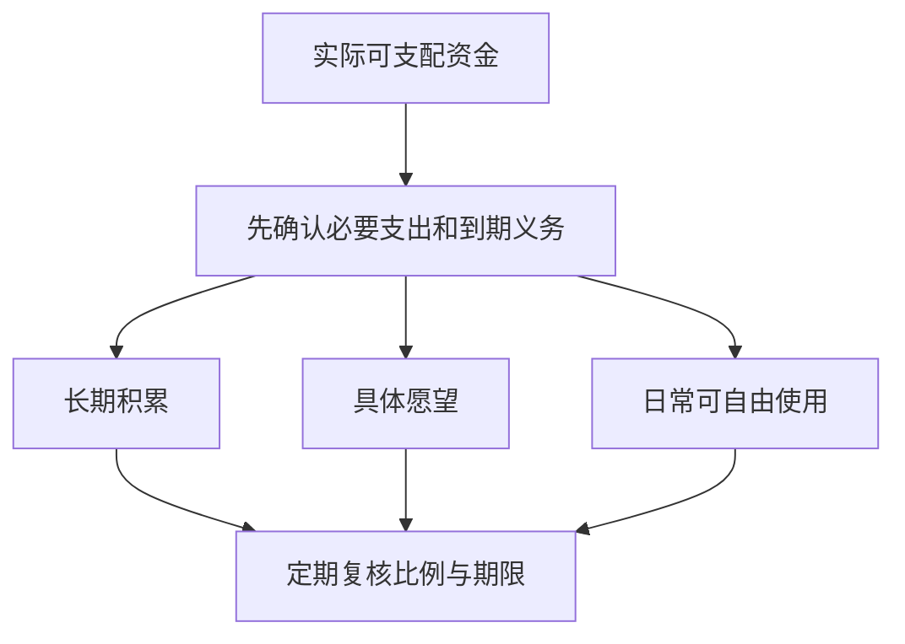

# 《小狗钱钱》读书笔记

> 作者：博多·舍费尔（Bodo Schäfer）；德文原名：Ein Hund namens Money。  
> 版本核验：dtv 出版社列有 2019 年平装版，ISBN 9783423349659；本笔记不将它等同于用户手中的中文译本，中文译者及印次未确认。  
> 资料范围：基于出版社介绍、作者公开资料与可检索原文片段的系统导读，另读作者学院公开《成功日记》的相关说明；未取得并读完《小狗钱钱》全文。原书旧 PDF 链接仍有检索片段，但直接获取失败，因此不编章节页码或声称逐章精读。  
> 覆盖：目标、行动、自信、增加收入、储蓄、债务、复利、股票基金与共同学习等主要主题，共 26 点；研究、风险口径及家庭应用属于明确标注的补充教学。  
> 更新日期：2026-11-12。

[dtv 出版社书页](https://www.dtv.de/buch/ein-hund-namens-money)确认作者、版本及故事主线。下文涉及情节和寓意，包含轻微剧透。主人公 Kira 在中文版本中常译作吉娅；本文不使用未经核对的人物年龄、币种或情节金额。

## 这本书讲什么

**它用一个女孩与会说话的小狗的故事，教读者把“希望以后有钱”变成可以从今天开始练习的习惯。** 主人公家庭有财务困扰，小狗 Money 成为引导者，故事将赚钱、留钱和学习投资串在一起。

这是一部财商寓言。女孩、小狗及其理财经历不能当作真实人物的投资业绩；故事中的顺利结果是作者组织教学的方式，不是已经进行的科学实验。它最适合建立入门概念与行动感，不足以单独决定具体基金、债务或证券配置。

最有价值的变化是：从只盯着“我没有多少钱”，转向“我能否记录、选择、提供价值、留下部分收入，并认识风险”。最需要补上的边界是：现实收入受家庭与社会条件约束，投资不保证高回报，儿童也不应承担解决成人债务的责任。

## 主线与主题地图

| 故事中的学习进展 | 主要问题 | 对应知识点 |
| --- | --- | --- |
| 认识自己的愿望与障碍 | 为什么想要钱，为什么总拖延 | 1—6 |
| 发现能做的事并获得收入 | 怎样把能力变成对别人的帮助 | 7—11 |
| 留下钱、保护会产生收益的本金 | 为什么赚到钱不等于积累财富 | 12—16 |
| 理解债务与投资 | 资金为什么会增长，也会受损 | 17—22 |
| 与别人共同学习、形成习惯 | 怎样把故事转成自己的日常能力 | 23—26 |

这张示意图强调循环。自信来自行动后的证据，储蓄来自重复安排；不是画出一个梦想后，钱就会自动到来。

## 知识点与讲解

### 1. 先让金钱问题可以讨论

家庭中的钱常带着焦虑、羞耻或指责。如果所有谈话都变成“你怎么又花钱”，人会回避记录，问题反而更难解决。书中的小狗让复杂问题变得可以被提问，这是寓言形式的重要功能。

应用时应把事实与评价分开：记录支出、收入和日期，不给人贴“天生不会理财”的标签。承认现实限制，也承认可以学习的部分；不是要求所有人对钱保持兴奋，而是让问题进入可处理的范围。

### 2. 目标要具体到可以做选择

“想有钱”不能帮助决定今天是否购买一件东西；一个有金额、时间和理由的目标可以。明确目标不是许愿，而是为有限资源建立取舍标准。

补充方法：写下要解决什么问题、预计需要多少、何时使用，以及目标改变时怎样调整。先查实际价格，再定储蓄计划。价格、收入或家庭责任变化，允许修订；不要为了维护原来写下的数字而借高成本资金。

### 3. 愿望需要排序，不能同时把一切都当最重要

本书的梦想练习强调从许多愿望中找重点。真正的约束不是愿望太多，而是时间和金钱有限。若每一个目标都拥有最高优先级，就没有办法比较机会成本。

可以区分近期必要、较重要愿望和可延后的愿望。每次承诺一个目标，问它会推迟另一个什么目标。排序帮助承担选择，不是宣称某种生活方式比别人高尚。

### 4. 梦想储蓄罐的作用，是让未来需要进入今天的注意力

作者的公开资料介绍了为不同愿望设立储蓄罐的方法。这个工具并没有改变钱的数学性质，它改变的是提醒与分类：眼前的小消费不断出现，未来目标如果没有提示，很容易被挤出注意力。[作者学院《成功日记》附载的梦想储蓄罐说明](https://www.bodoschaefer-akademie.de/PDF/Erfolgs-Journal_2018.pdf)

**书外真实研究：** Karlan 等人在玻利维亚、秘鲁和菲律宾合作银行开展随机分配提醒的实地研究。对象是真实新开储蓄账户的客户；结果支持提醒可以改善储蓄目标执行，提及具体目标或相关激励的内容尤其值得关注。[NBER 研究](https://www.nber.org/papers/w16205)、[正式发表论文](https://pubsonline.informs.org/doi/pdf/10.1287/mnsc.2015.2296)

这比“看图就能吸引财富”的解释扎实得多。目标提示让人在消费发生时记起另一种用途，从而改变选择。但研究不是对《小狗钱钱》的直接检验，也不证明提醒对所有人有效；缺少可储蓄收入的人，不能仅靠设置更多提醒解决问题。

现实中可用单独标签、账户分类或一张进度表代替实体罐。记录实际余额与下一次行动即可，不必购买昂贵工具。也要防止心理账户过度僵化：急需支付必要开支时，不应因某笔钱被命名为“梦想”就再去借高息贷款。

**练习：** 一个储蓄提醒只写“别乱花钱”，另一个写“本月为已定的学习费用留出预算”。哪个更能帮助做决定？参考答案：后者更具体，但能否有效仍取决于目标真实性、收入余地和执行条件，不是保证。

### 5. 尽快开始一个小步骤，别把行动规则当科学阈值

本书著名的“72 小时”提醒，是让人对已经决定的事尽快迈出第一步。作者原文的检索片段可以确认这个行动主题，但不能把 72 小时理解为经实验确认的生理或统计分界。[作者原书公开链接的检索来源](https://aktion.bodoschaefer.de/wp-content/uploads/2013/10/Ein-Hund-namens-Money.pdf)

真正有用的是把大愿望改成低门槛动作：先查价格、记录一周支出、预约一次讨论。行动应帮助获得信息，而不是在限时压力下仓促投资。对于借贷、签约和转账，“快开始”可以意味着先核查，绝不是必须马上付款。

### 6. 成功日记应记录证据，而不是只写积极口号

本书用成功日记建立行动信心。作者学院公开的《成功日记》进一步强调记录已经完成的事情、所使用的能力及可测量的结果。它是作者的训练方法，不是独立试验证明人人因此会提高收入。[作者学院公开 PDF](https://www.bodoschaefer-akademie.de/PDF/Erfolgs-Journal_2018.pdf)

它可以解决一个实际问题：人经常把成功归于偶然，把失败当作自己的本质，于是遇到新任务就不敢尝试。记录具体行动，例如完成报价比较、按时交付、向客户问清需求，能把“我行不行”转成“我已经能做哪一部分”。

但如果只收集赞美而不记录问题，日记也会制造过度自信。补充做法是保留三栏：完成了什么；凭什么判断完成；下一次需要改什么。利润、回款、时间和客户反馈，比笼统的“我很优秀”更可核查。

自信的目标是愿意学习与承担适度挑战，而不是相信自己不会亏损。面对投资，承认不知道某家公司怎样赚钱，往往比强迫自己“相信成功”更有价值。把真实进展当依据，才不会让励志工具变成拒绝反证的工具。

### 7. 先盘点可以使用的能力与资源

书中增加收入的方向不是凭空等待好运，而是观察自己已经会做、愿意做、别人需要的事。能力可以很小，但必须与真实需求相连。

补充检查表包括技能、可投入时间、工具、可信赖的协作者和需要补足的知识。也要列约束：身体条件、照护责任、学校安排和安全边界。只写优势而忽略约束，会把一个好主意变成无法交付的承诺。

### 8. 收入来自别人认可的服务，而不只来自自己的忙碌

寓言通过照料宠物等服务，让读者理解需求与报酬的关系。本文没有逐项核对中文版本的服务价格，因此不复述情节金额。

可以把“怎样赚钱”拆成：谁遇到什么困难，我能提供怎样的结果，对方是否愿意支付，怎样证明交付完成。先发现需求再增加投入，比先买一堆设备然后寻找客户更稳妥。需求验证可以是询问和小规模试做，不必一开始承担大额成本。

### 9. 收费、友善与个人价值，不是同一个问题

为有价值的服务合理收费，不必等同于贪婪；但对方支付多少，也不能用来评价一个人的整体价值。家庭帮助、友谊和商业服务的边界需要说清，避免所有关系都变成交易。

讨论报酬前明确工作范围、时间和结果，比事后凭感觉争论公平更有效。儿童练习更应在家长协助下进行，不把成人劳动市场的要求直接压给孩子。

### 10. 营业收入不等于最终留下的钱

这是从故事走向现实必须补上的基础。销售收入要扣材料、交通、平台费用、退货以及适用税费，才能接近利润；已确认的收入还可能尚未收到现金。

数学演示：服务收款 200 元，直接支出 60 元，暂时留下 140 元；如果完成它用了 7 小时，未计其他成本的每小时余额为 20 元。这只是成本意识练习，不是书中人物的真实业务。

记录时保留原始单据，把成本和回款日期写下来。若只夸大营业额，容易误以为扩张总能增加收入，却忽略每做一单实际都在亏。

### 11. 可靠交付，是一种可以积累的能力

得到一次机会与持续得到机会不同。按约完成、及时说明困难、知道何时求助，能让合作更可预测。书中的行动主题因此不应简化成只靠热情。

承诺前估计能力，遇到无法完成的情况尽早沟通。对不熟悉的任务先学习，不用自信掩盖资格、安全或质量要求。信誉也不应成为无限答应别人要求的理由。

### 12. 先分配再消费，降低每次重新抵抗诱惑的负担

如果只等月末“剩多少存多少”，储蓄会与所有即时愿望竞争。提前安排能把长期目标放进流程，减少每次重新做决定的次数。

**书外真实项目：Save More Tomorrow。** Thaler 与 Benartzi 在 2004 年论文中报告，将未来加薪与提高退休储蓄比例相连接的计划；参加者平均储蓄率在 40 个月内从 3.5% 升至 13.6%。论文同时明确，最初这项实施不是随机分组，参加者自行选择加入，不能把前后变化全部无条件归为单一干预的因果效果。[原论文，第 S165、S174 页](https://s3.amazonaws.com/fieldexperiments-papers2/papers/00337.pdf)

项目的机制很容易理解：今天先作承诺，将来收入增加时才提高储蓄，减少当下觉得收入被削减的痛感；安排一旦执行，惯性又有助于持续。它说明流程设计的重要性，不是说所有人必须采用同一比例，也不是对低收入家庭的指责。

个人迁移时，先确认基本开支和到期债务，再考虑自动转入适当账户。收入不稳定时可按实际到账做比例或最低限额安排；必须能够修改和暂停，防止机械扣款造成透支。自动化不是不再检查，而是把日常执行与定期复核分开。

### 13. 分成长期、愿望和日常三部分，是学习工具而非统一配方

本书常被概括为把收入分为长期积累、梦想目标和消费三类；作者官网刊载的读者反馈也明确提到 50%、40%、10% 的分法。该反馈用于核对方法流传与书籍关联，不能当作有效性的独立证据。[作者官网相关书籍反馈](https://stimmen.bodoschaefer.de/buecher/)

重要的是三种用途被看见，不是每个家庭必须达到这个比例。没有承担住房与食物开支的孩子，和需要照护家庭的成年人，可支配空间不同。若套用比例后必要支出无处支付，应调整方法，而不是借钱维持“正确比例”。

图意：现实应用先看约束，再分配余地。故事比例不替代预算，更不规定各部分必须购买某种金融产品。

### 14. “金鹅”比喻提醒你保护本金，但资产不会保证下蛋

书中的鹅与金蛋分别比喻积累的资本与其产生的收益。原文片段可以确认这个寓意；这是寓言中的第二层寓言，不是现实存在的稳定收益资产。[作者原书公开链接](https://aktion.bodoschaefer.de/wp-content/uploads/2013/10/Ein-Hund-namens-Money.pdf)

为什么这个比喻有帮助？它让人看到“花掉本金”与“花掉一段时间的收益”对未来能力的不同影响。如果每次有结余都立即花掉，就没有可持续参与投资的基础。

但现实资产与鹅差别很大：收益可能波动，本金可能损失，分红有时也伴随股价调整。企业派息不是账户外凭空掉下一枚金蛋；高分红率也可能来自价格下跌、特殊分配或无法持续的经营。

因此，应把寓意翻译成“为长期目标保留资本并研究其生产能力”，而不是“任何本金永远不能动”。必要医疗、教育和避免高息债务，可能就是积累资金要服务的目标。盲目保本金同时承受更昂贵的借款，不一定合理。

**练习：** 一项产品声称每年固定给你很高“金蛋”，能否因为符合书中比喻就购买？参考答案：不能。需要查实际资产、收益来源、损失承担和退出机制；故事不是产品信用背书。

### 15. 复利与“72 法则”，需要先说清假设

复利是收益参与下一期增长。常用近似为：翻倍年数约等于 `72÷年收益率的百分数`，例如固定 6% 时约 12 年。精确翻倍年数为 `ln(2)÷ln(1+r)`，r 用小数表示；6% 时约 11.90 年。

这里说的是固定正回报、收益留存且未另计费用税收的数学演示。实际投资回报会变化，不能把某年的高收益代入后宣称自己若干年必然翻倍。借款利息也可能复利，所以这个工具既能解释积累，也能帮助认识负债成本。

### 16. 钱的金额增长，与购买力增长不同

通胀意味着同样的钱购买的商品与服务减少。应比较净收益与对应期间的物价变化，而不只看银行或账户余额。

书外真实数据：美国 BLS 公布，2021 年 12 月至 2022 年 12 月 CPI 上涨 6.5%。这是特定国家与期间的历史数据，不是今天中国的通胀假设。[BLS 历史发布](https://www.bls.gov/opub/ted/2023/consumer-price-index-2022-in-review.htm)

数学演示：若同一期间一笔资金净增长 3%，按该 CPI 衡量的购买力变化为 `1.03÷1.065－1≈−3.29%`。3% 是演示设定，并非某项真实产品回报。这个对照说明现金有购买力成本，但不能由此要求短期必需资金全部承担股票风险。

### 17. 债务问题首先是一张完整清单

本金、利率、费用、到期日、最低付款与担保条件不同，不能只看“总共欠多少”。先把遗漏的账单找齐，再比较处理顺序；不能靠再借一笔掩盖旧账。

**现实中的正式工具：** 美国 CFPB 的债务行动表明确区分优先偿还最高利率与优先偿还最小余额两种路径。前者在其他条件相同、持续执行时通常节省利息；后者可能通过较快结清一笔提高执行动力。[CFPB 债务行动表](https://files.consumerfinance.gov/f/documents/cfpb_your-money-your-goals_debt-action-plan_tool_2018-11.pdf)

这两种方案都不意味着可以忽略其他债务的到期义务。若涉及住房、必要服务、担保或违约后果，还要先看实际合同与所在地规则，不能仅按金额排序。书中债务处理的励志表达，应被翻译成能核对的现金安排。

数学演示：额外还款 1000 元，若一笔债年利率 18%、另一笔 6%，忽略费用、复利与还款时间差，第一年粗略节省利息分别为 180 元和 60 元。这个差异帮助看清成本；是否能提前还款、是否有罚金仍需查合同。

### 18. 降低月供不一定降低总成本

把偿还期限延长，可能暂时减轻现金压力，却增加累计利息。只看月供小，会把“更容易支付”误读成“更便宜”。两者可能都需要考虑，但必须分开。

本书中涉及保留储蓄、控制还款压力的主题，不应机械变成“永远只还最低额”。应同时比较全部成本、应急资金、到期风险与持续执行能力。不能一边负担确定的高利息，一边把不确定投资收益当作必然可以覆盖它的收入。

### 19. 股票代表企业权益，不是涨跌竞猜券

股票投资需要承担企业经营与市场定价风险。你可能通过分红和价格变化取得回报，也可能因经营失败或付价过高受损。认识企业权益，是从“存钱”走向“投资”的第一步。

小读者可以先学习企业怎样赚钱、收入和利润有何不同，无需用真实大额交易证明自己理解。金融概念的掌握，不等于具备选择个股的能力。

### 20. 基金把多项资产集中管理，风险仍取决于持有什么

基金是组织与管理资金的形式，不是安全等级。股票基金、债券基金与货币市场基金，底层资产和波动机制不同；名称相近的产品也可能有不同费用与约束。

分散的好处是降低对单个企业的依赖，但行业高度相同的几十只股票，仍可能一起下跌。理解基金应从资产范围、集中度、管理方式和总成本开始，不从销售人员承诺的收益开始。

### 21. 过去业绩、名气和长期存在，都不能代替基金研究

书中介绍基金时采用了便于入门的选择思路；本文未核实各中文版本的具体年限或筛选阈值，不把旧数字写成当代购买标准。

补充研究框架是：弄清跟踪的指数或主动策略、费用、风险、流动性、历史回撤、经理与流程是否变化。过去表现良好可能来自某个市场阶段，且已停止的失败基金容易从比较中消失。排名不是未来合同。

### 22. 长期持有与定期投入，不能消除永久损失

长期资金可以给资产和策略更长的发挥空间，定期投入可以减少一次性选择时点的压力。但对永久衰退的资产持续投入，可能扩大损失；将短期必需款项投入市场，也不会因口头说“长期”而改变期限。

判断能否继续，应检查资产依据和资金用途，而不只是是否亏损。机械坚持与有证据的耐心不同。对儿童来说，模拟记录与观察真实公告比追求短期盈利更适合学习。

### 23. 投资俱乐部的价值，应是互相核查而非互相壮胆

故事中的共同学习让复杂概念变得可讨论。现实应用可采用读书小组、公开资料讨论和模拟账户，先练习解释理由与反驳，不必先把大家的钱集中在一起。

分工可以包括查资料、核计算、找反例和记录结论。若所有成员只重复同一种乐观观点，人数增加并没有带来独立证据。真正的合作应允许说“不知道”和“这个数字来源不对”。

### 24. 儿童财商不仅是懂利率，更是练习计划和选择

**真实教育框架：** CFPB 将青少年财务能力分为执行功能、习惯与规范、知识与决策技能。执行功能包括注意、计划和控制冲动；这些技能会随发展逐步形成，而不是听懂一个故事就完全具备。[CFPB 能力框架](https://www.consumerfinance.gov/consumer-tools/educator-tool/youth-financial-education/learn/)

这说明为什么只考“复利是什么意思”不够。更有价值的是让孩子在可承受的小范围里选择、等待、记录，并讨论结果。成人提供稳定规则与支持，允许可控的小错误，而不是每次都替孩子纠正后再责备其没有自主能力。

孩子不应因书中的成功主人公而感到必须赚钱养家。收入差异也不是品格差异。学习的评价应看能否说明目标、比较选项、识别风险和按约完成，不以账户金额作为唯一成绩。

### 25. 理财教育可以有用，但读完一本书不等于一定改变行为

**书外真实研究：** Kaiser 等人的元分析汇总 76 项随机实验、超过 16 万人，发现财务教育平均而言能改善金融知识与部分后续行为。[NBER 研究与数据入口](https://www.nber.org/papers/w27057)

这个结果支持学习的价值，却没有单独检验《小狗钱钱》，更不证明每种课程、每名读者或每项行为都有同样效果。知识需要在具体决策时被调用，也会受到收入、工具和环境的约束。

因此，读书之后最好只选一两项可观察的改变：连续记录、按时付款、目标储蓄或比较费用。不要同时订十个新习惯，再把坚持失败解释为自己不适合理财。

### 26. 对“容易获得高收益”的表达，必须再加一道核验

作者官网的书籍推广页面出现过年回报 8%—10% 的表述。它属于推广与历史语境下的表达，不能作为当下任何产品保证、存款利率或人人可实现的预测。[作者推广页](https://aktion.bodoschaefer.de/money-rs/)

应问回报是否扣费用税费、是否包含波动、来自哪种资产、需要多长期间，以及最坏会怎样。任何人把寓言、作者名气或历史平均收益转成“现在保本保收益”，都已经加入原故事不能证明的承诺。

真正值得保留的是目标、行动、记录、储蓄和学习；所有具体收益设想仍要接受现实证据检验。

## 学完怎样使用

| 能获得的能力 | 可以观察的表现 |
| --- | --- |
| 将愿望转成目标 | 能说明金额、期限和取舍 |
| 认识收入与成本 | 不再只把营业额当利润 |
| 建立储蓄流程 | 记录实际执行，能因现金约束调整 |
| 理解本金与收益 | 不再把高分红或高收益承诺当免费午餐 |
| 处理简单债务问题 | 能列清利率、到期和费用，不只看月供 |
| 与孩子讨论钱 | 讲事实和选择，避免羞辱及不适龄责任 |

## 一个带答案的家庭练习

选一个真实、可负担的目标，查实际价格并写下期限。把已有资金、预计可支配收入、必要支出和缺口放在一张纸上，再选择一个未来一周就能完成的动作。

**参考答案不是统一比例。** 合格的计划应满足：金额加总一致；没有挪用到期必需款；不把投资收益当保证；行动与自己能力相符；留有调整节点。若数字显示无法按期实现，延后目标、降低成本或增加可行收入都比借高息钱维持面子更合理。

## 来源边界与未覆盖内容

出版社资料负责确认故事类型、作者与版本；作者公开材料负责确认梦想储蓄、日记和常见方法；研究负责提供独立的行为证据，二者没有被混为一谈。未使用第三方长篇书评替代原文，也没有引用整段故事。

未逐页核对人物全部经历、中文章节、具体基金筛选规则及各版情节金额。故事中的银行、税制和收益数字不自动适用于当下中国。获得原书后，可补齐章节对应关系，同时保留这里的现实条件与风险解释。

---

[返回书籍索引](../README.md) · [财商学习与实践路线](../财商进阶合订本.md)
