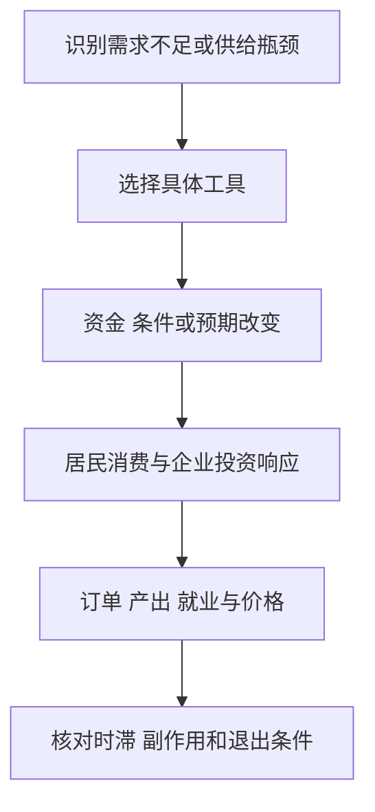

# 《就业、利息和货币通论》读书笔记

> 作者：约翰·梅纳德·凯恩斯（John Maynard Keynes），英文原作 *The General Theory of Employment, Interest and Money*，1936 年出版。中文译本及印次未确认。
>
> 资料范围：依据公开英文原文目录与重点章节，配合中央银行和官方统计材料整理。已核查有效需求、乘数、长期预期、流动性偏好、货币工资及结论章节，未逐页精读全书。以下是主框架导读与教学推导，不覆盖全部形式化论证。历史案例、后续制度与个人财商应用分别标明。整理日期：2026-11-12。

这本书提出一个看似简单、却改变宏观经济学的问题：**即使很多人愿意工作、工厂也能生产，为什么经济仍可能长期停在就业不足的状态？** 凯恩斯认为，总购买意愿与企业预期回款可能不足，使企业不愿扩大生产；降低工资和利率，也不保证所有环节自动恢复。

对财商的价值，是理解企业不仅受自身技术和成本约束，也处于客户收入、投资预期、金融条件与政策反馈之中。它并不教人“任何时候政府多花钱都好”，也不能直接给出股票涨跌答案。

## 原书结构与概念定位

| 原书位置 | 主要内容 | 本文位置 |
| --- | --- | --- |
| 第 1—3 章 | 古典理论的适用条件与有效需求 | 1—6 |
| 第 4—7 章 | 单位、预期、收入、储蓄和投资 | 7—10 |
| 第 8—10 章 | 消费倾向与乘数 | 11—15 |
| 第 11—18 章 | 投资、利率、货币与流动性 | 16—25 |
| 第 19—21 章 | 工资、就业与价格 | 26—29 |
| 第 22—24 章 | 周期、思想史与政策哲学 | 30—36 |

原文见[公开目录](https://www.marxists.org/reference/subject/economics/keynes/general-theory/index.htm)。后来的 IS–LM、现代总供求图及新凯恩斯模型，都是进一步解释或发展，不能直接称为本书原图。

## 核心知识点

### 1. “通论”强调充分就业只是可能状态之一

凯恩斯批评的对象，是他所概括的一组古典假定：价格和工资等调整机制是否足以让供给创造相应需求，并把经济带回充分就业。他并非证明所有此前经济学在任何问题上都无用。

读者应抓住模型边界：如果闲置资源、收入不确定和金融摩擦很重要，只分析单个市场的价格调整可能不够。反过来，在资源已经紧张时，需求扩张的效果也会与萧条时期不同。

### 2. 非自愿失业不能简单归结为劳动者不愿降薪

有人愿意在相应条件下工作，却找不到职位，可能因为企业预期卖不出新增产品。减少某项成本，不会自动创造足够订单。

这里需要区分个体与总体。一家企业降工资、其他条件不变，可能改善竞争位置；所有企业同时降工资，居民收入和消费也会变化。把前一种判断直接推广到全社会，容易忽略反馈。

### 3. 有效需求来自企业预期的可实现销售

第 3 章把就业决定与企业预期销售收入、生产成本联系起来。企业不是因为社会“需要”产品就无限生产，而是判断新增生产能否带来足够回款。[有效需求原章](https://www.marxists.org/reference/subject/economics/keynes/general-theory/ch03.htm)

例如，机器和人员闲置，并不意味着经营者不知道怎样使用它们；可能是对订单、付款与利润缺乏信心。要理解失业，就要研究企业为什么不愿把可用资源投入生产。

这与“总需求决定一切”不同。供给能力、成本和技术仍重要，问题在于经济可能在尚未充分利用资源时，就达到企业不愿再扩张的状态。

### 4. 一个人的支出，会成为另一个人的收入

这是宏观反馈的核心入口。居民少消费，商户收入下降；企业少投资，设备和建筑供应商订单减少；相关人员收入变化，又影响下一轮支出。

个人减少开销可以很理性，但总体结果取决于其他部门是否接过支出。政府、出口、企业投资或其他家庭能否填补空缺，需要证据，不能假设总收入永远不变。

图是教学示意。它解释一种收缩反馈，不证明每次储蓄增加都会引发衰退，也不预先指定哪种政策一定有效。

### 5. 就业不足也可能形成暂时稳定的总量状态

如果消费和投资不足，企业按照当前销售安排生产，劳动市场仍可能有大量未被使用的人力。没有单个企业愿意先独自扩产，并不意味着这种状态对社会最好。

这提醒投资者，宏观坏局面不一定因为所有公司都缺技术或管理能力；但也不能反过来把任何公司亏损都归于需求不足。需要区分共同环境与公司自己的竞争问题。

### 6. 市场协调问题与资源配置问题需要同时分析

总需求不足时，恢复购买力可能帮助使用闲置资源；若某些产能本就没有长期需求，单纯维持旧产量又可能延缓调整。

有效研究应同时问：经济整体是否缺需求，特定行业是否过剩，资金如何到达有价值的活动。宏观刺激和微观退出不是只能二选一，制度可以在保障生活与支付功能的同时允许失败项目重组。

### 7. 总量单位需要一致，不能把名义数与实际数混算

第 4 章处理经济总量计量困难，使用劳动单位、工资单位等方法。不同产品不能直接把物理数量相加，价格变化又会影响货币总额。

现代读者可将此转化为基础纪律：收入和现金流用哪种币种、哪个期间，是否剔除价格变化？名义销售增长并不等于真实销量增长；名义利率也不等于实际资金成本。

### 8. 短期预期和长期预期影响不同决定

第 5 章区分当前设备条件下如何安排生产，以及是否形成新资本设备等长期决策。短期订单改善可能让企业加班，却未必立刻让它决定建设新工厂。

研究企业可以分别记录订单、产能利用和资本开支。不能因为一个季度销量上升，就认定多年扩产计划合理；长期投入需要对需求持续性与竞争反应有更强依据。

### 9. 储蓄与投资的事后相等，不等于计划自动一致

第 6、7 章讨论收入、消费、储蓄与投资的定义。在简化封闭、无政府框架下，`Y=C+I`，储蓄定义为 `S=Y-C`，因此事后有 `S=I`。这里的投资包含相应存货变化，不能把未售产品忽略掉。[第 6 章](https://www.marxists.org/reference/subject/economics/keynes/general-theory/ch06.htm)

这个恒等式不证明家庭想多储蓄时，企业就愿意建设同额新产能。如果消费不足导致非自愿库存增加，企业可能随后减产，总收入改变，最终使实际储蓄与实际投资相容。

开放经济、有政府的现代账户还需要加入财政与对外关系。不要把一个简化恒等式直接当作所有部门的行为方程。

### 10. 节俭悖论讨论总体反馈，不反对家庭审慎

很多家庭同时增加储蓄意愿，在投资和其他需求没有相应增加时，收入可能下降，使总储蓄未能按意愿增长。这不是说每个家庭都应花掉储备，而是说总量结果不能简单相加。

个人财商应继续重视应急、偿债与未来支出；政策分析则要考虑整体需求。两个层次有不同可用工具，不能把国家预算和家庭钱包完全同构，也不能用宏观论点鼓励个人承担不适合的债务。

### 11. 消费倾向是收入怎样变成支出的行为关系

第 8、9 章分析客观因素与主观动机：收入、财富、税收、预期、谨慎、习惯和家庭目标都会影响消费。不是只由一个固定心理数字控制所有时期。

平均消费倾向是消费占收入比例；边际消费倾向是新增收入中用于新增消费的部分。两者可以不同，不能拿平均比率直接代入乘数公式。

### 12. 收入上升时，消费不一定在当期同比例增加

**后来的真实资料：**BEA 在 2020 年 5 月发布的美国 4 月收入支出初值中，记录了转移支付增加背景下个人收入上升、消费支出下降以及储蓄率显著上升。疫情限制、预防性储蓄和收入支持同时存在。[BEA 当期发布](https://www.bea.gov/news/2020/personal-income-and-outlays-april-2020)

它说明收入变化与支出变化之间需要条件，不能直接用一笔转移支付乘一个永恒系数。这里引用的是当时发布版本，不把后来修订数据混入，也不据此计算单一政策的因果效果。

对公司研究，居民账户现金增加不等于立即购买所有商品。消费机会、信心、负债和产品类型决定传导路径；应研究具体客户需求，而不是只看宏观资金量。

### 13. 乘数来自一轮支出变成下一轮收入

第 10 章说明，新增投资直接形成一些收入，收入的一部分继续消费，再形成他人的收入。凯恩斯同时承认其他投资被挤出、进口、利率和信心等因素会改变效果。[乘数原章](https://www.marxists.org/reference/subject/economics/keynes/general-theory/ch10.htm)

**数学演示：**假定价格不变、有闲置资源、没有税收与进口、边际消费倾向 `c=0.8`，独立支出增加 100。支出链为 `100+80+64+…`，总量趋近 `100/(1-0.8)=500`。这是假设模型，不是对现实政策的预测。

新增的 500 不是凭空制造五倍资源，而是原先闲置资源被多轮需求使用。若工人、原料或产能已满，链条可能更多表现为涨价；若收入用于进口、还债或储蓄，国内新增生产也会较小。

### 14. 财政乘数不是政策金额旁边的固定倍率

现实效果取决于经济状态、支出结构、执行速度、融资条件和央行反应。转移支付与政府直接购买也不是同一操作，前者需要通过领取者行为传导。

分析时至少列出四项：是否有闲置资源，资金多久到位，会不会替代原有支出，其他部门怎样响应。只把“刺激规模”乘以教材数字，会把关键未知藏进一个漂亮结果。

### 15. 过早撤回支持可能让复苏再次收缩

**真实历史：美国 1937—1938 年衰退。**美联储历史资料把这一段放在大萧条后的复苏中，讨论准备金要求、财政与财政部货币操作等收缩因素。它并非证明只有一种原因，而是说明政策与金融条件会影响尚未稳固的恢复。[美联储历史](https://www.federalreservehistory.org/essays/recession-of-1937-38)

该事件发生在《通论》出版之后，是后续对照。不能据此认为支持永远不应退出；判断退出要看私人需求、就业、通胀、金融系统和财政空间，而不是只看产出从低谷增长了几个月。

### 16. 投资取决于预期收益与取得资本的成本

第 11 章的资本边际效率，连接资本品供给价格与预期未来收益。白话说，今天投入设备成本，预期未来回款能够提供多大收益率？它不同于已经实现的会计利润率。

新增投资增多时，建设成本可能上升，未来产品供给也可能压低价格，边际项目收益下降。因此“行业过去回报很高”不能自动支持无限扩产。

### 17. 利率下降与预期利润下降可能互相抵消

融资便宜会提高一些项目的吸引力，但如果客户需求预期恶化，未来现金流下调幅度可能更大。企业仍可能不愿投资。

**数学演示：**一个项目一年后预期回款 110，成本 100，折现率 8% 时现值约 101.85；若利率降到 4%，但预期回款同时降为 95，现值约 91.35。只看利率下降，会漏掉更重要的现金流变化。实际长期项目还包含多期现金与风险，这里只演示方向。

对股票估值，同样不能只把降息代入折现率，却保持所有盈利预测不变。宏观变化通常同时影响分子和分母。

### 18. 长期预期建立在有限知识上

第 12 章强调长期项目的结果难以精确计算，参与者依赖信心、惯例和对现状的延伸。[长期预期原章](https://www.marxists.org/reference/subject/economics/keynes/general-theory/ch12.htm)

“动物精神”在这里不是简单骂人冲动，而是说明行动无法完全建立在可精确计算的概率上。它既可能支持有价值创业，也可能参与过度乐观。

财商上应把已知事实、预测区间与无法可靠估计的部分分开。一个表格算到小数点后两位，并不表示长期客户需求和竞争路径也同样精确。

### 19. 选美竞赛比喻解释对他人预期的猜测

金融市场参与者有时不只判断长期价值，还猜别人会如何评价、别人又猜更多人如何评价。这种多层预期可能让短期价格偏离个人对现金流的看法。

比喻不能证明所有价格都无意义，也不保证逆向者赚钱。若选择长期价值路线，需要匹配资金期限与承受波动的能力；若研究短期交易，则需要清楚的规则和证据，不能把两种退出逻辑混在一起。

### 20. 流动性对个人有用，对整体却不等于所有人同时退出

证券市场允许个人出售长期投资，提高持有便利；但全体投资者不能同时把所有真实资本都变成社会之外的现金。卖方需要买方，价格会调整。

这帮助理解危机中的抛售：平常可成交的资产，在所有人争取流动性时可能大幅折价。资产长期有用与短期容易出售，是两项不同属性。

### 21. 流动性偏好解释人为什么愿意持有货币

第 13、15 章从交易、预防与投机等动机理解持币。人们持有流动性，不只是因为没有找到投资，也因为随时支付、应对意外或避免价格风险有价值。[流动性原章](https://www.marxists.org/reference/subject/economics/keynes/general-theory/ch15.htm)

因此，不能只说储蓄供给与投资需求交叉就完整决定利率，还要看资产之间的选择和货币条件。现代金融市场比书中更复杂，但现金便利与风险回避仍是理解危机的重要问题。

### 22. 债券价格与收益率反向变化

固定现金流债券在要求收益率下降时，价格通常上升；反之下降。若人们认为利率已很低、未来可能上升，就可能担心债券价格损失而偏好现金。

这种关系有明确条件：发行人不违约、现金流规则已知，并要区分信用利差、期限与币种。公司债不能仅因为政策利率下降，就被推断一定上涨；信用恶化可能抵消无风险利率变化。

### 23. 极低利率可能削弱常规货币传导

**后来的真实政策：**日本银行资料记录，1999 年 2 月开始零利率政策，并在 2001 年采用数量宽松，以央行账户余额等为操作重点。[日本银行历史材料](https://www.boj.or.jp/en/mopo/outline/bpreview/ref.htm)

这说明短期政策利率接近零后，央行可能改变工具与预期管理方式。它不是单凭时间线就证明日本完全符合一个理想化流动性陷阱，也不证明所有货币政策从此无效；信用、银行资产负债表、汇率与长期利率仍可能有渠道。

阅读相关新闻时，要区分短期政策利率、银行贷款利率、信用利差与长期债券收益率。“利率为零”没有说明所有人的借款都免费，也没有说明风险消失。

### 24. 银行准备金增加，不保证企业贷款和投资同步增加

央行与银行之间的结算资产、公众存款以及企业获得的信用，属于不同层次。实际贷款还依赖资本、风险、需求和盈利；投资又依赖项目预期回报。

**制度补充：**英格兰银行 2014 年货币创造说明，商业银行贷款通常同时创造存款，不能把现实过程简化成固定储备乘数。[央行原文](https://www.bankofengland.co.uk/quarterly-bulletin/2014/q1/money-creation-in-the-modern-economy)

这项后续解释帮助校准现代机制，不能冒充凯恩斯在书中已给出今天所有央行操作细节。看见货币总量增长，仍需追踪资金如何连接经营活动。

### 25. 货币与其他资产各有收益、持有成本和流动性

第 17 章比较资产的不同属性：有的提供现金或服务收益，有的有储存维护成本，有的更容易被接受和变现。货币的特殊性与流动性及供给特征相关。

这使投资比较不能只看票面收益。低收益流动资产可能承担应急功能，高预期回报资产可能难退出、需要维护或有较大风险。选择是否合适，取决于目标与约束，而不是单一收益排名。

### 26. 全面降低货币工资的结果并不简单

第 19 章讨论降薪对价格、消费、债务、利率和预期的不同影响。若工资下降伴随收入减少与债务实际负担增加，可能削弱需求；有些渠道又可能降低成本或影响竞争位置。[工资原章](https://www.marxists.org/reference/subject/economics/keynes/general-theory/ch19.htm)

作者反对的是把降薪当作无需进一步分析的充分就业保证。不能把这点翻译为任何工资都不应调整，也不能忽略行业之间的相对价格与生产率差异。

### 27. 名义降价可能提高固定债务的实际负担

如果工资与物价下降，而本金利息仍按原名义金额支付，借款人需要拿出更大份额收入偿债。它可能促使削减开支、出售资产，进一步压低需求。

这也是“成本越低，经济必然越好”不完整的原因。技术进步带来的降价，与需求坍缩、债务压迫伴随的降价，要看产出、就业与支付关系区分。

### 28. 就业乘数与收入乘数不能随意当成同一个数

第 10、20 章涉及收入、产出与就业的关系。不同产业劳动强度不同，生产率、工时和产能利用也会变化，所以新增支出不一定按固定比例转为岗位。

阅读政策报告时，应区分直接岗位、间接岗位、净新增与临时岗位，以及人数和人年。把一个总支出倍率直接改写为相同就业倍率，会跳过产业结构与供给条件。

### 29. 接近供给约束时，需求扩张更多推高价格

第 21 章讨论价格时并未把经济写成永远闲置、价格永远不变。瓶颈、成本变化与充分就业都会影响需求增长分为产量和价格的比例。

**真实历史对照：**美国 1960 年代中期至 1980 年代初的大通胀，涉及政策、供给冲击和预期等因素，后来的反通胀付出明显经济代价。[美联储历史](https://www.federalreservehistory.org/essays/great-inflation)

这一史实不能直接宣布《通论》整体无效，也不能用需求不足理论否认通胀约束。先识别当前主要约束，再判断政策渠道，才是合理应用。

### 30. 周期可能来自投资预期的快速改变

第 22 章把资本边际效率的变化放在周期解释的重要位置。繁荣时预期乐观，项目不断增加；预期反转时，融资稍便宜也可能抵不过收益估计崩塌。

对公司研究，应寻找那些依赖多年高价格、高利用率或持续融资才能成立的项目，检查它们能否面对不同需求情景。不要把危机仅理解为某一天股市恐慌，它往往连接过去已形成的投资结构。

### 31. 库存和设备寿命影响调整过程

需求改变后，库存需要消化，旧设备仍存在，新项目不能瞬间撤回。因此复苏和收缩都可能有时滞，政策与情绪不是唯一变量。

周期股票的利润可能比销售更波动，因为固定成本、库存估值和资本开支承诺共同作用。分析应回到产能与现金，而不是只用一个宏观标签推测业绩。

### 32. 对重商主义的重读，不等于无条件支持贸易限制

第 23 章讨论历史思想时，关注当时货币、利率与就业之间的环境。某些在特定制度下有作用的政策，不代表在任何现代开放经济都合理。

贸易顺差、资本流动与国内需求相互关联，政策还会引发其他国家反应。不要用一段思想史讨论替代现行贸易、汇率和产业证据。

### 33. “投资社会化”不能简单译为取消全部私人企业

第 24 章讨论稳定总投资与就业的公共作用，同时保留私人活动及分散决策的空间。具体解释在经济思想史中有争论，应回到作者原文，而非只凭一个现代政治标签。[结论原章](https://www.marxists.org/reference/subject/economics/keynes/general-theory/ch24.htm)

需要区分公共部门影响总投资规模、直接经营所有生产和为所有投资损失兜底，这三者不是同一个主张。政策分析还应检查能力、激励、信息与预算约束。

### 34. 财政与货币工具要区分目标和传导

政府直接购买形成对产品的需求，转移支付改变领取者收入，降息改变资金条件，资产购买改变市场资产结构与利率。它们可能配合，但不能都只叫“放水”。

图是本文补充的政策阅读流程。每个箭头都可能受阻，公告金额不是最后的产出效果，也不能直接换算证券回报。

### 35. 国家改善需求，与个人买股票之间仍有距离

政策可能缓解经济收缩，但公司收益还受竞争、成本、债务与资本配置影响。股票价格也可能早已反映政策，或者反映更强的政策预期。

实用顺序是先解释宏观变化，再找到公司收入与现金的传导，最后比较市场价格和风险。不要因为理解一个宏观机制，就跳过企业和证券的具体权利。

### 36. 《通论》的最佳用法是增加条件意识

单个主体合理与总体结果理想不等价；储蓄计划与投资计划未必自动一致；低利率与强投资不是同义词；需求扩张的作用随供给和金融条件变化。

这几项认识能够帮助你读懂经济新闻，也应保留争议：预期怎样形成、乘数多大、政策怎样实施，需要后续理论与实证。读经典不应把全部后来研究压成支持或反对作者的二元投票。

## 练习与参考答案

**题一：家庭都更节俭，为什么总储蓄未必增加？** 若其他需求没有增加，消费下降可能使收入减少；事后储蓄取决于调整后的收入与投资。它不意味着个人不应保留合理储备。

**题二：降息后企业投资继续下降，是否矛盾？** 不矛盾。未来现金流预期可能下降更多，信用利差、资本和融资渠道也可能受限。应同时看项目回报和融资成本。

**题三：边际消费倾向为 0.8，现实一笔财政支出一定产生五倍 GDP？** 不一定。五倍只在简化条件下成立，还要检查税收、进口、挤出、供给限制、执行与政策反应；转移支付也不是直接购买。

**题四：股价先上涨，是否证明政策已经改善企业利润？** 只能说明价格发生变化。需要核对预期、订单、实际利润与回款；市场反应与真实经营结果的时间和机制不同。

## 阅读后的收获与缺口

本文覆盖六编主要框架及核心难点，未完成全部数学细节、工资单位分析与思想史旁论的逐页研究。已给出重点原文章节与现实来源；后来的制度资料不是原书已经包含的预测。

可与《国富论》比较长期生产能力和短期总需求，与《债务危机》比较资产负债表反馈，与《置身事内》研究中国制度和政策怎样落到实际项目。
