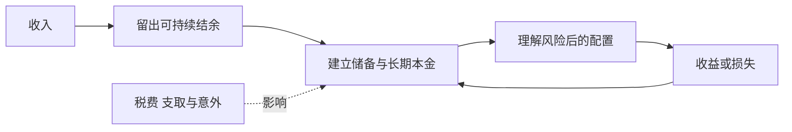
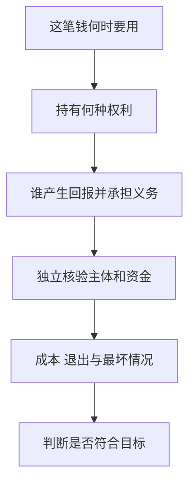

# 《巴比伦最富有的人》：从留下第一笔钱，到守住长期积累

> 作者：George S. Clason，乔治·克拉森。英文原名 *The Richest Man in Babylon*。作品源自作者在 1920 年代发表的理财寓言；出版社说明记载 1926 年开始推出相关小册子，汇编和再版的年份、章序不完全一致，本文不混用版次页码。  
> 范围：基于[出版社目录与作者介绍](https://www.wiley.com/en-us/the-richest-man-in-babylon-the-prosperity-classic-p-9781907326479)等公开材料整理的系统导读，未取得用户具体译本全文。覆盖七条致富原则、五条黄金法则、借贷、机会、债务与工作观，重组为 26 点。古巴比伦人物和泥板情节是文学化教学，不是考古实证。  
> 更新：2026-11-12。现实研究、现代制度和计算均为本笔记补充。

## 为什么简单的道理仍值得展开

本书把财富积累压缩为一条朴素路线：从收入中留下一部分，让它获得合适的回报，避免不理解的损失，同时提高赚钱能力。真正困难的地方不是记住“储蓄”，而是明确从哪里留下、怎样安排、何时不能冒险，以及面对债务和突发事件如何持续。

它不是证券分析教材，也不提供现代税务、养老金或保险的完整方法。寓言中的确定结局不能证明现实只要照做就会富有；但它可以帮助初学者建立资金流动、长期积累和风险责任的基本语言。

## 主要内容地图

| 主题 | 核心问题 |
| --- | --- |
| 七条原则 | 留钱、控制支出、投资、保护本金、安排住房、准备未来、提高能力 |
| 五条黄金法则 | 储蓄、运用资金、听取懂行者意见、远离不懂的项目与不合理收益承诺 |
| 借贷与担保寓言 | 谁真正有偿付能力，善意是否等于安全 |
| 机会与行动 | 机会需要准备，也不能用行动口号压倒尽调 |
| 债务与劳动 | 承认义务、形成可执行计划、以能力改善处境 |

## 核心知识点

### 1. 获得收入与保留收入，是两种不同能力

没有收入，储蓄空间会受限制；有收入，也可能被开支完全消耗。书中财富起点不是找到惊人收益率，而是形成可持续结余。

要同时看收入能力和支出结构。不能把基本生活费已经很紧的人与高收入高消费者等同处理，更不能把贫困全归于习惯。对自己的判断应来自真实账目，而不是别人对你是否节俭的印象。

### 2. 留下一部分收入，是建立安排顺序

寓言反复提到保留收入的一成。最值得学习的是预先安排长期积累，而非把十分之一当作适合所有家庭的精确比例。

不同人有不同收入波动、债务和责任。可以从现实可持续的金额开始，收入改善后再增加。若机械执行导致基本生活不足或高额透支，反而破坏目标。保留资金应纳入完整预算。

### 3. 支出会随着收入扩大，愿望需要排序

欲望并不只在低收入时存在，收入增加后可供比较的消费也更多。控制支出不是否认愿望，而是决定哪些值得优先实现。

可以把开支分为生活必要、已承诺责任、重要愿望和低价值重复消费。分类由自身目标决定，不需要别人把所有享受判为浪费。真正的成本是为某项选择放弃了什么。

### 4. 预算的作用是把冲突提前暴露

如果目标总额超过可用资源，预算会迫使你讨论延期、降低规格、增加收入或放弃部分目标。它无法凭空创造资源，但能防止多个承诺在同一天争抢现金。

预算还应有偶发支出：维修、医疗、年费和节庆并不每月发生，却不意味着无法预见。把它们完全排除，会使任何正常意外都像计划失败。

具体做预算时，可以把每项支出再标上“日期”和“能否调整”。总收入大于总支出，仍可能因为收入月底才到账、房租月初到期而产生短暂缺口；年度预算有结余，也不能证明每一天都有足够余额。第一步把现金时间排清楚，比单纯提高目标储蓄率更基础。

对于预计会发生但金额不固定的维修，可单独记录已有储备与估计范围，避免把它当作完全意外。预算应该能吸收正常生活的变化，而不是只能在完美月份成立。实际支出超出时，先判断是分类遗漏、估计错误还是新情况，再决定调整，不能把所有偏差都解释成缺少纪律。

### 5. 给储蓄安排合适的容器，执行难度会改变

**真实研究：肯尼亚小微经营者的储蓄账户实验。** Dupas 与 Robinson 通过随机提供账户接入研究储蓄约束，发现部分女性市场经营者明显使用账户并增加经营投入，男性参与者等群体效果不同；账户还有费用，不能把它理解为免费补贴的简单结果。[原始研究](https://www.aeaweb.org/articles?id=10.1257/app.5.1.163)

研究提醒，难以储蓄不一定只是缺乏自律。安全保管、取用摩擦、家庭压力和金融服务可得性都可能影响积累。同样的工具并不会对所有人产生相同效果。

把这点用于本书：设置单独目标记录或账户可能有帮助，但先比较费用、可用性和紧急取款条件。不能因为账户具有约束作用，就把必要现金锁到无法使用的位置。

这个实验对日常方法还有一个重要提醒：增加取钱摩擦有时能保护目标，也可能使紧急付款更困难。你需要区分“容易因冲动花掉的钱”和“必须随时使用的钱”。把两者全部锁起来，只是在一种问题上取得进展，同时制造另一种问题。

检验一个储蓄安排是否有效，可以先看三件事：真实结余是否增加，必要付款是否仍按时完成，是否新增高成本借款。如果储蓄账户增加了一千元，同时信用卡债务增加更多，不能只看储蓄数字宣称成功。研究揭示制度设计有影响，个人还应检验整体效果。

### 6. 让钱工作，需要解释谁创造了回报

利息、租金、股息与经营利润来自不同权利和风险。付给你的钱可能来自真实经营，也可能只是返还本金，甚至来自后来参与者的资金。

读产品材料时，先问谁支付、用什么活动支付、收入中断时由谁承担损失。名字叫“稳定收益”并不能回答这些问题。寓言里的钱生钱，应翻译成理解具体经济机制。

### 7. 单利与复利的差别在于收益是否继续参与

单利只按原始本金计算，复利把已经获得的收益留在体系内，再产生后续收益。现实中还要考虑税费、亏损和资金取出。

**数学演示：**本金 1 万元，假设每年固定收益 5%，不计税费。二十年单利终值是 `10000×(1+0.05×20)=20000` 元；复利终值是 `10000×1.05²⁰≈26533` 元。这是公式演示，不是任何产品的收益承诺。

如果中途亏损或取用资金，路径就改变。复利不是一种独立资产，也不保证高回报；它描述结果如何随时间累积，费用和负债利息同样可以累积。

图中保留了损失与支取，避免把“复利循环”画成只会向上的机器。

### 8. 时间重要，但不能弥补所有错误价格和资产质量

长期能够放大可持续收益，也能放大错误费用和持续亏损。买入缺乏经济价值的项目，并不会因为耐心就自动变好。

对股票，应看企业能否创造现金及所付价格；对债权，应看偿付能力和合同；对存款，应核对机构与保障范围。持有时间是条件之一，不能代替这些判断。

### 9. 保护本金不等于拒绝任何波动

本金保护可以包含避免欺诈、减少无法恢复的损失、安排流动性和控制集中度。短期报价波动与永久损失不同，但有近期支出时，波动也可能变成实际问题。

“没有波动”也不是安全证明。某些资产只是缺少频繁报价，账面平稳可能来自估值滞后；稳定显示的账户收益还可能是假数字。安全需要机制，不能只看曲线。

### 10. 制度保护与个人谨慎是互补关系

**真实历史：美国存款保险。** FDIC 官方时间线记载，1933 年银行法设立该机构，联邦存款保险在 1934 年开始运行。这是银行挤兑与信心问题下的制度变化，而不是储户个人眼光突然改善。[FDIC 历史](https://www.fdic.gov/90years)

这说明资金安全不仅靠挑一个“看起来可靠的人”，也依赖法律、监管、资本约束与保障制度。不同国家、机构、账户和产品的保障范围不同，不能因为都由银行销售，就把基金、理财和存款视为同一种权利。

使用时核对你持有的到底是什么、保障针对什么以及谁承担责任。本文不把美国制度当作中国账户规则，也不从历史保险建立推断今天任何资金都完全无风险。

### 11. 懂行的建议应与问题领域匹配

书中强调向了解相关业务的人咨询。专业能力具有领域边界：擅长制造不等于擅长证券估值，有财富不等于了解你所面对的合同。

问建议者如何得出结论、使用什么资料、可能在哪里出错，并核对其利益关系。真正的专业意见通常能说明条件与不确定性，而不只给你一个必须相信的答案。

### 12. 名声、熟人和过往付款，不能替代独立核验

**真实案例：麦道夫。** 美国司法部记载，麦道夫在 2009 年 3 月 12 日对十一项指控认罪。其骗局长期利用投资顾问业务与虚假记录维持外观，不能因账户过去显示稳定盈利，就认定底层投资真实。[司法部案件资料](https://www.justice.gov/usao-sdny/programs/victim-witness-services/united-states-v-bernard-l-madoff-and-related-cases)

这个案例并非说所有稳定回报都违法，而是说明可核验的托管、交易、审计与资金流，比口碑和精美报表更重要。收到过钱也不能单独证明回报来源合法、可持续。

对任何项目，应能够独立确认主体和权利，理解收益来源，并知道如何退出。信息越不透明，越不能靠更高承诺收益来补足信任缺口。

怎样把麦道夫案例转成核查动作？先确认报告究竟由谁出具，资产是否由独立主体保管，信息是否能够通过独立渠道取得；再看报表显示的交易能否与实际市场、账户权利和现金收付相互对应。一个网站展示净值、一名熟人转发截图，都不能完成这些检查。

同时应避免另一种误读：材料齐全并不代表你已能排除所有欺诈，专业机构也可能失误。核查的作用是提高发现矛盾的机会，并帮助识别超出自己能力的部分。若核心信息无法独立验证，不能用“承诺收益足够高”弥补证据不足。

### 13. 不理解的投资，风险往往首先体现在问题都问不出

不了解某个产品时，最危险的未必是没有预测能力，而是不知道哪些条款能改变结果。杠杆、提前赎回、担保范围或价格路径依赖可能藏在名字之外。

先用自己的话解释它如何赚钱、如何亏钱、钱何时可取。如果必须靠销售者不断保证才能放心，理解还不充分。暂时不参与也是有效的财务决定。

### 14. 不合理收益承诺通常伴随被省略的条件

高收益可能对应高信用风险、价格波动、流动性限制或经营不确定性。把这些条件藏起来，只展示回报数字，会使比较失真。

需要问收益是历史、预期、目标还是合同义务，是否扣费，是否包含返还本金，适用什么期间。承诺越强，越要核对履约主体与实际资源，不能只反复听“已经很多人参加”。

### 15. 借钱给别人，先判断偿付来源

善意、勤奋与需要帮助，都不等于具有偿付能力。债权研究至少包括资金用途、收入来源、原有负债、期限和违约处理。

如果资金用于消费，偿还主要依赖未来收入；如果用于经营，还要分析业务本身。抵押物也需核对权属、顺位、估值与执行成本，不能把“有房产”三个字当成完全保障。

### 16. 担保把别人的失败转成你的义务

担保往往在最初不发生现金流，却可能在未来形成巨大支付责任。因此个人财务表除了现有债务，还应记录潜在义务。

家庭情分与合同责任属于不同层次。是否帮助、帮助多少，可以先决定可承受的损失，再选择清晰方式。具体担保效力和执行依法律及合同而定，不能用寓言代替正式审查。

### 17. 安排住房，要区分生活需要和投资回报

书中鼓励改善自己的居所，具有当时社会和寓言环境的背景。现代购房涉及价格、融资、交易成本、税费、流动性和职业迁移，不能简化为买房永远优于租房。

居住稳定本身可以有价值，但仍须说明为它支付多少。不要把未来升值当作覆盖所有持有成本的既定事实，也不要把按揭本金全部当成永久消失的费用。

现代住房决策至少包含三张表。第一张是居住需要：预计住多久、工作是否可能迁移、家庭需要何种空间；第二张是现金安排：首付款、持续付款、维护和储备；第三张才是投资情景：租金替代、价格变化、出售成本和剩余贷款。顺序清楚后，才不会用一个升值故事替代全部判断。

还应比较可行的替代方案，而非把当前买房与完全不支付居住成本放在一起。租金是现金流出，房产持有也有资金机会成本；两者都提供居住服务。不同地区与时期结果可能不同，寓言里的住房原则更适合转化为“为生活稳定作准备”，不适合成为任何价格必须购买的命令。

### 18. 未来收入需要准备，也要承认无法精确预测寿命与支出

养老、照护和健康费用可能持续很久，提前积累能增加选择。但名义利息未必抵得过通胀，某种收入来源也可能变化。

可以先明确未来基本需要，再了解当地养老金、保险和储蓄投资工具。不同工具解决不同风险，不应只按预期收益高低排序。安排需要定期复查，而不是一次计算终身不改。

### 19. 提高赚钱能力，是本金较小时的重要部分

对尚未积累很多资产的人，职业能力、工作质量与收入稳定性的改善，可能比追求更高投资收益率更有影响。学习也需要比较成本、需求和可迁移性。

不要因为书强调劳动，就接受任何低回报工作或无限加班。关键是努力是否产生技能、客户价值或更好的选择。衡量能力建设，要看实际反馈和可展示成果。

学习投入也可以按阶段核查：先了解市场是否需要这项技能，再通过小作品或真实任务获得反馈，最后决定是否投入更大成本。课程学完、证书取得与客户愿意付费不是同一件事；它们可能相关，但还需要检验中间环节。

### 20. 机会偏爱准备，但准备包括拒绝不合适的机会

看到机会后迟迟不核实、拖到条件消失，可能是一种损失；被“机会难得”催促而跳过核查，也可能造成更大损失。

可在平时准备研究方法、资金安排和明确边界。这样真正的机会出现时，行动来自已经形成的判断能力，而非临时激动。机会不因被宣传为限量，就自动具有经济价值。

### 21. 运气不完全可控，行为能够改变暴露方式

努力不能保证获得幸运，但持续接触真实问题、积累技能和维持可信关系，可能增加发现机会的渠道。这里是合理机制，不是精确概率承诺。

同样，拒绝超出承受能力的赌注，可以减少一次坏运气毁掉长期计划的风险。不要把某次成功全部记作能力，也不要因短期不顺就认定所有努力无效。

### 22. 债务处理先承认事实，再讨论可执行计划

回避账单不会减少义务。列出本金、利率、费用、最低支付、到期日与担保，才能知道压力来自哪里。

寓言中的还债比例是教学安排，不能直接取代真实合同与基本生活预算。具体困难可能需要与债权人协商或寻求合格帮助；关键是尽早形成可核对的计划，而不是为了证明决心给出根本无法兑现的承诺。

还债计划需要把“每月支付金额”和“本金减少金额”分开。付款可能先用于利息、费用或其他约定项目；即使一直在付款，本金也未必下降。先取得完整账单与合同口径，再判断余额为什么变化，不能只凭支付截图评估进度。

接着做一个滚动检查：本期初本金、期间新增借款、利息与费用、已付款、期末余额是否能相互解释。若计划只有在未来收入显著增长时才成立，应把增长列为未确认条件，并另做收入不增长的安排。承诺可以表达诚意，但不能替代现金来源。

### 23. 还债、储备与投资需要同时比较

高成本债务具有明确支付负担，投资收益通常不确定；同时没有现金缓冲又可能使刚还掉的债务很快重新出现。三者不宜只用一个口号排序。

比较时看利率和罚费、资金流动性、紧急责任与收入波动。没有个人背景，不给统一配比。目标是减少整体脆弱性，而不是在账面上完成某个单一指标。

### 24. 守信用的价值来自长期合作，也有现实边界

如实说明处境、遵守合理约定、及时沟通，有助于降低合作的不确定性。信用不是为了面子隐瞒支付困难，更不是为无法履行的合同继续举新债。

如果基本条件已改变，应面对事实并依法处理。把财务困难当成道德羞耻，可能导致更晚求助、更差选择。书中的责任感应转化为透明与行动，而非自我惩罚。

### 25. 建立一张资金安全检查卡

这是现代补充工具。它把五条黄金法则转成可执行问题，不保证任何产品通过检查后绝对安全。对无法确认的关键部分，记录缺口比自行猜测更有价值。

使用这张卡时，最值得检查的是“收益率”和“可用时间”是否被混淆。年化数字不说明你持有几天就一定按比例取得收益，也不说明需要时可以按本金退出。锁定期、提前支取成本、净值波动和到账时间，都属于具体权利的一部分。

另一个检查是“安全”究竟指什么：主体不太可能违约、短期价格较稳定、合同有保障安排，还是销售者个人相信？这些含义不能互换。明确安全目标，才知道应该查合同、查市场价格、查制度范围，还是承认资料不足。

### 26. 从简单规则走向自己的制度

初读本书，可以从一张现金流记录、一项可持续储蓄安排和一次产品核验开始。熟练以后，再学习估值、资产配置、保险和税务等更复杂的问题。

不要因为道理简单就轻视执行，也不要因为故事容易记就忽略现代边界。寓言适合建立方向，现实决策还需要完整信息、适合的工具和不断更新。

## 练习与参考答案

**题一：每月强制储蓄一成，却因此产生昂贵透支，是否符合长期积累？** 未必。必须检查整体现金流和费用，比例应服务于可持续安排。

**题二：推荐者名气大且多年准时付款，缺了什么？** 缺独立核验的托管、交易、审计、收益来源与合同权利，过往支付不能代替这些证据。

**题三：复利公式能否证明某项投资值得持有二十年？** 不能。公式只在给定回报路径下计算，仍需判断资产质量、价格、成本、风险和资金期限。

## 读完后可以做的事

用一周把每项固定收付列出来；选择一个长期目标，明确可持续投入与复查时间；拿一份真实产品文件回答第 25 点的问题。无需为了练习而购买产品。

继续读[《小狗钱钱》](<../小狗钱钱 - 博多·舍费尔/读书笔记.md>)强化习惯，读[《聪明的投资者》](<../聪明的投资者 - 本杰明·格雷厄姆/读书笔记.md>)补充价值与价格。现实案例均为本笔记延伸，不能当作古代寓言的历史验证。
