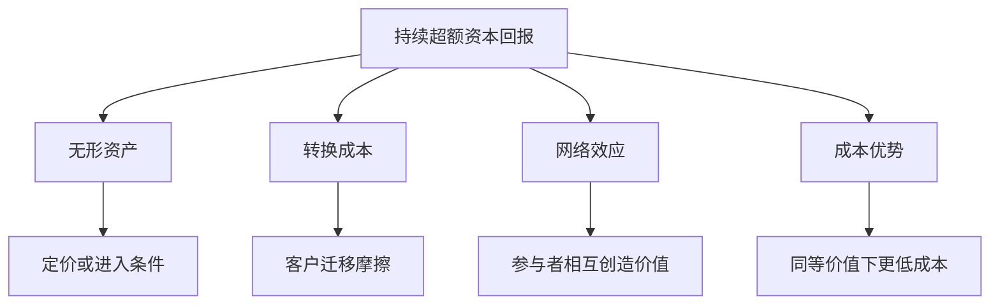
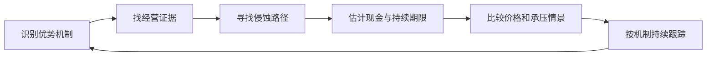

# 《巴菲特的护城河》：为什么有些企业的高回报能保持更久

> 作者：Pat Dorsey，帕特·多尔西，不是巴菲特。原作 The Little Book That Builds Wealth，2008 年。中文《中国经济出版社》2019 年版题为《巴菲特的护城河》，ISBN 9787513654876；2025 年中信版《投资护城河》为同一原作的另译，不另算一本。  
> 资料范围：依据出版社、馆藏目录、作者相关框架和公司公开披露整理的系统导读，未取得用户版本全文。覆盖四类护城河、虚假优势、竞争侵蚀、管理、估值和买卖判断，共 28 点；现代案例是书外补充。更新：2026-11-12。

## 核心问题

赚钱的企业会吸引竞争。竞争者模仿产品、抢客户、降价和增加供给，通常会压缩超额利润。护城河讨论的是：为什么某些企业能够较长时间抵抗这种压力？

这里的“超额”不是今天股价比市场涨得多，而是经营资本产生的回报能够持续高于其机会成本。护城河帮助判断这种持续性，估值才进一步回答应支付什么价格。两者缺一不可。

## 主要内容地图

| 模块 | 需要回答的问题 | 知识点 |
| --- | --- | --- |
| 定义与误区 | 护城河与好产品、好经理有何不同 | 1—5 |
| 四类主要来源 | 无形资产、转换成本、网络、成本如何起效 | 6—17 |
| 优势的变化 | 行业、管理和竞争怎样改变持续性 | 18—22 |
| 价格与行动 | 质量如何进入估值与复查 | 23—28 |

原作及四类来源见[Wiley 出版资料](https://www.wiley.com/en-nl/the-little-book-that-builds-wealth-the-knockout-formula-for-finding-great-investments-p-9781118045398)；中文 2019 年版可查[中欧国际工商学院馆藏书单](https://cn.ceibs.edu/files/2021-05/new_books_2019-07_0.pdf)，同原作新版见[中信出版书页](https://detail.youzan.com/show/goods?alias=2fsvi00f77szjvj&from_source=gbox_seo)。营销文案中的收益承诺不作为本笔记结论。

## 核心知识点

### 1. 护城河是经济机制，不是赞美词

一种优势必须能够影响客户选择、定价、成本或进入条件，并进一步保护资本回报，才与护城河有关。“技术领先”“品牌强”“生态完善”都还只是待解释的标签。

可用的描述应包含竞争者为什么难以复制、复制需要什么代价、客户为什么愿意继续付钱，以及优势怎样变成可持续收益。没有这些连接，就不能仅凭熟悉感或市场排名下判断。

### 2. 高利润是观察入口，不是充分证明

供给暂时不足、行业景气高峰、会计收益和一次性交易，都能抬高利润。真正的持续优势需要跨时间、跨环境的证据。

应观察资本回报的持续性、客户稳定、价格与成本变化，并寻找竞争者进入后发生了什么。即使没有很长的历史，也可以分析结构，但应相应降低确定性，避免把预测当事实。

### 3. 资本回报与股东回报是两条不同的关系

企业以少量新增资本创造大量现金，经营上可能优秀；投资者如果支付过高价格，仍可能获得很差回报。企业创造价值与你分到多少，还受到稀释、资本配置、税费和估值变化影响。

因此研究应分两页：一页解释业务优势，一页解释当前价格包含的期待。两页都写清楚，才能防止“因为公司好，所以股票便宜”的跳跃。

### 4. 好产品不一定是护城河

产品可以很好用，却容易被复制；产品有时领先，也可能在下一代技术被替代。若优势只能靠每次开发出下一款爆品维持，就需要不同于稳定客户锁定的判断。

研究应问客户付费意愿究竟来自功能、习惯、配套、网络还是价格。如果功能被追平后客户很快转移，那么产品领先的持续时间可能短于企业宣传的时间。

### 5. 好管理和大规模也不是自动的护城河

优秀管理能够配置资本、维护服务和避免错误，但不能保证竞争结构允许高回报。大公司也可能背负复杂组织、旧技术与低效资产。

规模必须通过采购、分销、固定成本、流动性或网络等明确渠道产生优势。营业额更大只是结果；如果成本与复杂度同步增加，并不自动提高单位经济性。

### 6. 无形资产：品牌必须影响经济选择

品牌知名度很高，不一定能提高价格或降低获客成本。真正需要看客户是否愿意为其付费、重复购买，或在有便宜替代品时仍选择它。

评价品牌要区分市场份额、价格溢价与维护支出。靠大量广告和折扣维持销售，也可能说明竞争激烈。品牌价值不是一个固定常数，它依赖消费者行为和企业长期交付。

### 7. 会员关系提供品牌与重复购买的联合证据

**真实补充：Costco 2024 财年末，美国和加拿大会员续费率为 92.9%，全球为 90.5%。** 会员费收入为 48.28 亿美元。[公司年报](https://www.sec.gov/Archives/edgar/data/909832/000090983224000071/cost2024annualreport.pdf)

这个事实比“大家喜欢它”更接近可检验行为，但还不是完整因果证明。续费可能与价格、选品、便利、会员结构和计算方法共同有关。高续费需要看服务成本和新增会员质量，不能直接把它全部归因于品牌。

对其他公司，应寻找相应的重复交易证据，而不是照搬会员指标。没有订阅制度的企业，可以研究复购、客户流失、价格与销量、渠道补货等。资料没有披露时就标明未知，不编一个“品牌忠诚度”。

### 8. 专利与许可创造法律边界，也有期限和替代风险

专利可能限制竞争者使用特定发明，但不阻止所有技术路线，且需要面对到期、诉讼和监管变化。许可证也要看是否限制供给，是否允许获得合理回报，而非只看企业是否持证。

**真实补充：FDA 在 2016 年 9 月批准 Amjevita，参照药为 Humira。**[FDA 生物类似药列表](https://www.fda.gov/drugs/biosimilars/biosimilar-product-information)这是审批事实，并不等于同日就在所有市场上市或实现完全替代；专利和商业安排另有时间线。

它说明研发和监管壁垒并非无限期。估值时要分别判断审批、上市、支付方接受和实际采用，不能把任何一项事件视作竞争立即结束，也不能把曾经独占的现金永久延长。

### 9. 监管既可能保护，也可能约束收益

经营许可、排他权和安全认证可以提高进入成本，但监管也可能限制收费、要求投资或改变经营条件。把受监管行业一概称为安全，会漏掉制度影响的另一面。

研究时应识别权利由谁授予、持续多久、可以怎样调整，以及公司承担什么服务义务。历史制度关系是分析起点，现行规则需要另行核实。

### 10. 转换成本：客户离开要付出什么

转换成本可以是迁移数据、培训员工、重建流程、承担停机风险和重新认证。它不一定写在解约罚金里，有时主要来自组织和技术上的摩擦。

关键比较是客户更换供应商的总成本与预期好处。若现有服务差到足以抵消迁移成本，客户仍会离开。高转换成本不能成为无限提价和忽视体验的理由。

### 11. 订阅制本身不等于转换成本

**Adobe 在 2013 年推动 Creative Cloud 转型，付费订阅从上一财年末约 30 万增至约 140 万，同时改变了收入确认节奏。**[Adobe 年报](https://www.sec.gov/Archives/edgar/data/796343/000079634314000004/adbe10kfy13.htm)

这说明商业模式转变可以观察，但不能仅由订阅增长断言客户被牢牢锁定。需要另外核对工具熟练度、文件兼容、协作流程、内容资产与替代工具成本。订阅只是付款方式，转换成本是客户实际面对的经济摩擦。

应用时还应观察客户能否同时使用多个工具，合同到期是否重新比价，低价替代产品是否足以完成核心任务。只看到付费用户增长，会忽略未来竞争可能从低要求场景进入。

### 12. 转换成本对客户群体可能不同

大型企业的数据集成和审批流程，可能使切换成本较高；小客户若只使用基本功能，切换则容易得多。不能用核心大客户的情况代表全部市场。

分部、客户规模、产品用途和合同期限都可能影响护城河。整体留存率如果变好，还要确认是不是低质量客户先流失或客户结构改变，而不是所有客户都更稳定。

### 13. 网络效应：其他使用者怎样提高你的价值

网络效应是用户或参与者增加，使某些参与者获得更多价值。它可以存在于同侧，如更多联系人，也可以存在于双边，如更多商户和消费者相互吸引。

用户多不自动证明网络效应。搜索、交易匹配、兼容和接受范围，必须具体说明。网络还可能出现拥堵、欺诈和质量下降，所以价值不必随规模无限增加。

识别时可以做两个反事实问题。第一，如果同样多的客户彼此完全不连接，产品价值会不会明显下降？若不会，观察到的可能主要是品牌或规模经济。第二，如果新进入者购买同样设备和流量，它能否立即提供同等使用价值？若必须等待某些关键参与者加入，才更像网络形成的进入障碍。

网络还要界定范围。全国用户数很大，未必改善某城市某时段的匹配；全球功能很多，也未必提高特定专业群体的协作价值。把实际交互的局部网络当作分析单位，通常比只看累计注册数更有意义。

### 14. Visa：品牌交易与网络处理是不同口径

**Visa 的官方财务页列示，2024 财年在 Visa 网络处理的交易约 2338 亿笔。**[Visa 财务资料](https://annualreport.visa.com/financials/default.aspx)这不是所有使用 Visa 品牌的交易总量，也不是 Visa 自己发放的贷款金额。

用护城河框架看，消费者希望卡被广泛接受，商户希望接触更多支付者，机构还需要可靠的处理与规则。但规模本身不能告诉你收费空间，竞争支付方式、路由规则、监管和客户议价仍影响收益。

研究平台时应分别看参与者数量、实际使用、交易价值、收入率与成本。把交易额当公司收入，或把全部生态利益当股东利益，都会夸大平台价值。网络提供可能的机制，财务与制度证据决定这个机制能保留多少回报。

### 15. 多平台使用会削弱锁定程度

如果客户容易同时使用多个平台，某个平台新增用户带来的独占优势可能较小。不同网络还可能通过标准和接口互联，使规模优势不完全归属于单个公司。

应问客户为什么只能或更愿意留在这里，是否可以把同一交易迁移出去，以及平台能否在不破坏活跃度的前提下收费。免费时期的增长不能直接证明付费时期也具有同样优势。

### 16. 成本优势必须相对于竞争者而且可持续

成本优势可以来自流程、位置、资源、规模和组织方式。低售价不等于低成本，也可能只是补贴或接受更低利润。

**巴菲特 1996 年股东信将 GEICO 的竞争力与低成本结构联系起来。**[当年股东信](https://www.berkshirehathaway.com/letters/1996.html)这是经营者对机制的解释，不能直接当作今天每项业务仍有相同优势的证明。

应用时应比较获客、服务、赔付或生产等分项成本，并看质量是否一致。若低成本来自暂时少提准备金、少做维护或把责任推迟到以后，那是风险转移，不是可持续效率。

### 17. 规模经济有边界，不能无限外推

固定投入分摊到更多销量，可能降低单位成本；但超过管理能力或物流半径后，复杂度也可能上升。规模经济应说明发生在哪个层级：门店、地区、工厂、平台还是整个企业。

一家公司全国规模很大，不一定在每个当地市场都占优。复制规模需要客户和资本，不能只用理论产能比较。低利用率时，巨额固定资产也可能成为负担。

**数学演示**：固定成本 100，单位变动成本 5，销量 20 时平均成本为 10，销量 50 时为 7。这个算例说明固定成本分摊，但还没证明护城河：竞争者若同样能卖 50，也能获得相同成本；若市场总需求只够一家有效经营，复制者则可能在达到规模前长期亏损。

判断优势要把规模门槛与市场容量一起看。如果市场突然扩大，原来容不下第二家的地方可能允许竞争者生存；如果物流半径扩大还伴随成本上升，全国规模未必产生全国低成本。所谓“更大”必须解释到客户、设施和单位成本。



图从结果回查可能原因，不表示所有高回报都能归入其中，也不表示四类互相排斥。

### 18. 行业结构会影响护城河出现的可能性

有些行业产品差异小、产能容易增加、客户转换容易，持续超额回报就更难；另一些行业存在认证、数据、分销或网络结构，优势可能更持久。

但行业平均不能代替企业分析。困难行业也可能有成本领先者，优质行业也可能有过度扩张者。行业筛选帮助安排研究时间，不应变成不用看公司就得出结论的标签。

### 19. 技术领先需要持续投入和产业协作

**ASML 2024 年报告披露约 43 亿欧元研发投入，涉及 EUV、High NA 和既有系统性能改进。**[公司年报](https://www.asml.com/investors/annual-report/2024)

对本书概念的补充解释是：复杂技术壁垒可能同时来自知识、客户验证、供应商协作和制造能力。仅有专利数或研发费用，不能完整衡量这些关系。高投入说明维护优势需要资源，不保证每项投入都有回报。

研究还要看客户资本开支、出口限制、技术采用和服务收入。强壁垒可以与周期波动并存。不要从“竞争者少”推断“需求无限”或“任何估值都安全”。

### 20. 护城河侵蚀通常先出现在经营细节

观察顺序也有意义：领先指标可能是客户试用替代品、合同期限缩短和销售优惠增加，滞后指标才是总体收入与利润率下降。但这些线索未必每次都预示优势恶化，可能来自产品换代或客户周期。最好预先列出需要同时成立的几项证据，减少看到一个季度坏数字就得出长期结论的冲动。

若原先论点依赖低获客成本，应追踪相同客户口径；若依赖认证壁垒，应关注竞争者实际获得的客户认证，而不是新闻中的研发计划。用机制选择指标，才能让复查真正检验原来的判断。

价格溢价缩小、客户流失、获客成本上升、替代技术成熟、渠道地位下降，都可能提供线索。单个季度的利润变化还可能是临时因素，所以需要多个证据互相支持。

最好的复查问题是：原先为什么难以竞争，现在这个障碍是否改变？如果原先依赖网络，但用户能轻松迁移和互通，分析应更新到这一机制，而不是只重复旧市占率。

### 21. 管理层会维护或消耗优势

保持产品质量、选择合适价格、投资关键能力和尊重客户，可以维护已有优势；过度提价、跨界收购、降低服务和激励失真，可能消耗它。

不要用“护城河深”原谅任何资本配置。优势带来的现金如何使用，会决定股东最终得到什么。管理评价应连接到实际投入、结果和责任安排，不能只依靠演讲和个人魅力。

### 22. 增长不是价值的同义词

当新增资本回报超过资金成本时，增长能够扩大创造的价值；若新增回报不足，扩张可能把原本不错的公司变成资本消耗者。

**数学演示：**新增投入 100，长期可持续税后经营收益 15，资金成本 10%，与收益只有 6 的扩张不同。两者都能增加收入，只有前者在此假设下超过资金机会成本。真实企业还要考虑时间、失败和持续投入。

### 23. 护城河宽度与估值期限有关，但不是同一概念

优势越可能持续，未来超额收益的期限可能越长；然而持续性不确定，不能轻易把所有高回报永久化。竞争消退速度往往是估值的重要假设。

可以设置优势维持、逐渐削弱和提前消失三种情况，观察现金与资本回报路径。用这种方式比给“宽护城河”直接贴固定市盈率更能暴露判断差异。

一个有用的补充是把旧业务与新增业务分开。现有客户可能因转换成本继续付费，但新客户获得成本却在上升；老工厂可能拥有独特位置，新建工厂却没有同样资源。历史整体 ROIC 很高，不能证明每一元新增资本都能复制旧回报。

因此，护城河研究最终要进入估值假设：超额回报还能维持多久，新增资本能投入多大规模，维持优势每年需要付出什么代价。若模型同时假设不需投入、份额不断提高且利润率永不下降，即使企业确有优势，估值也可能过于乐观。

### 24. 市场价格可能已经为优势支付很多钱

一项大家都知道的优势，未必是错误定价。你的研究还必须说明市场预期哪里过高或过低，以及为什么自己有证据支持不同判断。

高质量可以降低某些经营风险，却不能消除估值风险。如果买价要求几乎完美的发展路径，温和失望也可能造成很差回报。安全余地需要同时评价业务和价格。

### 25. 倍数比较应控制盈利和再投资差异

利润率、资本需求、增长持续性和风险不同，合理倍数自然可能不同。低市盈率可能反映衰退，高市盈率也可能反映可持续增长，但两种解释都须验证。

市销率尤其不能单独用来比较不同利润模式。同行表的作用是提示异常，随后回到未来现金和资金成本，不能用全行业平均替代独立价值判断。

### 26. 买入之后仍要跟踪机制

复查清单应来自原先的优势来源。依靠转换成本，就看客户迁移和替代方案；依靠成本，就看单位成本及竞争者学习；依靠品牌，就看价格、复购和维护费用。

这样可以避免把每天的股价波动当作全部信息，也能避免只看财报利润直到优势已严重改变。关键指标要有解释，不是越多越好。

### 27. 卖出和不买，同样需要明确理由

护城河弱化、价格过度透支、资本配置变坏或组合约束不适合，都可能改变选择。没有买入的理由不等于应立刻卖出已有持仓，税费、替代机会与原有约束还要综合比较。

但不要让成本价成为拒绝研究的理由。市场不会因为你付过更高价格，就必须给你回本机会。决定应建立在现在的信息与未来条件上。



图中的循环是研究流程，不是保证获利的认证体系。

### 28. 一页护城河研究卡

```text
企业、业务与资料日期：
客户为何付款，替代方案是什么：
声称存在的优势类型及具体机制：
哪些数字和事实支持机制：
竞争者复制需要什么，多久可能完成：
优势维护需要哪些投入：
哪些变化会削弱或破坏优势：
正常与承压情况下的资本回报：
当前价格隐含了多长、多强的优势：
最强反证和下一次复查条件：
```

写不出来的部分就是知识边界。不能用“公司优秀”填满每一栏，也不要因为框架里有四类，就强行给每家公司找到四条护城河。

## 练习与参考答案

**一家软件公司订阅率高，能否直接认定转换成本高？** 不能。付款方式与迁移摩擦不同，要查数据、流程、培训、兼容和替代工具。Adobe 案例提供模式转型事实，转换成本仍需要额外调查。

**Visa 的交易笔数巨大，是否意味着交易金额都是公司收入？** 不是。交易规模、网络处理量、公司收取的费用和最终利润各有定义，必须分开。

**公司有专利，能否假设长期没有竞争？** 不能。专利范围、期限、替代技术、审批与商业采用都要考虑。FDA 批准一种生物类似药，也不能直接等同所有市场立即替代。

## 容易误读的地方

本书四类框架是寻找结构性优势的工具，不是穷尽所有企业竞争方式的分类法。晨星后续研究中的分类和评级可能有扩展，不能倒写成原书全部内容。公司案例只能说明机制怎样被研究，不等于作者或本笔记对其当前价格的推荐。

建议与[《股市真规则》](<../股市真规则 - 帕特·多尔西/读书笔记.md>)连接财务分析，再与[《资本回报》](<../资本回报 - 爱德华·钱塞勒/读书笔记.md>)比较：护城河关注阻止竞争的机制，资本周期关注资金进入与退出怎样改变竞争条件。两者可互相检查。
