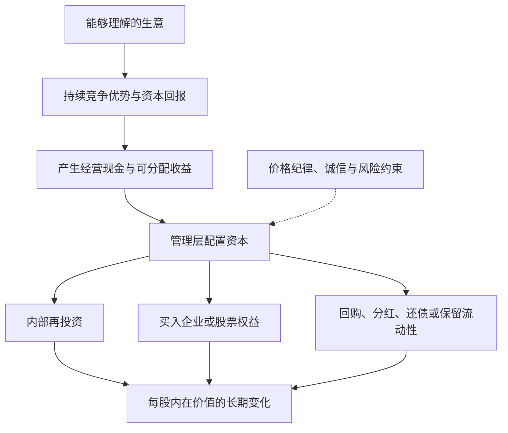
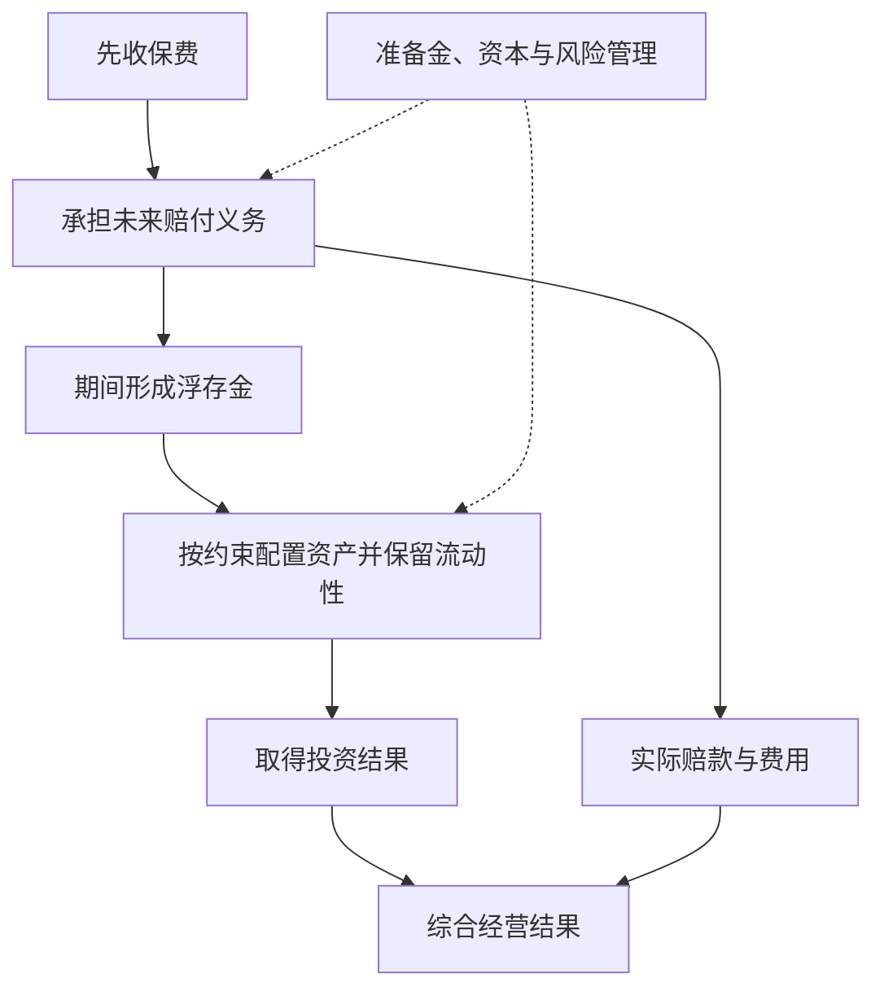

# 巴菲特股东信：按主题整理的读书笔记

> 作者：沃伦·巴菲特（Warren E. Buffett）。这里的“股东信”指伯克希尔官网原始书信，不对应某一种中文选编本。  
> 资料范围：选读并核对 1977、1983、1985、1986、1987、1989、1991、1992、1996、1999、2007、2008、2010、2011、2012、2013、2014、2016、2018、2020、2022、2023、2024 报告年度的代表主题，补充 2025 年感恩节信息的作者与传承说明；书外案例另使用贵州茅台 2026 年三季报与美国财政部 1999 年证词。不是全部年份逐封精读。  
> 组织方式：35 个知识点，关键小节直接解释原信真实企业与书外公告，保留必要公式演示，另附三个计算练习，全文四幅示意图；原信原则与补充教学分开，给出具体年份链接。  
> 更新日期：2026-11-11

**先把年份分清：** 年度信通常按报告年度命名，发表于下一年。巴菲特的 **2024 年度信署名日期为 2025-02-22**；2025-11-10 的信是感恩节信息，其中说明他不再撰写年度报告中的信。官网已将 Greg Abel 的年度信单列，不能把其 2025 报告年度信当作巴菲特写作。[巴菲特年度信目录](https://www.berkshirehathaway.com/letters/letters.html)、[2024 年度信](https://www.berkshirehathaway.com/letters/2024ltr.pdf)、[2025 感恩节信息](https://www.berkshirehathaway.com/news/nov1025.pdf)、[Abel 年度信目录](https://www.berkshirehathaway.com/letters/gealetters.html)

本笔记只提炼所列代表年份的主题，不把某年持仓、利率、会计规则或现金数字描述成当前状态，也不根据巴菲特历史交易给出现在的买卖建议。

## 先看这里：这些信的共同问题是什么

**一句话概括：把自己当作企业的长期共有人，研究一门生意能产生多少真实收益、谁在配置这些收益，以及你付出了什么价格和风险。**

股东信比“投资名言合集”更有用，因为它们把原则放进了真实取舍：为什么买或不买、为什么留存现金、为什么回购、怎样解释会计数字、犯了什么错，以及规模变大后原来的方法为什么需要调整。

最值得带走的八个结论：

1. **看每股价值，不只看企业规模。** 收入和利润总额增长，未必让原股东变得更富。
2. **优质企业要能长期创造超出资本成本的收益。** 品牌、成本优势等要落实成经济结果。
3. **增长需要算代价。** 只有新增投入能获得足够回报，增长才有价值。
4. **真正属于股东的收益，要扣除维持竞争力所需投入。** 折旧加回不等于设备可以永远不更新。
5. **资本配置是管理层的核心工作。** 再投资、收购、还债、分红和回购之间，要比较机会成本。
6. **现金与稳健负债结构提供生存能力。** 机会只有在你无需被迫退出时才有意义。
7. **长期持有有条件。** 生意、价格、管理和风险值得信任，才有耐心的依据。
8. **普通人最该学习的是判断方法。** 伯克希尔有保险资金、经营现金流与制度优势，个人无法直接复制其资金结构。

## 一张图看伯克希尔思路



这是一张**补充示意图**。重点是现金的再次配置决定后续复利；每一步都要看价格与风险。它不是说企业只要有现金，就必然能找到高回报项目。

## 主题一：作为企业共有人思考

### 1. 买股票，是买企业的一部分

1977 年信把股票选择与收购企业放在同一种研究逻辑下：理解业务、长期前景、管理者与购买价格。[1977 年信](https://www.berkshirehathaway.com/letters/1977.html)

**补充解释：** 如果没有交易软件报价，你仍愿意依据利润、资产、客户和竞争拥有这门生意吗？这能帮助区分“研究企业”与“等待别人接盘”。

### 2. 计分单位应该是每股，而不只是总量

1983 年信明确以每股内在价值的长期进展衡量成绩，而非公司规模。[1983 年信](https://www.berkshirehathaway.com/letters/1983.html)

分析并购、增发和股权激励时，因此要同时看新增价值与新增股数。仅仅“公司更大了”不足以证明交易有利。

### 3. 内在价值，是未来可取得现金的现值估计

1989 年信以未来现金流入流出的折现说明内在价值，并强调它不同于账面价值。[1989 年信](https://www.berkshirehathaway.com/letters/1989.html)

**补充解释：** 同样 100 元，今天收到与十年后收到并不等价；未来还存在不确定性。估值需要说明现金归谁、何时取得、还需投入多少，以及采用什么要求回报。

不是把增长率填进模型就能得到“真价格”。分析者对未来有不同合理判断，内在价值应视为区间；债务、现金、少数股东等口径必须配套。

### 4. 市场价值、账面价值与经济价值会偏离

1987 年信指出，账面数与实际商业价值可能差异很大；业务表现与投资者付出的购买成本也需要分开评价。[1987 年信](https://www.berkshirehathaway.com/letters/1987.html)

这也不意味着可以无视会计数字。先理解数字如何形成，再判断它有没有遗漏经济价值，比直接喊“账面没意义”更有用。

### 5. 能力圈最重要的是边界

能力圈不是给行业贴上“懂或不懂”的永久标签，而是知道哪些关键变量可以形成可靠判断，哪些仍只是猜测。1996 年信强调，判断范围有多大不如边界是否清楚重要。[1996 年信](https://www.berkshirehathaway.com/letters/1996.html)

**原信中的真实处境：1999 年，面对快速变化行业的吸引力。** 巴菲特在这一年信件的投资讨论中明确说，预测快速变化行业的长期经济状况超出他们的判断边界；即使别人的判断看起来被上涨股价验证，他们也不据此模仿。[1999 年信，末段投资讨论](https://www.berkshirehathaway.com/letters/1999htm.html)

这个选择很容易被误读成“认定新行业没有前途”。其实他说的是自己不能可靠预测谁能长期赚钱，而不是社会不会因技术进步受益。行业会发展、产品受欢迎、某家公司能保留利润、当前股价合理，是四个不同判断。能回答第一个，不等于后三个也有答案。

同封信对 GEICO 的经营则给出具体的客户、营销和资金信息，显示他的研究能够进入保险业务的实际机制。这个对照比“懂传统、不懂科技”的行业标签更重要：理解意味着能将客户行为、竞争成本与资本结果串起来，且知道哪些估计可以被后续结果检验。

因此，使用一个产品只是研究入口。你还要说明客户为何续费，竞争者为何不能轻易复制利润，以及维持优势要投入多少。关键数据没有披露时，应缩小结论，比如只确认销售增长，不扩大成长期经济性已经证明。

**边界：** 1999 年的自我限制不是所有投资者永远不得研究新技术的规则，也不证明伯克希尔后续所有技术投资都与能力圈冲突。能力可以扩展，但应由可验证的研究进展证明，不能由买入后的自信宣布。

**练习：** 别人买入一家公司后上涨，是否证明你也已具备研究它的能力？**参考答案：** 不证明。价格结果没有替你解释收入质量、竞争和估值；应先找出自己仍不能回答的关键问题。

### 6. 所有权视角还包括信息责任

2024 年信将报告理解为向股东解释“拥有什么”和“怎样思考”，不仅罗列法定数字，也应承认问题。[2024 年信](https://www.berkshirehathaway.com/letters/2024ltr.pdf)

**补充应用：** 读管理层信件时，检查是否说清盈利来源、困难、资本用途及错误，还是只重复口号。诚恳语言是一个信号，仍需要用数据、行动与多年记录核查。

对自己的投资也可以这样做：每年向“未来的自己”写一页报告，说明发生了什么、为什么继续持有、先前哪里判断错了。

## 主题二：识别真正好的生意

### 7. 护城河，要能保护资本回报

护城河要回答：利润这么好，为什么竞争者没有把它分走？它是阻止优势被侵蚀的机制，不是名气的同义词。2007 年信把这种问题落实在伯克希尔真实持有的生意上。[2007 年信](https://www.berkshirehathaway.com/letters/2007ltr.pdf)

**原信案例：喜诗糖果，1972—2007 年。** Blue Chip Stamps 在 1972 年收购喜诗，之后 Blue Chip 并入伯克希尔。2007 年信给出了下面的经营对照，金额为美元：

| 指标 | 1972 年收购时 | 2007 年 |
| --- | ---: | ---: |
| 年销量 | 1600 万磅 | 3100 万磅 |
| 销售额 | 3000 万 | 3.83 亿 |
| 税前利润 | 不到 500 万 | 8200 万 |
| 经营所需资本 | 800 万 | 4000 万 |

来源为[2007 年信，PDF 第 6 页喜诗段](https://www.berkshirehathaway.com/letters/2007ltr.pdf)。原信以持久竞争优势解释其结果，同时指出现金销售减少应收需求、较短的生产配送周期降低库存占用。

理解这个案例，要逐步看。首先，销量增长并非与利润同速爆发；这迫使我们研究价格、产品和成本，而不能只用“行业高速成长”解释成功。其次，更多利润没有要求经营资本按同样幅度增加，经营资金便更容易离开糖果业务，投向其他机会。最后，品牌优势只有落实成持续选择、盈利和资本效率，才成为股东的经济利益。


**图解：** 好生意不仅要赚到利润，还要避免为了维持这些利润不断吞回所有现金。

**不要从表里多推一步。** 销售额除以磅数的变化不是同质产品价格指数，可能包含产品结构和其他变化；税前利润除以某个期末资本，也不能直接冒充同口径税后 ROIC。这个案例更不证明今天任何带“品牌”标签的股票都值得高价购买。

核查另一家企业是否有类似优势，应寻找可持续的客户选择与单位经济性，并观察新竞争、渠道变化和替代品。**练习：** 利润率高但需要投入极大的资本，能否据此认定具有喜诗式经济特征？**参考答案：** 不能，还要看资本回报与可释放现金，不能只比较利润率。

### 8. 少量追加资本就能增长的生意，复利条件更好

1987 年信讨论一些企业以较少新增资本扩大收益，同时释放资金用于其他机会。[1987 年信](https://www.berkshirehathaway.com/letters/1987.html)

这里并不是说重资产行业全部差。基础设施可能在可靠需求和合适监管回报下创造价值；关键是资本需求、风险和回报匹配，而非只按“轻”或“重”打分。

### 9. 通胀考验的不只是涨价能力，还有补充资本需求

1983 年信的经济商誉讨论，把通胀下的盈利增长与维持业务所需资本放在一起看。[1983 年信](https://www.berkshirehathaway.com/letters/1983.html)

不要把“拥有很多实物资产”直接等同于抗通胀。资产替换成本上升也可能成为负担；还要考虑客户能否接受涨价。

### 10. 成长与价值不是两套互斥的投资

1992 年信指出，增长本来就是价值计算中的一项因素，其作用取决于增长所需投入及其回报。[1992 年信](https://www.berkshirehathaway.com/letters/1992.html)

“价值股”不是低 PE 的同义词，“成长股”也不是任何价格都合理。应比较未来净收益、风险和当前支付金额。

### 11. 优质企业也可能因买得过贵而成为差投资

2020 年信承认收购 Precision Castparts 时对正常盈利潜力过于乐观，因而付价过高；这与认可管理者和业务质量并不矛盾。[2020 年信](https://www.berkshirehathaway.com/letters/2020ltr.pdf)

**顺着这个真实事件理解：** 即使企业在自身设备和经营资本上回报很好，收购者支付的价格还可能远高于这些资本。收购价格越高，未来必须兑现的收益要求也越高。原信将错误归到对正常盈利的估计和付价，而没有将其简单归咎于经营者；这正是把公司质量与投资价格分开的含义。

### 12. 时间帮助好生意，也会暴露坏生意

2023 年信回顾芒格对伯克希尔路线的影响：从廉价但平庸的企业，转向以合理价格拥有更优秀的企业。[2023 年信](https://www.berkshirehathaway.com/letters/2023ltr.pdf)

这是一种研究方向，不是“好公司永不卖”的口号。若竞争优势消失、治理恶化、价格脱离合理范围或自身资金条件改变，仍需重新评估。

## 主题三：资本怎样分配，决定复利能否继续

### 13. 资本配置者，要把公司现金与最佳替代机会比较

经营者决定如何把业务做好，资本配置者还要决定利润留在原业务、买别的业务、还债或交还股东。1986 年信把配置资本列为总部的关键工作；现金已经在公司里，不代表继续投入没有机会成本。[1986 年信](https://www.berkshirehathaway.com/letters/1986.html)

**原信案例：从纺织业务抽出资金，到最终退出。** 1985 年信回顾，1967 年伯克希尔以纺织业务释放的资金进入保险、收购 National Indemnity；资金既来自收益，也来自减少库存、应收和固定资产占用。纺织业务仍持续多年，到 1985 年 7 月才决定关闭。[1985 年信：纺织业务回顾](https://www.berkshirehathaway.com/letters/1985.html)

这一历史把两个决策区分开：现有工厂是否继续运营，与新增一元资金是否继续投入同一行业，并不必然有相同答案。企业可以在承担现有业务责任的同时，把新增可用资金配置到更好的机会。若管理层只允许讨论“在原行业怎样扩张”，便人为缩小了股东资金的选项。

退出同样不是一开始便轻易作出的正确选择。巴菲特在原信中承认，原先预期纺织业务能保持适度现金回报，但后来持续耗用资金，自己退出太迟。教学上的重点是给继续投入设置证据条件：原来预期何时该实现，什么变化说明长期经济性已不成立，是否把既有投入变成继续投入的借口。

原业务利润高也不能证明下一笔投资好。资本配置应比较新增项目的回报和风险，而不只是历史平均成绩；对收购还要比较支付价格，对回购要比较每股价值，对还债要考虑融资成本和到期约束。投资于别处也不是天然正确，保险业务的成功并不能使每一次跨行业收购合理。

**仅作公式演示：** 假设盈利 100 万，其中留存 50 万；留存资金下一年带来 20% 的新增收益，则多赚 10 万。若新增回报仅为 4%，只多赚 2 万。两种方案都叫增长，但是否值得取决于匹配的要求回报；这些不是伯克希尔项目数据。

每股视角还要求查股数。若增长靠大量发行新股取得，原股东每一份权益对应的价值可能没有增长。**练习：** 连续多年不分红能否证明复利更快？**参考答案：** 不能，必须证明留存资金最终创造了足够的每股价值；规模扩大本身不是答案。

### 14. 留存利润必须有理由，分红也没有放之四海的答案

2012 年信详细讨论再投资、收购、回购和分红的选择。留存是否有利，依赖公司能否有效使用资金及股东的实际处境。[2012 年信](https://www.berkshirehathaway.com/letters/2012ltr.pdf)

不要从伯克希尔的历史不分红政策推出“所有好企业都不分红”，也不要把高股息率当成可持续回报承诺。

### 15. 回购是否创造价值，核心在价格和资金条件

2022 年信解释，减少股数会提高继续持有者的比例，但高价回购会损害他们；“回购”这个动作本身不保证创造价值。[2022 年信](https://www.berkshirehathaway.com/letters/2022ltr.pdf)

回购同时改变两个量：公司少了一笔现金，继续持有的股东所对应的股数也减少了。只看第二项，很容易得出“回购越多越好”；只看现金减少，又会忽略以折价买回权益可能给剩余股东带来的利益。正确比较是每股内在价值的变化，而不是回购公告金额或每股收益是否机械上升。

**原信案例：伯克希尔 2020 年的回购。** 当年公司花费 **247 亿美元**，回购相当于 **80,998 股 A 类股**的股份；巴菲特称，这使继续持有者在各项业务中的相对权益提高约 **5.2%**。他同时给出两项理由：认为每股内在价值会改善，并且回购后仍有充足资金应对机会和问题。[2020 年信，PDF 第 5 页](https://www.berkshirehathaway.com/letters/2020ltr.pdf)

5.2% 说明剩余股东对应的份额变化，不是当年利润增长率，也不是说回购花的钱消失后公司价值完全不变。回购仍须用公司现金支付；是否划算取决于买入价格与估计价值，以及资金是否真有余裕。原信表达的是管理层的判断，不能据此取得一个外部独立验证的精确内在价值。

下面用短算式将这笔实际决策的两个方向拆开，**仅演示数学，不复原伯克希尔估值**：假设回购前全部股权内在价值 V 为 1000 万元，包含 100 万可自由支配且按面值计入价值的现金；总股数 N 为 100 万股，每股内在价值 V/N＝10 元。公司用这 100 万现金 C 回购并注销股份，回购价为 P。忽略税费、交易费用、融资和经营变化，回购后：

```text
剩余股权价值＝V－C
剩余股数＝N－C/P
回购后每股内在价值＝(V－C)/(N－C/P)
```

式中金额和股数单位必须匹配，且剩余股数应大于零。用这个关系可以逐项计算：

| 回购价 | 买回并注销股数 | 剩余价值 | 剩余股数 | 每股内在价值 |
| --- | ---: | ---: | ---: | ---: |
| 5 元 | 20 万股 | 900 万 | 80 万股 | 11.25 元 |
| 10 元 | 10 万股 | 900 万 | 90 万股 | 10.00 元 |
| 20 元 | 5 万股 | 900 万 | 95 万股 | 约 9.47 元 |

在这些假设下，低于回购前每股内在价值回购，剩余每股价值提高；按相等价格回购，中性；高于价值回购，剩余股东受损。这里没有凭空创造新的工厂收益，而是公司以不同价格向退出的股东购买权益，改变了价值在退出者和留下者之间的分配。

为什么 EPS 上升仍可能误导？再假设回购所用的闲置现金没有收益，原业务一年利润 100 万且不变。即使按 20 元高价回购，利润除以 95 万股，EPS 仍由 1 元升到约 1.053 元；但每股内在价值已经由 10 元降到约 9.47 元。股数减少可以改善每股盈利表象，不能证明付价合理。

现实还要先检查资金条件。若这 100 万其实是季节性备货、偿债或承保赔付需要的资金，支出会损害经营与韧性，“其他条件不变”的算例就不成立。若借债回购，利息、违约风险和资金机会成本也要计入；若回购股份随后用于股权激励，实际净股数未必按公告金额所暗示的幅度减少。

实务阅读应把回购授权、实际执行金额、实际平均价格、注销或其他用途、期末及加权平均股数分开看。估计价值本来就有误差，因此不能将公司管理层说“低估”直接当作事实。

**练习：** 本例用 100 万按 8 元回购并注销，其他假设相同，每股价值是多少？**参考答案：** 注销 12.5 万股，剩余 87.5 万股，每股 900/87.5≈10.286 元。它说明低于假定价值回购的方向，不证明真实市场中 8 元一定便宜。

### 16. 用股票收购，付出的是一部分未来权益

2014 年信回顾 Dexter 鞋业收购错误，强调用伯克希尔股票支付的经济代价不能只看当年账面金额。[2014 年信](https://www.berkshirehathaway.com/letters/2014ltr.pdf)

因此并购要比较取得资产的价值与交付对价的内在价值。EPS 暂时增加、交易被称作“协同”，都不能替代这一比较；也应检查负债和潜在整合成本。

### 17. 少数股权与整家公司，都可以是资本配置选项

1999 年信把投资资产与经营企业分别展示；2012 年信也说明，整体收购并不天然优于持有部分优秀企业。[1999 年信](https://www.berkshirehathaway.com/letters/1999htm.html)、[2012 年信](https://www.berkshirehathaway.com/letters/2012ltr.pdf)

**补充解释：** 有控制权可以决定管理与现金用途，但价格可能更高、退出更困难；小股东更易调整仓位，却无法主导资本分配。两种结构有不同权利和约束。

对普通人，买上市股票通常是少数股东位置，因此不能假设自己买入后就能让公司改正治理问题。

## 主题四：读懂经济收益，而不只盯报表结尾

### 18. 所有者收益，要考虑维持业务真正需要的支出

1986 年信提出 owner earnings：从报告收益调整有关非现金项目，再考虑维持长期竞争位置和业务规模所需的资本支出及必要营运资金。它不是财报中一项标准化现成指标。[1986 年信](https://www.berkshirehathaway.com/letters/1986.html)

**原信真实案例：FlightSafety 的模拟器投入。** 2007 年信披露，1996 年收购 FlightSafety 时，税前经营利润为 **1.11 亿美元**，固定资产净额 **5.70 亿美元**；到 2007 年，税前经营利润为 **2.70 亿美元**，固定资产净额 **10.79 亿美元**。收购以来累计折旧 **9.23 亿美元**，资本支出却累计 **16.35 亿美元**，主要投入用于匹配新机型的飞行模拟器。[2007 年信，PDF 第 7 页](https://www.berkshirehathaway.com/letters/2007ltr.pdf)

这些数字说明为什么“利润加折旧”不是可永远提走的钱。折旧降低了会计利润，计提时没有再付现金；但真实经营仍须购买和更新设备。若把折旧全部加回，却忘记维持竞争位置的投入，就会高估长期可分配能力。

同时必须保留边界：上述 **16.35 亿美元不是已经确认的维持性资本支出**，其中包含增长与设备更新；累计资本支出比折旧多 **7.12 亿美元**，也不是可直接从某一年利润扣除的数字。案例教的是识别必要投入，不是教我们只靠两行报表就准确分开维护与增长。

```text
教学用近似关系：
所有者收益＝报告收益＋适当非现金调整
           －维持性资本支出－必要营运资金增加
```

现金流归属要一致，不能从集团税前经营利润出发，再随意解释为普通股东税后所得。实务上应调查设备寿命、更新计划、产能变化与长期投入，形成区间；非现金股权激励也可能稀释股东，不能因没有即时付款便让经济代价消失。

**书外真实对照：贵州茅台 2026 年前三季度。** 集团经营现金流净额 **840.59 亿元**、同比增长 **120.07%**。公司说明主要涉及财务子公司不可随时支取的同业存款到期收回，以及吸收集团成员单位存款的变化。[三季报第 2—3、10—11 页](https://static.cninfo.com.cn/finalpage/2026-10-31/1225649896.PDF)

这提醒我们在扣维护支出之前，还须认清现金来自哪项业务。财务子公司的资产收回与存款负债变化，不等于酒业当期创造的可持续收益；合并经营现金也不等于普通股东可以全部取走的钱。只扣两条存款项目，仍没有完整剥离金融业务及内部抵销，不能把剩余数直接叫酒业所有者收益。

**仅作算式演示：** 无债务企业利润 100 万、合适折旧调整 30 万、必要维护投入 45 万、营运资金增加 10 万，近似所有者收益为 75 万；这不是以上任一公司的估值。**练习：** 能否将茅台的 840.59 亿元直接作为永续现金流？**参考答案：** 不能，业务范围、可持续性、资本需求和股东归属均尚未统一。

### 19. 会计净利润与经营表现，需要拆开看

2018 年信解释，权益投资未实现价格变动进入当期损益后，伯克希尔合并净利润会出现很大波动，未必等于旗下经营企业同幅变化。[2018 年信](https://www.berkshirehathaway.com/letters/2018ltr.pdf)

这不意味着投资损失永远可以忽略。短期波动与长期价值损失要分别判断，也不能把管理层喜欢的“调整后利润”自动当成唯一真相。

### 20. 透视收益，帮助看见未分配但属于你的经营成果

1991 年信讨论 look-through earnings，把重要被投资企业留存的经营收益纳入经济观察，并考虑相关税负，而不仅看收到的股息。[1991 年信](https://www.berkshirehathaway.com/letters/1991.html)

也不能把透视收益直接当可用现金。你未必能强制分配，资金可能被低效投资消耗；税收、控制权及现金流限制仍重要。

### 21. 经济商誉与会计商誉，不是同一件事

1983 年信区分真实商业优势产生的经济价值与会计记录；后续年度信反复提醒，不同会计呈现不能取代经济分析。[1983 年信](https://www.berkshirehathaway.com/letters/1983.html)

既不能见商誉就认定优质，也不能见商誉就认定造假。应回到购买价格、取得资产的赚钱能力、减值假设与后续结果。旧信中的商誉摊销会计规则有历史背景，不应照搬到今天。

## 主题五：保险、资金来源与风险承受

### 22. 浮存金是暂时持有但最终负有义务的钱

1996 年信解释，保险通常先收保费、后支付赔款，从而形成可暂时运用的浮存金；它并不属于股东自由支取的权益。[1996 年信](https://www.berkshirehathaway.com/letters/1996.html)

浮存金的账面口径涉及准备金和其他项目，不能简单等于当年保费，也不能把它类比成个人信用卡额度后照搬投资。

### 23. 浮存金有没有优势，取决于成本和稳定性

保险先收保费、后付赔款形成时间差。暂时掌握的资金有价值，但最终负有赔付义务；承保定价不足，取得资金便要付出经济成本。低成本浮存金不是整个行业自动具有的属性。

**原信中的正反对照：1999 年与 2011 年的伯克希尔。** 1999 年信报告承保亏损约 **14 亿美元**，浮存金成本为 **5.8%**。2011 年信则披露全年承保利润 **2.48 亿美元**、年末浮存金 **705.71 亿美元**；截至当时连续九年承保盈利，合计约 **170 亿美元**。[1999 年信：保险经济性](https://www.berkshirehathaway.com/letters/1999htm.html)、[2011 年信，PDF 第 7、9 页](https://www.berkshirehathaway.com/letters/2011ltr.pdf)

对照说明，不能因为保险公司收到了保费、持有大量投资资产，就把资金说成免费。1999 年的承保亏损是取得和管理保险义务的代价；2011 年的承保盈利则意味着承保本身赚钱，投资收益还在其外。相同的“浮存金”名称，经济价值取决于产生它的业务质量。

数字的口径也值得学习：1999 年披露的成本率不能用当年亏损随手除以某个期末浮存金去强行复算，成本应与相应期间的平均资金匹配；2011 年年末浮存金不是全年平均数，更不能把九年累计承保利润除以它当作当年收益率。

为什么不能靠降低保费无限扩大浮存金？保费先到账，赔付可能多年后才充分显现；若最初少估损失，早期利润和资金规模都会看起来不错，随后补提准备才暴露成本。1999 年信也强调准备金估计的不确定性。核验应看多年的赔付发展、准备金和承保结果，而非只看当年现金流入。

资金稳定性与赔付时间必须同时检查。个别保单最终会赔付，总体资金能否稳定依赖持续的合理承保；若新业务减少而旧赔款到期，原先持有的资产必须能够及时变现。不能因为集团长期投资业绩不错，就忽略短期赔付和市场冲击可能同时发生。

**仅作成本演示：** 平均浮存金 1000 万、承保亏损 50 万，简化成本为 5%；投资若只赚 40 万，两项合计仍亏 10 万。这不是某一年的伯克希尔报表。**练习：** 2011 年的良好记录能否保证此后每年承保盈利？**参考答案：** 不能；原信也没有作这种保证，灾害、竞争和估计偏差仍会改变结果。

### 24. 保险的纪律，是价格不够时愿意不做生意

2011 年信列出的承保原则包括理解风险、审慎估计损失、给出合理保费，并在无法获得合适价格时放弃。[2011 年信](https://www.berkshirehathaway.com/letters/2011ltr.pdf)

**补充应用：** 这能推广到其他决策：不是所有收入都值得追，必须计算承担了什么义务。明知道某个客户价格不足以覆盖长期服务成本，却因“竞争对手也接”而接受，可能损害企业。

用于个人投资时，也可以问：我是否因为账户里有钱或别人都在买，就认为必须立刻成交？没有合适条件时，放弃并不是没有能力。

### 25. 流动性是生存条件，也是危机时的选择权

2010 年信强调现金与稳健资金来源，使伯克希尔能够抵御大额保险损失，并在别人被迫收缩时行动。[2010 年信](https://www.berkshirehathaway.com/letters/2010ltr.pdf)

不能照抄某年的现金金额或比例。保险集团有巨额潜在赔付，个人有生活开支、债务和职业收入，流动性应与自己的义务匹配。

### 26. 杠杆改变了你是否能等到判断兑现

2008 年信置于金融危机背景，揭示信用、融资和交易对手问题怎样互相放大；报价与会计盈利并不能代替真实偿付能力。[2008 年信](https://www.berkshirehathaway.com/letters/2008ltr.pdf)

**书外真实案例：** 1998 年 LTCM 濒临崩溃之前，1997 年末资产近 1300 亿美元、资本约 47 亿美元，表内粗略杠杆约 28 倍。美国财政部在 1999 年证词中以此说明规模和融资放大的风险。[财政部证词](https://home.treasury.gov/news/press-releases/rr2991)

此例不是伯克希尔的投资经历。它说明资产判断之外，还必须承受不利价格与融资要求；若资金先耗尽，最终估值判断就没有机会兑现。单一杠杆比率仍不足以完整描述衍生品和流动性风险。

关心的不是单一“借款比例”，还有利率、期限、担保条款、追加抵押要求和收入稳定性。长期投资不能自动抵消短期融资风险。

### 27. 衍生品要拆解合约，不靠名称判断安全

2008 年信谈到衍生品的交易对手、合约与估值问题，伯克希尔自身也持有相关合约；其观点不能简化成“所有衍生品都不能用”。[2008 年信](https://www.berkshirehathaway.com/letters/2008ltr.pdf)

**补充解释：** 需要看最大赔付、到期方式、保证金、提前终止、交易对手信用与现金需求。两份表面相似的合约，若一份要求每天追加保证金，另一份没有同样条款，风险路径可能差很多。

普通读者最该学会问“最坏时谁要付多少钱、什么时候必须付”，而不是看到专业机构使用就假设适合自己。

## 主题六：管理、行为与长期学习

### 28. 选人和授权相互依赖，分权不是放弃监督

1986、1987 年信解释伯克希尔对优秀经营者的信任与较少干预的方式，同时把总部注意力放在重要人选和资本上。[1986 年信](https://www.berkshirehathaway.com/letters/1986.html)、[1987 年信](https://www.berkshirehathaway.com/letters/1987.html)

**补充应用：** 授权有效的前提是人可靠、目标与激励明确、信息能够回到总部、关键风险有人负责。不能用“巴菲特不管细节”作为忽视内控的理由。

评价管理层时，结合长期每股成果、资本配置与股东待遇；仅有聪明和勤奋仍不够，利益是否一致、沟通是否诚实同样重要。

### 29. 组织也会从众，聪明人可能共同做出糟糕决定

1989 年信讨论组织惯性：有钱就找项目、替领导偏好寻找论据、照抄同行等现象，会侵蚀独立判断。[1989 年信](https://www.berkshirehathaway.com/letters/1989.html)

个人也会这样：先喜欢某只股票，再只搜索支持它的材料。写出反论点、替代方案和“不买”的条件，是可操作的纠偏办法。

### 30. 承认错误要具体，修正要及时

2020 年信说明一项收购中对正常盈利估计过高；2024 年信进一步强调，识人或资本配置失误发生后，拖延纠正会加重问题。[2020 年信](https://www.berkshirehathaway.com/letters/2020ltr.pdf)、[2024 年信](https://www.berkshirehathaway.com/letters/2024ltr.pdf)

**补充应用：** 复盘不要只写“市场不好”。分开记录事实错误、估值过高、现金安排不当、执行偏离，以及当时无法预知的冲击。

也要避免结果偏见：赚到钱的过程可能不可靠，亏钱的过程可能仍合乎事前概率。认错是更新证据和行动，不是以自责代替改进。

### 31. 长期成果可能由少数成功决定，但事前不能随意押注

2022 年信回顾可口可乐、美国运通等长期持有案例，说明少数重要成功和时间可以在整体结果中发挥很大作用。[2022 年信](https://www.berkshirehathaway.com/letters/2022ltr.pdf)

**补充解释：** 这不意味着随便买一堆高风险资产、等一只暴涨。必须有合理研究、价格、风险上限和避免整体毁灭的安排，才能让真正成功的业务有时间增长。

也不要仅用原始成本上的股息率决定是否继续持有；新增投资和持有选择都应看今天的价值、价格与替代机会。

### 32. 规模会限制机会，过去的高回报不能机械外推

1991 年信直说，资本基数扩大后，能够显著影响整体结果的机会更少。[1991 年信](https://www.berkshirehathaway.com/letters/1991.html)

个人资金小确有灵活性，但这不自动变成研究优势。学习巴菲特时要区分普遍原则与机构规模、声誉、资金结构带来的特殊条件。

### 33. 对多数非专业投资者，成本和简单性值得重视

2013 年信给出非专业投资者通过低成本指数方式持有一组企业的思路；2016 年信讨论多层费用如何侵蚀专业管理的结果。[2013 年信](https://www.berkshirehathaway.com/letters/2013ltr.pdf)、[2016 年信](https://www.berkshirehathaway.com/letters/2016ltr.pdf)

**补充解释：** 巴菲特积极选企业，与他认为很多人不必选股，并不矛盾：所需能力和条件不同。不要以他的长期持仓集中，推导自己也应该集中。

2013 年信提到为家人信托安排的特定比例，有明确对象和背景，不是所有人的通用配置。指数同样有市场、集中、币种和产品风险；学习原则比照抄数字更重要。

### 34. 继任与文化，是企业价值的一部分

2023、2024 年信和 2025 感恩节信息提供了继任与延续经营理念的背景。读信时应区分作者个人能力与能够延续的制度。[2023 年信](https://www.berkshirehathaway.com/letters/2023ltr.pdf)、[2025 感恩节信息](https://www.berkshirehathaway.com/news/nov1025.pdf)

继任不是只选一个名字，还包括激励、信息、治理与文化。知名创始人仍在，也不能跳过这些问题。

### 35. 财富最终服务于生活，幸运也参与了结果

2025 感恩节信息把人生、幸运、慈善安排与传承放进同一叙述，提醒读者财富不只是一个账户数字。[2025 感恩节信息](https://www.berkshirehathaway.com/news/nov1025.pdf)

**补充应用：** 提高财商不应只变成“尽可能提高年化收益”。更完整的目标是保留生活选择、减少不必要的脆弱性、为重要责任准备资金，并知道自己愿意怎样使用财富。

把成果全部归功于天赋，容易过度自信；把不利全部归咎运气，又会失去学习机会。可以同时承认环境作用，并改进自己能控制的储蓄、学习、判断和风险安排。

## 公式复习：与真实企业案例分开的计算练习

### 练习一：为什么利润相同，企业价值可能不同

以下金额统一为万元，全部是假设；为了突出概念，忽略税收变化、债务和复杂会计调整。

| 项目 | A 企业 | B 企业 |
| --- | ---: | ---: |
| 报告净利润 | 100 | 100 |
| 加回合适的非现金折旧调整 | 20 | 20 |
| 维持业务所需设备投入 | 15 | 70 |
| 必要营运资金增加 | 5 | 20 |
| **简化所有者收益** | **100** | **30** |

A 为 100＋20－15－5＝100；B 为 100＋20－70－20＝30。同样的会计利润，不代表同样的长期可提取收益。这里只比较经营现金基础，**尚未比较购买价格**：A 若贵得过头，也不一定比 B 更值得买。


维持性投入没有一个可以从所有公司报表中直接抄下来的准确数值，因此需要附注、业务理解与区间分析。图只是帮助理解资金去向，不是标准化自动估值程序。

### 练习二：浮存金为什么既有价值又有风险

假设某保险业务一年平均可运用浮存金 1000 万，在这一年的简化计量下：

| 场景 | 承保结果 | 投资收益 | 两者简化合计 |
| --- | ---: | ---: | ---: |
| 定价合理、投资正常 | 盈利 20 | 40 | 盈利 60 |
| 低价抢业务、投资正常 | 亏损 80 | 40 | 亏损 40 |
| 定价合理、投资亏损 | 盈利 20 | -100 | 亏损 80 |

这是机制示意，不是保险公司完整利润模型，尚未计入全部资本、税费与准备金变化。浮存金规模越大，并不必然越好；**资金成本、损失分布、运用方式和偿付能力必须一起看。**



这也解释为什么个人不能用普通短期借款模拟保险资金：还款期限、资金稳定性、成本、规模和风险管理机制都不同。

### 练习三：有增长，不一定创造价值

假设企业有 100 万可分配资金，可以选择：

- 项目甲：每年新增税后经营收益 5 万，持续经营仍需承担业务风险。
- 项目乙：每年新增税后经营收益 15 万，但预测更不确定。
- 其他选择：还债、保留现金、回购或分红。

不能仅以甲乙都能增加利润就认为两者都值得做。还要比较资本成本、现金时间、追加投入、失误情景和机会成本。若相应要求回报为 10%，甲的 5% 回报可能不足；乙的 15% 看上去较好，但必须核查其估计是否可靠。

**财商训练：** 每当看到“扩大规模”“利润增长”，补问一句“多用了多少钱、承担了什么新风险”。这比单记某年的伯克希尔回报率更容易迁移到自己的决策中。

## 读这些信时，最容易学错的地方

| 容易形成的口号 | 应补上的条件 |
| --- | --- |
| 买好公司就不用看价格 | 经营质量与购买价格共同决定回报 |
| 长期持有就是永远不卖 | 原先的经营与风险判断需要持续成立 |
| 不需要预测 | 不必精确预测短期市场，但估值仍包含对企业未来的判断 |
| 浮存金是免费资金 | 是否低成本取决于承保结果、稳定性和偿付约束 |
| 回购总是利好 | 价格、财务承受能力及替代用途都重要 |
| 现金多说明看空股市 | 可能服务于赔付、经营、收购与流动性；不能只猜宏观观点 |
| 经营利润比净利润好，所以调整后数都可靠 | 调整要逐项解释，不能一味排除真实成本 |
| 集中持有才能成功 | 个体能力、资金结构、信息和承受能力不同 |
| 伯克希尔买了，我也该买 | 成本、条件、期限、权利和信息时点可能完全不同 |
| 巴菲特成功，所有解释都已被证明 | 成功记录仍包含环境、机会与幸存者因素，需要独立检验 |

股东信同时是管理者向股东解释公司的文件，不是随机实验，也不是完整学术理论。评价某段话时要保留公司立场、当时背景和后来变化；关注其论证，避免把作者名望替代证据。

## 按财商目标使用：一张企业研究卡

每研究一家企业，尝试用下面十个问题写一页答案，不必先建立复杂模型：

1. **业务：** 谁为哪些产品或服务付钱？竞争者为什么不能轻易替代？
2. **能力边界：** 哪些关键因素我确实理解，哪些只是听说？
3. **收益：** 利润中有多少能转成可持续现金，维持业务还要花多少？
4. **资本回报：** 现有资本赚得怎样，新增资本是否有合适回报？
5. **管理：** 管理层过去如何使用资金，对待股东是否一致？
6. **融资：** 债务、保险义务或其他承诺，可能在何时要求现金？
7. **每股结果：** 增发、回购和分红，怎样改变每份权益？
8. **价值与价格：** 保守、正常、较好情景分别依赖哪些前提？
9. **推翻条件：** 哪两三种事实会让原判断不再成立？
10. **自身安排：** 即使研究正确，仓位与资金期限是否允许等到结果？

完成后找一位观点不同的人，或自己站在反方，挑战最关键的假设。对普通读者而言，能写清“不知道哪里”，往往比迅速生成一个精确目标价更有价值。

## 代表年份阅读地图与来源

表内年份均为报告年度；官网信件一般于下一年发表。每行只说明本文取用的主题，不表示那封信仅讨论这些内容。书外对照另使用[贵州茅台 2026 年三季报](https://static.cninfo.com.cn/finalpage/2026-10-31/1225649896.PDF)与[美国财政部 LTCM 证词](https://home.treasury.gov/news/press-releases/rr2991)，没有把这些事件冒充巴菲特原信案例。

| 原始资料 | 本文取用主题 |
| --- | --- |
| [1977](https://www.berkshirehathaway.com/letters/1977.html) | 以企业所有权方式选股 |
| [1983](https://www.berkshirehathaway.com/letters/1983.html) | 股东原则、每股价值、经济商誉 |
| [1985](https://www.berkshirehathaway.com/letters/1985.html) | 纺织业务退出、资金重新配置与决策复盘 |
| [1986](https://www.berkshirehathaway.com/letters/1986.html) | 资本配置、授权、所有者收益 |
| [1987](https://www.berkshirehathaway.com/letters/1987.html) | 账面与经济价值、资本效率 |
| [1989](https://www.berkshirehathaway.com/letters/1989.html) | 内在价值与组织惯性 |
| [1991](https://www.berkshirehathaway.com/letters/1991.html) | 透视收益与规模约束 |
| [1992](https://www.berkshirehathaway.com/letters/1992.html) | 成长、价值与新增资本回报 |
| [1996](https://www.berkshirehathaway.com/letters/1996.html) | 能力圈、浮存金 |
| [1999](https://www.berkshirehathaway.com/letters/1999htm.html) | 经营与投资口径、能力边界、浮存金成本 |
| [2007](https://www.berkshirehathaway.com/letters/2007ltr.pdf) | 喜诗的资本效率、FlightSafety 的设备投入与商业质量 |
| [2008](https://www.berkshirehathaway.com/letters/2008ltr.pdf) | 危机、融资及衍生品风险 |
| [2010](https://www.berkshirehathaway.com/letters/2010ltr.pdf) | 流动性与抗冲击能力 |
| [2011](https://www.berkshirehathaway.com/letters/2011ltr.pdf) | 浮存金成本和承保纪律 |
| [2012](https://www.berkshirehathaway.com/letters/2012ltr.pdf) | 分红、留存与资本用途 |
| [2013](https://www.berkshirehathaway.com/letters/2013ltr.pdf) | 非专业投资者与指数化思路 |
| [2014](https://www.berkshirehathaway.com/letters/2014ltr.pdf) | 以股票支付并购的机会成本 |
| [2016](https://www.berkshirehathaway.com/letters/2016ltr.pdf) | 专业管理费用与投资者净结果 |
| [2018](https://www.berkshirehathaway.com/letters/2018ltr.pdf) | 会计净利润与经营表现 |
| [2020](https://www.berkshirehathaway.com/letters/2020ltr.pdf) | PCC 收购估值失误、正常盈利判断及实际回购 |
| [2022](https://www.berkshirehathaway.com/letters/2022ltr.pdf) | 回购价格、长期成功及局限 |
| [2023](https://www.berkshirehathaway.com/letters/2023ltr.pdf) | 芒格对投资路线的影响与传承 |
| [2024](https://www.berkshirehathaway.com/letters/2024ltr.pdf) | 沟通责任、承认并纠正错误 |
| [2025-11-10 感恩节信息](https://www.berkshirehathaway.com/news/nov1025.pdf) | 年度信作者交接、人生与财富用途 |

## 自测：能回答这些，就抓住了核心

1. **企业利润增长，为什么股东未必更富？** 还要看资本投入、股数变化、资金使用与购买价格。
2. **所有者收益为什么不能简单等于净利润加折旧？** 需要扣除维持竞争力的资本投入及必要营运资金，且非现金调整应逐项判断。
3. **浮存金为什么不是股东权益？** 它对应未来赔付等义务，只是暂时由公司持有和按要求运用。
4. **为什么低价回购可能提高每股价值？** 如果价格低于合理内在价值且资金安排适当，减少股数所增加的份额可超过支付现金损失的价值。
5. **怎么判断护城河不是口号？** 寻找持续的定价、成本、复购、份额与资本回报证据，并分析竞争者怎样可能突破。
6. **为什么规模越大越难重复过去的高收益？** 足够影响整体的大机会更少，交易与资本配置约束更多。
7. **普通人应该照抄哪一部分？** 学研究、价格、费用、风险与诚信原则；不照抄历史持仓、机构杠杆和特定信托比例。
8. **2025 年发表的年度信与 2025 年度信相同吗？** 不同。巴菲特 2025-02-22 发表的是 2024 报告年度信；Abel 的 2025 报告年度信另列，2025 感恩节信息也不是年度报告信。

尚未覆盖每年全部业务、行业细节、税制与会计变更、早期合伙人信及全部投资记录；这些需要按专题继续读原文。本文已覆盖代表性投资与经营原则，但不应被理解为“巴菲特全部观点”或今天伯克希尔的完整经营分析。

---

[返回书籍索引](../README.md) · [财商学习与实践路线](../财商进阶合订本.md)
