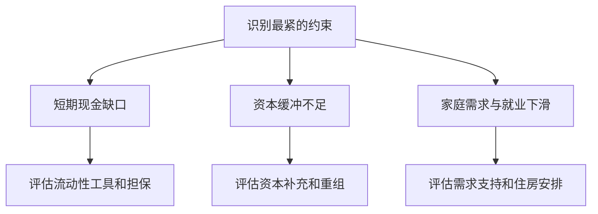

# 《当音乐停止之后》读书笔记

艾伦·布林德（Alan S. Blinder）著。英文原作 *After the Music Stopped: The Financial Crisis, the Response, and the Work Ahead* 于2013年出版。中文参考四川人民出版社2021年版，ISBN 9787220119552。本文依据出版社书目、中文公开目录和金融危机原始文件，整理五部分的主要问题。完整译文与页码未核定。政策评价属于作者分析或本篇推断，历史数据以对应机构文件为准。核验日期为2026-11-12。 [英文书目](https://www.penguinrandomhouse.com/books/312602/after-the-music-stopped-by-alan-s-blinder/) [中文书目及目录](https://read.douban.com/ebook/327260772/)

布林德研究了住房信贷风险怎样经证券化、短期融资和金融机构联系扩散，以及当局如何应对挤兑、资本缺口、需求下滑和后续监管问题。它与《大空头》可以对读，前者重点是系统与政策，后者从交易参与者的观察切入。读完应能区分资产损失、融资中断、资本不足和实体经济衰退，并为每种问题寻找相应证据。

## 一、从住房信用扩张到金融脆弱性

### 1. 住房价格和信贷可以相互强化

信贷更容易获得时，借款人支付能力上升，房价与抵押品价值可能提高。更高抵押品价值又能支持更多贷款和再融资。循环反转时，价格下跌可能削弱抵押覆盖、减少再融资机会，并使卖房后的剩余负债上升。要理解危机，先画出这两条方向相反的传导。

### 2. 发起后转售改变了贷款链的激励

贷款发起人可以把贷款转给证券化机构。风险分配和融资渠道因此拓宽，但收入若主要在发起时兑现，检查还款能力的激励可能下降。保留风险、追索条款和信息披露会改变这个结果。逐层记录谁收费、谁有信息、谁最终承担损失。

### 3. 证券化改变损失顺序，组合仍暴露于共同冲击

把贷款集合成证券后，现金流可以按优先级分配。低顺位先承担损失，给高顺位一定缓冲。若房价或就业共同恶化，原本分散的个体违约可能同步上升。判断高顺位风险需要检查底层资产质量、缓冲厚度和相关性假设。

### 4. CDO和信用衍生品增加了风险网络的层次

结构化产品可将若干证券重新组合和分层，信用违约互换可把某类信用风险转给保护卖方。要评价风险，就要追到抵押品、赔付义务和对手方财务。合同形式可以转移风险，整个系统仍要有人承担损失与融资需求。

### 5. 评级可能被错误地当作风险的全部

评级反映特定框架下的信用判断。市场价格波动、流动性、追加担保和卖出限制仍需另查。危机中，模型对共同违约的假设、发行人付费安排和投资者依赖评级的制度都值得考察。FCIC的多数报告与异议对根因权重有不同判断。 [调查委员会报告与异议](https://fcic.law.stanford.edu/report/conclusions)

### 6. 杠杆使小幅资产损失对资本产生大影响

**计算演示。**资产100，负债95，净资本5。若资产减值4且负债不变，净资本降到1，相当于损失80%。若资产难以出售或负债需要马上滚动，风险还会更快显现。公式只说明会计关系，真实机构需要检查净额、抵押品和表外义务。

### 7. 影子银行也可能发生挤兑

回购、资产支持商业票据和货币市场基金提供接近短期现金的工具，同时可能与长期或不易变现的资产相连。一旦短期出资方撤出，资产可能被迫折价卖出。检查金融机构时，把资金的到期时间、抵押要求和资产变现时间放在同一张表。

图示为危机的一条反馈路径。机构的资本、现金与抵押品条件决定每一环能否传递。

## 二、恐慌如何跨机构传播

### 8. 账面有资产与今天能付款属于不同问题

流动性不足指短期支付困难。资不抵债涉及资产可回收价值与负债的缺口。恐慌中市场价格、变现速度和资产长期价值都不易判断，两类问题可能相互恶化。阅读救助政策时，应说明工具解决的是哪种约束以及风险由谁承担。

### 9. 贝尔斯登与雷曼事件改变了市场对政策的预期

书中把不同机构的处置并列。研究时要对照当时的交易条件、法律权限、担保物与潜在买方，并区分先例改变了什么预期。雷曼破产后市场恶化，有助于观察网络传导，比较其他可能政策仍需承认反事实无法直接观测。 [FCIC资料](https://fcic.law.stanford.edu/report/conclusions)

### 10. 货币市场基金跌破一美元展示了挤兑机制

Reserve Primary Fund于2008年9月16日公告，将雷曼债务证券估值降至零，当日下午单位净值降为0.97美元。原先被许多投资者作为现金替代的产品出现本金损失，赎回压力与短期融资市场互相影响。这个案例说明现金管理要核对底层资产和赎回安排。 [基金原始公告](https://fraser.stlouisfed.org/files/docs/historical/fct/reservefund_pressrelease_20080916.pdf)

### 11. AIG展示衍生品和担保品怎样消耗现金

AIG面临信用相关损失及额外的流动性需求，2008年联储和财政部先后采取不同安排。查看一家机构的合同敞口时，需要问估值变化何时触发现金担保、评级变动是否影响门槛，以及交易对手的义务如何处理。名义金额、最终损失和即期现金需求各有定义。 [联储对国会的援助重组报告](https://www.federalreserve.gov/monetarypolicy/files/129aigrestructure.pdf)

### 12. 共同持仓可以在没有直接债权关系时传播风险

若机构甲被迫抛售，价格下跌可能使持有同类资产的机构乙也承受估值损失或保证金压力。金融网络包含直接合同，也包含共同资产、融资来源和市场价格。组合分散需要检查这些共同暴露。

### 13. 全系统信用收缩能影响原本健康的企业

贷款续作、商业票据、应收保理或供应商信用变紧，可能让经营本来稳定的企业削减投资和存货。企业分析应把经营现金流与融资现金流区分，再压力测试订单减少和借款续作失败同时发生时的资金缺口。

## 三、各类政策工具解决什么困难

### 14. CPFF为短期融资市场提供后备渠道

联储于2008年10月7日宣布商业票据融资工具CPFF，10月27日开始购买商业票据。它应对市场融资难以续接的问题。对信用质量和资格的要求决定可覆盖对象。用这个案例可以区分市场流动性安排与直接补充一家机构的净资本。 [联储CPFF档案](https://www.federalreserve.gov/newsevents/reform_cpff.htm)

### 15. TARP下的资本购买针对损失吸收能力

2008年10月，美国财政部公布资本购买计划，拟以标准条款购买最多2,500亿美元金融机构优先股。该额度为当时计划上限。拨款授权、承诺、实际投入、回收和最终成本需要分别核对。增资可以提高资本缓冲，也会改变既有股东、债权人和政府的利益位置。 [联储项目说明](https://www.federalreserve.gov/supervisionreg/tarpinfo.htm) [财政部项目资料](https://home.treasury.gov/data/troubled-assets-relief-program/about-tarp/)

### 16. 压力测试把市场猜测转成可比较的资本问题

2009年SCAP评估美国19家大型银行控股公司。联储随后报告其中10家在设定情景下需增加约746亿美元资本缓冲。该数字来自情景假设、损失估计与监管目标。压力测试有助于识别薄弱环节，情景覆盖和模型误差仍会影响判断。 [联储SCAP结果与跟进](https://www.federalreserve.gov/newsevents/pressreleases/bcreg20091109a.htm)

### 17. 担保旨在削弱争先撤资的激励

可信的担保可降低出资人抢先退出的动机。设计时要写明覆盖对象、费用、条件、退出和最终承担损失的主体。担保也会改变风险承担者的行为，所以危机中的临时安排与常态监管需要一起评价。

### 18. 降息和资产购买通过多个渠道传导

政策利率下降可能降低部分融资成本，资产购买可能作用于长期利率、市场流动性和资产定价。当借款人忙于去杠杆或银行资本不足，信贷扩张可能仍然有限。分析时分开观察政策实施、市场利率、实际信贷和消费投资。

### 19. 财政措施对应需求收缩和就业压力

政府支出、转移支付与税收变化可影响总需求。效果取决于执行时点、家庭和企业反应、经济闲置资源及金融条件。政策宣布的规模、实际到账时点和估计影响使用不同资料。多种措施同时发生时，不能凭经济恢复的时间先后确定某一项政策的效果。

### 20. 住房救助要处理合同和服务商激励

修改贷款条件可能减少止赎及对社区的外部冲击，执行中需要核对资格、信息、服务商安排和投资人权益。申请、试行修改、永久修改与长期履约要分别计数。单看计划公告或报名规模，无法衡量实际降低了多少损失。

图示将主要工具按约束组织。同一机构可能同时面临多个问题，政策效果需要用相应目标验证。

## 四、为什么金融修复、就业和改革进展不同

### 21. 衰退结束与就业恢复有时间差

美国劳工统计局回顾指出，美国失业率在2007年12月为5.0%，2009年6月衰退结束时为9.5%，同年10月达到10.0%。经济活动转向增长和劳动市场达到改善属于不同时间点。财商应用中，评估行业恢复应同时核对订单、招聘、工资与拖欠情况。 [BLS危机统计回顾](https://www.bls.gov/spotlight/2012/the-recession-of-2007-2009/home.htm)

### 22. 去杠杆可以使复苏持续承压

家庭和机构为了改善资产负债表，会压缩支出、偿还债务并保留现金。个体行为有其合理性，汇总后却可能降低其他主体的收入。用《就业、利息和货币通论》对照，可进一步理解总需求与个体财务修复的区别。

### 23. 政策的速度、公平性和问责需要同时评价

危机应对面临时间压力。快速措施可能避免连锁损失，也可能带来偏向、监督不足和道德风险。比较方案时写清目标、受益者、损失承担者、反事实和退出规则。救助能否防止系统恶化与损失分担是否公平各有评价维度。

### 24. 金融改革要兼顾正常监管与危机处置

本书改革部分讨论金融监管结构、系统重要性、消费者保护、衍生品和机构失败后的处置。资本、流动性和透明度要求作用于不同环节。制度安排有历史背景和实施变化，阅读2013年的评价时应以当时制度为边界。

### 25. 规则变化后风险可能迁移

监管收紧的业务可能转向新载体或不受相同要求的机构。追踪融资、抵押和最终持有人，可以发现风险怎样在不同主体间移动。监测指标需要随市场组织变化更新，否则形式上的改进可能掩盖相似的经济风险。

### 26. 作者的危机教训适合转成待验证的预案

把杠杆、短债、抵押、信息透明和失败处置分别列入风险记录。针对每一项写出监测数据、行动条件、责任人和退出条件。作者关于政策优劣的判断要与调查记录、事后研究和异议对读。前瞻预案的价值可用能否提前识别脆弱性来评价。

## 五、练习与参考答案

**练习一。**资产组合主要是长期贷款，资金来源却在一个月内集中到期。该怎样研究？

参考答案。先做现金到期梯度，列出可用现金、承诺授信、可出售资产和折价。再用损失情景评估资本是否仍足够。流动性表回答能否及时支付，资本表回答损失如何吸收。

**练习二。**为什么2008年可以同时出现CPFF和资本购买计划？

参考答案。CPFF针对短期融资市场受阻，资本购买改善合资格机构的损失缓冲。两项工具可同时起作用，各自需要核对条件、成本与实际效果。

**练习三。**怎样把危机史用于上市公司研究？

参考答案。查看短期债务、质押与担保、客户回款、再融资窗口和压力期可用现金。用公开公告建立基准与不利情景，并记录贷款展期、资金用途或客户付款变化对判断的影响。股价走势还需另外讨论估值和市场预期。
