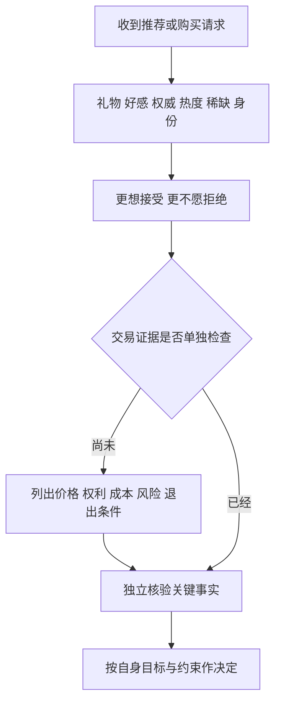
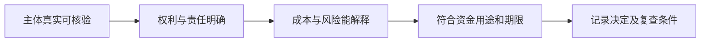

# 《影响力》：识别促使你点头的力量，把人情与投资判断分开

> 作者：Robert B. Cialdini，罗伯特·西奥迪尼。英文原名 *Influence: The Psychology of Persuasion*，1984 年初版；2021 年 New and Expanded 版加入“联盟／统一性（Unity）”，由原来的六项原则扩展为七项。不同中文版本的译名和章序有所不同。  
> 资料范围：基于作者公开的版本说明、七项原则说明、相关原始研究和监管机构案例整理；未取得用户持有版本的全文，不声称逐页精读。本篇按主要机制组织 28 个知识点，财商检查方法是补充应用。  
> 更新日期：2026-11-12。监管案例标明当时的公告状态，不把历史案件公告当作最新诉讼进展。

## 先理解这本书解决什么问题

有时我们答应一件事，并不是因为它最符合自己的利益，而是因为不好意思拒绝、别人都在做、对方看起来专业，或者机会似乎即将消失。西奥迪尼研究的是这些让人接受请求的社会心理机制。

这些机制本身并不坏。互惠帮助人们合作，信任专业人士节约学习成本，参考别人经验也常常合理。问题在于：**本来用于判断的一条线索，被偷换成了完整证据。** 对财商最有用的收获，是在付款、签约、投资之前发现这种替换，重新检查产品与约束。

读完应能做到：分辨喜欢一个人与认可一项产品；识别热度与收益证据的差别；知道小承诺为什么会变成大压力；核对稀缺与权威是否真实；把必要的冷静检查放进决策流程。

## 主要内容地图

| 原则 | 为什么会影响我们 | 财商场景里要补的证据 |
| --- | --- | --- |
| 互惠 | 收到好处后感到应该回报 | 礼物之外，交易本身是否合适 |
| 承诺与一致 | 希望后续行动符合已作承诺和自我形象 | 当前条件是否仍值得接受 |
| 社会认同 | 不确定时参考别人怎么做 | 别人的信息、利益与处境是否相同 |
| 喜好 | 更愿意接受喜欢之人的请求 | 好感与产品质量是否被混为一谈 |
| 权威 | 借助专家经验减少判断成本 | 专业领域、利益关系与证据质量 |
| 稀缺 | 机会减少会提高注意和占有愿望 | 稀缺是否真实，价格是否合理 |
| 联盟／统一性 | 共享身份使“他人的请求”更像“我们的事” | 共同身份是否替代了独立核验 |

版本与七项框架见[作者的书籍说明](https://cialdini.com/books/influence)。这张表是概念导航，后文分别说明机制、实证和边界。

## 核心知识点

### 1. 快捷判断能节省时间，也可能被错误触发

现实中没人能对每件商品、每位专家、每项合同从零研究。我们会使用“专家一般更懂”“很多人采用可能有道理”等经验规则。它们在信息有限时具有实用性。

危险发生在规则所依赖的关系断裂时：漂亮履历不属于相关领域，畅销来自付费推广，熟悉感来自反复曝光。你仍然看见了熟悉的提示，但它已经不能可靠地代表你要判断的性质。改善判断不需要消灭所有直觉，而是识别什么时候该提高核验强度。

### 2. 接受请求之前，先把请求翻译为具体动作

“支持一下”“一起成长”“加入内部圈子”都可能掩盖真正要你承担的东西。把它改写成：付多少钱、向谁支付、取得什么权利、承担什么义务、何时能退出。

这是本文的应用方法。抽象的身份语言容易让人讨论忠诚与态度，具体的交易语言则把注意力带回现金流、合同与风险。如果对方只愿意讨论愿景，却不愿说明实际义务，资料缺口本身就需要解决。

### 3. 互惠：收到好处，可能产生并未明说的负债感

互惠让合作能够延续：我接受你的帮助，未来愿意回报。但这种社会义务也可能影响一笔原本应该独立评价的交易。

**真实研究：一瓶饮料与购买彩票的请求。** Regan 1971 年实验中，男性被试与研究安排的同伴完成任务；部分被试收到同伴送来的软饮料，后来被请求购买抽奖券。收到同伴好处提高了响应请求的程度；研究也操纵了对同伴的喜欢程度，并发现“受到回报规范的压力”比单纯增加好感更能解释结果。这是有限情境中的实验，不是证明所有礼物都有同样效果。[原始论文](https://www.uni-muenster.de/imperia/md/content/psyifp/aeechterhoff/vorlesungkommunikation/regan_favorandlikingcompl_jesp1971.pdf)

读这个实验，关键不是记住饮料，而是发现两笔账：礼貌与感谢属于社会关系；产品回报与风险属于交易评价。接受了一次耐心答疑，可以表达感谢，却不能由此推出应购买对方推荐的基金。

### 4. 主动送来的好处，也可能让你感到必须回报

你没有提出要求，对方先给了礼物、免费服务或特别照顾，仍然可能触发欠人情的感觉。问题不在于免费本身，而在于免费是否被暗中转换为购买义务。

可以事先说明边界：“谢谢资料，我会独立比较，是否购买由内容和条件决定。”在机构采购或投资研究中，统一礼品与招待规则也能减少临场的人情压力。对方愿意提供的信息是否完整，比礼物的精致程度更值得关注。[作者对互惠的解释](https://cialdini.com/principles/reciprocity)

### 5. 对方作出让步，不等于剩下的价格合理

先提出一个很大的请求，再退到较小请求，可能让你把“对方退了一步”理解为自己也该退一步。这涉及互惠让步，也可能叠加最初报价形成的比较基准。

真正应该比较的是最终条件与外部替代方案。降价幅度很大，仍可能比其他选择贵；条件改善，也可能仍不符合预算。你的评估不应只依赖谈判中的前后变化。反过来，真实让步当然可以创造合作空间，不能看到还价就认定对方在欺骗。

### 6. 承诺与一致：人会维护“我是什么样的人”

答应一件小事以后，人可能不仅记住那次行动，还会据此解释自己：我是支持这个项目的人，我是敢于投资的人。后续请求如果与这种身份相连，拒绝就容易被体验为自我矛盾。

这里的难点是区分**稳定原则**与**固定结论**。你可以始终坚持核对证据，同时因为证据改变而撤回一个判断。真正的一致性应是评价标准一致，而不是任何旧决定都必须继续执行。[作者对承诺与一致的说明](https://cialdini.com/principles/commitment-and-consistency)

### 7. 小请求可能为大请求铺路，但不是不可抗拒的定律

**真实研究：Freedman 与 Fraser 的两项现场实验。** 1966 年论文检验了先接受小请求，是否会提高后来接受较大请求的可能性。其中一项先进行简短的家庭用品问答，再提出耗时得多的入户调查；另一项考察较小的公益承诺与后来设置较大标牌的请求。研究发现，在一些安排下，前面的承诺增加了后续响应。[原始论文](https://web.mit.edu/curhan/www/docs/Articles/15341_Readings/Influence_Compliance/Freedman_Fraser_Foot-in-the-door.pdf)

这说明请求序列可能影响选择，不能推出“只要先答应一点就一定失控”。研究对象、任务、时间间隔与自愿程度都重要，也不能单靠实验结果确认每个人内心的唯一机制。

财商应用是给每一步设独立边界：参加免费讲座，不等于同意付费课程；开通账户，不等于决定入金；研究一个行业，不等于必须持有该行业。把这些步骤写成独立选择，就能减少把流程惯性误认为投资理由。

### 8. 主动、公开和投入精力，会提高承诺的心理重量

自己写下、公开表达、为之花费努力的决定，往往比被动听到一句话更容易成为自我形象的一部分。它既能支持好的习惯，也可能让人难以承认研究错误。

因此公开研究时，最好同时写出“不成立的条件”。这样后来调整判断，是履行原先的更新规则，而不是背叛自己的身份。把“我永远看好”改成“在这些证据和价格条件下，我暂时这样判断”，更适合面对会变化的企业。

### 9. 条件改变后，应重新评估整个决定

一项决定最初因优惠、承诺或某项保障而成立，条件改变后，人可能仍沿用最初的同意。已经做好的准备、说过的话和想象中的收益，会给继续执行增加压力。

检查方式很简单：假如今天第一次看见最终条款，我还会接受吗？这不是要求忽略真实取消费用、合同责任或机会成本，而是把它们列入当前评价，避免用“已经走到这一步”替代比较。沉没成本与承诺压力相关，但并不是完全相同的概念。

### 10. 社会认同：别人的行为是一条线索，不是结论

不确定时，人会观察别人如何行动。尤其当别人看起来与自己相似时，他们的选择更容易被当作适用的参考。

必须区分三个问题：别人真的做了吗？他们为什么做？他们做了以后结果怎样？“购买人数多”只触及第一个问题，不能直接回答产品收益、适合程度或风险承担。价格上涨也可能同时带来更多关注和购买，不能把后续人气再拿来证明价格一定合理。[作者对社会认同的说明](https://cialdini.com/principles/social-proof)

### 11. 酒店毛巾实验：知道别人怎么做，可能改变行为

**真实研究与后续检验。** Goldstein、西奥迪尼与 Griskevicius 在 2008 年酒店现场研究中发现，描述其他住客重复使用毛巾的提示，在其研究条件下可优于普通环保呼吁。这里比较的是不同提示下的实际毛巾使用行为，并非问卷中表达的态度。[原研究 DOI](https://doi.org/10.1086/586910)

但 2014 年德国两家酒店的重复与扩展研究发现，提示总体可以比不提示促进重复使用，社会规范提示却没有比标准环保提示更有效；强调同一房间等接近性的效果也不一致。[Bohner 与 Schlüter 原始研究](https://journals.plos.org/plosone/article?id=10.1371/journal.pone.0104086)

为什么两个结果都要读？因为这正说明“存在一种影响机制”和“在每个地方都优于其他办法”是两种主张。已有习惯、文化、提示可信度与原先行为水平可能改变效果，具体解释仍需要研究。把一项实验变成任何产品都能提高固定转化率的公式，反而违背了认真使用证据的要求。

### 12. 多数人可能共享同一个信息源

十个投资博主说相同的话，如果都转载同一份未经核实的材料，并不是十次独立验证。一个群里人人表示相信，也可能只是大家观察到其他人表现得相信。

应追溯信息链：谁先提出？依据是公告、访谈还是传闻？后续的人有没有新增资料？在多人讨论前分别写下自己的判断，可以保留独立信息。讨论后的共识仍需检查共同前提，人数不能弥补同一个基础错误。

### 13. 喜好：对人的感受容易迁移到他的建议

相似经历、外表、赞美、熟悉和共同完成任务，都可能增加好感。好感能改善交流，却不能证明一个人提出的证券价格合理。

这个原则不要求冷漠。你可以喜欢分享者，也可以感谢对方，再独立检查事实。在笔记中把“对这个人的评价”和“对这项方案的评价”分开，是一种低成本的防混淆办法。[作者对喜好原则的说明](https://cialdini.com/principles/liking)

### 14. 共同目标能够促进合作，也要确认目标是否一致

销售顾问可能真心想帮你，但其报酬也可能与销量、产品类型或持有时长有关。双方都说“帮助你赚钱”，并不保证利益完全相同。

比判断对方人品更可靠的方法，是看制度：谁付报酬、如何计费、推荐不同产品时收入是否改变、发生损失由谁承担。利益冲突不自动证明建议错误，却意味着核验时不能把善意当作全部证据。

### 15. 权威应按领域、能力与独立性拆开

专业人士之所以值得参考，是因为特定领域的知识、经验和方法提高了判断质量。头衔、名气、制服和机构标志只是外在线索，不能替代这种因果关系。

检查一位“专家”至少分三步：专长是否与问题相符；其结论依据能否接受同行或数据检验；他从这项推荐中获得什么。权威意见可以帮助排序研究方向，不能免除对高影响决策的必要核验。[作者对权威原则的说明](https://cialdini.com/principles/authority)

### 16. 名人推荐：公开身份之外，还有未被看见的报酬

**真实监管案例。** 美国 SEC 在 2022 年 10 月公告，Kim Kardashian 因推广 EMAX 加密资产证券时未披露收到 25 万美元报酬，与 SEC 达成约 126 万美元的和解安排，并约定三年内不推广加密资产证券；她既未承认也未否认调查结论。[SEC 当时的公告](https://www.sec.gov/newsroom/press-releases/2022-183)

这个案例的关键事实是付费关系未被披露，不宜进一步编成刑事定罪或所有被推广产品都已被法院认定欺诈。对投资判断的启发是：关注度证明传播能力，不能证明估值能力；收到报酬会影响你怎样理解推荐的独立性。

应用时，先把推荐中的事实单独提取，再寻找发行文件、商业收入、资金用途和风险披露。即使对方坦率写明广告，也只解决了“你是否知道这是广告”，没有自动解决产品是否值得购买。

### 17. 稀缺会改变感受，但供给少不等于价值高

有限数量、限定时间和失去资格，会把注意力从“这东西值什么”转向“再不行动就没了”。人们还可能把竞争者的出现视为需求旺盛的证据。

但投资价值取决于未来权利与现金流、风险和支付价格。稀缺可以影响价格形成，却不能保证持有人获利。尤其要问：稀缺的是有经济价值的权利，还是人为限定的购买名额？有没有可替代方案？[作者对稀缺原则的说明](https://cialdini.com/principles/scarcity)

### 18. 倒计时需要有真实的到期依据

**真实监管材料。** 美国 FTC 2022 年关于“暗黑模式”的报告列举了没有真实时间限制的倒计时，以及隐蔽费用、取消订阅障碍等设计。这些设计可能改变消费者对选择的理解和执行能力。[FTC 报告说明](https://www.ftc.gov/news-events/news/press-releases/2022/09/ftc-report-shows-rise-sophisticated-dark-patterns-designed-trick-trap-consumers)

不要只问秒数还剩多少，而要查促销规则：截止以后究竟有什么变化，价格和资格依据是什么。真实的发行、预约或交易期限当然存在；辨别重点是期限能否被文件和机制解释。

对财商学习而言，可以给重要、可延期的购买安排一个复查步骤。复查要读取最终总价和退出条件；仅仅多等一天，却一直重复观看同一套宣传，不会自动获得更完整的信息。

### 19. 失去自由的感觉，可能提高对某个选项的渴望

当选择受到限制，人可能更想保留原先的自由。这种反应可以解释为什么禁止、排他资格和“以后不再开放”有时格外吸引人。

但“想保持选择权”和“应该立即购买”不是同一件事。适当保留流动资金、收集资料、比较替代方案，也是在保存选择权。不要把所有暂时不买的决定都理解为永久失去机会。

### 20. 联盟／统一性：相似与共同身份不是同一个层次

2021 年扩展版加入 Unity，强调某些关系让人把对方视为“我们的一部分”。喜好更接近“我喜欢你”，共享身份则可能变成“你的成功也是我们的成功”。

家庭、社群、校友与共同经历能够产生真实合作价值，也可能使核查变得难以启齿。维护关系和要求资料可以并存；对所有方案采用一致的核验标准，反而能减少把个人质疑理解成人身否定。[作者对统一性的说明](https://cialdini.com/principles/unity)

### 21. 熟人社群也需要独立证据

**真实案件材料。** 美国司法部 2024 年 12 月公告，D’Habsburg 已同意就电信欺诈指控认罪；当时提交的认罪协议描述了针对当地菲律宾裔社群、包括年长教友的募资活动，以及虚假的知名人士投资说法。公告记载受害投资人损失约 590 万美元。这里描述的是该公告及协议的历史状态，不延伸声称其后判决如何。[司法部原公告](https://www.justice.gov/usao-cdca/pr/san-fernando-valley-man-agrees-plead-guilty-engineering-59-million-ponzi-scheme)

对概念的解释是：共享社群提供信任通道，所谓名人参与又增加社会认同和权威线索。但推荐你的熟人也可能同样误信，不能据此断言每位介绍人都参与欺诈。

实用检查是绕开介绍链独立核对主体、资质、合同、资金托管与收益来源。“我认识他多年”可以支持人际信任的某些部分，无法替代这些性质不同的事实。

### 22. 多项影响因素会叠加，但没有通用的乘法公式

同一项请求可以同时提供免费服务、强调群体身份、展示追随者、制造时间压力。识别出一个机制后，不要以为其他问题都已解决。

也不能把实验里的效应数字相乘，声称七项一起使用就必然成功。它们可能相互加强、抵消，或因被识破而降低信任。重要的是回到具体情境，看哪些线索正在代替哪些证据。

图中前半段解释影响来源，后半段是本文的应用流程。出现社会心理线索不等于有骗局，缺少独立检查才是需要补的环节。

### 23. 防范的目标是判断质量，不是拒绝所有说服

把一切请求看成操控，可能损害合作，也可能让你忽视有价值的信息。判断应针对具体主张：这句话是否准确，这项承诺能否执行，这个价格是否值得。

礼貌表达可以与坚定边界并存。拒绝一个方案不必证明推荐者是坏人；接受一个合理方案也不必宣称自己完全不受影响。能把关系、事实和选择分开，就已经改善了决策。

### 24. 正当使用原则，首先要保证线索是真的

团队协作可以清楚说明专业经验，真实展示已有使用反馈，邀请人们自主承诺可实现的目标，并坦率说明实际期限。信息透明能降低沟通成本。

但不能编造评价、虚构名额、隐瞒费用，或者让人为了维护身份而接受不合适的条件。本书的心理学框架描述人会怎样受影响，不能替代伦理与合同义务。长期关系的评价应包括对方是否理解并受益，而不只看当场有没有同意。

### 25. 为高影响决定建立四道检查

这是本文综合的财商应用：先核实**主体**，知道与谁交易；再核实**权利**，知道买到了什么；随后核实**经济性**，知道收益从哪里来、代价是什么；最后核实**适配性**，知道期限和损失是否与自己的生活相容。

前面三项都通过，也可能不适合你。一个真实、合法、透明的长期产品，仍可能不适合即将使用的资金。影响力检查的终点不是给产品贴好坏标签，而是形成清楚、有依据的个人决定。

这是一条检查顺序，不是通过后收益就有保障的认证流程。

### 26. 把“被说服的理由”与“购买的理由”分栏

第一栏记录：对方很耐心、朋友参与、机会看起来少、我已经报名。第二栏记录：产品怎样创造价值、价格怎样比较、费用怎样收取、风险怎样承担。

如果第二栏空白，第一栏再丰富，也没有回答核心问题。这个动作特别适合读研报、听路演和观看财经直播：先承认信息对自己的影响，再把真正支撑结论的材料找出来。

### 27. 事后复盘不只问结果，还要问自己当时如何同意

赚到钱不能证明推销理由可靠，亏损也不能单独证明推荐者欺骗。复盘时保存原始宣传、合同、实际支付与事前判断，分别检查事实准确性、利益披露、过程和结果。

可重点记录一个转折点：自己从“想了解”变成“必须参与”，是因为获得了新的商业证据，还是因为出现了群体压力、身份压力或时间压力？这能帮助你改进下一次决策环境。

### 28. 理解原则以后，仍要给自己留外部检查

知道一个偏差的名字，不代表下一次就能在情绪中识别它。最有效的改进往往是结构性的：重要资料用书面形式保存；最终条款独立复查；让没有销售利益的人提出反问；大额决定避免只依赖一个信息渠道。

是否需要他人参与、等待多久，取决于决定的重要性和可逆性，不是一刀切的程序。目标是让核查能实际发生，而不是列出一张从未执行过的清单。

## 用两道题检查是否学会了

**题一：熟人认真解答了两个小时，你觉得不购买很过意不去。** 应分别处理感谢与购买：可以明确感谢时间与资料，再用最终产品条款独立比较。服务投入可能具有价值，但不能自动变成未约定的购买义务。

**题二：一个产品有大量好评，真实限量，推荐者也披露了佣金，是否足够？** 还不够。真实性和披露改善了信息质量，仍需知道产品权利、收益机制、成本、风险及自身期限。好评人数不是适配性证明。

## 常见误读与边界

- 七项原则是理解请求与响应的框架，不是完整的人类行为模型。
- 经典研究的样本、文化、时代和任务都有边界；毛巾案例已同时列出后续结果不同的研究。
- 影响因素可以用于善意沟通，也可以用于不当施压，不能只根据使用某项原则判定动机。
- 本书不能替代估值、财务分析或产品尽调；它帮助你识别为何想接受一个主张，并恢复对证据的检查。

## 来源与继续阅读

书籍版本和原则以[作者网站](https://cialdini.com/books/influence)及各原则链接为主；实际实验、监管和案件材料已附在对应知识点。原始研究中的实验安排与现实商业案例分别说明，没有把所有案例都当作原书情节。

可以接着读[《学会提问》](<../学会提问 - 尼尔·布朗、斯图尔特·基利/读书笔记.md>)检查论证，再读[《噪声》](<../噪声 - 丹尼尔·卡尼曼、奥利维耶·西博尼、卡斯·桑斯坦/读书笔记.md>)设计更稳定的判断流程。
