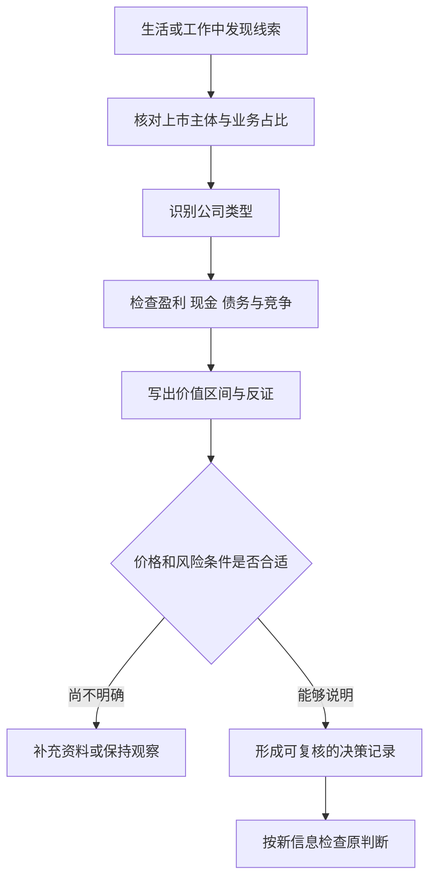
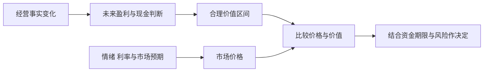

# 《彼得·林奇的成功投资》读书笔记

> 作者：彼得·林奇（Peter Lynch）、约翰·罗瑟查尔德（John Rothchild）  
> 英文原名：One Up on Wall Street，初版 1989 年；2000 年版加入千禧年导言。不是另一部作品《战胜华尔街》。  
> 中文书目：机械工业出版社《彼得·林奇的成功投资（典藏版）》，刘建位、徐晓杰译；用户未指定具体印次，本笔记不套用中文页码。  
> 分析依据：出版社目录与公开导言、林奇公开访谈，以及企业公告和监管机构材料；属于**基于公开资料的系统导读**，没有取得用户原书，不声称逐页精读。  
> 覆盖范围：投资准备、公司分类、调查与财务检查、组合和退出，共 28 个知识点。案例中的当代材料均为书外教学，不冒充林奇当年的持仓或交易。  
> 更新日期：2026-11-12

## 先看这里：这本书讲什么

**普通人的生活和工作经验，可以成为发现企业的入口；但只有把观察变成公司研究、价格判断和持续核查，才可能成为投资能力。**

本书反复纠正一个误区：买股票不是猜一个代码下一周怎么走，而是取得一部分企业权益。顾客喜欢产品、行业前景宏大、股价跌得很多，都只是调查线索。它们不能代替对盈利来源、负债、扩张空间和买入价格的研究。

最值得带走的是五件事：知道自己为什么能承受股票风险；分清企业是哪类增长或修复故事；用财务数字检查故事；让卖出条件对应原先理由；允许判断出错，却不让错误变成不可承受的损失。林奇的历史成就并不证明普通投资者只要照着读就能获得相同回报。

## 全书内容怎样连起来

| 原书部分与主题 | 要解决的问题 | 本笔记位置 |
| --- | --- | --- |
| 第一部分：投资前的准备 | 个人有何优势，资金与心理是否准备好 | 01—05 |
| 第二部分：发现公司、六种类型 | 究竟在研究哪一种盈利过程 | 06—12 |
| 第二部分：公司调查与重要数字 | 怎样把故事变成可核查条件 | 13—22 |
| 第三部分：组合、买卖与危险说法 | 怎样持续管理判断而非追逐价格 | 23—28 |

章节定位依照[机械工业出版社目录](https://ebooks.cmpbook.com/detail?id=20972)；原版年份及新增导言见[英文出版社页面](https://www.simonandschuster.com/books/One-Up-On-Wall-Street/Peter-Lynch/9780743200400)。以下是主题重组，不是逐章译写。

## 核心知识点

### 01. 熟悉产品只是研究起点，不是买入理由

“买自己了解的公司”很容易被误读成“我经常消费，所以可以买”。两句话之间，少了产品归属、业务占比、赚钱方式、竞争和价格五道检查。熟悉一件商品，只能降低理解它的难度，不能自动说明整个上市公司的价值。

**真实材料：苹果 2011 财年年报披露，iPod 净销售额较上年减少约 10%，但公司整体净销售额显著增长；iPod 占总销售额的比例也从 2010 财年的约 13% 降到 2011 财年的约 7%。** 这是企业自身披露，不是林奇原书案例。[苹果 2011 年 Form 10-K](https://d18rn0p25nwr6d.cloudfront.net/CIK-0000320193/3891cfa6-b494-4d2e-a6fe-b09a330df978.html)

如果投资者只观察身边的人是否还买音乐播放器，就可能把单个产品的衰退误判成整个企业衰退。反过来，某个新品排队火爆，也可能对一家大型集团的总利润贡献有限。这里需要的不是更强烈的消费感受，而是把感受接到分产品收入、利润与资本投入上。

实际研究可从三个问题开始：产品属于哪家法律实体；它占企业业务多大比重；销量变化是否能转成归属于股东的现金。再追问增长是否已经被价格反映。顾客获得实惠与股东得到回报，有时相互支持，有时却因补贴、低价或过度投入而分离。

**自测：** 产品销量很好，能否认定股票便宜？不能。还缺利润贡献、持续性、企业其他业务与估值证据。苹果的事后发展也不能证明，当时仅凭产品体验就能识别未来赢家。

### 02. 个人优势来自观察范围与时间尺度

普通人可能更早看到工作场景中的需求变化、产品体验或区域扩张。机构则有研究人员、数据库和访问资源，不能把个人优势夸大成“专业人士都没有用”。

可用的优势必须具体：比市场更了解哪一段业务、能持续取得什么公开证据、在哪些问题上愿意承认不知道。来自工作的信息还要遵守保密与交易规则；这本书不是鼓励利用未公开重大信息的许可证。

### 03. 投资准备先于寻找股票

原书先讨论投资者自己，原因是资金期限会改变风险后果。近期必需支出若依赖卖股支付，价格短期波动就可能迫使你在最不合适的时刻退出。

准备不等于简单问“我敢不敢亏”。还要问收入是否稳定、是否使用借款、能否持续研究、是否理解股权可能永久受损。长期持有的资格来自资金安排与企业质量，不能只靠口号。

### 04. 区分投资、投机与自己实际承担的条件

同一只股票，可以因经营研究而买，也可以因赌消息而买。决定性质的是理由、证据、价格和风险安排，而非持有几天就自动归类。

把一次幸运上涨记作研究能力，会鼓励下一次扩大不理解的风险。应保留事前判断，写明哪项事实若不成立就需要重新评价。事后收益只能告诉你发生了什么，不能单独告诉你过程是否可靠。

### 05. 宏观预测不能替代企业分析

林奇强调把精力放在可以研究的企业，而不是不断猜利率、指数和下一场衰退。这不意味着宏观条件无关：融资成本、汇率、消费需求和原料价格会切实影响经营。

更有用的做法，是把宏观变量落实到企业承受力。需求下滑时现金是否够用？利息变高是否需要再融资？这样即使没有准确预测经济，你仍能知道哪些情况会伤害自己的判断。

### 06. 六种公司类型，是六组不同的问题

林奇把公司分成缓慢增长、稳定增长、快速增长、周期、困境反转和资产富余六类。它们不是交易所标签，也不是终身身份，而是帮助选择研究重点的工具。

| 类型 | 主要价值来源 | 优先检查 | 常见分类错误 |
| --- | --- | --- | --- |
| 缓慢增长 | 成熟现金流、分红 | 派息能力与衰退 | 把高股息当安全保证 |
| 稳定增长 | 较稳定的盈利扩张 | 买价与抗冲击能力 | 把成熟企业按无限增长估值 |
| 快速增长 | 业务复制与渗透 | 单位经济、扩张空间 | 只看最近增速 |
| 周期 | 供需与盈利反转 | 库存、产能、债务 | 在利润高峰因低市盈率买入 |
| 困境反转 | 生存、修复与重组 | 现金期限、债权顺位 | 把企业获救等同旧股获救 |
| 资产富余 | 未充分反映的资产 | 可变现净值与实现路径 | 只加资产、不减负担 |

这张表最重要的用途是改变提问。对于扩店企业，应问新店能否复制老店回报；对于周期企业，应问眼下利润是不是异常高；对于重组企业，应先问股东在偿付顺序中还能剩下什么。一个统一的低市盈率筛选器无法替代这些差别。

公司可以从快速增长转成稳定增长，也可能从周期低谷进入困境。分类应随证据更新，不能为了维护原先买入理由而强行保留标签。**练习：** 企业盈利下降，是“成长暂时放慢”还是“周期正常回落”？仅凭下降幅度不能判断，需研究收入来源、需求、产能、竞争和资产负债表。

### 07. 缓慢增长与稳定增长，要重视现金分配

成熟公司增长有限，回报更依赖合理买价、稳定盈利与现金分配。股息率是每股股息除以股价，过去派息并不保证未来继续支付。

要同时核对现金流、负债、必要资本支出和派息政策。特别高的股息率可能来自股价对减派风险的反映。稳定增长也不等于股票价格稳定；估值过高时，平稳经营仍可能带来差的持有回报。

### 08. 快速增长的核心，是能否持续复制有效的经营单位

增长可以来自提价、销量、新门店、新产品或并购，各自风险不同。开店数量增加很快，若新店回报下降或老店被分流，整体规模越大未必越好。

要把总收入拆成原有业务增长与新增业务贡献；把新投入与以后产生的利润联系起来。一次低基数反弹不等于长期高速增长，收购带来的规模增加也不等于每股价值增加。

### 09. 沃尔玛的扩张说明：空间与能力需要同时验证

沃尔玛官方历史记录显示，1967 年有 24 家门店，1972 年为 51 家，1980 年达到 276 家；公司在扩张过程中建设配送中心，并逐步发展信息系统。这些是企业发展事实，不能直接换算成某个买入时点的股票收益。[沃尔玛官方历史](https://corporate.walmart.com/about/history)

用本书框架看，真正需要解释的不是“店开得多”，而是为什么新地区也能经营，以及扩张是否反过来提高供应链效率。一个门店模型可以在本地成功，却因管理跨度、采购条件或消费者差异而无法复制。因此，应把增长空间与复制能力分开验证。

历史事实只能告诉我们它后来完成了扩张。若站在当时，仍要检查新店成熟速度、老店销售、库存、租赁与建设开支、管理储备，以及竞争者反应。只挑成功者回头看，会遗漏大量同样宣布扩张、后来失败的企业。

**如何使用：** 研究连锁公司时，不只画门店数量图，还应并列观察同店销售、门店收益、开店资本、关店情况和现金流。这里不以缺少的历史细分数据编造具体回报；缺失数据本身就是研究边界。

**自测：** 门店增加 30%，是否足以预测利润增加 30%？不能。新店可能尚未盈利，旧店可能被分流，总部与物流成本也会改变。门店只是增长的一项中间变量。

### 10. 周期股的低市盈率，可能来自异常高的利润

市盈率等于股价除以每股收益。分母若处于供不应求、价格高企的时期，市盈率会显得特别低；但新增产能和需求回落可能让下一阶段利润大幅下降。

**数学演示：** 股价 50，当前每股盈利 10，市盈率为 5 倍；若正常化盈利只有 2，按同一价格计算就是 25 倍。不是计算器错了，而是使用了不同盈利基础。亏损低谷的市盈率则可能无法正常解释。

研究周期不能只反向操作。要问行业库存、产能利用、订单、产品价格、成本和融资是否同时出现变化。供给扩张有时需要几年，需求却可能迅速转弱，时间错配会放大利润波动。

本节是对原书周期分类的解释，不声称存在一个可机械复制的买卖时钟。低估值可以继续更低；若债务使企业熬不过低谷，所谓等待周期回来可能没有意义。

### 11. 困境反转首先是生存与权利问题

**2009 年通用汽车重组提供了真实反例。** SEC 与 FINRA 专门提醒，旧 GM 后更名为 Motors Liquidation Company，与新的 GM 是不同主体；旧公司股票不会因为新公司经营继续就自动变成新公司的证券。[SEC/FINRA 投资者提示](https://www.sec.gov/investor/alerts/bankruptcygmalert.htm)

这个案例说明，不能从“汽车还在卖”“品牌很有名”“政府希望保住生产”直接推导“原普通股会恢复价值”。持续经营的资产，可以通过重组转移给另一实体，而旧股东位于损失承担顺序的后面。

研究反转必须先画出现金与权利结构：谁提供资金、债务何时到期、哪些资产被抵押、救助会稀释谁、重组后旧股东拥有什么。然后才讨论经营能否修复。便宜报价不是这些问题的答案。

上述提示写于重组当时，本笔记不把当时的法律进度描述成所有国家或所有重组的通用规则。它用于说明企业命运与某一证券命运之间存在必须核查的桥梁。

### 12. 资产富余要算可实现净值，不能只看账面数字

“公司拥有很多土地、现金或股权”只是起点。资产出售可能有税费、用途限制和时间成本；现金可能属于受限资金，或者需要留在经营中；资产上还有债务和其他权利人的要求。

可用的研究顺序是：资产是什么，权属是否清楚，价值依据是什么，扣除什么负担，谁有权决定实现，普通股东最后能获得什么。如果没有可信的实现路径，折价可能长期存在；若公司继续亏钱，资产还会被消耗。

### 13. 小公司、冷门行业和普通名称，不是自动优势

原书关注未被广泛追逐的企业，因为市场关注度与企业价值不完全重合。但冷门也可能来自经营质量差、流动性低、披露不充分。

应把“不受关注”当作进一步研究的理由，而不是价值已经被低估的证据。一个有趣的名字不该让人买入，一个无聊的行业也不该让人跳过质量检查。

### 14. 两分钟说清公司故事，才知道自己缺什么

一份简短说明至少包含：公司怎样赚钱，为什么有望改善，哪项数字能验证，什么会使判断失败。所谓“故事”不是宣传词，而是一条有可观测节点的因果链。

若只能说赛道大、管理层优秀、市场空间广，就尚未解释利润如何到达每股。压缩成两分钟的价值，是逼自己删掉无关修饰；真正的研究底稿仍应保留来源、异议和不确定性。

### 15. 调查要连接产品、竞争与报表

年报、财报附注、公告、竞争者材料、顾客体验和渠道观察回答不同问题。公司说自己有优势，必须进一步说明相对谁、体现在哪、能否保持。

直接访问管理层也不是必要条件或证据终点。表达能力和经营能力不同；提出具体问题，并用后续披露核对答复，通常比收集令人兴奋的态度更有价值。传闻只能作为待查线索。

### 16. 库存和毛利能揭示收入背后的变化

**Target 2022 年第二季度收入同比增加 3.5%，可比销售增加 2.6%，营业利润却同比下降 87.0%，营业利润率为 1.2%。公司解释包括清理过剩库存的折价、商品结构以及运输等成本压力。**[Target 当季官方业绩公告](https://corporate.target.com/press/release/2022/08/target-corporation-reports-second-quarter-earnings)

如果只看收入还在增长，就会漏掉销售的质量。货卖得更多，可能是以大幅降价为代价；库存增加还会占用现金、带来仓储费用和减值。利润变化需要沿着销售、毛利、费用和资金占用逐层解释。

这里不能倒过来说库存增加永远坏。企业可能为新品、季节或供应链安全主动备货。要比较库存增速与销售增速，结合品类、采购承诺和周转变化，而不能拿一个比率判定管理层失误。

这个案例是原位的书外教学，不声称林奇预测过 Target 的该次变化，也不把其后股价作为研究规则有效的证明。**练习：** 该季度收入增长能否支持“经营全面改善”？不能，利润和库存处置提供了反证；但同样不能仅凭一次利润下降认定永久衰退。

### 17. 现金和债务决定公司能等多久

账面盈利不能支付所有眼前账单。应检查可用现金、短期借款、长期债务到期、利息、抵押与其他承诺。净现金通常比单看现金总额更有信息，但仍需要判断现金是否可自由使用。

对周期和困境企业，资产负债表尤其关键：同样的行业低谷，资金充裕的公司可能等待，债务紧迫的公司可能被迫稀释或出售资产。不要把会计账面权益误当随时可取的现金。

### 18. 每股增长比公司规模增长更接近股东结果

企业总利润增长，如果伴随大量增发，每股收益未必同步增加。回购则可能减少股数，但是否创造价值取决于回购价格、融资来源和被放弃的投资机会。

检查基本与稀释每股收益的区别，也要看可转债、股权激励和收购支付。仅靠减少研发或出售资产提高一年的每股收益，不等于持久竞争力提高。

### 19. 市盈率与增长率要同口径理解

林奇常把盈利增长与估值一起考虑；后来的 PEG 表达把市盈率除以增长率的百分数数值。它可以帮助发现明显不匹配，却不是估值定律。

**数学演示：** 市盈率 20 倍、预期增长 20%，常见 PEG 写法为 20÷20＝1，而不是 20÷0.2。即便得到 1，也未处理增长持续年限、资本需求、现金转换、风险和利率。用过去反弹的增速代替未来持续增长，往往比公式本身更危险。

### 20. 账面价值、现金流和利润率，各有边界

账面价值依据会计规则计量，不等于清算价或品牌价值。现金流需区分经营、投资和融资，经营流入增加也可能来自延迟付款或收回营运资金。

利润率适合与同业、历史和业务结构结合分析。高利润率可能体现优势，也可能来自周期高点或资本投入尚未显现；低利润率改善可以放大利润，但不保证能长期持续。

### 21. 多元化收购要看是否增加每股价值

原书警惕企业为了扩张而进入不熟悉业务。规模变大、业务更多，并不能自动降低风险；复杂性可能掩盖问题，收购价与整合成本也可能吞掉收益。

研究时分开看战略理由与资金回报。管理层是否证明协同能够兑现，是否承认失败项目，是否因追求规模而不断增发或借债。不能仅凭“这是龙头的收购”跳过价格。

### 22. 内部人交易与回购只是辅助信号

管理层持股有助于理解利益关系，但增持不保证没有判断错误，减持也可能因税务、个人流动性或分散需要发生。应核对金额、持股变化、计划安排和公司整体资本配置。

公告是可核查事实，动机常需要更多证据。把一次增持自动解释成“公司必有利好”，会把不确定的信息包装成确定性。

### 23. 持有与卖出，应对应公司类型和原先理由

本书的长期观点并不是无条件永不卖出。快速成长公司的关键可能是复制机制还在不在；稳定增长公司的问题可能是价格是否过度透支；资产型公司的问题可能是资产是否已经实现或被消耗。

卖出判断应分三层。第一，事实有没有变化；第二，变化是否伤害未来价值；第三，当前价格和替代机会是否改变了持有的合理性。仅因价格上涨而卖，会错过持续改善；仅因价格下跌而坚守，也可能把错误长期化。

对第 09 点沃尔玛案例，不能从最终成功倒推每次回调都应加仓。合理的中途检查仍包括扩张质量和竞争条件。对第 11 点旧 GM，所谓长期等待则无法替代证券权利的核实。两类案例的区别说明：持有纪律必须建立在企业与权利仍然成立的前提上。

**可操作做法：** 在买入研究中同步写出卖出或重估条件，按新公告更新。条件应可观察，例如盈利来源改变、资产负债表恶化、增长投入回报下降，而不是“我感觉不对”。具体条件仍需针对公司，不能机械套成统一百分比止损。

### 24. 组合不是股票越多越好，也不是越少越有信心

分散的目的，是避免单个判断错误伤害整体；持股过多又会超过研究能力。股票数量与分散程度不同，几个代码可能共同依赖同一商品、利率或消费群体。

个人不应照抄基金经理的持股数。资金规模、交易约束、研究团队和流动性都不同。应知道最大风险来自哪里，能持续跟踪什么，以及是否承受得起多个判断同时不利。

### 25. 不要用成本价组织未来决策

“跌了这么多不可能再跌”“涨过一倍不会再涨”“等回本就卖”，都把价格历史或个人成本当作企业价值的证明。

成本影响实际盈亏与税费，却不能决定未来经营。重新研究的核心仍是现在拥有何种资产、面对何种风险、当前价格要求怎样的未来。即使最终结果好，也不能证明当初没有分析的坚持合理。

### 26. 定期核查，防止故事悄悄换了内容

重新核查不是每天盯盘。它是在新财报、经营公告或重大变化后，检查原来的因果链是否还成立。增长来自哪里，现金是否跟上，竞争是否变化，管理层承诺是否兑现。

要保留旧版本，才能知道自己是否不断移动标准。允许因新证据改判断，也要能说明为什么改；否则容易把任何结果都解释成最初已经料到。

### 27. 杠杆与衍生工具改变损失方式

原书对期权、期货和卖空保持警惕，原因之一是时间、杠杆和不对称损失可能使经营判断正确也无法获利。股票最终上涨，不代表一份到期更早的看涨期权一定赚钱。

这些工具并非只有投机用途，但其定价、保证金、交割和损失路径需要额外学习。本书面向普通股研究的优势，不能自动转移为掌握复杂工具的能力。

### 28. 传奇案例需要与完整样本一起看

读成功投资者最容易产生的错觉，是觉得每一次重大赢家在当时都很明显。书中案例经过回忆和选择，不能直接估计自己的命中率。

应同时记录错过、买错、持有太久、卖出太早和没有参与的决定。能力要在多次事前记录中检验，而不是从几个故事获得确定感。本笔记没有重建林奇完整交易数据库，也没有验证本书方法在当代市场的超额收益。

## 图解：把消费线索变成公司研究

图中没有“喜欢产品直接买入”的箭头。每一层都可能发现前提不成立，停止研究也是有效结果；这是一张分析流程示意，不是下单程序。

## 图解：公司变化与价格变化要分开

经营与价格互相影响，但不是同一件事。财报改善不保证价格上涨，价格下跌也不直接证明经营恶化；真正研究要说明中间关系。

## 读完可以怎样练习

选一家自己理解业务的公司，只用公开资料写一页研究卡。先不填买卖结论，依次填写主营业务、所属类型、三个验证指标、两项主要风险和仍缺的证据。每条事实注明报告期与来源，避免把不同年份混在一起。

| 练习问题 | 参考答案的方向 |
| --- | --- |
| 一家公司收入增长，是否足以支持成长股判断？ | 还需盈利来源、单位经济、现金需求和持续性 |
| 旧 GM 品牌存续，为什么不保证旧股有价值？ | 企业资产与具体证券权利不同，重组后的归属需核实 |
| 库存上升为什么不能单独判坏？ | 可能是主动备货，也可能是滞销，要结合品类和周转 |
| 一个股票涨了很多，是否应立即卖？ | 检查原理由、价值和价格，而非只看涨幅 |
| 研究不到关键数据怎么办？ | 降低结论强度、列为未确认或不参与，不能用故事补齐 |

这份练习训练的是完整提问与证据纪律，不承诺选出的公司会赚钱。

## 常见误区与资料边界

- 熟悉行业不等于准确估值；发现好产品与买到好股票之间仍有大量工作。
- 六类公司是分析工具，不是固定收益等级，分类也会变化。
- 低市盈率、高股息、回购、增持都不能单独构成充分理由。
- 长期持有需要经营、权利和资金条件；不是拒绝面对反证。
- 原书的美国市场经验和历史公司案例，不能免去对其他市场制度的核对。

## 来源与后续补充

1. [机械工业出版社书目与目录](https://ebooks.cmpbook.com/detail?id=20972)、[出版社授权中文电子书书目](https://read.douban.com/ebook/52290909/)：中文题名、作者与结构。
2. [Simon & Schuster 原版书目与公开导言](https://www.simonandschuster.com/books/One-Up-On-Wall-Street/Peter-Lynch/9780743200400)：原版信息及作者对个人研究的定位。
3. [Fidelity 林奇公开访谈文字稿](https://www.fidelity.com/bin-public/060_www_fidelity_com/documents/learning-center/110322%20rewards%20exclusive_UnderstandtheChange-Transcript_%20F.pdf)：后续公开材料，不反写成原书新增章节。
4. [苹果 2011 年报](https://d18rn0p25nwr6d.cloudfront.net/CIK-0000320193/3891cfa6-b494-4d2e-a6fe-b09a330df978.html)、[沃尔玛官方历史](https://corporate.walmart.com/about/history)、[Target 2022 年第二季度公告](https://corporate.target.com/press/release/2022/08/target-corporation-reports-second-quarter-earnings)：原位业务研究案例。
5. [SEC/FINRA 旧 GM 提示](https://www.sec.gov/investor/alerts/bankruptcygmalert.htm)：困境反转中的证券权利边界。

尚未逐项核对指定中文译本的原书全部案例、表格和译注。文中的公司事实附原始出处，解释和练习由本笔记编排；没有以当前行情作估值或买卖推荐。

---

[返回书籍索引](../README.md) · [财商学习与实践路线](../财商进阶合订本.md)
