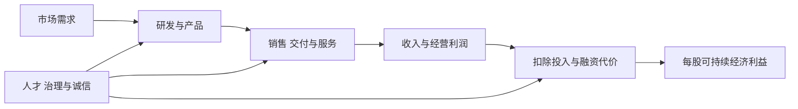
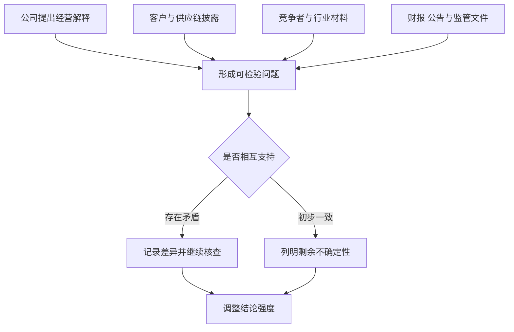

# 《怎样选择成长股》读书笔记

> 作者：菲利普·A.费雪（Philip A. Fisher），部分中文版本译作“费舍”。  
> 原著：Common Stocks and Uncommon Profits，1958 年初版。中文存在不同译本；可核对的地震出版社版译者为冯治平，ISBN 9787502831004，本笔记不声称依据该版全文。  
> 版本边界：Wiley 的 Common Stocks and Uncommon Profits and Other Writings 合集还收入 Conservative Investors Sleep Well 与 Developing an Investment Philosophy。它们不是 1958 年原著的原有章节；肯·费雪的序言也不是其父亲的正文。  
> 资料范围：出版社书目、目录与公开预览，结合企业官方披露和监管材料进行系统导读。没有用户原书，未逐页核对全部案例。  
> 覆盖范围：研究方法、十五项选股问题、买卖与持有、分红和分散，以及合集中后期思想的明确补充，共 30 个知识点。  
> 更新日期：2026-11-12

## 先看这里：这本书讲什么

**寻找有能力持续创造新利润的企业，弄清这种能力来自哪里，再以合理价格参与；真正难的不是找到一段高速增长，而是判断增长能否延续并属于股东。**

费雪把投资研究从静态报表推进到经营组织：产品市场、研发、销售、成本、人才、诚信和融资必须放在一起看。历史利润说明已经发生过什么，却不充分说明未来为何仍能增长。

最有价值的收获，是学会追问“增长背后的机器”：谁提出新产品，谁把产品卖出去，谁控制成本，组织怎样纠错，成果会不会被融资稀释。阅读时也要保持距离：对企业质量的主观判断可能出错，优秀企业也可能过贵，长期持有并不能修复所有错误。

## 原著与合集的内容地图

| 资料部分 | 主要内容 | 本笔记对应 |
| --- | --- | --- |
| 原著：历史线索、闲聊法 | 从多方信息了解企业 | 01—02 |
| 原著：选股十五要点 | 经营、组织、诚信与股东利益 | 03—17 |
| 原著：应用、何时买卖、股利 | 把企业判断变成持有决策 | 18—24 |
| 原著：两组“不做”、研究流程 | 避免机械估值、过度分散与短期干扰 | 25—27 |
| 合集：保守型投资者、形成投资哲学 | 经营与价格的安全、经验复盘 | 28—30 |

版本与目录见[Wiley 官方书目](https://www.wiley.com/en-us/common-stocks-and-uncommon-profits-and-other-writings-2nd-edition-p-9781119143130)；中文题名与译者见[新华书店书目](https://item.xhsd.com/items/1010000100790567)。以下对十五要点作概念化改写，延伸分析与书外案例明确区分，不转录现代译文。

## 核心知识点

### 01. 成长能力不同于已经增长

过去几年利润上升，可能来自周期、涨价、低基数、并购或一次性收益。成长能力则指企业在原有产品成熟后，仍能找到可盈利的新用途、新客户或新产品。

研究首先要把增长拆开：哪些因素能继续，哪些已经接近上限，哪些需要额外资本。费雪重视长期成长，但不是把最近增长率无限延长。对不熟悉的行业，承认无法判断比填出精确预测更有用。

### 02. 闲聊法的本质是交叉验证，不是搜集传闻

Scuttlebutt 常译“闲聊法”：从客户、供应商、竞争者、员工等不同角度形成对公司的认识。关键不是认识多少人，而是让不同来源回答可核查的问题，并识别各自的利益和局限。

**台积电的公开年报提供一个可直接使用的起点。** 公司将不与客户竞争列为专注晶圆代工模式的承诺，强调技术、制造能力和客户信任。[台积电 2024 年报的业务说明](https://investor.tsmc.com/static/annualReports/2024/english/ebook/files/basic-html/page19.html)

单读这份自述，只能确认公司如何解释自己。若用费雪式研究，就应追问：客户为何愿意交付设计；客户自己的公告怎样描述产能和供应风险；设备与材料供应商是否显示同样的技术推进；竞争者在哪些环节提出不同看法。公司宣传、客户依赖和竞争者承认的事实，不应被当作同一种证据。

信息之间的一致也未必是独立验证，可能都转引同一新闻稿。因此要给来源标记“直接观察”“公司说法”“转述”和“分析推断”。不能因某位前员工表达强烈，就推断整个组织都是如此；岗位、年代与样本选择会影响见闻。

本节没有替读者完成台积电全套尽调，也没有据此认定其当前股价便宜。**练习：** 公司、券商和媒体都写“客户信任很强”，算三条证据吗？若后三者源自同份年报，就主要仍是一条自述，需要其他独立材料。

### 03. 要点一：市场空间足以支持若干年的增长吗

市场大不等于公司可以取得市场。需要区分总需求、可服务市场、公司可以进入的部分，以及它实际能赚取利润的部分。

产品对客户有无真实价值、替代方案是什么、渗透率如何，都比只引用一个巨大行业规模更重要。市场空间最终要接到销量、价格、成本和现金，而不是停在宏大叙事。

### 04. 要点二：管理层能否在当前产品成熟前准备下一步

现有产品增长很好时，继续投入尚未成熟的新方向，会压低眼前利润。因此，管理层是否愿意为下一轮增长做准备，是不同于当前业绩的问题。

**德州仪器的官方历史记录了连续的技术发展：1950 年代的商业化硅晶体管、1958 年基尔比的集成电路，以及之后的计算与控制器件。**[德州仪器历史](https://www.ti.com/en-us/about-ti?DCMP=About_TI&HQS=aboutti)

这些事实说明，一家技术企业可以经历多轮产品能力建设。但从后来成果回望，不能把每项研究在当时都说成必然成功，也不能把发明直接等同股东回报。本笔记只用它说明应该研究持续创新的组织条件，没有声称费雪在某个价格买入这些阶段。

应进一步观察研发项目与现有能力是否相关、资源是否足够、失败是否及时终止。所谓长远眼光，既包括愿意投入，也包括拒绝没有合理路径的扩张。

### 05. 要点三：研发效率比研发费用排行榜更重要

研发支出是投入，不是成果。高投入可能建设能力，也可能掩盖项目反复延期、技术路线失效或商业化困难。低投入可能体现效率，也可能是在透支未来。

**ASML 2024 年按 US GAAP 披露的净销售额约 283 亿欧元，研发费用约 43 亿欧元。** 由这些舍入数字可粗算研发费用约为收入的 15%，但这个比例本身不能证明研发回报高。[ASML 官方年度报告概览](https://www.asml.com/investors/annual-report/2024)

要追踪研发如何转成可交付产品、客户良率与生产率、后续服务和现金。复杂设备还依赖供应商、客户验证与工程团队；公司在年报中描述的合作网络说明，创新并不是只靠一位天才或一次高额预算。[ASML 2024 年正式年报](https://www.sec.gov/Archives/edgar/data/937966/000093796625000009/asml-20241231.htm)

这里的分析不是为 ASML 作估值，而是示范怎样使用研发数据。不同会计准则对研发费用化、资本化的处理可能不同，不应混用两套利润数字。行业之间研发周期也不同，不能把药企、软件和设备公司的费用率直接排成能力榜。

**自测：** 企业研发增长 30% 就意味着未来利润增长 30% 吗？不意味着。还缺项目成功率、商业规模、实现时间、必要后续投入和竞争反应。

### 06. 要点四：销售组织能否把技术变成客户价值

产品领先与客户愿意付费之间，还隔着理解需求、试用、渠道、交付、服务和持续支持。销售能力不只是广告投入，也包括把客户问题反馈给研发的能力。

**3M 对 Post-it 相关创新的公开说明，把科研自由、探索项目和后续支持联系起来；其“15% 文化”允许研究人员拿部分时间探索自选项目。**[3M 官方创新说明](https://www.3m.com.vn/3M/vi_VN/company-vn/about-3m/state-of-science-index-survey/enabling-scientific-innovation-3m-state-of-science-survey/)

这个材料可以说明组织为探索留下空间，却不能据此推论所有自由研究都会成功。一个技术特性必须找到具体用途，并让用户理解为何要使用，才有可能变成商业产品。投资研究应继续寻找产品验证、渠道和复购证据，而不是只记住“发明诞生了”。

这也是费雪为何把研发与销售分别列出：实验室产生的可能性，需要商业组织加以筛选和实现。本例是企业自述的创新故事，具有选择成功案例的偏差，不是对该制度平均回报的独立试验。

### 07. 要点五：利润率是否足以支持企业继续发展

销量增长很快，但每卖一件都没有合理利润，可能只是在更快消耗资金。利润率应结合业务模式、资产周转和资本占用理解，而不能只看越高越好。

比较同业时应核对产品组合、会计口径、周期位置与一次性项目。特别高的利润率若吸引大量竞争，可能难以持续；较低利润率若有高周转和低资本需要，也可能有不错的资本回报。

### 08. 要点六：维持利润率靠什么具体措施

过去赚得多不保证以后还能赚。成本控制、技术升级、产品差异、采购与销售效率，都可能帮助维持利润；单靠不停提价则可能损害需求。

这里应寻找机制而不是口号：成本改善是一次性裁员还是流程提升；新产品是否解决客户更重要的问题；供应链是否增加了隐藏脆弱性。效率改善若牺牲必要维护，眼前利润可能以未来损失为代价。

### 09. 要点七：员工关系与激励会影响报表可信度

员工关系不是年报里写“重视人才”就足够。要看培训、晋升、离职、申诉机制以及完成目标的压力。员工会响应实际奖励与惩罚，不只响应企业墙上的价值观。

**CFPB 在 2016 年对富国银行的执法公告中指出，员工为满足销售目标和取得奖金，开立未经客户授权的账户。** 这是一项监管调查与执法事实，不能只用来给个别员工贴道德标签。[CFPB 当年公告](https://www.consumerfinance.gov/archive/newsroom/consumer-financial-protection-bureau-fines-wells-fargo-100-million-widespread-illegal-practice-secretly-opening-unauthorized-accounts/)

从费雪的组织视角看，漂亮的销售指标必须与真实客户需求、投诉及内部控制相互核对。如果奖惩只强调开户数量，账户是否被真实使用和客户是否受益就可能被忽略。一个看似不断成长的指标，可能离真实经济价值越来越远。

不能因为该事件，就断言所有销售目标都会导致违规。关键在于目标设计、核验机制和纠错渠道。**练习：** 如果销售增长但投诉增加，研究应如何继续？核查销售质量、激励安排与投诉类型，不能用增长自动覆盖负面证据。

### 10. 要点八：管理团队的合作比个人光环更重要

企业需要研发、销售、财务和运营互相配合。高管之间能否讨论不同意见、职责是否清楚、激励是否公平，会影响问题是否被及时发现。

外部投资者很难直接观察全部关系，不能靠一次路演就给团队打高分。可以长期对照战略变化、关键人员离任、关联交易和承诺兑现；未知部分应保持未知，不能用创始人魅力补齐。

### 11. 要点九：管理深度决定企业能否超越少数人

管理深度指关键岗位是否有能力储备、流程是否能够复制，而不是领导层人数多。快速扩张会让创始人无法继续亲自控制全部环节。

应观察决策授权、接班安排和干部培养。公司若每次问题都必须由一个人救火，短期可能显得领导者强大，长期却说明组织脆弱。也不能反过来认为制度化一定优于创业活力；要结合企业阶段判断。

### 12. 要点十：成本分析与会计控制帮助管理层看清自己

没有可靠的成本系统，管理层可能不知道哪些产品、客户或地区真正赚钱。总利润尚可，可能掩盖部分业务长期消耗资本。

外部研究可检查分部披露、存货、应收、费用分摊和重大会计估计。这里并不要求投资者替公司做内部审计，而是认识到：若管理层不能解释利润变化，所谓“优秀执行”缺少可观察基础。

### 13. 要点十一：竞争优势必须落实到行业特征

不同产业的关键门槛不同：有的依赖技术与良率，有的依赖品牌、渠道、网络或使用习惯。不能把同一张“护城河清单”勾选后就宣布研究结束。

回到台积电的真实商业模式，其不与客户竞争的承诺旨在减少客户对设计与知识产权冲突的顾虑。技术领先、制造执行和这种信任机制，构成不同层面的竞争解释；本笔记不把其中任何一项单独称作永远不会失效的保证。[台积电年报](https://investor.tsmc.com/static/annualReports/2024/english/ebook/files/basic-html/page19.html)

投资者接下来应问：客户转换需要付出什么，替代供应商有什么进展，资本需求多大，外部制度变化会影响什么。只有知道优势通过哪条机制产生，才知道将来应该监控哪条失效路径。

“公司很强”是结论，研究应提供通向结论的证据。若证据仅由管理层描述，仍需承认其来源局限；历史成功也不消除未来技术、地缘和需求风险。

### 14. 要点十二：公司优先维护的是长期能力还是眼前数字

为了达到短期利润目标而削减必要研发、维护或服务，可能把成本推到未来。但“长期投入”也不能成为永不兑现的借口。

更可靠的检查是：投入与目标是否对应，关键里程碑是否明确，失败是否被承认，资本回报是否能逐步验证。长远取向应表现为持续决策的一致性，而非一次演讲。

### 15. 要点十三：增长是否需要不断稀释股东

利润总额增长，如果需要频繁发行新股，现有股东的每股权益未必增长。融资不是原罪；关键是新增资本创造的价值是否超过稀释与成本。

**数学演示：** 原有利润 100、股数 100，每股盈利 1；利润增长到 130，而股数增长到 150，每股盈利变为约 0.87。公司规模增长 30%，每股盈利却下降约 13%。这是假设算例，不是任何上市公司的数据。

应把融资需求与经营现金、资本支出、债务和扩张速度一起看。成长股分析最终必须回到每股，而不是只庆祝总收入创新高。

### 16. 要点十四：坏消息时是否仍然解释清楚

顺利时愿意披露、遇到问题却沉默或改变口径，会使投资者无法检验原先判断。坦诚并不等于管理层保证不出错，而是对错误、假设和改进有可核查的说明。

研究可保存历年的目标与解释，核对是否反复更换指标、把每次失误都说成暂时因素。一个合理的坏消息解释应该允许被未来事实否定，而不是永远有新的借口。

### 17. 要点十五：诚信是不能用高速增长抵消的条件

对管理层诚信的判断不能只靠名望、履历或知名投资者背书。一旦关键事实虚假，精细估值建立在错误输入上，结果越精确也没有意义。

**SEC 在 2018 年起诉 Theranos、其创始人及前总裁时，指控其夸大技术能力和商业表现；公告对所谓 2014 年可实现超过一亿美元收入，与其所称实际经营收入仅十多万美元作了明确对照。** 这里按当年 SEC 指控与和解公告的性质表述，不把新闻稿自动当作所有被告全部诉讼的最终裁判。[SEC 原始公告](https://www.sec.gov/newsroom/press-releases/2018-41)

这一案例中的企业当时并非普通公众可随意买入的上市股票，因此不能机械复制为上市公司筛选法；它说明的是证据链问题。技术声称、客户关系、实际收入和设备使用，必须分别验证。名人董事或知名机构参与，不会替代这些检查。

费雪框架中，诚信不是可用其他十四项高分补足的一小项。若信息基础不可靠，就无法合理判断其他条件。**自测：** 管理层拒绝披露能否证明造假？不能；但如果关键条件无法验证，也不能因此默认它成立。

### 18. 十五项问题是一组关系，不是打分机器

研发要靠人才，产品要靠销售，销售要转成现金，融资与治理又决定成果归谁。某一项好看，不会自动弥补体系中的致命缺陷。

可以用清单防止遗漏，却不宜编出“达到 80 分一定买”的规则。各行业权重不同，证据质量也不同；清单最好增加“资料是什么、哪里尚不确定、什么会推翻”的栏位。

### 19. 买入时机要区分经营暂时困难与长期受损

优秀企业也会遇到新厂爬坡、新品推广或短期需求波动。它们可能使当期利润看起来不好，却不必然破坏长期能力。

但不是所有下滑都暂时。判断需要研究原因、修复资源和可验证进度，而非因为喜欢公司就宣布“市场误解”。股价下降只是价格变化，是否创造机会取决于价值变化与当时价格。

### 20. 为几分钱错过优质企业，与不计价格买入都不合理

费雪反对因为过度追求一个小价差而忽略长期机会。这个观点容易被滥用成“好公司任何价格都值得”。

应把小幅价格差与严重高估分开。合理价值本来就是区间；若价格远超乐观情景能支持的范围，长期成长也可能无法弥补。研究越不确定，越不该对买价毫不在意。

### 21. 持有优秀企业，需要持续验证而非停止思考

长期复利来自企业不断创造价值，不是持有日历自动产生收益。需要持续跟踪研发商业化、竞争、管理和资本回报，确认最初机制仍在。

反复交易可能增加成本、税务影响和重新买回的不确定性，但这不意味着每次卖出都是错误。应避免把“长期”用作拒绝更新的理由。

### 22. 三类卖出理由：判断错了、企业变了、替代机会更好

发现初始判断明显错误，应重新评价而不是等待回本。企业质量恶化，也可能使原投资前提失效。遇到更有把握的机会，则需比较风险、价格、交易成本与研究可靠度。

第三类最容易成为频繁换股的借口。新故事通常比熟悉的旧问题更有吸引力，但信息不足会被想象填补。替代机会需要达到同样的证据标准，而不是只比较宣传中的增长率。

### 23. 股利不是凭空增加的价值

分红把公司的一部分现金转给股东，会减少公司内部可用资金；它不是额外从外部产生的回报。能高效再投资的企业可能留存更多，缺乏好项目的企业则应认真考虑分配。

关键不是“分红越高越好”或“成长公司不该分红”，而是资金留在公司能获得什么回报，股东是否被公平对待，以及资金是否有被浪费的风险。

### 24. 分散要兼顾错误风险与了解程度

把不理解的公司买得很多，未必比深入理解较少公司更可靠。但深入研究也不能消除欺诈、制度变化和判断错误，所以集中不是能力证明。

个人应该先问：如果最大一项判断失误，生活与整体计划会受到什么影响？多个公司是否依赖同一技术、客户或融资条件？然后再考虑能持续研究多少家，而不是照抄名人的持仓数量。

费雪的高质量集中思想，建立在较强研究能力和长期承受力之上。本笔记没有用户背景，因此不据此给出集中比例；把这类风格当作风险更低的同义词，是误读。

### 25. 两组“不做”提醒，不宜拆成万能口诀

原著关于“不做”的讨论涉及缺少记录的新企业、只靠年报外观或估值表象判断、过度分散、小幅价格执念、恐慌环境与随大流等问题。核心不是把十条字面规则搬到所有时代，而是减少与企业长期价值无关的干扰。

尤其不能将历史语境中对战争恐慌或市场波动的讨论，扩展为今天任何危机都应立即买入。不同冲击可能永久改变资产、制度和现金流。

### 26. 发现候选公司与作出决定，是两个阶段

候选可以来自行业阅读、他人建议、产品体验或财务筛查。产生线索的门槛可以低，投入资金的证据门槛应高。

研究顺序可先排除明显不能理解或不能验证的公司，再对少量候选深入调查。这样既避免一开始就被管理层故事吸引，也减少为证明已经看好的结论而选择材料。

### 27. 把研究写成可更新的档案

研究档案不只是目标价，而应包含商业机制、关键假设、反证、来源日期和后续检查点。对不同信息保留不同置信程度，不要把估计写成事实。

定期回看自己究竟在哪一步出错：信息遗漏、因果理解、价格过高，还是事件超出合理预期。如此才能改方法，而不只是把盈亏改写成“耐心不足”或“运气不好”。

### 28. 合集补充：保守投资包含经营、人员、优势与价格

后期的 Conservative Investors Sleep Well 把保守投资扩展为多个维度：企业经营能力、人的因素、业务特征及价格。买熟悉的大公司不自动保守，买进价格过高也可能使好企业变成差投资。

这里的“保守”应理解为认真检查损失路径，而不是只挑低波动。它属于合集的后期论述，不是将原著十五点重新编号。

### 29. 合集补充：投资哲学要在经验中纠错

Developing an Investment Philosophy 涉及作者经验、耐心、择时和市场效率等思考。个人应形成一套相互一致的方法，知道自己为什么用它、何时可能失败。

作者经验是重要材料，却不是独立控制实验。任何名人回忆都可能有选择和事后解释；学习原则时仍要保留当时信息和失败样本。

### 30. 成长与价值不是互相排斥的两种标签

成长影响未来现金，价格决定你为这些现金付出多少，风险决定未来范围有多宽。只要承认这些关系，就不能把成长理解成不看价格，也不能把价值理解成只看低倍数。

费雪最值得学的，是对企业质量作深入研究；最需要防止的，是把深度了解转成过度自信。研究可以改善判断，却不能使未来变成确定。

## 图解：增长如何到达股东

这是因果检查示意，不是保证成功的线性流程。任何环节都可能损失价值，尤其不能从收入增长直接跳到每股回报。

## 图解：交叉验证的证据结构

多个来源若只是互相转载，不算独立验证。图中的一致性也不能保证真实，因此保留未知是研究结果的一部分。

## 可以直接使用的研究练习

为一家企业建立下表，先写事实与证据，再写判断。不要为了填满表格编造管理层品质或行业份额。

| 研究栏 | 合格内容 | 不合格内容 |
| --- | --- | --- |
| 增长机制 | 哪类客户为何购买、如何扩展 | 赛道无限大 |
| 研发成果 | 投入、进度、商业化与失败情况 | 费用高就是领先 |
| 组织能力 | 激励、控制与多期资料 | 领导人很有魅力 |
| 股东结果 | 每股、资本投入与稀释 | 总收入增长就算成功 |
| 反证 | 哪项变化会使判断失效 | 永远长期看好 |

**参考答案：** ASML 研发费用率高，尚不能证明研发回报；台积电承诺不与客户竞争，是可研究的制度特征，但仍需要客户与竞争证据；Theranos 案例提醒核查关键技术与商业声称，不能只信背书。三者共同训练的是证据与结论之间的距离。

## 来源与未覆盖部分

1. [Wiley 官方目录](https://www.wiley.com/en-us/common-stocks-and-uncommon-profits-and-other-writings-2nd-edition-p-9781119143130)、[Wiley 提供的版权书目](https://www.pubmatch.com/book/181672.html)：原著与合集结构。
2. [新华书店中文书目](https://item.xhsd.com/items/1010000100790567)：题名、译者与版本核验。
3. [台积电 2024 年报](https://investor.tsmc.com/static/annualReports/2024/english/ebook/files/basic-html/page19.html)、[ASML 2024 年报](https://www.sec.gov/Archives/edgar/data/937966/000093796625000009/asml-20241231.htm)：商业模式和研发的书外案例。
4. [德州仪器历史](https://www.ti.com/en-us/about-ti?DCMP=About_TI&HQS=aboutti)、[3M 创新说明](https://www.3m.com.vn/3M/vi_VN/company-vn/about-3m/state-of-science-index-survey/enabling-scientific-innovation-3m-state-of-science-survey/)：企业自行披露的创新沿革，不作为独立业绩验证。
5. [CFPB 富国银行公告](https://www.consumerfinance.gov/archive/newsroom/consumer-financial-protection-bureau-fines-wells-fargo-100-million-widespread-illegal-practice-secretly-opening-unauthorized-accounts/)、[SEC Theranos 公告](https://www.sec.gov/newsroom/press-releases/2018-41)：组织激励、事实核验与诚信边界。

未逐页核对原著全部企业案例、指定译本的译名及合集所有论证。重点十五项为主题归纳，分析步骤与图表为本笔记编排；不把今日企业材料称作费雪当年的投资结论。

---

[返回书籍索引](../README.md) · [财商学习与实践路线](../财商进阶合订本.md)
