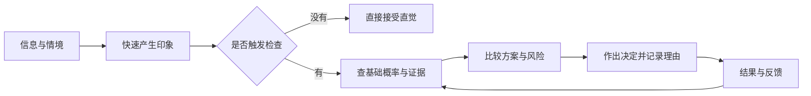
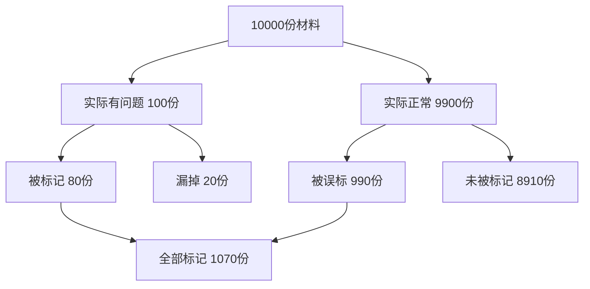
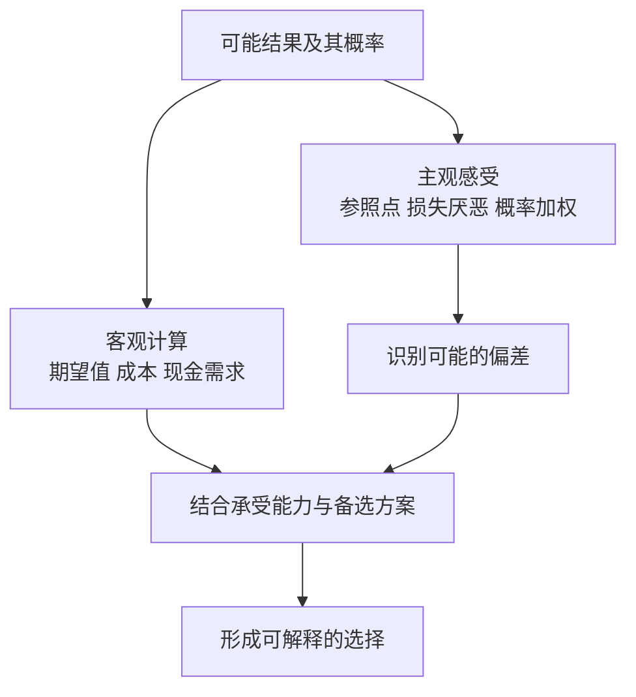

# 《思考，快与慢》读书笔记

> 作者：丹尼尔·卡尼曼（Daniel Kahneman）  
> 原书：Thinking, Fast and Slow，2011 年。简体参考版：胡晓姣、李爱民、何梦莹译，中信出版社，2012 年，ISBN 9787508633558；见[对外经济贸易大学图书馆书目](https://opac.lib.uibe.edu.cn/opac/book/b0acae873a7a226eb38de2c9ce39a774)。用户持有版本尚未确认，不混用不同译本页码。  
> 分析依据：出版社公开介绍与试读、作者研究和公开资料，结合原创概念解释；未取得用户原书，不声称逐页精读。  
> 覆盖范围：五部分框架、34 个主要知识点、概率与风险难点、财商应用和复盘练习。  
> 更新日期：2026-11-11

## 先看这里：它能怎样提高财商

**一句话概括：人经常在不知道自己用了什么捷径的情况下作出判断；改善决策，需要识别容易出错的情境，再用概率、外部数据和事先设计的流程约束直觉。**

本书最有价值的地方，不是让你记住一串偏差名称，而是帮助你发现这些常见错误：觉得熟悉就相信，听到故事就判断，赚了钱就认定自己厉害，亏了钱就只想回本，看见风险就忘了概率，看见机会就忘了代价。

先记住六个结论：

1. **直觉很有用，但自信不能证明直觉正确。** 要看环境是否有稳定规律，以及自己是否得到过有效反馈。
2. **先问同类情况通常怎样，再看这个案例有多特别。** 基础概率能为故事提供约束。
3. **一次结果不能完整代表决策质量。** 好方法可能暂时亏钱，错误判断也可能碰巧赚钱。
4. **损失和收益的感受受参照点影响。** 买入价格、历史高点和心理目标，常常会悄悄左右选择。
5. **把风险放进整体中审视。** 单独看每次涨跌，与看总体目标、相关性和承受能力，可能得到不同判断。
6. **用可重复的检查流程，代替“我以后一定更理性”。** 记录预测、比较备选方案、查证反面证据、事前复盘，通常更容易落实。

知识点中的真实研究、真实财报与教学推论分别注明。研究使用的虚构题目不等于虚构研究；必要的数学演示另作标注。财商应用不冒充原书投资策略。

## 全书五部分怎样连接

卡尼曼在[出版社公开试读](https://us.macmillan.com/books/9780374275631/thinkingfastandslow/)中说明了五部分的组织方式。下面按主题重组，便于把知识点连起来。

| 部分 | 核心问题 | 本笔记覆盖 |
| --- | --- | --- |
| 两种思考方式 | 判断如何快速产生，何时需要审查？ | 1—7：双系统、注意力、流畅性、联想、故事、替代、光环 |
| 启发式与偏差 | 为什么直觉常常不擅长统计？ | 8—15：样本、锚定、可得性、情感、基础概率、合取、回归 |
| 过度自信 | 为什么我们高估理解、预测和控制能力？ | 16—21：后见之明、有效性错觉、模型、专家直觉、外部视角、乐观 |
| 选择 | 人怎样感受收益、损失和风险？ | 22—31：参照点、价值函数、概率加权、心理账户、框架等 |
| 两个自我 | 当下感受与事后记忆为何不一致？ | 32—34：体验、记忆、峰终、聚焦与幸福 |

这张图是本笔记的应用整理。快速印象不可避免，关键是让重要决定经过必要检查，并能在之后得到真实反馈。

## 第一部分：两种思考方式

### 1. 系统 1 与系统 2 是理解思考的模型

系统 1 指快速、自动、往往不费力的处理，系统 2 指需要注意力的计算、推理和自我检查。它们是理解加工方式的模型，不是大脑里两个独立器官。快不等于错，慢也不保证对；关键是答案有没有接受与任务相称的检查。

**真实研究：球拍与球的认知反思题。** Frederick 在 2005 年发表的研究使用了一个问题：两样东西合计 1.10 美元，球拍比球贵 1 美元，球多少钱？这是实际研究采用的题目，不是声称现实中发生过这笔购买。[原研究及发表信息](https://www.aeaweb.org/articles?id=10.1257/089533005775196732)

直觉容易给出 0.10 美元，因为 1.10 很自然地被拆成 1 和 0.10。但把这个答案放回条件就会发现：球若为 0.10，球拍应为 1.10，合计变成 1.20，违反题设。设球价为 x，正确关系是 `x+(x+1)=1.10`，因此 x=0.05，球拍为 1.05。难点不在代数，而在于是否在“已经有一个顺口答案”之后继续验证。

这说明快速处理可以迅速产生候选答案，审查过程则要检查全部约束。只把同一个答案在心里重复三遍，不能算充分审查；把它代回原条件，才做了有机会发现错误的动作。研究中的表现也不能直接当作一个人的整体智商、道德或投资能力标签。

用于财商时，可以把这种检查迁移到财报：利润增长、收入增长和现金增加是否被当成同一个问题？买入理由是否同时满足价格、风险和期限约束？这些是本笔记的应用推论，不是该实验已经证明能提高股票回报。慢思考的价值取决于检验质量，而非思考时长。

### 2. 注意力有限，复杂判断会相互挤占资源

注意力有限，投入某项任务时，其他显眼的信息也可能被漏掉。重要判断因此需要安排检查步骤，不能依赖“有问题我自然会看到”。

**真实实验：数传球时漏看大猩猩。** Simons 与 Chabris 在 1999 年的研究中，让参与者观看传球录像并完成注意任务；不少人没有报告画面里经过的意外对象。实验使用了不同条件，不能把某一条件的漏看比例当作所有场景的固定比例。[两位作者的原论文](https://www.chabris.com/Simons1999.pdf)

这里不是参与者的眼睛收不到信息，而是正在执行的任务影响了什么进入注意。财报阅读的对应做法是把“查利润”和“查现金、债务、附注”分为明确步骤；后者不是看完前者后必然自动发生的过程。这个迁移是学习方法上的启发，并非实验直接测得的投资效果。

### 3. 认知轻松：容易处理的信息更容易显得可信

熟悉、重复、表达清楚的信息常让人产生顺畅感。这种感觉有时被误当作真实或优质的证据。相反，陌生或难读的信息会让人觉得不可靠，即使内容本身未必有问题。

### 4. 联想与启动：当前情境会影响接下来容易想到什么

一个词、情境或记忆能激活相关内容，使某些解释更容易进入头脑。这有助于理解信息并非在真空中被处理。但具体的社会启动实验效果，需要分别看证据。

卡尼曼在[2012 年公开信](https://www.nature.com/news/polopoly_fs/7.6716.1349271308!/suppinfoFile/Kahneman%20Letter.pdf)中已讨论社会启动研究的重复验证问题。不能把本书每个生动实验都当作普遍规律，也不能据此否定全部判断与决策研究。

### 5. 所见即全部：大脑倾向于用已有信息拼成完整故事

信息不足时，我们未必感到“还不知道”，反而容易把当前掌握的少量事实组合成连贯解释。故事越顺，就越容易忽视缺失的内容。

**书外真实财报练习（截至 2026-11-11）：** 根据美的 2026 年三季报，可以各拟一个标题：“前三季度归母净利润增长 9.27%”和“前三季度扣非归母净利润下降 22.49%”。先遮住另一条，记录自己由第一条产生的印象，再把它们同时列出来，并加入同一报告中收入增长 1.19%、经营现金流下降 29.58% 两项。四个指标合看，已经足以说明一条标题不能代表全部信息。[原报告第 2 页](https://static.cninfo.com.cn/finalpage/2026-10-30/1225645132.PDF) 两个标题来自同一份报告，却选择了不同信息；这里是自我观察练习，不是已经实施的心理实验，更没有证明所有读者必然受到同样影响。

继续把记录分成“表中事实”“我的解释”“尚缺资料”。例如“经营全面向好”与“主营业务全面恶化”，都比单项数字能支持的结论更宽。补全表格后，应查看非经常性损益明细和公司解释，而不是只挑能维护第一印象的一行。**参考答案方向：** 合理的修正未必是从乐观变悲观，而可能是承认各指标分化，暂缓总体判断；无论最先看到哪个标题，都使用同一份核对清单，才不会让最先看见的信息充当全部证据。

### 6. 问题替代：用容易的问题回答困难的问题

真正的问题可能是“这家公司未来产生的现金能否支持当前价格”，大脑却回答了“我喜不喜欢它的产品”。容易回答的问题产生了明确感觉，于是被误当成原问题的答案。

### 7. 光环效应：一个突出特点染色了其他判断

一个人的能力、外貌或名望令人印象深刻，可能连带影响我们对其诚信、专业范围和观点正确性的评价。负面印象也能产生类似扩散。

## 第二部分：直觉为什么容易误读统计

### 8. 小数定律错觉：以为小样本也应稳定代表总体

小样本通常比大样本波动更大，极端表现更常出现。如果只看几个案例，就容易把随机起伏解释成可靠规律。

### 9. 锚定：最先接触的数字会牵引后续估计

最先接触的数字可能牵引后续估计，即使它与目标并无可靠关系。锚定不是“用了参考价就一定错”，而是参考数字未经验证，却影响了判断尺度。

**真实实验：随机转盘与联合国成员估计。** Tversky 与 Kahneman 的 1974 年论文报告：不同组先接触到 10 或 65，再估计非洲国家在联合国成员中的占比，两组估计中位数分别为 25% 和 45%。这是历史实验的结果，不是今天的联合国成员比例。[原始论文公开副本](https://www.csc2.ncsu.edu/faculty/mpsingh/local/Social/f24/wrap/readings/Tversky%2BKahneman-heuristics-biases-1974.pdf)

转盘没有提供成员国信息，但估计仍向它靠拢。把机制迁移到股票时，应当追问自己围绕的是盈利与现金的独立估计，还是历史高价、买入价或别人的目标价。历史价格可能包含信息，却需要论证，不能仅因曾经出现过就成为合理价值。

可操作的检查是先记录独立估值区间与依据，再查看外部报价；若两者差异很大，明确是哪项新证据改变了估值。单纯把别人给出的数字上下调一点，仍可能没有摆脱原锚。

### 10. 可得性：容易想起不等于更常发生

鲜明、近期、反复出现的案例更容易被想起，于是可能被误认为发生频率高。判断的对象从真实比例变成了记忆的便利程度。

### 11. 情感启发：喜欢与害怕会影响风险判断

对某事有好感时，人可能同时提高对收益的估计、降低对风险的估计；反感时则反过来。这样形成的风险收益判断，看似来自分析，实际上可能来自同一个总体感觉。

### 12. 代表性与基础概率：像某一类，不等于很可能属于那一类

一个对象符合某种典型印象时，人容易忽略该类别原本多常见。正确判断通常既需要个案特征，也需要基础概率。

**真实研究与证据边界：** 卡尼曼在诺贝尔演讲中回顾了工程师／律师基础比例实验：给定类别构成后，人物描述仍可能使判断忽略基数；他同时指出，某些显式基数忽略结果对研究设计敏感，并非牢不可破。[作者回顾，印刷页 476](https://www.mit.edu/~shaslang/mprg/kahnemannNobelLecture.pdf)

这说明应先问总体由哪些类别组成，再问个案特征的区分能力；同时也应接受研究边界，不能宣称人类无论何时都会忽略基数。下面只用清楚标注的假设数字演示贝叶斯计算，不将其当成实验数据。

理解它的关键是分清两种问题：**若对象真的有问题，信号多大概率会出现？** 与 **若信号已经出现，对象多大概率真的有问题？** 前者从真实类别出发，后者从观察到的信号出发，分母完全不同。把两者混起来，就会把筛查能力误认为筛查后的确定程度。

可以把基础概率看成检查之前的人群构成，而把信号看成一种筛选。假如绝大多数对象本来都正常，即使正常者只有一小部分被误标，也可能涌入很多案例。筛选有价值，却不代表被选中的对象大多数必然属于目标类别。既要看它抓住了多少目标，也要看它带进来多少非目标。

下面的示意中，真正有问题的 100 份材料提供了 80 个标记，而正常的 9,900 份材料提供了 990 个误标。我们收到一个标记时，它来自哪条路径尚未知，因此正确的比较是 80 与全部 1,070 个标记，而不是 80 与最初的 100 个问题对象。

**财商应用中的对应关系：** 一个“公司可能有风险”的指标，不能只展示它曾经命中过哪些坏公司，还应检查它在正常公司里有多常见。同样，“成功企业常有某特征”，不意味着“有某特征的企业常成功”。这不是说指标无效，而是要求同时检查命中、误报和样本本来的构成。

**练习与参考答案：** 假设方法的识别率与误报率保持不变，但基础比例由 1% 上升为 10%，在 10,000 份材料中会怎样？真实问题 1,000 份，标记 800 份；正常 9,000 份，误标 900 份；标记中实际有问题的比例为 `800÷1700≈47.06%`。同一种信号，在不同总体中含义会变化。现实中还必须验证方法表现是否能迁移，不能随意假定不变。

### 13. 合取谬误：细节更多的故事，概率不会因此更大

“A 与 B 同时发生”属于“A 发生”的一部分，因此概率不能更高。故事更符合人物形象，不等于包含更多条件的事件更容易发生。

**真实研究：琳达问题。** Tversky 与 Kahneman 的研究给参与者阅读一位关注社会议题的虚构女性简介，再比较“银行出纳员”和“银行出纳员且积极参加女权运动”等描述。研究中出现了把合取项排在单一项之前的回答。琳达是实验人物，真实的是研究及其观察结果。[卡尼曼本人对原研究的回顾，印刷页 468—469](https://www.mit.edu/~shaslang/mprg/kahnemannNobelLecture.pdf)

不必猜琳达真正是什么人，集合关系已经给出限制：每位兼具两种特征的人都在第一类里，第一类还可能有不满足第二条件的人。因此“更像”与“更可能”必须分开。

分析企业时，同理要把“增长”与“增长且提高利润率且成功出海”区分。后者也许是更吸引人的完整故事，但每增加一个必须同时满足的条件，不能凭叙事吸引力提高联合概率。题目措辞和理解方式会影响实验回答，不能因此给某个真实投资者贴认知缺陷标签。

### 14. 回归均值：极端表现后往往不再同样极端

观测到极端结果后，下一次不再同样极端，可能来自不完全相关的测量和暂时因素，并不必然由奖励、惩罚或某种干预造成。回归均值也不等于所有个体最终都相同。

**真实历史研究：高尔顿对身高的分析。** 高尔顿 1886 年关于遗传身高的论文研究了父母与成年子女身高的关系：按父母身高分组后，极高或极矮父母的子女平均表现没有同样极端。这里讨论的是条件平均，不是每个高个子父母的孩子都更矮。[论文原文的大学存档](https://www.york.ac.uk/depts/maths/histstat/galton_reg.htm)

这个结果的关键是两代身高相关但并非完全一致。按照一个变量挑出最极端组后，另一个不完全相关变量的组平均，可能更接近其总体平均。它不需要一股神秘力量把每个人往中间拉，也不能被解释成人类一代代趋向同一个身高。

把逻辑迁移到投资排名时，某基金一年的极高收益可能同时包含能力、市场暴露和偶然顺风。按当年收益挑冠军，往往同时挑中了有利偶然因素；下一年这些因素不再同样有利，即使能力未变，名次也可能回落。这里是统计原理的应用分析，不是高尔顿研究过基金。

尤其要防止把它变成“股价跌多了必涨”。股票历史高点不是已验证的稳定价值中心；盈利、利率、竞争和股本会改变，原来所谓正常水平也会变化。只有先证明某变量存在相对稳定的关系，才谈得上研究回归；即便样本里存在，也还需考虑交易成本和样本外表现。

检查一段解释时，应问：极端样本是怎样选出来的？比较变量相关程度如何？正常水平是否改变？有没有把自然回落误当成管理措施的效果？这比单说“回归均值”更能帮助判断。

### 15. 直觉预测需要考虑信息可靠程度

弱信号不应支持非常极端的预测。若个案信息与最终结果的关联不强，合理预测通常应更靠近参考群体的平均情况。

### 难点图解一：基础概率如何改变信号的意义

**补充教学算例，数字全部假设：** 10,000 份材料中实际有问题的占 1%。某筛查方法能标记其中 80%，同时会误标 10% 的正常材料。

被标记后确实有问题的比例为：

`80 ÷ (80 + 990) ≈ 7.48%`

80% 是“有问题时被发现”的概率，不是“被发现时确实有问题”的概率。因为正常材料数量很大，少量比例的误标也会产生很多案例。实际使用还需要确认筛查表现、基础比例和人群是否可比。

## 第三部分：为什么我们容易过度自信

### 16. 理解错觉与后见之明：结果出来后，过去显得过分清楚

知道结果后，人容易重构当时的判断，觉得事情本来就明显。成功者的路径被写成必然，曾经存在的其他可能被抹掉。

### 17. 有效性错觉：有把握的感觉可以超过证据质量

判断的自信程度，常受故事一致性影响，不只受预测能力影响。资料即使有限，只要互相看起来吻合，人也可能很笃定。

### 18. 简单规则有时优于无约束的临场判断

人评估同类对象时容易受到顺序、心情和不相关信息影响。预先确定指标和处理方式，可以提高一致性。模型不需要很复杂才有帮助。

### 19. 专家直觉的可靠性需要条件

卡尼曼与加里·克莱因指出，直觉技能的形成需要环境具有可学习的规律，以及足够的学习机会与反馈。主观确信本身不能验证能力；参见二人的[原始论文](https://bear.warrington.ufl.edu/brenner/mar7588/Papers/kahneman-klein-2009.pdf)。

判断一项经验是否真的训练了直觉，可以拆成三个问题。首先，环境里是否存在相对稳定、足以支持预测的线索？其次，当事人是否经历过足够多且相关的案例？最后，反馈是否及时、清楚，能让他知道自己为什么对或错？只是工作年限很长，并不保证这三项成立。

专业能力的适用范围应按任务划分。会计规则核对与远期股价预测的线索稳定程度、反馈速度不同；前一任务上的熟练不能直接证明后一任务的预测能力。

反馈质量差时，人尤其容易从结果中学错。承担巨大隐含风险，短期也许连续获利；如果每次获利都被解释成判断高明，训练出的可能是过度自信。反之，一个过程合理的决定遇到罕见坏结果，也不能仅因损失就把全部方法推翻。记录事前依据、概率和环境，能帮助区分可重复信号与偶然回报。

这与第 1 点的关系是：可靠直觉往往来自长期学习，而不是天生免于偏差；慢分析也应尊重已经验证的领域经验，而非每次从零计算。遇到陌生领域、结构改变或反馈模糊时，应提高独立核查的比例。

**练习与参考答案：** “我经历过三个牛市，所以能准确预测下一次拐点”，缺了什么？至少缺少完整预测记录、失败样本、事前明确的拐点定义和能区分市场顺风的评价。经历丰富是相关信息，是否形成可靠技能仍要另行验证。

### 20. 外部视角：先找参考类别，再讲自己的特殊故事

内部视角关注眼前计划的细节；外部视角看类似项目通常花多久、成功率多高、常出现什么问题。计划谬误往往来自只看理想流程，忽略同类项目的实际分布。

### 21. 乐观偏差与事前验尸：提前讨论失败的可能路径

乐观能支持行动，但过度乐观会低估成本、竞争和偶然性。事前验尸的做法，是假设计划已经失败，请参与者独立写出可能原因，从而让不受欢迎的信息更容易被说出来。

## 第四部分：收益、损失与风险选择

### 22. 期望值、效用与参照点：相同金额不一定带来相同体验

期望值是不同结果按概率加权后的平均数；效用考虑结果对人的实际意义。前景理论进一步强调，人常按相对参照点的变化来感受结果，而不只看最终财富。

### 23. 敏感性递减：越远离参照点，同样增量的感觉可能越小

从没有到获得一小笔钱，心理变化可能大于在已经获得很多之后再增加相同金额。损失一侧也存在类似的非线性。人对变化的感觉通常不是一条直线。

### 24. 损失厌恶与禀赋效应：失去已经拥有的东西格外难受

损失厌恶比较的是参照点两侧的感受：失去一项东西与得到同等东西，心理分量未必相同。禀赋效应则指拥有某物后，愿意放弃它所要求的价格，可能高于尚未拥有时愿意付出的价格。

**真实实验：被分配到杯子的人与没有杯子的人。** Kahneman、Knetsch 与 Thaler 在 1990 年的实验中把杯子分配给部分参与者，再观察交易与估价；持有者愿意出售的价格与未持有者愿意购买的价格出现差距。杯子确实被分配和交易，不是拿一个虚构收藏者的故事证明结论。[三位研究者的原论文](https://econreadinggroup.github.io/assets/Kahneman%20et%20al.%20%281990%2C%20JPE%29.pdf)

这个设计有意思的地方是，分配改变了谁拥有物品，而不是先由最喜欢杯子的人自愿买入。于是“卖方本来就特别喜欢”不能轻易包办差异。但单个实验也不能穷尽所有解释：交易程序、理解程度和经验等都会影响表现；不能据此认为所有市场都存在固定倍数的估值差。

要把损失厌恶与风险厌恶分开。前者关心相对参照点的失去有多难接受，后者关心是否愿意承担不确定性。为避免承认损失而扩大下注，恰好可能表现为承担更多风险。股票持仓行为的现实研究见第 28 点。

对应财务决策，应分别列出未来现金、风险、成本，以及“这已经属于我”的感受。情感价值可以真实存在，却不能直接证明市场价值更高。“如果现在持有现金，还会以当前价格购买吗”可以帮助重新比较，但税费、流动性和组合约束仍要纳入，不能把这一问当成自动卖出规则。

### 25. 概率加权与四重模式：概率变化的心理分量不均匀

人可能把极小概率赋予过大权重，对接近确定的变化又格外敏感。收益与损失情境结合概率，会产生不同的风险偏好。这是常见倾向，不是人人必然遵守的规律。

| 情境 | 常见倾向 | 帮助理解的补充例子 |
| --- | --- | --- |
| 高概率收益 | 更偏向确定结果 | 接受略小但确定的收益 |
| 高概率损失 | 愿意冒险避免损失 | 为避免确认损失而选择更大的风险 |
| 低概率收益 | 偏好小概率大收益 | 为极低中奖机会支付费用 |
| 低概率损失 | 偏好消除风险 | 为小概率重大损失购买保障 |

不要把购买保险简单判作错误：损失规模、承受能力、保障条件和费用都重要。这个框架解释心理倾向，不替代具体经济分析。

可以用四个**完全假设的选择题**逐格理解它。第一，确定得到 90 与 90% 概率得到 100、10% 得到 0：两者金额期望值均为 90，但接近确定的收益可能格外有吸引力。第二，确定损失 90 与 90% 概率损失 100、10% 不损失：期望损失相同，后者却保留了“完全逃过损失”的希望，可能令人愿意冒险。风险偏好随着收益或损失的框架改变，而不只是因为期望金额不同。

第三，确定得到 10 与 1% 概率得到 1,000：小概率大奖容易占据想象，选择者可能赋予这 1% 超出其线性比例的心理权重。第四，确定损失 10 与 1% 概率损失 1,000：同样的小概率，因为对应灾难般的损失，又可能让人愿意付出确定成本来避免。现实选择还会受金额大小、个人资源与描述方式影响，不能据此预测每一个人的答案。

注意，**概率加权不等于把概率估计错了**。一个人可能知道 1% 就是每百次约一次，却在决定愿意付出多少钱时，把这个机会或风险看得特别重。判断事实概率与评价结果吸引力，是两项不同的心理任务。前景理论把相对参照点的结果感受、敏感性变化和概率权重结合起来；不能只用一句“人都讨厌亏损”解释四种情况。

**练习与参考答案：** 为什么有人既买彩票，又购买保险？两种行为可能都涉及对低概率结果的较大心理权重，只是一个追求巨大收益，一个避免巨大损失。但这不是对具体选择是否合理的最终评价。保险还可帮助承担不起的风险转移，彩票也可能被当作娱乐支出；仍需看价格、条款、能力与目标。

### 26. 罕见事件：想象鲜明时可能高估，经验不足时又可能低估

稀少事件的判断容易受呈现方式影响。文字描述中的灾难可能被过度关注；只看自己短期经验，又可能因为从未遇到而忽略它。

### 27. 窄框架与宽框架：不要把每次波动都当成完整人生

逐笔孤立地看收益和损失，可能让人对短期波动过度反应。把决策放在总体目标和长期规则中，有助于减少临时情绪的支配。

### 28. 心理账户、沉没成本与处置效应

心理账户给钱或资产贴上来源、用途与盈亏标签；沉没成本是已无法收回的投入；处置效应是更容易兑现盈利、继续持有亏损的行为倾向。三者有关联，不能只凭一次持有或卖出就判断动机。

**真实证券账户研究。** Odean 在 1998 年发表的研究分析一家折扣券商 10,000 个账户在 1987—1993 年的交易，观察到投资者较倾向兑现盈利而非亏损；研究还检查了再平衡、股价相关成本等替代解释。[原论文及方法](https://onlinelibrary.wiley.com/doi/10.1111/0022-1082.00072)

研究不是只数“卖出的赢家比输家多”，还必须考虑当时账户里分别有多少可卖的赢家与输家，否则行情较好时本来就可能有更多盈利股票。这个分母问题对个人复盘同样重要：需要比较有机会兑现的盈亏，而非只挑两笔令人印象深刻的交易。

数据支持的是样本中的行为模式，不能读取每个账户主人的内心。作者也区分了损失相关偏好与错误的均值回归信念等解释。因此，不能把所有持有亏损股票的行为都说成不理性。

个人可以检查：继续持有的理由是否仍指向未来价值与风险，还是只剩“卖了就证明我错了”？再把税费、组合和资金需求列入比较。这样使用研究，是为了提出更好的问题，而不是从一项群体现象直接生成买卖信号。

### 29. 后悔、默认与不作为：行动方式也会影响感受

相似后果下，人对主动改变造成的损失，可能比对维持默认造成的损失更后悔。因此“什么都不做”容易显得安全，即使它也有代价。

### 30. 偏好逆转：单独评价与并排比较可能改变排序

某些属性容易单独判断，另一些属性只有比较后才看得清。不同评价方式可能让同一个人给出不一致的选择。

### 31. 框架效应：同一个事实的说法会改变选择

相同结果换成“保住多少”或“损失多少”的说法，可能改变选择。需要先把两种描述转换到相同终局，再判断其差别究竟来自后果还是措辞。

**真实实验，假设题设：1981 年的疾病决策问题。** Tversky 与 Kahneman 给不同组描述一场预计危及 600 人的假设疾病。在“救活”框架下，72% 选择确定救活 200 人；在结果对应的“死亡”框架下，只有 22% 选择确定死亡 400 人。另一选项在两个版本中是同一风险分布。疾病情境是实验题设，不是真实疫情记录。[原论文，第 453 页](https://psych.hanover.edu/classes/cognition/papers/tversky81.pdf)

| 统一成最终结果 | 救活框架 | 死亡框架 |
| --- | --- | --- |
| 确定方案 | 200 人存活 | 400 人死亡 |
| 风险方案 | 1/3 全存活、2/3 无人存活 | 1/3 无人死亡、2/3 全死亡 |

在题设总人数固定的条件下，每一行两种说法对应相同结果，但不同组的选择比例变化明显。这个实验不表示每个人换个说法都会反转，也不是说承担风险必然错误；它说明措辞可以影响偏好。

读投资宣传时，可把“保本机会”“损失概率”“成功率”统一写成结果、概率、期限与费用，再问损失幅度是否被省略。只有统一了这些条件，才知道是在比较真实不同的方案，还是同一方案的不同包装。

### 难点图解二：收益、感受与决策分三层

**补充算例：** 一次假设机会有 50% 概率赚 200 元、50% 概率亏 100 元，金额期望值为 `0.5×200−0.5×100=50 元`。期望值为正不等于对每个人都值得承担：若损失会影响必要支出，或概率估计不可靠，判断就不同。前景理论解释感受如何影响选择，并不要求人接受一切正期望机会。

## 第五部分：两个自我与幸福

### 32. 体验自我与记忆自我

体验自我对应当下正在感受的生活；记忆自我负责对经历作整体评价，并影响下一次选择。一次经历的事后评价，未必准确汇总了其中每个时刻。

### 33. 峰终定律与时长忽视

对一些经历的事后评价，受最强烈时刻和结尾影响较大，对持续时间考虑较少。它是特定条件下观察到的倾向，不是所有记忆遵守的公式。

**真实随机研究：肠镜检查后的回忆。** Redelmeier、Katz 与 Kahneman 在 2003 年发表的研究纳入 682 名患者；随机分组后，一组在结尾增加一段相对不痛的过程。这组对整个经历的事后不愉快评分较低，尽管检查时间更长。[研究原文](https://www.amherst.edu/system/files/media/0678/colonoscopy%202.pdf)

这里要分清三种量：经历了多久、过程每一时刻怎样、事后如何概括。增加的结尾没有删掉此前经历，却改变了回忆中的整体评价。这正说明“记得没那么难受”与“经历的总负担更少”不是同一命题；研究也不能单独隔离所有记忆机制。

用到投资复盘时，可把期末收益与完整净值、最大回撤、持有时间和资金压力并排记录。这样不会只因最后一个月反弹就把前面全过程改写成轻松获利。这是对记忆偏差的应用思路，原研究没有测量证券投资效果；研究程序也不是日常诊疗建议。

### 34. 聚焦错觉：正在关注的因素，看起来比平时更能决定幸福

当人集中思考收入、城市、职位或某件物品时，容易高估该因素对日常生活的全面影响，忽略习惯、关系、时间使用及其他条件。

书中关于收入与幸福的具体研究有特定年份、人群和测量方式。本笔记不把某个历史收入阈值当作跨国家、跨时期的普遍标准。

## 财商应用：给重要决定做一次认知检查

以下流程是综合应用，不是作者给出的投资配方。

| 检查步骤 | 要回答的问题 | 主要防什么 |
| --- | --- | --- |
| 写清目标 | 这笔钱何时要用？我希望解决什么问题？ | 问题替代、聚焦 |
| 建立参考类别 | 类似情况通常怎样？失败案例占多少？ | 基础概率忽视、小样本 |
| 分开事实与叙事 | 哪些是已发生的事实，哪些是预测或愿望？ | 所见即全部、光环 |
| 统一比较口径 | 期限、费用、税费、流动性是否可比？ | 框架效应、偏好逆转 |
| 写出失败路径 | 什么情况会使判断错误？能否承受？ | 过度乐观、罕见风险忽视 |
| 查看整体影响 | 与已有风险是否重叠？是否影响必要现金？ | 窄框架 |
| 留下事前记录 | 预计什么、依据什么、何时复查？ | 后见之明、结果偏差 |

## 两个可以立即做的练习

**练习一：给一条“很有说服力”的观点拆层。** 写下它的结论、三个事实、两个假设、一个反面解释，以及仍缺少的信息。如果发现只有故事没有可核对数据，先降低确信程度。

**练习二：建立一页决策记录。** 记录日期、目标、选项、概率范围、可能损失、选择理由和复查时间。复盘时分别评价过程与结果，不能只用是否赚钱决定当时是否理性。

可以把记录写成：`我认为 X 可能发生，依据是 A/B；若出现 C，我会降低判断；目前最不确定的是 D。` 这会迫使模糊信心变成可检验的主张。

## 怎样批判性地读这本书

双系统是有用的解释框架，不是对所有认知过程的完整解剖。慢思考可能只是为原有偏见寻找更多理由；知道偏差名称，也不代表自己能自动避免。

书中实验的证据强弱并不一致。社会启动等具体例子受到重复验证方面的质疑，不能照单全收；同时，不能由部分例子有问题就宣布统计推理、前景理论和所有行为研究都无效。应按具体主张检查原研究、后续验证与适用条件。

许多偏差是群体层面的倾向，不能仅凭一次行为给个人贴标签。对他人的判断，最好先问数据与情境；对自己的改善，最好设计流程和环境，而不是只要求更用力思考。

## 回顾：八个自测问题

1. **系统 2 为什么不保证正确？** 注意力有限，而且慢处理也可能沿用错误假设或为偏见辩护。
2. **为什么成功三次不证明有能力？** 样本过小，还需区分运气、风险、筛选与稳定表现。
3. **基础概率与个案证据怎样配合？** 先用同类频率建立起点，再按证据的区分能力调整。
4. **回归均值是否意味着跌得多就会涨？** 不是；正常水平可能变化，价格也不是固定能力加随机噪声那么简单。
5. **损失厌恶与风险厌恶相同吗？** 不同；在某些损失情境中，人反而愿意承担更大风险。
6. **正期望值为什么仍不足以决定行动？** 还需考虑概率可靠性、承受能力、流动性及替代方案。
7. **如何降低后见之明？** 留下事前概率、证据和备选路径，按当时信息复盘。
8. **两个自我为什么与消费有关？** 事后回忆的美好，不一定等于日常体验的舒适。

## 来源与待补充内容

| 已查阅来源 | 用途 |
| --- | --- |
| [Macmillan：官方书页与公开试读](https://us.macmillan.com/books/9780374275631/thinkingfastandslow/) | 作者、书籍五部分结构及研究主题 |
| [对外经济贸易大学图书馆：简体版书目](https://opac.lib.uibe.edu.cn/opac/book/b0acae873a7a226eb38de2c9ce39a774) | 2012 年参考版译者、出版社及 ISBN |
| [卡尼曼：诺贝尔奖演讲文本，MIT 镜像](https://www.mit.edu/~shaslang/mprg/kahnemannNobelLecture.pdf) | 启发式、选择与框架研究的一手资料入口 |
| [卡尼曼与克莱因：Conditions for Intuitive Expertise](https://bear.warrington.ufl.edu/brenner/mar7588/Papers/kahneman-klein-2009.pdf) | 专家直觉的适用条件 |
| [卡尼曼 2012 年关于社会启动的公开信](https://www.nature.com/news/polopoly_fs/7.6716.1349271308!/suppinfoFile/Kahneman%20Letter.pdf) | 可重复性问题的作者本人说明 |
| [普林斯顿大学：作者演讲索引](https://kahneman.scholar.princeton.edu/lectures) | 原作者关于直觉、体验与记忆的进一步学习入口 |

正文用自己的话解释概念；真实实验、历史研究及财报在知识点原位注明来源，研究的假设题设与真实过程分别说明。图解、计算推导和应用练习为教学整理，不冒充原书引文。尚未核对用户版本的全部章节与案例，也未对全书所有实验进行系统证据综述。取得原书后，可继续补充逐章定位与译文差异。

---

[返回书籍索引](../README.md) · [财商学习与实践路线](../财商进阶合订本.md)
