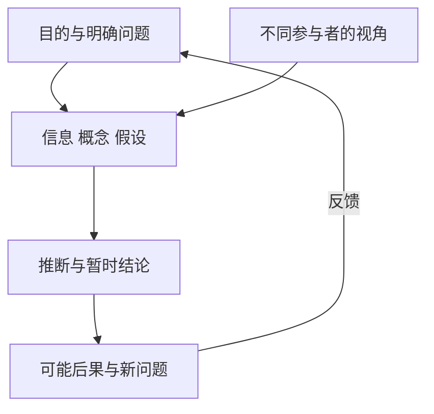

# 《思辨与立场》：不只检查别人，也用同一标准检查自己

> 作者：Richard Paul、Linda Elder，理查德·保罗、琳达·埃尔德。中文《思辨与立场：生活中无处不在的批判性思维工具》，李小平译，中国人民大学出版社；核对 2016 年 ISBN 9787300231044 及 2024 年书目信息。两位作者有多部标题相近的英文教材，本篇不将不同英文版和中文章序混为一谈。  
> 依据：中文书目、作者创办的批判性思维基金会公开框架，以及原始监管、调查和统计资料。未取得用户版本全文，属于主要知识框架导读，不声称逐页精读。按推理要素、思维标准、智力品格、自我中心与社会思维、阅读沟通和伦理应用组织 30 点。  
> 真实案例为书外教学；财商应用是本文综合，不冒充作者的选股方法。更新：2026-11-12。

## 先抓住核心

一个人可以非常擅长寻找漏洞，却只用这项能力保护自己的立场。本书因此区分会争辩和会公正思考：前者可能只是用更精巧的方式维护利益，后者还愿意让自己的前提、标准和结论接受检查。

它提供三层工具：八个推理要素帮助拆开思考；一组质量标准帮助评价思考；智力品格帮助我们在不舒服、受威胁或有利益冲突时仍然使用这些工具。

对财商最直接的价值是：看到一份研报，知道它怎样从资料走到推荐；面对自己喜欢的公司，能认真写出反证；讨论分歧时，能分清数据、假设、价值和目标分别出了什么问题。

## 内容地图

| 层次 | 核心内容 | 练习成果 |
| --- | --- | --- |
| 拆解 | 目的、问题、信息、推断、概念、假设、视角、后果 | 一张论证结构表 |
| 评价 | 清晰、准确、精确、相关、深度、广度、逻辑、重要、公正 | 对关键判断的质量检查 |
| 修养 | 谦逊、勇气、同理、正直、坚持、理性信心、自主与公平 | 更新规则与反证记录 |
| 应用 | 阅读、写作、学习、媒体、群体与伦理 | 可复盘的财商判断 |

书目信息见[高校馆藏记录](https://opac.lib.uibe.edu.cn/opac/book/45e6b64a7df62a451dff50d89612c9c7)，核心模型见[作者机构的要素与标准说明](https://www.criticalthinking.org/pages/the-elements-of-reasoning-and-the-intellectual-standards/480)。

## 核心知识点

### 1. 思考会自动发生，思考质量却需要主动检查

我们一直在解释、判断和选择，但熟练使用直觉不等于会识别其中的假设。本书的出发点是把思考本身变成观察对象。

对一个投资念头，不只问“我现在相信什么”，还问“我是怎样相信它的”。可能来自年报、熟人意见、过去收益或情绪。来源不同，支持力也不同。把这些过程说出来，才有机会改进，而不是把最先想到的故事当成结论。

### 2. 弱式批判与强式批判：标准是否也约束自己

弱式使用可以很聪明：抓住对方的文字缺口，却绕开对自己不利的证据。强式使用要求把相同的清晰性、证据与逻辑标准用于双方。

这里不是要求没有立场，而是要求立场可被检验。你可以偏好长期投资，但不能因此拒绝检查长期持有对象的永久受损；可以研究指数化，也仍需核对指数的集中度与费用。方法认同不应成为免检理由。

### 3. 目的：先确认到底在解决谁的问题

同一份报告可能服务于投资者研究，也可能服务于销售、融资或部门考核。目的不同，会影响选择哪些事实、强调哪些风险。

**真实案例：2003 年研究分析师与投行业务的利益冲突和解。** SEC 对十家大型投资机构的执法行动涉及投行业务对证券研究的不当影响。和解包括资金支付与组织安排调整，目的之一是减弱研究与投行业务之间的利益牵连。[SEC 当时的执法公告](https://www.sec.gov/newsroom/press-releases/2003-54-ten-nations-top-investment-firms-settle-enforcement-actions-involving-conflicts-interest-between)

这个案例不证明所有分析师都不可信，而是提醒你：专业能力与组织目的属于不同层面。一个人可以懂业务，同时受到获取客户、促成交易或考核排名的压力。

读材料时先记录作者身份、服务对象、报酬与使用场景，再评价论证。发现利益冲突，合理动作是增加独立核验，不能直接从动机推出所有结论为假。历史和解条款也不能不经核对就当成今天仍完全相同的制度。

### 4. 问题：大问题需要拆成能够回答的小问题

“这家公司怎么样”同时包含业务、治理、估值与个人适配性，任何一段好故事都可能被当成完整答案。更好的问题是明确对象、期间、指标与判断标准。

可以先问未来盈利依赖什么，再问现金能否实现，再问当前价格隐含什么，最后才问是否符合资金条件。问题拆分不是复杂化，而是防止用一个层面的好消息替代其他层面的研究。

### 5. 信息：资料多不等于证据足

十篇转述同一消息的文章，不是十个独立来源。公开文件、当事人说明、第三方研究与匿名评论，也具有不同的可核验程度。

证据质量要看来源、方法、完整性与相关性。遇到相互冲突的资料，先比较定义和时间，再比较谁更接近原始记录。不要只留下支持自己的部分，也不要为了显得客观，把质量差异很大的来源平均对待。

### 6. 推断：从信息到结论的那一步最值得写出来

事实不会自动给出行动。收入上升可以支持经营扩张，却不能单独证明利润质量改善，更不能直接推出股票便宜。

把推断写成完整句子：“因为哪些事实，在什么条件下，我暂时认为什么。”这样能发现一份看似有很多数字的报告，真正依赖的可能是一个没有验证的增长假设。结论写清条件，才便于以后更新。

### 7. 概念：同一词语的含义必须稳定

“安全”可能指价格波动小，也可能指违约概率低、资金随时可用或购买力稳定。若研究者与读者采用不同含义，会产生没有实质共识的沟通。

重要概念可以先写操作定义，再说明它遗漏了什么。例如用财务比率研究偿债能力，有助于比较，但不能代替债务到期日、担保条款和受限现金。定义让研究开始，不是让研究结束。

### 8. 假设：结论背后可能藏着没有说出来的世界

预测增长时常默认竞争格局不变、客户继续支付、成本能够控制、融资能够续接。假设没有写出来，不代表它不存在，只代表更难被检查。

一种有效方法是反向追问：什么条件若不成立，结论会明显改变？然后把这些条件分成已有证据、可监测与无法可靠估计。最重要的假设应出现在正文，不能只放在一堆通用风险提示里。

### 9. 视角：换位置看问题，不是无限迁就所有意见

企业增长对股东、债权人、客户和员工可能意味着不同的成本与收益。理解这些视角可以帮助发现自己遗漏的机制。

例如宽松赊销可能提高报告收入，客户获得资金便利，股东却承担回款风险。换位分析后仍需要证据判断，不能因为存在多种视角，就说任何观点都同样正确。视角提供问题，事实约束答案。

### 10. 后果：一阶结果之外还要看连锁影响

一个行动的直接目标可以实现，同时产生新的问题。降价可能扩大销量，也可能改变品牌定位、竞争反应和现金需求。

后果分析要区分“逻辑上意味着什么”和“现实中可能发生什么”。前者涉及推理一致性，后者需要行为、制度与数据证据。不要只因为能讲出一条连锁故事，就把它当作必然路径。

图中要素彼此关联。改变问题、目的或关键假设，往往会改变所需资料和结论，而不是只换一种表达方式。

### 11. 清晰、准确与精确是三道不同检查

清晰是听懂在说什么；准确是它与事实是否相符；精确是细节是否足以解决问题。“收入增长了”可能清晰准确，但若用于估值，仍可能缺少幅度、期间、业务范围与一次性因素。

反过来，写出很多小数并不保证准确。对未经核对的假设保留六位小数，只会制造精确的外观。先确保对象正确、数据可靠，再决定需要多精细的表达。[作者机构的标准说明](https://www.criticalthinking.org/pages/universal-intellectual-standards/527)

### 12. 相关性：真的事实也可能没有回答当前问题

管理层毕业于名校、产品曾获奖、行业媒体很关注，这些信息可能真实，却未必能支持你正在判断的现金回报或估值。

每引用一条材料，都追问它改变哪个关键变量。不能建立联系的内容，可以作为背景，而不应成为购买理由。研究篇幅长不等于研究充分，相关性要求把有限注意力放在会改变判断的地方。

### 13. 深度与广度：既要追机制，也要看替代解释

深度是识别问题的复杂条件和根本原因；广度是考虑其他有分量的视角与解释。只问很多表面问题，没有追到机制，不叫有深度；只列赞成和反对两个口号，也不叫有广度。

**真实案例：哥伦比亚号事故调查。** 2003 年调查不仅分析泡沫撞击机翼的物理过程，还将管理实践、组织文化和信息处理视为重要成因。报告明确没有把事故简化为一个孤立零件或某个人的失误。[NASA 调查综述](https://www.nasa.gov/history/columbia-accident-investigation-board-synopsis/)、[原始调查报告](https://ntrs.nasa.gov/archive/nasa/casi.ntrs.nasa.gov/20030066167.pdf)

它说明深度分析要解释为什么信息没有产生应有行动，广度分析要纳入工程、管理和组织约束。这里不能凭报告反推每个参与者的内心偏差，更不能拿事故故事替代企业研究；真正可迁移的是提问层次。

对一家出现连续质量问题的公司，可以同时看技术原因、激励、反馈渠道与处理记录。只要求员工更认真，可能没有触及结构；只说文化有问题，又可能缺乏可检验细节。应把两者连接起来。

### 14. 逻辑与重要性：推理通顺，还要抓住决定性因素

逻辑检查结论是否跟随前提、不同主张是否相容。重要性则要求区分关键变量与边缘细节。

如果一家企业短期现金缺口足以改变生存前景，研究大量装修风格、广告偏好，却不分析债务与可用资金，就算每句话都正确，也没有抓住重要问题。给未知事项排序，是提高研究效率的关键动作。

### 15. 公正不等于各打五十大板

公正意味着使用一致标准，认真理解相关立场，并按证据质量分配信心。若一边有可复核数据，另一边只有猜测，不能为了形式对称而给两边同样权重。

同样，不应把对自己有利的证据要求放低，把不利证据要求抬高。公正可以产生明确结论，也可以产生不确定结论；关键是结论怎样形成，而不是表面上是否居中。

### 16. 智力谦逊：知道自己的知识边界

谦逊不是凡事说不知道，而是区分已经知道、合理推断和暂时不懂。它允许人在熟悉领域作明确判断，同时承认其他领域需要帮助。

财商应用可以建立“能力边界表”：哪些业务能解释收入和现金来源，哪些只能复述市场口号，哪些关键变量缺少资料。把未知写出来，是保护判断质量的动作，不是能力不足的羞耻标记。[作者机构的智力品格说明](https://www.criticalthinking.org/pages/valuable-intellectual-traits/528)

### 17. 智力勇气：愿意面对不受欢迎的证据

接受证据有时会损害面子、所属群体的认同或已有利益。勇气表现为仍愿意检查，而不是故意持反主流立场。

在投资中，可把“最不想看到的证据”单独列一栏，例如客户流失、费用低估或融资条件变化。然后预先约定它出现时做什么。等情绪最强的时候再决定是否接受，通常更困难。

### 18. 智力同理：先理解对方如何得到那个结论

同理不是赞同，而是能够重建对方的问题、资料、价值和限制。对方的选择可能在其条件下合理，只是与你的目标不同。

一个需要短期流动性的人与一个长期资金账户，对同一资产作出不同安排，不一定是谁不懂投资。先确认目标与约束，再讨论事实和估值，能够避免把适配差异误判为智力差异。

### 19. 智力正直：要求别人做到的，也要求自己做到

如果你要求看空观点提供来源，自己的看多观点也应提供；如果指责他人事后修改预测，自己的事前记录也应保留。正直把抽象的诚实变成可观察的标准一致。

实践中，可以保存研究版本与修改理由。改变观点是正常更新，悄悄重写原先理由却会让复盘失真。尤其不要在结果揭晓后，把原先模糊愿望改写成明确预测。

### 20. 坚持与理性信心：困难问题需要持续调查

深度分析可能暂时没有漂亮结论。坚持意味着愿意完成必要工作，理性信心意味着相信证据、比较和讨论可以改善判断，而不是只能服从强势人物。

但坚持不等于无限研究。需要结合决定重要性与信息价值设置停止条件：新增资料是否还可能改变行动？为一个低影响选择耗费巨大成本，也可能不合理。本书的品格训练应与资源约束一起使用。

### 21. 自主思考不是拒绝专家和合作

自主意味着能够说明自己为何采纳某种判断，而不是所有知识都要亲自从零证明。现代经济活动依赖分工，正确使用专家意见本身就是能力。

你应了解专家的领域、方法、利益关系和不确定性，并知道哪些问题需要交叉验证。拒绝专业证据来维护独立形象，可能只是另一种身份依赖。

### 22. 自我中心思维会把利益伪装成事实

我们可能因为一个结论方便、有利或已经投入很多，就更愿意相信它。推理能力强并不能自动防止这一点，反而可能帮助人制造更精细的辩解。

一个具体动作是把“我希望发生什么”和“证据支持什么”分开写。然后请没有相同利益的人检查最关键假设。外部检查并不保证公正，却能增加发现盲点的机会。

### 23. 群体中心思维会压缩可以提出的问题

群体可以提供知识、信任与合作，也可能使某些事实难以表达。成员开始先判断一句话是否忠于群体，再判断它是否真实。

哥伦比亚号调查显示，组织信息与安全文化值得单独检查。迁移到投资团队时，可以观察不同意见能否被记录、坏消息是否上达、资历是否替代证据。不能仅因最后形成一致意见就认定有群体思维；需要看形成共识的过程。

### 24. 理解现实需要主动寻找不符合原故事的对象

**真实历史研究：约翰·斯诺与 1854 年霍乱。** CDC 的历史说明记载，斯诺把病例与饮水来源联系起来，并调查了地理位置与患病情况不完全一致的对象。关闭水泵发生时疫情已经下降，因此不能把后来下降的全部幅度归因于移除泵柄。[CDC 对历史证据的说明](https://www.cdc.gov/mmwr/preview/mmwrhtml/mm5334a1.htm)

值得学习的是对例外的态度。一个故事若说某种暴露导致风险，那么接近却未暴露的人、远离却实际接触的人，都能帮助检验解释。例外不是必须隐藏的麻烦，而是区分竞争机制的资料。

企业研究可以同样寻找反例：同样处于热门行业却失败的公司，为何不同？拥有同样标签的公司，成本和现金表现是否相近？但不能把历史观察等同随机实验；病例定义、记录和其他条件仍影响因果强度。

### 25. 批判性阅读要重建作者，而不只摘取金句

每读一章，试着用自己的话写作者的问题、中心结论、主要理由、关键概念和最重要假设。若只能复制结论，还没有理解论证。

接着问：作者回应了哪些反对意见，忽略了哪些适用条件？对投资书尤其要记录时代与市场背景。某条规则在特定制度下有道理，不意味着移到另一市场仍原样成立。

### 26. 批判性写作让别人能够复查你

好的研究文字把事实、推理和建议分开，使用可定位的来源，并明确不知道的部分。读者应能找到哪条证据支持哪项判断。

写作时先给清楚结论，再说明理由和边界；不要把大量引用排在文末，却让正文关键数字找不到出处。表达的目的不是制造专业感，而是降低别人检查你的成本。

### 27. 媒体与数字的框架，会影响人们看见什么

**真实统计：2024 年全国居民人均可支配收入平均数为 41,314 元，中位数为 34,707 元。** 两项都是国家统计局公布的居民收入口径，并非工资收入的同义表达。[国家统计局原始发布](https://www.stats.gov.cn/sj/zxfb/202501/t20250117_1958325.html)

只引用平均数可以描述总量除以人口的水平，却不能说明典型位置；中位数提供另一种分布位置，也不能告诉你全部收入差距。若标题写“普通人的工资是多少”，就同时发生了指标与对象的变化。

应用本书标准，可以依次检查清晰性（什么收入）、准确性（数字是否正确）、精确性（哪年、哪个群体）、相关性（是否回答工资问题）和广度（分布是否被忽略）。这比直接宣布“平均数骗人的”更准确，也更能修复信息。

### 28. 伦理推理需要把受影响者纳入边界

事实告诉我们某个行动可能产生什么结果，伦理判断还涉及应该怎样对待别人、哪些责任不能忽略。本书把公正与道德推理联系起来，但这不意味着一套公式能解决所有价值冲突。

财商决策中可检查：收益是否建立在他人未理解的风险上，是否隐瞒重要信息，是否把成本转移给无选择权的人。合法性、盈利性和伦理可接受性并不完全相同，应分别讨论，不能用一个词包办。

### 29. 进步阶段是训练地图，不是给自己贴身份标签

作者的成长框架从缺乏反思、意识到问题，走向开始练习、持续实践和更成熟的思考。价值在于提醒我们技能需要反复应用，而不是读完一本书就毕业。

不要把“我属于高级思考者”当作新身份。一项更可检查的标准是：能否指出自己最近一次重要更新、修改原因与证据。如果没有真实记录，熟悉术语也可能只是知识展示。

### 30. 用一个循环，让标准在日常研究中生效

第一次只选一条具体观点，不要同时审查整个人生。每次重点改一个动作：补来源、明确术语、检查假设或更公平地重述反方。工具能否被持续使用，比一次填满所有栏目更重要。

## 三个带参考答案的练习

**练习一：**朋友说“这家公司是龙头，所以当前买入一定划算”。先指出哪个要素缺失。至少缺少对“龙头”的定义、价格与价值的联系、增长及竞争假设、个人目标与风险条件。不要只回复“你有从众偏差”，而应提出能补证据的问题。

**练习二：**两份报告引用同一数据，一份看多、一份看空，谁一定有错？未必。可能时间范围、关键假设、估值或资金目标不同。先拆八要素，再定位分歧；如果事实判断真正相反，再寻找可裁定的资料。

**练习三：**是否公正就要给所有观点相同篇幅？不是。应认真理解相关观点，并按证据质量和问题重要性决定权重。公正约束评价标准，不要求结论居中。

## 如何接入财商学习

把本书用于[《财商进阶合订本》](../财商进阶合订本.md)的企业研究卡和论证检查卡。每次研究后，写三句：目前最强的证据是什么，最脆弱的假设是什么，什么新信息会改变判断。

这套框架属于规范性的思考工具，不是能预测股票回报的经验模型，也不保证采用后消除所有偏差。具体理论与案例已在原位附来源；没有取得的原书章节和页码不作虚构补充。
