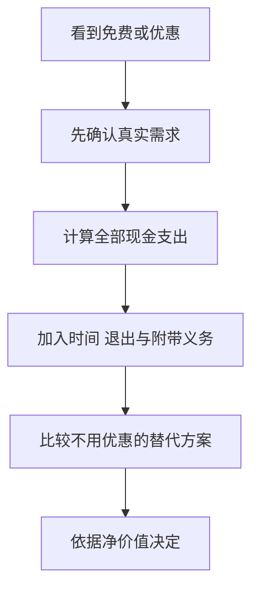
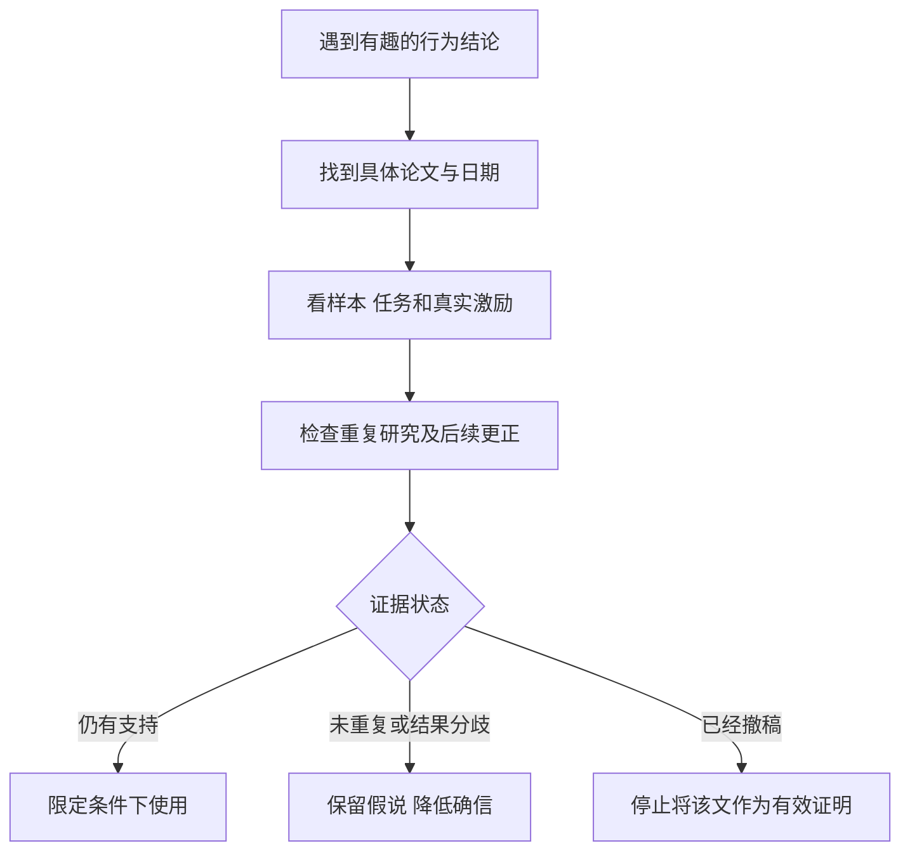

# 《怪诞行为学》读书笔记

> 作者：丹·艾瑞里；英文原作 *Predictably Irrational*，2008 年初版，2009 年有修订扩展版。本篇指这一部作品，不把同一中文系列名下的其他书合并进来。
> 资料范围：依据公开目录、作者版本说明、原始论文、重复研究和期刊撤稿通知整理，未取得完整原书逐页核对。覆盖相对比较、锚定、免费、社会规范、自控、拥有、选项、预期、价格与诚实等主要主题。更新：2026-11-12。
> 证据更新：书中相关的 2002 年拖延与期限论文已于 2026-09-02 撤稿；道德提醒的部分研究未得到大型重复研究支持。下文在对应位置说明。2012 年签名位置论文的撤稿另列为书外背景，不错误地说成它已经收录于 2008 年初版。

本书试图说明，人们的选择会受比较对象、先看到的数字、是否免费、情境与情绪影响。这些偏离有时呈现规律，因此可以研究，而不只是归因于个人“没想清楚”。

对财商的实际价值，是学会检查自己正在怎样评价一个产品或机会。与此同时，今天阅读这本书也应练习另一种能力：有趣的故事、著名作者和一次显著实验，都不能让一个结论永久免于复核。

## 主要内容怎样连起来

| 主题组 | 关键问题 | 可迁移的检查 |
| --- | --- | --- |
| 比较、锚定、免费 | 我认为划算的依据从何而来 | 去掉标签后重新比较总成本 |
| 社会规范与情绪 | 情境怎样改变动机与偏好 | 分清关系、合同与当下状态 |
| 拖延、拥有、保留选项 | 为什么知道目标却没有行动 | 检查执行摩擦与机会成本 |
| 预期和价格 | 感觉是否被信息改变 | 区分体验、客观属性与承诺 |
| 诚实与自我形象 | 人怎样解释自己的行为 | 除提醒外还检查核验与激励 |

主题对应公开书目中列出的原作十三章及扩展材料；不同译本可能重新编排。[2009 年版本与目录](https://discover.library.unt.edu/catalog/b3793868)；[作者关于扩展版的说明](https://danariely.com/the-expanded-edition-is-out-on-may-19th/)。

## 核心知识点

### 1. “可预测”指可能出现稳定模式，不是能准确读心

实验中的平均变化，不能保证每个人在每个情境下都同方向变化。一个模式是否出现，取决于选项、信息、经验、激励和测量方法。

因此本书适合提供“应检查什么”的线索，不适合给所有人贴上固定行为标签。投资者更不能由此推出自己能稳定预测其他人的下一笔交易。

### 2. 相对比较帮助理解，也可能把问题换掉

当没有清楚的绝对标准，人容易比较谁比谁便宜、谁更接近某个参考产品。比较本来是必要工具，问题在于参照对象由谁选择。

购买基金时，“比旁边那只费用低”并不等于费用低，也不等于适合目标。应加入同类可行替代品，并保留暂不购买这一选项，避免在销售者划定的小圈子里完成全部判断。

### 3. 诱饵效应：一个少有人选的选项也可能影响其他选择

Huber、Payne 与 Puto 在 1982 年研究“不对称占优”的选择结构：新增的选项被原有某一个选项明显胜过，却不被另一个以同样方式胜过；在研究条件下，这可能提高前者被选中的概率。[原论文](https://doi.org/10.1086/208899)。

这个研究早于本书，不能把发现全归给艾瑞里。其意义不是“任何第三个商品都能操纵消费者”，而是提醒选项集合本身可能改变比较。

**结构演示，非真实产品：**同为一年服务，A 收费 100、容量 10；B 收费 150、容量 20；C 收费 150、容量 15。在只比较价格和容量的前提下，B 不比 C 贵且容量更多，因此 C 容易突出 B 的优势。但 A 仍更便宜，若 10 已够用，B 相对 C 的优势不能证明它相对 A 值得多花 50。

| 演示方案 | 年费 | 容量 | 应问的问题 |
| --- | ---: | ---: | --- |
| A | 100 | 10 | 我的真实需求是否已经满足 |
| B | 150 | 20 | 多出来的容量对我值多少钱 |
| C | 150 | 15 | 它是否只是让 B 看起来突出 |

消除误导的方法不是发现诱饵就一律买最便宜，而是先写自己的约束和用途，再计算边际收益与边际成本。

### 4. 比例会夺走对绝对金额的注意

同样节省一笔钱，放在小额商品上显得折扣很大，放在大额商品上显得无足轻重。比例有助于表达价格，却不能代替时间与现金的真实价值。

财务决策应同时看百分比、绝对金额和为此付出的时间。在管理费问题上，还需要看持续多少年、作用于多大资产基数；不能因为单年百分比小就忽略累计成本。

### 5. 锚定：第一组数字可能影响后续估值

Ariely、Loewenstein 与 Prelec 的 2003 年研究报告，在特定实验中，初始估值会受任意数字影响，随后对数量或品质变化的估值又呈现相对一致的关系。[原论文](https://people.duke.edu/~dandan/webfiles/PapersPI/Coherent%20Arbitrariness.pdf)。

原文把这种组合称为“连贯的任意性”：后续选择看起来有秩序，不代表最初的价格基准就有充分根据。不能据此说所有市场价格都任意，也不能把实验影响幅度套到每只股票。

**财商应用：**先根据现金流、可比交易或替代用途形成独立区间，再看商家报价和历史高点。如果所有估值理由都围绕“以前更贵”，需要追问这个旧价格是否包含过度预期。

### 6. 自己过去的选择也会成为锚

人不只受别人报价影响，还会观察自己过去买过什么，继而把过去行为当成偏好的证据。第一次决定若带有偶然性，后续重复可能把偶然变成习惯。

反思时应区分“使用后确认值得”和“因为一直这样，所以继续”。前者包含反馈，后者可能只是未重新比较。也不要为改变而改变；转换本身可能有真实成本。

### 7. 免费可能引发超出价格差的反应

Shampanier、Mazar 与 Ariely 的 2007 年研究比较多个商品选择条件，包括较便宜商品从小额付费变成免费。研究在相应条件下观察到选择向免费选项明显移动，并讨论情感等可能机制。[原论文](https://pubsonline.informs.org/doi/10.1287/mksc.1060.0254)。

理解时要分两层。价格下降自然可以增加吸引力；研究关心的是降到零是否产生超出简单成本收益差的特殊变化。它不是说选择免费一定错误，也不是说所有免费产品都藏有陷阱。

判断一项免费金融服务，应列出服务费以外的代价：后续销售、交易价差、时间、退出步骤、数据使用和是否诱发更多不必要操作。若确实没有重大代价且满足需求，免费也可以是好选择。

### 8. 零标价不等于零机会成本

等待、搬运、保管、学习和注意力都有替代用途。为凑免邮购买不需要的商品，可能减少某一项费用却增加总支出。

**计算演示：**原本要买 80 元商品，运费 8 元；为了满 100 元免邮，另买 25 元无用商品，总支出从 88 元变为 105 元，增加 17 元。这里的前提是新增商品对你没有用途，不能假定所有凑单都浪费。

图解把注意力从优惠标签转向整体方案；目的不是拒绝优惠，而是避免把局部省钱误认成整体划算。

### 9. 社会规范与市场规范可能激活不同的关系期待

朋友帮忙、礼物交换和按价付费，包含不同的权利与责任。把一种关系突然改用另一种方式表达，可能改变对方对公平、努力和后续义务的理解。

Heyman 与 Ariely 的 2004 年实验比较不同报酬安排下的努力，讨论低额金钱报酬与无金钱报酬为何可能有不同结果。[作者公开原论文](https://danariely.com/wp-content/uploads/2024/06/heyman-ariely-2004-effort-for-payment-a-tale-of-two-markets.pdf)。

这不意味着企业应该用使命代替工资，也不意味着朋友之间不能谈钱。适用的启发是把关系性质讲清楚：商业劳动应有明确报酬和责任，感谢与友谊不能用来掩盖不公平要求。

### 10. 金钱激励可能改变行为的意义，而非只改变强度

加入奖励或罚款，可能让人把原来按责任理解的行为改看成有价交易；但这种效应是否发生，需要具体证据。不能仅凭“内在动机”四个字否定合理报酬。

财务管理也有类似问题：家庭讨论预算时，若只用惩罚推动执行，可能损害共同目标。清楚说明约束、共同制定规则与及时反馈，是另一组可以比较的工具。

### 11. 冷静时可能低估强烈情绪下的自己

本书讨论情绪与唤起状态怎样改变判断。日常对应问题是：平静时制定的承诺，到了恐慌、兴奋或疲惫时是否还能执行？

不同情绪并非同一机制，书中的特定实验也不能直接提供股市情绪影响的精确系数。可迁移的做法是识别高风险时刻，事先准备容易执行的步骤，而非事后责备自己“怎么又不理性”。

### 12. 对投资情绪的管理应落实到动作之前

以下为补充教学：重要交易前记录理由与反证；对临时出现的新想法先完成研究卡；将价格通知与风险通知分开；在明显激动时延后可以延后的决定。

延后不是万能规则。面对确定期限、流动性或合同要求，等待也有成本。因此先分清哪些决定可逆、哪些信息必须立即处理，不能一律冷静几天了事。

### 13. 拖延章节今天必须连同撤稿信息阅读

书中讨论通过期限和预先承诺改善拖延。与之相关的 Ariely、Wertenbroch 2002 年论文曾报告自定期限与外部期限的比较；**该论文已于 2026 年 9 月 2 日被期刊撤稿**。[期刊撤稿通知](https://journals.sagepub.com/doi/10.1177/09567976261488042)；[PubMed 撤稿记录](https://pubmed.ncbi.nlm.nih.gov/42684323/)。

因此本篇不把那篇论文原来的效果和组间排序当作可靠证据，也不沿用“实验已证明某种截止日期安排最佳”的说法。旧论文网页、旧书和旧笔记可能仍保留原摘要，不能只读到摘要就忽略后续状态。

这并不逻辑地证明一切期限安排都无效。准确结论是：这项特定证据不能继续承担当初的证明任务；要推荐具体方法，应寻找其他独立研究，或在低风险场景测量自己的实际完成情况。

### 14. 预先承诺是待检验的工具，不是对人性的最终答案

把目标拆成阶段、指定检查时间、减少执行摩擦，在实际工作中可能有用；本篇将它们作为可试用的流程建议，不用已撤稿研究背书。

检验可以很具体：任务质量是否下降、是否只是提前交了形式成果、安排是否增加无谓焦虑。完成日期是一个指标，完成的价值和代价同样重要。

### 15. 拥有之后的评价要与获得之前对照

人可能因熟悉、投入和避免损失而高估已有物品。部分差异也可能有合理原因，例如转换成本、私人使用价值和掌握的信息不同。

重新评价持仓时，应将“我拥有它”与“它现在提供什么未来收益”暂时分开。然后把税费、组合关系等真实约束加回来，不要为了显示自己不恋旧而过度交易。禀赋效应的实验程序争议可对照[《错误的行为》](<../错误的行为 - 理查德·塞勒/读书笔记.md>)第 6 点。

### 16. 虚拟拥有与提前投入也可能提高心理黏性

定制配置、试用、竞价和投入时间，会让人产生“已经是我的”或“已经走到这一步”的感觉。情绪上越来越投入，并不等于新增支付越来越划算。

检查后续决定时，只把无法改变的过去投入用于总结经验，把新增行动按未来结果比较。实际合同义务若已经成立，则是现实约束，不能当作纯心理标签忽略。

### 17. 保留选项有价值，也有维护成本

不关掉任何机会看起来谨慎，但跟踪太多产品、同时研究过多公司、不断切换方向，都需要时间。若一个选项长期不可能使用，保留它的代价可能超过价值。

“选择权有价值”并不等于“选择权没有成本”。金融中的期权价值有明确条款和定价条件，不能把日常保留机会与金融期权完全等同。

### 18. 关闭选项之前，应区分不可逆损失与暂时放下

从研究清单移除一个标的，通常不意味着以后永远不能再看；签署不可撤销合同则不同。很多焦虑来自把普通的注意力分配误当成终身失去机会。

可为选项设置重启条件，例如出现重大公告、价格达到预设研究区间或原有不确定性得到解决。这比每天维持全部关注更有纪律，但不保证会抓住每次上涨。

### 19. 预期可能改变体验，需要区分体验与客观属性

Plassmann 等人在 2008 年研究中改变受试者得到的葡萄酒价格信息，考察主观愉悦评价及相关神经活动，发现价格信息能够影响体验的相应测量。[原论文与补充资料](https://authors.library.caltech.edu/records/aavdz-6e373)。这是相关主题的书外研究，不是艾瑞里独自完成的实验。

这个案例说明价格不只传达成本，也可能制造预期；它没有证明更贵的酒在化学性质上发生改变，更没有证明昂贵金融产品会产生更高回报。

对投资产品应把“使用体验更舒服”“服务更周到”“长期净收益更好”分成不同指标。有些服务价值真实存在，但不能拿满意度替代成本后业绩。

### 20. 盲测有助于隔离标签，却不是所有评价的完整替代

在适合的任务中，先去掉品牌和价格标签，可以帮助检查信息对感受的影响。但购买时售后、信用、合同和稳定性本来就是产品价值的一部分，不能全部视为无关噪声。

财务产品较可行的对应方法，是先统一费用、风险和收益口径，再看品牌。比较“同一段历史净值曲线的不同包装”与比较不同权利结构的产品，也应区分。

### 21. 价格可以是质量线索，也可以只是线索

信息不足时，价格确实可能包含质量、稀缺和服务信息；但这种相关性需要市场条件支持，不能倒推任何高价商品都更好。

本书关于价格与安慰剂的主题，不应转换成“贵药更有效”的医疗建议。本篇侧重一般判断问题：如果知道价格后评价改变了，要检查究竟是获得新信息，还是仅仅提高了期待。

### 22. 自我形象可能参与人对不诚实行为的解释

书中的诚实讨论提出，人可能希望获得好处，同时维持“我是好人”的自我认识，因而为某些小违规寻找解释。这是一个研究框架，不是对每个人的道德诊断。

用于财务工作时，可以检查模糊报销、业绩归因、风险披露与“大家都这么做”的合理化语言。治理仍需要记录、核验和责任，不能只依赖当事人良好的自我感觉。

### 23. 道德提醒的著名实验未得到大型重复研究支持

Mazar、Amir 与 Ariely 的 2008 年一项实验报告，回忆道德准则会减少特定解题任务中的虚报。2018 年预注册重复研究汇集 25 次直接重复、共 5786 人；其主要分析使用符合相应标准的 19 次重复、4674 人，没有支持原先的减少作弊效应。[重复研究原文](https://pure.uva.nl/ws/files/232943584/verschuere-et-al-2018-registered-replication-report-on-mazar-amir-and-ariely-_2008_.pdf)。

“25 次全部项目”与“19 次主要分析”是不同口径，不能混写成同一个样本。研究针对的是特定提醒、任务与程序，不证明道德教育在所有场景都没有作用。

对实际风控的结论是：不要因为一张诚信声明听起来合理，就把核验、权限与抽查取消。提醒是否有用可以测量，但它不自动承担制度保障的功能。

### 24. 签名位置论文的撤稿是另一个事件，不能混淆年份

2012 年关于“在表格开头签名能提高诚实”的论文，于 2021 年被 PNAS 撤稿，通知指出数据有效性受到证据质疑。[期刊撤稿通知](https://pmc.ncbi.nlm.nih.gov/articles/PMC8463784/)。

它发表于本书 2008 年初版之后，不能用它来虚构原书某页内容。本篇列出它，是提醒阅读该作者相关通俗说法时核对具体论文及状态，而不是把作者所有作品、所有合作者或所有行为研究一概判为无效。

### 25. 距离现金较远，不等于可以免于同一标准

书中讨论代币、实物与现金怎样改变人对行为的感受。这一方向可以启发检查“只改一个统计口径”“只是把收入提前一点”等合理化，但具体心理效应仍需可靠证据。

财商上的补充原则可以独立成立：不同包装下的同一经济利益，应按相应事实、合同和会计规则处理。不能因为账面形式变化，就假定经济代价或受影响者消失。

### 26. 从众与独特性都可能让人偏离实际喜好

有时人跟随别人以减少不确定性，有时又故意选不同的东西以显得独特。两种方向都可能发生，因此“人会受群体影响”不能成为事后解释任何选择的万能话术。

投资中应先形成自己的问题与证据清单，再听取其他观点。独立判断不等于与多数人相反，逆向也需要价格和事实支持。

### 27. 建立一个证据分层，而非只收藏精彩结论

图中三条分支对应不同状态。重复失败不是自动证明作者欺骗；撤稿也不自动证明相反命题成立。准确更新，比从全盘相信跳到全盘否定更有价值。

### 28. 把洞见变成消费与投资中的可检查动作

补充教学的实用流程是：先确定需求；独立估计价值；计算全部费用；比较可行替代；辨认当前情绪；记录为什么选择；之后检查使用结果。

对一次普通购买不必写长报告。把步骤集中用于高金额、长期承诺、难退出或容易反复后悔的决定。行为知识的收益来自减少具体错误，不来自让每一次生活选择都变成审讯。

## 练习与参考答案

**一：一个套餐完全优于旁边的高价套餐，是否值得购买？**

尚不能确定。还需与不买、原有方案和其他真正满足需要的方案比较。战胜一个可能被刻意放入的参照，不等于净价值最大。

**二：研究撤稿后，是否应当断言所有截止日期都没有用？**

不能。应停止引用被撤稿论文作为证据，并重新寻找独立支持。撤稿改变证据状态，不自动建立相反的普遍规律。

**三：免费工具需要投入很多时间，但确实能满足需求，是否一定不划算？**

也不一定。把时间、后续费用与替代方案放在同一尺度上比较即可。目的不是反对免费，而是避免漏算成本。

## 最值得带走的东西

你可以学会拆除参考价格和选项包装、识别情境对选择的影响，并更严谨地阅读行为研究。重要缺口是尚未逐页核对特定中文版本；争议研究已按核验到的期刊状态标示，不能将未标为撤稿的论文理解为已完成全面独立复现。

可配合[《学会提问》](<../学会提问 - 尼尔·布朗、斯图尔特·基利/读书笔记.md>)检查论证，再用[《助推》](<../助推 - 理查德·塞勒、卡斯·桑斯坦/读书笔记.md>)学习如何评估一个实际改进方案，而不止记忆心理效应。
