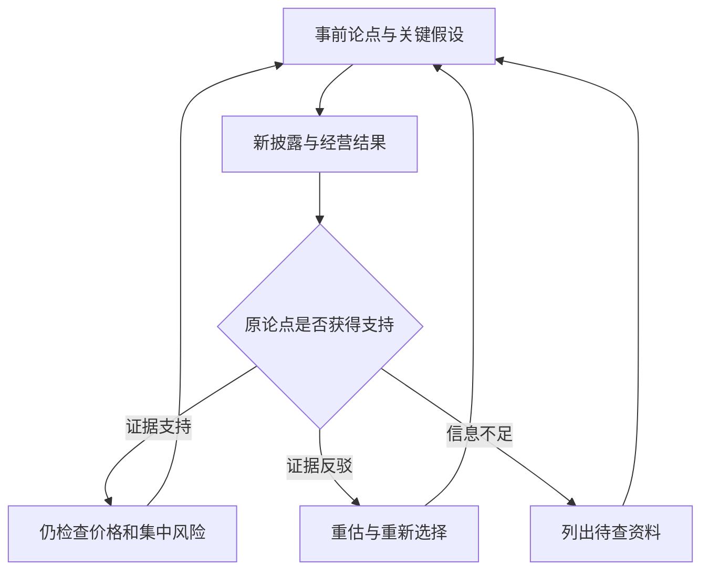

# 《战胜华尔街》：把发现公司变成持续研究的过程

> 作者：Peter Lynch、John Rothchild，彼得·林奇、约翰·罗瑟查尔德。英文 Beating the Street，1993 年初版；本次核对出版社 1994 年修订平装版与公开节选。它不同于《彼得·林奇的成功投资》。用户具体中文版本未确认。  
> 资料范围：基于出版社目录与节选、作者公开访谈和公司原始披露整理，没有取得用户版本全文，属于公开资料系统导读。覆盖投资准备、基金管理经验、行业研究、跟踪与退出；书后案例明确为补充教学，不编造林奇的交易。更新：2026-11-12。

## 这本书能帮助你学会什么

这本书的价值，在于展示一个投资者怎样反复寻找、调查、比较和更新公司判断。真正可学习的不是某次买进了哪只股票，而是怎样把“好像不错”变成一组可以核验的问题。

林奇强调普通人的观察有价值，但观察必须经过研究。顾客看到的是商品，投资者购买的是企业权益；好产品、好企业和好价格之间，各有一道不能省略的判断。书名表达的是主动投资的追求，不是对任何读者收益的承诺。

## 内容地图

| 主线 | 研究问题 | 笔记位置 |
| --- | --- | --- |
| 投资准备与业余投资者 | 自己能承受什么，优势在哪里 | 1—5 |
| 麦哲伦基金经历 | 研究、规模、组合和市场波动 | 6—10 |
| 公司的调查方式 | 怎样理解增长、周期和修复 | 11—22 |
| 跟踪与再评价 | 如何更新、卖出和复盘 | 23—28 |

原书版本及节选见[出版社书页](https://www.simonandschuster.com/books/Beating-the-Street/Peter-Lynch/9780671891633)。以下按理解顺序重组，不复制章节文字。

## 核心知识点

### 1. 股票背后是企业，而不是一串可供猜测的价格

价格告诉你别人此刻愿意怎样交换权益，不能单独告诉你企业未来能赚多少钱。研究从客户、产品、成本、资本和竞争开始，再回到价格。

这个顺序能防止一种常见倒置：先因为涨跌喜欢上一个代码，再寻找经营理由。对任何候选公司，先尝试用不含股价的三句话说明其生意。如果说不清谁付款、为何付款、钱如何留下，估值通常还没有可靠基础。

### 2. 生活经验提供线索，不能免除尽调

出版社公开节选中的学生投资活动，展示了从熟悉产品开始研究的方式，也记录了错误选择。它是作者讲述的教学经历，不是随机实验，更不能证明学生普遍胜过机构。[出版社节选](https://www.simonandschuster.com/books/Beating-the-Street/Peter-Lynch/9780671891633)

学习的关键是把观察推进一步：排队来自长期需求还是促销？这项业务属于上市主体吗？占总收入多大？赚钱的是品牌方、渠道商还是设备供应商？不完成这些转换，熟悉感就可能伪装成理解。

研究不必把每条线索都做成投资。发现产品很好，但对集团利润影响很小，仍是有价值的排除结果。财商提高包括缩小自己不懂的部分，而不是扩大必须买入的名单。

### 3. 个人优势必须具体到信息和能力

身处行业、长期使用产品或熟悉地区需求，可能带来观察优势；机构则拥有团队、数据库与访问资源。不能把“普通人也能做”理解为“普通人天然占优”。

把优势写清：你比谁更了解哪个环节，使用什么公开信息，怎样避免利益和情绪影响，判断错了如何识别。若所谓优势只有“我比别人有耐心”，还需要经营与价格证据支持。工作中接触的信息也须遵守保密与交易限制。

### 4. 先确认资金是否允许你持有股票

能承受账面波动与能承担实际损失是两回事。很快要支付的款项，不应因为看见机会就被重新命名为长期资金；借款又增加利息、期限和被迫出售的可能。

对股票风险的准备包括收入稳定性、家庭责任、资金期限与研究能力。原书倡导对企业保持耐心，但耐心不能补上一个不匹配的资金安排，也不能使已永久受损的企业恢复价值。

### 5. 宏观判断应转化为企业承受力

林奇不主张把主要精力用于预测市场下一次转折。这并不表示利率、汇率和需求无关，而是说宏观方向很难准确择时，且同一变化对企业影响不同。[林奇本人访谈](https://cgi.pbs.org/wgbh/pages/frontline/shows/betting/pros/lynch.html)

与其只问“明年经济会不会衰退”，不如问收入下降后固定成本多大、债务什么时候到期、能否减少资本开支。后者即使没有预测准，也能帮助你知道判断对哪些条件最敏感。

### 6. 基金经理的成果来自过程与环境共同作用

富达记录确认林奇管理麦哲伦基金的时期为 1977—1990 年。[富达基金历史](https://www.fidelity.com/myfidelity/InsideFidelity/NewsCenter/quickFacts/Magellan.html)这一事实提供背景，却不能把历史结果归因于单一秘诀。

研究能力、可投资范围、资金规模、市场环境与执行共同影响结果。复制某次持仓，无法复制当时成本、组合、资金流和卖出判断。学习投资传记时，应追问哪些步骤可以重复，哪些结果依赖当时条件。

### 7. 研究数量和持仓数量不是同一个指标

接触很多公司可以拓展比较范围，但实际拥有多少公司，取决于理解深度、机会差异和管理能力。持仓很少不自动代表理解深，持仓很多也不自动代表充分分散。

每个持仓都需要持续追踪的理由。如果观察范围超过自己能处理的信息容量，就可能把遗漏风险当成长期持有。先为研究建立优先级，再决定是否值得增加一项需要维护的判断。

### 8. 规模增长会改变投资方法的可执行性

小额资金可以买入对大基金没有容量意义的公司；大额资金则更需要流动性和足够可部署的机会。同一个策略在不同规模下，成交成本、持仓影响和研究组织都可能改变。

因此，评价基金经理时要比较相近的规模与约束。早年小规模回报记录，不一定能原样延续。个人也不应因为缺少机构规模而自卑，但要认识自己的信息与行为限制。

### 9. 组合应按经济驱动分散

十家公司都依赖房地产融资，并不能因为代码不同就认为风险独立。需要检查需求、原料、融资、客户和地区等共同因素。

分散的目的在于减少一个判断错误伤害整个计划的程度，不是让所有持仓都差不多。具体数量没有脱离研究能力的通用答案；每个额外标的都应改善风险或机会结构，而不是满足一个数字。

### 10. 市场下跌是重新比较的时机，不是自动买入信号

下跌可能让相同业务变得便宜，也可能反映你尚未理解的恶化。区分这两种情况，需要重看公司事实，而非仅看离历史高点多远。

“以前值更高”只是价格历史，不是价值依据。新增资金应重新比较机会成本、业务前景和集中风险。原书对波动的耐受，与无条件摊平成本之间有明确区别。

### 11. 不同公司应使用不同问题清单

成长企业关注可复制的单位经济与空间；周期企业关注供需、产能和正常利润；困境公司先关注资金与权利；资产型公司关注变现与负债。统一的筛选阈值无法替代这些差异。

分类只是工作假设。公司会改变，行业会改变，业务组合也会改变。每次重大信息更新后，都应问现在的主要价值来源是否仍与原先一致，避免为了保住旧结论而拒绝重新分类。

### 12. 餐饮和零售扩张，要拆成老店和新店

**真实补充：Chipotle 2024 年披露，可比餐厅销售增长 7.4%，其中交易量增长 5.3%、平均客单增长 2.1%，全年新开 304 家餐厅。** 这是公司 2025 年发布的年度结果，不是林奇当年的案例。[公司原始公告](https://ir.chipotle.com/2025-02-04-CHIPOTLE-ANNOUNCES-FOURTH-QUARTER-AND-FULL-YEAR-2024-RESULTS)

数据展示了增长可以拆为两层：现有门店经营变化与门店网络扩展。总收入增长不能直接代表每家店都更强，新店需要爬坡，旧店可能被分流，总部与供应链投入也可能增加。

进一步研究应查新店投资额、成熟所需时间、关店情况、地区差异与现金回收。开得越快不一定创造越多价值；如果新增投入的回报低于资金成本，规模可能增加而每股价值受损。

**自测：** 同店销售上升是否意味着顾客增加？不一定，可能主要来自提价或购买结构。Chipotle 的披露把交易量和客单分开，恰好说明需要哪类证据，不能把一个总增长率解释成全部机制。

### 13. 单店经济要在扩张之前说得通

单店经济是把一个经营单位的收入、成本、资本和回收过程连起来。它包括租赁、人工、设备、维护与总部支持，不能只用门店层面的某个调整后利润率替代全部成本。

扩张能摊薄总部费用，也会增加管理跨度和基础设施投入。研究时分别判断成熟单位是否赚钱、新单位能否复制、整体增长是否需要持续融资。这三问没有全部回答，开店数量还不足以支持估值。

更完整的检查可分三步。第一，区分新开、关闭和净增加门店，不能把新开数量直接当门店总数增幅。第二，把成熟店和爬坡店分开，确认同店口径要求开业多久；新店逐渐进入可比基数后，同店增长可能出现机械变化。第三，把门店利润与公司利润对照，查看总部、物流和数字系统的成本是否已经由前者承担。

对 Chipotle 的公告也应这样阅读：5.3% 的交易量与 2.1% 的客单变化是公司披露的增长拆分，不能将舍入数当作未经舍入的乘法恒等式。客单增加可能来自价格、产品组合和购买数量，不必全部解释为同款产品提价。数据核查的目的，是使“开店扩张好”变成可判断的机制。

### 14. 库存提供需求变化的另一种证据

**真实补充：Target 2022 年第二季度销售和客流继续增长，但公司为削减库存承受利润压力，营业利润降至 3.21 亿美元，同比下降 87.0%。** 这是单季公司口径，不是全年经营结论。[Target 财报公告](https://corporate.target.com/press/release/2022/08/target-corporation-reports-second-quarter-earnings)

这个案例说明，销售增长与利润增长可以分离。库存采购决定发生在需求实现之前；消费者偏好转变、交付延迟或预测错误，会使企业需要降价清货。只看收入曲线，可能漏掉为实现这些销售付出的代价。

应检查存货增速与销售增速、品类结构、跌价和促销、采购承诺与现金流。库存上升也可能是计划扩张或供应安全需要，不能单凭一个比率给出作假或经营崩溃的结论。解释要与管理层披露及后续数据相互核对。

### 15. 周期企业应寻找正常化利润

景气顶点利润很高，会把市盈率压得很低；低谷利润接近零时，市盈率又可能失去意义。把波动最极端的一年当永久基础，容易得到颠倒的便宜贵判断。

正常化不是简单取算术平均。历史产能、成本、竞争与债务结构已改变时，旧平均未必适用。应解释供需如何回到较稳定状态，以及企业是否有资金活到那一天。低价格不能抵消无法融资的事实。

### 16. 银行要先理解资产质量和资金结构

银行收入和普通制造企业不同，不能机械使用同一组现金流比率。需要关注贷款质量、拨备、资本、存款稳定性和资产负债期限。

**真实历史：1984 年 Continental Illinois 的问题贷款与资金流失引发危机，监管机构实施救助。** 联储历史资料强调了其融资和贷款结构，而不是把问题归结为股价波动。[美联储历史记录](https://www.federalreservehistory.org/essays/continental-illinois)

案例提示：账面净资产可能因信用损失而改变，短期偿付压力也可能迫使资产折价处置。银行仍能营业、存款得到保护，与普通股股东获得完整保护，是不同问题。研究金融股必须识别自己购买的请求权。

### 17. 资产价值必须扣除实现它的成本

土地、子公司、现金和投资可能未充分体现在某个估值指标里，但估计资产价值时，要扣负债、税费、处置成本和其他权利人的份额，还要考虑出售是否可行。

“持有很多资产”与“普通股能获得很多现金”之间，可能隔着抵押、少数股东权益、业务所需资金及管理层决策。估值应说明实现路径与时间，不能只做资产加法。

### 18. 困境修复先看能否生存，再看能赚多少

一个商业模式可以有希望，但债务可能先到期。研究反转时应把时间写进模型：现金还能维持多久，什么条件触发追加资金，新增融资会怎样稀释旧股东。

**真实补充：旧通用汽车股票在 2009 年重组后成为 Motors Liquidation Company 股票，最终于 2011 年 3 月 31 日注销；它没有自动变成新 GM 的股票。**[GM 投资者关系说明](https://investors.gm.com/shareholders/stock-information)

品牌继续、工厂继续和普通股继续保值不是同一件事。公司获救可能由债权人、政府或新投资者获得新的权益，旧股东未必分享。研究“跌了很多的名企”时，权利顺位往往比品牌知名度更先需要回答。

### 19. 管理层访谈要问能验证的事实

问“未来好不好”，通常得到愿景；问新增产能何时投产、客户如何付款、哪些成本无法转嫁，更容易获得可对照材料。访谈不是找人替自己作投资决定。

把回答分为已发生事实、管理层判断和承诺。之后用公告与实际结果核对。优秀表达能力能够提高说服力，却不能代替资本配置和执行记录；也不要因为管理者不擅长演讲，就直接否定业务质量。

### 20. 财务数字应构成一个故事的检验链

收入说明交易规模，利润说明按会计规则确认的结果，现金流说明实际收付，资产负债表说明积累和负担。它们不一致时先调查原因，而非只挑最支持自己的一张表。

每个增长主张至少问：增长占用多少资本，现金何时回来，普通股份额是否被稀释。这样研究就从“公司越来越大”推进到“我的每份权益是否获得更多经济利益”。

图中任何一步资料不足，都可以返回补充或停止研究，不必把每个线索推进成持仓。

### 21. 估值要与增长质量相匹配

成长速度影响价值，但增长需要投入并承担失败风险。用市盈率与增长率做粗略比较，可以提出问题，不能得到不受条件限制的定价公式。

同样的利润增速，若一家依赖不断发新股和举债，另一家能够用内部现金维持，经济含义不同。估值前应看增长来源、持续时间、再投资回报和财务约束。数学比率简洁，不代表业务已经简单。

一个容易漏掉的环节是增长基数。亏损后的恢复、极低利润率回升、资产出售或收购并表，都可能使某一年的增长率很高。把这一个数字外推五年，会将恢复当作持续复利。应先还原可比业务和经常性利润，再判断增长是销量、提价、效率还是融资带来的。

可给自己一道检查题：如果增长率减半，企业仍有现金偿债和维护业务吗？如果必须不断融资，新增股东会分走多少权益？这些问题不能给出唯一股价，但可以先淘汰只有在完美假设下才能成立的故事。

### 22. 股息与回购都要看资金来源和价格

派息可以让股东取得现金，但借钱派息也会增加未来负担。回购可以提高剩余股东份额，但买贵了可能损害价值，还要观察股权激励等新增股份。

公司“返还了很多钱”不是独立优点。要与经营所需投入、负债、资本成本和替代用途一起评价。利润分配决策属于企业研究的一部分，不应只在看股息率时顺便处理。

### 23. 写下持有理由，避免涨跌代替证据

持有理由应包含可观察条件，例如某项业务扩张具备经济性、资产能够实现、经营修复与现金期限匹配。不能只写“长期看好”，因为它无法被检验。

把改变判断的条件也写下来：主要客户流失、单位收益长期下降、债务结构恶化或价格已反映过高预期。条件不是机械触发交易的口令，而是强制重新研究的提醒。

### 24. 定期回访公司，比每天寻找新故事更有价值

复查频率可以随信息重要性变化：季度报告适合核对进展，重大融资、收购、客户变化或监管公告则需要即时重新研究。按日历复查与按事件复查相结合，能避免每天刷报价，却长期没有检查真正影响价值的事实。

研究完成后，业务仍会变化。更新应比较原先预测与实际证据：发生了什么，哪些变化重要，哪些只是确认时间或季节差异。

已有持仓容易获得较宽松的标准，因为承认错误有心理成本。可把它当作今天第一次见到的新机会：在当前价格和条件下，是否仍愿意承担同样风险？这个问题同时适用于盈利和亏损持仓。

### 25. 卖出理由应与研究逻辑连接

经营论点被推翻、价格显著超过合理假设、组合风险不合适或资金目标变化，都可能构成重新安排的理由。只因“赚够了”或“终于回本”，未必对应企业价值。

这不表示交易价格无关，价格恰恰影响回报。应区分“价格提供了更好替代机会”与“我想消除账面亏损的不适”。前者需要比较，后者需要识别动机。

### 26. 买基金也是在购买一套方法和组织

基金的历史收益要和费用、风格、规模、经理变化、风险与基准一起看。排名是结果汇总，不是未来能力证明。

选基金后仍要检查它是否按你理解的方法运行。持有多只基金，若底层高度重叠，可能只是把同一风险装进不同包装。个人选股与基金投资不必靠身份区分，关键是各自是否满足目标和证据要求。

### 27. 复盘要允许“判断对而结果暂时差”

单次收益由研究、市场环境、风险暴露和运气共同影响。结果好不自动证明逻辑好，结果差也不自动证明逻辑坏。

先用事前可获得资料评价信息与推理，再看执行和结果。若只能在知道结果以后解释为何必然如此，说明还没有掌握可以重复的方法。复盘目标是改进下一次判断，不是给过去的自己写一篇辩护词。

循环表示持续研究，不表示必须频繁交易。很多更新的结论可以是暂不行动。

### 28. 把主动投资当成需要交付成果的工作

最基本的成果是一页研究卡：业务、类型、价值来源、价格假设、现金与债务、反证和复查时间。若无法产出这些材料，仅仅看行情和收藏名言不等于完成研究。

投入时间也有机会成本。主动投资应与可取得的低成本基准比较，并考虑工作、家庭与学习安排。承认目前没有充分优势，是一种有依据的决定，并不意味着读书没有价值。

## 三个练习与参考答案

1. **一家连锁企业新开店很多、总收入增长，是否证明扩张创造价值？** 不能。至少还需老店表现、新店资本投入、成熟时间、关店和现金回收，并与资本成本比较。
2. **公司获救，旧股票是否必然受益？** 不必然。GM 案例说明企业资产继续经营与旧股东权利延续不同，先查重组文件和请求权顺序。
3. **库存增长比收入快，是否足以判定经营恶化？** 不足。可能是扩张、在途到货或需求误判；需品类、促销、跌价与后续周转证据。Target 案例展示一种实际机制，不是所有公司的通用诊断。

## 使用边界与来源

原书包含大量当时公司与行业经历，本笔记覆盖其研究主线，未逐一核对全部历史选股，不提供伪造的买卖收益表。林奇管理经验不构成普通投资者复制收益的保证；历史证券、税制和监管安排也不能直接当作现行规则。

主要书目、作者访谈和真实案例来源已在原节标注。建议与[《彼得·林奇的成功投资》](<../彼得·林奇的成功投资 - 彼得·林奇、约翰·罗瑟查尔德/读书笔记.md>)比较：前者帮助建立分类，本文更强调持续调查、组合管理与跟踪。财报基础不足时回到[《一本书读懂财报》](<../一本书读懂财报 - 肖星/读书笔记.md>)，不要用投资故事替代会计理解。
