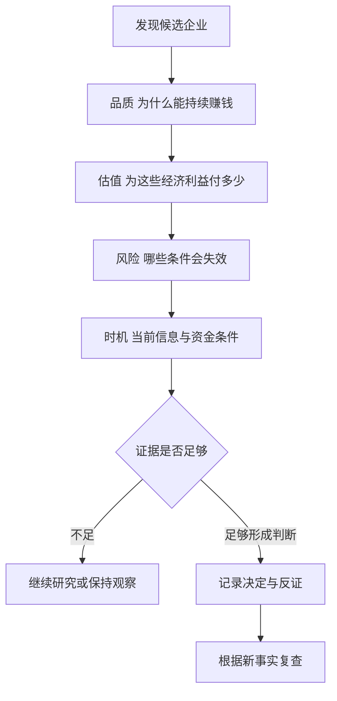
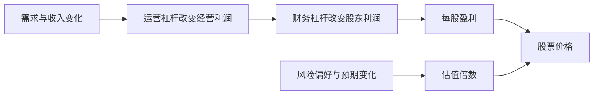

# 《投资中最简单的事》读书笔记

> 作者：邱国鹭。  
> 版本：2014 年初版由中国人民大学出版社出版；可核对的 2020 年更新版由中国经济出版社出版，ISBN 9787513660389。更新版调整了编排并增加作者思考，本笔记以其主要主题为骨架，历史文章另行标注。  
> 同名边界：不是多人合著的《投资中不简单的事》，也不是霍华德·马克斯的《投资最重要的事》。  
> 分析依据：出版书目、授权电子书目录与试读、作者所在机构发布的文章和访谈，以及企业和监管原始资料；属于公开资料系统导读，未取得用户原书。  
> 覆盖范围：投资理念、品质与估值、行业结构、价值陷阱、周期与杠杆、心理和执行，共 28 个知识点。历史行业判断不作为今天的推荐。  
> 更新日期：2026-11-12

## 先看这里：这本书讲什么

**把股票当成企业权益，优先研究能够理解、具有竞争优势的公司，再用价格和风险约束自己。**

“简单”指抓住少数重要问题，不是说赚钱容易。本书反复围绕三个问题展开：公司为什么好，价格为什么便宜，为什么在这个条件下值得考虑。好公司与便宜价格必须一起判断；逆向也必须有依据，不能只因别人不喜欢就买。

本书特别适合把财报知识接到投资问题：利润为何能保持，行业竞争是否改善，哪些低估值是陷阱，资金是否允许等待价值被认识。它主要代表作者的基本面价值投资方法，不是对所有交易方式的统一裁决。

## 版本与内容地图

| 更新版主题 | 核心问题 | 本笔记位置 |
| --- | --- | --- |
| 投资理念 | 实业眼光、逆向、买价 | 01—06 |
| 投资方法 | 品质、估值、时机、行业结构 | 07—12 |
| 投资风险 | 价值陷阱、成长陷阱、安全边际与局限 | 13—18 |
| 周期与三种杠杆 | 不同变量如何放大变化 | 19—22 |
| 投资心理与执行 | 事后解释、群体情绪、知易行难 | 23—28 |

[更新版书目与目录](https://aus.zxhsd.com/kgsm/ts/2020/04/20/5020138.shtml)显示四部分编排；[初版授权电子书目录](https://www.dedao.cn/ebook/detail?id=oOAdXprx6N41dm9BQkayr8z7OqLGoE3lEbwYMlVAnxRZXK2Dg5pbevPJjjnQv2eb&source=douban)另有历史策略章节。因此不能把某版章节编号强套到另一版。

## 核心知识点

### 01. 以实业眼光投资，先回答利润怎样产生

若买下整个企业，你会关心客户、竞争、成本、现金、负债和管理；买一小部分股票也不应完全换成只看价格线。股票提供交易便利，但不改变其权益性质。

可以先问：如果明天停止报价，我能否说明这家公司如何创造经济利益？这不是要求永不出售，而是检查买入依据是否独立于“以后有人愿意出更高价”。实业眼光也不意味着任何优秀企业都值得持有，交易价格仍然决定回报条件。

### 02. 三个基本问题：品质、估值和时机

品质回答盈利能力为何可持续，估值回答付多少钱，时机回答哪些信息或条件使当前研究具有行动意义。三者不能互相替代。

作者在 2013 年署名文章中用估值、品质、时机组织行业配置问题，并明确承认时机较难判断。[作者署名原文](https://finance.sina.cn/sa/2013-02-24/detail-ikftssan5926205.d.html?wm=3049_0015)

应用时先把事实和判断分列。利润率高是事实还是预测？估值便宜相对什么？所谓催化剂只是可能发生，还是已经公告？这能防止一句“好公司低估”掩盖三个都没有解决的问题。

### 03. “便宜”必须相对于可持续价值

股价低、跌幅大、市盈率低，都不自动便宜。价格与每股经济利益之间的关系才重要。债务、资本开支、一次性利润和周期位置，会改变表面倍数的含义。

**数学演示：** 股价 30、每股利润 6，对应 5 倍；若其中 4 来自不能重复的收益，可持续利润假设只有 2，对应就是 15 倍。这里没有证明公司值多少，只说明便宜判断依赖利润口径。

不要因为估值表可以算出小数点，就忽视输入的不确定性。真正的安全边际来自保守而可信的判断，不是更复杂的计算表。

### 04. 安全边际有经营与价格两个来源

经营稳固可以减少未来恶化的范围，低买价可以容纳一部分估计误差。两者互补，不能因公司稳定就不看价格，也不能因价格低就忽略经营永久衰退。

作者后续公开讨论也区分基本面稳固与低估买入，并提醒拥挤在“安全”资产中也可能付出太高价格。[高毅发布的作者文章](https://www.gyasset.com/p/site/investTeamNewsArticle?id=194&type=5)

**如何用：** 先画出基准、较差和严重受损情景，再问低价到底补偿了什么。若所谓便宜必须依靠最乐观增长才能成立，就没有为误差留下多少空间。若关键资产无法估计，报出一个折扣率也不能解决问题。

### 05. 逆向的对象是错误定价，不是人群本身

人少的地方可能有机会，也可能长期缺乏价值。逆向投资需要说明多数看法在哪个事实上过度悲观，以及公司有什么资源等到情况改善。

应分别检查短期冲击与结构性变化。需求暂时推迟、行业永久替代、债务无法偿还，是不同的问题。股价走势相似，不代表买入理由相同。逆向还需要资金期限，否则可能在判断兑现前被迫退出。

### 06. 定价权要从交易关系中验证

定价权不是“敢宣布涨价”，而是企业在合理范围调整价格后，仍能维持有价值的客户关系和盈利能力。品牌、成本优势、替代难度、渠道位置都可能支持它。

**贵州茅台公告，自 2023 年 11 月 1 日起，上调 53%vol 贵州茅台酒飞天、五星的出厂价格，平均幅度约 20%，不涉及产品市场指导价格。**[上市公司原始公告镜像](https://vip.stock.finance.sina.com.cn/corp/view/vCB_AllBulletinDetail.php?CompanyCode=10000351&gather=1&id=9621414)；其后[公司官网 2023 年报](https://www.moutai.com.cn/eportal/attachDir/mtgf/2024/05/2024050716563472819.pdf)也记载了出厂价调整。

这个事实有三个边界。第一，出厂价不是消费者最终购买价；第二，公告涉及特定产品，不是公司所有收入一律加 20%；第三，提价幅度不能直接当作总利润增长。渠道结构、销量、税费与成本仍会影响结果。

用本书方法研究，应继续检查提价后的渠道承接、终端需求和现金回收。若销量减少、库存积压或必须用折扣补偿，表面提价可能没有转成持续收益。公告证明做了什么，不独自证明定价权永不减弱。

**自测：** 能否从这份公告推出茅台股票当时便宜？不能。它帮助研究品质的一部分，估值仍需要价格、未来盈利与风险资料。

### 07. 行业竞争格局影响利润能否留在企业

行业需求增长，不保证股东获利。新进入者、客户议价、替代品和供应商都可能分走收益。相反，需求不快的行业，如果竞争有序、资本需求低，也可能产生现金。

研究行业要看企业能否合理收费，而不只看产业政策和市场规模。集中度上升值得关注，但少数公司也可能激烈竞争；具体区域、产品和渠道往往比全国总份额更接近真实战场。

### 08. “数月亮”是寻找可判断的优势，不是只买最大公司

作者用“宁数月亮，不数星星”表达对较明确行业赢家的偏好。重点是减少对谁将胜出的猜测，并不是市值越大越安全。

**2016 年，华润啤酒收购 SABMiller 持有的华润雪花 49% 股权，交易金额为 16 亿美元，完成后雪花成为其全资子公司。**[交易完成的原始公告，SEC 存档](https://www.sec.gov/Archives/edgar/data/1668717/000119312516735808/d232472dex991.htm)

这个真实交易特别适合防止一种误读：收购了股权，不一定意味着行业少了一家独立经营的竞争者。交易前已经是同一家合资啤酒业务，股东结构变化与产品市场竞争变化，必须分开。不能仅看到“并购完成”就宣布价格战结束、利润必增。

更完整的分析应检查品牌组合、区域份额、工厂效率、产品结构和资本配置。即使归属于上市公司股东的利润份额可能改变，也要考虑购买成本和融资，不把权益比例提高当作免费的增长。

**练习：** 怎样判断一次并购改变了竞争格局？要说明合并前后谁在独立决定价格和产能、客户替代选择是否变化，而不是只数公告中的法人名称。

### 09. 胜负较清楚时参与，仍然要支付合理价格

等待行业格局明朗，可以减少技术与商业模式猜测，但市场可能已经给赢家很高估值。风险减少与预期收益提高不是同一件事。

应把“更确定的好公司”与“更便宜的投资”分开。若全部好消息都包含在价格中，后来经营达到预期，也未必产生出色收益。对优秀企业保持耐心，不等于对任何价格都接受。

### 10. 护城河需要检查维护成本和失效路径

稳定品牌、规模、客户黏性或网络能够保护利润，但优势并非自然永久存在。有些技术优势需要持续高投入，若每隔几年就必须重新下注，风险结构与稳定消费习惯不同。

关键是判断优势怎样被侵蚀：新技术、渠道改变、客户集中、监管或产品替代。研究不应只列出有利词汇，还要写出一条最可能的破坏路径。

### 11. 经验要先检查适用条件

“经验像旧衣服”提醒读者，过去有用的方法未必适合今天的市场结构。估值口径、融资方式、产业阶段和投资者结构变化，会使相似现象产生不同结果。

但这不代表每次变化都推翻基本原则。现金、资本成本、竞争和价格仍有约束。应区分需要更新的具体假设与仍然成立的经济关系，避免在固执和追逐新故事之间摆动。

### 12. 行业配置与个股研究是两个层次

行业条件可能同时推动多家公司，个别公司的治理和经营又会造成差异。不能把行业上涨全归为选股能力，也不能因行业不被看好就忽略企业间差别。

对个人而言，行业分类尤其用于发现共同风险。持有多家公司但都依赖同一原材料价格、房地产需求或融资渠道，未必真正分散。作者关于大资金配置的经验，不应直接转换成个人仓位比例。

### 13. 价值陷阱：看似低价，价值却在持续下降

低估值陷阱可能来自周期高点利润、技术替代、治理问题、资产质量恶化或持续烧钱。价格相对过去便宜，不代表相对未来便宜。

**柯达在 2011 年年报中明确指出，技术和客户偏好变化使传统胶片与相纸市场衰退；公司及其美国子公司于 2012 年申请 Chapter 11 保护。**[柯达向 SEC 提交的 2011 年报](https://www.sec.gov/Archives/edgar/data/31235/000003123512000036/ek2011_10k.htm)

本例不能被简化成“柯达从未研究数字技术”，也不能把全部失败归到单一原因。原始文件包含转型、业务退出、财务负担与经营风险；这些关系需要共同研究。重点是历史品牌、设备和利润，并不保证原有经济价值能延续。

识别陷阱可按三步进行：先把盈利正常化；再看维持和转型需要多少现金；最后看现有股东能否在融资和重组后保有价值。若价值下降速度超过价格下降，越跌越买可能只是扩大错误。

**参考判断：** 正确问题不是“它曾经多辉煌”，而是“现有资源还能产生什么、要付出多少代价、成果属于谁”。本节不虚构邱国鹭对柯达的具体交易或判断。

### 14. 成长陷阱：未来不错，买价却要求近乎完美

投资者可能看对产品方向，却为未来增长支付过高价格。市场规模大、利润增长快，都不足以免除竞争、资本需求和增长减速。

**数学演示：** 每股盈利从 1 增至 2，企业盈利翻倍；若买入时 60 倍市盈率、卖出时 20 倍，股价由 60 变为 40，仍亏约三分之一。这里假设不分红、股数与口径一致，只用于分解盈利与估值。

高估值不必然马上下跌，但未来需要更多成功才可能支持价格。对增长越依赖遥远年份的判断，越要检查实现路径，而非仅提高预测曲线。

### 15. 价格波动与永久损失要区分，也会互相转化

股价短期下跌不一定毁坏企业现金流；欺诈、债务违约或竞争力永久衰退则可能产生更持久损失。但如果投资者有杠杆、赎回或支付压力，原本可等待的波动也会造成实际永久退出。

“波动不是风险”不能当作无条件格言。风险需要同时看资产、证券权利与持有者资金结构；缺少其中一层，就容易把不能承受的损失美化为正常波动。

### 16. 价值投资有条件，不是所有资产都能估计内在价值

如果关键业务无法理解、信息不可信，或者经济价值高度依赖持续融资与市场信心，静态估值就可能失去基础。低报价不能自动解决这些问题。

**硅谷银行 2023 年倒闭的官方复盘，涉及利率风险、流动性管理和高度集中的未保险存款等因素。** 银行的资产价值与资金来源期限必须一起分析，不能只看报表资本或历史利润。[美联储 2023 年复盘](https://www.federalreserve.gov/publications/review-of-the-federal-reserves-supervision-and-regulation-of-silicon-valley-bank.htm)

这里最值得学习的是反馈：对银行稳健性的担忧可以引发提款，提款压力又可能迫使资产处置，从而改变原本设想的持有路径。市场信心与经营资源之间，并非总能完全隔开。

本节按 2023 年报告解释风险结构，不声称单一因素足以解释全部监管争议，也不推导所有银行都不适合价值分析。**自测：** 长期资产最终可能收回本金，是否足以保证短期兑付安全？不够，现金流时间与可出售价格同样关键。

### 17. 是否继续持有亏损投资，要重新证明前提

价值投资不能照搬某些交易系统的价格止损，也不能因此宣布无需控制损失。若原本判断错了、信息失真或资金条件变化，应重新评价。

继续持有必须依靠当前证据，而不是成本价或不愿承认错误。可以提前写明基本面失效条件、融资风险和最大可承受暴露；临时把每个坏消息解释成机会，不是纪律。

### 18. 分散、流动性与资金期限，是等待的条件

知道价格与价值可能偏离，不代表知道何时纠正。持有者必须有能力承受时间成本、机会成本与进一步不利变化。

应检查投资是否过于集中于一种经营风险，是否会因生活支出被迫卖出，是否依赖借款。资产可以最终恢复，但一个不能存活到那时的账户无法受益。耐心首先是一项资源安排。

### 19. 四种周期不是四张精确的时间表

作者讨论政策周期、市场或估值周期、经济周期、盈利周期。它们可能先后变化：政策会回应经济，市场会提前反映预期，企业利润则受订单和成本影响而滞后。

这是一种解释框架，不是每轮必然相同的排列。不同冲击可能打乱顺序，政策也不保证马上有效。作者早年文章中的历史判断应保留当时语境，不能将“通常如此”改成永远成立的法则。[作者 2013 年文章](https://finance.sina.cn/sa/2013-02-24/detail-ikftssan5926205.d.html?wm=3049_0015)

实际使用可同时记录政策方向、融资条件、需求和企业盈利，再观察它们是否一致。单看一个变量转好就宣布进入新牛市，省略了传导过程。

### 20. 财务杠杆：固定债务会放大股东结果

企业以债务融资，利息和到期偿还对股东形成固定要求。经营改善可以使股东收益更快上升，经营恶化也会更快侵蚀权益。利率变化的影响还取决于固定或浮动、到期期限及是否需要再融资。

作者讨论财务杠杆对利率的敏感性，但不能据此推出“降息时所有高负债企业都好”。债务可能已不可持续，融资利差也可能扩大；借新还旧的可得性与名义政策利率是两回事。

### 21. 运营杠杆：收入变化如何放大利润变化

当成本中固定部分较多，收入增加时利润可能更快增长，反向也一样。研究应先分清哪些成本短期能削减、哪些不能，不能只把历史利润增速外推。

**迪士尼 2020 财年 Parks, Experiences and Products 分部收入为 165.02 亿美元，上年为 262.25 亿；分部营业结果从盈利 67.58 亿美元变为亏损 0.81 亿美元。公司披露疫情导致园区关闭或限制容量等冲击。**[迪士尼官方年度业绩公告](https://investors.thewaltdisneycompany.com/news/news-details/2020/The-Walt-Disney-Company-Reports-Fourth-Quarter-and-Full-Year-Earnings-for-Fiscal-2020-11-12-2020/default.aspx)

收入下降约 37%，利润变化却大得多。这说明，昂贵设施和运营体系不会因为顾客减少就同比例消失。该分部同时含其他业务，疫情也影响多项费用，因此不能把全部差额精确归因于某一个固定成本；本例说明放大机制，不估计唯一杠杆系数。

**如何用：** 对酒店、制造、运输等业务，检查低利用率情景下现金能否覆盖必要支出，再研究恢复时增量收入能留下多少。恢复不能只看需求，资产维护和重启成本也需要考虑。

### 22. 估值杠杆：盈利与市场愿付倍数可以同向放大

作者的“估值杠杆”主要描述估值扩张或收缩对价格的放大，不是实际借款。流动性、风险偏好与预期会影响投资者愿付的倍数。

**数学演示：** 盈利增加 20%，市盈率从 10 倍变为 15 倍，价格倍数为 1.2×1.5＝1.8，即增加 80%。反过来，盈利下降和估值收缩也会相乘。不能把估值变化全归因于流动性，更不能把倍数扩张当永久收益来源。

### 23. 后视镜：看见结果之后，过程会显得过分清楚

历史图表会让底部、顶部与行业赢家显得明显，但当时的信息通常混乱。只有事前写下依据，才能知道自己当时到底相信什么。

复盘时应该遮住后续结果，重新检查可获得资料，记录原先概率与反证。不要只保留预测正确的片段，也不应把每次错误都称为不可预测的例外。

### 24. “傻瓜定价”提醒你别把退出依赖更激进的买家

若无法用经营和现金解释价格，只能希望未来有人出价更高，就要承认主要依赖情绪延续。价格上涨本身可以吸引资金，却不能无限创造经济价值。

这不意味着每个高估值企业都会失败，而是提醒收益来源的差别。对长期投资来说，应能说明最终谁支付现金，而不是永远把问题推给下一位持有者。

### 25. “这次不同”要拆成变化与不变

新技术、制度或商业模式确实可能改变旧经验。错误不是承认变化，而是借变化取消成本、竞争、现金和价格约束。

研究应写成两列：哪些条件真的改变，哪些经济关系仍然存在。若一个新故事只能靠忽略亏损、稀释和融资来维持，它需要更强证据，而不是更少证据。

### 26. 树动、风动、心动：企业、价格与自身情绪分开记录

公司基本面、市场波动和个人情绪常同时发生，却不是同一种信息。持仓上涨时自信增强，下跌时恐惧增强，可能只是价格影响了感受。

可在日志中分别写经营新事实、估值变化和自己的动作。把“我很担心”与“债务到期而融资失败”分开，才能判断需要补充心理准备还是修正投资前提。

### 27. 知易行难，要靠事前规则减少临场变形

很多原则在没有持仓时容易赞同，一旦面对亏损、排名或他人收益，就容易改变。纪律不应只是要求自己坚强，而应把研究和行动条件提前写清。

可以规定重大决定前必须核对反方证据、资金来源、公司公告和估值区间。是否采取分批等具体执行方式，需要结合真实背景，不能把本书读成适用于所有人的仓位模板。

### 28. 基本原则可借鉴，历史行业判断要重新检验

作者早期对银行、地产、家电或行业轮动的看法，有明确时代背景。学习的是如何提出问题，不是把十多年前偏好的行业名单复制到今天。

同样，作者对价值投资可学习性的强调，是其方法立场，不足以证明其他策略全部无效。本笔记未做当代市场的策略回测，也没有用案例的事后股价验证这套方法必然超额获利。

## 图解：品质、价格与时机怎样分工

图把价格放在行动之前，而不是认为“公司好”就已经完成决策。时机是条件判断，不是要求精确预测最低点。

## 图解：三种放大作用

这是简化机制图。税费、股数、业务组合、政策与会计变化也会影响结果；“估值杠杆”是价格倍数变化，不应与融资借款混同。

## 用真实材料练习，并核对参考答案

| 练习问题 | 参考答案 |
| --- | --- |
| 茅台出厂价提高约 20%，总利润是否必增 20%？ | 不能，产品范围、渠道、销量和成本不同 |
| 华润收购雪花剩余股权，是否代表行业少了一家独立啤酒商？ | 不能直接这么说，原来已是同一家合资经营主体 |
| 柯达有历史品牌，为什么仍需检查价值陷阱？ | 技术、需求、现金负担和转型代价会改变价值 |
| 迪士尼分部收入跌 37%，为何利润变化更大？ | 成本并非完全随收入同比变化，也有其他疫情因素 |
| 银行资产长期可能收回，是否说明没有流动性风险？ | 不说明，资金来源期限和即时兑付要求必须匹配 |

下一步可以选一家能理解的公司，分别写“为什么好”“为什么这个价格合理”“最有力反证”“需要等什么资料”。不必强行给出买卖结论。研究后的“不知道”，比未经核实的确定更有价值。

## 来源与范围说明

1. [2020 年更新版书目](https://aus.zxhsd.com/kgsm/ts/2020/04/20/5020138.shtml)、[初版授权电子书目录](https://www.dedao.cn/ebook/detail?id=oOAdXprx6N41dm9BQkayr8z7OqLGoE3lEbwYMlVAnxRZXK2Dg5pbevPJjjnQv2eb&source=douban)、[繁体版出版试读](https://www.kingstone.com.tw/basic/2800000067564/)：结构与版本。
2. [高毅发布的作者序言](https://www.gyasset.com/p/site/investTeamNewsArticle?id=175&type=5)、[安全边际讨论](https://www.gyasset.com/p/site/investTeamNewsArticle?id=194&type=5)、[作者访谈](https://www.gyasset.com/p/site/article?id=14&type=2)：核对方法立场，后续材料不视作初版已有内容。
3. [2013 年作者署名文章](https://finance.sina.cn/sa/2013-02-24/detail-ikftssan5926205.d.html?wm=3049_0015)：四种周期与三种杠杆的历史表述。
4. [茅台公告原文镜像](https://vip.stock.finance.sina.com.cn/corp/view/vCB_AllBulletinDetail.php?CompanyCode=10000351&gather=1&id=9621414)、[公司官网年报](https://www.moutai.com.cn/eportal/attachDir/mtgf/2024/05/2024050716563472819.pdf)、[雪花股权交易公告](https://www.sec.gov/Archives/edgar/data/1668717/000119312516735808/d232472dex991.htm)：书外中国企业案例。
5. [柯达年报](https://www.sec.gov/Archives/edgar/data/31235/000003123512000036/ek2011_10k.htm)、[美联储 SVB 复盘](https://www.federalreserve.gov/publications/review-of-the-federal-reserves-supervision-and-regulation-of-silicon-valley-bank.htm)、[迪士尼 2020 年度业绩](https://investors.thewaltdisneycompany.com/news/news-details/2020/The-Walt-Disney-Company-Reports-Fourth-Quarter-and-Full-Year-Earnings-for-Fiscal-2020-11-12-2020/default.aspx)：陷阱、反馈和运营杠杆案例。

未逐页覆盖指定版本的所有随想录、访谈及历史预测；没有为作者补写未确认的交易。公式演示使用假设数字，真实案例在原位交代期间和来源，二者明确区分。

---

[返回书籍索引](../README.md) · [财商学习与实践路线](../财商进阶合订本.md)
