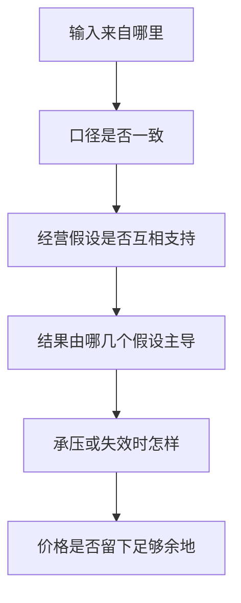

# 《投资估价》：把商业判断转成一致、可检验的价值模型

> 作者：Aswath Damodaran，阿斯沃斯·达摩达兰。原作 Investment Valuation: Tools and Techniques for Determining the Value of Any Asset。核对 Wiley 第四版大学版，2025 年，ISBN 9781394262731；中文译本未确认。不要与作者另一本 Damodaran on Valuation 混为一书。  
> 分析依据：作者 NYU 官方第四版配套网站、公开讲义和估值实例，以及原始公司文件。未取得完整中文教材，属于主要框架导读。原书超过千页，本文以 36 点解释核心原理和重要特殊情形，不声称覆盖全部推导、习题和资产类别细节。更新：2026-11-12。

## 这本书最重要的收获

估值不是寻找一个神奇市盈率，而是把未来现金、增长、再投资、风险和权利结构放在同一个模型里。一个模型即使公式完全正确，只要假设互相矛盾，结果仍可能没有经济意义。

达摩达兰的教学特别强调一致性：现金给谁，折现率就对应谁；现金以什么币种和购买力表达，折现率也要匹配；增长越高，通常越需要解释资金投入和竞争条件。估值输出最好是一组可讨论的假设与情景，而不只是一个目标价。

## 内容地图

| 模块 | 关键问题 | 知识点 |
| --- | --- | --- |
| 方法与资料 | 价值和定价有何不同 | 1—5 |
| 风险与现金流 | 用什么风险调整什么现金 | 6—13 |
| 增长与终值 | 增长从哪里来，最终怎样稳定 | 14—20 |
| 比较与权利 | 倍数、控制权、流动性怎样处理 | 21—27 |
| 特殊对象 | 金融、亏损、周期、困境、期权等 | 28—34 |
| 实际应用 | 如何审查、更新和复盘模型 | 35—36 |

主框架可回查[作者第四版配套网站](https://pages.stern.nyu.edu/~adamodar/New_Home_Page/Inv4ed.htm)的章节和例题入口；书目见[Wiley 第四版资料](https://www.wiley.com/en-us/investment-valuation-university-edition-tools-and-techniques-for-determining-the-value-of-any-asset-4th-edition-p-9781394262731)。

## 核心知识点

### 1. 价值与价格回答不同的问题

内在价值来自资产未来能提供的现金及风险；相对定价关注类似资产在市场上怎样交易。二者都能帮助决策，但不能互相冒充。

如果用同行倍数得到价格，结论依赖同行定价是否合理；如果用现金流折现，结论依赖你的经营与风险假设。明确自己采用哪种方法，才能正确解释结果为什么会变化。

### 2. 三类方法各有适用条件

现金流折现适合把未来经济收益连接起来；相对估值适合比较市场对相似现金、增长和风险的定价；期权框架适合在特定条件下分析等待、扩张或放弃的选择。

资产多不一定只能用资产法，亏损也不等于完全不能估值。问题是哪些事实能支持未来收益、权利和退出价值。方法应该跟着对象走，而不是把所有公司塞进最熟悉的表格。

### 3. 故事必须转成可计算的条件

“平台会更大”需要转成市场范围、份额、收入率、利润率和再投资；“品牌强”需要转成价格、客户稳定和超额回报持续期。不能把叙事放在第一页，模型却使用与它不相关的数字。

同样，数字也需要故事解释。十年利润率提高十个百分点，究竟来自规模、产品结构还是竞争减少？说不清时，精确数字并没有提高知识质量。

### 4. Uber 案例展示了商业定义怎样改变估值

**作者真实教学实例：达摩达兰曾把 Uber 视为城市汽车服务，再讨论更广义的个人出行市场，并在 2019 年 IPO 教学中比较整体和用户层面的估值。**[作者关于 Uber 的说明](https://www.stern.nyu.edu/experience-stern/faculty-research/how-do-you-value-company-uber)、[2019 年课程材料](https://pages.stern.nyu.edu/~adamodar/New_Home_Page/eqemailspr19.html)

这不是说市场定义越大，价值就应该越高。较大市场需要对应竞争、监管、补贴和投入；更高份额也不应与更高利润率无条件同时出现。定义改变会改变多个参数，而不是只修改收入终点。

学习时可以保留两个有条件的版本，列出会让自己支持其中一个的证据。作者估值是当时判断，不是后来价格表现的预言，也不能只挑其判断正确的日期来证明方法没有误差。

### 5. 财报需要按估值目的调整

会计确认规则服务于报告目的，估值关注未来经济现金。一次性项目、租赁、研发、股权报酬和并购影响，都可能需要分析性调整。

调整必须对称：不能为了提高盈利加回费用，却不处理相应资产、未来摊销、稀释或现金需求。每一项调整都应保留原报表口径和理由，让其他人能够复算。

### 6. 折现率必须与现金流的承担者匹配

股权现金流归股东，使用股权资本成本；企业自由现金流属于全部资本提供者，使用与之匹配的加权平均资本成本。混用会使风险与利息处理出错。

```text
FCFF = 税后经营利润 + 非现金经营费用 − 资本开支 − 经营营运资本增加
FCFE = 归属股东净利润 + 非现金费用 − 资本开支 − 营运资本增加 + 净借款
```

公式为常用简化框架，租赁、金融企业和其他特殊项目要保持一致定义。FCFE 加入净借款，是因为借还本金直接改变可供股东分配的现金。

### 7. 从企业价值到普通股价值需要一座桥

折现 FCFF 得到经营资产价值后，需加适用的非经营资产，减债务及其他优先请求权，处理少数股东权益、交叉持股和股权期权等，再除以一致的股数。

**数学演示：**经营资产值 1000，额外现金 100，债务 300，其他优先权利 50，普通股价值为 750。若现金已被纳入经营估值，再加一次便会重复；若经营利润包含非全资子公司，相关权益也不能漏掉。

### 8. 无风险利率首先与币种有关

人民币现金流、美元现金流和其他币种现金流，应使用各自一致的名义利率体系。注册地与现金流币种不是同一个概念，政府发行的债券也可能包含违约风险。

不要把高通胀币种的现金增长率，配上低通胀币种的折现率。即使公式执行正确，也会人为抬高价值。必要时可采用一致假设换算，最终结果应能够在相同汇率框架下衔接。

### 9. 股权风险溢价是要求的补偿，不是保证收益

投资者对承担股权风险要求超过无风险利率的回报，形成风险溢价。历史估计与根据市场价格推导的隐含估计各有问题，不能把某个历史平均当永恒常数。

估值应说明采用哪种方法、数据期间、市场和币种。风险溢价越高，其他条件相同下现值越低；但真实危机中现金流预期也会变化，不宜把全部价格变化都归结为一个折现率。

### 10. Beta 衡量特定市场协动，不是全部风险

回归 Beta 受样本、频率、指数、业务和杠杆变化影响。它没有自动覆盖流动性、欺诈、集中客户或模型错误。

可以用同业业务风险和资本结构估计自下而上的 Beta，但仍需明确可比性。把较低历史波动直接解释为低经济风险，可能漏掉尚未发生的尾部损失。

### 11. 债务成本应反映当前信用条件

账上历史利息除以旧债务余额，不一定等于今天新增融资的成本。到期结构、信用利差、担保、税收与违约风险会影响要求回报。

税盾也不能无限使用。亏损、税法限制或无法产生足够应税利润时，理论税盾未必按时实现。增加债务虽然可能在一定范围降低 WACC，也会提高财务困境风险。

### 12. WACC 使用市场权重，并与未来结构一致

加权平均资本成本综合股权和税后债务成本，权重通常应反映经济价值。若公司未来杠杆变化很大，用一个固定比例贯穿全期就需要额外解释。

资本成本不能作为让估值达到目标价格的旋钮。每次修改都要说明融资结构、业务风险或市场条件发生了什么变化，否则模型只是在倒推想要的答案。

### 13. 名义与实际、税前与税后必须对应

实际现金剔除了通胀，应用实际折现率；名义现金使用名义折现率。税前和税后的收益也不能随意混用。增长率和折现率的期限单位要一致。

这类错误容易隐藏在复杂表格里。建立模型前写一行“币种、名义／实际、税后／税前、现金归属、时点”，常比后期增加更多敏感性图更有效。

### 14. 增长需要再投资与回报共同支持

在简化稳定关系下，经营利润增长可写成再投资率乘新增资本回报率。它表达的是增长来源，而不是所有年份都必须精确满足的会计恒等式。

**数学演示：**再投资率 40%，新增资本回报 15%，支持的增长约 6%。若想保持 6% 增长但新增回报只有 10%，再投资率需约 60%，可分配现金因此更少。相同增长不代表相同价值。

### 15. 高增长不应自动配上高利润和低投入

规模扩大可能改善利润，但开拓新市场也可能需要降价、营销、设备和库存。模型中几个有利假设同时出现时，应检验是否相容。

一家公司若要抢占大量份额，竞争者为何不反应？增长很快却应收和库存不增加，凭什么？用这些问题审查模型，可以发现数字之间被省略的商业约束。

### 16. 研发资本化是分析调整，不是宣布研发不会失败

达摩达兰在公开材料中讨论把研发视为产生多年效益的投入：假设经济寿命，累积未摊销研究资产，并调整当期盈利与资本。[作者研发调整说明](https://pages.stern.nyu.edu/~adamodar/New_Home_Page/AccPrimer/research.htm)

**真实补充：ASML 2024 年研发费用约 43 亿欧元。**[公司年报](https://www.asml.com/investors/annual-report/2024)若研究者将其资本化，需要同时估计以前研发的剩余寿命和摊销，不能只把 43 亿加回利润而不增加投入资本。

调整能改善不同投资模式的可比性，但寿命假设可能错，失败项目也可能需要经济减值。它不是改变公司正式报表，更不能自动把高研发公司评为便宜。

### 17. 稳定增长率必须符合长期经济约束

单个企业不可能无限期以远高于其经济环境的速度扩张，否则最终会大到不合理。稳定阶段还应有与成熟业务匹配的利润、资本回报和风险。

```text
稳定阶段价值 = 下一期自由现金流 ÷ (折现率 − 永续增长率)
```

要求折现率高于增长率。接近时价值极敏感，因此终值既是数学问题，也是对成熟状态的经济判断。

### 18. 终值不能与再投资脱节

稳定阶段若仍增长，就通常仍需投入资金。不能将最后一年全部经营利润作为自由现金流，再额外假设永久增长而不支付相应成本。

**数学演示：**稳定经营利润 100，增长 3%，新增回报 10%，所需再投资率约 30%，简化自由现金约 70；若直接用 100 计算终值，会夸大可分配现金。实际模型还要确认税、时点和折旧等口径。

### 19. 高终值占比提醒你关注假设，不自动否定 DCF

**数学演示**：若第六年的稳定自由现金流为 70，资本成本 10%、永续增长 3%，第五年末终值为 `70÷(10%−3%)＝1000`。这个 1000 还不是今天的价值；若距离今天五年，要再除以 `1.1^5`，约为 621，并与前五年现金流现值相加。

这里常见两个错误：用第五年现金流代替下一期现金流，却仍声称已经包含增长；或者把第五年末的终值不折现就加到今天。符号和时间点不复杂，却会持续影响整张估值表，审查时应先于讨论小数点后的参数。

寿命很长的企业，大量价值自然可能来自明确预测期以后。问题不是终值存在，而是有没有可信的成熟阶段，以及结论是否依赖不合理的永续优势。

应展示终值占比、主要输入和承压结果。不要通过把明确预测期从五年延长到十年，就声称不确定性消失；如果后五年只是机械外推，信息并未增加。

### 20. 情景与敏感性解决不同问题

敏感性通常改变一个或两个输入，观察模型反应；情景改变一组互相联系的经济条件。它们都帮助暴露依赖，不会自动告诉你哪个情景概率正确。

若需求下降会同时影响价格、利润、融资和营运资本，只改收入一个单元格可能低估压力。模型越复杂，越应说明主要变量之间的联系。


图中两个输入路径需要一致，最后的权利调整不能省略。

### 21. 可比公司比较需要控制价值驱动因素

相同产业代码不保证增长、利润、资本需求和风险相同。应先找相似经济结构，再比较市场倍数，而不是只找规模接近的名字。

市盈率的分母要剔除或解释异常盈利，预测与历史口径不能混用。亏损公司被排除后，剩余样本本身也可能产生选择偏差。

### 22. 企业价值倍数也需要理解资本开支

EV/EBITDA 常被用于比较经营规模，但 EBITDA 没有扣掉维持资产所需投入，也不反映全部税和营运资本。资产更新需求不同，倍数就不能直接对照。

租赁计入债务、租金调整成折旧利息时，分子分母都要保持一致。只改变其中一个，会制造并不存在的便宜。

### 23. 相对估值会继承市场共同错误

如果所有同行都对同一成长故事过度乐观，一家公司即使低于同行平均，也可能高于合理现金价值。相对便宜并不等于绝对便宜。

可以反向计算：当前价格要求怎样的利润率和增长？再用经营证据判断。这把市场价格转成可讨论条件，比只宣布市场疯狂更有用。

### 24. 控制权价值来自能改变经营的具体动作

控制权有时允许改变管理、资本配置和资产使用。其价值应等于可实现改善的现值差额，不是给所有收购统一加一个比例。

改善需要时间、费用和执行能力，可能受合同、监管与少数股东权利限制。只因买方有控制权，就假设协同全部成功，会把购买价格变成自证合理的循环。

### 25. 协同要说明谁创造、谁支付、谁获得

微软 2022 年宣布以每股 95 美元现金收购动视暴雪，公告中的交易价值采用包含目标净现金的特定口径；交易最终于 2023 年 10 月完成。[微软 2023 年报](https://www.microsoft.com/investor/reports/ar23/)、[动视完成公告](https://newsroom.activisionblizzard.com/p/our-next-adventure)

这个真实交易提醒我们，宣布金额、股权对价、企业价值和最终会计购买价可能有不同口径，不能任意互换。估值时还要分独立价值与协同价值，不能把双方原有收益重复计算。

协同应该落实到新增客户、成本节约或资本效率，并扣整合代价及可能的限制。交易最终完成，不能独立证明买方支付价格低于价值；这需要以后经营证据和机会成本比较。

### 26. 流动性与少数权益折价不是固定贴纸

无法及时出售会降低灵活性，但影响大小取决于持有期限、交易条件、资金需求与市场环境。少数股东权利也因制度与公司安排不同。

如果现金流或折现率中已经反映某种限制，再额外加一个笼统折价，可能重复计入风险。每种调整都要说明它补偿的到底是哪项经济差异。

### 27. 股权报酬与潜在稀释不能消失

股权报酬可能是非现金费用，但意味着员工获得经济权益。加回现金流后，必须用合理方式处理未来稀释、回购支出或相应权利价值。

完全摊薄股数、期权价值与未来股权薪酬的处理要相互一致。不能为了提高现金流把费用加回，又用未稀释股数计算每股价值。

### 28. 金融企业常更适合从股权和资本约束入手

银行、保险的债务具有经营属性，普通工业企业的 FCFF 和净债务定义不一定合适。监管资本、信用质量和可分配股权现金更重要。[作者对金融企业价值驱动的说明](https://pages.stern.nyu.edu/~adamodar/New_Home_Page/littlebook/bankvaluedriver.htm)

市净率需要结合可持续 ROE 与股权成本判断，不能只看低于一倍。账面权益的可信度与未来损失准备，会改变这项比较的含义。

### 29. 亏损企业要区分暂时问题与尚未成立的模式

**Amazon 2014 年报披露净亏损 2.41 亿美元，同时提供经营现金、资本开支和租赁相关的多种现金流口径。**[原始 10-K](https://www.sec.gov/Archives/edgar/data/1018724/000101872415000006/amzn-20141231x10k.htm)

这个案例说明净亏损与现金状况不是同一问题，租赁融资也可能影响对资本支出的理解。不能从亏损推出企业必无价值，也不能从经营现金为正推出所有投入都已覆盖。

估值必须解释未来何时盈利、成熟利润率为什么合理、转型需要多少现金、股东可能被稀释多少。后来成功的公司不能为所有当时亏损企业提供免责。

### 30. 周期与商品企业需要正常化和外部价格情景

顶点利润不能永久化，低谷利润也不能机械按零值处理。应结合产能、成本曲线、储量或订单，分析不同价格条件下的现金。

正常化不是随意选择最好年份，也不能假设商品价格一定回到曾经高点。企业是否能穿越低谷，取决于负债、资金与资产质量。

### 31. 困境价值应把生存与清算分开

标准持续经营 DCF 隐含企业能经营下去。若失败概率很高，可以分别估计存续情景和清算／重组情景，再处理各权利人的分配。

使用很高折现率未必能充分表达权利中断和非线性损失。旧 GM 股票注销说明企业资产继续存在，不代表原普通股仍拥有那些资产的价值。[GM 官方说明](https://investors.gm.com/shareholders/stock-information)

### 32. 私营企业和初创企业要特别处理资料与退出

财务记录、所有者报酬、关联交易和可交易性可能与上市公司不同。不能把缺少报价当作没有波动，也不能把创始人的信心当作现金证据。

估值需要说明未来融资、权利优先顺序、退出条件和失败情景。不同轮次投资者拥有的条款不同，所谓同一家公司的估值不一定意味着所有股份价值相同。

### 33. 实物资产需要匹配租金、成本与维护投入

房地产、资源和其他实物资产可以按未来净现金分析，但要处理空置、租约、维修、税费、开采和环保义务。资产价格上涨不能替代经营现金。

资本化率是压缩后的假设集合，不是永远适用的行业常数。没有计算净收入和未来投入之前，就把租金乘固定倍数，可能遗漏重要负担。

### 34. 实物期权必须有真实选择权和约束

等待、扩张、放弃项目在某些条件下有价值，但需要可执行权利、时间范围、后续投入和竞争限制。所有“不确定但可能很好”的项目都叫期权，会让估值失去约束。

如果竞争者也可随时进入，你未必拥有独占的等待利益；如果许可证会失效，等待有成本。期权思维帮助识别非线性，不是给缺少现金流的故事无限加值。

### 35. 模型审查应优先寻找不一致

检查现金归属、币种、名义实际、税、租赁、股数、终值、资本结构和重复计数。再问增长、资本投入与利润路径是否相容。



图中先检查基础再讨论价格，避免对错误模型做精细敏感性分析。

### 36. 估值应留下可以更新的记录

保存模型日期、原始文件、主要假设、改变条件与尚未确认的资料。未来不同意旧估值时，先说明哪一项证据改变，而不是悄悄覆盖数字。

可以记录市场价格隐含预期与自己的判断差异，但不能因自己做过模型就确信市场错误。估值是一种有纪律的判断语言，不是消除不确定性的工具。

## 练习与参考答案

**把 FCFF 用股权资本成本折现是否可以？** 一般不可以。现金属于全部资本提供者，风险及融资处理应与 WACC 等一致框架匹配。

**稳定增长 3% 而完全不再投资是否合理？** 对通常需要资本支持的业务不合理，应解释新增回报与再投资；不能把全部利润分配同时无成本增长。

**回购抵消股权报酬稀释，报酬就没有成本吗？** 不是。回购花费真实现金，需在经济价值中体现。

## 阅读边界

本文适合建立模型语言，不替代统计、会计和公司金融基础。期权、复杂交叉持股、金融机构、跨国税制等这里只给分析入口；实施需要具体合同和专业资料。作者公开资料随教学更新，本篇引用的是可确认主题，不混写不同版本页码。

可以结合[《价值投资》](<../价值投资 - 布鲁斯·格林沃尔德等/读书笔记.md>)比较资产价值、盈利能力与增长三层判断，再用[《安全边际》](<../安全边际 - 塞思·卡拉曼/读书笔记.md>)检查估值误差和资本损失。
