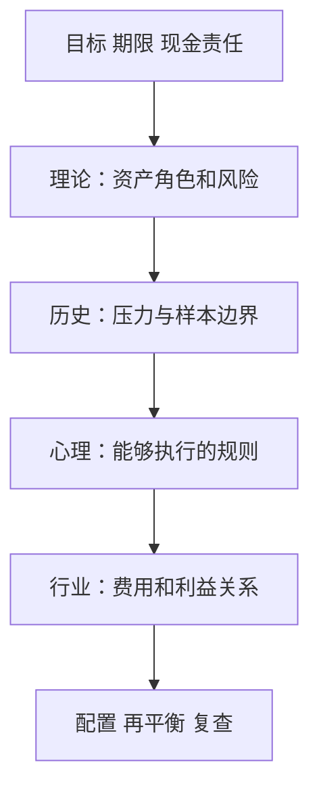
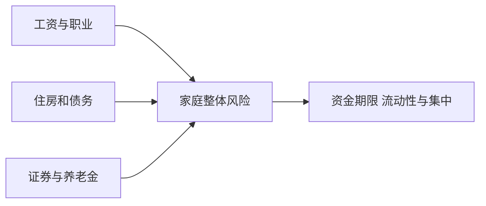

# 《投资四大支柱》：把理论、历史、心理与行业利益一起纳入投资

> 作者：William J. Bernstein，威廉·伯恩斯坦。英文原名 *The Four Pillars of Investing*，2002 年初版；2023 年第二版更新了历史与实践讨论。本文以四支柱结构为主，不把后来资料归入早版。  
> 范围：基于[出版社第二版说明](https://www.mheducation.com/highered/mhp/product/four-pillars-investing-second-edition-lessons-building-winning-portfolio.html)、[作者公开导论](https://www.efficientfrontier.com/t4poi/intro.htm)与[新版说明](https://www.efficientfrontier.com/t4poi/t4poi-new.html)及原始金融资料整理，未取得用户完整译本，属于系统导读。共 30 个知识点。  
> 更新：2026-11-12。组合公式与个人应用为补充教学，历史收益不作为未来承诺。

## 先理解四根支柱为什么缺一不可

会算波动率，却不知道历史中发生过什么，可能高估模型可靠性；知道历史，却无法在恐慌中执行，仍可能卖在最不合适的时点；有纪律，却买入费用昂贵或利益不一致的产品，又可能把回报让给中介。

本书把投资理解为一个完整系统：理论解释收益和风险；历史提供超出近期经验的样本；心理决定实际行为；行业分析告诉你谁从你的交易中获利。最后才是建立能够维护的组合。

## 知识地图

| 支柱 | 关键问题 | 本文位置 |
| --- | --- | --- |
| 理论 | 风险怎样获得补偿，分散为何有效 | 1—10 |
| 历史 | 长期数据与危机告诉我们什么 | 11—16 |
| 心理 | 为什么理解后仍会做错 | 17—22 |
| 行业 | 产品、费用、销售与代理冲突 | 23—27 |
| 组合实施 | 怎样把知识变成政策与复盘 | 28—30 |

## 核心知识点

### 1. 投资首先要明确资金承担什么责任

生活现金、几年后的确定支出与长期资本的约束不同。风险不只在行情里，也在需要用钱的时间与资产可变现时间之间。

在比较收益前，先写目标、期限、可调整程度和已有保障。否则很容易把理论上回报较高的资产，用在现实中无法等待的资金上。组合优化不能替你决定人生目标。

### 2. 预期回报是事前判断，历史回报是事后记录

投资者通常要求承担某些风险获得补偿，但预期补偿不会每年兑现。风险上升时，价格可能先下跌，未来较高预期回报与当下损失可以同时出现。

也不能把所有高风险项目都叫高收益机会。某些风险可以通过分散减少，某些只是没有合理补偿的错误暴露。需要解释风险来源与支付价格，而非只给资产贴风险等级。

### 3. 名义增长与购买力增长要分开

长期目标通常是未来能购买多少生活服务，而不仅是账户数字。因此名义回报需与通胀、税费一起解释。

实际回报可写成 `(1+名义回报)/(1+通胀率)−1`。低风险名义工具仍可能受到购买力侵蚀；高波动资产也不因长期历史较好就消除短期使用风险。不同风险不能只排成一条高低序列。

### 4. 算术平均不等于复合增长

**数学演示：**一年上涨 50%，下一年下跌 50%，算术平均为零，但本金只剩 `1.5×0.5=0.75`，两年累计亏损 25%。复合年化回报为 `√0.75−1≈−13.40%`。

原因是每次变化作用于不同基数。财富路径由收益因子相乘决定，而不是简单把百分数相加。对基金或策略，核对“平均收益”究竟是哪种定义，尤其当宣传同时展示高均值与大波动时。

这也不意味着应该只追求最低波动。要同时考虑预期回报、长期目标和极端损失，不能用一个指标覆盖所有取舍。

### 5. 波动率是风险描述之一，不是全部风险

标准差衡量观察期回报偏离平均值的程度，但无法自动区分暂时波动与永久损失，也可能低估罕见事件、流动性和制度变化。

估计本身取决于样本、频率和历史窗口。平静年份给出的低波动，不一定能代表下一次危机。模型用于明确假设，不应成为忽略模型外风险的理由。

### 6. 分散依赖收益关系，不只依赖数量

拥有十只都集中于相同科技公司的基金，可能仍主要承担同一个风险；持有不同名字的资产，也可能共同依赖低利率或同一融资渠道。

先看底层持仓与经济驱动，再看相关系数。历史相关性只是估计，危机时可能变化。分散可以减少部分风险，但不能保证任何时期都不亏损。

### 7. 组合的波动不是各资产波动的简单平均

两资产组合方差为 `w²σ₁²+(1−w)²σ₂²+2w(1−w)ρσ₁σ₂`，其中 w 是第一项权重，σ 是波动率，ρ 是相关系数。

**数学演示：**两项资产波动都为 20%，各占一半，相关系数为零，则组合波动约 14.14%，低于单项 20%。如果相关系数为 1，组合波动仍为 20%。这说明关系比名称数量重要。

演示假设权重和参数确定，现实参数会变化，回报也未必服从正态分布。因此公式帮助理解机制，不能保证真实组合恰好出现所算结果。

### 8. 股票、债券与现金承担不同角色

股票提供企业剩余权益，债券依赖合同与偿付，现金支持近期支付。股票可能长期增长却剧烈波动；债券可能价格下跌或违约；现金可能被通胀侵蚀。

不能只用过去最高回报决定全部配置。应说明每类资产为什么存在于组合，以及没有它时会增加哪种失败。资产角色比追逐近期赢家更稳定。

### 9. 债券的价格风险与信用风险不同

利率上升通常压低固定现金流债券价格；久期越长，对利率变化越敏感。即使违约概率很低，也可能承受明显市值损失。

信用风险则涉及能否支付约定现金，信用利差还会随市场条件变化。债券基金持续持有和交易不同债券，不能简单照搬一只持有到期债券的解释。产品名字中的“债”并非保本承诺。

为什么利率上升会压低旧债价格？若旧债支付固定金额，而市场上新发行的同类债券提供更高收益，买方通常需要以更低价格买入旧债，才能获得可比回报。反之，利率下降可能提高旧债价格。这个解释假定其他条件相近；信用、期权条款等也能改变价格。[SEC 债券教育说明](https://www.investor.gov/introduction-investing/general-resources/news-alerts/alerts-bulletins/investor-bulletins-86)。

对现金流较远的债券，现值更依赖折现率，因此久期较长时更敏感。持有到期可以避免必须按中途报价出售，但仍要考虑违约、通胀、机会成本和实际用钱日期；基金则可能持续维持某种久期，并没有一个对所有份额持有人共同有效的“等到期就回本”日期。

### 10. 资产配置不应依赖一个精确预测

预测可以帮助形成情景，但一个组合若只有在某种利率、增长或汇率路径下才成立，就可能非常脆弱。

可以同时检查通胀、衰退、市场下跌和收入中断，说明每种情况的影响。这不是要求对所有环境都赚钱，而是知道可能的损失与调整空间。预测不准时仍能生存，比展示精确小数更重要。

### 11. 历史让你看见近期经验遗漏的环境

长周期样本包含泡沫、危机、通胀和恢复，能够纠正把最近几年当常态的倾向。但历史不是重复播放的剧本。

制度、指数构成、费用和市场参与者都会变化。应用历史应提取机制并保留差异，而不是把某次下跌幅度当作未来最大损失，或把某段高收益当作常数。

### 12. LTCM 表明聪明与精密不等于可承受所有冲击

**真实案例：长期资本管理公司。** 1999 年总统金融市场工作组报告指出，LTCM 的高杠杆、市场与流动性风险，以及交易对手理解不足，使其接近倒闭时产生系统性威胁。报告以 1998 年初资本计算，其资产负债表杠杆超过 25 倍；不同衍生品还带来额外复杂性。[官方调查报告](https://www.cftc.gov/sites/default/files/tm/tmhedgefundreport.htm)

不要把教训简化成数学无用。真正问题是模型、融资和执行条件一起决定结果：价差可能最终收敛，但先扩大时能否追加资金？多人同时退出时，能否按模型价格成交？

对个人学习，最直接的检查是避免把历史稳定收益与低风险混为一谈，尤其要看杠杆、共同交易与强制平仓条件。拥有名人和复杂模型，不能替代资本缓冲。

把这类风险拆开看，至少有三张表：模型预期价差怎样变化，交易对手在什么情况下要求追加抵押，以及真实市场能按什么价格提供流动性。第一张表即使最终判断正确，后两张也可能在此前迫使策略退出。因此“最终会收敛”和“能够持有到收敛”是不同命题。

一种有用的压力练习，是假定最不利的市场价格、融资要求和变现条件同时出现，而非分别计算后认为每项都可承受。这是对案例的机制应用，不是断言所有套利都会失败。专业研究的价值也包括说明哪些风险无法可靠建模，以及为它们留出多大调整空间。

### 13. 股债组合也可能同时下跌

**真实基金数据：**Vanguard Balanced Index Fund 的 2022 年年度报告披露，Admiral Shares 当年回报为 −16.90%。这是特定基金、份额和期间的实际净值回报，不能推广为所有股债组合当年相同表现。[SEC 保存的基金报告](https://www.sec.gov/Archives/edgar/data/889519/000110465923027116/tm231735d4_ncsr.htm)

这一年利率与通胀环境提醒：股票和债券并不是永远一涨一跌。风险来源改变时，历史负相关可能减弱。

分散的合理目标是降低对单一风险的依赖，而不是承诺每年正收益。评价组合还要对照其资产构成、期限和预先目标，不能因为一次共同下跌就宣布全部配置理论失效。

### 14. 历史赢家会造成选择偏差

只研究后来成功的市场、基金和企业，会遗漏关闭、退市、战争与制度改变的样本。长期平均值如果只包含幸存者，可能高估可复制结果。

应核对数据库如何处理消失的对象，是否计入完整成本、分红和重组损失。历史越漂亮，越值得追问样本怎样选出来。数据完整性是理论应用的前提。

**真实基金研究补充。** 标普道琼斯指数公司的 SPIVA 美国 2024 年报告显示，当年约 65% 的主动大型美国股票基金落后于标普 500。它描述特定分类、市场、基准和期间，不能外推成任何市场每年都有同样比例；指数公司也具有相关业务利益，仍应核对方法。[原始报告入口](https://www.spglobal.com/spdji/en/spiva/article/spiva-us-year-end-2024/)。

学习重点不只是记住比例，而是要求比较包含相应基金总体，而非只选仍在宣传的赢家；并确认基金收益是否扣费、基准是否匹配。某年存在赢家，并不能直接证明下一年可事前找到他们。历史排名提供线索，筛选能力还需要另外的证据。

### 15. 估值影响未来回报，但不足以精确择时

为同样现金流支付更高价格，其他条件不变时未来回报会降低。可是价格还受增长、利率与风险预期影响，不能只凭一个估值指标推断明天方向。

更可行的用途是调整预期、比较情景与审查风险，而不是不断猜顶底。便宜可能继续便宜，昂贵可能持续很久；没有资金和心理承受力，理论判断也难以执行。

### 16. 新时代叙事可能包含真实创新，也可能夹带过高价格

技术改变社会，不等于每一家相关企业都获利；企业获利，也不等于任何买入价格都有好回报。把这三个层次分开，才能同时承认创新与质疑估值。

寻找客户支付、竞争、资本投入和每股现金的证据。故事越宏大，越需要落实到可验证环节，而不只是争论你是否相信未来。

### 17. 风险承受能力往往在平静时被高估

纸面上能接受亏损，和真实看到工资、市场、家庭责任同时受压时能否坚持不同。问卷只能提供线索，不能完整模拟压力。

设计时宁可承认自己的行为限制，也不要为了最大理论回报做无法坚持的组合。目标是承受得起的长期安排，不是证明胆量。

把风险感受变成可检查问题，可以问：若证券账户下跌，日常付款是否受影响；若同时失去一部分收入，是否需要卖出；若组合落后热门资产两三年，是否仍相信原先理由。这些情景不预测一定发生，而是检验计划是否暗中依赖一切顺利。

如果答案表明无法承受，应先调整资金用途、缓冲或目标，不要只要求自己更坚定。行为问题有时来自情绪，有时来自组合确实不符合生活条件。把后者误认为缺乏纪律，会迫使人坚持错误安排；把前者全部归为市场变化，又可能鼓励不断追涨杀跌。

### 18. 追逐最近赢家，常把过去回报当成未来理由

看到一类资产涨得好后增加投入，可能恰好提高对已有高预期的暴露。过去表现有时包含真实能力，也可能来自风格、杠杆或运气。

先检查为什么盈利、成本后与什么基准比较、完整样本怎样，再决定是否更新。不要仅因落后就抛弃合理策略，也不要为了忠诚而忽略真实失效。

### 19. 损失厌恶与频繁查看会相互强化

如果每天观察长期投资，短期波动会占据注意，容易把正常变化当成行动要求。增加查看频率不一定增加有用信息。

可以预先规定复查节奏和重要触发事件。减少无意义观察不是隐藏风险，而是让注意力集中在会改变目标或证据的事项上。

### 20. 再平衡是维护风险结构，不是保证低买高卖获利

资产涨跌后权重会偏离原计划，再平衡把组合拉回目标。它可能要求卖出相对涨得多的资产，但在持续趋势中也可能降低回报。

因此主要理由应是风险控制。执行要考虑税费、交易成本和新增资金，不能只看回测中最优频率。目标权重本身若已不合适，也应先修订政策而非机械维护。

再平衡还应区分“权重偏离”与“原目标失效”。市场变化使某项资产占比上升，可能需要按政策调整；家庭资金在半年后必须使用，则可能要求重新设计政策本身。将后者误当成前者，会机械地维持已经不适合的风险；将前者误当成后者，则可能每次涨跌都重写目标。

可以在行动记录中写明触发原因、依据和替代方案。用新增结余补足低于目标的部分，有时能减少卖出与费用，但不能为了等待新增资金而无限容忍超出能力的风险。规则的意义是帮助判断，不是让人无需解释任何操作。

### 21. 简单策略的困难主要在于坚持，而非理解

分散、低成本和长期纪律听起来容易，在别人暴富或市场恐慌时却可能难做。认识这一点，有助于把执行安排放到与选资产同样重要的位置。

记录原先理由、限制和变化条件，可以减少事后改故事。允许适当弹性，但每次修改应有目标或证据依据，而不是最近新闻的情绪。

### 22. 好过程不保证单次好结果

同样合理的组合可能在某年落后，不合理冒险也可能暂时领先。评价必须看完整期间、成本、风险暴露与过程。

如果只奖励短期赚钱，就会鼓励越来越大的隐藏风险。复盘时问当时掌握什么、是否遵守约束、有哪些新证据，再讨论结果；两者都重要但不能互相代替。

### 23. 投资行业的收入结构会影响给你的建议

产品销售、资产管理、顾问服务与交易佣金有不同激励。利益冲突不自动证明建议错误，但需要披露与独立核查。

问谁付钱、如何收费、换产品会不会增加收入、发生损失谁承担。最容易被忽略的是建议本身免费，却通过后续产品持续收费。

### 24. 小费率可以形成很大的长期差额

**监管教学材料：**SEC 的费用说明在相同初始资金和毛收益假设下比较持续费率，展示费用对二十年终值的累积影响；这是数学情景，不是市场回报预测。[SEC 费用图解](https://www.sec.gov/oiea/Article/ib_fees_expenses.pdf)

费率比较要包含销售、管理、顾问、交易与其他成本，且避免重复计算已经包含在净回报里的费用。成本对未来回报的影响比市场方向更容易确定，因此值得优先核对。

最低费用仍不是唯一目标：底层资产、跟踪方式、税务、流动性和服务需要也有关。正确比较是在清楚差异后判断净价值。

### 25. 媒体的任务不一定与你的长期任务相同

媒体需要持续内容、注意与讨论，投资者可能只需要偶尔调整。每日必须提出“现在该做什么”的节目形式，容易让人误以为不行动就是落后。

用固定研究问题筛选信息：它改变哪项现金流、风险、价格或个人约束？若只是重复情绪，不必立即进入决策。保持知情与持续交易不是同义词。

### 26. 基金选择应先看结构，再看排行榜

核对资产范围、基准、费用、规模、流动性、管理过程与利益安排。历史排名要看样本、风格和持续性，不应只按最近一年筛选。

指数基金也有集中和方法风险，不同指数代表的暴露不同。主动基金则需要更强证据说明费用后优势。产品形式只是起点，底层内容决定主要风险。

### 27. 专业帮助的价值要能具体说明

顾问可能提供税务协调、行为支持、规划与执行，而不只是选赢家。评价应与实际服务相对应。

要清楚服务边界、收费、利益冲突和资格适用领域。不能因有人无法保证超额收益就断定所有帮助无价值，也不能因为服务复杂就不比较成本。

向顾问提出具体问题比只问“能赚多少”更能检验价值：他将检查哪些责任、交付什么记录、多久更新一次、遇到冲突怎样处理、是否会因推荐某产品获得额外报酬。应将服务与可以独立完成的替代方案比较，而不只比较投资回报。

若购买的是行为支持，就看是否帮助你按真实目标执行，而不是鼓励更多交易；若购买的是复杂事务协调，就看是否具备相应专业范围。把服务价值说清楚后，费用才有可以评估的对象，不能用“长期专业陪伴”一类模糊表述代替具体任务。

### 28. 把四支柱写成一张投资政策

政策应写明为什么持有、怎样评价、何时需要调整，不必复杂。具体比例要依据个人条件，不能直接从书中示例复制。

### 29. 实施之前先核对共同风险与操作细节

证券账户只是家庭财务的一部分。还要检查交易单位、赎回时间、账户费用、税务和文件保管。小的执行误解也可能让合理理论失效。

还应定期检查是否出现重复暴露：同一公司可能同时进入多只基金，同一行业可能同时影响工资和投资。持仓数量增加并不必然带来新的风险来源。将底层名单和主要经济驱动对照，能够比查看产品名称更早发现集中问题。

### 30. 复盘应让四根支柱同时接受检查

理论假设是否仍成立？历史比较是否完整？自己实际行为与计划有何差异？费用和服务是否值得？最后才比较净回报与适当基准。

一次复盘只选择少量改进动作，以免不断推翻系统。投资知识的价值在于形成能够持续使用的判断，不是记住最多术语。

## 练习与答案

**题一：股票和债券同跌，是否证明分散完全无用？** 不能。分散降低部分共同风险之外的波动，不承诺每年正收益；还需看资产特征和情境。

**题二：高学历团队长期盈利，是否足以忽略杠杆？** 不足以。LTCM 案例说明融资、流动性与模型外冲击仍可能决定生存。

**题三：再平衡后少赚，是否说明规则错？** 未必。先检查它是否按目标维护风险，再比较成本与替代规则，不按单次结果判断。

## 来源与继续阅读

原书框架、历史案例和公式范围已在原位说明。继续读[《聪明的资产配置》](<../聪明的资产配置 - 威廉·伯恩斯坦/读书笔记.md>)深入组合数学，读[《金钱心理学》](<../金钱心理学 - 摩根·豪泽尔/读书笔记.md>)理解执行限制。本书提供综合框架，不替代个人背景与实际产品核查。
