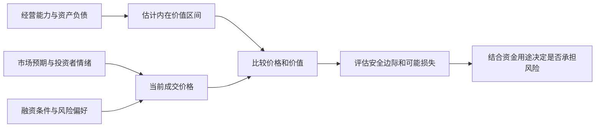
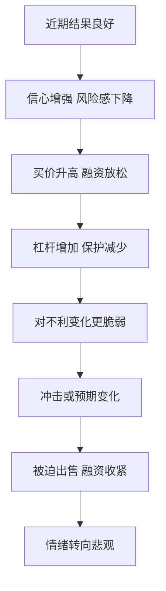

# 《投资最重要的事》读书笔记

> 作者：霍华德·马克斯（Howard Marks）  
> 英文原作：The Most Important Thing: Uncommon Sense for the Thoughtful Investor，2011 年  
> 版本说明：原书与后来的 Illuminated 评注版有区别。后者加入其他投资者的评论；本笔记围绕马克斯原书的 20 章思想整理，不把评注者观点自动归到马克斯名下。中文译者和具体版次未指定。  
> 分析依据：出版社目录、作者公开投资备忘录、公司正式财报与美联储历史资料，未取得用户原书。较晚备忘录和真实财报仅作为书外教学，不作为“原版已写过这些后来事实”的证据；作者回顾、公司披露与本笔记推断分别标明。  
> 覆盖范围：主要章节与 30 个核心知识点，侧重价值、价格、风险、周期、心理及决策方法。  
> 更新日期：2026-11-11

## 先看这里：这本书讲什么

**一句话概括：投资的关键，是在不确定的未来面前，以合适的价格承担自己理解、能承受、并得到足够补偿的风险。**

书名里的“最重要”不是只有一个秘诀。马克斯不断从不同角度解释：只懂价值却不懂价格，只会判断却不懂风险，或者懂道理但受情绪驱动，都可能让投资失败。全书讨论的是判断框架，不是一个固定买卖公式。[出版社原书框架及评注版说明](https://cup.columbia.edu/book/the-most-important-thing-illuminated/9780231162845/)

最值得记住的七个结论：

1. **好公司不一定是好投资。** 好坏还要结合买入价格和未来真正实现的结果。
2. **想与平均结果不同，就需要有依据地与平均观点不同。** 单纯反对多数人没有优势。
3. **风险不只是价格上下波动。** 还包括永久损失、流动性、杠杆和无法按计划持有。
4. **高风险意味着更宽的结果范围，不意味着确定的高收益。**
5. **周期和情绪会改变机会的价格。** 不必能预测拐点日期，仍可以评估当下是否过分乐观或悲观。
6. **好过程不保证每次有好结果。** 运气使单次输赢不能直接证明能力。
7. **防守的目的，是在不利情境中保留继续参与的能力。** 它不等于永远不承担风险。

## 全书主要内容与知识地图

下面把原书 20 章归为七组，标题是本笔记的中文概括。[原版章节目录见出版社页面](https://cup.columbia.edu/book/the-most-important-thing-illuminated/9780231162845/)

| 原书章节 | 核心主题 | 需要学会回答的问题 |
| --- | --- | --- |
| 1—2 | 第二层思维、市场效率及局限 | 我凭什么比市场的综合判断更有优势 |
| 3—4 | 价值、价格与价值关系 | 买到的东西值多少，现在付了多少 |
| 5—7 | 理解、识别、控制风险 | 哪些情境会让我遭受难以恢复的损失 |
| 8—10 | 周期、心理钟摆、负面影响 | 当下价格包含怎样的情绪和融资条件 |
| 11—13 | 逆向、寻找便宜、耐心等待 | 为什么别人不愿买，而我有理由参与 |
| 14—16 | 知道未知、理解位置、运气 | 我不知道什么，能否承受预测出错 |
| 17—20 | 防御、避免陷阱、增加价值、综合运用 | 怎样把这些认识组成一致的决策方式 |

## 核心知识点：先明确自己的优势

### 01. 第二层思维：不仅判断事情，还判断价格中的预期

第二层思维不是把结论说得更复杂，而是把两件事分开：企业发生了什么，以及投资者已经为怎样的前景付出了多少价格。判断经营改善，并不能跳过第二件事直接得出投资有利。[作者对第二层思维的说明](https://www.oaktreecapital.com/insights/memo/i-beg-to-differ)

**直接看真实财报：** 美的集团 2026 年前三季度收入同比增长 1.19%，归母净利润增长 9.27%，扣非归母净利润却下降 22.49%。公司在三季报中把扣非变化主要联系到汇率与相关风险管理工具收益的分类差异。这组事实本身就不支持只用一个增长率概括经营。[美的官方三季报，第 2—4 页](https://static.cninfo.com.cn/finalpage/2026-10-30/1225645132.PDF)

第一层分析应该先核对口径：归母利润、扣非利润和现金流分别是什么，哪些项目造成分化，相关收益与损失是否经济匹配。不能看到归母增长就宣布全面改善，也不能看到扣非下降就把同样幅度直接叫作主营业务衰退。连第一层事实都未拆清时，复杂的估值故事只是放大不确定性。

第二层才进一步问：公告前的市场原本预计什么，价格已反映多少，以及自己的估计到底比共识乐观还是悲观。**本笔记没有公告前同口径预期、当前估值或市场隐含假设的完整证据，所以不能把这些数字称作超预期或低于预期。** 数据难看并不自动表示价格低估，数据好看也不自动表示仍有收益空间。

这里的真实案例还有一个教训：仅仅找到公司对分类差异的解释，仍不等于证明盈利可以持续。需要继续检查匹配关系、实现与未实现损益、业务本身变化和资本需求。市场预期也不能从单一股价唯一反推，因为同一价格可以包含不同的增长、风险与持有期限假设。

读者可以在这一节直接完成三栏记录：已披露事实、公司解释、尚缺的预期与价格证据。**参考判断：** 目前能够确认利润口径分化并提出下一步问题，不能形成买卖结论。完整勾稽和原表在[真实财报图解](../实战案例/2026三季报图解.md)，但本节的核心是识别每一层到底需要什么证据。

### 02. 与众不同是必要条件之一，不是充分条件

主动投资想得到不同于市场的结果，持仓或判断通常也要不同。但不同可能来自更深入的研究，也可能只是无知和固执。

提出不同于市场的判断，需要说明市场漏看了什么事实、自己的估计为何更可靠。仅说“别人恐惧我贪婪”，无法区分便宜机会与真正的坏资产。

### 03. 市场有效意味着竞争很强，不是价格永不出错

大量聪明参与者会迅速消化公开信息，所以显而易见的机会不容易长期存在。与此同时，情绪、约束、信息差异和强迫交易也可能使价格偏离合理范围。

**补充解释：** 不能从“市场有时犯错”直接跳到“我可以稳定赚钱”。还需要证明你能识别错误、在成本后有优势，并在价格修复前坚持得住。这是对原书市场效率主题的展开。

### 04. 先问自己知道什么，再问市场明天怎样

公司现金流、债务结构和合同条款通常比宏观拐点更具体；但即使研究了很多，也必须识别能力边界。承认不知道，可以避免在没有优势的领域承担过大风险。

能读懂历史财报，不代表能精确判断未来利率和汇率。把知识分为已核实事实、合理估计、无法判断三层，有助于控制自信。[作者区分不同投资态度：Us and Them](https://www.oaktreecapital.com/docs/default-source/memos/2004-05-07-us-and-them.pdf)

## 核心知识点：价值与价格

### 05. 价值来自资产能够提供的经济利益

价值最终关联资产能向出资者提供的经济利益。利润、经营现金流、可分配现金与价值不是同一个量；从一张财报走向估值，需要继续处理维持经营的投入、资本需求、负债和利益归属。[作者后续讨论：The Calculus of Value](https://www.oaktreecapital.com/insights/memo/the-calculus-of-value)

**真实例子：贵州茅台 2026 年前三季度合并经营现金流净额为 840.59 亿元，同比增长 120.07%，而销售商品、提供劳务收到的现金增幅约为 3.41%。** 报告解释，合并经营现金流大幅变化主要涉及财务子公司的同业存款到期收回，以及吸收集团成员存款的净变化。[贵州茅台官方三季报，第 1—3、10—11 页](https://static.cninfo.com.cn/finalpage/2026-10-31/1225649896.PDF)

因此，840.59 亿元不是“当期卖酒产生、股东随时可取走的钱”。合并范围中包含金融业务，就需要理解存款、资金运用和相应负债；即使只考察实体经营，也仍须考虑维持业务的投入、必要营运资金及其他现金义务。把一个经营净额直接乘以估值倍数，会跳过这些环节。

同样，不能减掉两项存款相关的同比变化，就称剩余为纯酒业现金流。同比变化不是本期金额，两项也不代表全部金融业务，内部交易与抵销仍未处理。这些限制不是为了否认报表，而是确保拿去估值的量真正回答“可持续、归属于谁的经济利益”。

**必要的折现算术：** 假如一年后能确定收到 110 元，按 10% 折现，现值为 100 元。这只是数学演示，现实企业的未来现金与折现条件都不确定。必须先研究现金从哪来、需要留下多少、哪些变化使它减少，再考虑如何折现；公式不能替代前面的经营判断。

本例能帮助理解为何好看的现金增速不等于价值同比增长同样幅度，却没有得出茅台的合理价格。练习的合格答案应说明还需要哪些经营、投入与负债资料，而不是在缺少这些材料时填出一个精确估值。[本例数据勾稽](../实战案例/2026三季报图解.md)

### 06. 价值是估计区间，不是精确真值

未来经营和折现条件都不确定，所以一个看似精确的估值常隐藏很多假设。用区间和情境思考，比假装知道精确到小数点的价值更诚实。

合理价值区间不是已经确定的客观常数，区间中点也不自动成为精确答案。应解释哪些变化会使价值落到区间下方，以及不同估计对买入价格的影响。估值表格越复杂，不等于输入越可靠。

### 07. 好资产与好价格必须分开评价

企业、行业的前景，与买入价格是否划算必须分开。一个产业改变世界，不保证所有公司都成功；即使选中了成功者，也可能支付了过高价格。

**马克斯本人在 2000 年初发表的 bubble.com 是可直接核对的事前材料。** 当时他没有否认科技、电子商务和通信会改变生活，而是把问题转向：谁能成为赢家，以及现在为其权益付出多少才合理。[2000 年备忘录原文](https://www.oaktreecapital.com/docs/default-source/memos/2000-01-02-bubble.pdf) 这比事后笼统说互联网是泡沫更有教学价值，因为它展示了如何在承认技术前景的同时质疑价格。

这里至少有三项不确定性：产业发展规模、企业能够获取并保留多少收益、当前价格对未来提前支付了多少。前一项正确，后两项仍可能错误。只要把“世界会需要它”直接等同于“任何价格都能买”，价值判断就被产业叙事替代了。

反过来，后来出现大幅调整，也不能证明科技进步是假的；更不能据此将每一个新行业都归为同类泡沫。需要重新检查收入转化为现金的能力、竞争和资本投入，以及价格中包含的期待。该备忘录是作者当时观点的证据，不是证明他每次择时都准确的完整业绩记录。

**自测与参考答案：**“互联网后来确实改变世界，所以当时所有高估值都合理”缺少什么？缺少公司层面的价值捕获、持续性和价格比较。技术正确、企业成功与投资回报，是相连但不等价的三个判断。

### 08. 买入价格在很大程度上决定未来空间

一个价格已经要求经营、融资和市场情绪都非常顺利的投资，对坏消息的容错通常较小。如果买入时已经充分反映悲观预期，结果只需没有那么差，也可能有较好回报。

这不是“越跌越买”的规则。要同时确认价值是否也在下降。如果合理价值的降幅大于报价降幅，资产即使跌价也可能变得更贵；要比较的是价格相对价值的关系。[作者第二层思维备忘录](https://www.oaktreecapital.com/docs/default-source/memos/2015-09-09-its-not-easy.pdf)

### 09. 安全边际是在估错时留出空间

安全边际不是一个保证赚钱的固定折扣，而是通过更保守的估计、更有利的买价、更强的资产负债表或合同保护，为不利结果保留余地。

相对保守估值打折买入，能容纳一部分判断误差；但债务和经营变化若使实际价值大幅下降，原先的“折扣”仍会失效。安全边际要建立在可信的价值分析上，而不是只看与历史高价的差距。

### 10. 价值陷阱：看似便宜，实则价值持续流失

低市盈率可能来自周期顶部利润，低市净率可能伴随资产减值或无法变现。价格便宜的原因必须讲得通。

**数学演示（假设利润与价格）：** 当年每股利润 10、股价 50，对应 5 倍市盈率；若正常年份每股利润只有 2，则对应 25 倍。分母处于周期高点，会把估值看得过于便宜；同时还需分清暂时低迷与结构性衰退。

## 核心知识点：风险究竟是什么

### 11. 波动是一个风险信息，不是风险的全部

马克斯更关心永久资本损失及不利情境，而不是仅用历史价格标准差概括风险。没有频繁报价的资产也可能很危险；价格经常变化的资产也未必必然遭受永久损失。

边界是：波动仍会通过杠杆、生活用款、赎回或心理压力让人被迫卖出。因此不能把“波动不等于风险”读成“波动无所谓”。[作者相关讨论：A Look Under the Hood](https://www.oaktreecapital.com/insights/memo/a-look-under-the-hood)

### 12. 承担更多风险，不保证得到更多回报

通常需要更高的预期回报吸引人承担不确定性，但预期不是承诺，合同票息也不等于最后实际回报。风险补偿还可能在竞争中被压低，出现承担更多风险却得到更少保护的情况。

**真实的事前观察来自马克斯 2007 年的 The Race to the Bottom。** 在后来公开对话中，他回顾当时看到贷款机构通过放松条件争取业务，指出资本提供者竞争可能同时压低收益要求、弱化保障。这份备忘录写在全球金融危机全面爆发之前，属于可核对的当时判断，而非事后补写。[2007 年备忘录入口](https://www.oaktreecapital.com/insights/memo/the-race-to-the-bottom)、[作者对当时观察的公开回顾](https://www.oaktreecapital.com/insights/memo/conversation-at-panmure-house)

把这种竞争看作一场拍卖就容易理解：希望获得贷款业务的人，可能接受更低利率、更少约束或更弱的借款人。赢得交易不代表赢得好投资；如果得到的保护比减少的报酬还差，未来不利情境反而更难承受。供需旺盛带来的热闹，会掩盖交易条款本身的恶化。

**纯算术示例，非真实债券：** 100 元买入，一年后有 90% 概率收回 110 元、10% 概率归零，预计收回只有 99 元。纸面正常履约收益为 10%，预期名义收益却为 −1%。真实违约概率、回收率和发生时间不能这样随手假定，这个式子只是展示“承诺”与“综合结果”不同。

风险补偿也不是挑出高期望就结束。即使更低买价改善平均结果，仍要检查极端损失、资金用途、多个资产共同出问题的可能，以及概率估计是否可信。不能因为最后顺利履约，就回头宣称当时不存在风险。

这个案例支持的是研究条款与价格的必要性，并不能把所有宽松融资都判为将要违约，更不能从一篇正确预警推出危机发生的精确日期。

### 13. 风险常在大家觉得安全时积累

普遍乐观会压低风险补偿、推高估值、鼓励借债和降低审查标准。因此过去一段时间平稳，并不能证明未来也安全。

长期未出问题可能诱使融资者接受更高杠杆和更少保护，表面的稳定便可能伴随内部脆弱性增加。需要观察行为是否更激进，而不仅仅看最近有没有亏损。[作者对风险的后续回顾](https://www.oaktreecapital.com/insights/memo/risk-revisited-again)

### 14. 风险控制不等于拒绝所有风险

完全回避不确定性，也可能付出购买力损失、目标无法实现或机会成本。真正的管理，是判断哪些风险值得承担、承担多少，以及出错后会怎样。

同一项投资，对长期闲置资金与近期必须支付的费用，风险意义不同。选择应当结合资金用途，而不是只看产品标签。[作者后续论述：The Indispensability of Risk](https://www.oaktreecapital.com/insights/memo/the-indispensability-of-risk/)

### 15. 杠杆缩小能够活下来的结果范围

杠杆会把小幅资产变化转成更大的权益变化，也可能使你在分析最终兑现前被迫行动。它改变的不只是收益率，而是能够继续持有的结果范围。

**真实事件是 1998 年 LTCM 濒临失败。** 美联储历史资料记录，该基金在 1997 年末向投资者返还资本，却没有相应缩减投资规模；1998 年危机中，原本期待收敛的价差反而扩大。其后由私人金融机构注资安排避免仓促清算，纽约联储参与协调但未投入自身资金。[美联储历史资料](https://www.federalreservehistory.org/essays/ltcm-near-failure)

表面上，许多头寸押的是相似资产价差，不是简单押市场涨跌。然而，融资、流动性和共同平仓压力可以使这些交易一起恶化。等待未来收敛需要资本与对手继续支持，数学上的长期关系不能替你支付眼前的资金要求。

**只作杠杆算术：** 资产 100、负债 80，权益为 20；资产降到 85、暂时假设负债不变，权益只剩 5，下降 75%。这不是 LTCM 的真实账表，而是解释为什么资产跌幅与资本损失不是同一个比例。

实际判断要检查融资期限、保证金、可变现性以及损失时是否被迫出售，不能只看常态下的波动。LTCM 事件不证明所有杠杆或价差策略都失败，但足以反驳“市场中性就不需要担心生存条件”这种过强结论。

### 16. 流动性与资金期限也是风险

某资产长期可能有价值，但若短期无法变现，而你短期必须用钱，就有错配。价格低不代表一定适合持有者。

退出期限远于资金使用期限时，不能只比较预计收益。还要考虑锁定、交易深度、估值透明度和被迫出售的折价。耐心需要资金条件支撑，不能只靠意志。

## 核心知识点：周期与心理钟摆

### 17. 周期意味着变化，不能把现状永久外推

繁荣会吸引投资和融资，新增供给与过度扩张又可能压低回报；衰退会促使收缩，逐渐创造改善条件。不同周期可能相互作用，但长度和幅度没有固定刻度。

高利润可能吸引扩产；新增供给逐步释放后，先前的高利润可能消失。不能机械地把一年的好业绩乘很多年。周期分析需要具体行业依据，不是看到上涨多年就断言明年必跌。

### 18. 信贷周期会放大经济与价格变化

融资宽松时，借款容易、条款放松，更多交易得以完成；当信心逆转，融资收缩又迫使出售和缩减投资。资产价格与资金可得性会互相强化。

收购价格上涨使账面抵押价值看起来更高，进而支持更多借款；一旦价格下降，这个循环可能反转。研究投资时要问“如果不能再轻易融资，会怎样”。[作者历史备忘录：The Race to the Bottom](https://www.oaktreecapital.com/insights/memo/the-race-to-the-bottom)

### 19. 心理钟摆：现实小变动，评价可能大摆动

同样的数据，在乐观环境中容易被解读为暂时困难，在悲观环境中容易被解读为永久崩溃。情绪会改变投资者愿意支付的价格。

企业利润变化与市场愿付的估值倍数变化可能同时发生，因此价格变化不只来自利润本身。钟摆只是解释框架，没有告诉你哪一天到顶或触底。[作者对心理的后续说明：Sea Change](https://www.oaktreecapital.com/insights/memo/sea-change)

### 20. 识别我们在哪里，比精确预测下一步更务实

可以评估价格、融资条件、风险偏好和市场叙事是否偏向极端，而不声称知道下周走势。这些判断可以影响整体风险姿态，但不应被包装成精确择时能力。

估值偏高、融资条件激进、参与者普遍不讨论损失，提示认真检查防御；它仍可能持续很久。准备和预测的区别在于，准备允许多种未来，预测往往押一个结果。

### 21. 恐惧、贪婪、从众与嫉妒会干扰决策

“别人已经赚了很多”不是资产价值的证据，却很容易降低自己的标准。职业压力、排名和面子，也会使人参与自己并不理解的事情。

**补充练习：** 决策前分别写“我希望得到什么”和“支持投资的事实是什么”。如果第二栏只有别人赚钱、名人参与或过去上涨，应回到分析，而不是用情绪补足证据。

## 核心知识点：逆向、耐心与防御

### 22. 逆向投资依赖价格错误，而非人少

逆向投资需要指出价格为什么错，不是只证明参与者少。群体可能因恐慌低估资产，也可能因真实损伤而合理撤退；必须从资产、结构和价格中区分。

**真实实践：2008 年危机中的橡树。** 马克斯在 Taking the Temperature 中回顾，橡树在危机前准备了储备资本；雷曼破产后，Bruce Karsh 团队从 9 月中旬到年底大规模投入困境债务。他解释当时关注的，是较高顺位债权及低买价提供的保护，而非确定市场已经见底。[作者关于当时决策的回顾](https://www.oaktreecapital.com/insights/memo/taking-the-temperature)

这段材料是参与者事后的公开叙述，不能当成独立审计的全部业绩。其教学价值在于让“别人恐惧我买入”变成具体条件：先有能够投入的资金，再研究偿付结构与价值，即使经营出现不利变化，买价和权利顺序是否仍留下空间。缺少这些条件，单靠逆向勇气并不能复制其决策。

这里也能看见周期与准备的关系。好时期融资容易、保护被削弱，值得积累警惕；恐慌时被迫出售增多，才可能出现价格与价值分离。但同样的低价既可能是折扣，也可能是资产永久受损的反映，所以要继续核查而不是自动买入。

资金期限同样关键。若自己需要短期偿债、必须等待新融资，可能在机会出现时没有行动能力。所谓耐心不只是愿意等，也是持有资金与资产的安排允许等。原文没有让读者相信任何下跌都会恢复。

**自测与参考答案：** 橡树当时买入，能否证明它准确预知最低点？不能。该叙述强调在可接受条件下采取行动，本来就不要求先确定底部。学习对象是证据、价格、权利结构和准备，而不是事后最低价的神话。

### 23. 便宜货通常令人不舒服，但不舒服不是证据

如果所有人都能轻松确认安全、有吸引力，价格通常已反映许多优点。机会常伴随争议、复杂性或短期问题。

**补充解释：** 这不是鼓励专挑难懂的资产。复杂性可能意味着你根本无法判断价值。只有当不舒服的原因可分析、价格提供补偿且资金能承担时，才值得继续研究。

### 24. 耐心等待不等于永远看空

机会不好时可以维持标准，而不是为了有动作而行动。但等待也有代价：现金回报、购买力、目标期限和错失机会都需要评估。

预先写明什么价格、质量和风险条件值得参与，定期复查；如果只说“等更便宜”，却永远不愿更新，就可能把耐心变成拖延。书中的耐心是有准备的等待。

### 25. 防御投资重视少犯致命错误

防御是保留在不利环境里继续决策的能力，可以体现为较低买价、较少杠杆、较可靠的资产负债表和匹配现金用途；它不是永远只持现金，也不是所有年份都必须领先。

**真实的动态调整材料是马克斯 2020 年的 Calibrating。** 他回顾当年 3 月不同时间发表的判断：市场下跌、价格降低时讨论分步买入；反弹改变价格之后，又重新检查积极程度。文中坚持不把“可以开始买一些”说成“已经知道唯一底部”。[2020 年备忘录原文](https://www.oaktreecapital.com/docs/default-source/memos/calibrating.pdf)

这使防御从一个永久标签变成相对价格和条件的选择。相同资产，在不同价格下值得承担的程度可能不同；同一经济前景也可能因买价下降而出现更多补偿。逐步调整则承认未来仍有多种路径，避免把全部决定压在某一天的预测上。

还要区分债权与股票。债权上行常受合同限制，避免严重违约很重要；股票可能由少数持续增长的赢家贡献较大收益。为了不出现任何短期波动而退出所有赢家，也不是完整防御。因此要结合资产的损益结构，而不是统一套一个“有利润就卖”的动作。[作者对两类资产的后续讨论](https://www.oaktreecapital.com/insights/memo/fewer-losers-or-more-winners/)

**算术演示，非历史组合：** 100 先涨 50% 再跌 50%，剩 75；先涨 20% 再跌 20%，剩 96。它解释下行破坏为何值得防范，但不证明保守组合永远更好。如果严重下跌未发生，承担较多风险者可能长期领先。

评估防御应看保护是否真实、代价是否事先接受、机会成本是否合理，以及多个环境中的表现。上述备忘录记录的是作者判断随当时条件更新，不是提供一套已验证的机械择时公式。

### 26. 分散要看共同失败原因

一篮子资产可能共同依赖低利率、同一行业或同一融资来源。分散名称不等于分散真正风险。

评估家庭风险时，还要检查收入、房产和证券是否高度依赖同一个行业；共同依赖会使它们在行业低迷时同时承压。将投资放回整体财务状况，比单看每项资产的独立回报更有用。这是把原书风险思想用于个人决策的补充。

## 核心知识点：不确定性、运气与评价

### 27. 用一组情境替代单一路线

未来不是唯一可预测的结果。应描述正常、较差、严重不利等情境，以及每种情况下现金流、偿债和退出会怎样。

预计销量增长的同时，也计算持平和下滑时是否仍能覆盖固定费用。情境概率可能很不精确，不能因表格写了百分比就误以为不确定性已被消除。

### 28. 单次结果不能证明决策质量

评价决策需要回到当时信息与风险，不能只靠结果。一个真实而有意思的观察对象，就是马克斯本人后来最受认可的预警。

在 2000 年初的 bubble.com 中，他先承认此前的谨慎在当时行情中显得错误，再继续陈述对投机行为的担忧。到 2025 年回顾时，他又明确说那次预警后来得到迅速印证。[2000 年原文](https://www.oaktreecapital.com/docs/default-source/memos/2000-01-02-bubble.pdf)、[2025 年本人回顾](https://www.oaktreecapital.com/insights/memo/on-bubble-watch)

把两份材料放在一起，比只读“成功预言泡沫”的标题更有帮助。决策当时并没有结果保证；先前看起来落后，也不自动说明风险判断毫无根据。后来迅速应验，使一次判断格外容易被记住，但它仍不足以单独证明完整预测能力，更不能倒推他知道具体转折日期。

因此应区分判断内容：发现价格和叙事中存在脆弱性，与准确知道脆弱性何时暴露，不是同一能力。前者可以支持调整承担，后者需要另外的证据。若把每次正确方向都说成精准择时，就会夸大经验能够提供的东西。

在后来的 You Bet! 中，马克斯明确把过程与实现结果分开，强调未知信息和随机性会影响结果。[作者关于决策质量的说明](https://www.oaktreecapital.com/docs/default-source/memos/you-bet.pdf) 这不等于亏损时一律归咎运气：仍须检查是否遗漏可得信息、规模是否合理、是否为坏结果准备过。

实用复盘分两步：先尽量遮住结果，评估当时资料、价格、反证与承担；再加入结果，检查它提供了什么新信息。即使长期成绩也需看环境、杠杆、成本和未发生但曾承担的失败路径。真实成功案例是研究起点，不是可以停止质疑的终点。

### 29. 看风险调整后的贡献，而不是只看涨了多少

牛市中承担更大市场风险的人可能赚得更多，却未必创造了更多能力价值。比较表现需要考虑市场环境、杠杆、基准、成本与风险承担。

相对于市场的额外收益，可能来自分析能力，也可能来自更多杠杆、更集中暴露或暂未显现的尾部风险。仅凭收益数字无法排序，还需要检查完整过程和下行情景。

### 30. 把原则组合起来，避免单项走极端

只讲安全可能永不行动，只讲逆向可能不停接下跌资产，只讲耐心可能变成不肯认错。真正的框架需要同时回答价值、价格、风险、资金期限和反证条件。

**补充解释：** 一项机会可以有估值折扣，却因无法承受锁定期而不适合你；也可以是好企业，却因价格已很充分而缺少吸引力。投资决策是多条件权衡，不是寻找一句永远正确的口号。

## 难点算例：好公司为什么也可能是坏投资

以下为原创教学例子，所有金额按每股计算，忽略股息、成本和税费，不对应实际证券。

假设现在每股利润为 5，三年后利润增长到 6，经营确实改善 20%。但价格还取决于市场愿意支付多少倍利润。

| 情景 | 买入价格 | 三年后估值假设 | 三年后价格 | 简单持有收益 |
| --- | --- | --- | --- | --- |
| A：初始支付很高预期 | 150（30 倍） | 20 倍 | 120 | −20% |
| B：初始支付较低预期 | 75（15 倍） | 20 倍 | 120 | +60% |

两种情景面对同一家企业、同样的经营增长，却有不同结果。这里并未证明 15 倍便宜或 30 倍昂贵；估值是否合理还取决于质量、增长、风险和其他机会。算例只说明：**公司表现与买方回报之间，隔着买入价格。**

## 难点图解一：价值、预期和价格如何相互作用

图中价值和价格分别形成，最后再比较。它们会相互影响，但不应被混成同一个数字。“市场今天报价多少”与“你估计它能提供多少经济利益”是两个问题。

## 难点图解二：风险为什么会在繁荣中增长

这只是机制示意，没有固定时间表。它不表示每次上涨都会立即崩溃，也不表示所有悲观市场都有便宜机会；它提醒读者观察价格背后的风险积累。

## 如何把这本书用于自己的决策

可以将一次投资研究写成一页，逐项填入真实资料：

| 问题 | 应写出的内容 |
| --- | --- |
| 我买的究竟是什么 | 资产、权利、现金来源，而不只是代码或概念 |
| 我估计值多少 | 区间、关键假设、最敏感的变量 |
| 现在支付多少 | 当前价格包含怎样的增长与风险预期 |
| 我与市场哪里不同 | 具体事实或解释差异，不是“我更有信心” |
| 可能错在哪里 | 竞争、债务、估值、执行、资金期限等 |
| 最差会怎样 | 永久损失、被迫退出和生活资金影响 |
| 为什么值得承担 | 价格提供的补偿与其他选择相比如何 |
| 什么会改变判断 | 可验证的反证与复查时间 |

**补充练习：** 找一个历史上由热门转冷门的行业，分别重建当时的乐观与悲观解释。不要用已经知道的结局给当时的人贴标签，而是检查哪些信号当时已经可见，哪些只是事后才知道。

## 常见误读

- “风险不是波动”，不等于可以无视净值波动、保证金或短期用款。
- “逆向”，不等于自动买入跌得最多的东西。
- “好价格”，不等于绝对价格低或离历史高点很远。
- “知道周期位置”，不等于能预测转折日期。
- “防守”，不等于永远追求零亏损，也不等于永不投资。
- “运气重要”，不等于研究无用；它要求以更长样本和更完整过程评价能力。
- “有安全边际”，不等于估值一定正确或永远不需要重新评估。

## 回顾自测

1. **为什么利好兑现后也可能下跌？** 因为之前价格可能预期了更好的结果。
2. **风险越高，为什么不保证赚得越多？** 因为更高不确定性同时扩大了不利结果范围。
3. **安全边际能防止什么，不能防止什么？** 可以留出部分误差空间，不能修复完全错误的价值判断或所有极端情境。
4. **如何区分逆向与固执？** 前者有证据和价格依据，也愿意面对反证；后者只维护原立场。
5. **好公司与好投资之间还差什么？** 买价、未来实际结果、风险与持有者条件。
6. **单次成功为什么不够？** 因为运气和隐藏风险可能暂时没有暴露。

## 来源与资料边界

- [Columbia University Press：The Most Important Thing Illuminated](https://cup.columbia.edu/book/the-most-important-thing-illuminated/9780231162845/)：用于原书 20 章结构及评注版区别。
- [作者备忘录：I Beg to Differ](https://www.oaktreecapital.com/insights/memo/i-beg-to-differ)与[It's Not Easy](https://www.oaktreecapital.com/docs/default-source/memos/2015-09-09-its-not-easy.pdf)：第二层思维、逆向及价格的重要性。
- [Us and Them](https://www.oaktreecapital.com/docs/default-source/memos/2004-05-07-us-and-them.pdf)：知识边界与不同风险态度。
- [The Calculus of Value](https://www.oaktreecapital.com/insights/memo/the-calculus-of-value)：作者后续对价值与价格的澄清；文中当时的市场判断没有转成今天的建议。
- [Risk Revisited Again](https://www.oaktreecapital.com/insights/memo/risk-revisited-again)、[The Indispensability of Risk](https://www.oaktreecapital.com/insights/memo/the-indispensability-of-risk/)与[A Look Under the Hood](https://www.oaktreecapital.com/insights/memo/a-look-under-the-hood)：风险概念与个人约束。
- [The Impact of Debt](https://www.oaktreecapital.com/insights/memo/the-impact-of-debt)：杠杆与生存空间。
- [The Race to the Bottom](https://www.oaktreecapital.com/insights/memo/the-race-to-the-bottom)与[Sea Change](https://www.oaktreecapital.com/insights/memo/sea-change)：融资行为及心理变化。
- [You Bet!](https://www.oaktreecapital.com/docs/default-source/memos/you-bet.pdf)：决策过程与结果的区别。
- [Fewer Losers, or More Winners?](https://www.oaktreecapital.com/insights/memo/fewer-losers-or-more-winners/)：防守、股债差异和风险回报关系的后续说明。

- [2000 年 Bubble.com 备忘录](https://www.oaktreecapital.com/docs/default-source/memos/2000-01-02-bubble.pdf)、[Taking the Temperature](https://www.oaktreecapital.com/insights/memo/taking-the-temperature)与[2020 年 Calibrating](https://www.oaktreecapital.com/docs/default-source/memos/calibrating.pdf)：互联网估值、2008 年机会准备及 2020 年风险调整的作者原始论述或事后回顾，不能当作独立审计的业绩证明。
- [美的 2026 三季报](https://static.cninfo.com.cn/finalpage/2026-10-30/1225645132.PDF)、[茅台 2026 三季报](https://static.cninfo.com.cn/finalpage/2026-10-31/1225649896.PDF)与[核验表及图解](../实战案例/2026三季报图解.md)：第 01、05 点书外财报教学材料；报告期间、单位与归属口径在原位说明。
- [美联储：LTCM 濒临倒闭](https://www.federalreservehistory.org/essays/ltcm-near-failure)：第 15 点杠杆与融资约束案例。

本笔记没有检验个人投资组合，也没有推导一套普适估值参数。待提供具体中文版本后，可以继续核对原书案例、译名与评注者的不同意见。图表由本笔记编排；真实财报与历史事件在原位附来源，只有明确标为数学演示或假设算例的数值为教学设定。

---

[返回书籍索引](../README.md) · [财商学习与实践路线](../财商进阶合订本.md)
