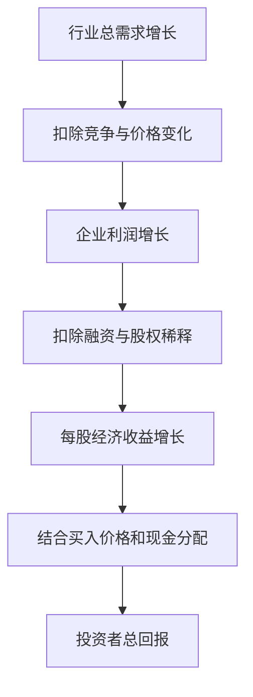
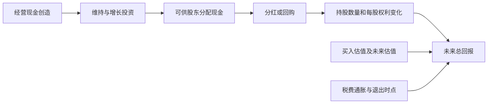

# 《投资者的未来》读书笔记

> **书目与范围**：杰里米·J. 西格尔（Jeremy J. Siegel），*The Future for Investors: Why the Tried and the True Triumph over the Bold and the New*，2005 年，Crown。中文具体版次未确认；本书与作者的《股市长线法宝》是不同作品。实际使用出版社书目、作者所在沃顿商学院对本书的介绍和相关公开研究说明，辅以指数编制、公司报告与人口资料。本篇是基于公开资料的主题导读，没有取得全部正文或重跑原书历史数据库；不声称逐章精读，也不把历史收益率当作未来保证。

本书最有价值的问题是：一家公司的增长很快，为什么它的股票仍可能不是好投资？答案在于，你购买的是一定价格下的未来股东现金流，而不是“先进”“热门”或“代表未来”这些标签。增长越被广泛预期，投资者可能越早为它付出很高价格。

读完应掌握三种能力：把企业增长与投资收益分开；正确计算含分红的总回报；检查估值、再投资、人口叙事和历史统计的适用边界。

## 一、增长、价格与回报

### 1. 增长陷阱：预测对行业，不等于买对股票

增长陷阱不是说增长有害，而是预期与价格已经太高。投资者可能正确判断需求增长，也正确识别龙头，却仍因付出过高价格获得较差回报。

企业表现是绝对结果，投资结果还要和买入时隐含的预期比较。需要同时问“未来能做到什么”和“当前价格要求它做到什么”。只回答前者，就缺少一半估值工作。出版方对本书的定位也围绕新兴行业与成熟企业投资回报之间的区别。[出版社书目](https://www.penguinrandomhouse.com/books/166741/the-future-for-investors-by-jeremy-j-siegel-author-of-stocks-for-the-long-run/9781400081981/)

### 2. IBM 与标准石油：研究比较的是投资路径

**书中历史研究案例，经作者所在学校介绍核对。** 西格尔比较了 1950—2003 年 IBM 与新泽西标准石油的长期投资结果。IBM 的业务增长更快，但标准石油在该比较中的含分红再投资回报更高。沃顿介绍列出，两者在研究期的平均市盈率和股息收益率明显不同：IBM 的估值更高，标准石油的股息收益率更高。[沃顿对本书研究的介绍](https://knowledge.wharton.upenn.edu/podcast/knowledge-at-wharton-podcast/jeremy-siegels-latest-book-lays-out-the-future-for-investors/)

机制不是“石油永远优于计算机”。较低买价提供更多初始盈利权，较高且持续的分红在再投资后增加持股数量，长期累积可能超过更快的业务增长。比较中还涉及公司演变与再投资规则，不能拿两个今天的股价除以当年报价简单复制。

本笔记未取得完整底层数据，故不另行宣称复算了最终财富数额。两家幸存大型公司的比较可以说明机制，不能单独证明一切成熟行业都胜过科技行业，也不能成为今天买入其中任一公司的理由。

### 3. 股价、每股盈利和估值倍数如何共同变化

在盈利为正且口径可比时，可以写成：股价＝每股盈利 EPS × 市盈率 PE。因此股价变化同时受盈利变化与市场愿意给出的倍数影响。

**数学演示**：初始 EPS 为 2，PE 为 50 倍，股价 100；五年后 EPS 翻倍到 4，但 PE 回到 20 倍，股价只有 80。企业盈利翻倍，忽略分红的价格回报仍为 −20%。五年的年化价格回报约为 `(80/100)^(1/5)−1≈−4.4%`。

这并不是对某种估值倍数的通用判决。高倍数有时能被长时间高回报增长支撑。关键是把增长期限、利润率、再投资和估值变化放在同一个情景中，不要既假设高速增长，又不解释高倍数为什么永久不变。

### 4. 市场预期不能直接当作一项可观测数据

“超过市场预期”听起来清楚，实务中却有难点：分析师平均预测、市场叙事和股价隐含假设并不是同一个东西。股票可能已经提前反映了尚未进入分析师报表的乐观情景。

一种补充办法是反向估值：固定当前市值和合理的现金流关系，推算需要怎样的收入、利润率与持续期才能支持价格，再比较公司实际能力。反向估值仍依赖折现率与终值，不是从价格里提取唯一真相。

### 5. 行业增长、企业增长、每股增长是三层

行业需求扩大，新增竞争者会分享市场；公司营收扩大，新增资本和员工可能分享收益；总利润扩大，发行新股又可能稀释原股东。因此每股收益与现金流才更接近单个股东所持权利。

图示是一条检查链。某一层增长并不自动传递到下一层，跳过中间环节就容易把宏观故事当成股东收益。

### 6. 创新创造的价值可能由消费者获得

技术进步降低成本、改善产品，社会受益很大。但若竞争激烈，企业可能不得不降价，成本改善主要变成消费者剩余，而非长期超额利润。

读者可以把本书与[《资本回报》](<../资本回报 - 爱德华·钱塞勒/读书笔记.md>)联系起来：技术的重要性解释需求，供给与壁垒解释谁能保留利润。不要因为一项技术有用，就跳到所有相关股票都值高价；也不要因为早期行业投资回报差，就否认技术本身的价值。

### 7. 新股投资还包含出售方与买方的信息差

首次公开发行让投资者参与企业未来，但发行时点、定价和募集资金用途会影响买方收益。热门时期融资多，并不证明当时最适合购买。

应区分发行价格、普通投资者实际能够买到的价格、首日涨跌和多年持有回报。研究新股时还应计入退市、并购和失败样本，而非只选择后来最知名的赢家。本篇不提供所有市场“打新”的统一结论，不同制度与获配条件差异很大。

## 二、分红与复利的正确理解

### 8. 总回报包括分红，但分红不是额外印钞

一段期间内、暂不考虑期间再投资时，简单总回报可写为：`（期末价格−期初价格＋收到的现金分红）÷期初价格`。跨多年时，要依据现金流发生时间与再投资价格计算，不能把每年的股息率简单相加。

公司支付现金后，归属于公司的资产会减少。在其他条件不变的理论情况下，除息价格会相应调整；实际交易价格还受市场变化影响。收到 5 元股息，不代表凭空多出 5 元财富。

分红的意义在于把一部分经营现金交给股东，减少其对未来市场出价的依赖，并提供再配置机会。经济价值最终仍来自企业产生可分配现金的能力。

### 9. 价格指数与全收益指数不可混用

**真实方法案例：标普道琼斯指数。** 该机构的指数数学方法明确区分价格回报和含分红再投资的总回报指标。价格指数反映价格变化，全收益指标还纳入按规则再投资的分红；指数除数调整则用来处理某些公司行动，维护指数连续性。[标普指数数学方法](https://www.spglobal.com/spdji/en/methodology/article/index-mathematics-methodology/)

因此比较基金业绩与基准，必须统一是否含分红、税前税后、币种和期间。一只基金净值包含分红收益，却拿不含分红的价格指数做比较，会把口径差异误认为管理能力。

指数计算也不是个人账户：真实投资还有费用、税收、交易与现金拖累。本书强调长期复利，但不能把无成本的理论再投资路径直接当作个人实现结果。

### 10. 再投资为什么可能放大低价的作用

**数学演示**：持有 100 股，每股现金分红 2 元，共收到 200 元。若可用 20 元买回，可增加 10 股；若可用 40 元买回，只能增加 5 股。未来每股现金创造能力相同、税费忽略时，低价再投资带来更多收益权。

这里比较的是收到同一笔现金后的不同买入价格，不能把两个情景的总财富只按新增股数判断。更不能假设价格下跌时每股分红永久不变：盈利恶化、债务到期或经营转型都可能导致减息。

所以“低价有利于继续买入”需要两个条件：经济价值没有同比恶化，以及投资者确实有能力继续持有或投入。单纯股价下跌并不构成好消息。

### 11. 股息率高可能来自现金充足，也可能来自股价暴跌

历史股息率通常用过去分红除以当前价格。若企业前景恶化、价格已经下跌，而过去分红尚未调整，股息率看起来会非常高。

判断时要区分普通与特别分红、经常性利润与资产出售所得，查看经营现金流能否覆盖维护投资、债务与分红。银行和保险等行业还受资本约束，不能只用工业企业现金流公式判断。

如果采用预期分红，必须写明它来自公司公告、董事会提案还是分析者估算。尚未获准的计划不等于已经收到的钱。

### 12. 支付率要与再投资机会一起看

分红支付率是现金分红相对利润的比例，但利润质量与再投资需求决定它是否有经济意义。高回报、长跑道企业保留部分利润，可能比立即分掉更有价值；缺少好项目的企业持续积累现金，则可能增加低效并购的风险。

**数学演示**：企业有 100 的利润，如果保留 40，能以 15% 的增量回报再投资，简化的可持续盈利增长约为 6%。如果同样保留 40，只能赚取 3%，则增长只有约 1.2%，且可能低于资金机会成本。支付率本身不是好坏排名。

### 13. 回购与分红：相近目标，不同路径

**真实案例：IBM 2011 年资本分配。** IBM 年报显示当年进行了约 150 亿美元规模的股票回购，并支付现金股息。这说明股东回报不只通过现金分红实现，回购也是资本分配的重要路径。[IBM 2011 年年报](https://www.ibm.com/investor/att/pdf/IBM_Annual_Report_2011.pdf)

回购减少股份数量，可能提高剩余每股收益，但要同时看公司支付了多少现金、是否新增债务，以及股权激励是否又增加股份。即便 EPS 上升，也不能据此认定经营能力改善。

高价回购会损害留下股东的价值，低价回购则可能有利。上述报告确认了行为和规模，不能仅凭此得出 IBM 那一年或之后一定是好投资的结论。

### 14. 巴菲特的 IBM 演示：低价为什么可能帮助长期持有人

伯克希尔 2011 年股东信以 IBM 为例，比较相同回购资金在较低和较高股价下可以买回的股份数量，说明持续股东在业务价值成立时，可能受益于低价回购。信中的未来盈利与回购情景是巴菲特的假设计算，不是后来已兑现的事实。[伯克希尔 2011 年股东信](https://www.berkshirehathaway.com/letters/2011ltr.pdf)

这个案例适合纠正“持有以后只希望涨”的直觉。若企业仍在回购，股东会间接成为继续买入者；但若业务本身衰败，便宜回购也可能只是用现金买入正在缩小的价值。

它与西格尔的分红再投资思路相通，但二者并不完全相同：分红由股东决定投向何处，回购由管理层执行，税务、机会成本与股东间财富转移也不同。

### 15. 分红复利需要企业存续和权益存续

**真实反例：旧通用汽车。** 通用汽车投资者说明指出，旧公司的股份在重整过程中并未自动变成新通用的普通股，后来被取消。知名品牌、生产持续和原股东权利持续，是三件不同的事。[通用汽车：旧股与新股说明](https://investors.gm.com/shareholders/stock-information)

因此长期持有不能只问品牌是否还存在，还要问原来持有的证券是否仍有权分享现金流。历史派息记录不会阻止破产或重组中的权益损失。成熟公司可能稳健，也可能已被债务与经营恶化掏空。

## 三、读历史数据，避免读成未来保证

### 16. 历史赢家只能帮助生成问题

本书讨论传统企业的长期表现，是对投资直觉的挑战。阅读时应追问作者当时如何定义样本、如何处理合并、拆分、退市、现金收购和分红再投资。

如果只是事后选出几家最好公司，再总结它们共同拥有“好品牌”，结论很可能包含幸存者偏差。本篇没有取得原书数据库，所以不把其中所有组合回报表重算或扩大成普适定律。

### 17. 原有成分股与不断更新的指数是不同策略

保留某一历史时点的成分股，与按规则持续纳入新企业、剔除旧企业的指数，会形成不同组合。它们的行业分布、交易次数、破产处理和资本配置不同。

即使一种历史组合胜出，也需要分解胜出原因：低换手、起始估值、个别极端赢家、分红规则，还是特定时期的行业结构。不能从一段回测直接推出“永远不要换股”或“指数纳入的都是坏公司”。

### 18. 复利要求比较几何收益，而非平均涨幅

**数学演示**：先涨 50%，再跌 50%，算术平均收益是零，但本金从 100 变成 150，再变成 75。两年复合年化收益为 `√0.75−1≈−13.4%`。

长期回报还要检查是否有现金追加或提取。用投资组合自身表现衡量管理，可以看时间加权收益；衡量个人实际资金体验，则现金流时间可能很重要。不能用一个“平均年收益”掩盖这些差异。

### 19. 真实购买力比账户名义数字更接近生活目标

实际收益率的精确关系是：`1＋实际收益率＝（1＋名义收益率）÷（1＋通胀率）`。名义收益 8%、通胀 3% 的数学演示中，实际收益约为 4.85%，而非严格等于 5%。

通胀指标代表某种平均消费篮子，不是每个人的支出结构。美国 BLS 对 CPI 的解释也明确将其用于名义金额和购买力之间的转换。[BLS：购买力与不变价](https://www.bls.gov/cpi/factsheets/purchasing-power-constant-dollars.htm)

对财商学习而言，长期目标应同时记录未来花多少钱和大致购买什么，而不是仅追求一个越来越大的名义余额。

### 20. 股票长期优势不等于所有期限安全

研究的长期平均结果，不保证任何起点、任何国家、任何公司都能在给定期限内恢复。资产价格可能多年低迷，而家庭支出不能无限等待。

因此应把应急开支、明确期限目标和长期增长目标分开研究。这里没有用户个人资金背景，不能从书中观点直接推导固定股票仓位；实际配置还需期限、收入稳定性和损失承受能力。

### 21. 税、费用与换手会改变可实现复利

两个税前回报相同的策略，税费时点不同，长期结果可能不同。高分红策略不一定在所有账户或地区最有利，频繁交易也可能带来持续摩擦。

本书所处的美国税制背景不能直接移植为 A 股、港股或跨境账户的现行规则。应用时应核对所在地和账户类型的当前制度，而不是机械照搬历史税率。比较策略时至少同时给出总回报口径和成本假设。

## 四、人口、全球化和未来叙事

### 22. 经济增长不自动转化为上市公司每股回报

GDP 统计一国生产活动，上市公司股东得到的是企业剩余收益。增长可能来自非上市企业、新发行股权、劳动报酬提升，也可能被原有企业的竞争和成本侵蚀。

此外，上市公司的销售与利润可能分布在多个国家。“某国经济高增长”与“该国股市会给当下买入者高回报”之间缺少价格、权益与分配环节。这个逻辑不要求否定经济增长，只要求分清研究对象。

### 23. 人口老龄化会影响资产需求，但不是单向卖盘公式

本书后半部分涉及老龄化、退休与全球资本需求的展望。这些是作者在出版时对未来的分析，不应因为人口趋势部分发生，就把全部金融预测视为证实。

**较新资料对照**：联合国《世界人口展望 2024》提供人口年龄结构、国家差异和未来情景，且将估计与预测分开。它可以更新人口假设，却没有直接给出股票未来回报率。[联合国人口展望 2024](https://population.un.org/wpp)

从人口到资产价格还要经过劳动参与、生产率、退休制度、储蓄、继承、财政和国际资本流动等环节。老年人可能卖出资产，也可能保留财富用于养老不确定性或遗赠。单看老龄化比率，不能得出某一年股市必跌。

### 24. 全球化可能扩大买方，也可能带来新约束

跨境资本流动能把不同地区的储蓄和投资机会连接起来，但并非无摩擦：汇率、资本管制、税务、法律、治理和政治风险都会影响实际收益权。

因此国际分散的理由是降低对单一经济与制度的依赖，而不是保证某个新兴市场接力买入全部发达市场资产。本篇不把 2005 年的全球化设想当作当前必然路径。

### 25. 国家标签不能代替企业暴露

一家在美国上市的公司可能大量依赖海外客户，一家本地消费公司可能依赖进口原料。按上市地点分类很方便，但不足以反映收入、成本、融资和政策暴露。

真正分散需要观察共同风险来源：相同商品价格、同一种融资货币、同一批客户、同一个技术替代风险。持有很多股票也可能仍在押注同一个宏观故事。

## 五、把书变成可检验的研究习惯

### 26. 成熟企业筛选要同时检查质量和价格

可建立四栏：稳定需求与竞争地位、可持续现金分配、估值隐含预期、衰退与债务风险。只有现金分红而缺少经营质量，可能是陷阱；只有优秀经营而不看价格，也可能落入增长陷阱。

用历史股息率排序只是起点。应回到利润表、现金流量表、资本开支、负债附注和董事会分配计划，确认现金究竟来自经营、举债还是出售资产。

### 27. 一个完整的长期回报框架

图中没有把“有分红”直接连接到“高收益”，因为中间需要看价格、权利和现金分配的可持续性。它可以帮助解释：为什么总利润增加而每股回报差，为什么股价横盘仍可能有总回报，以及为什么高股息率仍可能亏损。

### 28. 预先写下什么会推翻长期持有理由

长期持有的依据可能是需求稳定、优势持久和现金分配合理。那么客户流失、竞争结构变化、杠杆迅速升高、反复高价并购或分红依靠债务，都是应重新研究的信号。

退出判断不应只有“跌了很多”或“涨了很多”。同时也不能把长期当作永远不审查，尤其当原有股东权利、公司业务或资本结构已经改变。

### 29. 评价策略要分清逻辑、历史与实施条件

“付出更低价格取得同样现金流”是逻辑关系；“某类股票在某时期表现较好”是历史证据；“今天可用某只产品低成本实施”是当下条件。三者需要分别成立。

在跨市场应用时，信息质量、公司治理、股东权利和成本结构可能改变结果。最值得保留的是研究顺序与口径纪律，而非照搬原书年代的股票名单。

### 30. 本书最终提高的是对叙事的抵抗力

当听到“这是未来十年的大趋势”，可以继续问：谁获得利润，谁提供资本，每股权利如何变化，预期已经体现在什么价格里，经营失败时股东还能剩下什么？

当听到“这个行业过时了”，也应问：需求是否真的消失，资本是否减少，现金能否持续回到股东，以及价格是否已经过于悲观。两种检查都要求证据，不以新旧、冷热门替代分析。

## 练习与参考答案

**练习一：利润五年翻倍，为什么股票可能亏损？** 参考：买入估值过高、期末倍数下降、股权稀释或现金分配不足都可能影响结果。用第 3 节算例可看到 EPS 翻倍、PE 从 50 降到 20，价格仍从 100 降至 80；有分红时需另算总回报。

**练习二：股息率 12% 是否说明三四年就能收回大部分本金？** 参考：首先核对股息率是历史还是预测、是否含特别分红、现金可持续性及股价下降原因。每次分红会减少公司现金，不能把股息累加而忽略剩余资产价值；未来减息也可能发生。

**练习三：做一份五年研究记录，怎样避免自己骗自己？** 参考：写明期初价格、当时可得财报、每股收益、分红、增发与回购、期末价值、税费、现金再投资规则及基准口径。保留失败或退出公司，不事后只列赢家。若无法获取完整数据，应明确分析缺口，而不是把未复核的网络收益图当作答案。

## 来源与延伸阅读

上文直接链接了实际使用资料：出版社用于书目；沃顿用于核对 IBM 与标准石油的研究结论；标普用于指数口径；IBM 年报与伯克希尔股东信用于区别真实资本分配与假设演示；通用汽车用于权益终止反例；BLS 与联合国用于购买力和人口背景。没有使用未经授权的全书下载，也没有自行补造原书页码和全部组合收益表。

可与[《股市真规则》](<../股市真规则 - 帕特·多尔西/读书笔记.md>)结合检查公司质量，与[《投资估价》](<../投资估价 - 阿斯沃斯·达摩达兰/读书笔记.md>)结合检查价格隐含假设。应学会的是解释回报从何而来，而不是记住“老公司一定赢”这样的另一种口号。
