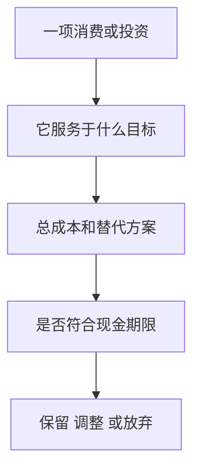

# 《拿铁因素》：把小额选择变成可持续的财务安排

> 作者：David Bach、John David Mann，大卫·巴赫、约翰·戴维·曼；英文原名 *The Latte Factor: Why You Don't Have to Be Rich to Live Rich*，2019 年。  
> 范围：基于[出版社书页与公开节选](https://www.simonandschuster.com/books/The-Latte-Factor/David-Bach/9781982120238)和行为金融研究整理，未取得完整译本，属于系统导读。三项核心原则扩展为 26 个理解与应用知识点；Zoey 与咖啡师 Henry 是寓言人物，不把小说情节作为实证。  
> 更新：2026-11-12。原章节 PDF 旧链接当前不可取得，未据此声称读完原书。现实案例和公式均另作补充说明。

## 本书不只是在讨论一杯咖啡

“拿铁因素”指那些看起来不大、却持续重复的支出，以及它们占用的其他选择。书中希望读者发现：有些梦想并不需要等到收入大幅提高，先把钱从不重要的用途转向重要目标，就能开始改变。

三项原则可以概括为：给自己未来的目标先安排资源；让合理安排容易执行；现在也要过符合价值的生活。它不意味着靠戒掉咖啡就能解决住房、收入不足和疾病等问题，也不意味着所有小额快乐都应该削减。

## 内容如何展开

| 主线 | 需要弄懂的机制 |
| --- | --- |
| 发现重复支出 | 单次金额、频率与机会成本 |
| 先安排自己的目标 | 储蓄顺序、预算与现金约束 |
| 自动执行 | 默认、拖延、复查与费用 |
| 让时间参与积累 | 复利、投入期、成本与不确定性 |
| 现在过有意义的生活 | 目标、满足感、消费取舍和现实边界 |

## 核心知识点

### 1. 寓言负责帮助理解，不负责证明普遍效果

故事中的人物能够在短时间内获得顿悟，是叙事设计。现实家庭的收入、债务、照护和金融服务条件差异很大，不会因为知道一个观念就立即改变。

阅读时提取可检验动作：哪些支出没有价值，怎样持续留钱，什么安排容易失败。不要把人物的顺利结局当作自己的收益预测，也不要因为生活较困难就责怪自己“不够相信”。

### 2. 单次金额不大，乘上频率就可能重要

一项每天发生的费用，需要按实际天数汇总；每月扣费则按月份；偶尔消费不应随意按全年每天外推。频率算错，会制造夸大的节省金额。

**数学演示：**每个工作日支出 20 元，按一年 250 个实际工作日是假设 5000 元；不能直接用 365 天得到 7300 元，再假装两者描述同一种习惯。算例只说明口径，未指向真实家庭。

### 3. 机会成本是放弃的最佳可行用途

一笔钱用于咖啡，就不能同时用于同一时点的其他目标。但替代用途必须现实可行，不能把“本来可能买到暴涨股票”当成必然损失。

对日常选择，更合适的比较可能是旅行基金、学习、减少高成本债务或保留现金。机会成本不总是最大投资终值，也包括当下体验和时间。完整比较允许你决定咖啡值得保留。

可以把每项支出的替代方案写成一对具体选项，而不是“享受”和“自律”两个抽象标签。例如，一个已使用很少的订阅，替代方案可能是需要时按次购买；如果改成按次后花得更多、使用更困难，取消就未必有益。比较需要保留服务质量和实际频率，不能假定所有便宜方案完全等价。

另一个容易遗漏的成本是注意力。为了每月少花很少的钱，持续花大量时间寻找优惠，可能挤掉更值得做的学习和休息。机会成本的概念适用于消费，也适用于省钱行为本身。应优先处理金额大、重复多、价值低且调整成本不高的项目。

### 4. 先找低价值重复消费，不先给消费贴道德标签

有些开支只是忘了取消的订阅，有些是工作压力下的临时补偿，有些则提供真实快乐和便利。把它们一律视为浪费，会让计划难以坚持。

可以回看一个月记录，分别标出“值得保留”“价值不清”“可以取消”。先处理没有争议的低价值部分，再讨论复杂项目。财务改善来自更合适的选择，不来自自我惩罚。

### 5. 大额结构性支出与小额习惯都要看

住房、交通、债务、照护可能占支出大头。小额开支容易调整，却不必然是最有影响的部分。若只盯着一杯饮料，可能错过昂贵贷款或不合适的住房安排。

先按全年总额排序，再比较可调整程度与代价。某项大支出短期无法改变，可以先处理小项；但要明确这只是当前可行的切口，不是对全部财务困难的解释。

### 6. 费用安排也会改变小额交易的真实价格

**现实材料：美国透支与余额不足费用。** CFPB 2024 年的数据分析显示，2023 年相关收入较疫情前下降超过一半，银行收费政策变化是重要背景。这个事实提醒我们，消费者负担会受到产品设计与制度影响，不能只归因于购物习惯。[CFPB 数据分析](https://files.consumerfinance.gov/f/documents/cfpb_overdraft-nsf_data-spotlight_2024-04.pdf)

对于一次小额消费，如果触发账户费用，实际成本可能远超标价。因此预算不仅要看买了什么，也要看付款工具、到账日和余额安排。

这不意味着所有收费都可消除，也不把美国历史规则当作其他市场当前规则。可做的检查是阅读账户费表、设置余额提醒和按实际现金流安排自动扣款，避免“省钱计划”反而造成透支。

把这个案例放进个人账本，可以做一张按日期排列的现金表：收入什么时候真正可用，哪些支出自动扣款，哪些金额有浮动，遇到节假日到账是否变化。月度总额平衡，并不代表扣款日余额充足；自动转走储蓄之后更需要检查这个时点问题。

政策和账户设计变化能减少某类费用，说明改善也可以来自比较服务和理解规则，而非无限压缩日常消费。但不应只为免一项费用接受更不合适的其他条件，例如增加难以达到的余额要求或购买不需要的产品。比较应看完整费用和使用条件。

### 7. 先支付自己，是给长期目标留位置

消费之后再储蓄，常因剩余不确定而难以执行。预先把目标纳入预算，可以减少它每次都输给眼前愿望的情况。

但先支付自己不意味着优先于必要生活、到期税费和合同义务。需要在可持续资源内安排。如果计划只能通过借高成本债务维持，就应重新设计金额与时点。

### 8. 把目标写具体，才知道节省的钱该去哪里

“以后有钱”太模糊，容易被新的消费覆盖。写清目标、金额范围、时间和重要性，才能判断每月投入是否合理。

目标可以是现金缓冲、学习费用、减少工作依赖，也可以是旅行或改善居住。不是所有目标都必须是金融资产，书中的“现在过丰富生活”正要求承认多种价值。

### 9. 自动化降低重复决策的摩擦

收入到账后按预算自动划拨，可以减少每次重新决定的心理成本。它把“愿意储蓄”转成实际流程，但前提是账户、额度和底层工具合适。

自动化不是永久放任。收入减少、费用改变、家庭责任增加后，原规则可能不再适用。应预设复查时间和异常提示，让执行稳定又能调整。

### 10. 默认选择会影响行动，也会影响错误如何持续

**真实研究：退休计划自动加入。** Madrian 与 Shea 发现，改变一家企业退休计划的默认加入方式会显著影响参与，同时默认缴费率和资产选择有黏性。研究揭示了惯性的力量，并非宣布默认选项天然最佳。[原始论文](https://www.nber.org/papers/w7682)

如果默认方案费用高或风险不适合，自动执行会让问题持续更久。读本书时，应把“让它自动”与“先确认值得自动做”连在一起。

可检查四项：资金是否足够；划拨后是否仍能支付必要费用；投资是否与期限一致；是否能方便暂停。自动化应服务于目标，而不是让人对账户失去关注。

### 11. 未来加薪的一部分，可以提前安排

**真实实施：Save More Tomorrow。** Thaler 与 Benartzi 设计的方案让员工预先同意，把未来加薪的一部分用于提高退休储蓄。早期企业实施显示储蓄率上升；参与具有选择性，不能把它当作所有人随机分组后的普遍效果。[2004 年原始论文](https://www.journals.uchicago.edu/doi/full/10.1086/380085)

机制在于降低眼前牺牲感，并利用预承诺减少将来拖延。它与《拿铁因素》的自动执行相呼应，但提高的是储蓄投入，不是投资收益率。

应用时可先为收入改善制定分配规则，同时保留应对实际责任的弹性。不能假设未来一定加薪，也不能用未来收入为当前过度借贷背书。

为什么预承诺有时比“下个月一定努力”更有效？前者提前确定规则，减少未来每次都要与当下消费竞争；把提高储蓄与收入增加同步，也让可支配收入不必立即下降。不过，如果收入改善只是名义增加、必要支出上涨更快，机械提高储蓄仍会造成压力。

所以可迁移的是设计规则的方法，而非研究中的具体储蓄比例。规则中应说明何时增加、何时复查、收入不增或责任变化时怎样处理。不要把本来有弹性的承诺变成不容修改的道德考核，也不要把执行成功误记为预测了投资市场。

### 12. 把节省下来的钱重新花掉，不会增加长期积累

取消一项订阅后，如果没有明确用途，资金可能被另一项消费吸收。记录“省下多少”与实际账户增加是两回事。

可以把节省额转入目标记录，再核对总支出是否真的下降。还要防止重复计算：同一笔结余不能同时计为旅行储蓄、养老储蓄和还债进度。

### 13. 复利计算必须说明投入发生在什么时候

一次性投入与每月投入不同，期初投入与期末投入也不同。把每天省的钱当作第一天就全部投入，会高估终值。

**数学演示：**假设每月末投入 500 元，月回报率固定为 `0.05/12`，持续 20 年、共 240 次，不计税费。终值为 `500×[(1+0.05/12)^240−1]÷(0.05/12)`，约 20.55 万元，其中本金 12 万元。这是把名义年率 5% 按月分配的教学假设，不是市场每月稳定回报。

公式中的收益假设、投入频率和期间必须同时给出。不能只展示最终大数字，让读者误以为小额储蓄无需时间和风险就能变成巨款。

为了看清假设影响，可以先把收益设为零：同样每月 500、共 240 次，最终只有累计本金 12 万元；这并不是失败，而是无需收益假设就可以解释的投入成果。前一个算例高于 12 万的部分，才依赖投资回报和收益继续留存。将两部分拆开，有助于避免把整个终值都误当成市场创造的财富。

还要说明该终值是名义金额。二十年后的购买力、税费和中途取款都尚未纳入；若把它用于某个生活目标，就需要用同一价格口径估计目标成本。积累计算最好同时保留实际投入记录，防止多年后只比较余额，却忽略自己投入了多少。

### 14. 开始得早有帮助，但不应制造晚开始者的绝望

时间增加复利参与期，也增加可持续投入的次数。已经错过的年份不能追回，但今天改进安排仍能影响未来。

晚开始者更需要真实评估目标、收入、时间和风险，而不是通过更激进的收益假设补足差距。为赶进度承担不可承受的风险，可能把剩余选择也损害。

### 15. 收益率影响结果，但不是最容易控制的变量

投入金额、费用、执行与期限相对更可管理；未来市场回报具有不确定性。可以做不同情景，不应挑一个高收益假设来证明目标必然可达。

若低回报情景下目标明显缺口，可能需要增加收入、延长时间或调整目标，不能只提高模型里的收益数字。计算的意义在于暴露取舍。

### 16. 费用也会长期累积

**真实投资者教育材料：**SEC 用相同初始金额与毛收益假设，比较不同持续费率，展示长期终值的明显差异。这是监管机构提供的假设算例，不是基金真实历史业绩。[SEC 费用说明](https://www.sec.gov/oiea/Article/ib_fees_expenses.pdf)

与拿铁支出相比，金融费用可能更不显眼，却会随着资产规模持续发生。检查管理费、顾问费、销售费用、交易成本与税，才能知道真正留下多少。

低费不自动等于合适，资产风险和产品结构仍需理解；但对于相近暴露，成本通常值得认真比较。省下小消费却忽略高额长期费用，会使努力方向失衡。

分析费用时，先画出从毛收益到个人净所得的路径：底层资产创造回报，扣除基金内部费用，可能再有销售、顾问、交易和税务成本。不能把已经在净值中扣过的费用重复扣一次，也不能因银行账户没有单独扣款，就判断某项产品没有费用。

此外，金额相同的两种费用可能发生在不同时间。一次性支付减少可投资本金，年度持续收费会随余额重复发生，业绩提成还依赖合同的计提和亏损弥补规则。比较的目标是可解释的总成本，而不是只挑一行最低费率。普通人未必需要掌握所有结构，但应该能够发现自己尚未弄清的地方。

### 17. 储蓄与投资是不同任务

储蓄描述收入中暂未消费的部分，投资描述这些资金如何配置。储蓄增加不保证投资正确，投资回报好也不能替代可持续收入和预算。

先明确资金何时需要，再选择存款、债券、基金等可用工具，并检查具体制度与产品文件。不能因为钱准备长期用，就自动接受任何高波动项目。

### 18. 先建立现金缓冲，可以保护自动计划

突发支出会打断长期投资，甚至引起高成本借款。适当储备能减少这种中断，但金额应结合家庭责任和收入稳定性。

储备的目标是及时可用，因此不能只追求最高收益。资金标签并不保证流动性，应核对赎回、到账、提前支取或价格风险。

确定现金缓冲时，可以先列出最不能推迟的付款及其日期，再看收入可能中断多久、哪些保障已存在、哪些援助只是尚未确认的可能性。这样估计出来的需要比直接套用一个统一月数更有解释力，也能看见家庭不同阶段为什么需要不同安排。

缓冲使用后要允许逐步恢复，不必把一次医疗或维修支出当成计划被破坏。它本来就是为这些情况准备的。若一直不敢使用储备，转而借入高成本资金，可能只是为了保留漂亮余额而违背了资金用途。

### 19. 高成本债务需要与投资机会共同比较

债务利息与罚费通常是实际义务，投资收益却不确定。阅读本书后，可能最值得做的不是立刻买产品，而是完整列出已有债务。

同时注意现金缓冲，避免全部资金还款后又因必要支出重新借入。具体顺序依合同、利率和生活约束而定，不能一条比例适用于所有人。

### 20. 小习惯改善不应掩盖收入不足

如果必要支出已经超过收入，取消几杯饮料也可能无法改变结构。需要考虑职业机会、保障、债务协商或其他现实支持。

不能由“有人通过小改变成功”推出“没成功的人一定没有努力”。书中方法适合发现可行动空间，不应成为评价贫困或家庭困难的道德标准。

### 21. 现在过丰富生活，需要识别真正重视什么

有些目标花钱不多，却需要安排时间与注意；另一些确实需要资源。书中强调不要把所有值得做的事推迟到遥远的退休以后。

可以选择一个本月能实现的小目标，同时保留长期积累。这样能减少把储蓄理解成无限延期生活的对抗感，让计划更容易持续。

可以把“丰富生活”拆成时间、关系、健康、学习和体验几个具体维度，分别找最有影响的一小步。某些改善主要需要更好地安排时间，而不是额外购买；某些则确实值得增加预算。它们的共同点是能够解释为什么重要，而非照着广告定义自己需要什么。

为当前生活留出合理空间，也有助于降低极端节省之后的补偿性消费。但这只是可能的行为机制，不应当成“花得越开心越能存钱”的普遍结论。最终仍要看真实现金流和持续体验，而不是用一种口号替换另一种口号。

### 22. 改善收入与改善开支可以同时进行

学习技能、谈判、改善工作效率或寻找更适合岗位，可能带来更大的资源变化。但这些动作也有成本和不确定性。

比较时看税后净收益、时间、健康和未来能力，不能只看工资涨幅。财务安排越完整，越不容易把收入增长立即转化成新增固定负担。

### 23. 一次只改变少量事项，才能看清反馈

选择一项低价值开支、一项自动安排和一个具体目标，先观察一个月。若同时大幅改变饮食、社交、住房和投资，难以知道哪里有效，也更难坚持。

记录实际结果：花费是否减少，是否产生额外费用，生活满意度怎样。失败应帮助调整方案，而不是证明自己没有自律。

小试验可以预先写一行预测：“这项调整应减少多少实际支出，生活质量预计有什么变化，可能增加什么其他成本。”月底再把预测和结果放在一起。如果消费转移到了其他类别，或没有享受预期服务，就据实记录，不要为了证明自己做对而只看有利数字。

若试验有效，再决定是否自动化；若无效，恢复或更换方案。这样的先试验后固化，能减少把一时热情变成长期负担的可能。积累的重点是找到适合现实条件的安排，不是追求连续多少天没有花钱的漂亮记录。

### 24. 不把作者的营销表述当作结果保证

出版社与作者可能用强烈语言鼓励读者行动。评价时要分清启发、方法与证据：案例是否选取成功者，回报是否假设，是否遗漏制度条件。

付费课程和产品仍需独立比较。喜欢一本书不意味着应该购买作者所有服务；同样，发现某种夸张也不意味着其中关于成本、频率和执行的基本逻辑全部无效。

### 25. 用两张表把想法转成执行

第一张是支出与价值表：项目、实际频率、全年总额、提供的价值、保留或调整。第二张是资金安排表：目标、期限、金额、账户或工具、自动执行方式、暂停条件。

两张表要勾稽，省下的钱必须在资金安排中实际出现，不能只停留在估算。

每次复查可只做一个决定：保留、调整或取消某项安排，并写明依据。资料不足时先补记录，避免为了显示自己在行动而频繁改规则。持续积累小而可靠的决策，才是这套方法能够长期发挥作用的条件。

### 26. 财商的进步是更有意识地选择，而不是消费越少越好

如果你能说明为什么保留一杯咖啡、取消一个闲置订阅、调整一个收费过高的产品，并持续记录结果，就已把本书从口号变成判断能力。

## 练习与答案

**题一：每天少花 20 元，是否应当按 365 天计算？** 只有该支出原本确实每天发生才可以；工作日支出需按实际频率。

**题二：自动扣款后账户产生透支，说明什么？** 执行时点、额度或缓冲不合适，自动化不能替代预算。

**题三：20 年后数学终值很高，是否证明今天可以不看风险？** 不可以。终值依赖回报路径、持续投入、费用和支取假设，应做情景比较。

## 来源与继续阅读

书籍身份与寓言性质见[出版社资料](https://www.simonandschuster.com/books/The-Latte-Factor/David-Bach/9781982120238)；行为研究、真实收费材料及监管算例在对应小节列出。可接[《金钱与生活》](<../金钱与生活 - 维姬·鲁宾、乔·多明格斯/读书笔记.md>)深入时间价值，接[《共同基金常识》](<../共同基金常识 - 约翰·博格/读书笔记.md>)比较投资工具与成本。
