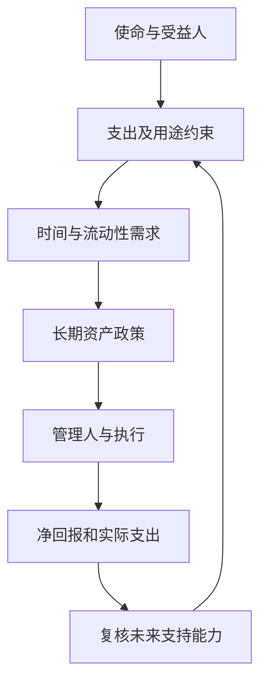
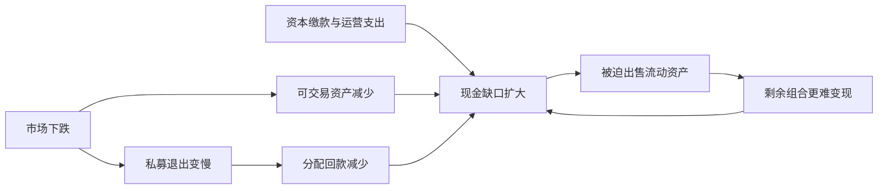

# 《机构投资的创新之路》：先建立制度，再讨论资产比例

> 作者：大卫·斯文森（David F. Swensen）。对应英文 **Pioneering Portfolio Management: An Unconventional Approach to Institutional Investment**，原版 2000 年，本文主要参考出版社可核验的 2009 年修订版介绍、公开导论及目录。它不同于作者面向个人的 *Unconventional Success*。中文具体译本、页码未确认。本文是**基于公开资料的系统导读**，未取得全书，不能替代逐章精读。书中的制度框架与下文 2009、2025 年案例、组合计算及个人应用补充分别标明。

这本书最有价值的问题是：如果一笔资产要持续支持一所大学，既不能停止今天的支出，也不能透支未来几代人的利益，该怎样投资？答案不仅是“买什么”，还包括谁有权决策、怎样选择管理人、如何保证付得出钱、怎样评价结果。个人读它，最值得带走的是目标、约束、治理和激励分析，而非照抄耶鲁的私募投资比例。

## 阅读地图

公开目录包含捐赠基金的目的、投资与支出目标、投资哲学、资产配置及管理、传统与另类资产、投资过程等主题。下面按决策顺序重组为 32 点，不冒充原书逐章摘要。[出版社版本与导论](https://www.simonandschuster.com/books/Pioneering-Portfolio-Management/David-F-Swensen/9781416544692)，[2009 年目录预览](https://books.google.com/books/about/Pioneering_Portfolio_Management.html?id=SbIz2gRbrF4C)。

## 一、先确定这笔钱为什么存在

### 1. 永续资金的目标是持续购买力，而非某一年排名

大学支付的是教师、实验设备和助学金，未来这些东西的价格会变化。因此，只守住名义本金，未必守住了教育能力；只追求今年高收益，也可能伤害以后提供服务的能力。

这同时约束过度保守与过度冒险。现金可能避免近期市场波动，却不能自动抵御长期实际支出增长；大比例高风险资产可能提高预期增长，却使预算遭遇冲击。投资目标必须同时说明支出、通胀、时间与可承受的不确定性。

### 2. 捐赠基金不是一只可以随便支取的大钱包

**真实制度案例。** 耶鲁公开说明，约 75% 的捐赠资金带有指定用途，例如奖学金或研究。资金管理可以集中，法律用途却未必可以互换。学校有巨额资产，不意味着任何部门都可以即时使用全部资产。[耶鲁捐赠基金说明](https://www.yale.edu/funding-yale-home/overview-yales-endowment)。

个人对应的启发是把“属于我”与“可以用于此目的”区分开：有抵押的资产、共有财产、必须履行的支出、短期不可退出的投资，都不能全部当作随时可用的资金。这是约束分析，不是把家庭等同于大学。

### 3. 代际公平把今天和未来的受益人放在同一张表上

支出太少，当前学生和研究项目得不到资源；支出太多，未来的人承担代价。投资目标由此带有价值选择，不存在只凭历史收益率就能计算出的唯一正确答案。

家庭中也有类似冲突：当前生活、子女教育、自己的养老需要共同协调。但家庭生命周期有限、就业收入不稳定，与持续招生和接收捐赠的大学差别很大，不能直接采用同一支出率。

### 4. 真实回报必须覆盖支出、通胀和管理成本

一个粗略理解是：长期名义回报需要支撑实际支出率、通胀和成本，但这些量不能在有波动、提取与税费时简单相加后当作保证。

**数学演示。** 年初资产 100，年末投资后先增长 7%，再支出 5，剩余 102；若物价上涨 3%，其期初购买力为 102÷1.03≈99.03。账户金额增长了，实际资本却减少约 0.97%。支出发生的时间不同，结果也不同。本例解释口径，不是在推荐 5% 提取。

### 5. 支出平滑是预算工具，不是创造收益的方法

若今年市场上涨就同步扩张全部固定预算，明年下跌便可能被迫裁减。支出平滑把前期支出和基金规模等信息结合，使预算调整更缓慢。耶鲁当前公开说明其规则对上一年度支出赋予较大权重；这是现行制度说明，不应倒写成各历史年份完全相同的规则。[耶鲁支出政策概览](https://www.yale.edu/funding-yale-home/overview-yales-endowment)。

平滑只是把冲击延后和分散。资产大跌后，如果仍维持原支出，提取占资产的比例会上升，必须进一步检查可持续性。它保护短期运营，却可能增加中期调整压力。

图为决策关系示意：资产比例位于使命和约束之后。只看收益率，无法判断这套计划是否完成任务。

## 二、长期配置为什么要同时讨论风险与治理

### 6. 权益导向意味着参与生产性资产，也意味着承受亏损

股票、非上市企业和部分实物资产可以分享经济活动增长，适合研究长期实际回报来源。但权益持有人的索取权通常排在债权人之后，经营失利可能直接侵蚀本金。

长期资金能承受一定波动，不意味着它天然承受得起任何损失。资金期限长只是一个条件，还需要现金安排、治理稳定、投资能力与合理买价。

### 7. 配置政策、主动选择和市场择时是不同决策

长期决定股票、债券及其他风险来源的比例，属于政策；在某类资产中选择管理人或证券，属于主动选择；因判断短期涨跌而改变风险暴露，属于择时。

如果一个组合赚钱，必须分清市场普涨、承担更多风险、选择能力和时点运气。否则会把牛市奖励当作可以长期复制的技能，并在下一轮扩大风险。

### 8. 资产类别的名字不能代表真正的分散

股票、房地产基金、收购基金看上去不同，却可能一起依赖经济增长、低融资成本和顺畅退出。分类应看最终现金流和融资机制，不能只看产品名称。

分析时问：谁付钱？付款依赖什么？是否使用杠杆？需要谁接盘？负债何时到期？这些问题比“我买了五种基金”更能解释共同风险。

### 9. 2009 年耶鲁亏损说明长期优势不能取消短期冲击

**真实历史案例。** 耶鲁于 2009 年 9 月披露，截至当年 6 月 30 日的财政年度回报为 **−24.6%**，并说明权益暴露和非流动性损害了表现。其“绝对回报”类别当年也为负。这里使用当时公告口径，不混入后续调整数据。[耶鲁 2009 年公告](https://news.yale.edu/2009/09/22/yale-university-releases-endowment-figures)。

它说明两件事可以同时成立：一个机构长期成绩较好；它在危机中仍会遭受严重回撤。批评“有亏损就证明模型无效”过于简单，宣传“多资产就不会大跌”同样错误。正确问题是：风险是否事先可承受，现金是否够，组织能否坚持有依据的政策。

### 10. 固定收益不能只按票息分类

高信用质量、币种匹配且期限适当的债券，可能服务于稳定和付款；高收益信用债则可能更依赖企业盈利与融资环境，危机时呈现权益式风险。

债券还包含利率、信用、通胀、货币和流动性风险。提高票息可能只是增加信用风险，并没有改善“危机中可用”的属性。应先确定债券承担什么任务，再比较产品。

### 11. 资产估值不频繁，不等于实际风险较低

公开股票每天交易，私募和地产可能季度估值。后者曲线较平滑，部分原因可能是价格更新迟缓，而非经济价值没有变化。

将两种不同频率的数据直接计算相关性，容易高估分散效果。压力分析应考虑共同的经营、利率和融资冲击，并区分账面估值、可出售价格与强制出售价格。

### 12. 再平衡需要流动性，也需要授权

价格变化使风险比例偏离政策，再平衡用于恢复约定风险。在恐慌中买入下跌资产，若缺乏预算和授权，投资负责人可能既没有现金，也无法获得委员会支持。

因此，再平衡不能只写“低买高卖”。应预先定义触发条件、可交易资产、资金来源、审批权限和例外程序。对无法及时出售的私募，目标比例只能通过较长周期的承诺计划调整。

## 三、另类投资：回报以外的合同和现金流

### 13. 另类资产的吸引力依赖能力，不是名称自带超额收益

信息不充分、交易复杂的市场，可能给优秀研究者提供机会，也可能让普通投资者更难看清成本和风险。非公开市场的价格发现较弱，并不自动对所有参与者有利。

“机构有机会获取优秀管理人”和“任何人买一只同类产品都能复制成绩”之间，隔着进入资格、选择能力、费用、团队稳定和资金耐心。个人不能把产品类别当作耶鲁能力的替代品。

### 14. 非流动性不是免费收益，更不是必然溢价

投资者可能要求补偿无法随时退出的不便，但卖方不会因为锁定期长就保证支付额外回报。价格、竞争、收费和资产质量都可能吞掉这种补偿。

特别要区分：因为主动选择并有能力承担而锁定资金，和因为销售承诺而被动套住资金。前者仍可能亏损，后者更不能用“长期主义”掩饰判断错误。

### 15. 资本承诺不等于已付款，也不等于可随时取消

私募基金常先取得投资者的资本承诺，之后按项目需要通知缴款。账上尚未付出的金额，看似仍是现金，实际上已有潜在用途。它不能同时被当作应急资金和新增投资额度。

**数学演示。** 可交易资产 40，未缴资本承诺 20，未来一年刚性支出 8。若基金集中要求缴款，且可交易资产下跌 25%，可变现资产仅 30；扣除缴款与支出只剩 2。整体账面净资产可能很大，现金余量却接近耗尽。这里未计新增收入与融资，目的是显示承诺的约束。

### 16. 分母效应使没有加仓的私募比例也会升高

公开资产下跌很快，私募估值调整较慢，分母先缩水，私募占比便上升。如果仍按旧计划投入，会继续挤压流动资产。

**数学演示。** 公开资产 60、私募 40，私募占比 40%。公开资产下跌一半而私募暂未调价，总值变为 70，私募占比升至 57.14%。这不证明私募保值，也不证明管理人主动增配；可能只是估值时点和分母变化。

### 17. 流动性压力测试要把坏情况放在同一时间

平时单独看支出、资本缴款和市场下跌，可能每项都能应对；危机中它们可能同时发生，而捐赠或经营收入还会下降。测试应联合考虑这些冲击。

可按月份列出：不依赖卖资产的现金收入、刚性支出、可能缴款、到期债务、可用现金及有折价后的可出售资产。再区分“预计收入”与“已承诺可用”。融资额度不是永恒现金，合同条款和对手方也要检查。

图为压力传导示意，并非每次危机都会走完整链条。关键在于，卖掉最容易卖的资产可能解决今天的付款，却让明天更脆弱。

### 18. 私募收益要同时看金额、时间和未实现估值

内部收益率 IRR 是让各期现金流折现后净现值为零的收益率，容易受现金流时间影响；投入资本倍数说明收回或估计价值相对投入有多少，却忽略持有时间。两者必须配合看。

**数学演示。** 投入 100，三年后回收 150，资本倍数是 1.5，年化约 14.47%；若十年后才回收 150，倍数仍是 1.5，年化却约 4.14%。未退出资产估值也不是已到账现金。因此，还需分开已分配金额、剩余账面价值，并与相同时间现金流的公开市场替代方案比较。

### 19. 绝对回报是目标，不是保本条款

对冲基金可能通过多空、套利等方式减少某些市场风险，但仍可能留下融资、基差、模型、拥挤交易、对手方风险。低方向敞口并不保证危机中不亏损。

尽调要问哪些风险被对冲，哪些仍保留；对冲能否在极端行情执行；保证金从哪里来。不能把“对冲”“市场中性”当作无需分析的安全词。

## 四、选管理人，其实是在选人、组织和激励

在具体合同中，还应分别看市场风险限制、赎回条件和融资安排。低净股票敞口可能同时包含很大的多头与空头总额，价格相对变化或借券条件改变仍可能造成损失。若投资者只能季度赎回，底层交易又依赖每天补充抵押，两个流动性层次也不能混在一起。

这类分析的目的不是判断所有对冲基金都不好，而是要求名称背后有可说明的机制。只要自己无法识别主要损失路径，就不应仅凭机构持有或历史曲线平滑，把它当作现金替代品。

### 20. 先解释投资过程，再看收益排名

可重复的过程应该说明机会从何而来、研究怎样检验、买卖由谁批准、错误如何处理。只有历史曲线而没有机制，难以判断结果是技能、风险暴露还是偶然。

可以要求管理人解释失败投资及当时已有的信息。事后总能讲圆的故事价值有限；持续记录决策假设与证伪条件，更有助于判断是否真正学习。

### 21. 组织稳定与容量会改变策略效果

优秀团队人员离开、激励变化、规模过大，都可能改变未来能力。小资金容易进入的机会，在资金扩大后未必有足够容量。

因此，选择不能只验证“过去是谁做出的成绩”，还要问“未来是否仍由同样的人、在类似约束下执行”。名牌、创始人声望和短期排名不能代替这些检查。

### 22. 利益一致必须落实为合同，而非口头承诺

跟投可以让管理人与客户共同承担风险，但仍要检查是否可提前退出、是否获得不同条款、其他收入是否大于跟投损失。评价激励要看完整收入结构。

管理费、业绩提成、项目收费、交易分成、关联服务和费用分摊可能同时存在。只谈一个表面费率，无法知道投资者最终支付多少。

### 23. 黑石费用披露案：总收益之前先看谁拿走了现金

**真实监管案例。** 美国 SEC 在 2015 年有关黑石顾问实体的和解行政决定中认定，提前收取某些投资组合公司未来监控费等做法未获充分事前披露；相关实体在不承认或否认认定的基础上和解。这是特定实体与期间的案件，不是对全部私募的定性。[SEC 原始决定，2015-10-07](https://www.sec.gov/litigation/admin/2015/ia-4219.pdf)。

机制在于：钱即使不从投资者账户直接扣，也可能先从被投企业支付，降低企业价值和最终可分配金额。阅读材料时应穿透“基金层面费用”和“项目层面费用”，检查抵扣规则、关联关系与批准程序。它证明费用治理重要，不能单凭该案推断某机构今日仍有相同行为。

### 24. 尽调同时检查投资、运营和法律

投资尽调研究策略是否可信；运营尽调检查估值、托管、资金划付、审计和人员权限；法律尽调明确赎回、违约、争议处理及投资者权利。

三者不能互相替代。一个人很会选股，不等于组织能可靠处理资金；一家知名审计机构出具报告，也不等于所有投资逻辑和未来收益得到保证。

### 25. 良好治理要容许合理的短期落后

若委员会要求任何一年都超过当年最强市场，组合最终可能追涨并失去分散。长期策略需要明确评价周期和可以接受的偏离范围。

但容忍短期落后不应变成拒绝问责。重大人员变化、偏离授权、信息不透明、风险持续超标，可以在收益尚好时触发审查。评价应同时看结果与过程。

## 五、怎样评价成绩，怎样转化为个人财商

### 26. 基准必须与承担的风险和资金用途匹配

权益导向、含私募的组合，直接和短期存款比较容易显得优秀；与某一年最强股票指数比较，又可能掩盖它承担不同使命。基准应在投资之前确定，而不是事后选择最有利的参照。

至少检查净费用、同一期间、币种、杠杆、流动性和估值频率。机构之间还有捐赠和支出差异，资产规模增长不是投资回报率。

### 27. 2025 年耶鲁数据怎样读才不混淆

**真实近期案例。** 耶鲁 2025 年 10 月公告：截至 2025 年 6 月 30 日财政年度，扣费后回报 **11.1%**；期末基金价值 **441 亿美元**，向运营预算分配 **21 亿美元**；过去十年年化为 **9.4%**。这些是不同性质的指标，不能互相替代。[耶鲁 2025 财年公告](https://news.yale.edu/2025/10/24/yale-reports-investment-return-fiscal-2025)。

不能用期末价值变化简单反推收益率，因为分配、捐赠等会影响规模；不能把一年的回报当成稳定利率；也不能将 2025 年表现全部归功于已于 2021 年去世的斯文森。制度延续、后任团队、市场条件与资产估值共同作用。

### 28. 个人最能复制的是流程，最难复制的是准入与组织

| 可以学习的能力 | 需要重新判断的机构条件 |
|---|---|
| 先写目标，再选产品 | 永续期限与持续捐赠 |
| 控制费用和利益冲突 | 顶级管理人准入和议价 |
| 分散真实经济风险 | 专业团队和尽调预算 |
| 预留现金并检验压力 | 资本承诺、特殊税制和融资 |
| 用固定政策减少追涨杀跌 | 委员会长期授权和组织稳定 |

个人不必通过复杂产品证明自己理解了这本书。使用易懂、低成本、可核验的工具完成目标，也可以体现同样的制度精神。

### 29. 写一份投资政策说明，比寻找耶鲁最新仓位更有价值

说明书至少记录：资金目的和时间，必须保留的付款能力，允许与禁止的风险，资产范围及调整条件，费用上限的判断方式，谁能改变政策，以及哪些事件需要复核。

**补充应用。** 不替用户假定仓位比例。先给每笔未来支出标日期，再识别可长期承担波动的资金；之后才研究可用工具和组合。若前两步不清楚，所谓最优比例只是脱离任务的数字。

### 30. 用一页压力表暴露最脆弱的一环

将市场下跌、收入下降、额外支出、无法赎回和债务到期列成不同情景。每个情景写“需要多少现金、从哪里来、需要多久、有什么条件”，而不只是写可能亏多少。

如果方案只有“等市场恢复”，还不能证明可以执行；如果必须靠新融资，应把融资可得性本身作为不确定条件。目标是先发现被迫行动的触发点。

### 31. 将能力边界写进决策，而非事后解释

没有研究条件的资产，可以不纳入组合；看不懂收费条款，可以暂停判断；无法持续跟踪管理人的产品，即使过去回报好，也可能超出自己的能力范围。

这不是认定复杂资产必然差，而是承认优势具有条件。机构投资的专业性，恰恰表现为知道哪些能力必须长期投入资源才能建立。

### 32. 读完应能独立回答的五个问题

这笔钱服务谁？何时必须付钱？预期回报来自哪种经济风险或能力？管理人与我是否存在利益冲突？若市场和现金流同时恶化，谁有权按什么规则行动？

能回答这些问题，便从模仿投资名人，转向设计可执行的决策制度。这是本书对提高财商最可迁移的贡献。

## 练习与参考答案

**一：私募资产没有调价，而公开资产大跌，私募占比上升是否说明私募取得超额收益？** 不一定。可能包含估值滞后和分母效应，需要看最终现金流及可交易价值。

**二：一只基金资本倍数为 1.8，是否一定比 1.5 好？** 不能独立判断。还缺少持有时间、费用、风险、已实现程度和投入时间。

**三：总资产很多，却付不起明年的缴款，问题在哪里？** 总资产与可用现金不相同；要重新检查未缴承诺、退出限制、收入压力和资产变现折价。

**四：个人是否应按耶鲁比例配置私募？** 单凭机构历史成绩不足以支持。个人目标、期限、产品准入、流动性和研究能力通常不同，应先完成自己的约束分析。

## 资料范围与关联阅读

本文依据公开导论、目录、大学披露和监管原件建立概念导读；未声称核对全书每个案例。2009 与 2025 年数据为各自财政年度历史事实，现行政策另标，不形成具体产品建议。可衔接[《聪明的资产配置》](<../聪明的资产配置 - 威廉·伯恩斯坦/读书笔记.md>)和[《投资四大支柱》](<../投资四大支柱 - 威廉·伯恩斯坦/读书笔记.md>)，把机构治理与个人组合数学区分开读。
