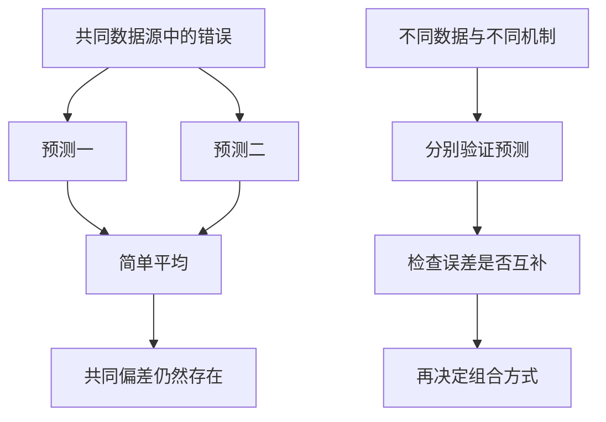
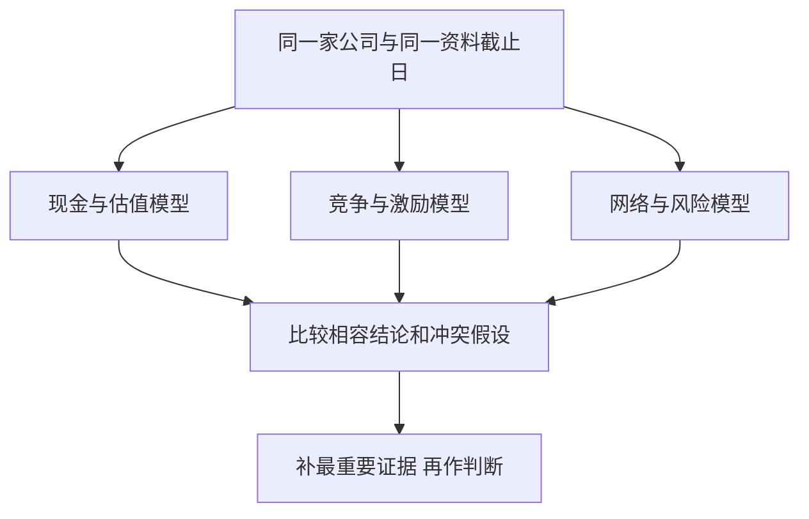

# 《模型思维》：用多个可检查的机制，避免一个故事解释一切

> 作者：Scott E. Page，斯科特·佩奇。原作 *The Model Thinker: What You Need to Know to Make Data Work for You*，2018 年初版；2021 年扩展版增加了疫情等新讨论。用户中文版本未确认。  
> 依据：出版社、授权目录、原始模型论文与预测研究。未取得完整原书，属于公开资料系统导读，按主要模型家族整理 34 点，不提供所有模型的完整数学证明。2021 年新增主题与 2018 年初版分开说明。  
> 研究中的模拟、数学定理、真实数据比赛与现实制度不是同一种证据；本篇逐项区分。财商应用为补充。更新：2026-11-12。

## 一句话理解本书

面对复杂问题，不要寻找一把能够打开所有门的钥匙。用不同模型提出不同问题，比较它们的解释、预测和遗漏，再形成与证据相称的判断。

模型是一种有目的的简化：保留某些变量、关系和规则，忽略其他部分。它可以帮助分类、解释、预测、设计、交流或探索可能性。预测准的模型未必解释因果；解释机制的模型也未必能给出准确价格。

对财商的价值，在于同时看到估值、竞争、网络、风险分布、反馈与学习。例如只用“低市盈率”研究企业，会漏掉盈利周期和资本需求；只用“网络效应”研究平台，会漏掉成本、治理和购买价格。

## 模型家族与阅读方式

| 家族 | 主要主题 | 用在财商哪里 |
| --- | --- | --- |
| 概率与统计 | 正态、长尾、线性、不确定性、随机游走 | 理解数据与风险分布 |
| 动态系统 | 马尔可夫、反馈、阈值、路径依赖 | 理解经营与市场变化 |
| 个体与互动 | 选择、空间、博弈、合作、机制、信号 | 理解客户、竞争和激励 |
| 网络与群体 | 扩散、局部互动、集体行动、多样性 | 理解规模、传染与集体结果 |
| 搜索与学习 | 学习、多臂老虎机、崎岖景观 | 分配研究与试错资源 |

主题范围参照[出版社扩展版](https://www.hachettebookgroup.com/titles/scott-e-page/the-model-thinker/9781541675711/)及[授权图书目录](https://books.google.com/books/about/The_Model_Thinker.html?id=iWRPDwAAQBAJ)。

## 核心知识点

### 1. 模型的价值取决于任务，不取决于有多复杂

地图省略树木细节，仍能帮助找路；财务模型省略某些日常活动，也可能解释现金需求。关键是省略部分是否影响当前问题。

使用模型前先写用途。若只需判断资金会不会在债务到期前耗尽，现金时间表可能比复杂估值更有用。若研究竞争策略，仅有利润预测又可能不够。复杂度应由任务和证据决定，而不是由展示专业感的需要决定。

### 2. 一个模型会强调一种机制，也会遮住其他机制

供需模型关注价格与数量，博弈模型关注相互反应，网络模型关注连接结构，现金流模型关注资金创造与分配。它们可以描述同一对象的不同部分。

因此发现一个模型有用，不代表其他模型都多余。要主动问它把哪些因素当成固定背景；现实若正在改变这些背景，就需要补充模型，而不是反复调整同一公式的参数。

### 3. 多模型不等于术语大集合

有效的多模型分析应让每个模型回答不同但相关的问题，并用共同事实约束它们。不能遇到上涨就讲趋势，遇到下跌就讲均值回归，却没有事前说明何时采用哪种解释。

可以把模型分成相互补充与相互竞争两类。前者分别解释价值和流动性等不同层面，后者争论同一现象由哪种机制驱动。竞争模型需要比较预测和证据，而不是同时宣布全都正确。

### 4. 模型要写明变量、规则与边界

“用户多所以价值高”还只是口号。需要明确用户指活跃还是注册，价值指收入、使用效用还是股权价值，增长怎样产生收益，以及成本如何变化。

最好同时写一个失效条件：如果新增用户主要是补贴吸引、留存不足，网络增长可能不转成利润。模型边界写得越清楚，就越容易决定下一步补什么资料。

### 5. 多样性定理不是“随便找不同的人就一定更好”

**真实研究：Hong 与 Page 2004 年论文。** 研究构建了问题表征与搜索方法不同的求解者，给出在特定条件下，具有功能多样性的群体可以超过由单独表现最佳者组成群体的结果。它包含数学与模型分析，不是一项对所有真实团队随机抽样的普遍结论。[原始论文](https://bactra.org/sloth/HongPagePNAS.pdf)

机制是大家若擅长相似路径，就可能一起停在相同的局部答案；不同路径能发现彼此遗漏的解。但前提包括成员具有相关能力、问题足够复杂，以及协作和搜索条件合适。

对研究团队，应该追求有内容的互补：有人懂行业、有人查财务、有人检查统计与反证。人口背景差异可能影响经验，但不能与功能差异简单画等号。也不能把沟通成本、错误信息和协调问题从现实中删除。

### 6. 集成预测有效，关键在误差是否互补

把多个预测平均，有时能抵消各自错误。如果它们都依赖同一错误信息，就可能只是把同一个错误说得更自信。

**数学演示：**两个等权预测误差的方差为 `¼Var(e1)+¼Var(e2)+½Cov(e1,e2)`。各自误差大小相同而协方差较低时，平均误差可能更小；共同偏差则不会因为平均自动消失。这是平方误差框架的示意，不是保证任何组合都更准。

实际整合研报时，要追踪数据源、模型假设与估值方式。十份复制相同盈利预测的报告，提供的独立信息可能远少于十份。



左侧说明数量增加不自动带来信息独立；右侧说明组合之前先检验差异是否真实、是否有帮助。不能为追求不同而加入明显低质量的预测。

### 7. M4 预测竞赛：用样本外表现比较模型

**真实数据研究。** M4 竞赛使用 100,000 条真实时间序列，对多种方法进行统一评价；正式研究比较了 61 种预测方法，并同时关注点预测与区间。结果强调组合与混合方法的竞争力。[正式论文](https://doi.org/10.1016/j.ijforecast.2019.04.014)、[组织方项目说明](https://www.unic.ac.cy/iff/research/forecasting/m-competitions/m4/)

值得学习的是比较制度：在结果尚未知时提交预测，用共同指标评价，而不是事后挑一段最有利的数据。历史拟合漂亮，未必意味着未来预测好。

也不能把某次竞赛名次当作所有领域永久排名。任务、期限、数据频率、评价函数和成本都会影响结果。股票价格、公司销量与物流需求不是同一个预测问题，模型迁移需要再次验证。

### 8. 正态分布：适用于某些聚合规律，不是自然界默认答案

很多较小、相对独立的影响相加，在适当条件下可能形成接近钟形的分布。它帮助描述中心位置与离散程度。

但中心极限定理有条件，不能据此宣布极端风险都可以用一个固定倍数的标准差描述。依赖、结构变化和厚尾，都可能让简单正态模型低估尾部。先检查分布形成机制，再选方便的曲线。

### 9. 长尾：少数大结果可能改变整体结论

当极端结果占重要份额，平均数与典型个体经历可能分离，少量样本也不稳定。研究创业、热门作品或个股财富创造时，需要留意这种结构。

这不意味着每个长尾变量都有同一幂律参数，也不意味着发现尾部就能预测下一个赢家。可行应用是检查收益是否依赖少数极端样本、失败者是否缺席，以及损失是否有无法恢复的部分。

### 10. 线性模型：局部近似与整体规律要分开

线性模型把结果写成因素的加权和，容易解释与估计。它适合提供第一层近似，也能揭示变量之间的条件关系。

如果产能接近瓶颈、债务触发契约、客户采用达到阈值，关系可能改变。把正常范围的斜率延伸到极端状态，会忽略机制切换。模型报告应说明训练范围与外推范围，不能只给一个相关系数。

### 11. 凹性与凸性：平均输入不一定产生平均输出

若函数是凸的，在合适条件下波动会提高平均输出；若是凹的，方向相反。关键是作用函数，而不只是输入的平均值。

**数学演示：**令输出为平方函数，输入在 1 和 3 之间等概率变化，平均输入为 2，平均输出却为 `(1²+3²)/2=5`，大于 `2²=4`。这是纯数学例子，不是一项真实投资收益。

投资应用要进一步看价格、费用和损失约束。某种收益结构具有凸性，买入成本仍可能过高；某种经营投入存在递减收益，也不表示投入没有价值。形状告诉你怎样比较，不能替代完整决策。

### 12. 价值与权力：贡献取决于合作结构

一个成员的价值不只看它单独能做什么，也看加入或退出以后，整体能力怎样变化。谈判权还受替代选择、稀缺资源与合作规则影响。

研究企业利润分配时，可以问价值由谁创造、谁拥有不可替代的环节、谁能够拒绝交易。产品受欢迎不等于生产者拿到全部经济利益，渠道、供应商、平台和客户可能分享或转移收益。

### 13. 投资组合：共同变化比资产数量更关键

**真实理论研究：Markowitz 1952 年《Portfolio Selection》。** 论文把单项收益与组合风险联系起来，强调方差与协方差在组合选择中的作用。它是有明确假设的理论框架，不是历史数据保证未来安全。[原始论文](https://onlinelibrary.wiley.com/doi/full/10.1111/j.1540-6261.1952.tb01525.x)

两个等权资产若都具有波动尺度 σ，且相关系数为 ρ，组合方差为 `σ²(1+ρ)/2`。相关接近 1 时，数量增加带来的分散效果有限；相关较低时，可以降低部分共同波动之外的风险。

但协方差是需要估计的，可能随环境变化；方差也不能覆盖流动性、违约和个人资金期限。多模型思维意味着用组合模型处理共同波动，再用偿债和压力模型补足它没有描述的风险，而不是把任一模型当成全部风险定义。

### 14. 网络模型：位置与连接会改变影响力

网络不只数节点，还看谁连着谁、连接有多强、是否存在枢纽、桥梁与集中依赖。同样规模的网络，可以有完全不同的脆弱性。

供应链、支付系统和客户推荐都可用网络思维提问。拥有很多供应商不一定分散，如果它们依赖同一上游来源；拥有很多客户也未必独立，如果它们共享同一融资渠道。画关系比简单数数量更有信息。

### 15. 广播、扩散与传染对应不同的增长过程

广播由一个源头向很多人传递；扩散可能依靠接触、学习或采用；传染常包含状态随接触而改变的动态。不同机制需要不同参数与干预方式。

产品增长若依赖持续广告，就不能无条件套用自发扩散曲线；传播很广也不等于付费率高。研究时把触达、尝试、留存与付费分开，确认哪个环节在增长。

### 16. 不确定性模型要区分随机性与知识缺口

某些波动是已知机制下的随机变化，另一些不确定来自参数未知、模型遗漏或规则改变。二者对行动的意义不同。

前者可以在条件合理时用概率分布描述，后者还要做模型比较、敏感性分析与容错安排。把所有未知都硬塞成一个精确概率，会掩盖知识边界；完全拒绝概率，也会失去可用的比较工具。

### 17. 随机游走：不可轻易预测，不等于结果没有风险

随机游走描述状态由连续随机增量积累的过程。即使每步平均变化为零，路径仍可能偏离起点很远；波动与时间共同影响分布。

股票分析中的“难预测”也不等于“价格永远合理”或“长期一定回本”。一个统计模型主要描述特定规律，不自动证明全部经济解释。需要检查漂移、相关、厚尾和结构变化是否被忽略。

### 18. 马尔可夫模型：用当前状态描述下一步转移

模型假定在指定状态信息足够时，下一步分布不再依赖更早历史。关键是状态怎样定义，而不是现实真的没有记忆。

可用于理解客户从试用到留存或流失、信用等级变化等过程。若遗漏客户使用时长或经济环境，简单转移概率可能不稳定。不能把过去估计的转移矩阵当作永恒规则。

### 19. 系统动力学：存量、流量与反馈共同生成路径

存量记录积累，流量改变积累，反馈又影响未来流量。增长、振荡和停滞可能来自结构，而不是每次都有新的外部原因。

资金占用、产能建设与需求变化尤其需要时间维度。订单增加到实际交付可能有延迟，扩张先消耗现金、后产生收入。只看当期增长率，会漏掉路径中的资金约束。

### 20. 阈值模型：渐进变化可能引发突然跃迁

当个体决策依赖其他人参与到什么程度，系统可能存在临界区域。条件逐步变化，集体行为却可能快速切换。

这种模型帮助理解采用、退出和挤兑的可能机制，但不能仅凭一个故事就定位精确阈值。临界参数、网络结构和外部冲击需要证据。看到突然变化，也不意味着此前一定没有可观察的积累。

### 21. 路径依赖：历史顺序可能改变最终结果

如果早期选择会改变后续成本、信息或协调方式，相同初始资源也可能走向不同结果。学习、切换成本和反馈都能产生这种现象。

历史重要不等于历史决定一切。技术替代、规则变化和新的协调机会仍可能打破原路径。对企业护城河，既要研究它如何积累，也要研究什么条件能降低客户切换成本。

### 22. 局部互动可以产生没人整体设计过的结果

**真实模型研究：Schelling 1971 年居住分隔模型。** 论文通过模拟和分析展示，在特定邻里选择规则下，个体相对温和的偏好可以产生明显的整体分隔。这是抽象模型，不是真实城市全部原因的实测分解。[原始论文](https://acoustique.ec-lyon.fr/chaos/Schelling71.pdf)

重要机制是每次移动会改变别人的邻里条件，进一步触发移动。整体结果不能简单从单个人的偏好强度读出。

研究现实城市仍需要考虑收入、制度、歧视、住房供给与历史。模型的贡献是证明一种机制能够产生某种结果，而不是证明该机制解释全部观察。这也是投资研究应保留的区别：可行故事与实际主导原因不相同。

### 23. 均衡不一定最优，也不一定稳定

均衡通常指在规定规则下没有进一步改变的动机或趋势。它可能稳定，也可能对扰动敏感；可能使各方接受，也可能共同陷入不理想状态。

李雅普诺夫函数等工具在满足条件时可以帮助分析系统是否向某种状态靠近。读者应把它理解为检验动态性质的方法，不要把数学上的稳定等同于经济上的公平、健康或永久存在。

### 24. 空间与属性选择：产品竞争不只围绕一个价格

消费者在地点、质量、便利、风格和服务等属性上有不同偏好。产品的位置与差异化，会影响竞争强度和客户选择。

研究公司时，不要只比较功能清单。客户选择的关键属性、替代成本和预算可能不同。市场规模也不等于每家企业能获取的收入，因为定位与交付能力限制了可服务范围。

### 25. 博弈模型：你的行动会改变别人下一步

当结果取决于多方选择，不能把其他人当作不会反应的背景。价格、产能、谈判和平台规则都可能改变对手激励。

纳什均衡描述在其他人的策略给定时，没有参与者愿意单独偏离的状态；它不是每个人都满意，也不保证现实能到达。实际分析需说明信息、时序、可承诺动作与重复关系，而不是只画一个收益矩阵就下结论。

### 26. 合作与集体行动：个人最优可能损害共同结果

公共资源、行业标准和团队研究都可能出现搭便车与协调问题。重复互动、可观察行为、可信规则和责任安排，有时能支持合作。

不能把所有人都假设成短视自利，也不能只靠善意忽略激励。研究合作能否持续，应看违规如何被发现、成本由谁承担、退出是否容易，以及规则是否被参与者认可。

### 27. 机制设计：改变规则来改变可预期行为

与在既定规则下求最佳行动不同，机制设计问怎样设置信息、支付与分配规则，使参与者的行动更接近目标。

在个人财务中，自动记录和事前限额是简单制度设计；在企业中，奖励收入而不考虑回款，会与奖励现金质量产生不同诱因。好的规则需要检查参与者如何响应和规避，不能只看设计者希望发生什么。

### 28. 信号模型：昂贵行为何时能传递信息

某种行为能够成为信号，通常因为不同类型的人或企业承担它的成本不同。信号不是越贵越可信，也不是任何公开承诺都值得相信。

高分红可能表达现金能力，也可能消耗未来投入；管理层持股可能加强利益连接，也可能伴随集中控制。应研究信号为何难以伪造、是否有替代解释、成本最终由谁承担，而不只看表面姿态。

### 29. 学习模型：反馈怎样改变行动

学习可能通过试错奖励、观察他人、贝叶斯更新或规则调整发生。不同方法适合不同信息条件。

如果结果延迟、噪声很大或行动难以重复，直接按上一次输赢修改规则可能学到错误东西。应区分结果反馈与过程反馈，记录当时信息，并检查环境是否变化。学习得快也可能只是更快适应最近噪声。

### 30. 多臂老虎机：探索新方法与使用已知方法之间的取舍

这一模型讨论有限资源怎样在了解未知选项和使用当前最好选项之间分配。完全不探索可能错过更好方案，永远探索又可能付出太多成本。

对财商训练，可以把新方法先放在低影响、可记录的纸面研究中，设定观察指标和退出条件。不能把这个模型简单翻译为用真实资金随机买股；实验对象的可逆性、风险和可重复性必须先满足要求。

### 31. 崎岖景观：局部改进可能把你困在局部最优

当多个决策相互影响，改善一个变量可能损害其他变量。只做相邻小调整，可能无法到达更好的整体组合。

这解释了为什么有时需要同时考虑商业模式、组织与技术，而不是只优化单一成本。但“大幅改变”也不是天然更好，可能带来巨大风险。可行方法是比较不同结构、分阶段试验，并保留失败后的调整空间。

### 32. 复杂现实常需要模型分工，而不是一个巨型公式

2021 年扩展版把疫情等问题纳入多模型讨论。此类议题同时包含传播、行为、网络、资源和不平等，单一机制难以覆盖全部后果。

本文不复述未经逐章核对的新案例数字。可迁移的方法是拆分任务：哪个模型解释传播，哪个解释行为反应，哪个评价资源约束？模型间的假设应协调，不能一边假设行为固定，一边把行为变化当作主要结论。

### 33. 做一份企业研究，至少保留三张不同的图

一张解释业务与现金，一张解释竞争和参与者反应，一张解释风险与反馈。它们共同约束结论，但不必强行合成一个精确分数。



如果估值模型要求持续高增长，而竞争模型预期价格战，就不能只保留喜欢的一边。冲突是下一步研究入口。

### 34. 模型检查卡：让简化有责任

```text
模型服务的问题与使用期限：
变量、单位、规则和边界：
核心机制与原始证据：
哪些因素被当作固定背景：
对参数、样本和分布有什么要求：
能解释哪些事实，不能解释哪些事实：
与哪个替代模型比较：
样本外或新资料如何评价：
什么条件出现时停止使用：
```

每次选两三个真正相关的模型即可。多模型思维的目标是扩大可检查的视野，不是把每个问题变成难以执行的研究工程。

## 练习与参考答案

**题一：**十份预测来自同一盈利数据库，平均以后是否就很稳健？不一定。共同数据错误与共同假设会形成相关误差，平均不能自动消除。

**题二：**模型证明温和偏好能够产生分隔，是否证明现实分隔全由温和偏好造成？不是。模型展示一种可能机制，现实归因还需数据和对替代机制的检验。

**题三：**持有二十只同一产业链股票，是否显著分散风险？不能仅按数量判断。需要检查共同客户、融资、商品价格与供应来源，也要考虑相关关系在压力下的变化。

## 边界与衔接

本书涵盖许多模型，笔记侧重它们如何提出问题及何时失效，不能替代概率论、计量经济学、优化和博弈论的完整训练。原始定理与研究只按已核对的范围介绍，不把数学模型写成现实必然规律。

接着用[《为什么》](<../为什么 - 朱迪亚·珀尔、达纳·麦肯齐/读书笔记.md>)检查因果，用[《系统之美》](<../系统之美 - 德内拉·梅多斯/读书笔记.md>)检查反馈，再用[《投资估价》](<../投资估价 - 阿斯沃斯·达摩达兰/读书笔记.md>)学习把经营判断转成现金与价格。
