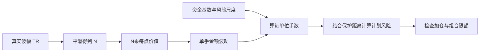
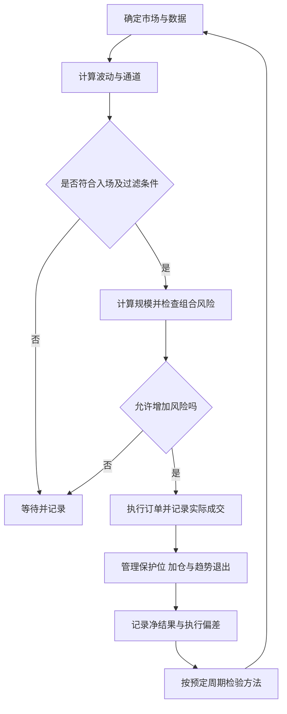

# 《海龟交易法则》读书笔记

> 作者：柯蒂斯·费思（Curtis Faith，亦译柯蒂斯·费斯）  
> 英文原名：Way of the Turtle，McGraw Hill，2007 年  
> 版本：未指定中文译本；本笔记对应费思的这本书，不是迈克尔·卡沃尔的海龟历史著作。  
> 分析依据：出版社信息与目录、作者参与公开的原始海龟规则、交易所合约资料、原始研究论文及监管机构历史报告。未取得用户原书，不声称逐页精读；历史规则、书外真实案例和假设数学演示分别标明。  
> 覆盖范围：全书主要主题、32 个知识点，包含交易心理、完整系统、原始参数、风险、绩效与回测。原始规则与本笔记的教学补充分别说明。  
> 更新日期：2026-11-11

## 先看这里：这本书讲什么

**一句话概括：把交易变成一套能承受不确定性、控制仓位、反复执行并接受检验的系统，而不是不停寻找“下一次必涨”的答案。**

作者是海龟培训计划的参与者，书中既回顾训练与交易经历，也讨论如何判断一套方法是否真的有优势。规则简单，不代表执行容易；同一套方法会让人经历长时间不顺、连续亏损，以及盈利大幅回吐。书的价值很大一部分就在解释这些困难。[出版社书目](https://www.mheducation.com/highered/mhp/product/way-turtle-secret-methods-turned-ordinary-people-into-legendary-traders.html)

最重要的六个认识：

1. **优势是长期分布上的优势，不是下一笔必胜。**
2. **买卖信号只是系统的一部分。** 交易什么、买多少、怎样退出、怎样应对成本同样重要。
3. **仓位由波动和资金承受力决定。** 名义金额相同，不代表风险相同。
4. **趋势交易常以许多小亏换少数较大盈利。** 如果总提前卖出盈利单，可能把系统原有优势破坏掉。
5. **回测漂亮不等于未来可靠。** 参数挑选、样本、成本、幸存者偏差和执行假设都会影响结果。
6. **纪律必须建立在方法有依据的前提上。** 坚持无优势的规则，只会稳定地执行错误。

## 全书主要内容地图

以下为按原版目录对应的中文主题概括，中文译本标题可能不同。[目录核对：图书馆书目](https://librarycatalog.cityofwoodland.gov/Record/.b18118562)

| 原版章节 | 主要问题 | 本笔记的重点 |
| --- | --- | --- |
| 1—2 风险与海龟心智 | 人为什么会做出不利于自己的交易 | 偏见、损失厌恶、结果与过程 |
| 3—4 训练经历与思考方式 | 同样接受训练，为什么执行不同 | 概率思维、耐心、规则一致性 |
| 5—6 优势与优势消失 | 优势从哪里来，为什么会被破坏 | 期望值、入场与退出、市场环境 |
| 7—8 绩效与资金管理 | 怎样衡量收益和承担风险 | 波动、回撤、仓位、组合限制 |
| 9—10 系统构件与实例 | 怎样把想法组成可测试的系统 | 市场、过滤器、信号、退出、规模 |
| 11 回测问题 | 为什么历史结果会骗人 | 过拟合、样本和交易成本 |
| 12—13 稳健性 | 如何减少对偶然参数与行情的依赖 | 指标稳定性、跨市场检验、系统分散 |
| 14 与结语 | 如何面对自己的弱点 | 可执行的方法、持续学习 |
| 原始规则附录 | 海龟当年具体怎样操作 | 突破、N、头寸单位、止损与限额 |

整体逻辑是：**先接受不确定性 → 找到可检验优势 → 用仓位保护资金 → 执行完整规则 → 持续检查优势和风险。**

## 核心知识点：概率与心理

### 01. 交易系统必须完整

一个“突破就买”的想法不是完整系统。还要说明交易哪些市场、每次买多少、何时止损、何时退出盈利头寸，以及如何执行订单。否则结果不好时，很难知道问题出在信号、仓位还是执行。

同样的入场信号，配上不同仓位和退出规则，会形成不同的收益与损失分布。比较策略时，必须比较整套规则，而非只比较买点。[原始规则入口](https://www.tradingblox.com/originalturtles/originalturtlerules.htm)

### 02. 趋势跟随是在响应价格

海龟通过突破识别可能形成的趋势，再跟随价格，而不是先给出目标价。突破会失败，所以系统必须接受反复小额试错。

突破失败和按规则退出，本来就是趋势跟随可能付出的代价；若长期趋势收益覆盖不了这些损失和成本，系统优势也可能不存在。趋势跟随不能免除验证。

### 03. 胜率和期望值是两回事

胜率回答多少次赚钱，期望回答把盈利、亏损和成本合起来后，平均结果怎样。趋势方法尤其不能只看胜率：如果一部分收益来自少数持续很久的行情，频繁落袋为安可能同时切掉方法的收益来源。

**真实研究可以怎样看？** Hurst、Ooi、Pedersen 在 2017 年发表的趋势研究，把时间序列动量的历史模拟扩展到 1880 年，并比较不同市场和环境。他们研究的是明确构建的策略及历史数据，不是只展示某位海龟的大赚故事。[作者机构发布的论文](https://www.aqr.com/-/media/AQR/Documents/Insights/Journal-Article/AQR-JPM-Fall-2017.pdf)

这提供的学习方向，是用完整结果分布检验方法，而不是拿一次漂亮交易作答案。它不等于费思的 20/55 日规则已经得到同样验证；模拟的规则、样本、交易成本与风险目标不同，结果不能互相借用，更不能当作今天的收益承诺。

**以下仅是算术演示，不是上述论文或海龟业绩：** 若胜率 40%，平均盈利 3R、平均亏损 1R、每笔成本 0.1R，则期望为 `0.4×3−0.6×1−0.1=0.5R`。R 指事前定义的风险金额尺度。若实际执行把平均盈利截成 0.5R，暂时保持其他条件不变，期望就变成 −0.5R。这里假设胜率不变只是为了隔离退出方式的影响，现实修改后要重新检验整套分布。

正期望也不排除连亏。纯数学上，独立且亏损概率固定为 60% 时，事先指定的五笔都亏的概率是 `0.6^5≈7.78%`；这不是一百笔中出现任意五连亏的概率。真实交易还可能受同一行情影响而相关。

因此要同时检查平均值、尾部、收益集中度与承受能力。研究支持的只能是一定假设下的历史分布，不是下一笔必胜。**自测：** 能否因读到长期研究为正，就直接接受未经核对的个人策略？不能，必须确认自己执行的规则与证据指向的是同一个对象。

### 04. 单次结果无法评价整体方法

好方法可能连续亏损，坏方法也可能连赚。需要观察足够多、相对独立且覆盖不同环境的样本。几十笔高度相似的交易，未必比几笔更能代表不同情境。

高度相关品种的同期盈利，可能主要来自同一个市场冲击。记录多笔交易不等于获得同样多的独立证据，不能把交易次数直接等同于证据强度。

### 05. 损失厌恶会改变收益分布

人容易尽快卖出盈利头寸来获得确定感，却愿意拖延接受亏损。在需要少数大趋势贡献收益的系统中，这样会截断有利的一端、放大不利的一端。

解决思路是事先确定条件并复查执行，而不是在交易中临时追求舒服。提前离场一次可能恰好避开回落，但长期是否有利，要对全部退出记录一起分析。

### 06. 纪律和方法适配同样重要

纪律不是无视现实地永远坚持。一套平均回撤很深、很久才出现大盈利的系统，可能超出某个人的资金期限和心理承受力。选择适合自己的规则，应发生在研究和计划阶段，而不是持仓中随意修改。

无法承受策略可能出现的回撤时，不宜仅因某策略年化收益高就选择它。真实可执行的较低风险方案，可能优于纸面上更漂亮却会中途放弃的方案。

## 核心知识点：海龟原始规则

下面是历史规则的概念摘要，不是当前所有市场的通用参数。历史参数依据作者署名的公开规则文件；本笔记以自己的话解释，并把书外真实材料与假设数学演示分别标注。[公开规则原站](https://www.tradingblox.com/originalturtles/originalturtlerules.htm)；[同文 PDF 镜像，供核对](https://www.tradingwithrayner.com/wp-content/uploads/2014/11/OriginalTurtleRules.pdf)

| 项目 | 历史规则核心参数 |
| --- | --- |
| 入场 | 系统一前 20 日突破；系统二前 55 日突破 |
| 趋势退出 | 系统一反向 10 日突破；系统二反向 20 日突破 |
| 波动单位 | N 为真实波幅的 20 期平滑值 |
| 单位规模 | 一个 Unit 的 1N 波动约对应资金的 1% |
| 初始保护距离 | 通常为 2N |
| 顺势加仓 | 通常每有利移动 0.5N 增加一个 Unit |
| 单市场限额 | 最多 4 Units |
| 组合限额 | 紧密相关同向 6；较松相关同向 10；全部同向 12 Units |

### 07. 真实波幅 TR：把跳空算进去

普通高低差只看当天内部范围，可能漏掉隔夜跳空。真实波幅用三个距离中的最大值：

`TR = max(H−L, |H−C前|, |L−C前|)`

H 是当天最高价，L 是最低价，C前是前一交易日收盘价。**数学演示（假设价格）：** 昨收 100，今天最高 106、最低 104，日内高低差只有 2，但 TR 为 6。隔夜从 100 跳到 104 以上的风险不能忽略。

### 08. N 是波动尺度，不是方向预测

原始算法先用 20 个 TR 的简单平均初始化，再递推：

`N今日 = (19×N昨日 + TR今日) / 20`

N 越大，说明近期价格通常波动更宽；它不告诉你下一步上涨还是下跌。这里平滑系数为 `1/20`，不能直接与所有软件默认的“20 日 EMA”混为一谈，后者常用不同系数。实际计算必须确认定义。

### 09. 先把价格波动换成金额波动

不同合约每个报价点对应的钱不同。先算 `每手的1N金额 = N × 每点价值`，再决定手数，才能跨市场比较。

**数学演示（假设合约）：** A 合约波动 2 点、每点值 100 元，1N 是每手 200 元；B 合约波动 20 点、每点值 5 元，1N 是每手 100 元。A 的报价波动较小，金额风险却更大。不能只看屏幕价格变化多少。

### 10. Unit 是波动标准化后的头寸单位

Unit 是按波动金额确定的头寸单位，不是固定一手。原始规则的规模思想是先把价格波动转成一手的金额波动，再决定多少手接近账户的风险尺度。[作者公开的原始规则](https://www.tradingblox.com/originalturtles/originalturtlerules.htm)

`每个 Unit 手数 = 向下取整[资金基数×1% ÷ (N×每点价值)]`

用**真实合约规格**看中间一步：CME 的 Micro E-mini S&P 500 期货，乘数是每指数点 5 美元，最小跳动为 0.25 点，对应每手 1.25 美元。这里的“点”和“最小跳动”不同：一个完整指数点包含四个最小跳动。[CME 官方合约规格](https://www.cmegroup.com/markets/equities/sp/micro-e-mini-sandp-500.contractSpecs.html)

如果把每跳 1.25 美元误当成每点价值，头寸计算会扩大四倍。这不是交易观点错误，而是单位错误。真实产品名称也必须查清：同属一个指数的不同规格合约，乘数可能不同；不能因为图表看起来一样，就沿用另一份合约的数量。

**仅为算术，N 并非实际测量值：** 假设某时点 N＝20 指数点、资金基数为 100000 美元，则一手的 1N 波动金额为 `20×5=100 美元`；1% 尺度为 1000 美元，一个 Unit 为 10 手。若保护距离是 2N，到保护位的计划损失约为 2000 美元，而不是 1000 美元。真实保证金、交易成本和组合限额还须另外检查。

波动变大时，在资金基数相同的条件下，计算出来的手数会变少；但 N 是过去波动的估计，不保证未来冲击也处于同一范围。若向下取整为零，表示最小合约已超过这项尺度，不能为了参与而自动四舍五入成一手。

这个现实规格例子把三个问题分开了：N 衡量多少价格变化，乘数规定变化值多少钱，Unit 决定持有多少数量。后面 N＝2、每点价值 100 元的加仓表采用另一组纯教学数字，不能误读成该 CME 合约的实测交易。

### 11. 1% 波动单位，不等于单笔最多亏 1%

**这是最常见的理解错误。** 如果一单位的 1N 等于资金 1%，保护距离是 2N，那么该单位从入场到保护价的计划损失约为 2%，还未计成本和跳空。1% 描述的是规模标准，2N 描述的是距离。

实际止损成交可能比预设价差，因此“计划损失”不是保证的最大损失。多个单位和多个市场还要合并评估，不能把每一笔的数字孤立看待。

**另设一组数学演示，供本节与后面的加仓表使用：** 资金基数 100000 元，N＝2 点，每点每手 100 元。按第 10 点公式，一个 Unit＝1000÷200＝5 手。100 点买入，初始保护位按 2N 放在 96，距离为 4 点，所以计划损失为 `5×4×100=2000 元`。把它误记成 1000 元，等于只计算了 1N 波动，却忘了实际保护距离有两个 N。原始规则中的规模与保护距离，是两项要相乘的条件。

再加入顺势扩仓。为了只观察逻辑，固定 N，不考虑本次交易中的重新定规模、成本和跳空；每上涨 0.5N，也就是 1 点，增加 5 手。按规则同步调整前面单位的保护位后，四批入场是 100、101、102、103，常规等间隔情况下最终保护位为 99。第一批到保护位亏 500，第二批亏 1000，第三批亏 1500，第四批亏 2000，总计 5000 元。后面的加仓表逐行列出每一步，不能把四批一律当成“每批 1%”。

这里还有一个更难的区别：在价格到 103 时，前面三批已经有浮盈 1500、1000、500，共 3000 元；第四批刚建仓。此刻若 20 手都从 103 回到 99，净值将回吐 `20×4×100=8000 元`。其中 3000 是已经出现但未兑现的浮盈，另外 5000 是相对全部入场成本的净损失。所以“这笔操作从入场算最多计划亏 5000”和“当前净值可能回落 8000”，在这些假设下可以同时成立。

这也说明有浮盈并不等于新增头寸免费。风险管理需要知道自己在问什么：相对本金的损失、相对当前权益的回吐，还是保证金不足的可能性。若存在其他相关品种，压力可能同时发生；若开盘跳过保护位，实际回吐又可能超过上述计划。

**练习与参考答案：** 四批建完后，若只能统一在 98 成交退出，总损失是多少？四批分别亏 1000、1500、2000、2500，合计 7000 元；从 103 时的净值看回吐 10000 元。区别仍然是此前 3000 元浮盈。这个练习说明为什么保护价只能是行动触发条件，不能被当成保险赔付上限。

### 12. 20 日与 55 日突破使用已完成交易日

向上超过此前若干日最高价对应做多信号，向下低于最低价对应做空信号。把当天尚未结束的数据提前放进计算，可能制造前视错误。

原始规则采用盘中穿越触发，而非默认等当天收盘；开盘已越过信号时还要考虑真实开盘与成交价格。若修改成收盘信号，就是另一个策略变体，需要单独测试。

### 13. 系统一有“上次突破是否盈利”的过滤

系统一并非遇到每次 20 日突破都交易。作者公开的原始规则规定：若该市场上一次突破按规则本应盈利，新的短周期突破被跳过；计算时既包括实际参加的突破，也包括被跳过的突破，且不区分上次是多头还是空头。亏损突破的具体口径，是在出现盈利的 10 日退出前，价格先向不利方向移动 2N。[原始规则 PDF，Entries 部分](https://www.tradingwithrayner.com/wp-content/uploads/2014/11/OriginalTurtleRules.pdf)

这是一条**真实公布的历史规则**，不是本笔记为解释行情临时设计的过滤。它要求维护两类记录：实际成交账回答账户发生了什么；理论突破账回答按规则该把前次信号判为什么。没有真实下单，也不能因此删掉理论突破，否则过滤状态会停留在很久以前的一笔真实交易。

| 当时已经知道的状态 | 系统一下一步怎样处理 |
| --- | --- |
| 前次突破按规则为亏损 | 新的合格 20 日突破可以进入后续规模检查 |
| 前次突破按规则为盈利 | 跳过新的短周期信号，同时保留 55 日补救安排 |
| 当前信号被跳过 | 仍按规定跟踪理论结果，为后续判断保存记录 |
| 市场继续形成 55 日突破 | 按补救安排检查，避免始终被短周期过滤挡在行情外 |

表格把原规则拆成状态流程，不是一份覆盖所有日内细节的实现程序。尤其不能先读完整段历史，知道某次突破最终亏损，再把这个未来结果用于决定更早时点的信号；记录必须沿时间向前更新。重叠信号、一天内多次触发和跳空，仍需在具体实现中确定处理顺序。

系统二的 55 日突破不采用这项盈利过滤。两种系统有时可能在类似价格进入，却不应因此把逻辑混在一起。软件的现代默认参数也可能不同于历史参数。[Trading Blox 的规则实现说明](https://tradingblox.com/docs/users-guide/17-built-in-systems-and-blox/turtle-system-rules/)

**自测与参考答案：** 为什么仅查询“账户上一笔是否赚钱”不够？因为原规则的判断对象是突破历史，包含未真实成交的信号。理解这一点比记住“20 日买入”更重要：同样的入场数字，加上不同状态记录，实际已经是不同方法。

### 14. 55 日系统与补救信号各有作用

长期系统接受符合条件的 55 日突破，不使用上述盈利过滤。短期系统保留 55 日补救，是为了在跳过短期信号后，仍有机会参与持续扩展的趋势。

20 日信号被盈利过滤跳过，不会取消随后 55 日突破的补救职责。这项衔接是原规则的一部分；具体两个系统怎样分配资金，需要事先确定。

### 15. 加仓依据有利运动，而不是亏损补救

历史规则通常在有利移动 0.5N 后增加一单位，间距以此前实际成交价为基准，并受单位限额约束。实际成交滑点会改变下一次加仓位置。

**数学演示（假设成交）：** 计划在 100 附近入场却实际成交 100.4，N 为 2，那么下一次加仓基准通常应以 101.4 考虑，而非假装仍在 100 成交。成本和成交事实必须进入后续规则。

### 16. 加仓后要同步管理保护位置

标准规则在增加单位后会调整先前单位的保护位置，以免新旧仓位风险无限叠加。正常按 0.5N 间隔加仓时，保护位置常集中到最新单位入场价后方 2N；出现跳空或异常间隔时，不应机械假设所有保护位完全相同。

最需要理解的是：加仓、止损和总风险必须作为一个整体计算。只记住“最多四单位”，却不调整保护和计算总暴露，不能称为理解了系统。

### 17. 保护性止损与趋势退出是两种条件

前者限制不利变化，后者在价格反向突破通道时结束趋势持仓。系统一多头通常关注反向 10 日低点，系统二关注 20 日低点；空头对称处理。

应执行先触发的适用退出条件，不能为了等通道信号而忽略已经触发的保护位。趋势退出可能把浮盈还回很多，这是允许利润扩展所付出的代价，不等于可以忽视风险。

### 18. 更紧的止损不是免费的改进

公开规则还说明过 Whipsaw 替代方法：更紧的 0.5N 保护距离，退出后满足条件可以重入。它与标准 2N 方法不同，不能混拼成“只取优点”的版本。

**补充解释：** 更紧的保护减少单次计划损失，却可能提高被正常噪声洗出的次数、手续费和心理负担。评估时要比较总体期望和执行成本，而不是只问一笔最坏亏多少。

## 核心知识点：组合与资金管理

### 19. 分散的是风险来源，不只是品种名称

同时做多几种高度相关的商品，可能相当于押同一个经济因素。原始规则设置分层单位限额，就是为了避免表面分散、实质集中。

多个代码可能同时对同一种原材料价格敏感，不能仅凭代码不同就认定机会相互独立。历史相关性也会变化，压力时期的共同下跌可能比正常时期更强。

### 20. 同向单位限额不等于固定最大亏损

单品种、相关组和全组合的限额同时生效；达到任一约束，就可能无法继续增加。12 个同向单位不意味着账户最大只会亏 12%，因为单位按 1N 标准化，保护距离、跳空和同时波动都可能放大损失。

**补充解释：** 风险限额是限制暴露的工具，不是对未来损失的保险。账户需要考虑各头寸的实际保护距离、现金和保证金压力，不能仅数单位。

### 21. 回撤之后，仓位应该能随之收缩

资金下降却维持原有手数，会使每次交易占剩余资金的比例越来越高。海龟历史上采用名义资金基数管理，并有亏损后的主动降档；这与普通账户实时净值直接复利不是完全同一结构。

**数学演示（假设资金）：** 资金从 100 降到 80，若每次仍可能损失 10，风险从 10% 上升到 12.5%。一般教学重点是让风险预算随承受能力下降，而不是将历史名义账户细则照搬到所有个人账户。

### 22. 保证金不是风险的价格标签

保证金是建立或维持期货头寸的资金要求，不是亏损上限。真实的损益由合约数量、价格变化、乘数和成交过程决定，必要时还会涉及交割与额外资金要求。[CME 的头寸与风险教育](https://www.cmegroup.com/education/courses/things-to-know-before-trading-cme-futures/position-and-risk-management)

**真实事件：2020 年 4 月 20 日，WTI 2020 年 5 月合约结算价为每桶 −37.63 美元。** 这发生在该合约临近到期时。EIA 的解释涉及需求骤降、可用储存能力和近月合约流动性；它同时指出，较远月合约及其他原油价格并未因此全部变成负数。[EIA 当时的市场说明](https://www.eia.gov/todayinenergy/detail.php?id=43495)、[CFTC 对该合约事件的报告](https://www.cftc.gov/media/5296/InterimStaffReportNYMEX_WTICrudeOil/download)

这个事件使两个常见误解失效。第一，商品“总有实物价值”不代表某个时间、地点和交割义务对应的合约不会出现负价。第二，只交了部分保证金，不代表损失只能止于那笔保证金。不能承接实物、储存或融资的参与者，其可等待时间与有实际经营能力的参与者不同。

对应海龟规则，N 与单位规模解决的是按既有波动尺度配置头寸；它们不能代替合约月份、换月、可交割性和异常价格机制的检查。历史波动较小，也不能保证临近到期的未来风险小。

这里没有重建任何海龟账户当日的信号、成交或损益，不能说趋势方法一定赚到了负油价行情，也不能说所有持有人都会遭受同样损失。能确认的是：真实交易条件可以超出朴素价格直觉，风险系统必须能够处理这种可能性。

### 23. 要同时观察回撤幅度和持续时间

回撤是净值从此前峰值下降的比例。相同 20% 回撤，三周恢复与三年未恢复，对资金用途和执行压力不同。

**补充算例：** 下跌 d 后，回到原值需要上涨 `d/(1−d)`。跌 20% 需涨 25%；跌 50% 需涨 100%。这说明避免过深损失不仅是心理需要，也关乎复利基础；它不意味着能事先精确知道最大回撤。

### 24. 少数大盈利对系统可能至关重要

趋势方法的利润可能不均匀分布。连续几次失败后选择性跳过下一个信号，有可能恰好错过主要盈利交易。

但也不能用“下次可能是大行情”支持无限亏损。需要在研究阶段估计合理回撤范围、建立运行监测，并在事先约定的评估时点审查，而不是每次亏损后随意切换，又在每次盈利后突然扩大。

## 核心知识点：评估优势与回测

### 25. MFE、MAE 与 E-ratio：分开研究入场反馈

MFE 是观察期内相对入场最有利的移动，MAE 是最不利的移动；以入场时的波动尺度归一化后，可以跨品种比较。E-ratio 用平均归一化有利移动除以平均归一化不利移动，研究特定时间窗口内的入场倾向。

**补充解释：** 这不等于实际利润率。达到过最高点，不代表真实系统在最高点卖掉；观察窗口、做空方向和成本口径也会影响结论。它是拆解系统的工具，最终仍需看完整策略结果。对应原书第 5 章 Trading with an Edge 中的 The Edge Ratio 小节；中文译名随版本而异。

### 26. 收益、波动、回撤不能压成一个数字就完事

常见评估方法包括复合年化收益 CAGR、风险调整收益和最大回撤。CAGR 的教学公式为 `(期末净值/期初净值)^(1/年数)−1`，假设不存在未调整的中途资金进出。

Sharpe 常以平均超额收益除以超额收益标准差；MAR 常以年化收益与最大回撤相比。比较时必须统一数据频率、费用及净值定义。波动指标也可能漏掉难以在短样本中观察的尾部风险。[补充资料：CFA 绩效指标](https://rpc.cfainstitute.org/topics/performance-attribution/risk-adjusted-performance)

### 27. 稳健的衡量要减少端点和单次事件的支配

书中讨论 RAR、R-cubed 等稳健指标，是为了避免起止日期或某次最大回撤过分决定评价。RAR 从资金曲线回归趋势估计年化增长，不能把它简单当作 CAGR 的另一个名字。

CAGR 对样本起止点敏感，末段行情可能明显改变计算结果；这不等于系统整体突然变好。各种稳健指标仍依赖定义和样本，本笔记不以某个指标阈值宣称可靠。[Trading Blox 对 RAR 的定义](https://www.tradingblox.com/docs/users-guide/22-appendices/glossary-of-terms/)

### 28. 过拟合：把历史噪声当规律

过拟合不是单纯“参数很多”，而是不断利用已见结果改变问题，最终把历史答案写进规则。Bailey 等人的《回测过拟合概率》研究把这种选择问题作为检验对象：从许多候选中挑出历史赢家，会使样本内的优胜表现不能直接代表样本外能力。[研究原文](https://www.davidhbailey.com/dhbpapers/backtest-prob.pdf)

一个真实的研究要求因此变得清楚：不能只保存最终获胜的回测，还要知道研究中比较过哪些变体、为何淘汰其他结果。规则最后只留下几个参数，并不意味着选择过程只有一次机会。**纯计数演示：** 10 种入场、5 种退出、4 种保护距离和5种过滤，已经是 1000 个组合；这个数字不是作者或海龟实际做过的测试记录。

还要区分开发数据与评估数据。假如看过所谓测试期的结果后，据此修改规则，这段数据就参与了开发。把文件继续叫作“测试集”，不会恢复独立性。这不是说一旦调整就不许继续研究，而是要诚实记录新版本已经使用哪些证据，再寻找新的验证方式。

实际市场还会改变测试程序的适用范围。2020 年负油价前，CME 已在 4 月发布支持负价格的准备与测试通知。[CME 2020 年 4 月 8 日公告](https://www.cmegroup.com/notices/clearing/2020/04/Chadv20-152.html) 这提醒研究者：若代码默认价格必须大于零，或数据处理把负价当错误删去，回测看似平稳也可能只是遗漏了真正困难的市场状态。这里是对真实制度变化的研究方法应用，不是该公告在证明某项策略优劣。

因此，检验至少要区分三件事：策略有无经济或行为依据，统计选择是否制造了假优势，数据和执行模型是否正确。多留一段样本不能自动修好合约处理错误；程序算得准确也不能修好筛选偏差。**自测：** 结果不好后只修改一次规则，原测试期还能算完全未参与选择吗？不能。

### 29. 样本和市场选择会制造假优势

只测试今天还活着的资产，会漏掉退市或消失的失败者；只挑选趋势最明显的年份，也会高估趋势策略。使用当时无法得知的成分、修订后数据或最终收盘价，可能引入前视偏差。

用今天仍然存续的公司名单回测过去，会漏掉已经退市或消失的样本，相当于提前使用了存续信息。测试应尽量还原每个历史时点实际可选的范围。这里是对书中样本与可靠性主题的教学展开。

### 30. 交易成本和执行假设可以吃掉纸面优势

成本不只是手续费，还包括买卖价差、滑点、冲击和期货换月等。预设触发价不等于真实成交价，限价单可能根本不成交。

对毛优势很小的系统，忽略滑点可能直接改变盈亏结论。改变合理的成本假设后就完全失效的系统，需要特别审视。[CFTC 对模拟交易局限的说明](https://www.cftc.gov/LearnAndProtect/AdvisoriesAndArticles/fraudadv_tradingsystem.html)

### 31. 稳健系统追求一片可用区域

稳健性讨论的是：方法的解释是否只依赖几个恰巧有利的历史位置。费思强调不要迷信孤立的最优参数；真实研究中也需要主动扩大环境与样本，而不是只展示一条漂亮曲线。

**可核对的研究实例：** Hurst、Ooi、Pedersen 的 2017 年论文使用跨商品、股指、债券和货币的长期资料构建时间序列动量，比较多个历史阶段，并讨论费用、成本及市场相关性。[论文原文](https://www.aqr.com/-/media/AQR/Documents/Insights/Journal-Article/AQR-JPM-Fall-2017.pdf) 它所示范的是把同一个明确方法放进更多环境检查，而不是从过去挑一个最适合的方法再宣称普遍有效。

这仍然是历史模拟。早期资料质量、可交易性、成本估计和策略选择都需要审查；它也不是费思原始海龟参数的同义词。读者应先问具体测试了什么，再问结果怎样，不能把所有标着“趋势跟随”的成绩汇成同一份证明。

参数邻域是另一项检查。若一个周期非常好，相邻周期却完全失效，应研究它是否由少数入场日期决定。不能为了避免这个问题，就要求去掉最大盈利后仍获利：少数大趋势本来可能是方法结构的一部分。正确用途是识别收益集中度，而非偷偷改掉收益分布后审判另一套系统。

组合层面同样要看共同失败原因。多个系统名字不同，若依赖相同市场、方向或流动性环境，压力时仍可能一起亏损。平时相关性低也不等于危机时独立。稳健性因此既包括参数，也包括市场、时间、成本与风险来源。

读完这一节应能提出比“哪个参数最好”更有用的问题：哪些条件下机制仍成立，哪些变化会使自己降低信心，实际执行与研究假设是否一致。答案依然是有条件的证据，不能变成对未来收益的保证。

### 32. 方法会衰退，需要监测而不是迷信

方法需要监测，原因不仅是价格规律可能改变，还包括实现系统可能偏离原定规则。只看最终盈亏，会把这两类问题混成一件事。

**真实事件：Knight Capital 的 2012 年交易事故。** SEC 的行政命令记载，系统部署与旧功能问题使订单路由程序在处理 212 笔客户订单时，约 45 分钟内产生数百万次成交，形成大量非预期头寸，最终损失超过 4.6 亿美元。[SEC 行政命令](https://www.sec.gov/files/litigation/admin/2013/34-70694.pdf) 这是自动执行和控制失效的案例，并非海龟策略的运行结果。

把它放回系统交易框架，研究逻辑正确只是第一步。还要核对实际发出的订单是否等于计划订单，累计头寸是否越界，数据、合约与程序版本是否正确，以及异常时怎样停止继续增加承担。机器严格执行的如果是错误状态，速度反而会放大损失。

因此，运行记录应同时保存策略信号、订单、成交、风险和版本。遇到异常，先辨别是正常不利行情、规则本身失效，还是实现根本没有按规则工作。不能用“长期坚持”掩盖执行错误，也不能因为一次正常止损就随意更换参数。

这里不能断言某一种风控设置必然阻止 Knight 的全部损失，也不把机构系统事故直接等同于个人交易。它能支持的结论是：真实系统必须有过程监测，回测曲线无法替代这部分工作。

## 难点算例：N、单位、止损和加仓一次算清

以下为数学演示，全部数值为假设，不对应任何实际产品或历史业绩。假设资金基数 100000 元、N＝2 点、每手每点价值 100 元，忽略手续费、滑点、保证金限制，N 在本次示例中固定。

- 一个 Unit 的规模：`100000×1%÷(2×100)=5 手`。
- 一个 Unit 波动 1N 的损益：`5×2×100=1000 元`，即 1%。
- 100 点入场、96 点保护：距离 2N，计划亏损 `5×4×100=2000 元`，即 2%。
- 每次有利移动 0.5N＝1 点增加一单位。

| 已持有单位 | 各单位入场价 | 示例共同保护价 | 全部触发时相对各入场价的总计划损失 |
| --- | --- | --- | --- |
| 1 | 100 | 96 | 2000 元 |
| 2 | 100、101 | 97 | 3500 元 |
| 3 | 100、101、102 | 98 | 4500 元 |
| 4 | 100、101、102、103 | 99 | 5000 元 |

最后一行计算：`[(100−99)+(101−99)+(102−99)+(103−99)]×5×100=5000`。

这说明：不能说“每单位 2%，四单位必定总风险 8%”，因为先前单位保护位同步改变；也不能说“四单位还是最多亏 2%”。还要区分**相对入场成本的亏损**与**从当前浮盈回撤到保护位的损失**。若在 103 观察，全部 20 手回到 99，净值会相对当时减少 8000 元，其中包含已经拥有的浮盈回吐。

读图顺序是先统一波动单位，再统一金额，最后才决定数量。N 不等于手数，保证金也不等于损失预算。

## 难点图解：系统为什么需要整个闭环

图中每个环节都可能出错。一个优秀的入场条件，无法自动修复过大仓位、成交不真实或退出设计不匹配的问题。

## 可以怎样用这本书训练决策

先做纸面练习或历史演练，把以下七项写清：交易范围、数据口径、入场、规模、保护、退出、执行成本。每一项都要能让另一个人看懂后作出相同判断。

再做三组比较：

1. **完整规则与临时干预。** 记录提前退出、跳过信号、取消保护分别改变了什么。
2. **单笔与组合。** 先计算单品种风险，再把相关品种放在一起，检查风险是否集中。
3. **纸面与执行。** 对比理论触发价和可成交价，检查细小优势是否被成本抹去。

输出可以是一张日志：日期、信号、N、资金基数、单位数、保护价、组合风险、实际成交、偏离原因。学习成果是能完整说明风险和规则，而不是背出“20 日买、10 日卖”。

## 回顾自测与边界

- **为什么低胜率也可能盈利？** 取决于平均盈亏和成本，不能只看猜对次数。
- **1% 与 2N 怎么对应？** 单位按 1N≈1% 配置，2N 距离约为该单位 2% 的计划损失。
- **为什么不能直接复制网上软件默认值？** 软件实现与历史参数可能不同，过滤、成交和数据口径也会改变策略。
- **更紧止损一定更好吗？** 不是，频繁退出、重入和成本可能抵消单次损失降低。
- **为什么系统要有趋势退出？** 否则只知道什么时候买，却没有办法确定盈利持仓何时结束。
- **回测最好的参数最可靠吗？** 不一定，可能是筛选噪声的结果。

历史海龟计划的业绩叙述不是当前收益承诺。本笔记没有完成对某个当代市场的回测，也没有证明原始参数今天仍有正期望。公开规则中部分账户制度和操作细节带有历史背景；真要实现系统，还须明确数据、换月、触发顺序、跳空和成本，不能凭这个摘要直接认定实现正确。

## 来源与待补充内容

1. [McGraw Hill 原版书目](https://www.mheducation.com/highered/mhp/product/way-turtle-secret-methods-turned-ordinary-people-into-legendary-traders.html)：作者、原版与出版信息。
2. [图书馆原版目录](https://librarycatalog.cityofwoodland.gov/Record/.b18118562)：章节结构。
3. [作者参与公开的原始规则入口](https://www.tradingblox.com/originalturtles/originalturtlerules.htm)和[同文 PDF 镜像](https://www.tradingwithrayner.com/wp-content/uploads/2014/11/OriginalTurtleRules.pdf)：历史参数与规则细节。
4. [Trading Blox 规则实现说明](https://tradingblox.com/docs/users-guide/17-built-in-systems-and-blox/turtle-system-rules/)及[术语表](https://www.tradingblox.com/docs/users-guide/22-appendices/glossary-of-terms/)：过滤逻辑与研究指标；软件默认值未当作原始海龟参数。
5. [CME 风险管理教育](https://www.cmegroup.com/education/courses/things-to-know-before-trading-cme-futures/position-and-risk-management)：现代保证金与风险的补充解释。
6. [CFA 风险调整绩效](https://rpc.cfainstitute.org/topics/performance-attribution/risk-adjusted-performance)：绩效评价补充。
7. [Bailey 等：回测过拟合概率](https://www.davidhbailey.com/dhbpapers/backtest-prob.pdf)：研究方法补充，不是书中逐字内容。
8. [CFTC 模拟交易局限](https://www.cftc.gov/LearnAndProtect/AdvisoriesAndArticles/fraudadv_tradingsystem.html)：实际执行与假设回测的差异。

9. [CME 微型标普 500 期货规格](https://www.cmegroup.com/markets/equities/sp/micro-e-mini-sandp-500.contractSpecs.html)、[2020 年 4 月负价格准备通知](https://www.cmegroup.com/notices/clearing/2020/04/Chadv20-152.html)、[EIA 对负油价的解释](https://www.eia.gov/todayinenergy/detail.php?id=43495)及[CFTC WTI 中期调查报告](https://www.cftc.gov/media/5296/InterimStaffReportNYMEX_WTICrudeOil/download)：真实合约、市场事件与系统假设边界。
10. [Hurst、Ooi、Pedersen：趋势跟随长期研究](https://www.aqr.com/-/media/AQR/Documents/Insights/Journal-Article/AQR-JPM-Fall-2017.pdf)：历史模拟研究，不能等同于原始海龟规则或实际账户收益。
11. [SEC：Knight 2012 事件行政命令](https://www.sec.gov/files/litigation/admin/2013/34-70694.pdf)：真实执行控制失效案例。

尚待指定中文版本后核对的部分包括译名、译注、书内全部测试表，以及 R-cubed 等扩展指标的具体实现。这里解释其用途，不编造未经核实的公式或历史结果。真实事件、合约规格与研究各在原位附来源；明确标为数学演示的价格、账户和盈亏分布仅服务于计算，不是当时交易记录。

---

[返回书籍索引](../README.md) · [财商学习与实践路线](../财商进阶合订本.md)
