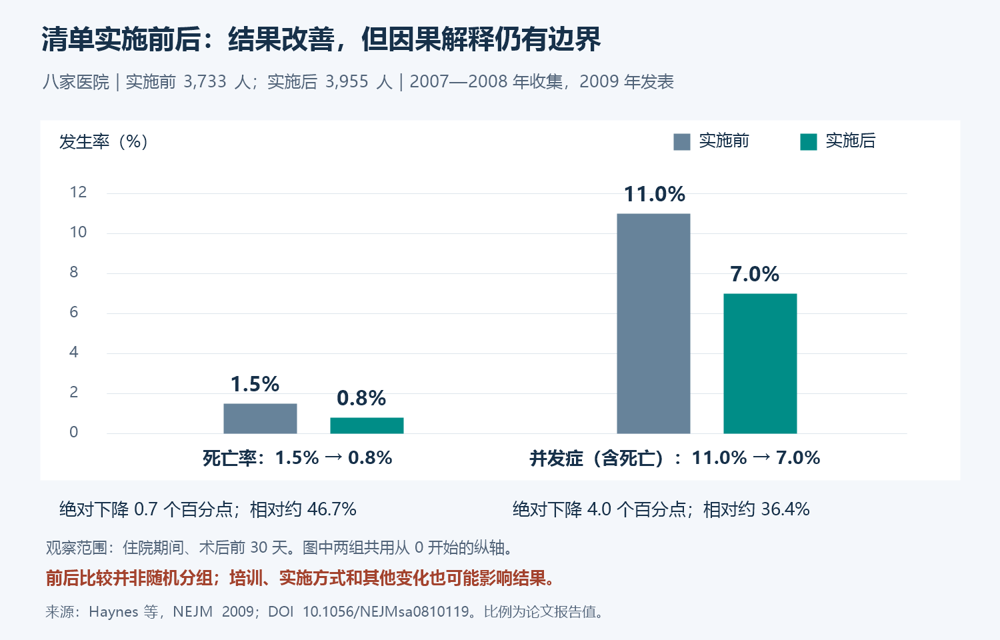
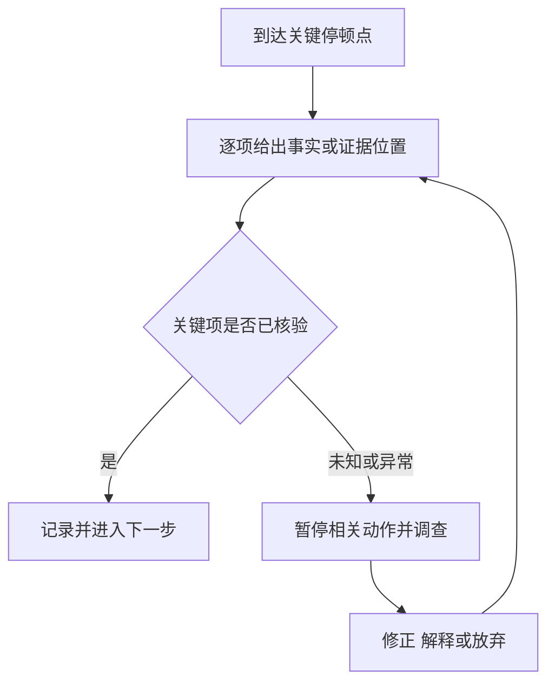

# 《清单革命》读书笔记

> 作者：阿图·葛文德（Atul Gawande）。英文原作 *The Checklist Manifesto: How to Get Things Right*，2009 年初版；中文译本印次未指定。
> 资料范围：依据作者及出版社公开资料、WHO 原始清单与实施手册、医学研究和航空事故调查整理，未取得完整原书逐页核对。覆盖复杂工作中的遗漏、协作、清单设计、测试、实施与专业判断；2014 年等后续研究明确作为书外更新。更新：2026-11-12。

本书要解决的是一个很具体的矛盾：我们掌握的专业知识越来越多，却仍会漏掉已经知道该做的基本步骤。清单的作用是把关键动作与必要沟通放到正确时刻，减少可避免遗漏，让专业能力更可靠地发挥。

对财商学习，它可以帮助你在读公告、估值、购买产品和复盘时，稳定完成那些“平时知道、忙起来却容易跳过”的检查。它不能替你预测股价，也不能把不成立的投资逻辑变成好逻辑。

## 主要内容地图

书的主线从专业领域的复杂性出发，借医疗、航空和大型协作说明，错误不仅来自个人知识不足，还来自步骤遗漏和信息交接；继而讨论怎样制作、试用和实施清单，并处理专业人员对清单的抗拒。[作者书目](https://atulgawande.com/books/)；[出版社介绍与公开节选](https://us.macmillan.com/books/9780312430009/thechecklistmanifesto/)。

下面的临床与航空案例用于理解流程和证据，不作为医疗或飞行操作手册。面向财报研究的清单是本篇补充教学。

## 核心知识点

### 1. 不知道怎么做，与知道却没做好，需要不同改进

前者需要研究、学习或新的技术；后者可能需要提醒、标准流程、合适资源与更好的协调。若问题本来是知识缺口，增加勾选框不能创造答案。

财报分析同样如此：不知道自由现金流怎样定义，需要学习；知道但每次忘记区分合并与母公司报表，可以用检查点减少遗漏。先诊断错误类型，再选择工具。

### 2. 复杂性会使可靠性超出单个人的记忆能力

专业工作常涉及多个环节、不同人员和相互依赖的状态。每一步单独看很简单，组合后却容易在打断、时间压力和交接中遗漏。

因此“这么简单也会忘”并不是解释。越是关键而基础的动作，越值得考虑怎样让正确执行不依赖当时恰好足够警觉。

### 3. 清单不是把整本知识手册缩到一张纸上

手册负责解释怎样做和为什么做；清单负责在关键时刻提醒确认少量重要事项。若每次使用都必须阅读长篇原理，现场很可能无法执行。

好的清单背后可以有详尽知识库，但使用层应短、清楚、有证据入口。投资清单上的“核对收入确认政策”可以指向年报附注，不应把整个会计准则复制进勾选框。

### 4. 简单、繁杂与复杂任务，对规则的依赖不同

步骤明确且重复性强的任务，适合较稳定的操作顺序；大量部件协作的任务，需要流程与接口；存在适应、独特情境和难以预测互动的任务，还需要现场判断。

这一区分提醒我们：可以规范基础检查，却不能把每个意外都提前列完。面对新情境，清单应帮助团队发现和讨论问题，而不是强迫现实符合旧表格。

### 5. 清单同时支持记忆与沟通

一类条目确认某个动作是否完成；另一类条目要求相关人员交换关键风险与计划。后者的重要性常被低估。

如果投资研究中一人负责财务、一人负责行业，分别完成自己的表格仍可能遗漏共同假设。某项增长预测需要多少营运资金，正处在两种分析的交界处，需要明确讨论。

### 6. WHO 手术清单把确认放在三个流程节点

WHO 的 19 项手术安全清单，在麻醉诱导前、切开皮肤前以及患者离开手术室前设置确认。检查既涉及身份与准备，也包含团队对关键问题的沟通。[WHO 原始工具及资源](https://www.who.int/teams/integrated-health-services/patient-safety/research/safe-surgery/tool-and-resources)。

值得学习的是时机：一些信息必须在动作发生前共享，而非手术结束后补签。各阶段关注的问题不同，不是从头到尾反复问同一组问题。

**财报研究的对应设计：**开始分析时核对公司、报告期与单位；得出估值前核对利润到现金的转换及关键假设；准备实际行动时核对产品条款、资金用途与退出约束。这样的迁移借用流程原则，不声称医疗效果可以直接换算成投资收益。

### 7. 停顿点必须具体，不能只写“有空时检查”

应明确什么时候触发、由谁发起、完成后才能进入哪一步。如果检查放在行动之后，可能只剩记录意义，失去防止错误的机会。

可执行的条目如“在把数字放入估值表之前，确认金额单位及累计/单季口径”；“注意数据准确”则太模糊，既不知道何时做，也无法判断是否做了。

### 8. 做完再确认与边读边做适合不同工作

做完再确认适合已熟悉流程的专业工作：完成一段操作后暂停，检查是否漏掉关键项目。边读边做则按清单逐项执行，适用于某些明确程序。

两者没有绝对高下。熟悉工作中逐字照念全部动作可能造成负担；不熟悉或高风险程序中仅凭记忆先做再补查，也可能来不及纠错。必须结合真实任务设计。

### 9. 优先保留后果重要、又容易遗漏的项目

不是所有检查价值都一样。选择条目时要考虑错误发生频率、后果、能否及时发现、已有保护是否足够，以及检查需要多少时间。

频率低但后果巨大、检查成本很低的事项也可能值得保留。相反，已经被系统可靠验证、人工再读不会改善的项目，未必需要挤占现场注意力。

### 10. 条目要能被回答，最好能指向证据

“管理层优秀吗”过于宽泛；“近五年是否发生重大关联交易，资料定位在哪里”更容易检查。不同问题仍需不同形式，不必全部压成是/否。

当答案未知时，清单应允许写未知并进入处理流程。强制每格都勾“已完成”，会鼓励把不确定包装成确认。

### 11. 团队要有明确的发起者与停止权

如果所有人都以为别人会检查，清单很容易落空；如果地位较低的人发现异常却不敢说，表格也无法保护结果。

职责应说明谁组织确认、谁提供证据、哪类异常需要暂停或升级。停止权不是任意否决所有工作，而是对关键未解决问题有明确处理机制。

### 12. 密歇根 ICU 项目：清单有效需要物资与组织配合

Pronovost 等人在 2006 年发表的协作改进研究，纳入 103 个 ICU，围绕导管相关血流感染采取一组措施。研究报告，感染率中位数从基线每千导管日 2.7 次降至干预后三个月的 0；均值在后续观察中也下降。[原研究](https://www.nejm.org/doi/abs/10.1056/NEJMoa061115)。

这不能读成“所有医院都零感染”，因为中位数为零不代表每个单位为零。分母是导管使用日，也不是每千名患者。

更关键的是，项目包含实践措施、可用物资、安全文化、测量反馈和团队协作等内容。不能把整组改善的结果全部归给一张纸，也不能假定只发清单、不补资源就有同等效果。

**财商迁移：**如果条目要求核对附注，却没有报告来源、没有时间和能力阅读，勾选不会产生可靠性。清单需要证据、工具与执行条件共同支撑。

### 13. 八家医院研究说明了改善，也暴露解释边界

Haynes 等人 2009 年研究比较八家医院实施手术安全清单前后患者结果：样本为 16 岁及以上、接受非心脏手术的患者，实施前 3733 人，实施后 3955 人；住院期间、术后前 30 天范围内的死亡率从 1.5% 降至 0.8%，并发症（含死亡）发生率从 11.0% 降至 7.0%。[原论文](https://www.nejm.org/doi/abs/10.1056/NEJMsa0810119)。

| 研究所报告指标 | 实施前 | 实施后 | 绝对变化 |
| --- | ---: | ---: | ---: |
| 死亡率 | 1.5% | 0.8% | 下降 0.7 个百分点 |
| 住院并发症发生率（含死亡） | 11.0% | 7.0% | 下降 4.0 个百分点 |

图表依据上表原论文比例重绘；蓝灰为实施前、绿色为实施后，所有柱共用从零开始的百分比纵轴。并发症指标包含死亡，两行不能相加。图片保留研究设计限制，不能只截取相对降幅而遗漏背景。[重绘脚本](图片/生成图解.ps1)。

**基于发表比例的计算：**死亡率相对降幅约为 `0.7÷1.5=46.7%`，并发症相对降幅约为 `4÷11=36.4%`。绝对百分点与相对百分比不是同一口径，不能混写。

研究是前瞻性的实施前后比较，并非把患者或医院随机分配到有无清单两组。培训、执行文化、时间变化与其他因素可能参与结果。因此准确表述是实施后观察到改善，不能宣称这一研究单独识别了清单纸张的纯因果效应，也不能仅凭比例差给出可普遍应用的治疗人数指标。

### 14. 后续推广并不必然复制试点结果

**书外更新：**Urbach 等人 2014 年研究加拿大安大略省 101 家医院引入清单前后结果，没有发现与早期试点相同的显著死亡及并发症改善。[原论文](https://www.nejm.org/doi/abs/10.1056/NEJMsa1308261)。

两项研究的基线风险、医疗环境、衡量方法与实施方式不同，不能只并排两个结果就断言其中一个必错。推广时执行质量可能不同，但这也不能仅凭猜测用来解释全部差异。

对实践的含义是：**采用了一个流程，与它在这个环境确实改善结果，要分别验证。** 如果只报告清单覆盖率达到很高水平，仍不足以说明关键动作完成质量和实际后果已经改善。

### 15. 不能把统计显著与实际价值混成一个开关

结果“不显著”可能来自效应小、样本与噪声，也可能确实没有明显改善；“显著”则不自动说明效果大、可推广或成本合算。

评估清单应同时看置信区间、绝对变化、基线、执行成本和不利影响。学习这里的统计区别，也能帮助阅读券商策略、管理项目和商业实验报告。

### 16. 1549 航班说明清单必须适合时间压力

2009 年全美航空 1549 航班遇鸟击后在哈德逊河迫降。NTSB 的 2010 年调查及 FAA 案例说明，低高度和有限时间使机组未能完成双发失效检查程序；调查讨论了清单设计与紧急情境适配问题。[NTSB 原报告](https://www.ntsb.gov/investigations/accidentreports/reports/aar1003.pdf)；[FAA 事故学习资料](https://www.faa.gov/lessonslearned/transportairplane/accidents/N160US)。

因此不能把这件事写成“机组把所有清单一项不漏执行，所以成功”。专业判断、人员配合、设备条件和救援等都需要放回完整事件。

能迁移的原则是：紧急情况下必须先识别最关键的动作，程序长度与可用时间相匹配。为平稳日常设计的长清单，不一定适合突然发生的危机。

### 17. 清单要在模拟或实际工作中测试

坐在桌前看起来清楚的句子，到了现场可能有歧义；顺序可能与实际流程冲突；一项检查可能找不到负责人。

试用时记录在哪里停住、哪句话需要解释、什么证据拿不到、是否遗漏真正重要的异常。修订应依据观察，而不是为了显得全面不断添加条目。

### 18. 简短依靠筛选，不依靠含糊

把十项具体要求压成一句“全面核验所有风险”，表面变短，实质失去功能。简短意味着找出关键项，将不同阶段分开，并把详细说明放到可查阅的辅助材料。

不存在对所有任务都适用的神奇条目数。篇幅应服从实际注意力、时间与风险，经试用决定，不能把某个记忆容量说法当成固定法律。

### 19. 本地调整不能删掉目的，只改掉不适配形式

WHO 实施手册强调人员参与、领导支持、培训、反馈和本地适配。[原始实施手册](https://www.who.int/publications/i/item/9789241598590)。

调整前先说明某条在防止什么错误。如果只是换成当地术语而保留检查目标，可能有益；如果为减少麻烦删掉关键确认，就需要重新评估风险。

个人财务清单也应根据工具、期限和家庭约束改写。把机构投资者清单原封不动搬来，可能检查了很多无关事项，却漏掉自己的流动性需求。

### 20. 形式完成率可能变成错误目标

当考核只看勾选率，人可能在结束后补填，或者让每个人机械回答“是”。这会制造流程已经可靠的幻觉。

除了表格，还应抽查对应证据、观察执行过程、记录异常怎样解决，并检查是否真正减少遗漏。完成率可以是过程指标，不能成为唯一成绩。

### 21. 清单应允许异常被看见，而非强迫所有项目通过

一个诚实的“不知道”比未经核验的“已确认”更有价值。需要设计待查、例外和升级处理的路径，避免检查者为了赶进度掩盖问题。

图中暂停的是依赖该信息的动作，不一定是所有工作。其他独立研究可以继续，这有助于兼顾可靠与效率。

### 22. 清单需要版本和修订理由

一次错误发生后，可以修改清单，但要记录为什么增加或删除条目、在哪类任务生效。否则不同人可能使用互相矛盾的版本。

也要防止每次遇到小意外就永久加一项。定期删除重复、已经由可靠系统处理或没有实际作用的要求，让注意力留给仍然重要的风险。

### 23. 自动化适合机械校验，判断仍需负责

金额单位、公式引用、缺页、链接和日期等可用工具辅助检查；管理层解释是否可信、行业竞争是否改变，则需要理解语境。

自动检查通过只能说明它实际检查过的条件满足。不能把“表格无错误提示”理解为数据来源正确、估值假设合理或投资安全。

### 24. 专业自主与流程纪律可以同时存在

清单规范的是关键的最低可靠性要求，为专家腾出注意力处理非标准情况。它不是要求所有人对每个问题给出同样答案。

专业人员应能够解释有理由的例外，但例外要可记录、可复查。完全没有例外会僵化，任何事都可随口例外则失去纪律。

### 25. 把清单用于财报：先防止口径错误

以下为补充教学，可作为数据进入分析表前的检查：

1. 公司、报告名称、公告日期及报告期间是否对应？
2. 金额单位、币种、合并或母公司口径是否明确？
3. 数据是单季还是累计、期末余额还是期间流量？
4. 利润是营业、净利润、归母还是扣非口径？
5. 是否查看会计政策、重要附注与可比期变化？
6. 原始数据、公司解释与自己的推断是否分别记录？

这些检查不会告诉你公司值多少钱，但可以防止用错误输入做出看似精确的估值。与其在最终报告上笼统写“数据已核验”，不如为关键数字保存页码、表名或公告链接。

### 26. 把清单用于估值：核对最可能扭曲结果的连接

关键项可以包括现金流与折现率口径匹配、增长与再投资相容、企业价值到股权价值的转换、稀释和非经营资产处理、终值假设以及主要敏感变量。

这里不能将“已建 DCF 模型”当作“估值合理”的替代。一个模型可能公式全部正确，却因为永续增长、资本回报或竞争假设不合理而严重偏离。

可把需要深入推理的条目写成证据问题：“为什么新增资本还能获得这一回报？”而不是“是否采用 10% 回报率”。清单应促使审查假设，不应替人指定一个未经论证的数字。

### 27. 把清单用于行动：区分研究认可与资金适配

即使企业值得研究，也要检查产品权利、费用、现金用途、可能损失、退出条件及与既有风险的相关性。研究质量不自动解决家庭约束。

准备行动时可以要求留下简短决定记录：买的是什么权利、主要判断是什么、证据在哪里、什么变化会触发重审。具体投入多少应另行根据实际情况分析，本篇不为未知账户给出固定仓位。

### 28. 把清单用于复盘：不只数盈亏

复盘应分别记录遗漏、判断、执行和随机结果。若漏看了公告中的担保，即使本次没亏，也值得改善；若遭遇事前已识别但无法消除的低概率事件，则不一定意味着流程无效。

检查改进是否起作用，可以追踪关键数字口径错误、缺失证据、临时改变计划和重复性遗漏是否减少。投资收益还受市场与策略影响，不能用一次盈利证明清单有效。

图解强调清单是不断改进的工具。一次写完、永久不改，与不断堆砌条目，同样可能偏离目的。

## 可直接使用的简短复核卡

这张卡用于重要财务决定之前，不是普适购买条件：

| 检查 | 留下的证据 | 异常时处理 |
| --- | --- | --- |
| 目标与期限是否清楚 | 资金用途、预计使用时间 | 先补目标 |
| 对象与权利是否明确 | 产品合同或公司正式资料 | 暂停依赖该权利的判断 |
| 数据是否同口径 | 报告期、单位、表名 | 重新核对 |
| 结论依赖什么假设 | 关键假设与反证 | 补研究或放弃 |
| 费用与最差情形是否考虑 | 总成本、现金需求与情景 | 调整方案 |
| 何时复查 | 日期、事件或关键变化 | 指定触发器 |

真实使用后，如果某项反复填不出，先判断是信息不可得、知识不足，还是条目本身含糊。不同原因需要不同改进，不能只要求“下次认真一点”。

## 练习与参考答案

**题一：研究显示感染率中位数为零，是否意味着所有单位没有感染？**

不是。中位数只描述排序中间的位置，还要看均值、分布、单位数量和分母。每千导管日也不能误写为每千人。

**题二：清单使用率达到 99%，为什么还不能宣布有效？**

因为填表不等于认真执行，过程完成不等于结果改善。应检查执行质量、原有问题是否减少、成本和其他同时变化的因素。

**题三：财报分析清单太长，如何缩减？**

先分阶段，再保留后果重大又易漏的项目；把说明移入知识库，删除重复及已被可靠工具覆盖的检查。不能把具体条目合并成一句无法核验的“全面注意风险”。

## 阅读后的收获与边界

你应能设计一个发生在正确时刻、能指向证据、允许异常处理的简短清单，也能区分知识不足、执行遗漏与组织问题。早期成功案例与后续不同结果都应进入理解，不能把清单视为万能解决方案。

可接着对照[《决断力》](<../决断力 - 奇普·希思、丹·希思/读书笔记.md>)组织决定过程，结合[《一本书读懂财报》](<../一本书读懂财报 - 肖星/读书笔记.md>)练习数据检查，再用[《噪声》](<../噪声 - 丹尼尔·卡尼曼、奥利维耶·西博尼、卡斯·桑斯坦/读书笔记.md>)处理多人判断的不一致。
